# Complete Errington Plant, Figure and Worked-Example Supplement

This supplement contains 137 stable plant profiles, 36 educational figures,
and 18 practical worked examples. Plant taxonomic and local-timing claims
must remain source-reviewed; this file separates recorded registry fields
from verified recommendations.

## Plant profile convention

Every profile below is a complete registry/profile shell, not a claim that
all stated fields have independent botanical or local verification.

### Arugula

**Stable plant ID:** `plant-arugula`
**Category:** vegetable
**Recorded botanical name:** Eruca vesicaria subsp. sativa
**Recorded family:** Brassicaceae
**Life cycle:** Annual
**Illustration status:** `CANDIDATE_GENERATED / REVIEW_PENDING / NOT_APPROVED`

**Identification and morphology**

- Growth habit: Growth habit should be resolved to the exact species or cultivar; this entry provides a category-level source scaffold.
- Root or storage organ: Species-specific root, crown, or storage organ; verify the exact form before illustrating.
- Leaf arrangement and shape: Species-specific arrangement and blade shape; verify exact genus and cultivar.
- Flower structure: Species-specific inflorescence or flower structure.
- Fruit or seed structure: Species-specific fruit, seed pod, achene, capsule, berry, or nut.

**Errington timing fields**

- Indoor sow: Source timing not reviewed
- Direct sow: Source timing not reviewed
- Transplant: Source timing not reviewed
- Bloom: Source timing not reviewed
- Harvest: Source timing not reviewed
- Frost: Source timing not reviewed

**Cultivation**

- Soil: Well-drained, fertile soil with organic matter; adjust for the crop's root depth.
- Water: Keep moisture even during establishment and harvest formation; avoid prolonged waterlogging.
- Spacing: Use the calendar, seed packet, or mature crop size; do not rely on a registry-wide spacing value.
- Light: Full sun is usual; leafy cool-season crops tolerate more partial shade.
- Maintenance: Thin, weed, mulch, and monitor; support or stake as the crop requires.
- Pests/diseases: Monitor locally for aphids, slugs, caterpillars, fungal leaf spots, and soil-borne disease; identify before treatment.

**Candidate plate:**
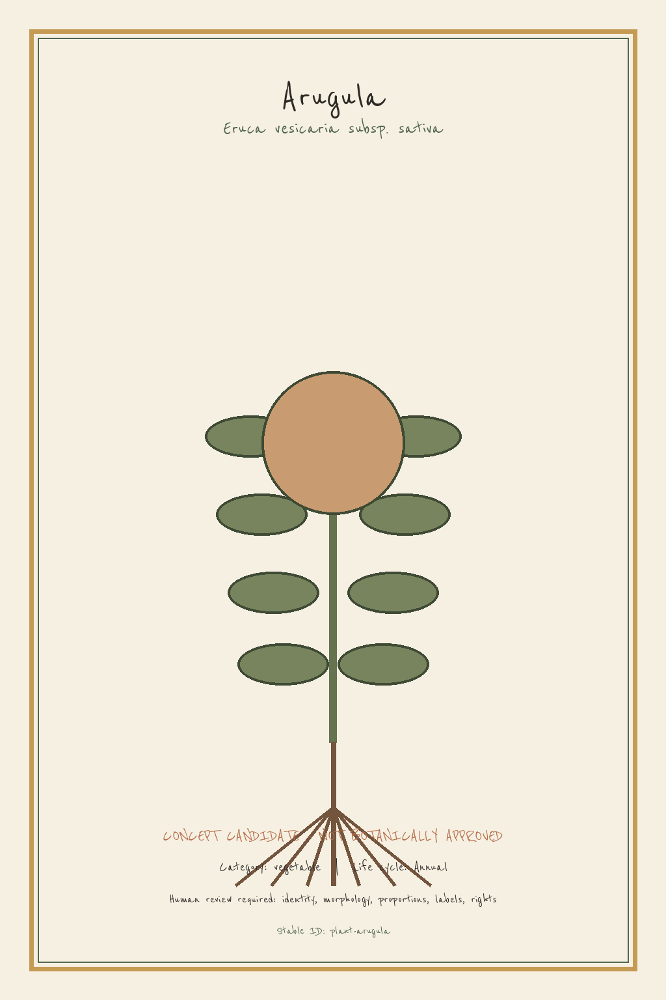

**Source status:** Not botanically or horticulturally approved. Recorded fields are derived
from the retained registry and remain subject to claim-level source review.

### Asparagus

**Stable plant ID:** `plant-asparagus`
**Category:** vegetable
**Recorded botanical name:** Asparagus officinalis
**Recorded family:** Asparagaceae
**Life cycle:** Perennial
**Illustration status:** `CANDIDATE_GENERATED / REVIEW_PENDING / NOT_APPROVED`

**Identification and morphology**

- Growth habit: Growth habit should be resolved to the exact species or cultivar; this entry provides a category-level source scaffold.
- Root or storage organ: Species-specific root, crown, or storage organ; verify the exact form before illustrating.
- Leaf arrangement and shape: Species-specific arrangement and blade shape; verify exact genus and cultivar.
- Flower structure: Species-specific inflorescence or flower structure.
- Fruit or seed structure: Species-specific fruit, seed pod, achene, capsule, berry, or nut.

**Errington timing fields**

- Indoor sow: Source timing not reviewed
- Direct sow: Source timing not reviewed
- Transplant: Source timing not reviewed
- Bloom: Source timing not reviewed
- Harvest: Source timing not reviewed
- Frost: Source timing not reviewed

**Cultivation**

- Soil: Well-drained, fertile soil with organic matter; adjust for the crop's root depth.
- Water: Keep moisture even during establishment and harvest formation; avoid prolonged waterlogging.
- Spacing: Use the calendar, seed packet, or mature crop size; do not rely on a registry-wide spacing value.
- Light: Full sun is usual; leafy cool-season crops tolerate more partial shade.
- Maintenance: Thin, weed, mulch, and monitor; support or stake as the crop requires.
- Pests/diseases: Monitor locally for aphids, slugs, caterpillars, fungal leaf spots, and soil-borne disease; identify before treatment.

**Candidate plate:**

**Source status:** Not botanically or horticulturally approved. Recorded fields are derived
from the retained registry and remain subject to claim-level source review.

### Beans

**Stable plant ID:** `plant-beans`
**Category:** vegetable
**Recorded botanical name:** Phaseolus vulgaris
**Recorded family:** Fabaceae
**Life cycle:** Annual
**Illustration status:** `CANDIDATE_GENERATED / REVIEW_PENDING / NOT_APPROVED`

**Identification and morphology**

- Growth habit: Growth habit should be resolved to the exact species or cultivar; this entry provides a category-level source scaffold.
- Root or storage organ: Species-specific root, crown, or storage organ; verify the exact form before illustrating.
- Leaf arrangement and shape: Species-specific arrangement and blade shape; verify exact genus and cultivar.
- Flower structure: Species-specific inflorescence or flower structure.
- Fruit or seed structure: Species-specific fruit, seed pod, achene, capsule, berry, or nut.

**Errington timing fields**

- Indoor sow: Source timing not reviewed
- Direct sow: Source timing not reviewed
- Transplant: Source timing not reviewed
- Bloom: Source timing not reviewed
- Harvest: Source timing not reviewed
- Frost: Source timing not reviewed

**Cultivation**

- Soil: Well-drained, fertile soil with organic matter; adjust for the crop's root depth.
- Water: Keep moisture even during establishment and harvest formation; avoid prolonged waterlogging.
- Spacing: Use the calendar, seed packet, or mature crop size; do not rely on a registry-wide spacing value.
- Light: Full sun is usual; leafy cool-season crops tolerate more partial shade.
- Maintenance: Thin, weed, mulch, and monitor; support or stake as the crop requires.
- Pests/diseases: Monitor locally for aphids, slugs, caterpillars, fungal leaf spots, and soil-borne disease; identify before treatment.

**Candidate plate:**
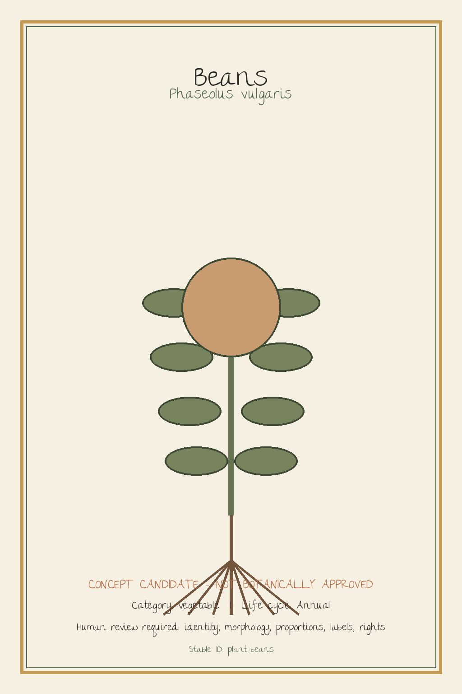

**Source status:** Not botanically or horticulturally approved. Recorded fields are derived
from the retained registry and remain subject to claim-level source review.

### Beets

**Stable plant ID:** `plant-beets`
**Category:** vegetable
**Recorded botanical name:** Beta vulgaris
**Recorded family:** Amaranthaceae
**Life cycle:** Annual
**Illustration status:** `CANDIDATE_GENERATED / REVIEW_PENDING / NOT_APPROVED`

**Identification and morphology**

- Growth habit: Growth habit should be resolved to the exact species or cultivar; this entry provides a category-level source scaffold.
- Root or storage organ: Species-specific root, crown, or storage organ; verify the exact form before illustrating.
- Leaf arrangement and shape: Species-specific arrangement and blade shape; verify exact genus and cultivar.
- Flower structure: Species-specific inflorescence or flower structure.
- Fruit or seed structure: Species-specific fruit, seed pod, achene, capsule, berry, or nut.

**Errington timing fields**

- Indoor sow: Source timing not reviewed
- Direct sow: Source timing not reviewed
- Transplant: Source timing not reviewed
- Bloom: Source timing not reviewed
- Harvest: Source timing not reviewed
- Frost: Source timing not reviewed

**Cultivation**

- Soil: Well-drained, fertile soil with organic matter; adjust for the crop's root depth.
- Water: Keep moisture even during establishment and harvest formation; avoid prolonged waterlogging.
- Spacing: Use the calendar, seed packet, or mature crop size; do not rely on a registry-wide spacing value.
- Light: Full sun is usual; leafy cool-season crops tolerate more partial shade.
- Maintenance: Thin, weed, mulch, and monitor; support or stake as the crop requires.
- Pests/diseases: Monitor locally for aphids, slugs, caterpillars, fungal leaf spots, and soil-borne disease; identify before treatment.

**Candidate plate:**

**Source status:** Not botanically or horticulturally approved. Recorded fields are derived
from the retained registry and remain subject to claim-level source review.

### Bell Pepper

**Stable plant ID:** `plant-bell-pepper`
**Category:** vegetable
**Recorded botanical name:** Capsicum annuum
**Recorded family:** Solanaceae
**Life cycle:** Annual
**Illustration status:** `CANDIDATE_GENERATED / REVIEW_PENDING / NOT_APPROVED`

**Identification and morphology**

- Growth habit: Growth habit should be resolved to the exact species or cultivar; this entry provides a category-level source scaffold.
- Root or storage organ: Species-specific root, crown, or storage organ; verify the exact form before illustrating.
- Leaf arrangement and shape: Species-specific arrangement and blade shape; verify exact genus and cultivar.
- Flower structure: Species-specific inflorescence or flower structure.
- Fruit or seed structure: Species-specific fruit, seed pod, achene, capsule, berry, or nut.

**Errington timing fields**

- Indoor sow: Source timing not reviewed
- Direct sow: Source timing not reviewed
- Transplant: Source timing not reviewed
- Bloom: Source timing not reviewed
- Harvest: Source timing not reviewed
- Frost: Source timing not reviewed

**Cultivation**

- Soil: Well-drained, fertile soil with organic matter; adjust for the crop's root depth.
- Water: Keep moisture even during establishment and harvest formation; avoid prolonged waterlogging.
- Spacing: Use the calendar, seed packet, or mature crop size; do not rely on a registry-wide spacing value.
- Light: Full sun is usual; leafy cool-season crops tolerate more partial shade.
- Maintenance: Thin, weed, mulch, and monitor; support or stake as the crop requires.
- Pests/diseases: Monitor locally for aphids, slugs, caterpillars, fungal leaf spots, and soil-borne disease; identify before treatment.

**Candidate plate:**
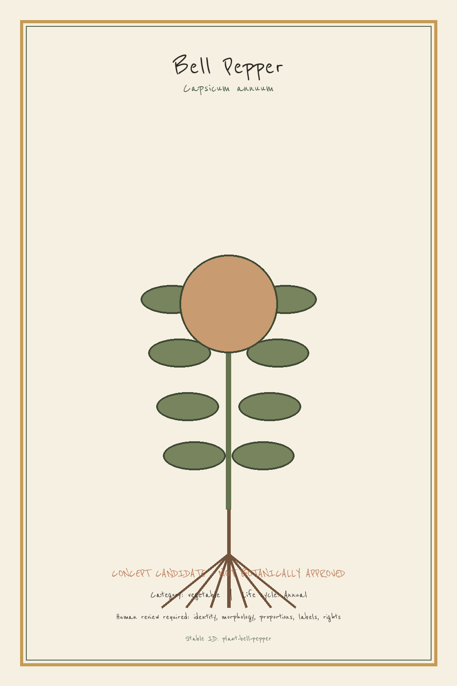

**Source status:** Not botanically or horticulturally approved. Recorded fields are derived
from the retained registry and remain subject to claim-level source review.

### Broccoli

**Stable plant ID:** `plant-broccoli`
**Category:** vegetable
**Recorded botanical name:** Brassica oleracea var. italica
**Recorded family:** Brassicaceae
**Life cycle:** Annual
**Illustration status:** `CANDIDATE_GENERATED / REVIEW_PENDING / NOT_APPROVED`

**Identification and morphology**

- Growth habit: Growth habit should be resolved to the exact species or cultivar; this entry provides a category-level source scaffold.
- Root or storage organ: Species-specific root, crown, or storage organ; verify the exact form before illustrating.
- Leaf arrangement and shape: Species-specific arrangement and blade shape; verify exact genus and cultivar.
- Flower structure: Species-specific inflorescence or flower structure.
- Fruit or seed structure: Species-specific fruit, seed pod, achene, capsule, berry, or nut.

**Errington timing fields**

- Indoor sow: Source timing not reviewed
- Direct sow: Source timing not reviewed
- Transplant: Source timing not reviewed
- Bloom: Source timing not reviewed
- Harvest: Source timing not reviewed
- Frost: Source timing not reviewed

**Cultivation**

- Soil: Well-drained, fertile soil with organic matter; adjust for the crop's root depth.
- Water: Keep moisture even during establishment and harvest formation; avoid prolonged waterlogging.
- Spacing: Use the calendar, seed packet, or mature crop size; do not rely on a registry-wide spacing value.
- Light: Full sun is usual; leafy cool-season crops tolerate more partial shade.
- Maintenance: Thin, weed, mulch, and monitor; support or stake as the crop requires.
- Pests/diseases: Monitor locally for aphids, slugs, caterpillars, fungal leaf spots, and soil-borne disease; identify before treatment.

**Candidate plate:**
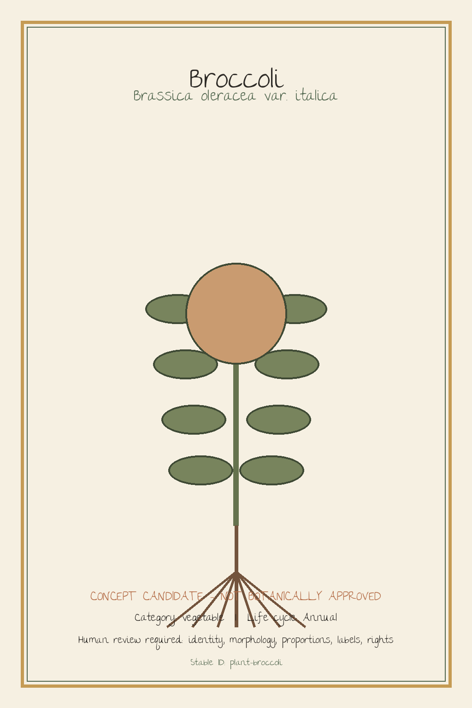

**Source status:** Not botanically or horticulturally approved. Recorded fields are derived
from the retained registry and remain subject to claim-level source review.

### Brussels Sprouts

**Stable plant ID:** `plant-brussels-sprouts`
**Category:** vegetable
**Recorded botanical name:** Brassica oleracea var. gemmifera
**Recorded family:** Brassicaceae
**Life cycle:** Annual
**Illustration status:** `CANDIDATE_GENERATED / REVIEW_PENDING / NOT_APPROVED`

**Identification and morphology**

- Growth habit: Growth habit should be resolved to the exact species or cultivar; this entry provides a category-level source scaffold.
- Root or storage organ: Species-specific root, crown, or storage organ; verify the exact form before illustrating.
- Leaf arrangement and shape: Species-specific arrangement and blade shape; verify exact genus and cultivar.
- Flower structure: Species-specific inflorescence or flower structure.
- Fruit or seed structure: Species-specific fruit, seed pod, achene, capsule, berry, or nut.

**Errington timing fields**

- Indoor sow: Source timing not reviewed
- Direct sow: Source timing not reviewed
- Transplant: Source timing not reviewed
- Bloom: Source timing not reviewed
- Harvest: Source timing not reviewed
- Frost: Source timing not reviewed

**Cultivation**

- Soil: Well-drained, fertile soil with organic matter; adjust for the crop's root depth.
- Water: Keep moisture even during establishment and harvest formation; avoid prolonged waterlogging.
- Spacing: Use the calendar, seed packet, or mature crop size; do not rely on a registry-wide spacing value.
- Light: Full sun is usual; leafy cool-season crops tolerate more partial shade.
- Maintenance: Thin, weed, mulch, and monitor; support or stake as the crop requires.
- Pests/diseases: Monitor locally for aphids, slugs, caterpillars, fungal leaf spots, and soil-borne disease; identify before treatment.

**Candidate plate:**

**Source status:** Not botanically or horticulturally approved. Recorded fields are derived
from the retained registry and remain subject to claim-level source review.

### Cabbage

**Stable plant ID:** `plant-cabbage`
**Category:** vegetable
**Recorded botanical name:** Brassica oleracea var. capitata
**Recorded family:** Brassicaceae
**Life cycle:** Annual
**Illustration status:** `CANDIDATE_GENERATED / REVIEW_PENDING / NOT_APPROVED`

**Identification and morphology**

- Growth habit: Growth habit should be resolved to the exact species or cultivar; this entry provides a category-level source scaffold.
- Root or storage organ: Species-specific root, crown, or storage organ; verify the exact form before illustrating.
- Leaf arrangement and shape: Species-specific arrangement and blade shape; verify exact genus and cultivar.
- Flower structure: Species-specific inflorescence or flower structure.
- Fruit or seed structure: Species-specific fruit, seed pod, achene, capsule, berry, or nut.

**Errington timing fields**

- Indoor sow: Source timing not reviewed
- Direct sow: Source timing not reviewed
- Transplant: Source timing not reviewed
- Bloom: Source timing not reviewed
- Harvest: Source timing not reviewed
- Frost: Source timing not reviewed

**Cultivation**

- Soil: Well-drained, fertile soil with organic matter; adjust for the crop's root depth.
- Water: Keep moisture even during establishment and harvest formation; avoid prolonged waterlogging.
- Spacing: Use the calendar, seed packet, or mature crop size; do not rely on a registry-wide spacing value.
- Light: Full sun is usual; leafy cool-season crops tolerate more partial shade.
- Maintenance: Thin, weed, mulch, and monitor; support or stake as the crop requires.
- Pests/diseases: Monitor locally for aphids, slugs, caterpillars, fungal leaf spots, and soil-borne disease; identify before treatment.

**Candidate plate:**

**Source status:** Not botanically or horticulturally approved. Recorded fields are derived
from the retained registry and remain subject to claim-level source review.

### Cantaloupe

**Stable plant ID:** `plant-cantaloupe`
**Category:** vegetable
**Recorded botanical name:** Cucumis melo
**Recorded family:** Cucurbitaceae
**Life cycle:** Annual
**Illustration status:** `CANDIDATE_GENERATED / REVIEW_PENDING / NOT_APPROVED`

**Identification and morphology**

- Growth habit: Growth habit should be resolved to the exact species or cultivar; this entry provides a category-level source scaffold.
- Root or storage organ: Species-specific root, crown, or storage organ; verify the exact form before illustrating.
- Leaf arrangement and shape: Species-specific arrangement and blade shape; verify exact genus and cultivar.
- Flower structure: Species-specific inflorescence or flower structure.
- Fruit or seed structure: Species-specific fruit, seed pod, achene, capsule, berry, or nut.

**Errington timing fields**

- Indoor sow: Source timing not reviewed
- Direct sow: Source timing not reviewed
- Transplant: Source timing not reviewed
- Bloom: Source timing not reviewed
- Harvest: Source timing not reviewed
- Frost: Source timing not reviewed

**Cultivation**

- Soil: Well-drained, fertile soil with organic matter; adjust for the crop's root depth.
- Water: Keep moisture even during establishment and harvest formation; avoid prolonged waterlogging.
- Spacing: Use the calendar, seed packet, or mature crop size; do not rely on a registry-wide spacing value.
- Light: Full sun is usual; leafy cool-season crops tolerate more partial shade.
- Maintenance: Thin, weed, mulch, and monitor; support or stake as the crop requires.
- Pests/diseases: Monitor locally for aphids, slugs, caterpillars, fungal leaf spots, and soil-borne disease; identify before treatment.

**Candidate plate:**
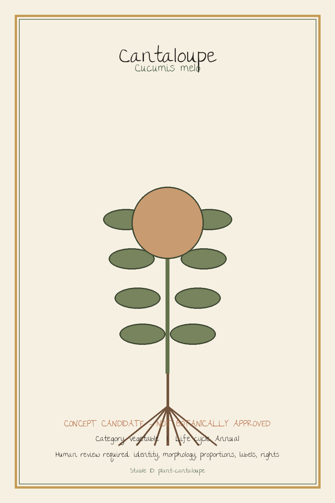

**Source status:** Not botanically or horticulturally approved. Recorded fields are derived
from the retained registry and remain subject to claim-level source review.

### Carrots

**Stable plant ID:** `plant-carrots`
**Category:** vegetable
**Recorded botanical name:** Daucus carota subsp. sativus
**Recorded family:** Apiaceae
**Life cycle:** Annual
**Illustration status:** `CANDIDATE_GENERATED / REVIEW_PENDING / NOT_APPROVED`

**Identification and morphology**

- Growth habit: Growth habit should be resolved to the exact species or cultivar; this entry provides a category-level source scaffold.
- Root or storage organ: Species-specific root, crown, or storage organ; verify the exact form before illustrating.
- Leaf arrangement and shape: Species-specific arrangement and blade shape; verify exact genus and cultivar.
- Flower structure: Species-specific inflorescence or flower structure.
- Fruit or seed structure: Species-specific fruit, seed pod, achene, capsule, berry, or nut.

**Errington timing fields**

- Indoor sow: Source timing not reviewed
- Direct sow: Source timing not reviewed
- Transplant: Source timing not reviewed
- Bloom: Source timing not reviewed
- Harvest: Source timing not reviewed
- Frost: Source timing not reviewed

**Cultivation**

- Soil: Well-drained, fertile soil with organic matter; adjust for the crop's root depth.
- Water: Keep moisture even during establishment and harvest formation; avoid prolonged waterlogging.
- Spacing: Use the calendar, seed packet, or mature crop size; do not rely on a registry-wide spacing value.
- Light: Full sun is usual; leafy cool-season crops tolerate more partial shade.
- Maintenance: Thin, weed, mulch, and monitor; support or stake as the crop requires.
- Pests/diseases: Monitor locally for aphids, slugs, caterpillars, fungal leaf spots, and soil-borne disease; identify before treatment.

**Candidate plate:**
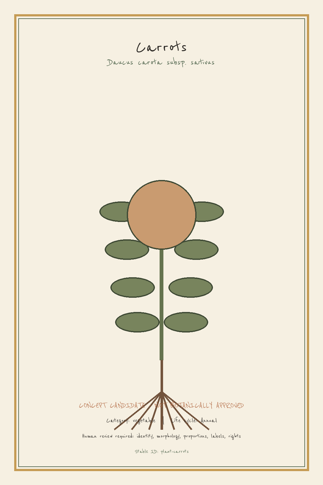

**Source status:** Not botanically or horticulturally approved. Recorded fields are derived
from the retained registry and remain subject to claim-level source review.

### Cauliflower

**Stable plant ID:** `plant-cauliflower`
**Category:** vegetable
**Recorded botanical name:** Brassica oleracea var. botrytis
**Recorded family:** Brassicaceae
**Life cycle:** Annual
**Illustration status:** `CANDIDATE_GENERATED / REVIEW_PENDING / NOT_APPROVED`

**Identification and morphology**

- Growth habit: Growth habit should be resolved to the exact species or cultivar; this entry provides a category-level source scaffold.
- Root or storage organ: Species-specific root, crown, or storage organ; verify the exact form before illustrating.
- Leaf arrangement and shape: Species-specific arrangement and blade shape; verify exact genus and cultivar.
- Flower structure: Species-specific inflorescence or flower structure.
- Fruit or seed structure: Species-specific fruit, seed pod, achene, capsule, berry, or nut.

**Errington timing fields**

- Indoor sow: Source timing not reviewed
- Direct sow: Source timing not reviewed
- Transplant: Source timing not reviewed
- Bloom: Source timing not reviewed
- Harvest: Source timing not reviewed
- Frost: Source timing not reviewed

**Cultivation**

- Soil: Well-drained, fertile soil with organic matter; adjust for the crop's root depth.
- Water: Keep moisture even during establishment and harvest formation; avoid prolonged waterlogging.
- Spacing: Use the calendar, seed packet, or mature crop size; do not rely on a registry-wide spacing value.
- Light: Full sun is usual; leafy cool-season crops tolerate more partial shade.
- Maintenance: Thin, weed, mulch, and monitor; support or stake as the crop requires.
- Pests/diseases: Monitor locally for aphids, slugs, caterpillars, fungal leaf spots, and soil-borne disease; identify before treatment.

**Candidate plate:**
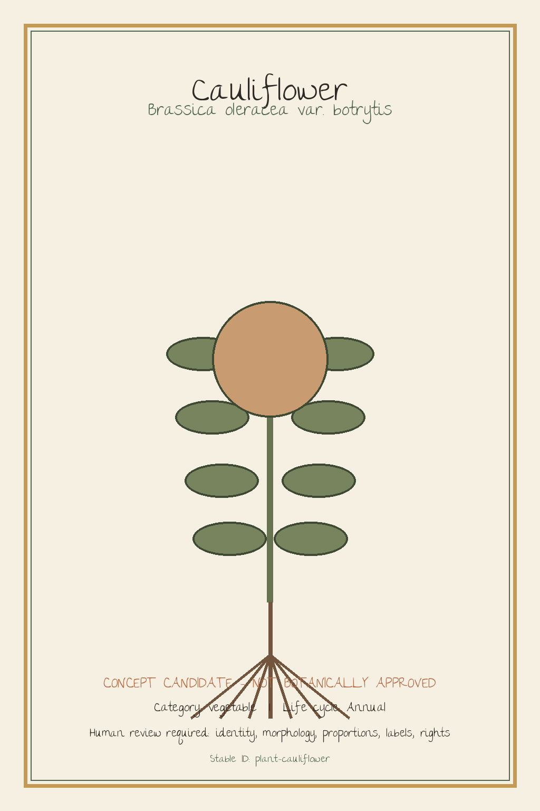

**Source status:** Not botanically or horticulturally approved. Recorded fields are derived
from the retained registry and remain subject to claim-level source review.

### Celery

**Stable plant ID:** `plant-celery`
**Category:** vegetable
**Recorded botanical name:** Apium graveolens var. dulce
**Recorded family:** Apiaceae
**Life cycle:** Annual
**Illustration status:** `CANDIDATE_GENERATED / REVIEW_PENDING / NOT_APPROVED`

**Identification and morphology**

- Growth habit: Growth habit should be resolved to the exact species or cultivar; this entry provides a category-level source scaffold.
- Root or storage organ: Species-specific root, crown, or storage organ; verify the exact form before illustrating.
- Leaf arrangement and shape: Species-specific arrangement and blade shape; verify exact genus and cultivar.
- Flower structure: Species-specific inflorescence or flower structure.
- Fruit or seed structure: Species-specific fruit, seed pod, achene, capsule, berry, or nut.

**Errington timing fields**

- Indoor sow: Source timing not reviewed
- Direct sow: Source timing not reviewed
- Transplant: Source timing not reviewed
- Bloom: Source timing not reviewed
- Harvest: Source timing not reviewed
- Frost: Source timing not reviewed

**Cultivation**

- Soil: Well-drained, fertile soil with organic matter; adjust for the crop's root depth.
- Water: Keep moisture even during establishment and harvest formation; avoid prolonged waterlogging.
- Spacing: Use the calendar, seed packet, or mature crop size; do not rely on a registry-wide spacing value.
- Light: Full sun is usual; leafy cool-season crops tolerate more partial shade.
- Maintenance: Thin, weed, mulch, and monitor; support or stake as the crop requires.
- Pests/diseases: Monitor locally for aphids, slugs, caterpillars, fungal leaf spots, and soil-borne disease; identify before treatment.

**Candidate plate:**
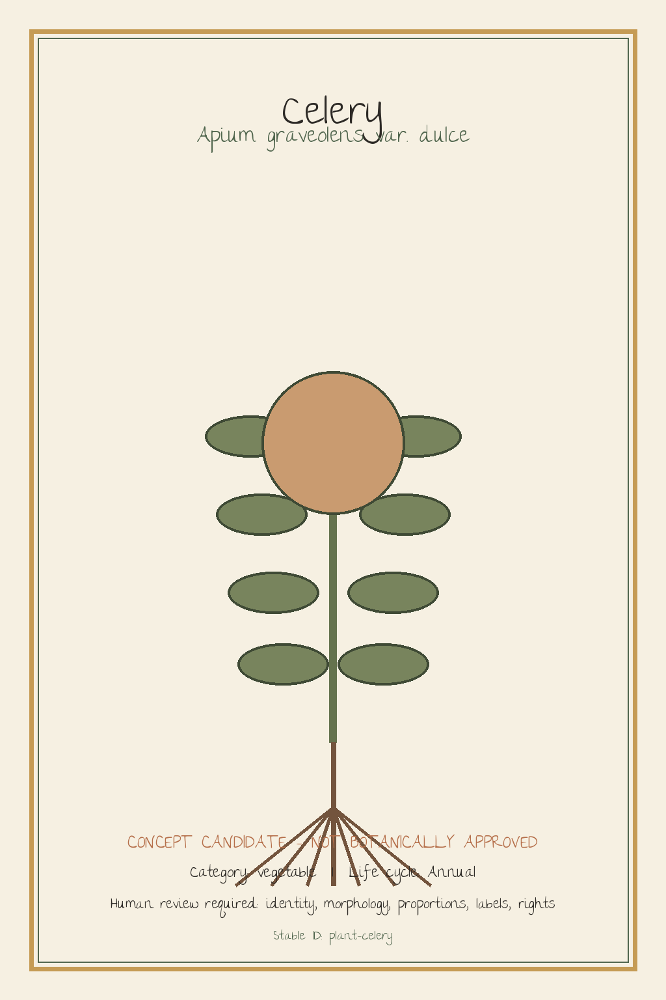

**Source status:** Not botanically or horticulturally approved. Recorded fields are derived
from the retained registry and remain subject to claim-level source review.

### Corn

**Stable plant ID:** `plant-corn`
**Category:** vegetable
**Recorded botanical name:** Zea mays
**Recorded family:** Poaceae
**Life cycle:** Annual
**Illustration status:** `CANDIDATE_GENERATED / REVIEW_PENDING / NOT_APPROVED`

**Identification and morphology**

- Growth habit: Growth habit should be resolved to the exact species or cultivar; this entry provides a category-level source scaffold.
- Root or storage organ: Species-specific root, crown, or storage organ; verify the exact form before illustrating.
- Leaf arrangement and shape: Species-specific arrangement and blade shape; verify exact genus and cultivar.
- Flower structure: Species-specific inflorescence or flower structure.
- Fruit or seed structure: Species-specific fruit, seed pod, achene, capsule, berry, or nut.

**Errington timing fields**

- Indoor sow: Source timing not reviewed
- Direct sow: Source timing not reviewed
- Transplant: Source timing not reviewed
- Bloom: Source timing not reviewed
- Harvest: Source timing not reviewed
- Frost: Source timing not reviewed

**Cultivation**

- Soil: Well-drained, fertile soil with organic matter; adjust for the crop's root depth.
- Water: Keep moisture even during establishment and harvest formation; avoid prolonged waterlogging.
- Spacing: Use the calendar, seed packet, or mature crop size; do not rely on a registry-wide spacing value.
- Light: Full sun is usual; leafy cool-season crops tolerate more partial shade.
- Maintenance: Thin, weed, mulch, and monitor; support or stake as the crop requires.
- Pests/diseases: Monitor locally for aphids, slugs, caterpillars, fungal leaf spots, and soil-borne disease; identify before treatment.

**Candidate plate:**
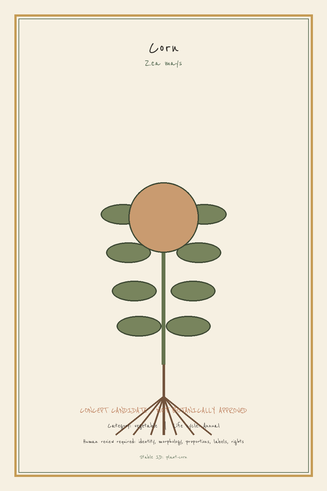

**Source status:** Not botanically or horticulturally approved. Recorded fields are derived
from the retained registry and remain subject to claim-level source review.

### Cucumber

**Stable plant ID:** `plant-cucumber`
**Category:** vegetable
**Recorded botanical name:** Cucumis sativus
**Recorded family:** Cucurbitaceae
**Life cycle:** Annual
**Illustration status:** `CANDIDATE_GENERATED / REVIEW_PENDING / NOT_APPROVED`

**Identification and morphology**

- Growth habit: Growth habit should be resolved to the exact species or cultivar; this entry provides a category-level source scaffold.
- Root or storage organ: Species-specific root, crown, or storage organ; verify the exact form before illustrating.
- Leaf arrangement and shape: Species-specific arrangement and blade shape; verify exact genus and cultivar.
- Flower structure: Species-specific inflorescence or flower structure.
- Fruit or seed structure: Species-specific fruit, seed pod, achene, capsule, berry, or nut.

**Errington timing fields**

- Indoor sow: Source timing not reviewed
- Direct sow: Source timing not reviewed
- Transplant: Source timing not reviewed
- Bloom: Source timing not reviewed
- Harvest: Source timing not reviewed
- Frost: Source timing not reviewed

**Cultivation**

- Soil: Well-drained, fertile soil with organic matter; adjust for the crop's root depth.
- Water: Keep moisture even during establishment and harvest formation; avoid prolonged waterlogging.
- Spacing: Use the calendar, seed packet, or mature crop size; do not rely on a registry-wide spacing value.
- Light: Full sun is usual; leafy cool-season crops tolerate more partial shade.
- Maintenance: Thin, weed, mulch, and monitor; support or stake as the crop requires.
- Pests/diseases: Monitor locally for aphids, slugs, caterpillars, fungal leaf spots, and soil-borne disease; identify before treatment.

**Candidate plate:**
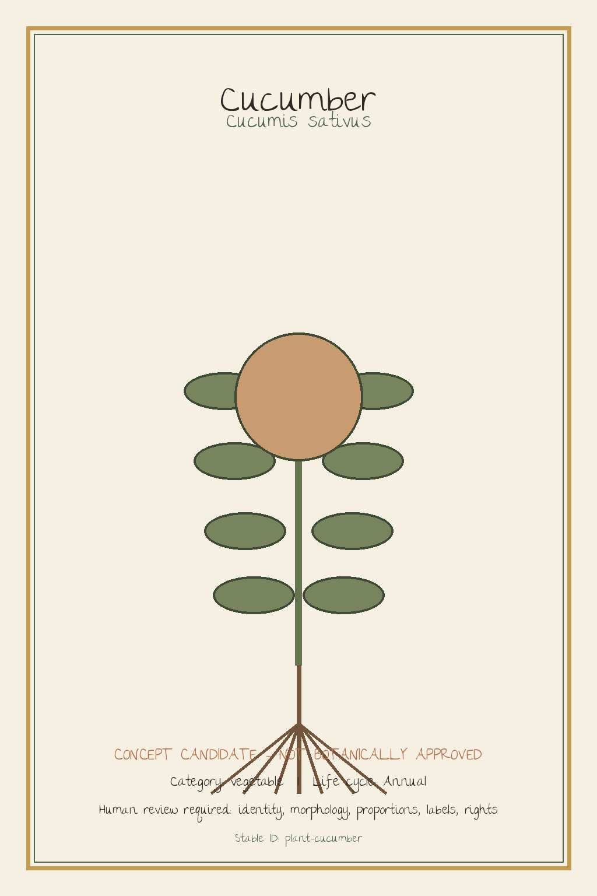

**Source status:** Not botanically or horticulturally approved. Recorded fields are derived
from the retained registry and remain subject to claim-level source review.

### Garlic

**Stable plant ID:** `plant-garlic`
**Category:** vegetable
**Recorded botanical name:** Allium sativum
**Recorded family:** Amaryllidaceae
**Life cycle:** Annual
**Illustration status:** `CANDIDATE_GENERATED / REVIEW_PENDING / NOT_APPROVED`

**Identification and morphology**

- Growth habit: Growth habit should be resolved to the exact species or cultivar; this entry provides a category-level source scaffold.
- Root or storage organ: Species-specific root, crown, or storage organ; verify the exact form before illustrating.
- Leaf arrangement and shape: Species-specific arrangement and blade shape; verify exact genus and cultivar.
- Flower structure: Species-specific inflorescence or flower structure.
- Fruit or seed structure: Species-specific fruit, seed pod, achene, capsule, berry, or nut.

**Errington timing fields**

- Indoor sow: Source timing not reviewed
- Direct sow: Source timing not reviewed
- Transplant: Source timing not reviewed
- Bloom: Source timing not reviewed
- Harvest: Source timing not reviewed
- Frost: Source timing not reviewed

**Cultivation**

- Soil: Well-drained, fertile soil with organic matter; adjust for the crop's root depth.
- Water: Keep moisture even during establishment and harvest formation; avoid prolonged waterlogging.
- Spacing: Use the calendar, seed packet, or mature crop size; do not rely on a registry-wide spacing value.
- Light: Full sun is usual; leafy cool-season crops tolerate more partial shade.
- Maintenance: Thin, weed, mulch, and monitor; support or stake as the crop requires.
- Pests/diseases: Monitor locally for aphids, slugs, caterpillars, fungal leaf spots, and soil-borne disease; identify before treatment.

**Candidate plate:**

**Source status:** Not botanically or horticulturally approved. Recorded fields are derived
from the retained registry and remain subject to claim-level source review.

### Kohlrabi

**Stable plant ID:** `plant-kohlrabi`
**Category:** vegetable
**Recorded botanical name:** Brassica oleracea var. gongylodes
**Recorded family:** Brassicaceae
**Life cycle:** Annual
**Illustration status:** `CANDIDATE_GENERATED / REVIEW_PENDING / NOT_APPROVED`

**Identification and morphology**

- Growth habit: Growth habit should be resolved to the exact species or cultivar; this entry provides a category-level source scaffold.
- Root or storage organ: Species-specific root, crown, or storage organ; verify the exact form before illustrating.
- Leaf arrangement and shape: Species-specific arrangement and blade shape; verify exact genus and cultivar.
- Flower structure: Species-specific inflorescence or flower structure.
- Fruit or seed structure: Species-specific fruit, seed pod, achene, capsule, berry, or nut.

**Errington timing fields**

- Indoor sow: Source timing not reviewed
- Direct sow: Source timing not reviewed
- Transplant: Source timing not reviewed
- Bloom: Source timing not reviewed
- Harvest: Source timing not reviewed
- Frost: Source timing not reviewed

**Cultivation**

- Soil: Well-drained, fertile soil with organic matter; adjust for the crop's root depth.
- Water: Keep moisture even during establishment and harvest formation; avoid prolonged waterlogging.
- Spacing: Use the calendar, seed packet, or mature crop size; do not rely on a registry-wide spacing value.
- Light: Full sun is usual; leafy cool-season crops tolerate more partial shade.
- Maintenance: Thin, weed, mulch, and monitor; support or stake as the crop requires.
- Pests/diseases: Monitor locally for aphids, slugs, caterpillars, fungal leaf spots, and soil-borne disease; identify before treatment.

**Candidate plate:**
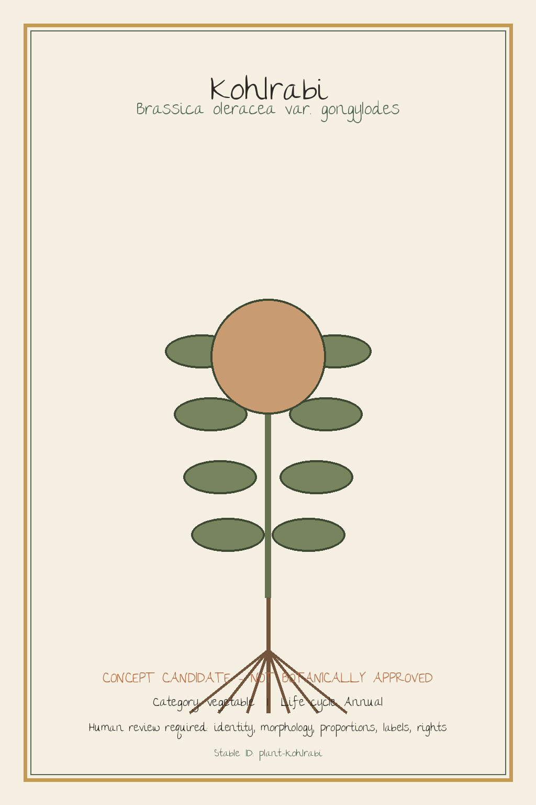

**Source status:** Not botanically or horticulturally approved. Recorded fields are derived
from the retained registry and remain subject to claim-level source review.

### Leeks

**Stable plant ID:** `plant-leeks`
**Category:** vegetable
**Recorded botanical name:** Allium ampeloprasum
**Recorded family:** Amaryllidaceae
**Life cycle:** Annual
**Illustration status:** `CANDIDATE_GENERATED / REVIEW_PENDING / NOT_APPROVED`

**Identification and morphology**

- Growth habit: Growth habit should be resolved to the exact species or cultivar; this entry provides a category-level source scaffold.
- Root or storage organ: Species-specific root, crown, or storage organ; verify the exact form before illustrating.
- Leaf arrangement and shape: Species-specific arrangement and blade shape; verify exact genus and cultivar.
- Flower structure: Species-specific inflorescence or flower structure.
- Fruit or seed structure: Species-specific fruit, seed pod, achene, capsule, berry, or nut.

**Errington timing fields**

- Indoor sow: Source timing not reviewed
- Direct sow: Source timing not reviewed
- Transplant: Source timing not reviewed
- Bloom: Source timing not reviewed
- Harvest: Source timing not reviewed
- Frost: Source timing not reviewed

**Cultivation**

- Soil: Well-drained, fertile soil with organic matter; adjust for the crop's root depth.
- Water: Keep moisture even during establishment and harvest formation; avoid prolonged waterlogging.
- Spacing: Use the calendar, seed packet, or mature crop size; do not rely on a registry-wide spacing value.
- Light: Full sun is usual; leafy cool-season crops tolerate more partial shade.
- Maintenance: Thin, weed, mulch, and monitor; support or stake as the crop requires.
- Pests/diseases: Monitor locally for aphids, slugs, caterpillars, fungal leaf spots, and soil-borne disease; identify before treatment.

**Candidate plate:**

**Source status:** Not botanically or horticulturally approved. Recorded fields are derived
from the retained registry and remain subject to claim-level source review.

### Lettuce

**Stable plant ID:** `plant-lettuce`
**Category:** vegetable
**Recorded botanical name:** Lactuca sativa
**Recorded family:** Asteraceae
**Life cycle:** Annual
**Illustration status:** `CANDIDATE_GENERATED / REVIEW_PENDING / NOT_APPROVED`

**Identification and morphology**

- Growth habit: Growth habit should be resolved to the exact species or cultivar; this entry provides a category-level source scaffold.
- Root or storage organ: Species-specific root, crown, or storage organ; verify the exact form before illustrating.
- Leaf arrangement and shape: Species-specific arrangement and blade shape; verify exact genus and cultivar.
- Flower structure: Species-specific inflorescence or flower structure.
- Fruit or seed structure: Species-specific fruit, seed pod, achene, capsule, berry, or nut.

**Errington timing fields**

- Indoor sow: Source timing not reviewed
- Direct sow: Source timing not reviewed
- Transplant: Source timing not reviewed
- Bloom: Source timing not reviewed
- Harvest: Source timing not reviewed
- Frost: Source timing not reviewed

**Cultivation**

- Soil: Well-drained, fertile soil with organic matter; adjust for the crop's root depth.
- Water: Keep moisture even during establishment and harvest formation; avoid prolonged waterlogging.
- Spacing: Use the calendar, seed packet, or mature crop size; do not rely on a registry-wide spacing value.
- Light: Full sun is usual; leafy cool-season crops tolerate more partial shade.
- Maintenance: Thin, weed, mulch, and monitor; support or stake as the crop requires.
- Pests/diseases: Monitor locally for aphids, slugs, caterpillars, fungal leaf spots, and soil-borne disease; identify before treatment.

**Candidate plate:**
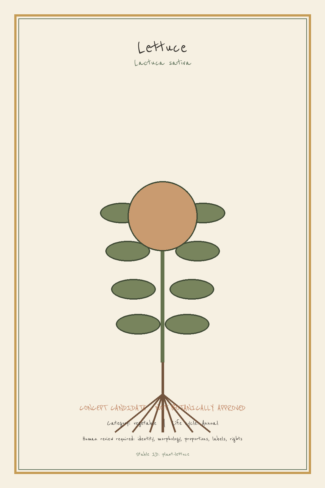

**Source status:** Not botanically or horticulturally approved. Recorded fields are derived
from the retained registry and remain subject to claim-level source review.

### Eggplant

**Stable plant ID:** `plant-eggplant`
**Category:** vegetable
**Recorded botanical name:** Solanum melongena
**Recorded family:** Solanaceae
**Life cycle:** Annual
**Illustration status:** `CANDIDATE_GENERATED / REVIEW_PENDING / NOT_APPROVED`

**Identification and morphology**

- Growth habit: Growth habit should be resolved to the exact species or cultivar; this entry provides a category-level source scaffold.
- Root or storage organ: Species-specific root, crown, or storage organ; verify the exact form before illustrating.
- Leaf arrangement and shape: Species-specific arrangement and blade shape; verify exact genus and cultivar.
- Flower structure: Species-specific inflorescence or flower structure.
- Fruit or seed structure: Species-specific fruit, seed pod, achene, capsule, berry, or nut.

**Errington timing fields**

- Indoor sow: Source timing not reviewed
- Direct sow: Source timing not reviewed
- Transplant: Source timing not reviewed
- Bloom: Source timing not reviewed
- Harvest: Source timing not reviewed
- Frost: Source timing not reviewed

**Cultivation**

- Soil: Well-drained, fertile soil with organic matter; adjust for the crop's root depth.
- Water: Keep moisture even during establishment and harvest formation; avoid prolonged waterlogging.
- Spacing: Use the calendar, seed packet, or mature crop size; do not rely on a registry-wide spacing value.
- Light: Full sun is usual; leafy cool-season crops tolerate more partial shade.
- Maintenance: Thin, weed, mulch, and monitor; support or stake as the crop requires.
- Pests/diseases: Monitor locally for aphids, slugs, caterpillars, fungal leaf spots, and soil-borne disease; identify before treatment.

**Candidate plate:**

**Source status:** Not botanically or horticulturally approved. Recorded fields are derived
from the retained registry and remain subject to claim-level source review.

### Melons

**Stable plant ID:** `plant-melons`
**Category:** vegetable
**Recorded botanical name:** Cucumis melo
**Recorded family:** Cucurbitaceae
**Life cycle:** Annual
**Illustration status:** `CANDIDATE_GENERATED / REVIEW_PENDING / NOT_APPROVED`

**Identification and morphology**

- Growth habit: Growth habit should be resolved to the exact species or cultivar; this entry provides a category-level source scaffold.
- Root or storage organ: Species-specific root, crown, or storage organ; verify the exact form before illustrating.
- Leaf arrangement and shape: Species-specific arrangement and blade shape; verify exact genus and cultivar.
- Flower structure: Species-specific inflorescence or flower structure.
- Fruit or seed structure: Species-specific fruit, seed pod, achene, capsule, berry, or nut.

**Errington timing fields**

- Indoor sow: Source timing not reviewed
- Direct sow: Source timing not reviewed
- Transplant: Source timing not reviewed
- Bloom: Source timing not reviewed
- Harvest: Source timing not reviewed
- Frost: Source timing not reviewed

**Cultivation**

- Soil: Well-drained, fertile soil with organic matter; adjust for the crop's root depth.
- Water: Keep moisture even during establishment and harvest formation; avoid prolonged waterlogging.
- Spacing: Use the calendar, seed packet, or mature crop size; do not rely on a registry-wide spacing value.
- Light: Full sun is usual; leafy cool-season crops tolerate more partial shade.
- Maintenance: Thin, weed, mulch, and monitor; support or stake as the crop requires.
- Pests/diseases: Monitor locally for aphids, slugs, caterpillars, fungal leaf spots, and soil-borne disease; identify before treatment.

**Candidate plate:**
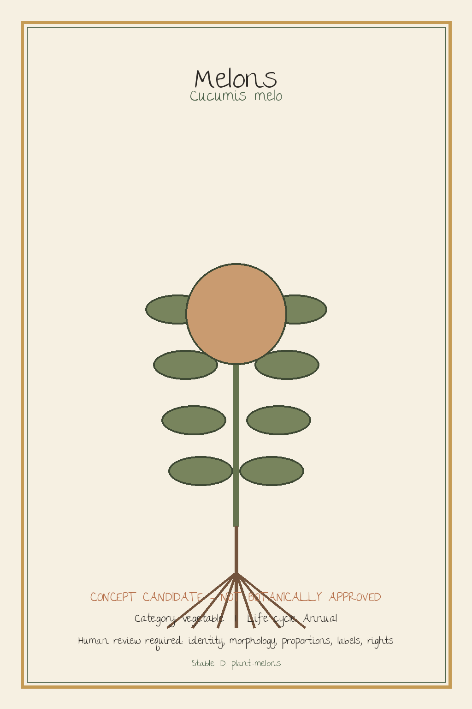

**Source status:** Not botanically or horticulturally approved. Recorded fields are derived
from the retained registry and remain subject to claim-level source review.

### Okra

**Stable plant ID:** `plant-okra`
**Category:** vegetable
**Recorded botanical name:** Abelmoschus esculentus
**Recorded family:** Malvaceae
**Life cycle:** Annual
**Illustration status:** `CANDIDATE_GENERATED / REVIEW_PENDING / NOT_APPROVED`

**Identification and morphology**

- Growth habit: Growth habit should be resolved to the exact species or cultivar; this entry provides a category-level source scaffold.
- Root or storage organ: Species-specific root, crown, or storage organ; verify the exact form before illustrating.
- Leaf arrangement and shape: Species-specific arrangement and blade shape; verify exact genus and cultivar.
- Flower structure: Species-specific inflorescence or flower structure.
- Fruit or seed structure: Species-specific fruit, seed pod, achene, capsule, berry, or nut.

**Errington timing fields**

- Indoor sow: Source timing not reviewed
- Direct sow: Source timing not reviewed
- Transplant: Source timing not reviewed
- Bloom: Source timing not reviewed
- Harvest: Source timing not reviewed
- Frost: Source timing not reviewed

**Cultivation**

- Soil: Well-drained, fertile soil with organic matter; adjust for the crop's root depth.
- Water: Keep moisture even during establishment and harvest formation; avoid prolonged waterlogging.
- Spacing: Use the calendar, seed packet, or mature crop size; do not rely on a registry-wide spacing value.
- Light: Full sun is usual; leafy cool-season crops tolerate more partial shade.
- Maintenance: Thin, weed, mulch, and monitor; support or stake as the crop requires.
- Pests/diseases: Monitor locally for aphids, slugs, caterpillars, fungal leaf spots, and soil-borne disease; identify before treatment.

**Candidate plate:**
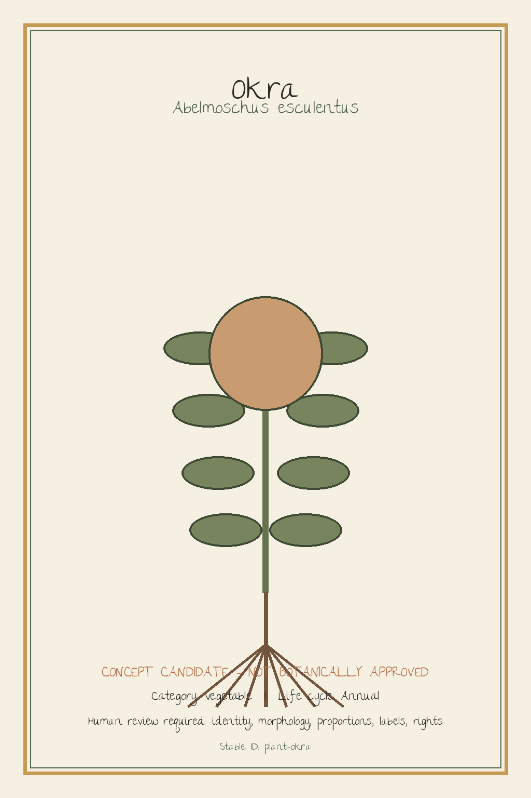

**Source status:** Not botanically or horticulturally approved. Recorded fields are derived
from the retained registry and remain subject to claim-level source review.

### Parsnips

**Stable plant ID:** `plant-parsnips`
**Category:** vegetable
**Recorded botanical name:** Pastinaca sativa
**Recorded family:** Apiaceae
**Life cycle:** Annual
**Illustration status:** `CANDIDATE_GENERATED / REVIEW_PENDING / NOT_APPROVED`

**Identification and morphology**

- Growth habit: Growth habit should be resolved to the exact species or cultivar; this entry provides a category-level source scaffold.
- Root or storage organ: Species-specific root, crown, or storage organ; verify the exact form before illustrating.
- Leaf arrangement and shape: Species-specific arrangement and blade shape; verify exact genus and cultivar.
- Flower structure: Species-specific inflorescence or flower structure.
- Fruit or seed structure: Species-specific fruit, seed pod, achene, capsule, berry, or nut.

**Errington timing fields**

- Indoor sow: Source timing not reviewed
- Direct sow: Source timing not reviewed
- Transplant: Source timing not reviewed
- Bloom: Source timing not reviewed
- Harvest: Source timing not reviewed
- Frost: Source timing not reviewed

**Cultivation**

- Soil: Well-drained, fertile soil with organic matter; adjust for the crop's root depth.
- Water: Keep moisture even during establishment and harvest formation; avoid prolonged waterlogging.
- Spacing: Use the calendar, seed packet, or mature crop size; do not rely on a registry-wide spacing value.
- Light: Full sun is usual; leafy cool-season crops tolerate more partial shade.
- Maintenance: Thin, weed, mulch, and monitor; support or stake as the crop requires.
- Pests/diseases: Monitor locally for aphids, slugs, caterpillars, fungal leaf spots, and soil-borne disease; identify before treatment.

**Candidate plate:**
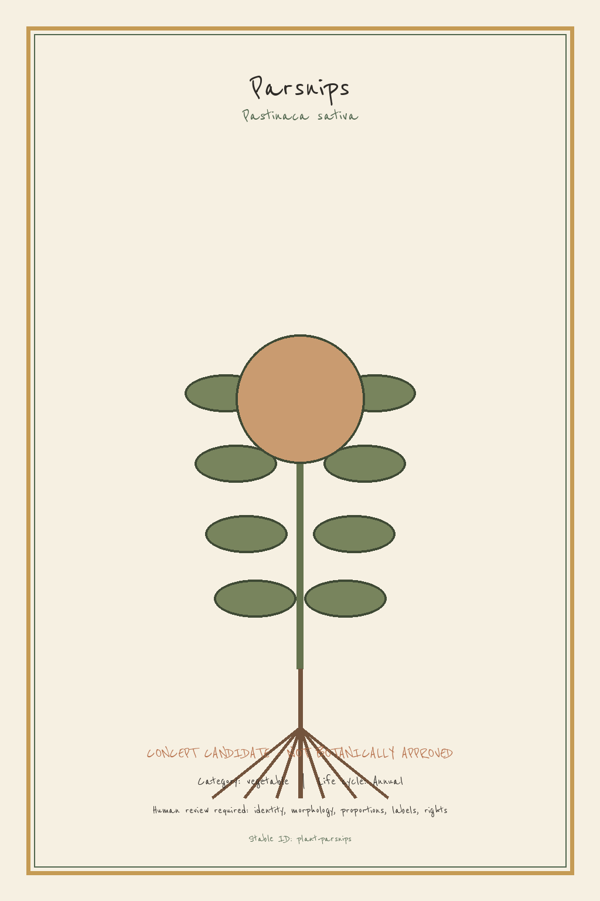

**Source status:** Not botanically or horticulturally approved. Recorded fields are derived
from the retained registry and remain subject to claim-level source review.

### Peas

**Stable plant ID:** `plant-peas`
**Category:** vegetable
**Recorded botanical name:** Pisum sativum
**Recorded family:** Fabaceae
**Life cycle:** Annual
**Illustration status:** `CANDIDATE_GENERATED / REVIEW_PENDING / NOT_APPROVED`

**Identification and morphology**

- Growth habit: Growth habit should be resolved to the exact species or cultivar; this entry provides a category-level source scaffold.
- Root or storage organ: Species-specific root, crown, or storage organ; verify the exact form before illustrating.
- Leaf arrangement and shape: Species-specific arrangement and blade shape; verify exact genus and cultivar.
- Flower structure: Species-specific inflorescence or flower structure.
- Fruit or seed structure: Species-specific fruit, seed pod, achene, capsule, berry, or nut.

**Errington timing fields**

- Indoor sow: Source timing not reviewed
- Direct sow: Source timing not reviewed
- Transplant: Source timing not reviewed
- Bloom: Source timing not reviewed
- Harvest: Source timing not reviewed
- Frost: Source timing not reviewed

**Cultivation**

- Soil: Well-drained, fertile soil with organic matter; adjust for the crop's root depth.
- Water: Keep moisture even during establishment and harvest formation; avoid prolonged waterlogging.
- Spacing: Use the calendar, seed packet, or mature crop size; do not rely on a registry-wide spacing value.
- Light: Full sun is usual; leafy cool-season crops tolerate more partial shade.
- Maintenance: Thin, weed, mulch, and monitor; support or stake as the crop requires.
- Pests/diseases: Monitor locally for aphids, slugs, caterpillars, fungal leaf spots, and soil-borne disease; identify before treatment.

**Candidate plate:**

**Source status:** Not botanically or horticulturally approved. Recorded fields are derived
from the retained registry and remain subject to claim-level source review.

### Potatoes

**Stable plant ID:** `plant-potatoes`
**Category:** vegetable
**Recorded botanical name:** Solanum tuberosum
**Recorded family:** Solanaceae
**Life cycle:** Annual
**Illustration status:** `CANDIDATE_GENERATED / REVIEW_PENDING / NOT_APPROVED`

**Identification and morphology**

- Growth habit: Growth habit should be resolved to the exact species or cultivar; this entry provides a category-level source scaffold.
- Root or storage organ: Species-specific root, crown, or storage organ; verify the exact form before illustrating.
- Leaf arrangement and shape: Species-specific arrangement and blade shape; verify exact genus and cultivar.
- Flower structure: Species-specific inflorescence or flower structure.
- Fruit or seed structure: Species-specific fruit, seed pod, achene, capsule, berry, or nut.

**Errington timing fields**

- Indoor sow: Source timing not reviewed
- Direct sow: Source timing not reviewed
- Transplant: Source timing not reviewed
- Bloom: Source timing not reviewed
- Harvest: Source timing not reviewed
- Frost: Source timing not reviewed

**Cultivation**

- Soil: Well-drained, fertile soil with organic matter; adjust for the crop's root depth.
- Water: Keep moisture even during establishment and harvest formation; avoid prolonged waterlogging.
- Spacing: Use the calendar, seed packet, or mature crop size; do not rely on a registry-wide spacing value.
- Light: Full sun is usual; leafy cool-season crops tolerate more partial shade.
- Maintenance: Thin, weed, mulch, and monitor; support or stake as the crop requires.
- Pests/diseases: Monitor locally for aphids, slugs, caterpillars, fungal leaf spots, and soil-borne disease; identify before treatment.

**Candidate plate:**
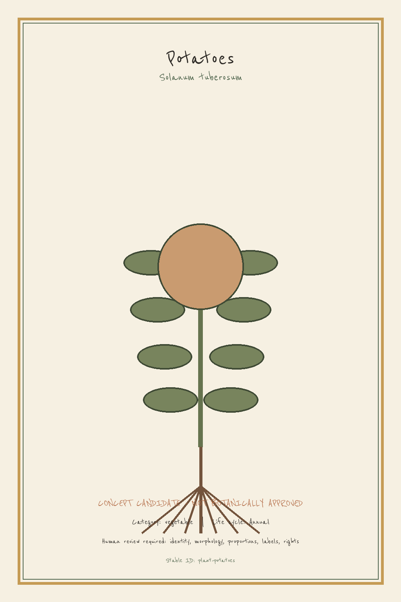

**Source status:** Not botanically or horticulturally approved. Recorded fields are derived
from the retained registry and remain subject to claim-level source review.

### Spinach

**Stable plant ID:** `plant-spinach`
**Category:** vegetable
**Recorded botanical name:** Spinacia oleracea
**Recorded family:** Amaranthaceae
**Life cycle:** Annual
**Illustration status:** `CANDIDATE_GENERATED / REVIEW_PENDING / NOT_APPROVED`

**Identification and morphology**

- Growth habit: Growth habit should be resolved to the exact species or cultivar; this entry provides a category-level source scaffold.
- Root or storage organ: Species-specific root, crown, or storage organ; verify the exact form before illustrating.
- Leaf arrangement and shape: Species-specific arrangement and blade shape; verify exact genus and cultivar.
- Flower structure: Species-specific inflorescence or flower structure.
- Fruit or seed structure: Species-specific fruit, seed pod, achene, capsule, berry, or nut.

**Errington timing fields**

- Indoor sow: Source timing not reviewed
- Direct sow: Source timing not reviewed
- Transplant: Source timing not reviewed
- Bloom: Source timing not reviewed
- Harvest: Source timing not reviewed
- Frost: Source timing not reviewed

**Cultivation**

- Soil: Well-drained, fertile soil with organic matter; adjust for the crop's root depth.
- Water: Keep moisture even during establishment and harvest formation; avoid prolonged waterlogging.
- Spacing: Use the calendar, seed packet, or mature crop size; do not rely on a registry-wide spacing value.
- Light: Full sun is usual; leafy cool-season crops tolerate more partial shade.
- Maintenance: Thin, weed, mulch, and monitor; support or stake as the crop requires.
- Pests/diseases: Monitor locally for aphids, slugs, caterpillars, fungal leaf spots, and soil-borne disease; identify before treatment.

**Candidate plate:**
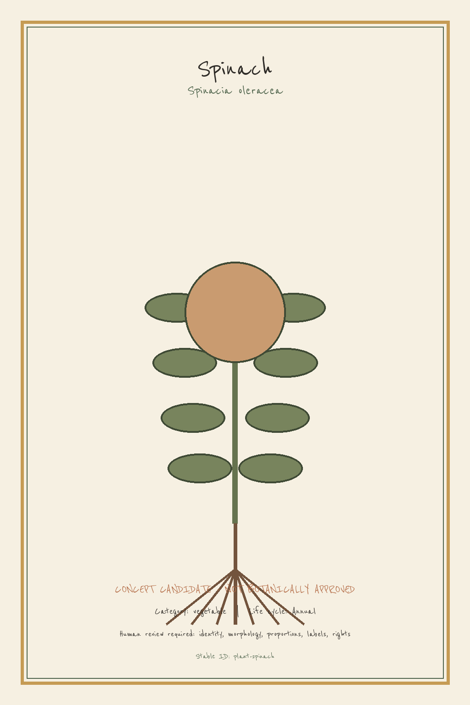

**Source status:** Not botanically or horticulturally approved. Recorded fields are derived
from the retained registry and remain subject to claim-level source review.

### Sweet Potato

**Stable plant ID:** `plant-sweet-potato`
**Category:** vegetable
**Recorded botanical name:** Ipomoea batatas
**Recorded family:** Convolvulaceae
**Life cycle:** Annual
**Illustration status:** `CANDIDATE_GENERATED / REVIEW_PENDING / NOT_APPROVED`

**Identification and morphology**

- Growth habit: Growth habit should be resolved to the exact species or cultivar; this entry provides a category-level source scaffold.
- Root or storage organ: Species-specific root, crown, or storage organ; verify the exact form before illustrating.
- Leaf arrangement and shape: Species-specific arrangement and blade shape; verify exact genus and cultivar.
- Flower structure: Species-specific inflorescence or flower structure.
- Fruit or seed structure: Species-specific fruit, seed pod, achene, capsule, berry, or nut.

**Errington timing fields**

- Indoor sow: Source timing not reviewed
- Direct sow: Source timing not reviewed
- Transplant: Source timing not reviewed
- Bloom: Source timing not reviewed
- Harvest: Source timing not reviewed
- Frost: Source timing not reviewed

**Cultivation**

- Soil: Well-drained, fertile soil with organic matter; adjust for the crop's root depth.
- Water: Keep moisture even during establishment and harvest formation; avoid prolonged waterlogging.
- Spacing: Use the calendar, seed packet, or mature crop size; do not rely on a registry-wide spacing value.
- Light: Full sun is usual; leafy cool-season crops tolerate more partial shade.
- Maintenance: Thin, weed, mulch, and monitor; support or stake as the crop requires.
- Pests/diseases: Monitor locally for aphids, slugs, caterpillars, fungal leaf spots, and soil-borne disease; identify before treatment.

**Candidate plate:**

**Source status:** Not botanically or horticulturally approved. Recorded fields are derived
from the retained registry and remain subject to claim-level source review.

### Summer Squash

**Stable plant ID:** `plant-summer-squash`
**Category:** vegetable
**Recorded botanical name:** Cucurbita pepo
**Recorded family:** Cucurbitaceae
**Life cycle:** Annual
**Illustration status:** `CANDIDATE_GENERATED / REVIEW_PENDING / NOT_APPROVED`

**Identification and morphology**

- Growth habit: Growth habit should be resolved to the exact species or cultivar; this entry provides a category-level source scaffold.
- Root or storage organ: Species-specific root, crown, or storage organ; verify the exact form before illustrating.
- Leaf arrangement and shape: Species-specific arrangement and blade shape; verify exact genus and cultivar.
- Flower structure: Species-specific inflorescence or flower structure.
- Fruit or seed structure: Species-specific fruit, seed pod, achene, capsule, berry, or nut.

**Errington timing fields**

- Indoor sow: Source timing not reviewed
- Direct sow: Source timing not reviewed
- Transplant: Source timing not reviewed
- Bloom: Source timing not reviewed
- Harvest: Source timing not reviewed
- Frost: Source timing not reviewed

**Cultivation**

- Soil: Well-drained, fertile soil with organic matter; adjust for the crop's root depth.
- Water: Keep moisture even during establishment and harvest formation; avoid prolonged waterlogging.
- Spacing: Use the calendar, seed packet, or mature crop size; do not rely on a registry-wide spacing value.
- Light: Full sun is usual; leafy cool-season crops tolerate more partial shade.
- Maintenance: Thin, weed, mulch, and monitor; support or stake as the crop requires.
- Pests/diseases: Monitor locally for aphids, slugs, caterpillars, fungal leaf spots, and soil-borne disease; identify before treatment.

**Candidate plate:**
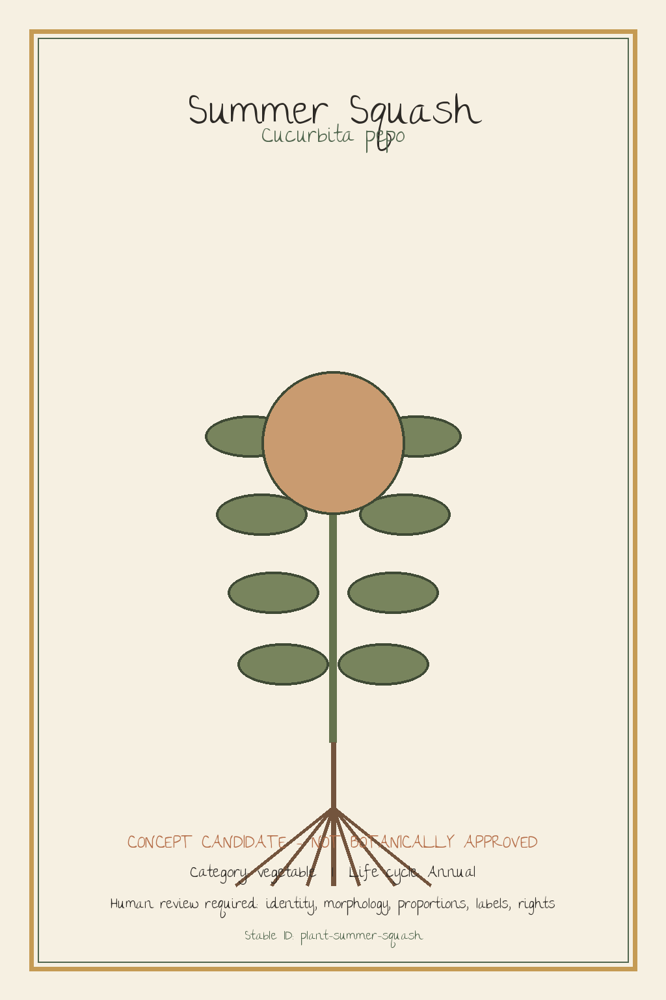

**Source status:** Not botanically or horticulturally approved. Recorded fields are derived
from the retained registry and remain subject to claim-level source review.

### Swiss Chard

**Stable plant ID:** `plant-swiss-chard`
**Category:** vegetable
**Recorded botanical name:** Beta vulgaris subsp. cicla
**Recorded family:** Amaranthaceae
**Life cycle:** Annual
**Illustration status:** `CANDIDATE_GENERATED / REVIEW_PENDING / NOT_APPROVED`

**Identification and morphology**

- Growth habit: Growth habit should be resolved to the exact species or cultivar; this entry provides a category-level source scaffold.
- Root or storage organ: Species-specific root, crown, or storage organ; verify the exact form before illustrating.
- Leaf arrangement and shape: Species-specific arrangement and blade shape; verify exact genus and cultivar.
- Flower structure: Species-specific inflorescence or flower structure.
- Fruit or seed structure: Species-specific fruit, seed pod, achene, capsule, berry, or nut.

**Errington timing fields**

- Indoor sow: Source timing not reviewed
- Direct sow: Source timing not reviewed
- Transplant: Source timing not reviewed
- Bloom: Source timing not reviewed
- Harvest: Source timing not reviewed
- Frost: Source timing not reviewed

**Cultivation**

- Soil: Well-drained, fertile soil with organic matter; adjust for the crop's root depth.
- Water: Keep moisture even during establishment and harvest formation; avoid prolonged waterlogging.
- Spacing: Use the calendar, seed packet, or mature crop size; do not rely on a registry-wide spacing value.
- Light: Full sun is usual; leafy cool-season crops tolerate more partial shade.
- Maintenance: Thin, weed, mulch, and monitor; support or stake as the crop requires.
- Pests/diseases: Monitor locally for aphids, slugs, caterpillars, fungal leaf spots, and soil-borne disease; identify before treatment.

**Candidate plate:**

**Source status:** Not botanically or horticulturally approved. Recorded fields are derived
from the retained registry and remain subject to claim-level source review.

### Tomatoes

**Stable plant ID:** `plant-tomatoes`
**Category:** vegetable
**Recorded botanical name:** Solanum lycopersicum
**Recorded family:** Solanaceae
**Life cycle:** Annual
**Illustration status:** `CANDIDATE_GENERATED / REVIEW_PENDING / NOT_APPROVED`

**Identification and morphology**

- Growth habit: Growth habit should be resolved to the exact species or cultivar; this entry provides a category-level source scaffold.
- Root or storage organ: Species-specific root, crown, or storage organ; verify the exact form before illustrating.
- Leaf arrangement and shape: Species-specific arrangement and blade shape; verify exact genus and cultivar.
- Flower structure: Species-specific inflorescence or flower structure.
- Fruit or seed structure: Species-specific fruit, seed pod, achene, capsule, berry, or nut.

**Errington timing fields**

- Indoor sow: Source timing not reviewed
- Direct sow: Source timing not reviewed
- Transplant: Source timing not reviewed
- Bloom: Source timing not reviewed
- Harvest: Source timing not reviewed
- Frost: Source timing not reviewed

**Cultivation**

- Soil: Well-drained, fertile soil with organic matter; adjust for the crop's root depth.
- Water: Keep moisture even during establishment and harvest formation; avoid prolonged waterlogging.
- Spacing: Use the calendar, seed packet, or mature crop size; do not rely on a registry-wide spacing value.
- Light: Full sun is usual; leafy cool-season crops tolerate more partial shade.
- Maintenance: Thin, weed, mulch, and monitor; support or stake as the crop requires.
- Pests/diseases: Monitor locally for aphids, slugs, caterpillars, fungal leaf spots, and soil-borne disease; identify before treatment.

**Candidate plate:**
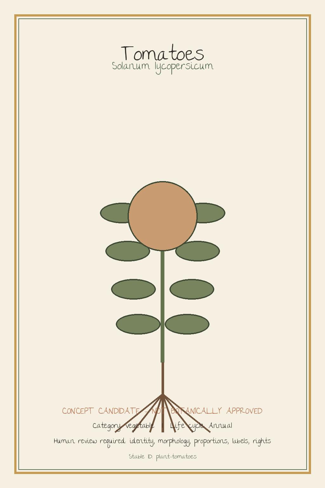

**Source status:** Not botanically or horticulturally approved. Recorded fields are derived
from the retained registry and remain subject to claim-level source review.

### Marigold

**Stable plant ID:** `plant-marigold`
**Category:** flower
**Recorded botanical name:** Tagetes patula
**Recorded family:** Asteraceae
**Life cycle:** Annual
**Illustration status:** `CANDIDATE_GENERATED / REVIEW_PENDING / NOT_APPROVED`

**Identification and morphology**

- Growth habit: Growth habit should be resolved to the exact species or cultivar; this entry provides a category-level source scaffold.
- Root or storage organ: Species-specific root, crown, or storage organ; verify the exact form before illustrating.
- Leaf arrangement and shape: Species-specific arrangement and blade shape; verify exact genus and cultivar.
- Flower structure: Species-specific inflorescence or flower structure.
- Fruit or seed structure: Species-specific fruit, seed pod, achene, capsule, berry, or nut.

**Errington timing fields**

- Indoor sow: Source timing not reviewed
- Direct sow: Source timing not reviewed
- Transplant: Source timing not reviewed
- Bloom: Source timing not reviewed
- Harvest: Source timing not reviewed
- Frost: Source timing not reviewed

**Cultivation**

- Soil: Fertile, well-drained soil with organic matter unless the species has a known exceptional preference.
- Water: Provide even establishment moisture; then follow the species' drought, moisture, or wetness preference.
- Spacing: Base spacing on mature height and spread, not just the common name.
- Light: Sun requirement is species-specific; the common name alone is not a reliable light label.
- Maintenance: Mulch, deadhead or divide as appropriate, and monitor for structural or seasonal maintenance.
- Pests/diseases: Identify the pest or disease locally before control; favor sanitation, cultural prevention, and targeted action.

**Candidate plate:**
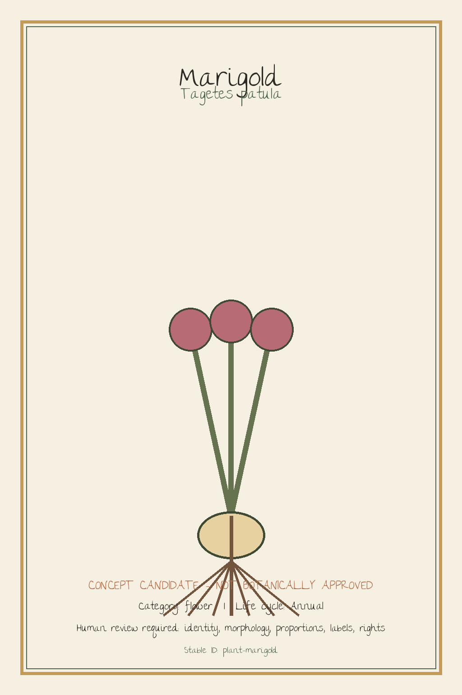

**Source status:** Not botanically or horticulturally approved. Recorded fields are derived
from the retained registry and remain subject to claim-level source review.

### Zinnia

**Stable plant ID:** `plant-zinnia`
**Category:** flower
**Recorded botanical name:** Zinnia elegans
**Recorded family:** Asteraceae
**Life cycle:** Annual
**Illustration status:** `CANDIDATE_GENERATED / REVIEW_PENDING / NOT_APPROVED`

**Identification and morphology**

- Growth habit: Growth habit should be resolved to the exact species or cultivar; this entry provides a category-level source scaffold.
- Root or storage organ: Species-specific root, crown, or storage organ; verify the exact form before illustrating.
- Leaf arrangement and shape: Species-specific arrangement and blade shape; verify exact genus and cultivar.
- Flower structure: Species-specific inflorescence or flower structure.
- Fruit or seed structure: Species-specific fruit, seed pod, achene, capsule, berry, or nut.

**Errington timing fields**

- Indoor sow: Source timing not reviewed
- Direct sow: Source timing not reviewed
- Transplant: Source timing not reviewed
- Bloom: Source timing not reviewed
- Harvest: Source timing not reviewed
- Frost: Source timing not reviewed

**Cultivation**

- Soil: Fertile, well-drained soil with organic matter unless the species has a known exceptional preference.
- Water: Provide even establishment moisture; then follow the species' drought, moisture, or wetness preference.
- Spacing: Base spacing on mature height and spread, not just the common name.
- Light: Sun requirement is species-specific; the common name alone is not a reliable light label.
- Maintenance: Mulch, deadhead or divide as appropriate, and monitor for structural or seasonal maintenance.
- Pests/diseases: Identify the pest or disease locally before control; favor sanitation, cultural prevention, and targeted action.

**Candidate plate:**

**Source status:** Not botanically or horticulturally approved. Recorded fields are derived
from the retained registry and remain subject to claim-level source review.

### Cosmos

**Stable plant ID:** `plant-cosmos`
**Category:** flower
**Recorded botanical name:** Cosmos bipinnatus
**Recorded family:** Asteraceae
**Life cycle:** Annual
**Illustration status:** `CANDIDATE_GENERATED / REVIEW_PENDING / NOT_APPROVED`

**Identification and morphology**

- Growth habit: Growth habit should be resolved to the exact species or cultivar; this entry provides a category-level source scaffold.
- Root or storage organ: Species-specific root, crown, or storage organ; verify the exact form before illustrating.
- Leaf arrangement and shape: Species-specific arrangement and blade shape; verify exact genus and cultivar.
- Flower structure: Species-specific inflorescence or flower structure.
- Fruit or seed structure: Species-specific fruit, seed pod, achene, capsule, berry, or nut.

**Errington timing fields**

- Indoor sow: Source timing not reviewed
- Direct sow: Source timing not reviewed
- Transplant: Source timing not reviewed
- Bloom: Source timing not reviewed
- Harvest: Source timing not reviewed
- Frost: Source timing not reviewed

**Cultivation**

- Soil: Fertile, well-drained soil with organic matter unless the species has a known exceptional preference.
- Water: Provide even establishment moisture; then follow the species' drought, moisture, or wetness preference.
- Spacing: Base spacing on mature height and spread, not just the common name.
- Light: Sun requirement is species-specific; the common name alone is not a reliable light label.
- Maintenance: Mulch, deadhead or divide as appropriate, and monitor for structural or seasonal maintenance.
- Pests/diseases: Identify the pest or disease locally before control; favor sanitation, cultural prevention, and targeted action.

**Candidate plate:**
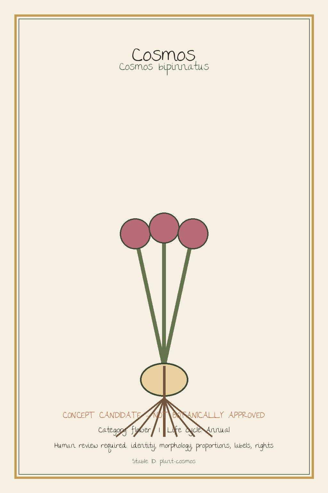

**Source status:** Not botanically or horticulturally approved. Recorded fields are derived
from the retained registry and remain subject to claim-level source review.

### Nasturtium

**Stable plant ID:** `plant-nasturtium`
**Category:** flower
**Recorded botanical name:** Tropaeolum majus
**Recorded family:** Tropaeolaceae
**Life cycle:** Annual
**Illustration status:** `CANDIDATE_GENERATED / REVIEW_PENDING / NOT_APPROVED`

**Identification and morphology**

- Growth habit: Growth habit should be resolved to the exact species or cultivar; this entry provides a category-level source scaffold.
- Root or storage organ: Species-specific root, crown, or storage organ; verify the exact form before illustrating.
- Leaf arrangement and shape: Species-specific arrangement and blade shape; verify exact genus and cultivar.
- Flower structure: Species-specific inflorescence or flower structure.
- Fruit or seed structure: Species-specific fruit, seed pod, achene, capsule, berry, or nut.

**Errington timing fields**

- Indoor sow: Source timing not reviewed
- Direct sow: Source timing not reviewed
- Transplant: Source timing not reviewed
- Bloom: Source timing not reviewed
- Harvest: Source timing not reviewed
- Frost: Source timing not reviewed

**Cultivation**

- Soil: Fertile, well-drained soil with organic matter unless the species has a known exceptional preference.
- Water: Provide even establishment moisture; then follow the species' drought, moisture, or wetness preference.
- Spacing: Base spacing on mature height and spread, not just the common name.
- Light: Sun requirement is species-specific; the common name alone is not a reliable light label.
- Maintenance: Mulch, deadhead or divide as appropriate, and monitor for structural or seasonal maintenance.
- Pests/diseases: Identify the pest or disease locally before control; favor sanitation, cultural prevention, and targeted action.

**Candidate plate:**
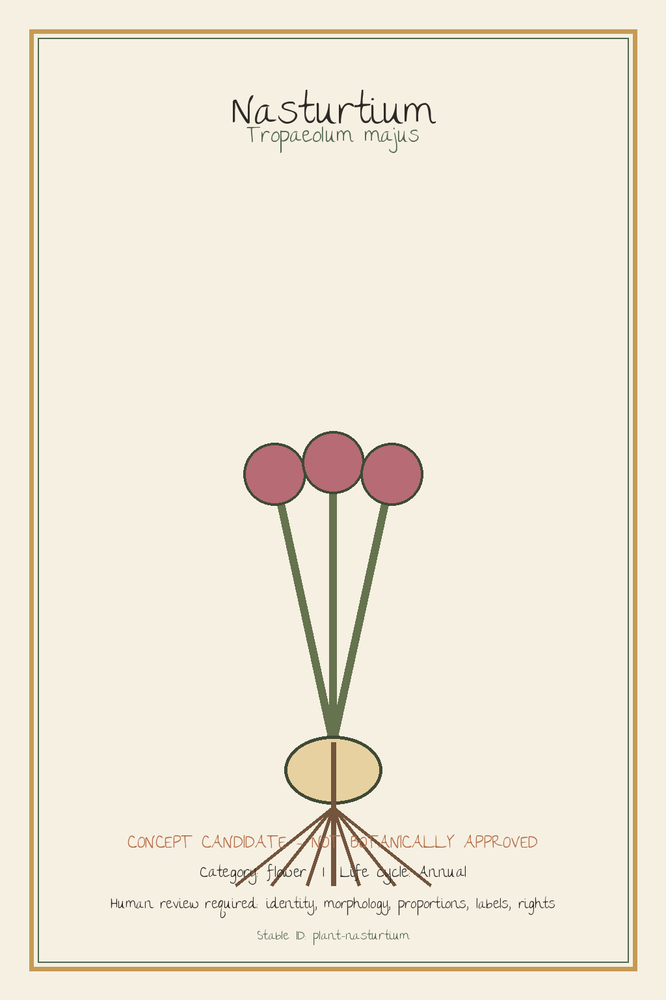

**Source status:** Not botanically or horticulturally approved. Recorded fields are derived
from the retained registry and remain subject to claim-level source review.

### Sunflower

**Stable plant ID:** `plant-sunflower`
**Category:** flower
**Recorded botanical name:** Helianthus annuus
**Recorded family:** Asteraceae
**Life cycle:** Annual
**Illustration status:** `CANDIDATE_GENERATED / REVIEW_PENDING / NOT_APPROVED`

**Identification and morphology**

- Growth habit: Growth habit should be resolved to the exact species or cultivar; this entry provides a category-level source scaffold.
- Root or storage organ: Species-specific root, crown, or storage organ; verify the exact form before illustrating.
- Leaf arrangement and shape: Species-specific arrangement and blade shape; verify exact genus and cultivar.
- Flower structure: Species-specific inflorescence or flower structure.
- Fruit or seed structure: Species-specific fruit, seed pod, achene, capsule, berry, or nut.

**Errington timing fields**

- Indoor sow: Source timing not reviewed
- Direct sow: Source timing not reviewed
- Transplant: Source timing not reviewed
- Bloom: Source timing not reviewed
- Harvest: Source timing not reviewed
- Frost: Source timing not reviewed

**Cultivation**

- Soil: Fertile, well-drained soil with organic matter unless the species has a known exceptional preference.
- Water: Provide even establishment moisture; then follow the species' drought, moisture, or wetness preference.
- Spacing: Base spacing on mature height and spread, not just the common name.
- Light: Sun requirement is species-specific; the common name alone is not a reliable light label.
- Maintenance: Mulch, deadhead or divide as appropriate, and monitor for structural or seasonal maintenance.
- Pests/diseases: Identify the pest or disease locally before control; favor sanitation, cultural prevention, and targeted action.

**Candidate plate:**
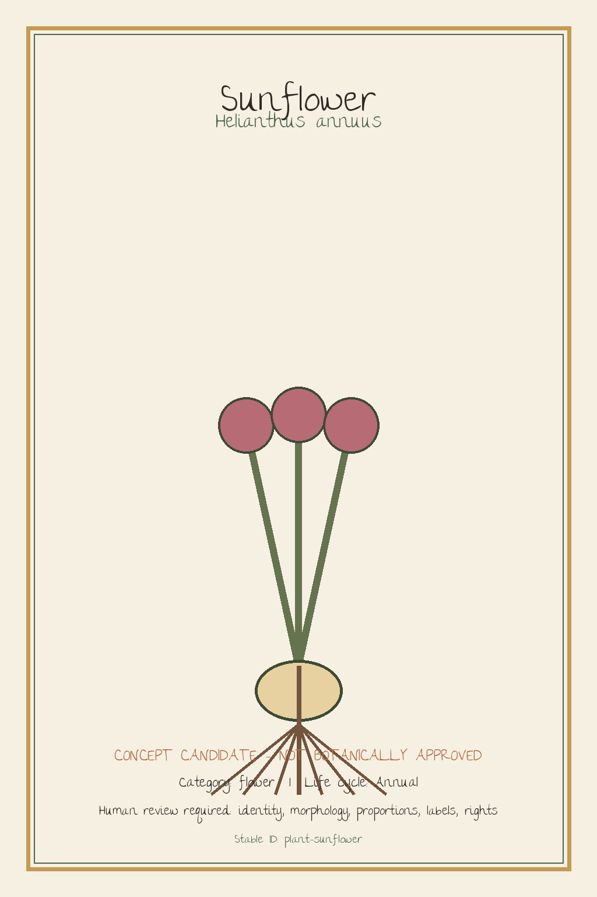

**Source status:** Not botanically or horticulturally approved. Recorded fields are derived
from the retained registry and remain subject to claim-level source review.

### Sweet Pea

**Stable plant ID:** `plant-sweet-pea`
**Category:** flower
**Recorded botanical name:** Lathyrus odoratus
**Recorded family:** Fabaceae
**Life cycle:** Annual
**Illustration status:** `CANDIDATE_GENERATED / REVIEW_PENDING / NOT_APPROVED`

**Identification and morphology**

- Growth habit: Growth habit should be resolved to the exact species or cultivar; this entry provides a category-level source scaffold.
- Root or storage organ: Species-specific root, crown, or storage organ; verify the exact form before illustrating.
- Leaf arrangement and shape: Species-specific arrangement and blade shape; verify exact genus and cultivar.
- Flower structure: Species-specific inflorescence or flower structure.
- Fruit or seed structure: Species-specific fruit, seed pod, achene, capsule, berry, or nut.

**Errington timing fields**

- Indoor sow: Source timing not reviewed
- Direct sow: Source timing not reviewed
- Transplant: Source timing not reviewed
- Bloom: Source timing not reviewed
- Harvest: Source timing not reviewed
- Frost: Source timing not reviewed

**Cultivation**

- Soil: Fertile, well-drained soil with organic matter unless the species has a known exceptional preference.
- Water: Provide even establishment moisture; then follow the species' drought, moisture, or wetness preference.
- Spacing: Base spacing on mature height and spread, not just the common name.
- Light: Sun requirement is species-specific; the common name alone is not a reliable light label.
- Maintenance: Mulch, deadhead or divide as appropriate, and monitor for structural or seasonal maintenance.
- Pests/diseases: Identify the pest or disease locally before control; favor sanitation, cultural prevention, and targeted action.

**Candidate plate:**

**Source status:** Not botanically or horticulturally approved. Recorded fields are derived
from the retained registry and remain subject to claim-level source review.

### Calendula

**Stable plant ID:** `plant-calendula`
**Category:** flower
**Recorded botanical name:** Calendula officinalis
**Recorded family:** Asteraceae
**Life cycle:** Annual
**Illustration status:** `CANDIDATE_GENERATED / REVIEW_PENDING / NOT_APPROVED`

**Identification and morphology**

- Growth habit: Growth habit should be resolved to the exact species or cultivar; this entry provides a category-level source scaffold.
- Root or storage organ: Species-specific root, crown, or storage organ; verify the exact form before illustrating.
- Leaf arrangement and shape: Species-specific arrangement and blade shape; verify exact genus and cultivar.
- Flower structure: Species-specific inflorescence or flower structure.
- Fruit or seed structure: Species-specific fruit, seed pod, achene, capsule, berry, or nut.

**Errington timing fields**

- Indoor sow: Source timing not reviewed
- Direct sow: Source timing not reviewed
- Transplant: Source timing not reviewed
- Bloom: Source timing not reviewed
- Harvest: Source timing not reviewed
- Frost: Source timing not reviewed

**Cultivation**

- Soil: Fertile, well-drained soil with organic matter unless the species has a known exceptional preference.
- Water: Provide even establishment moisture; then follow the species' drought, moisture, or wetness preference.
- Spacing: Base spacing on mature height and spread, not just the common name.
- Light: Sun requirement is species-specific; the common name alone is not a reliable light label.
- Maintenance: Mulch, deadhead or divide as appropriate, and monitor for structural or seasonal maintenance.
- Pests/diseases: Identify the pest or disease locally before control; favor sanitation, cultural prevention, and targeted action.

**Candidate plate:**
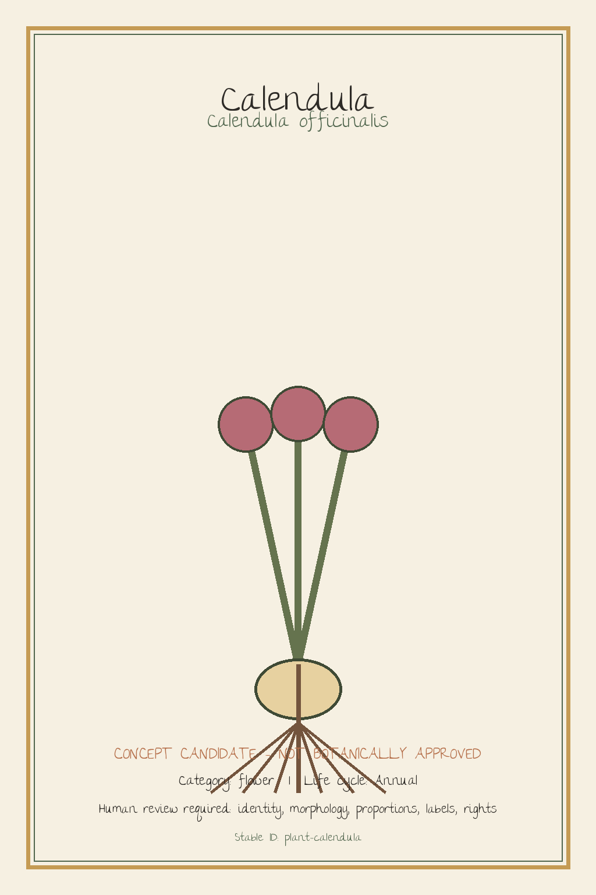

**Source status:** Not botanically or horticulturally approved. Recorded fields are derived
from the retained registry and remain subject to claim-level source review.

### Dahlia

**Stable plant ID:** `plant-dahlia`
**Category:** flower
**Recorded botanical name:** Dahlia pinnata
**Recorded family:** Asteraceae
**Life cycle:** Perennial
**Illustration status:** `CANDIDATE_GENERATED / REVIEW_PENDING / NOT_APPROVED`

**Identification and morphology**

- Growth habit: Growth habit should be resolved to the exact species or cultivar; this entry provides a category-level source scaffold.
- Root or storage organ: Species-specific root, crown, or storage organ; verify the exact form before illustrating.
- Leaf arrangement and shape: Species-specific arrangement and blade shape; verify exact genus and cultivar.
- Flower structure: Species-specific inflorescence or flower structure.
- Fruit or seed structure: Species-specific fruit, seed pod, achene, capsule, berry, or nut.

**Errington timing fields**

- Indoor sow: Source timing not reviewed
- Direct sow: Source timing not reviewed
- Transplant: Source timing not reviewed
- Bloom: Source timing not reviewed
- Harvest: Source timing not reviewed
- Frost: Source timing not reviewed

**Cultivation**

- Soil: Fertile, well-drained soil with organic matter unless the species has a known exceptional preference.
- Water: Provide even establishment moisture; then follow the species' drought, moisture, or wetness preference.
- Spacing: Base spacing on mature height and spread, not just the common name.
- Light: Sun requirement is species-specific; the common name alone is not a reliable light label.
- Maintenance: Mulch, deadhead or divide as appropriate, and monitor for structural or seasonal maintenance.
- Pests/diseases: Identify the pest or disease locally before control; favor sanitation, cultural prevention, and targeted action.

**Candidate plate:**

**Source status:** Not botanically or horticulturally approved. Recorded fields are derived
from the retained registry and remain subject to claim-level source review.

### Peony

**Stable plant ID:** `plant-peony`
**Category:** flower
**Recorded botanical name:** Paeonia lactiflora
**Recorded family:** Paeoniaceae
**Life cycle:** Perennial
**Illustration status:** `CANDIDATE_GENERATED / REVIEW_PENDING / NOT_APPROVED`

**Identification and morphology**

- Growth habit: Growth habit should be resolved to the exact species or cultivar; this entry provides a category-level source scaffold.
- Root or storage organ: Species-specific root, crown, or storage organ; verify the exact form before illustrating.
- Leaf arrangement and shape: Species-specific arrangement and blade shape; verify exact genus and cultivar.
- Flower structure: Species-specific inflorescence or flower structure.
- Fruit or seed structure: Species-specific fruit, seed pod, achene, capsule, berry, or nut.

**Errington timing fields**

- Indoor sow: Source timing not reviewed
- Direct sow: Source timing not reviewed
- Transplant: Source timing not reviewed
- Bloom: Source timing not reviewed
- Harvest: Source timing not reviewed
- Frost: Source timing not reviewed

**Cultivation**

- Soil: Fertile, well-drained soil with organic matter unless the species has a known exceptional preference.
- Water: Provide even establishment moisture; then follow the species' drought, moisture, or wetness preference.
- Spacing: Base spacing on mature height and spread, not just the common name.
- Light: Sun requirement is species-specific; the common name alone is not a reliable light label.
- Maintenance: Mulch, deadhead or divide as appropriate, and monitor for structural or seasonal maintenance.
- Pests/diseases: Identify the pest or disease locally before control; favor sanitation, cultural prevention, and targeted action.

**Candidate plate:**
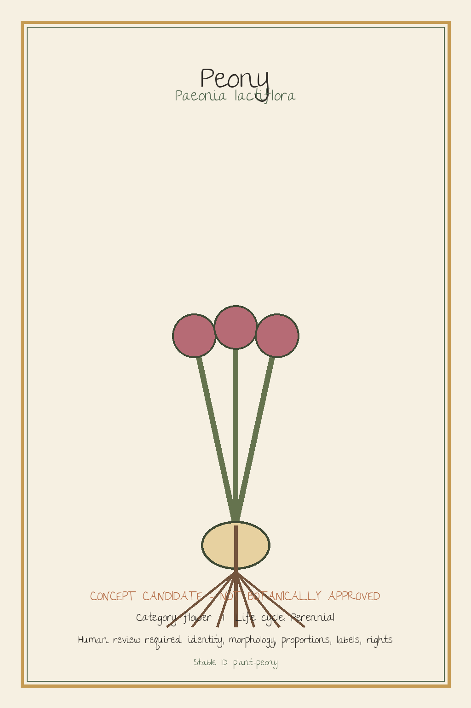

**Source status:** Not botanically or horticulturally approved. Recorded fields are derived
from the retained registry and remain subject to claim-level source review.

### Iris

**Stable plant ID:** `plant-iris`
**Category:** flower
**Recorded botanical name:** Iris × germanica
**Recorded family:** Iridaceae
**Life cycle:** Perennial
**Illustration status:** `CANDIDATE_GENERATED / REVIEW_PENDING / NOT_APPROVED`

**Identification and morphology**

- Growth habit: Growth habit should be resolved to the exact species or cultivar; this entry provides a category-level source scaffold.
- Root or storage organ: Species-specific root, crown, or storage organ; verify the exact form before illustrating.
- Leaf arrangement and shape: Species-specific arrangement and blade shape; verify exact genus and cultivar.
- Flower structure: Species-specific inflorescence or flower structure.
- Fruit or seed structure: Species-specific fruit, seed pod, achene, capsule, berry, or nut.

**Errington timing fields**

- Indoor sow: Source timing not reviewed
- Direct sow: Source timing not reviewed
- Transplant: Source timing not reviewed
- Bloom: Source timing not reviewed
- Harvest: Source timing not reviewed
- Frost: Source timing not reviewed

**Cultivation**

- Soil: Fertile, well-drained soil with organic matter unless the species has a known exceptional preference.
- Water: Provide even establishment moisture; then follow the species' drought, moisture, or wetness preference.
- Spacing: Base spacing on mature height and spread, not just the common name.
- Light: Sun requirement is species-specific; the common name alone is not a reliable light label.
- Maintenance: Mulch, deadhead or divide as appropriate, and monitor for structural or seasonal maintenance.
- Pests/diseases: Identify the pest or disease locally before control; favor sanitation, cultural prevention, and targeted action.

**Candidate plate:**

**Source status:** Not botanically or horticulturally approved. Recorded fields are derived
from the retained registry and remain subject to claim-level source review.

### Daylily

**Stable plant ID:** `plant-daylily`
**Category:** flower
**Recorded botanical name:** Hemerocallis × hybrida
**Recorded family:** Asphodelaceae
**Life cycle:** Perennial
**Illustration status:** `CANDIDATE_GENERATED / REVIEW_PENDING / NOT_APPROVED`

**Identification and morphology**

- Growth habit: Growth habit should be resolved to the exact species or cultivar; this entry provides a category-level source scaffold.
- Root or storage organ: Species-specific root, crown, or storage organ; verify the exact form before illustrating.
- Leaf arrangement and shape: Species-specific arrangement and blade shape; verify exact genus and cultivar.
- Flower structure: Species-specific inflorescence or flower structure.
- Fruit or seed structure: Species-specific fruit, seed pod, achene, capsule, berry, or nut.

**Errington timing fields**

- Indoor sow: Source timing not reviewed
- Direct sow: Source timing not reviewed
- Transplant: Source timing not reviewed
- Bloom: Source timing not reviewed
- Harvest: Source timing not reviewed
- Frost: Source timing not reviewed

**Cultivation**

- Soil: Fertile, well-drained soil with organic matter unless the species has a known exceptional preference.
- Water: Provide even establishment moisture; then follow the species' drought, moisture, or wetness preference.
- Spacing: Base spacing on mature height and spread, not just the common name.
- Light: Sun requirement is species-specific; the common name alone is not a reliable light label.
- Maintenance: Mulch, deadhead or divide as appropriate, and monitor for structural or seasonal maintenance.
- Pests/diseases: Identify the pest or disease locally before control; favor sanitation, cultural prevention, and targeted action.

**Candidate plate:**
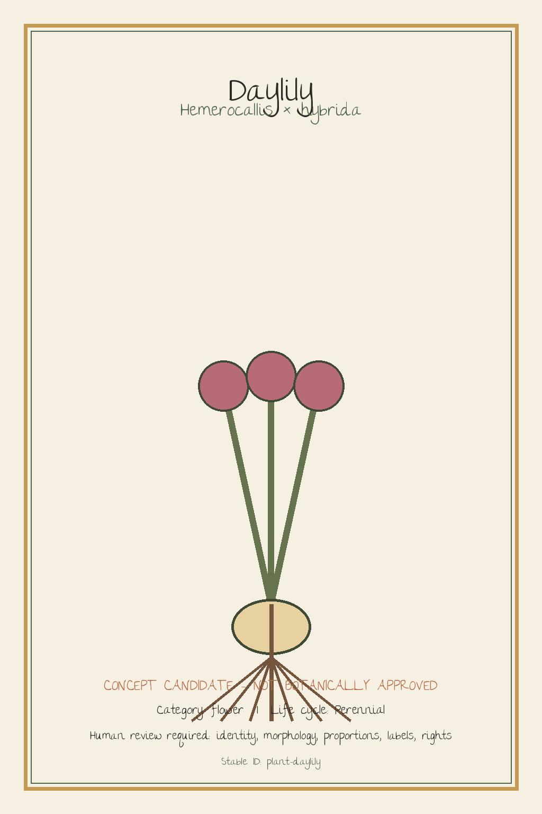

**Source status:** Not botanically or horticulturally approved. Recorded fields are derived
from the retained registry and remain subject to claim-level source review.

### Lavender

**Stable plant ID:** `plant-lavender`
**Category:** flower
**Recorded botanical name:** Lavandula angustifolia
**Recorded family:** Lamiaceae
**Life cycle:** Perennial
**Illustration status:** `CANDIDATE_GENERATED / REVIEW_PENDING / NOT_APPROVED`

**Identification and morphology**

- Growth habit: Growth habit should be resolved to the exact species or cultivar; this entry provides a category-level source scaffold.
- Root or storage organ: Species-specific root, crown, or storage organ; verify the exact form before illustrating.
- Leaf arrangement and shape: Species-specific arrangement and blade shape; verify exact genus and cultivar.
- Flower structure: Species-specific inflorescence or flower structure.
- Fruit or seed structure: Species-specific fruit, seed pod, achene, capsule, berry, or nut.

**Errington timing fields**

- Indoor sow: Source timing not reviewed
- Direct sow: Source timing not reviewed
- Transplant: Source timing not reviewed
- Bloom: Source timing not reviewed
- Harvest: Source timing not reviewed
- Frost: Source timing not reviewed

**Cultivation**

- Soil: Fertile, well-drained soil with organic matter unless the species has a known exceptional preference.
- Water: Provide even establishment moisture; then follow the species' drought, moisture, or wetness preference.
- Spacing: Base spacing on mature height and spread, not just the common name.
- Light: Sun requirement is species-specific; the common name alone is not a reliable light label.
- Maintenance: Mulch, deadhead or divide as appropriate, and monitor for structural or seasonal maintenance.
- Pests/diseases: Identify the pest or disease locally before control; favor sanitation, cultural prevention, and targeted action.

**Candidate plate:**
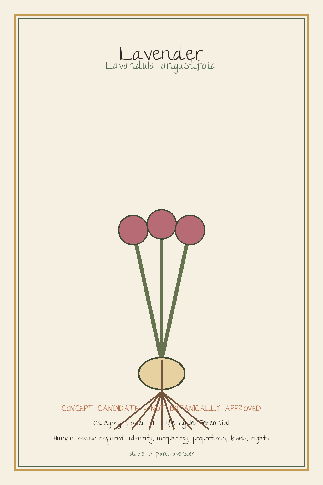

**Source status:** Not botanically or horticulturally approved. Recorded fields are derived
from the retained registry and remain subject to claim-level source review.

### Echinacea

**Stable plant ID:** `plant-echinacea`
**Category:** flower
**Recorded botanical name:** Echinacea purpurea
**Recorded family:** Asteraceae
**Life cycle:** Perennial
**Illustration status:** `CANDIDATE_GENERATED / REVIEW_PENDING / NOT_APPROVED`

**Identification and morphology**

- Growth habit: Growth habit should be resolved to the exact species or cultivar; this entry provides a category-level source scaffold.
- Root or storage organ: Species-specific root, crown, or storage organ; verify the exact form before illustrating.
- Leaf arrangement and shape: Species-specific arrangement and blade shape; verify exact genus and cultivar.
- Flower structure: Species-specific inflorescence or flower structure.
- Fruit or seed structure: Species-specific fruit, seed pod, achene, capsule, berry, or nut.

**Errington timing fields**

- Indoor sow: Source timing not reviewed
- Direct sow: Source timing not reviewed
- Transplant: Source timing not reviewed
- Bloom: Source timing not reviewed
- Harvest: Source timing not reviewed
- Frost: Source timing not reviewed

**Cultivation**

- Soil: Fertile, well-drained soil with organic matter unless the species has a known exceptional preference.
- Water: Provide even establishment moisture; then follow the species' drought, moisture, or wetness preference.
- Spacing: Base spacing on mature height and spread, not just the common name.
- Light: Sun requirement is species-specific; the common name alone is not a reliable light label.
- Maintenance: Mulch, deadhead or divide as appropriate, and monitor for structural or seasonal maintenance.
- Pests/diseases: Identify the pest or disease locally before control; favor sanitation, cultural prevention, and targeted action.

**Candidate plate:**

**Source status:** Not botanically or horticulturally approved. Recorded fields are derived
from the retained registry and remain subject to claim-level source review.

### Rudbeckia

**Stable plant ID:** `plant-rudbeckia`
**Category:** flower
**Recorded botanical name:** Rudbeckia hirta
**Recorded family:** Asteraceae
**Life cycle:** Perennial
**Illustration status:** `CANDIDATE_GENERATED / REVIEW_PENDING / NOT_APPROVED`

**Identification and morphology**

- Growth habit: Growth habit should be resolved to the exact species or cultivar; this entry provides a category-level source scaffold.
- Root or storage organ: Species-specific root, crown, or storage organ; verify the exact form before illustrating.
- Leaf arrangement and shape: Species-specific arrangement and blade shape; verify exact genus and cultivar.
- Flower structure: Species-specific inflorescence or flower structure.
- Fruit or seed structure: Species-specific fruit, seed pod, achene, capsule, berry, or nut.

**Errington timing fields**

- Indoor sow: Source timing not reviewed
- Direct sow: Source timing not reviewed
- Transplant: Source timing not reviewed
- Bloom: Source timing not reviewed
- Harvest: Source timing not reviewed
- Frost: Source timing not reviewed

**Cultivation**

- Soil: Fertile, well-drained soil with organic matter unless the species has a known exceptional preference.
- Water: Provide even establishment moisture; then follow the species' drought, moisture, or wetness preference.
- Spacing: Base spacing on mature height and spread, not just the common name.
- Light: Sun requirement is species-specific; the common name alone is not a reliable light label.
- Maintenance: Mulch, deadhead or divide as appropriate, and monitor for structural or seasonal maintenance.
- Pests/diseases: Identify the pest or disease locally before control; favor sanitation, cultural prevention, and targeted action.

**Candidate plate:**

**Source status:** Not botanically or horticulturally approved. Recorded fields are derived
from the retained registry and remain subject to claim-level source review.

### Tulip

**Stable plant ID:** `plant-tulip`
**Category:** flower
**Recorded botanical name:** Tulipa gesneriana
**Recorded family:** Liliaceae
**Life cycle:** Perennial; grown from a bulb, corm, or storage organ
**Illustration status:** `CANDIDATE_GENERATED / REVIEW_PENDING / NOT_APPROVED`

**Identification and morphology**

- Growth habit: Growth habit should be resolved to the exact species or cultivar; this entry provides a category-level source scaffold.
- Root or storage organ: Basal plate and fibrous roots; bulb or corm storage organ.
- Leaf arrangement and shape: Basal or sheathing leaves; strap, linear, or species-specific blades.
- Flower structure: Species-specific flower or inflorescence; generally showy and arranged to attract pollinators.
- Fruit or seed structure: Seed capsule or berry may follow flowering.

**Errington timing fields**

- Indoor sow: Source timing not reviewed
- Direct sow: Source timing not reviewed
- Transplant: Source timing not reviewed
- Bloom: Source timing not reviewed
- Harvest: Source timing not reviewed
- Frost: Source timing not reviewed

**Cultivation**

- Soil: Fertile, well-drained soil with organic matter unless the species has a known exceptional preference.
- Water: Provide even establishment moisture; then follow the species' drought, moisture, or wetness preference.
- Spacing: Base spacing on mature height and spread, not just the common name.
- Light: Sun requirement is species-specific; the common name alone is not a reliable light label.
- Maintenance: Mulch, deadhead or divide as appropriate, and monitor for structural or seasonal maintenance.
- Pests/diseases: Identify the pest or disease locally before control; favor sanitation, cultural prevention, and targeted action.

**Candidate plate:**

**Source status:** Not botanically or horticulturally approved. Recorded fields are derived
from the retained registry and remain subject to claim-level source review.

### Daffodil

**Stable plant ID:** `plant-daffodil`
**Category:** flower
**Recorded botanical name:** Narcissus pseudonarcissus
**Recorded family:** Amaryllidaceae
**Life cycle:** Perennial; grown from a bulb, corm, or storage organ
**Illustration status:** `CANDIDATE_GENERATED / REVIEW_PENDING / NOT_APPROVED`

**Identification and morphology**

- Growth habit: Growth habit should be resolved to the exact species or cultivar; this entry provides a category-level source scaffold.
- Root or storage organ: Basal plate and fibrous roots; bulb or corm storage organ.
- Leaf arrangement and shape: Basal or sheathing leaves; strap, linear, or species-specific blades.
- Flower structure: Species-specific flower or inflorescence; generally showy and arranged to attract pollinators.
- Fruit or seed structure: Seed capsule or berry may follow flowering.

**Errington timing fields**

- Indoor sow: Source timing not reviewed
- Direct sow: Source timing not reviewed
- Transplant: Source timing not reviewed
- Bloom: Source timing not reviewed
- Harvest: Source timing not reviewed
- Frost: Source timing not reviewed

**Cultivation**

- Soil: Fertile, well-drained soil with organic matter unless the species has a known exceptional preference.
- Water: Provide even establishment moisture; then follow the species' drought, moisture, or wetness preference.
- Spacing: Base spacing on mature height and spread, not just the common name.
- Light: Sun requirement is species-specific; the common name alone is not a reliable light label.
- Maintenance: Mulch, deadhead or divide as appropriate, and monitor for structural or seasonal maintenance.
- Pests/diseases: Identify the pest or disease locally before control; favor sanitation, cultural prevention, and targeted action.

**Candidate plate:**
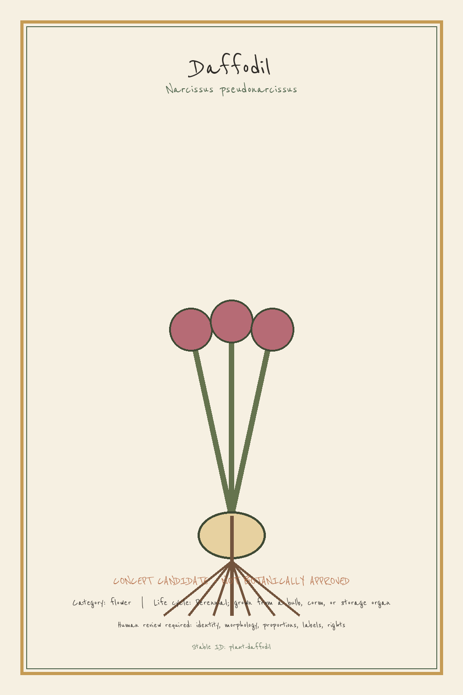

**Source status:** Not botanically or horticulturally approved. Recorded fields are derived
from the retained registry and remain subject to claim-level source review.

### Crocus

**Stable plant ID:** `plant-crocus`
**Category:** flower
**Recorded botanical name:** Crocus vernus
**Recorded family:** Iridaceae
**Life cycle:** Perennial; grown from a bulb, corm, or storage organ
**Illustration status:** `CANDIDATE_GENERATED / REVIEW_PENDING / NOT_APPROVED`

**Identification and morphology**

- Growth habit: Growth habit should be resolved to the exact species or cultivar; this entry provides a category-level source scaffold.
- Root or storage organ: Basal plate and fibrous roots; bulb or corm storage organ.
- Leaf arrangement and shape: Basal or sheathing leaves; strap, linear, or species-specific blades.
- Flower structure: Species-specific flower or inflorescence; generally showy and arranged to attract pollinators.
- Fruit or seed structure: Seed capsule or berry may follow flowering.

**Errington timing fields**

- Indoor sow: Source timing not reviewed
- Direct sow: Source timing not reviewed
- Transplant: Source timing not reviewed
- Bloom: Source timing not reviewed
- Harvest: Source timing not reviewed
- Frost: Source timing not reviewed

**Cultivation**

- Soil: Fertile, well-drained soil with organic matter unless the species has a known exceptional preference.
- Water: Provide even establishment moisture; then follow the species' drought, moisture, or wetness preference.
- Spacing: Base spacing on mature height and spread, not just the common name.
- Light: Sun requirement is species-specific; the common name alone is not a reliable light label.
- Maintenance: Mulch, deadhead or divide as appropriate, and monitor for structural or seasonal maintenance.
- Pests/diseases: Identify the pest or disease locally before control; favor sanitation, cultural prevention, and targeted action.

**Candidate plate:**

**Source status:** Not botanically or horticulturally approved. Recorded fields are derived
from the retained registry and remain subject to claim-level source review.

### Allium

**Stable plant ID:** `plant-allium`
**Category:** flower
**Recorded botanical name:** Allium hollandicum
**Recorded family:** Amaryllidaceae
**Life cycle:** Perennial; grown from a bulb, corm, or storage organ
**Illustration status:** `CANDIDATE_GENERATED / REVIEW_PENDING / NOT_APPROVED`

**Identification and morphology**

- Growth habit: Growth habit should be resolved to the exact species or cultivar; this entry provides a category-level source scaffold.
- Root or storage organ: Basal plate and fibrous roots; bulb or corm storage organ.
- Leaf arrangement and shape: Basal or sheathing leaves; strap, linear, or species-specific blades.
- Flower structure: Species-specific flower or inflorescence; generally showy and arranged to attract pollinators.
- Fruit or seed structure: Seed capsule or berry may follow flowering.

**Errington timing fields**

- Indoor sow: Source timing not reviewed
- Direct sow: Source timing not reviewed
- Transplant: Source timing not reviewed
- Bloom: Source timing not reviewed
- Harvest: Source timing not reviewed
- Frost: Source timing not reviewed

**Cultivation**

- Soil: Fertile, well-drained soil with organic matter unless the species has a known exceptional preference.
- Water: Provide even establishment moisture; then follow the species' drought, moisture, or wetness preference.
- Spacing: Base spacing on mature height and spread, not just the common name.
- Light: Sun requirement is species-specific; the common name alone is not a reliable light label.
- Maintenance: Mulch, deadhead or divide as appropriate, and monitor for structural or seasonal maintenance.
- Pests/diseases: Identify the pest or disease locally before control; favor sanitation, cultural prevention, and targeted action.

**Candidate plate:**

**Source status:** Not botanically or horticulturally approved. Recorded fields are derived
from the retained registry and remain subject to claim-level source review.

### Hyacinth

**Stable plant ID:** `plant-hyacinth`
**Category:** flower
**Recorded botanical name:** Hyacinthus orientalis
**Recorded family:** Asparagaceae
**Life cycle:** Perennial; grown from a bulb, corm, or storage organ
**Illustration status:** `CANDIDATE_GENERATED / REVIEW_PENDING / NOT_APPROVED`

**Identification and morphology**

- Growth habit: Growth habit should be resolved to the exact species or cultivar; this entry provides a category-level source scaffold.
- Root or storage organ: Basal plate and fibrous roots; bulb or corm storage organ.
- Leaf arrangement and shape: Basal or sheathing leaves; strap, linear, or species-specific blades.
- Flower structure: Species-specific flower or inflorescence; generally showy and arranged to attract pollinators.
- Fruit or seed structure: Seed capsule or berry may follow flowering.

**Errington timing fields**

- Indoor sow: Source timing not reviewed
- Direct sow: Source timing not reviewed
- Transplant: Source timing not reviewed
- Bloom: Source timing not reviewed
- Harvest: Source timing not reviewed
- Frost: Source timing not reviewed

**Cultivation**

- Soil: Fertile, well-drained soil with organic matter unless the species has a known exceptional preference.
- Water: Provide even establishment moisture; then follow the species' drought, moisture, or wetness preference.
- Spacing: Base spacing on mature height and spread, not just the common name.
- Light: Sun requirement is species-specific; the common name alone is not a reliable light label.
- Maintenance: Mulch, deadhead or divide as appropriate, and monitor for structural or seasonal maintenance.
- Pests/diseases: Identify the pest or disease locally before control; favor sanitation, cultural prevention, and targeted action.

**Candidate plate:**

**Source status:** Not botanically or horticulturally approved. Recorded fields are derived
from the retained registry and remain subject to claim-level source review.

### Hostas

**Stable plant ID:** `plant-hostas`
**Category:** ornamental
**Recorded botanical name:** Hosta spp.
**Recorded family:** Asparagaceae
**Life cycle:** Perennial or variable; species-level resolution required
**Illustration status:** `CANDIDATE_GENERATED / REVIEW_PENDING / NOT_APPROVED`

**Identification and morphology**

- Growth habit: Growth habit should be resolved to the exact species or cultivar; this entry provides a category-level source scaffold.
- Root or storage organ: Fibrous, rhizomatous, clumping, or fleshy according to the species.
- Leaf arrangement and shape: Species- or genus-specific leaf arrangement and shape; generic label needs disambiguation.
- Flower structure: Species-specific flower form; local bloom timing comes from the Errington calendar if matched.
- Fruit or seed structure: Seed capsule, achene, berry, or no conspicuous fruit according to species.

**Errington timing fields**

- Indoor sow: Source timing not reviewed
- Direct sow: Source timing not reviewed
- Transplant: Source timing not reviewed
- Bloom: Source timing not reviewed
- Harvest: Source timing not reviewed
- Frost: Source timing not reviewed

**Cultivation**

- Soil: Choose a well-drained soil matched to the plant; the label and species can vary widely.
- Water: Water to establish, then match moisture to the specific ornamental's type.
- Spacing: Allow for mature clump or canopy width; label or cultivar may change the correct spacing.
- Light: Check the specific species; full sun, shade, and moisture labels may vary across genera.
- Maintenance: Remove damaged growth, divide where applicable, mulch carefully, and avoid overwatering.
- Pests/diseases: Monitor for slugs, aphids, mites, scale, and fungal leaf problems; use identification and prevention first.

**Candidate plate:**

**Source status:** Not botanically or horticulturally approved. Recorded fields are derived
from the retained registry and remain subject to claim-level source review.

### Ferns

**Stable plant ID:** `plant-ferns`
**Category:** ornamental
**Recorded botanical name:** Fern species / multiple genera
**Recorded family:** Multiple families
**Life cycle:** Perennial or variable; species-level resolution required
**Illustration status:** `CANDIDATE_GENERATED / REVIEW_PENDING / NOT_APPROVED`

**Identification and morphology**

- Growth habit: Growth habit should be resolved to the exact species or cultivar; this entry provides a category-level source scaffold.
- Root or storage organ: Fibrous, rhizomatous, clumping, or fleshy according to the species.
- Leaf arrangement and shape: Species- or genus-specific leaf arrangement and shape; generic label needs disambiguation.
- Flower structure: Species-specific flower form; local bloom timing comes from the Errington calendar if matched.
- Fruit or seed structure: Seed capsule, achene, berry, or no conspicuous fruit according to species.

**Errington timing fields**

- Indoor sow: Source timing not reviewed
- Direct sow: Source timing not reviewed
- Transplant: Source timing not reviewed
- Bloom: Source timing not reviewed
- Harvest: Source timing not reviewed
- Frost: Source timing not reviewed

**Cultivation**

- Soil: Choose a well-drained soil matched to the plant; the label and species can vary widely.
- Water: Water to establish, then match moisture to the specific ornamental's type.
- Spacing: Allow for mature clump or canopy width; label or cultivar may change the correct spacing.
- Light: Check the specific species; full sun, shade, and moisture labels may vary across genera.
- Maintenance: Remove damaged growth, divide where applicable, mulch carefully, and avoid overwatering.
- Pests/diseases: Monitor for slugs, aphids, mites, scale, and fungal leaf problems; use identification and prevention first.

**Candidate plate:**

**Source status:** Not botanically or horticulturally approved. Recorded fields are derived
from the retained registry and remain subject to claim-level source review.

### Ornamental Grasses

**Stable plant ID:** `plant-ornamental-grasses`
**Category:** ornamental
**Recorded botanical name:** Ornamental grass species / multiple genera
**Recorded family:** Poaceae
**Life cycle:** Perennial or variable; species-level resolution required
**Illustration status:** `CANDIDATE_GENERATED / REVIEW_PENDING / NOT_APPROVED`

**Identification and morphology**

- Growth habit: Growth habit should be resolved to the exact species or cultivar; this entry provides a category-level source scaffold.
- Root or storage organ: Fibrous, rhizomatous, clumping, or fleshy according to the species.
- Leaf arrangement and shape: Species- or genus-specific leaf arrangement and shape; generic label needs disambiguation.
- Flower structure: Species-specific flower form; local bloom timing comes from the Errington calendar if matched.
- Fruit or seed structure: Seed capsule, achene, berry, or no conspicuous fruit according to species.

**Errington timing fields**

- Indoor sow: Source timing not reviewed
- Direct sow: Source timing not reviewed
- Transplant: Source timing not reviewed
- Bloom: Source timing not reviewed
- Harvest: Source timing not reviewed
- Frost: Source timing not reviewed

**Cultivation**

- Soil: Choose a well-drained soil matched to the plant; the label and species can vary widely.
- Water: Water to establish, then match moisture to the specific ornamental's type.
- Spacing: Allow for mature clump or canopy width; label or cultivar may change the correct spacing.
- Light: Check the specific species; full sun, shade, and moisture labels may vary across genera.
- Maintenance: Remove damaged growth, divide where applicable, mulch carefully, and avoid overwatering.
- Pests/diseases: Monitor for slugs, aphids, mites, scale, and fungal leaf problems; use identification and prevention first.

**Candidate plate:**
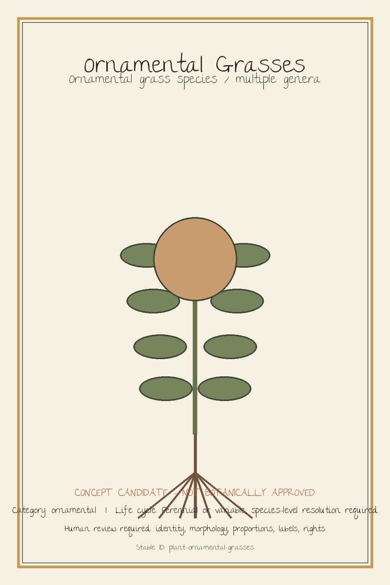

**Source status:** Not botanically or horticulturally approved. Recorded fields are derived
from the retained registry and remain subject to claim-level source review.

### Sedum

**Stable plant ID:** `plant-sedum`
**Category:** ornamental
**Recorded botanical name:** Hylotelephium telephium
**Recorded family:** Crassulaceae
**Life cycle:** Perennial or variable; species-level resolution required
**Illustration status:** `CANDIDATE_GENERATED / REVIEW_PENDING / NOT_APPROVED`

**Identification and morphology**

- Growth habit: Growth habit should be resolved to the exact species or cultivar; this entry provides a category-level source scaffold.
- Root or storage organ: Fibrous, rhizomatous, clumping, or fleshy according to the species.
- Leaf arrangement and shape: Species- or genus-specific leaf arrangement and shape; generic label needs disambiguation.
- Flower structure: Species-specific flower form; local bloom timing comes from the Errington calendar if matched.
- Fruit or seed structure: Seed capsule, achene, berry, or no conspicuous fruit according to species.

**Errington timing fields**

- Indoor sow: Source timing not reviewed
- Direct sow: Source timing not reviewed
- Transplant: Source timing not reviewed
- Bloom: Source timing not reviewed
- Harvest: Source timing not reviewed
- Frost: Source timing not reviewed

**Cultivation**

- Soil: Choose a well-drained soil matched to the plant; the label and species can vary widely.
- Water: Water to establish, then match moisture to the specific ornamental's type.
- Spacing: Allow for mature clump or canopy width; label or cultivar may change the correct spacing.
- Light: Check the specific species; full sun, shade, and moisture labels may vary across genera.
- Maintenance: Remove damaged growth, divide where applicable, mulch carefully, and avoid overwatering.
- Pests/diseases: Monitor for slugs, aphids, mites, scale, and fungal leaf problems; use identification and prevention first.

**Candidate plate:**

**Source status:** Not botanically or horticulturally approved. Recorded fields are derived
from the retained registry and remain subject to claim-level source review.

### Heuchera

**Stable plant ID:** `plant-heuchera`
**Category:** ornamental
**Recorded botanical name:** Heuchera sanguinea
**Recorded family:** Saxifragaceae
**Life cycle:** Perennial or variable; species-level resolution required
**Illustration status:** `CANDIDATE_GENERATED / REVIEW_PENDING / NOT_APPROVED`

**Identification and morphology**

- Growth habit: Growth habit should be resolved to the exact species or cultivar; this entry provides a category-level source scaffold.
- Root or storage organ: Fibrous, rhizomatous, clumping, or fleshy according to the species.
- Leaf arrangement and shape: Species- or genus-specific leaf arrangement and shape; generic label needs disambiguation.
- Flower structure: Species-specific flower form; local bloom timing comes from the Errington calendar if matched.
- Fruit or seed structure: Seed capsule, achene, berry, or no conspicuous fruit according to species.

**Errington timing fields**

- Indoor sow: Source timing not reviewed
- Direct sow: Source timing not reviewed
- Transplant: Source timing not reviewed
- Bloom: Source timing not reviewed
- Harvest: Source timing not reviewed
- Frost: Source timing not reviewed

**Cultivation**

- Soil: Choose a well-drained soil matched to the plant; the label and species can vary widely.
- Water: Water to establish, then match moisture to the specific ornamental's type.
- Spacing: Allow for mature clump or canopy width; label or cultivar may change the correct spacing.
- Light: Check the specific species; full sun, shade, and moisture labels may vary across genera.
- Maintenance: Remove damaged growth, divide where applicable, mulch carefully, and avoid overwatering.
- Pests/diseases: Monitor for slugs, aphids, mites, scale, and fungal leaf problems; use identification and prevention first.

**Candidate plate:**
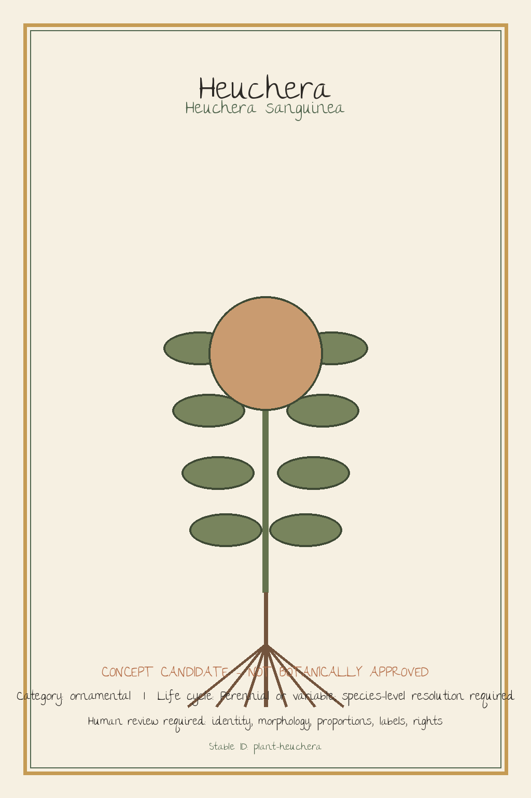

**Source status:** Not botanically or horticulturally approved. Recorded fields are derived
from the retained registry and remain subject to claim-level source review.

### Astilbe

**Stable plant ID:** `plant-astilbe`
**Category:** ornamental
**Recorded botanical name:** Astilbe × arendsii
**Recorded family:** Saxifragaceae
**Life cycle:** Perennial or variable; species-level resolution required
**Illustration status:** `CANDIDATE_GENERATED / REVIEW_PENDING / NOT_APPROVED`

**Identification and morphology**

- Growth habit: Growth habit should be resolved to the exact species or cultivar; this entry provides a category-level source scaffold.
- Root or storage organ: Fibrous, rhizomatous, clumping, or fleshy according to the species.
- Leaf arrangement and shape: Species- or genus-specific leaf arrangement and shape; generic label needs disambiguation.
- Flower structure: Species-specific flower form; local bloom timing comes from the Errington calendar if matched.
- Fruit or seed structure: Seed capsule, achene, berry, or no conspicuous fruit according to species.

**Errington timing fields**

- Indoor sow: Source timing not reviewed
- Direct sow: Source timing not reviewed
- Transplant: Source timing not reviewed
- Bloom: Source timing not reviewed
- Harvest: Source timing not reviewed
- Frost: Source timing not reviewed

**Cultivation**

- Soil: Choose a well-drained soil matched to the plant; the label and species can vary widely.
- Water: Water to establish, then match moisture to the specific ornamental's type.
- Spacing: Allow for mature clump or canopy width; label or cultivar may change the correct spacing.
- Light: Check the specific species; full sun, shade, and moisture labels may vary across genera.
- Maintenance: Remove damaged growth, divide where applicable, mulch carefully, and avoid overwatering.
- Pests/diseases: Monitor for slugs, aphids, mites, scale, and fungal leaf problems; use identification and prevention first.

**Candidate plate:**

**Source status:** Not botanically or horticulturally approved. Recorded fields are derived
from the retained registry and remain subject to claim-level source review.

### Rosemary

**Stable plant ID:** `plant-rosemary`
**Category:** herb
**Recorded botanical name:** Salvia rosmarinus
**Recorded family:** Lamiaceae
**Life cycle:** Perennial
**Illustration status:** `CANDIDATE_GENERATED / REVIEW_PENDING / NOT_APPROVED`

**Identification and morphology**

- Growth habit: Growth habit should be resolved to the exact species or cultivar; this entry provides a category-level source scaffold.
- Root or storage organ: Species-specific root, crown, or storage organ; verify the exact form before illustrating.
- Leaf arrangement and shape: Species-specific arrangement and blade shape; verify exact genus and cultivar.
- Flower structure: Species-specific inflorescence or flower structure.
- Fruit or seed structure: Species-specific fruit, seed pod, achene, capsule, berry, or nut.

**Errington timing fields**

- Indoor sow: Source timing not reviewed
- Direct sow: Source timing not reviewed
- Transplant: Source timing not reviewed
- Bloom: Source timing not reviewed
- Harvest: Source timing not reviewed
- Frost: Source timing not reviewed

**Cultivation**

- Soil: Fertile, well-drained soil with organic matter unless the species has a known exceptional preference.
- Water: Provide even establishment moisture; then follow the species' drought, moisture, or wetness preference.
- Spacing: Base spacing on mature height and spread, not just the common name.
- Light: Sun requirement is species-specific; the common name alone is not a reliable light label.
- Maintenance: Mulch, deadhead or divide as appropriate, and monitor for structural or seasonal maintenance.
- Pests/diseases: Identify the pest or disease locally before control; favor sanitation, cultural prevention, and targeted action.

**Candidate plate:**

**Source status:** Not botanically or horticulturally approved. Recorded fields are derived
from the retained registry and remain subject to claim-level source review.

### Thyme

**Stable plant ID:** `plant-thyme`
**Category:** herb
**Recorded botanical name:** Thymus vulgaris
**Recorded family:** Lamiaceae
**Life cycle:** Perennial
**Illustration status:** `CANDIDATE_GENERATED / REVIEW_PENDING / NOT_APPROVED`

**Identification and morphology**

- Growth habit: Growth habit should be resolved to the exact species or cultivar; this entry provides a category-level source scaffold.
- Root or storage organ: Species-specific root, crown, or storage organ; verify the exact form before illustrating.
- Leaf arrangement and shape: Species-specific arrangement and blade shape; verify exact genus and cultivar.
- Flower structure: Species-specific inflorescence or flower structure.
- Fruit or seed structure: Species-specific fruit, seed pod, achene, capsule, berry, or nut.

**Errington timing fields**

- Indoor sow: Source timing not reviewed
- Direct sow: Source timing not reviewed
- Transplant: Source timing not reviewed
- Bloom: Source timing not reviewed
- Harvest: Source timing not reviewed
- Frost: Source timing not reviewed

**Cultivation**

- Soil: Fertile, well-drained soil with organic matter unless the species has a known exceptional preference.
- Water: Provide even establishment moisture; then follow the species' drought, moisture, or wetness preference.
- Spacing: Base spacing on mature height and spread, not just the common name.
- Light: Sun requirement is species-specific; the common name alone is not a reliable light label.
- Maintenance: Mulch, deadhead or divide as appropriate, and monitor for structural or seasonal maintenance.
- Pests/diseases: Identify the pest or disease locally before control; favor sanitation, cultural prevention, and targeted action.

**Candidate plate:**
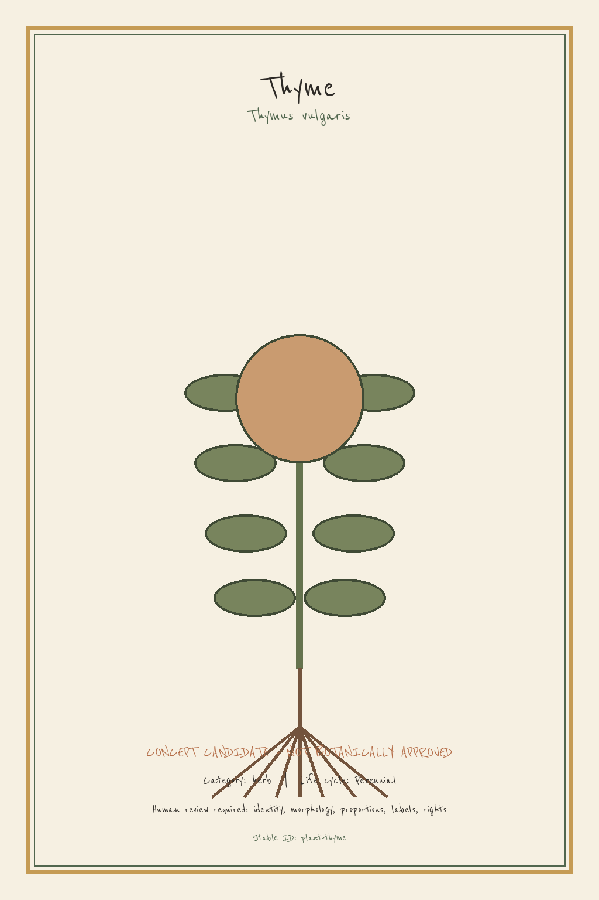

**Source status:** Not botanically or horticulturally approved. Recorded fields are derived
from the retained registry and remain subject to claim-level source review.

### Oregano

**Stable plant ID:** `plant-oregano`
**Category:** herb
**Recorded botanical name:** Origanum vulgare
**Recorded family:** Lamiaceae
**Life cycle:** Perennial
**Illustration status:** `CANDIDATE_GENERATED / REVIEW_PENDING / NOT_APPROVED`

**Identification and morphology**

- Growth habit: Growth habit should be resolved to the exact species or cultivar; this entry provides a category-level source scaffold.
- Root or storage organ: Species-specific root, crown, or storage organ; verify the exact form before illustrating.
- Leaf arrangement and shape: Species-specific arrangement and blade shape; verify exact genus and cultivar.
- Flower structure: Species-specific inflorescence or flower structure.
- Fruit or seed structure: Species-specific fruit, seed pod, achene, capsule, berry, or nut.

**Errington timing fields**

- Indoor sow: Source timing not reviewed
- Direct sow: Source timing not reviewed
- Transplant: Source timing not reviewed
- Bloom: Source timing not reviewed
- Harvest: Source timing not reviewed
- Frost: Source timing not reviewed

**Cultivation**

- Soil: Fertile, well-drained soil with organic matter unless the species has a known exceptional preference.
- Water: Provide even establishment moisture; then follow the species' drought, moisture, or wetness preference.
- Spacing: Base spacing on mature height and spread, not just the common name.
- Light: Sun requirement is species-specific; the common name alone is not a reliable light label.
- Maintenance: Mulch, deadhead or divide as appropriate, and monitor for structural or seasonal maintenance.
- Pests/diseases: Identify the pest or disease locally before control; favor sanitation, cultural prevention, and targeted action.

**Candidate plate:**
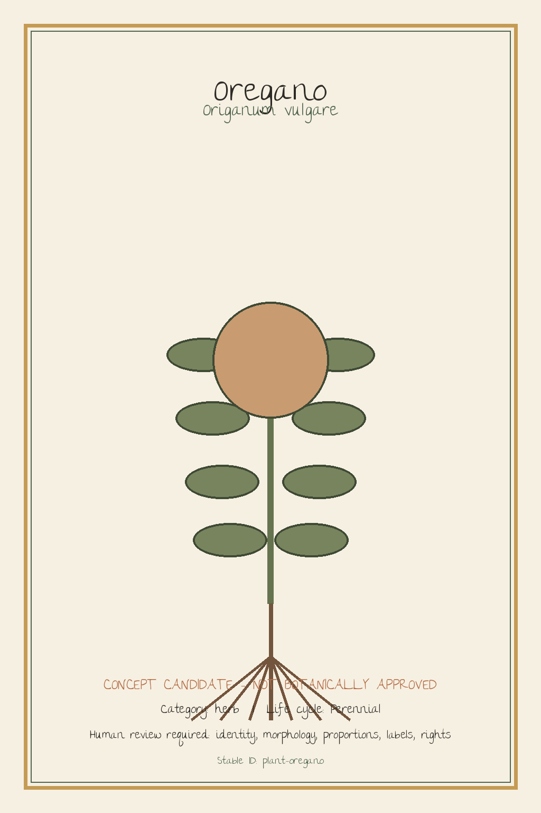

**Source status:** Not botanically or horticulturally approved. Recorded fields are derived
from the retained registry and remain subject to claim-level source review.

### Parsley

**Stable plant ID:** `plant-parsley`
**Category:** herb
**Recorded botanical name:** Petroselinum crispum
**Recorded family:** Apiaceae
**Life cycle:** Biennial, often grown as an annual
**Illustration status:** `CANDIDATE_GENERATED / REVIEW_PENDING / NOT_APPROVED`

**Identification and morphology**

- Growth habit: Growth habit should be resolved to the exact species or cultivar; this entry provides a category-level source scaffold.
- Root or storage organ: Species-specific root, crown, or storage organ; verify the exact form before illustrating.
- Leaf arrangement and shape: Species-specific arrangement and blade shape; verify exact genus and cultivar.
- Flower structure: Species-specific inflorescence or flower structure.
- Fruit or seed structure: Species-specific fruit, seed pod, achene, capsule, berry, or nut.

**Errington timing fields**

- Indoor sow: Source timing not reviewed
- Direct sow: Source timing not reviewed
- Transplant: Source timing not reviewed
- Bloom: Source timing not reviewed
- Harvest: Source timing not reviewed
- Frost: Source timing not reviewed

**Cultivation**

- Soil: Fertile, well-drained soil with organic matter unless the species has a known exceptional preference.
- Water: Provide even establishment moisture; then follow the species' drought, moisture, or wetness preference.
- Spacing: Base spacing on mature height and spread, not just the common name.
- Light: Sun requirement is species-specific; the common name alone is not a reliable light label.
- Maintenance: Mulch, deadhead or divide as appropriate, and monitor for structural or seasonal maintenance.
- Pests/diseases: Identify the pest or disease locally before control; favor sanitation, cultural prevention, and targeted action.

**Candidate plate:**
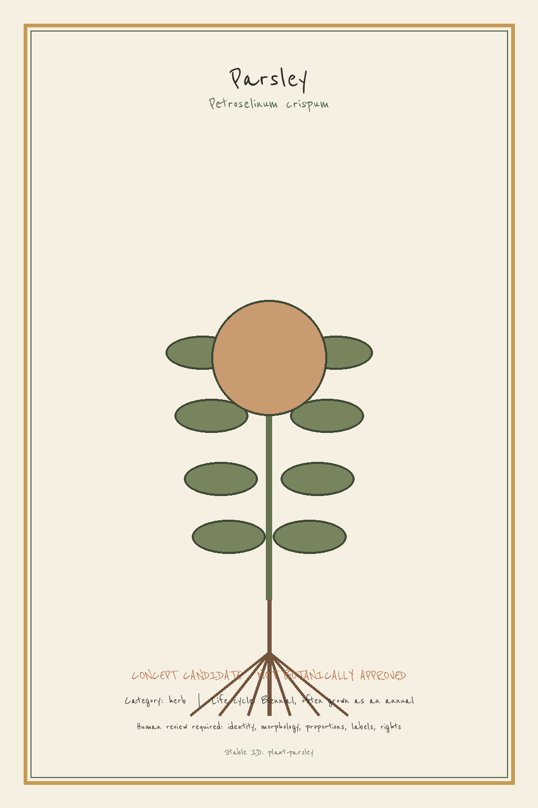

**Source status:** Not botanically or horticulturally approved. Recorded fields are derived
from the retained registry and remain subject to claim-level source review.

### Chives

**Stable plant ID:** `plant-chives`
**Category:** herb
**Recorded botanical name:** Allium schoenoprasum
**Recorded family:** Amaryllidaceae
**Life cycle:** Perennial
**Illustration status:** `CANDIDATE_GENERATED / REVIEW_PENDING / NOT_APPROVED`

**Identification and morphology**

- Growth habit: Growth habit should be resolved to the exact species or cultivar; this entry provides a category-level source scaffold.
- Root or storage organ: Species-specific root, crown, or storage organ; verify the exact form before illustrating.
- Leaf arrangement and shape: Species-specific arrangement and blade shape; verify exact genus and cultivar.
- Flower structure: Species-specific inflorescence or flower structure.
- Fruit or seed structure: Species-specific fruit, seed pod, achene, capsule, berry, or nut.

**Errington timing fields**

- Indoor sow: Source timing not reviewed
- Direct sow: Source timing not reviewed
- Transplant: Source timing not reviewed
- Bloom: Source timing not reviewed
- Harvest: Source timing not reviewed
- Frost: Source timing not reviewed

**Cultivation**

- Soil: Fertile, well-drained soil with organic matter unless the species has a known exceptional preference.
- Water: Provide even establishment moisture; then follow the species' drought, moisture, or wetness preference.
- Spacing: Base spacing on mature height and spread, not just the common name.
- Light: Sun requirement is species-specific; the common name alone is not a reliable light label.
- Maintenance: Mulch, deadhead or divide as appropriate, and monitor for structural or seasonal maintenance.
- Pests/diseases: Identify the pest or disease locally before control; favor sanitation, cultural prevention, and targeted action.

**Candidate plate:**

**Source status:** Not botanically or horticulturally approved. Recorded fields are derived
from the retained registry and remain subject to claim-level source review.

### Basil

**Stable plant ID:** `plant-basil`
**Category:** herb
**Recorded botanical name:** Ocimum basilicum
**Recorded family:** Lamiaceae
**Life cycle:** Annual
**Illustration status:** `CANDIDATE_GENERATED / REVIEW_PENDING / NOT_APPROVED`

**Identification and morphology**

- Growth habit: Growth habit should be resolved to the exact species or cultivar; this entry provides a category-level source scaffold.
- Root or storage organ: Species-specific root, crown, or storage organ; verify the exact form before illustrating.
- Leaf arrangement and shape: Species-specific arrangement and blade shape; verify exact genus and cultivar.
- Flower structure: Species-specific inflorescence or flower structure.
- Fruit or seed structure: Species-specific fruit, seed pod, achene, capsule, berry, or nut.

**Errington timing fields**

- Indoor sow: Source timing not reviewed
- Direct sow: Source timing not reviewed
- Transplant: Source timing not reviewed
- Bloom: Source timing not reviewed
- Harvest: Source timing not reviewed
- Frost: Source timing not reviewed

**Cultivation**

- Soil: Fertile, well-drained soil with organic matter unless the species has a known exceptional preference.
- Water: Provide even establishment moisture; then follow the species' drought, moisture, or wetness preference.
- Spacing: Base spacing on mature height and spread, not just the common name.
- Light: Sun requirement is species-specific; the common name alone is not a reliable light label.
- Maintenance: Mulch, deadhead or divide as appropriate, and monitor for structural or seasonal maintenance.
- Pests/diseases: Identify the pest or disease locally before control; favor sanitation, cultural prevention, and targeted action.

**Candidate plate:**

**Source status:** Not botanically or horticulturally approved. Recorded fields are derived
from the retained registry and remain subject to claim-level source review.

### Dill

**Stable plant ID:** `plant-dill`
**Category:** herb
**Recorded botanical name:** Anethum graveolens
**Recorded family:** Apiaceae
**Life cycle:** Annual
**Illustration status:** `CANDIDATE_GENERATED / REVIEW_PENDING / NOT_APPROVED`

**Identification and morphology**

- Growth habit: Growth habit should be resolved to the exact species or cultivar; this entry provides a category-level source scaffold.
- Root or storage organ: Species-specific root, crown, or storage organ; verify the exact form before illustrating.
- Leaf arrangement and shape: Species-specific arrangement and blade shape; verify exact genus and cultivar.
- Flower structure: Species-specific inflorescence or flower structure.
- Fruit or seed structure: Species-specific fruit, seed pod, achene, capsule, berry, or nut.

**Errington timing fields**

- Indoor sow: Source timing not reviewed
- Direct sow: Source timing not reviewed
- Transplant: Source timing not reviewed
- Bloom: Source timing not reviewed
- Harvest: Source timing not reviewed
- Frost: Source timing not reviewed

**Cultivation**

- Soil: Fertile, well-drained soil with organic matter unless the species has a known exceptional preference.
- Water: Provide even establishment moisture; then follow the species' drought, moisture, or wetness preference.
- Spacing: Base spacing on mature height and spread, not just the common name.
- Light: Sun requirement is species-specific; the common name alone is not a reliable light label.
- Maintenance: Mulch, deadhead or divide as appropriate, and monitor for structural or seasonal maintenance.
- Pests/diseases: Identify the pest or disease locally before control; favor sanitation, cultural prevention, and targeted action.

**Candidate plate:**

**Source status:** Not botanically or horticulturally approved. Recorded fields are derived
from the retained registry and remain subject to claim-level source review.

### Cilantro

**Stable plant ID:** `plant-cilantro`
**Category:** herb
**Recorded botanical name:** Coriandrum sativum
**Recorded family:** Apiaceae
**Life cycle:** Annual
**Illustration status:** `CANDIDATE_GENERATED / REVIEW_PENDING / NOT_APPROVED`

**Identification and morphology**

- Growth habit: Growth habit should be resolved to the exact species or cultivar; this entry provides a category-level source scaffold.
- Root or storage organ: Species-specific root, crown, or storage organ; verify the exact form before illustrating.
- Leaf arrangement and shape: Species-specific arrangement and blade shape; verify exact genus and cultivar.
- Flower structure: Species-specific inflorescence or flower structure.
- Fruit or seed structure: Species-specific fruit, seed pod, achene, capsule, berry, or nut.

**Errington timing fields**

- Indoor sow: Source timing not reviewed
- Direct sow: Source timing not reviewed
- Transplant: Source timing not reviewed
- Bloom: Source timing not reviewed
- Harvest: Source timing not reviewed
- Frost: Source timing not reviewed

**Cultivation**

- Soil: Fertile, well-drained soil with organic matter unless the species has a known exceptional preference.
- Water: Provide even establishment moisture; then follow the species' drought, moisture, or wetness preference.
- Spacing: Base spacing on mature height and spread, not just the common name.
- Light: Sun requirement is species-specific; the common name alone is not a reliable light label.
- Maintenance: Mulch, deadhead or divide as appropriate, and monitor for structural or seasonal maintenance.
- Pests/diseases: Identify the pest or disease locally before control; favor sanitation, cultural prevention, and targeted action.

**Candidate plate:**
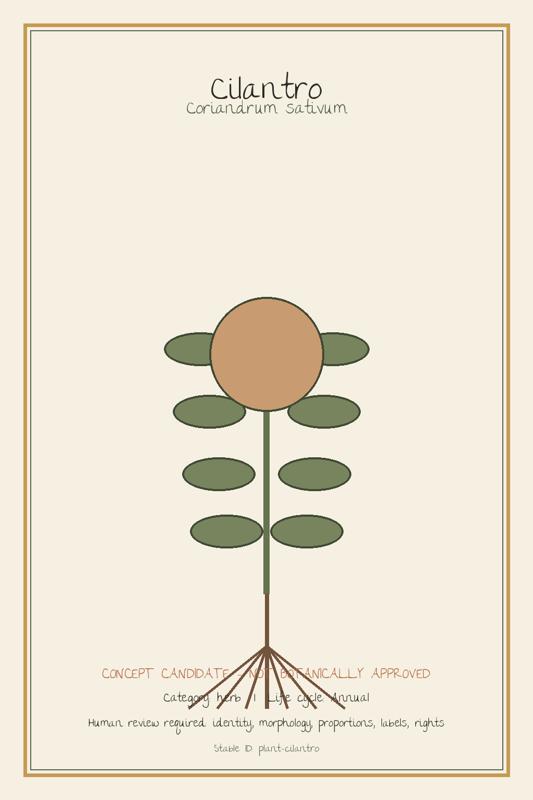

**Source status:** Not botanically or horticulturally approved. Recorded fields are derived
from the retained registry and remain subject to claim-level source review.

### Chervil

**Stable plant ID:** `plant-chervil`
**Category:** herb
**Recorded botanical name:** Anthriscus cerefolium
**Recorded family:** Apiaceae
**Life cycle:** Annual
**Illustration status:** `CANDIDATE_GENERATED / REVIEW_PENDING / NOT_APPROVED`

**Identification and morphology**

- Growth habit: Growth habit should be resolved to the exact species or cultivar; this entry provides a category-level source scaffold.
- Root or storage organ: Species-specific root, crown, or storage organ; verify the exact form before illustrating.
- Leaf arrangement and shape: Species-specific arrangement and blade shape; verify exact genus and cultivar.
- Flower structure: Species-specific inflorescence or flower structure.
- Fruit or seed structure: Species-specific fruit, seed pod, achene, capsule, berry, or nut.

**Errington timing fields**

- Indoor sow: Source timing not reviewed
- Direct sow: Source timing not reviewed
- Transplant: Source timing not reviewed
- Bloom: Source timing not reviewed
- Harvest: Source timing not reviewed
- Frost: Source timing not reviewed

**Cultivation**

- Soil: Fertile, well-drained soil with organic matter unless the species has a known exceptional preference.
- Water: Provide even establishment moisture; then follow the species' drought, moisture, or wetness preference.
- Spacing: Base spacing on mature height and spread, not just the common name.
- Light: Sun requirement is species-specific; the common name alone is not a reliable light label.
- Maintenance: Mulch, deadhead or divide as appropriate, and monitor for structural or seasonal maintenance.
- Pests/diseases: Identify the pest or disease locally before control; favor sanitation, cultural prevention, and targeted action.

**Candidate plate:**
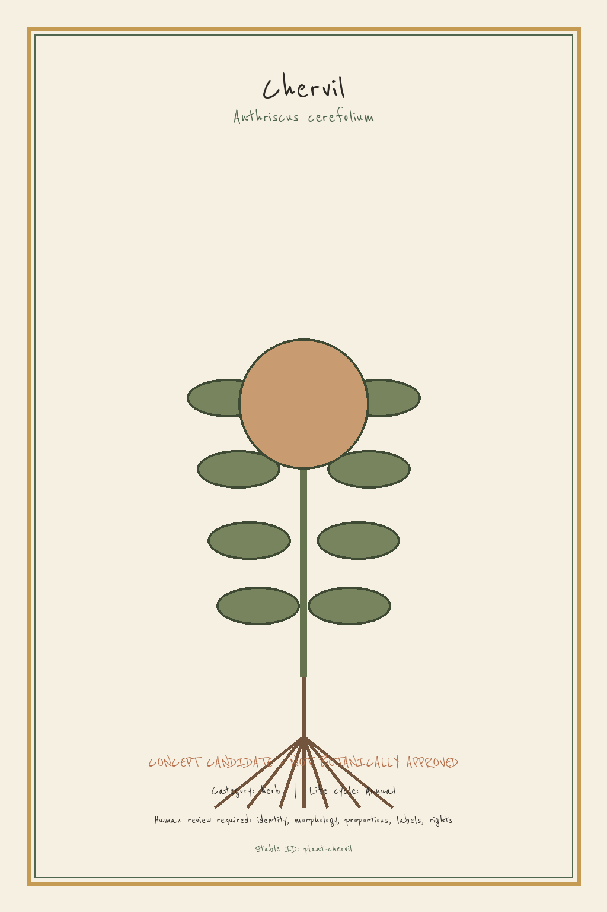

**Source status:** Not botanically or horticulturally approved. Recorded fields are derived
from the retained registry and remain subject to claim-level source review.

### Fennel

**Stable plant ID:** `plant-fennel`
**Category:** herb
**Recorded botanical name:** Foeniculum vulgare
**Recorded family:** Apiaceae
**Life cycle:** Perennial
**Illustration status:** `CANDIDATE_GENERATED / REVIEW_PENDING / NOT_APPROVED`

**Identification and morphology**

- Growth habit: Growth habit should be resolved to the exact species or cultivar; this entry provides a category-level source scaffold.
- Root or storage organ: Species-specific root, crown, or storage organ; verify the exact form before illustrating.
- Leaf arrangement and shape: Species-specific arrangement and blade shape; verify exact genus and cultivar.
- Flower structure: Species-specific inflorescence or flower structure.
- Fruit or seed structure: Species-specific fruit, seed pod, achene, capsule, berry, or nut.

**Errington timing fields**

- Indoor sow: Source timing not reviewed
- Direct sow: Source timing not reviewed
- Transplant: Source timing not reviewed
- Bloom: Source timing not reviewed
- Harvest: Source timing not reviewed
- Frost: Source timing not reviewed

**Cultivation**

- Soil: Fertile, well-drained soil with organic matter unless the species has a known exceptional preference.
- Water: Provide even establishment moisture; then follow the species' drought, moisture, or wetness preference.
- Spacing: Base spacing on mature height and spread, not just the common name.
- Light: Sun requirement is species-specific; the common name alone is not a reliable light label.
- Maintenance: Mulch, deadhead or divide as appropriate, and monitor for structural or seasonal maintenance.
- Pests/diseases: Identify the pest or disease locally before control; favor sanitation, cultural prevention, and targeted action.

**Candidate plate:**
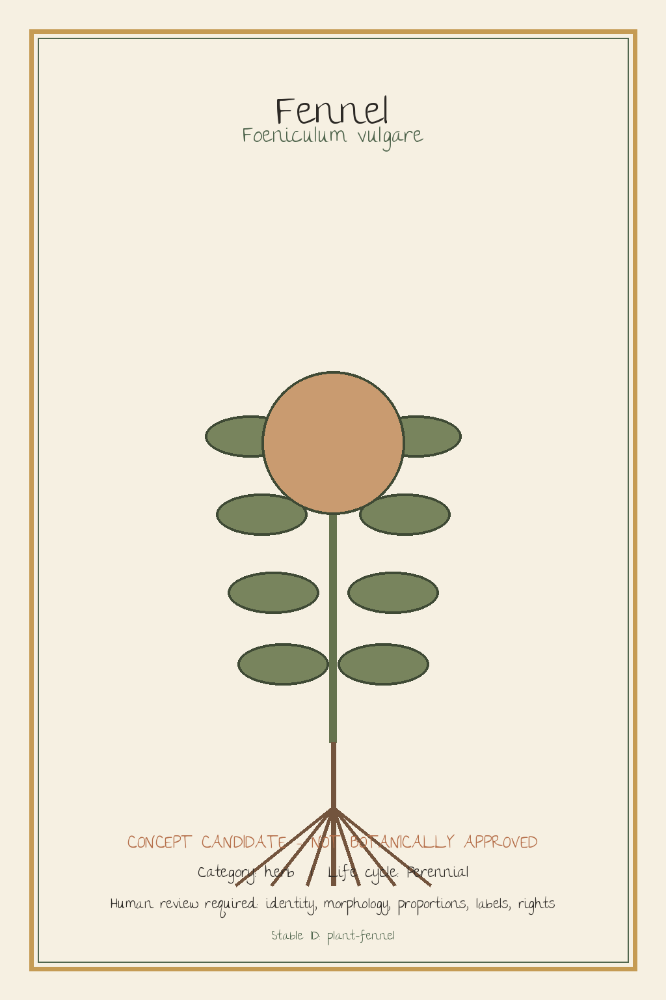

**Source status:** Not botanically or horticulturally approved. Recorded fields are derived
from the retained registry and remain subject to claim-level source review.

### Apple

**Stable plant ID:** `plant-apple`
**Category:** fruit
**Recorded botanical name:** Malus domestica
**Recorded family:** Rosaceae
**Life cycle:** Perennial
**Illustration status:** `CANDIDATE_GENERATED / REVIEW_PENDING / NOT_APPROVED`

**Identification and morphology**

- Growth habit: Growth habit should be resolved to the exact species or cultivar; this entry provides a category-level source scaffold.
- Root or storage organ: Woody perennial root system; grafted trees may include rootstock-specific traits.
- Leaf arrangement and shape: Alternate or opposite foliage according to the exact genus; use species-level morphology.
- Flower structure: Flowers arranged in species-specific racemes, clusters, umbels, or catkins.
- Fruit or seed structure: Botanical fruit type is species-specific: pome, drupe, berry, aggregate fruit, or grape.

**Errington timing fields**

- Indoor sow: Source timing not reviewed
- Direct sow: Source timing not reviewed
- Transplant: Source timing not reviewed
- Bloom: Source timing not reviewed
- Harvest: Source timing not reviewed
- Frost: Source timing not reviewed

**Cultivation**

- Soil: Fertile, well-drained soil with organic matter unless the species has a known exceptional preference.
- Water: Provide even establishment moisture; then follow the species' drought, moisture, or wetness preference.
- Spacing: Base spacing on mature height and spread, not just the common name.
- Light: Sun requirement is species-specific; the common name alone is not a reliable light label.
- Maintenance: Mulch, deadhead or divide as appropriate, and monitor for structural or seasonal maintenance.
- Pests/diseases: Identify the pest or disease locally before control; favor sanitation, cultural prevention, and targeted action.

**Candidate plate:**

**Source status:** Not botanically or horticulturally approved. Recorded fields are derived
from the retained registry and remain subject to claim-level source review.

### Pear

**Stable plant ID:** `plant-pear`
**Category:** fruit
**Recorded botanical name:** Pyrus communis
**Recorded family:** Rosaceae
**Life cycle:** Perennial
**Illustration status:** `CANDIDATE_GENERATED / REVIEW_PENDING / NOT_APPROVED`

**Identification and morphology**

- Growth habit: Growth habit should be resolved to the exact species or cultivar; this entry provides a category-level source scaffold.
- Root or storage organ: Woody perennial root system; grafted trees may include rootstock-specific traits.
- Leaf arrangement and shape: Alternate or opposite foliage according to the exact genus; use species-level morphology.
- Flower structure: Flowers arranged in species-specific racemes, clusters, umbels, or catkins.
- Fruit or seed structure: Botanical fruit type is species-specific: pome, drupe, berry, aggregate fruit, or grape.

**Errington timing fields**

- Indoor sow: Source timing not reviewed
- Direct sow: Source timing not reviewed
- Transplant: Source timing not reviewed
- Bloom: Source timing not reviewed
- Harvest: Source timing not reviewed
- Frost: Source timing not reviewed

**Cultivation**

- Soil: Fertile, well-drained soil with organic matter unless the species has a known exceptional preference.
- Water: Provide even establishment moisture; then follow the species' drought, moisture, or wetness preference.
- Spacing: Base spacing on mature height and spread, not just the common name.
- Light: Sun requirement is species-specific; the common name alone is not a reliable light label.
- Maintenance: Mulch, deadhead or divide as appropriate, and monitor for structural or seasonal maintenance.
- Pests/diseases: Identify the pest or disease locally before control; favor sanitation, cultural prevention, and targeted action.

**Candidate plate:**
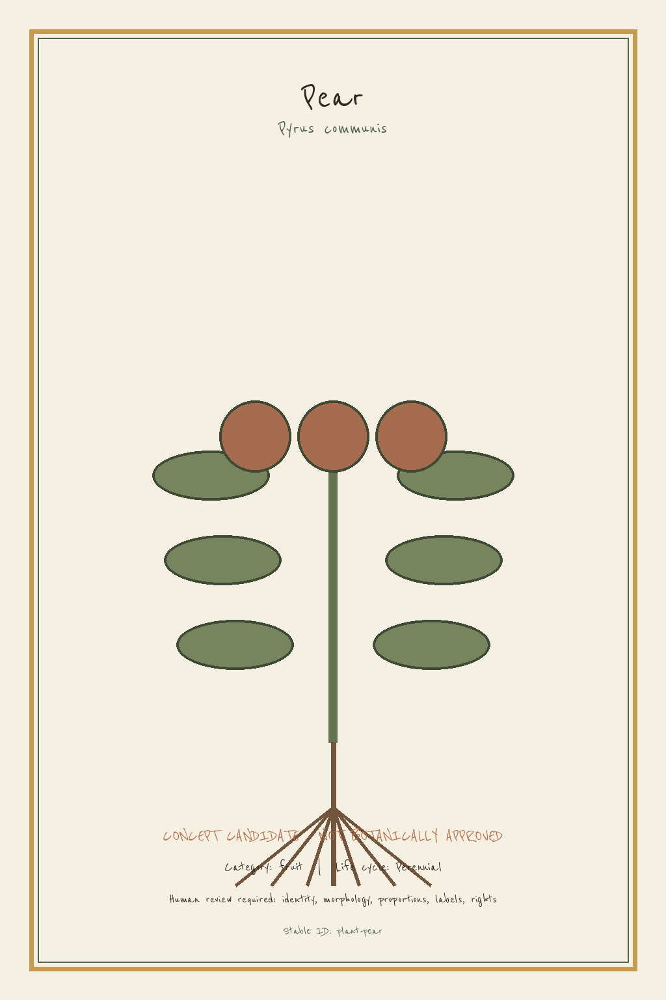

**Source status:** Not botanically or horticulturally approved. Recorded fields are derived
from the retained registry and remain subject to claim-level source review.

### Plum

**Stable plant ID:** `plant-plum`
**Category:** fruit
**Recorded botanical name:** Prunus domestica
**Recorded family:** Rosaceae
**Life cycle:** Perennial
**Illustration status:** `CANDIDATE_GENERATED / REVIEW_PENDING / NOT_APPROVED`

**Identification and morphology**

- Growth habit: Growth habit should be resolved to the exact species or cultivar; this entry provides a category-level source scaffold.
- Root or storage organ: Woody perennial root system; grafted trees may include rootstock-specific traits.
- Leaf arrangement and shape: Alternate or opposite foliage according to the exact genus; use species-level morphology.
- Flower structure: Flowers arranged in species-specific racemes, clusters, umbels, or catkins.
- Fruit or seed structure: Botanical fruit type is species-specific: pome, drupe, berry, aggregate fruit, or grape.

**Errington timing fields**

- Indoor sow: Source timing not reviewed
- Direct sow: Source timing not reviewed
- Transplant: Source timing not reviewed
- Bloom: Source timing not reviewed
- Harvest: Source timing not reviewed
- Frost: Source timing not reviewed

**Cultivation**

- Soil: Fertile, well-drained soil with organic matter unless the species has a known exceptional preference.
- Water: Provide even establishment moisture; then follow the species' drought, moisture, or wetness preference.
- Spacing: Base spacing on mature height and spread, not just the common name.
- Light: Sun requirement is species-specific; the common name alone is not a reliable light label.
- Maintenance: Mulch, deadhead or divide as appropriate, and monitor for structural or seasonal maintenance.
- Pests/diseases: Identify the pest or disease locally before control; favor sanitation, cultural prevention, and targeted action.

**Candidate plate:**
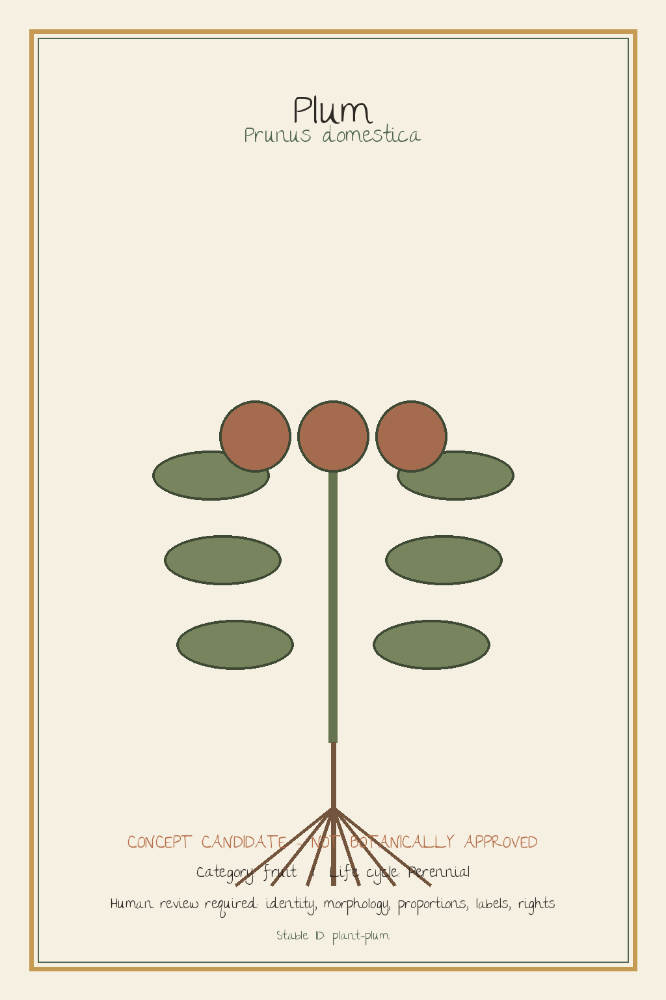

**Source status:** Not botanically or horticulturally approved. Recorded fields are derived
from the retained registry and remain subject to claim-level source review.

### Cherry

**Stable plant ID:** `plant-cherry`
**Category:** fruit
**Recorded botanical name:** Prunus avium
**Recorded family:** Rosaceae
**Life cycle:** Perennial
**Illustration status:** `CANDIDATE_GENERATED / REVIEW_PENDING / NOT_APPROVED`

**Identification and morphology**

- Growth habit: Growth habit should be resolved to the exact species or cultivar; this entry provides a category-level source scaffold.
- Root or storage organ: Woody perennial root system; grafted trees may include rootstock-specific traits.
- Leaf arrangement and shape: Alternate or opposite foliage according to the exact genus; use species-level morphology.
- Flower structure: Flowers arranged in species-specific racemes, clusters, umbels, or catkins.
- Fruit or seed structure: Botanical fruit type is species-specific: pome, drupe, berry, aggregate fruit, or grape.

**Errington timing fields**

- Indoor sow: Source timing not reviewed
- Direct sow: Source timing not reviewed
- Transplant: Source timing not reviewed
- Bloom: Source timing not reviewed
- Harvest: Source timing not reviewed
- Frost: Source timing not reviewed

**Cultivation**

- Soil: Fertile, well-drained soil with organic matter unless the species has a known exceptional preference.
- Water: Provide even establishment moisture; then follow the species' drought, moisture, or wetness preference.
- Spacing: Base spacing on mature height and spread, not just the common name.
- Light: Sun requirement is species-specific; the common name alone is not a reliable light label.
- Maintenance: Mulch, deadhead or divide as appropriate, and monitor for structural or seasonal maintenance.
- Pests/diseases: Identify the pest or disease locally before control; favor sanitation, cultural prevention, and targeted action.

**Candidate plate:**

**Source status:** Not botanically or horticulturally approved. Recorded fields are derived
from the retained registry and remain subject to claim-level source review.

### Grapes

**Stable plant ID:** `plant-grapes`
**Category:** fruit
**Recorded botanical name:** Vitis vinifera
**Recorded family:** Vitaceae
**Life cycle:** Perennial
**Illustration status:** `CANDIDATE_GENERATED / REVIEW_PENDING / NOT_APPROVED`

**Identification and morphology**

- Growth habit: Growth habit should be resolved to the exact species or cultivar; this entry provides a category-level source scaffold.
- Root or storage organ: Woody perennial root system; grafted trees may include rootstock-specific traits.
- Leaf arrangement and shape: Alternate or opposite foliage according to the exact genus; use species-level morphology.
- Flower structure: Flowers arranged in species-specific racemes, clusters, umbels, or catkins.
- Fruit or seed structure: Botanical fruit type is species-specific: pome, drupe, berry, aggregate fruit, or grape.

**Errington timing fields**

- Indoor sow: Source timing not reviewed
- Direct sow: Source timing not reviewed
- Transplant: Source timing not reviewed
- Bloom: Source timing not reviewed
- Harvest: Source timing not reviewed
- Frost: Source timing not reviewed

**Cultivation**

- Soil: Fertile, well-drained soil with organic matter unless the species has a known exceptional preference.
- Water: Provide even establishment moisture; then follow the species' drought, moisture, or wetness preference.
- Spacing: Base spacing on mature height and spread, not just the common name.
- Light: Sun requirement is species-specific; the common name alone is not a reliable light label.
- Maintenance: Mulch, deadhead or divide as appropriate, and monitor for structural or seasonal maintenance.
- Pests/diseases: Identify the pest or disease locally before control; favor sanitation, cultural prevention, and targeted action.

**Candidate plate:**
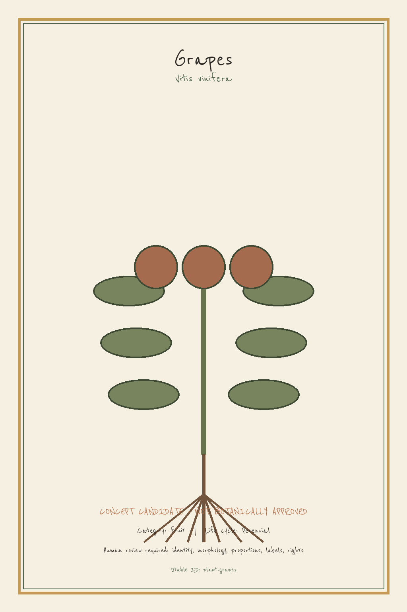

**Source status:** Not botanically or horticulturally approved. Recorded fields are derived
from the retained registry and remain subject to claim-level source review.

### Strawberries

**Stable plant ID:** `plant-strawberries`
**Category:** fruit
**Recorded botanical name:** Fragaria × ananassa
**Recorded family:** Rosaceae
**Life cycle:** Perennial
**Illustration status:** `CANDIDATE_GENERATED / REVIEW_PENDING / NOT_APPROVED`

**Identification and morphology**

- Growth habit: Growth habit should be resolved to the exact species or cultivar; this entry provides a category-level source scaffold.
- Root or storage organ: Woody perennial root system; grafted trees may include rootstock-specific traits.
- Leaf arrangement and shape: Alternate or opposite foliage according to the exact genus; use species-level morphology.
- Flower structure: Flowers arranged in species-specific racemes, clusters, umbels, or catkins.
- Fruit or seed structure: Botanical fruit type is species-specific: pome, drupe, berry, aggregate fruit, or grape.

**Errington timing fields**

- Indoor sow: Source timing not reviewed
- Direct sow: Source timing not reviewed
- Transplant: Source timing not reviewed
- Bloom: Source timing not reviewed
- Harvest: Source timing not reviewed
- Frost: Source timing not reviewed

**Cultivation**

- Soil: Fertile, well-drained soil with organic matter unless the species has a known exceptional preference.
- Water: Provide even establishment moisture; then follow the species' drought, moisture, or wetness preference.
- Spacing: Base spacing on mature height and spread, not just the common name.
- Light: Sun requirement is species-specific; the common name alone is not a reliable light label.
- Maintenance: Mulch, deadhead or divide as appropriate, and monitor for structural or seasonal maintenance.
- Pests/diseases: Identify the pest or disease locally before control; favor sanitation, cultural prevention, and targeted action.

**Candidate plate:**
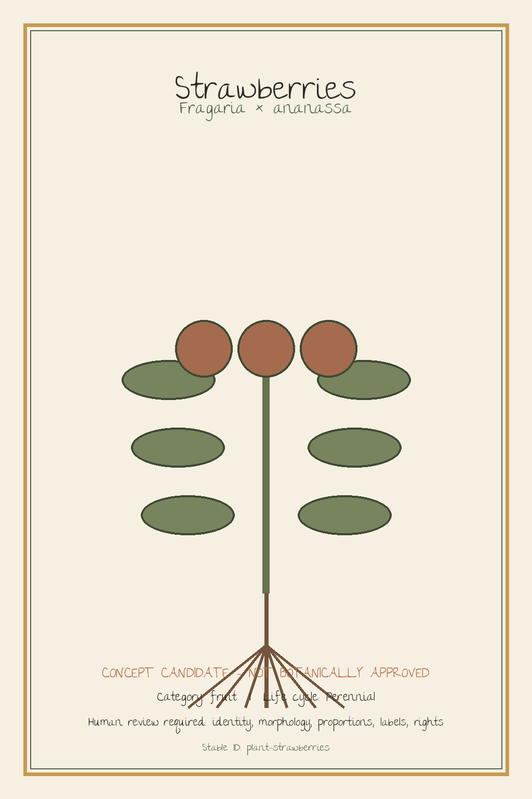

**Source status:** Not botanically or horticulturally approved. Recorded fields are derived
from the retained registry and remain subject to claim-level source review.

### Raspberries

**Stable plant ID:** `plant-raspberries`
**Category:** fruit
**Recorded botanical name:** Rubus idaeus
**Recorded family:** Rosaceae
**Life cycle:** Perennial
**Illustration status:** `CANDIDATE_GENERATED / REVIEW_PENDING / NOT_APPROVED`

**Identification and morphology**

- Growth habit: Growth habit should be resolved to the exact species or cultivar; this entry provides a category-level source scaffold.
- Root or storage organ: Woody perennial root system; grafted trees may include rootstock-specific traits.
- Leaf arrangement and shape: Alternate or opposite foliage according to the exact genus; use species-level morphology.
- Flower structure: Flowers arranged in species-specific racemes, clusters, umbels, or catkins.
- Fruit or seed structure: Botanical fruit type is species-specific: pome, drupe, berry, aggregate fruit, or grape.

**Errington timing fields**

- Indoor sow: Source timing not reviewed
- Direct sow: Source timing not reviewed
- Transplant: Source timing not reviewed
- Bloom: Source timing not reviewed
- Harvest: Source timing not reviewed
- Frost: Source timing not reviewed

**Cultivation**

- Soil: Fertile, well-drained soil with organic matter unless the species has a known exceptional preference.
- Water: Provide even establishment moisture; then follow the species' drought, moisture, or wetness preference.
- Spacing: Base spacing on mature height and spread, not just the common name.
- Light: Sun requirement is species-specific; the common name alone is not a reliable light label.
- Maintenance: Mulch, deadhead or divide as appropriate, and monitor for structural or seasonal maintenance.
- Pests/diseases: Identify the pest or disease locally before control; favor sanitation, cultural prevention, and targeted action.

**Candidate plate:**

**Source status:** Not botanically or horticulturally approved. Recorded fields are derived
from the retained registry and remain subject to claim-level source review.

### Blueberries

**Stable plant ID:** `plant-blueberries`
**Category:** fruit
**Recorded botanical name:** Vaccinium corymbosum
**Recorded family:** Ericaceae
**Life cycle:** Perennial
**Illustration status:** `CANDIDATE_GENERATED / REVIEW_PENDING / NOT_APPROVED`

**Identification and morphology**

- Growth habit: Growth habit should be resolved to the exact species or cultivar; this entry provides a category-level source scaffold.
- Root or storage organ: Woody perennial root system; grafted trees may include rootstock-specific traits.
- Leaf arrangement and shape: Alternate or opposite foliage according to the exact genus; use species-level morphology.
- Flower structure: Flowers arranged in species-specific racemes, clusters, umbels, or catkins.
- Fruit or seed structure: Botanical fruit type is species-specific: pome, drupe, berry, aggregate fruit, or grape.

**Errington timing fields**

- Indoor sow: Source timing not reviewed
- Direct sow: Source timing not reviewed
- Transplant: Source timing not reviewed
- Bloom: Source timing not reviewed
- Harvest: Source timing not reviewed
- Frost: Source timing not reviewed

**Cultivation**

- Soil: Fertile, well-drained soil with organic matter unless the species has a known exceptional preference.
- Water: Provide even establishment moisture; then follow the species' drought, moisture, or wetness preference.
- Spacing: Base spacing on mature height and spread, not just the common name.
- Light: Sun requirement is species-specific; the common name alone is not a reliable light label.
- Maintenance: Mulch, deadhead or divide as appropriate, and monitor for structural or seasonal maintenance.
- Pests/diseases: Identify the pest or disease locally before control; favor sanitation, cultural prevention, and targeted action.

**Candidate plate:**
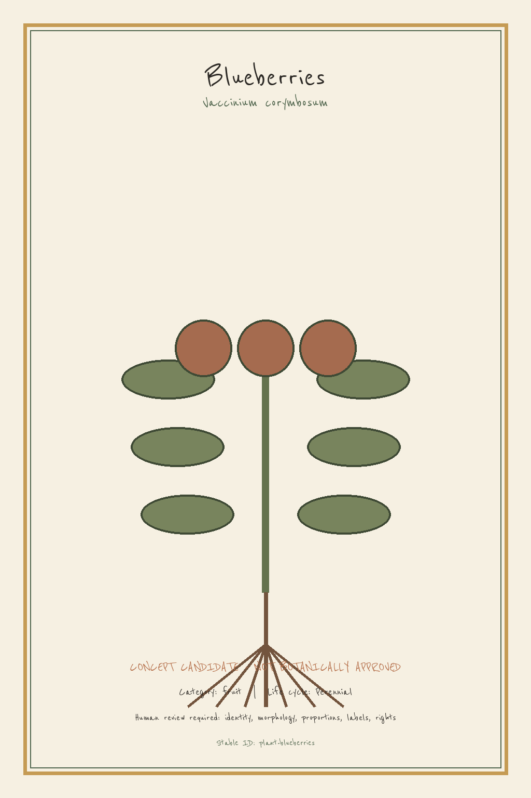

**Source status:** Not botanically or horticulturally approved. Recorded fields are derived
from the retained registry and remain subject to claim-level source review.

### Currants

**Stable plant ID:** `plant-currants`
**Category:** fruit
**Recorded botanical name:** Ribes rubrum
**Recorded family:** Grossulariaceae
**Life cycle:** Perennial
**Illustration status:** `CANDIDATE_GENERATED / REVIEW_PENDING / NOT_APPROVED`

**Identification and morphology**

- Growth habit: Growth habit should be resolved to the exact species or cultivar; this entry provides a category-level source scaffold.
- Root or storage organ: Woody perennial root system; grafted trees may include rootstock-specific traits.
- Leaf arrangement and shape: Alternate or opposite foliage according to the exact genus; use species-level morphology.
- Flower structure: Flowers arranged in species-specific racemes, clusters, umbels, or catkins.
- Fruit or seed structure: Botanical fruit type is species-specific: pome, drupe, berry, aggregate fruit, or grape.

**Errington timing fields**

- Indoor sow: Source timing not reviewed
- Direct sow: Source timing not reviewed
- Transplant: Source timing not reviewed
- Bloom: Source timing not reviewed
- Harvest: Source timing not reviewed
- Frost: Source timing not reviewed

**Cultivation**

- Soil: Fertile, well-drained soil with organic matter unless the species has a known exceptional preference.
- Water: Provide even establishment moisture; then follow the species' drought, moisture, or wetness preference.
- Spacing: Base spacing on mature height and spread, not just the common name.
- Light: Sun requirement is species-specific; the common name alone is not a reliable light label.
- Maintenance: Mulch, deadhead or divide as appropriate, and monitor for structural or seasonal maintenance.
- Pests/diseases: Identify the pest or disease locally before control; favor sanitation, cultural prevention, and targeted action.

**Candidate plate:**

**Source status:** Not botanically or horticulturally approved. Recorded fields are derived
from the retained registry and remain subject to claim-level source review.

### Gooseberries

**Stable plant ID:** `plant-gooseberries`
**Category:** fruit
**Recorded botanical name:** Ribes uva-crispa
**Recorded family:** Grossulariaceae
**Life cycle:** Perennial
**Illustration status:** `CANDIDATE_GENERATED / REVIEW_PENDING / NOT_APPROVED`

**Identification and morphology**

- Growth habit: Growth habit should be resolved to the exact species or cultivar; this entry provides a category-level source scaffold.
- Root or storage organ: Woody perennial root system; grafted trees may include rootstock-specific traits.
- Leaf arrangement and shape: Alternate or opposite foliage according to the exact genus; use species-level morphology.
- Flower structure: Flowers arranged in species-specific racemes, clusters, umbels, or catkins.
- Fruit or seed structure: Botanical fruit type is species-specific: pome, drupe, berry, aggregate fruit, or grape.

**Errington timing fields**

- Indoor sow: Source timing not reviewed
- Direct sow: Source timing not reviewed
- Transplant: Source timing not reviewed
- Bloom: Source timing not reviewed
- Harvest: Source timing not reviewed
- Frost: Source timing not reviewed

**Cultivation**

- Soil: Fertile, well-drained soil with organic matter unless the species has a known exceptional preference.
- Water: Provide even establishment moisture; then follow the species' drought, moisture, or wetness preference.
- Spacing: Base spacing on mature height and spread, not just the common name.
- Light: Sun requirement is species-specific; the common name alone is not a reliable light label.
- Maintenance: Mulch, deadhead or divide as appropriate, and monitor for structural or seasonal maintenance.
- Pests/diseases: Identify the pest or disease locally before control; favor sanitation, cultural prevention, and targeted action.

**Candidate plate:**

**Source status:** Not botanically or horticulturally approved. Recorded fields are derived
from the retained registry and remain subject to claim-level source review.

### Rhubarb

**Stable plant ID:** `plant-rhubarb`
**Category:** perennial-edible
**Recorded botanical name:** Rheum × hybridum
**Recorded family:** Polygonaceae
**Life cycle:** Perennial
**Illustration status:** `CANDIDATE_GENERATED / REVIEW_PENDING / NOT_APPROVED`

**Identification and morphology**

- Growth habit: Growth habit should be resolved to the exact species or cultivar; this entry provides a category-level source scaffold.
- Root or storage organ: Species-specific root, crown, or storage organ; verify the exact form before illustrating.
- Leaf arrangement and shape: Species-specific arrangement and blade shape; verify exact genus and cultivar.
- Flower structure: Species-specific inflorescence or flower structure.
- Fruit or seed structure: Species-specific fruit, seed pod, achene, capsule, berry, or nut.

**Errington timing fields**

- Indoor sow: Source timing not reviewed
- Direct sow: Source timing not reviewed
- Transplant: Source timing not reviewed
- Bloom: Source timing not reviewed
- Harvest: Source timing not reviewed
- Frost: Source timing not reviewed

**Cultivation**

- Soil: Fertile, well-drained soil with organic matter unless the species has a known exceptional preference.
- Water: Provide even establishment moisture; then follow the species' drought, moisture, or wetness preference.
- Spacing: Base spacing on mature height and spread, not just the common name.
- Light: Sun requirement is species-specific; the common name alone is not a reliable light label.
- Maintenance: Mulch, deadhead or divide as appropriate, and monitor for structural or seasonal maintenance.
- Pests/diseases: Identify the pest or disease locally before control; favor sanitation, cultural prevention, and targeted action.

**Candidate plate:**

**Source status:** Not botanically or horticulturally approved. Recorded fields are derived
from the retained registry and remain subject to claim-level source review.

### Globe Artichoke

**Stable plant ID:** `plant-globe-artichoke`
**Category:** perennial-edible
**Recorded botanical name:** Cynara cardunculus var. scolymus
**Recorded family:** Asteraceae
**Life cycle:** Perennial
**Illustration status:** `CANDIDATE_GENERATED / REVIEW_PENDING / NOT_APPROVED`

**Identification and morphology**

- Growth habit: Growth habit should be resolved to the exact species or cultivar; this entry provides a category-level source scaffold.
- Root or storage organ: Species-specific root, crown, or storage organ; verify the exact form before illustrating.
- Leaf arrangement and shape: Species-specific arrangement and blade shape; verify exact genus and cultivar.
- Flower structure: Species-specific inflorescence or flower structure.
- Fruit or seed structure: Species-specific fruit, seed pod, achene, capsule, berry, or nut.

**Errington timing fields**

- Indoor sow: Source timing not reviewed
- Direct sow: Source timing not reviewed
- Transplant: Source timing not reviewed
- Bloom: Source timing not reviewed
- Harvest: Source timing not reviewed
- Frost: Source timing not reviewed

**Cultivation**

- Soil: Fertile, well-drained soil with organic matter unless the species has a known exceptional preference.
- Water: Provide even establishment moisture; then follow the species' drought, moisture, or wetness preference.
- Spacing: Base spacing on mature height and spread, not just the common name.
- Light: Sun requirement is species-specific; the common name alone is not a reliable light label.
- Maintenance: Mulch, deadhead or divide as appropriate, and monitor for structural or seasonal maintenance.
- Pests/diseases: Identify the pest or disease locally before control; favor sanitation, cultural prevention, and targeted action.

**Candidate plate:**

**Source status:** Not botanically or horticulturally approved. Recorded fields are derived
from the retained registry and remain subject to claim-level source review.

### Snapdragons

**Stable plant ID:** `plant-snapdragons`
**Category:** flower
**Recorded botanical name:** Antirrhinum majus
**Recorded family:** Plantaginaceae
**Life cycle:** Annual
**Illustration status:** `CANDIDATE_GENERATED / REVIEW_PENDING / NOT_APPROVED`

**Identification and morphology**

- Growth habit: Growth habit should be resolved to the exact species or cultivar; this entry provides a category-level source scaffold.
- Root or storage organ: Species-specific root, crown, or storage organ; verify the exact form before illustrating.
- Leaf arrangement and shape: Species-specific arrangement and blade shape; verify exact genus and cultivar.
- Flower structure: Species-specific inflorescence or flower structure.
- Fruit or seed structure: Species-specific fruit, seed pod, achene, capsule, berry, or nut.

**Errington timing fields**

- Indoor sow: Source timing not reviewed
- Direct sow: Source timing not reviewed
- Transplant: Source timing not reviewed
- Bloom: Source timing not reviewed
- Harvest: Source timing not reviewed
- Frost: Source timing not reviewed

**Cultivation**

- Soil: Fertile, well-drained soil with organic matter unless the species has a known exceptional preference.
- Water: Provide even establishment moisture; then follow the species' drought, moisture, or wetness preference.
- Spacing: Base spacing on mature height and spread, not just the common name.
- Light: Sun requirement is species-specific; the common name alone is not a reliable light label.
- Maintenance: Mulch, deadhead or divide as appropriate, and monitor for structural or seasonal maintenance.
- Pests/diseases: Identify the pest or disease locally before control; favor sanitation, cultural prevention, and targeted action.

**Candidate plate:**
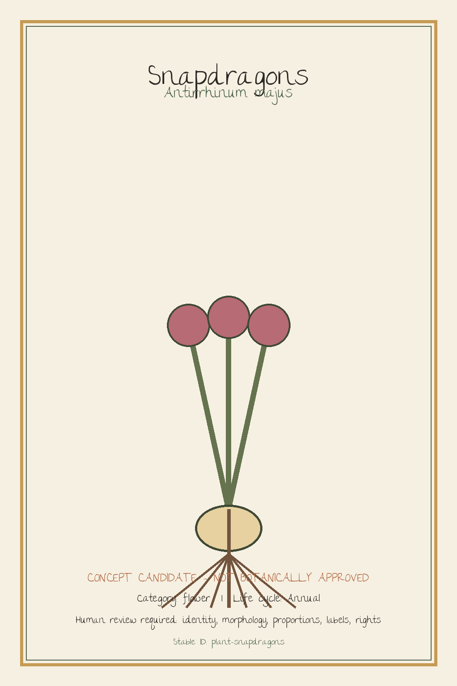

**Source status:** Not botanically or horticulturally approved. Recorded fields are derived
from the retained registry and remain subject to claim-level source review.

### Petunias

**Stable plant ID:** `plant-petunias`
**Category:** flower
**Recorded botanical name:** Petunia × atkinsiana
**Recorded family:** Solanaceae
**Life cycle:** Annual
**Illustration status:** `CANDIDATE_GENERATED / REVIEW_PENDING / NOT_APPROVED`

**Identification and morphology**

- Growth habit: Growth habit should be resolved to the exact species or cultivar; this entry provides a category-level source scaffold.
- Root or storage organ: Species-specific root, crown, or storage organ; verify the exact form before illustrating.
- Leaf arrangement and shape: Species-specific arrangement and blade shape; verify exact genus and cultivar.
- Flower structure: Species-specific inflorescence or flower structure.
- Fruit or seed structure: Species-specific fruit, seed pod, achene, capsule, berry, or nut.

**Errington timing fields**

- Indoor sow: Source timing not reviewed
- Direct sow: Source timing not reviewed
- Transplant: Source timing not reviewed
- Bloom: Source timing not reviewed
- Harvest: Source timing not reviewed
- Frost: Source timing not reviewed

**Cultivation**

- Soil: Fertile, well-drained soil with organic matter unless the species has a known exceptional preference.
- Water: Provide even establishment moisture; then follow the species' drought, moisture, or wetness preference.
- Spacing: Base spacing on mature height and spread, not just the common name.
- Light: Sun requirement is species-specific; the common name alone is not a reliable light label.
- Maintenance: Mulch, deadhead or divide as appropriate, and monitor for structural or seasonal maintenance.
- Pests/diseases: Identify the pest or disease locally before control; favor sanitation, cultural prevention, and targeted action.

**Candidate plate:**
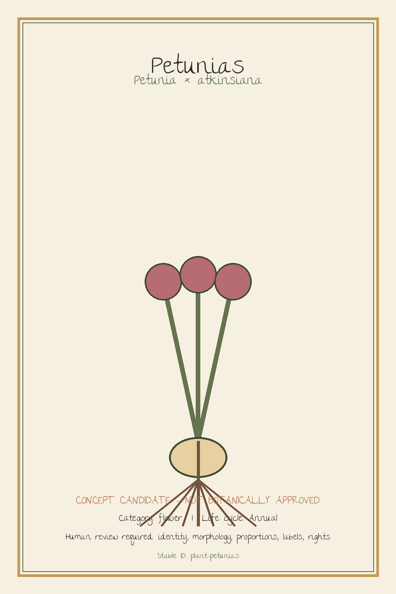

**Source status:** Not botanically or horticulturally approved. Recorded fields are derived
from the retained registry and remain subject to claim-level source review.

### Lobelia

**Stable plant ID:** `plant-lobelia`
**Category:** flower
**Recorded botanical name:** Lobelia erinus
**Recorded family:** Campanulaceae
**Life cycle:** Annual
**Illustration status:** `CANDIDATE_GENERATED / REVIEW_PENDING / NOT_APPROVED`

**Identification and morphology**

- Growth habit: Growth habit should be resolved to the exact species or cultivar; this entry provides a category-level source scaffold.
- Root or storage organ: Species-specific root, crown, or storage organ; verify the exact form before illustrating.
- Leaf arrangement and shape: Species-specific arrangement and blade shape; verify exact genus and cultivar.
- Flower structure: Species-specific inflorescence or flower structure.
- Fruit or seed structure: Species-specific fruit, seed pod, achene, capsule, berry, or nut.

**Errington timing fields**

- Indoor sow: Source timing not reviewed
- Direct sow: Source timing not reviewed
- Transplant: Source timing not reviewed
- Bloom: Source timing not reviewed
- Harvest: Source timing not reviewed
- Frost: Source timing not reviewed

**Cultivation**

- Soil: Fertile, well-drained soil with organic matter unless the species has a known exceptional preference.
- Water: Provide even establishment moisture; then follow the species' drought, moisture, or wetness preference.
- Spacing: Base spacing on mature height and spread, not just the common name.
- Light: Sun requirement is species-specific; the common name alone is not a reliable light label.
- Maintenance: Mulch, deadhead or divide as appropriate, and monitor for structural or seasonal maintenance.
- Pests/diseases: Identify the pest or disease locally before control; favor sanitation, cultural prevention, and targeted action.

**Candidate plate:**
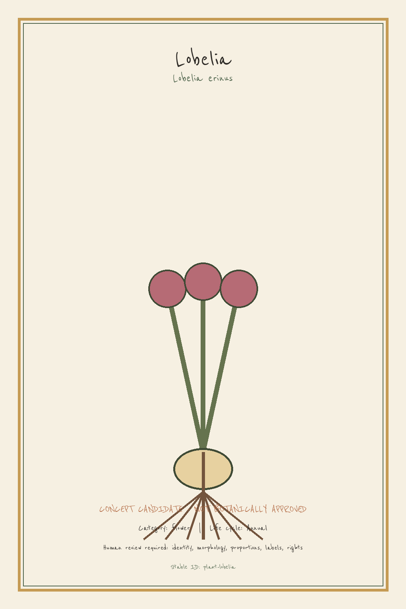

**Source status:** Not botanically or horticulturally approved. Recorded fields are derived
from the retained registry and remain subject to claim-level source review.

### Pansy

**Stable plant ID:** `plant-pansy`
**Category:** flower
**Recorded botanical name:** Viola × wittrockiana
**Recorded family:** Violaceae
**Life cycle:** Annual
**Illustration status:** `CANDIDATE_GENERATED / REVIEW_PENDING / NOT_APPROVED`

**Identification and morphology**

- Growth habit: Growth habit should be resolved to the exact species or cultivar; this entry provides a category-level source scaffold.
- Root or storage organ: Species-specific root, crown, or storage organ; verify the exact form before illustrating.
- Leaf arrangement and shape: Species-specific arrangement and blade shape; verify exact genus and cultivar.
- Flower structure: Species-specific inflorescence or flower structure.
- Fruit or seed structure: Species-specific fruit, seed pod, achene, capsule, berry, or nut.

**Errington timing fields**

- Indoor sow: Source timing not reviewed
- Direct sow: Source timing not reviewed
- Transplant: Source timing not reviewed
- Bloom: Source timing not reviewed
- Harvest: Source timing not reviewed
- Frost: Source timing not reviewed

**Cultivation**

- Soil: Fertile, well-drained soil with organic matter unless the species has a known exceptional preference.
- Water: Provide even establishment moisture; then follow the species' drought, moisture, or wetness preference.
- Spacing: Base spacing on mature height and spread, not just the common name.
- Light: Sun requirement is species-specific; the common name alone is not a reliable light label.
- Maintenance: Mulch, deadhead or divide as appropriate, and monitor for structural or seasonal maintenance.
- Pests/diseases: Identify the pest or disease locally before control; favor sanitation, cultural prevention, and targeted action.

**Candidate plate:**
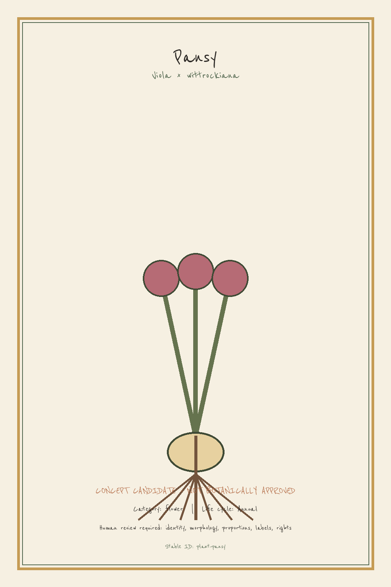

**Source status:** Not botanically or horticulturally approved. Recorded fields are derived
from the retained registry and remain subject to claim-level source review.

### Stocks

**Stable plant ID:** `plant-stocks`
**Category:** flower
**Recorded botanical name:** Matthiola incana
**Recorded family:** Brassicaceae
**Life cycle:** Annual
**Illustration status:** `CANDIDATE_GENERATED / REVIEW_PENDING / NOT_APPROVED`

**Identification and morphology**

- Growth habit: Growth habit should be resolved to the exact species or cultivar; this entry provides a category-level source scaffold.
- Root or storage organ: Species-specific root, crown, or storage organ; verify the exact form before illustrating.
- Leaf arrangement and shape: Species-specific arrangement and blade shape; verify exact genus and cultivar.
- Flower structure: Species-specific inflorescence or flower structure.
- Fruit or seed structure: Species-specific fruit, seed pod, achene, capsule, berry, or nut.

**Errington timing fields**

- Indoor sow: Source timing not reviewed
- Direct sow: Source timing not reviewed
- Transplant: Source timing not reviewed
- Bloom: Source timing not reviewed
- Harvest: Source timing not reviewed
- Frost: Source timing not reviewed

**Cultivation**

- Soil: Fertile, well-drained soil with organic matter unless the species has a known exceptional preference.
- Water: Provide even establishment moisture; then follow the species' drought, moisture, or wetness preference.
- Spacing: Base spacing on mature height and spread, not just the common name.
- Light: Sun requirement is species-specific; the common name alone is not a reliable light label.
- Maintenance: Mulch, deadhead or divide as appropriate, and monitor for structural or seasonal maintenance.
- Pests/diseases: Identify the pest or disease locally before control; favor sanitation, cultural prevention, and targeted action.

**Candidate plate:**
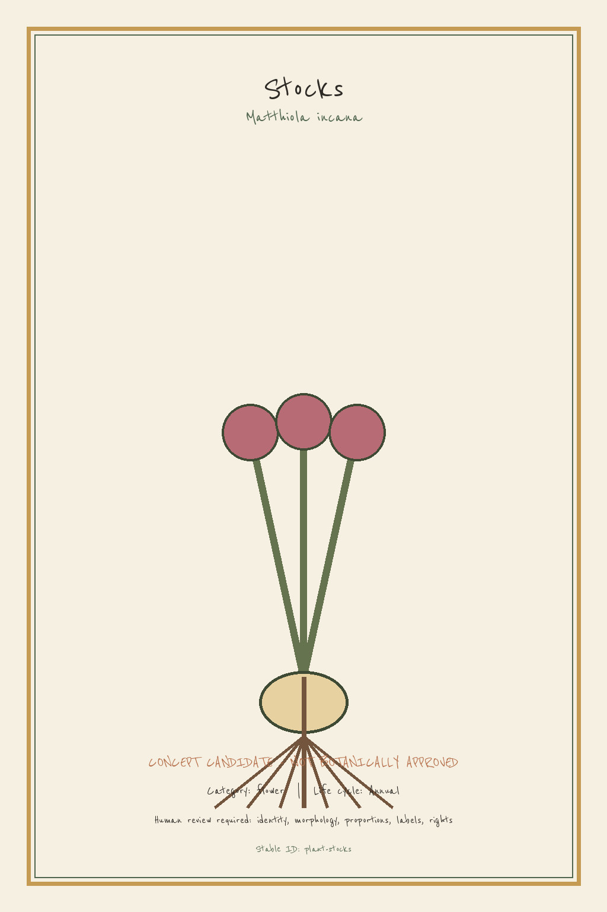

**Source status:** Not botanically or horticulturally approved. Recorded fields are derived
from the retained registry and remain subject to claim-level source review.

### Statice

**Stable plant ID:** `plant-statice`
**Category:** flower
**Recorded botanical name:** Limonium sinuatum
**Recorded family:** Plumbaginaceae
**Life cycle:** Annual
**Illustration status:** `CANDIDATE_GENERATED / REVIEW_PENDING / NOT_APPROVED`

**Identification and morphology**

- Growth habit: Growth habit should be resolved to the exact species or cultivar; this entry provides a category-level source scaffold.
- Root or storage organ: Species-specific root, crown, or storage organ; verify the exact form before illustrating.
- Leaf arrangement and shape: Species-specific arrangement and blade shape; verify exact genus and cultivar.
- Flower structure: Species-specific inflorescence or flower structure.
- Fruit or seed structure: Species-specific fruit, seed pod, achene, capsule, berry, or nut.

**Errington timing fields**

- Indoor sow: Source timing not reviewed
- Direct sow: Source timing not reviewed
- Transplant: Source timing not reviewed
- Bloom: Source timing not reviewed
- Harvest: Source timing not reviewed
- Frost: Source timing not reviewed

**Cultivation**

- Soil: Fertile, well-drained soil with organic matter unless the species has a known exceptional preference.
- Water: Provide even establishment moisture; then follow the species' drought, moisture, or wetness preference.
- Spacing: Base spacing on mature height and spread, not just the common name.
- Light: Sun requirement is species-specific; the common name alone is not a reliable light label.
- Maintenance: Mulch, deadhead or divide as appropriate, and monitor for structural or seasonal maintenance.
- Pests/diseases: Identify the pest or disease locally before control; favor sanitation, cultural prevention, and targeted action.

**Candidate plate:**

**Source status:** Not botanically or horticulturally approved. Recorded fields are derived
from the retained registry and remain subject to claim-level source review.

### Antirrhinum

**Stable plant ID:** `plant-antirrhinum`
**Category:** flower
**Recorded botanical name:** Antirrhinum majus
**Recorded family:** Plantaginaceae
**Life cycle:** Annual
**Illustration status:** `CANDIDATE_GENERATED / REVIEW_PENDING / NOT_APPROVED`

**Identification and morphology**

- Growth habit: Growth habit should be resolved to the exact species or cultivar; this entry provides a category-level source scaffold.
- Root or storage organ: Species-specific root, crown, or storage organ; verify the exact form before illustrating.
- Leaf arrangement and shape: Species-specific arrangement and blade shape; verify exact genus and cultivar.
- Flower structure: Species-specific inflorescence or flower structure.
- Fruit or seed structure: Species-specific fruit, seed pod, achene, capsule, berry, or nut.

**Errington timing fields**

- Indoor sow: Source timing not reviewed
- Direct sow: Source timing not reviewed
- Transplant: Source timing not reviewed
- Bloom: Source timing not reviewed
- Harvest: Source timing not reviewed
- Frost: Source timing not reviewed

**Cultivation**

- Soil: Fertile, well-drained soil with organic matter unless the species has a known exceptional preference.
- Water: Provide even establishment moisture; then follow the species' drought, moisture, or wetness preference.
- Spacing: Base spacing on mature height and spread, not just the common name.
- Light: Sun requirement is species-specific; the common name alone is not a reliable light label.
- Maintenance: Mulch, deadhead or divide as appropriate, and monitor for structural or seasonal maintenance.
- Pests/diseases: Identify the pest or disease locally before control; favor sanitation, cultural prevention, and targeted action.

**Candidate plate:**

**Source status:** Not botanically or horticulturally approved. Recorded fields are derived
from the retained registry and remain subject to claim-level source review.

### Impatiens

**Stable plant ID:** `plant-impatiens`
**Category:** flower
**Recorded botanical name:** Impatiens walleriana
**Recorded family:** Balsaminaceae
**Life cycle:** Annual
**Illustration status:** `CANDIDATE_GENERATED / REVIEW_PENDING / NOT_APPROVED`

**Identification and morphology**

- Growth habit: Growth habit should be resolved to the exact species or cultivar; this entry provides a category-level source scaffold.
- Root or storage organ: Species-specific root, crown, or storage organ; verify the exact form before illustrating.
- Leaf arrangement and shape: Species-specific arrangement and blade shape; verify exact genus and cultivar.
- Flower structure: Species-specific inflorescence or flower structure.
- Fruit or seed structure: Species-specific fruit, seed pod, achene, capsule, berry, or nut.

**Errington timing fields**

- Indoor sow: Source timing not reviewed
- Direct sow: Source timing not reviewed
- Transplant: Source timing not reviewed
- Bloom: Source timing not reviewed
- Harvest: Source timing not reviewed
- Frost: Source timing not reviewed

**Cultivation**

- Soil: Fertile, well-drained soil with organic matter unless the species has a known exceptional preference.
- Water: Provide even establishment moisture; then follow the species' drought, moisture, or wetness preference.
- Spacing: Base spacing on mature height and spread, not just the common name.
- Light: Sun requirement is species-specific; the common name alone is not a reliable light label.
- Maintenance: Mulch, deadhead or divide as appropriate, and monitor for structural or seasonal maintenance.
- Pests/diseases: Identify the pest or disease locally before control; favor sanitation, cultural prevention, and targeted action.

**Candidate plate:**
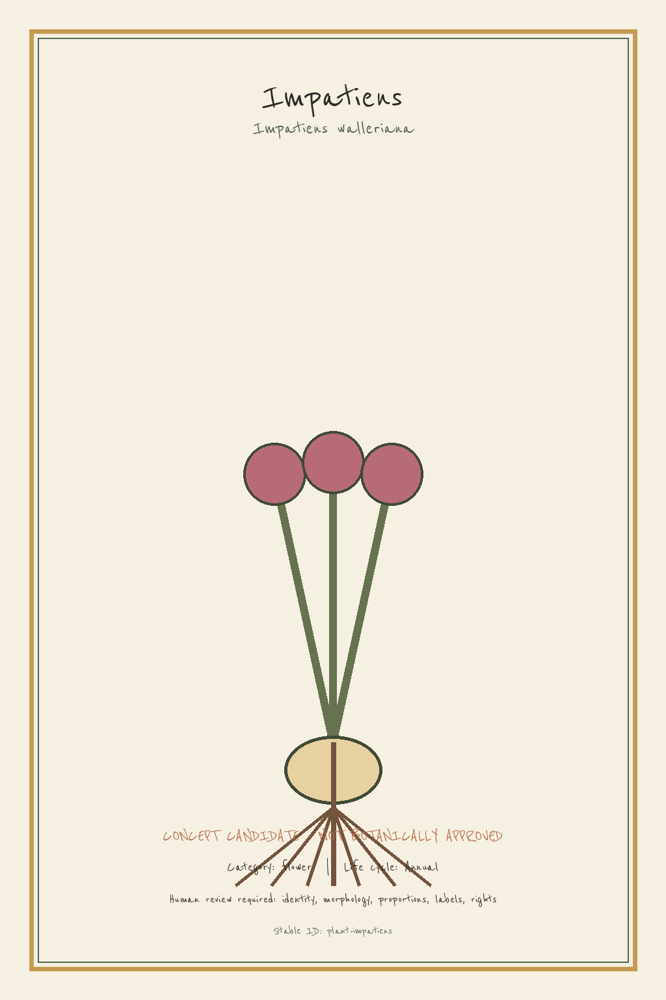

**Source status:** Not botanically or horticulturally approved. Recorded fields are derived
from the retained registry and remain subject to claim-level source review.

### Nicotiana

**Stable plant ID:** `plant-nicotiana`
**Category:** flower
**Recorded botanical name:** Nicotiana alata
**Recorded family:** Solanaceae
**Life cycle:** Annual
**Illustration status:** `CANDIDATE_GENERATED / REVIEW_PENDING / NOT_APPROVED`

**Identification and morphology**

- Growth habit: Growth habit should be resolved to the exact species or cultivar; this entry provides a category-level source scaffold.
- Root or storage organ: Species-specific root, crown, or storage organ; verify the exact form before illustrating.
- Leaf arrangement and shape: Species-specific arrangement and blade shape; verify exact genus and cultivar.
- Flower structure: Species-specific inflorescence or flower structure.
- Fruit or seed structure: Species-specific fruit, seed pod, achene, capsule, berry, or nut.

**Errington timing fields**

- Indoor sow: Source timing not reviewed
- Direct sow: Source timing not reviewed
- Transplant: Source timing not reviewed
- Bloom: Source timing not reviewed
- Harvest: Source timing not reviewed
- Frost: Source timing not reviewed

**Cultivation**

- Soil: Fertile, well-drained soil with organic matter unless the species has a known exceptional preference.
- Water: Provide even establishment moisture; then follow the species' drought, moisture, or wetness preference.
- Spacing: Base spacing on mature height and spread, not just the common name.
- Light: Sun requirement is species-specific; the common name alone is not a reliable light label.
- Maintenance: Mulch, deadhead or divide as appropriate, and monitor for structural or seasonal maintenance.
- Pests/diseases: Identify the pest or disease locally before control; favor sanitation, cultural prevention, and targeted action.

**Candidate plate:**
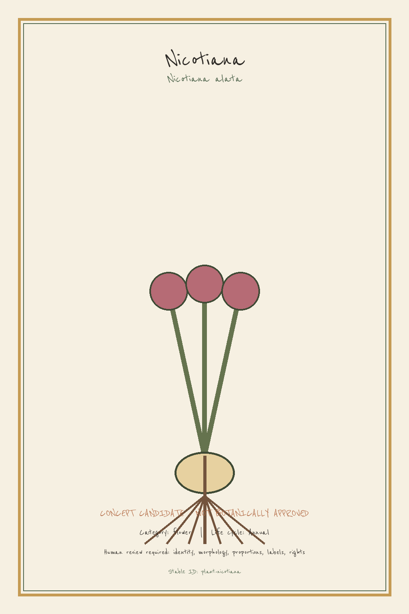

**Source status:** Not botanically or horticulturally approved. Recorded fields are derived
from the retained registry and remain subject to claim-level source review.

### Cleome

**Stable plant ID:** `plant-cleome`
**Category:** flower
**Recorded botanical name:** Cleome hassleriana
**Recorded family:** Cleomaceae
**Life cycle:** Annual
**Illustration status:** `CANDIDATE_GENERATED / REVIEW_PENDING / NOT_APPROVED`

**Identification and morphology**

- Growth habit: Growth habit should be resolved to the exact species or cultivar; this entry provides a category-level source scaffold.
- Root or storage organ: Species-specific root, crown, or storage organ; verify the exact form before illustrating.
- Leaf arrangement and shape: Species-specific arrangement and blade shape; verify exact genus and cultivar.
- Flower structure: Species-specific inflorescence or flower structure.
- Fruit or seed structure: Species-specific fruit, seed pod, achene, capsule, berry, or nut.

**Errington timing fields**

- Indoor sow: Source timing not reviewed
- Direct sow: Source timing not reviewed
- Transplant: Source timing not reviewed
- Bloom: Source timing not reviewed
- Harvest: Source timing not reviewed
- Frost: Source timing not reviewed

**Cultivation**

- Soil: Fertile, well-drained soil with organic matter unless the species has a known exceptional preference.
- Water: Provide even establishment moisture; then follow the species' drought, moisture, or wetness preference.
- Spacing: Base spacing on mature height and spread, not just the common name.
- Light: Sun requirement is species-specific; the common name alone is not a reliable light label.
- Maintenance: Mulch, deadhead or divide as appropriate, and monitor for structural or seasonal maintenance.
- Pests/diseases: Identify the pest or disease locally before control; favor sanitation, cultural prevention, and targeted action.

**Candidate plate:**

**Source status:** Not botanically or horticulturally approved. Recorded fields are derived
from the retained registry and remain subject to claim-level source review.

### Larkspur

**Stable plant ID:** `plant-larkspur`
**Category:** flower
**Recorded botanical name:** Consolida ajacis
**Recorded family:** Ranunculaceae
**Life cycle:** Annual
**Illustration status:** `CANDIDATE_GENERATED / REVIEW_PENDING / NOT_APPROVED`

**Identification and morphology**

- Growth habit: Growth habit should be resolved to the exact species or cultivar; this entry provides a category-level source scaffold.
- Root or storage organ: Species-specific root, crown, or storage organ; verify the exact form before illustrating.
- Leaf arrangement and shape: Species-specific arrangement and blade shape; verify exact genus and cultivar.
- Flower structure: Species-specific inflorescence or flower structure.
- Fruit or seed structure: Species-specific fruit, seed pod, achene, capsule, berry, or nut.

**Errington timing fields**

- Indoor sow: Source timing not reviewed
- Direct sow: Source timing not reviewed
- Transplant: Source timing not reviewed
- Bloom: Source timing not reviewed
- Harvest: Source timing not reviewed
- Frost: Source timing not reviewed

**Cultivation**

- Soil: Fertile, well-drained soil with organic matter unless the species has a known exceptional preference.
- Water: Provide even establishment moisture; then follow the species' drought, moisture, or wetness preference.
- Spacing: Base spacing on mature height and spread, not just the common name.
- Light: Sun requirement is species-specific; the common name alone is not a reliable light label.
- Maintenance: Mulch, deadhead or divide as appropriate, and monitor for structural or seasonal maintenance.
- Pests/diseases: Identify the pest or disease locally before control; favor sanitation, cultural prevention, and targeted action.

**Candidate plate:**

**Source status:** Not botanically or horticulturally approved. Recorded fields are derived
from the retained registry and remain subject to claim-level source review.

### Poppy

**Stable plant ID:** `plant-poppy`
**Category:** flower
**Recorded botanical name:** Papaver rhoeas
**Recorded family:** Papaveraceae
**Life cycle:** Annual
**Illustration status:** `CANDIDATE_GENERATED / REVIEW_PENDING / NOT_APPROVED`

**Identification and morphology**

- Growth habit: Growth habit should be resolved to the exact species or cultivar; this entry provides a category-level source scaffold.
- Root or storage organ: Species-specific root, crown, or storage organ; verify the exact form before illustrating.
- Leaf arrangement and shape: Species-specific arrangement and blade shape; verify exact genus and cultivar.
- Flower structure: Species-specific inflorescence or flower structure.
- Fruit or seed structure: Species-specific fruit, seed pod, achene, capsule, berry, or nut.

**Errington timing fields**

- Indoor sow: Source timing not reviewed
- Direct sow: Source timing not reviewed
- Transplant: Source timing not reviewed
- Bloom: Source timing not reviewed
- Harvest: Source timing not reviewed
- Frost: Source timing not reviewed

**Cultivation**

- Soil: Fertile, well-drained soil with organic matter unless the species has a known exceptional preference.
- Water: Provide even establishment moisture; then follow the species' drought, moisture, or wetness preference.
- Spacing: Base spacing on mature height and spread, not just the common name.
- Light: Sun requirement is species-specific; the common name alone is not a reliable light label.
- Maintenance: Mulch, deadhead or divide as appropriate, and monitor for structural or seasonal maintenance.
- Pests/diseases: Identify the pest or disease locally before control; favor sanitation, cultural prevention, and targeted action.

**Candidate plate:**
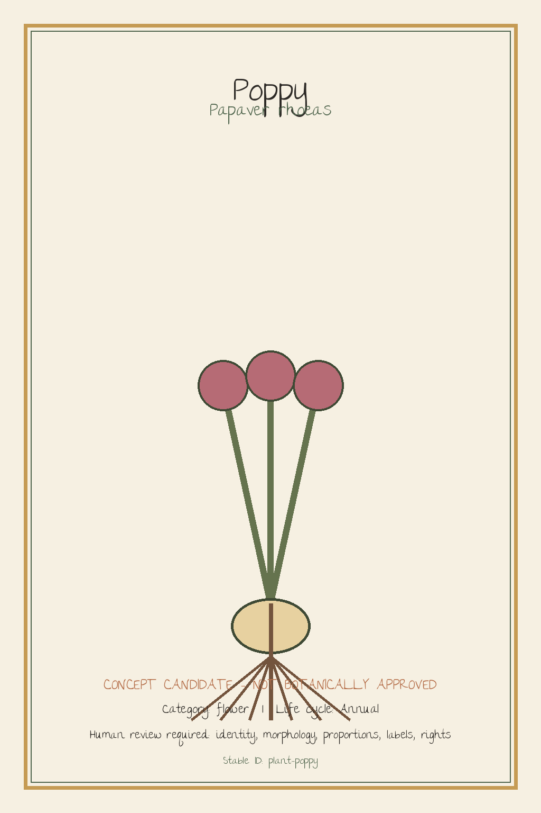

**Source status:** Not botanically or horticulturally approved. Recorded fields are derived
from the retained registry and remain subject to claim-level source review.

### Nigella

**Stable plant ID:** `plant-nigella`
**Category:** flower
**Recorded botanical name:** Nigella damascena
**Recorded family:** Ranunculaceae
**Life cycle:** Annual
**Illustration status:** `CANDIDATE_GENERATED / REVIEW_PENDING / NOT_APPROVED`

**Identification and morphology**

- Growth habit: Growth habit should be resolved to the exact species or cultivar; this entry provides a category-level source scaffold.
- Root or storage organ: Species-specific root, crown, or storage organ; verify the exact form before illustrating.
- Leaf arrangement and shape: Species-specific arrangement and blade shape; verify exact genus and cultivar.
- Flower structure: Species-specific inflorescence or flower structure.
- Fruit or seed structure: Species-specific fruit, seed pod, achene, capsule, berry, or nut.

**Errington timing fields**

- Indoor sow: Source timing not reviewed
- Direct sow: Source timing not reviewed
- Transplant: Source timing not reviewed
- Bloom: Source timing not reviewed
- Harvest: Source timing not reviewed
- Frost: Source timing not reviewed

**Cultivation**

- Soil: Fertile, well-drained soil with organic matter unless the species has a known exceptional preference.
- Water: Provide even establishment moisture; then follow the species' drought, moisture, or wetness preference.
- Spacing: Base spacing on mature height and spread, not just the common name.
- Light: Sun requirement is species-specific; the common name alone is not a reliable light label.
- Maintenance: Mulch, deadhead or divide as appropriate, and monitor for structural or seasonal maintenance.
- Pests/diseases: Identify the pest or disease locally before control; favor sanitation, cultural prevention, and targeted action.

**Candidate plate:**
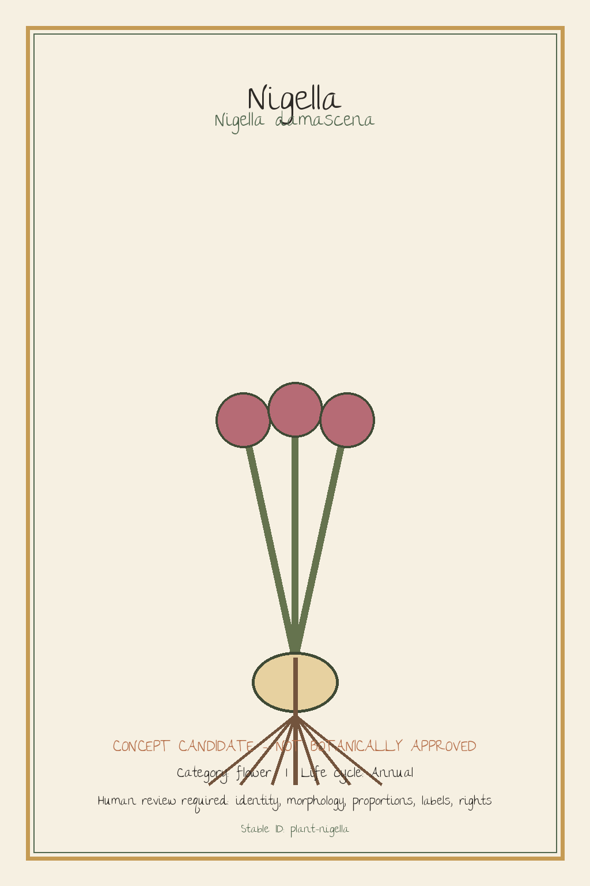

**Source status:** Not botanically or horticulturally approved. Recorded fields are derived
from the retained registry and remain subject to claim-level source review.

### Borage

**Stable plant ID:** `plant-borage`
**Category:** flower
**Recorded botanical name:** Borago officinalis
**Recorded family:** Boraginaceae
**Life cycle:** Annual
**Illustration status:** `CANDIDATE_GENERATED / REVIEW_PENDING / NOT_APPROVED`

**Identification and morphology**

- Growth habit: Growth habit should be resolved to the exact species or cultivar; this entry provides a category-level source scaffold.
- Root or storage organ: Species-specific root, crown, or storage organ; verify the exact form before illustrating.
- Leaf arrangement and shape: Species-specific arrangement and blade shape; verify exact genus and cultivar.
- Flower structure: Species-specific inflorescence or flower structure.
- Fruit or seed structure: Species-specific fruit, seed pod, achene, capsule, berry, or nut.

**Errington timing fields**

- Indoor sow: Source timing not reviewed
- Direct sow: Source timing not reviewed
- Transplant: Source timing not reviewed
- Bloom: Source timing not reviewed
- Harvest: Source timing not reviewed
- Frost: Source timing not reviewed

**Cultivation**

- Soil: Fertile, well-drained soil with organic matter unless the species has a known exceptional preference.
- Water: Provide even establishment moisture; then follow the species' drought, moisture, or wetness preference.
- Spacing: Base spacing on mature height and spread, not just the common name.
- Light: Sun requirement is species-specific; the common name alone is not a reliable light label.
- Maintenance: Mulch, deadhead or divide as appropriate, and monitor for structural or seasonal maintenance.
- Pests/diseases: Identify the pest or disease locally before control; favor sanitation, cultural prevention, and targeted action.

**Candidate plate:**

**Source status:** Not botanically or horticulturally approved. Recorded fields are derived
from the retained registry and remain subject to claim-level source review.

### Cornflower

**Stable plant ID:** `plant-cornflower`
**Category:** flower
**Recorded botanical name:** Centaurea cyanus
**Recorded family:** Asteraceae
**Life cycle:** Annual
**Illustration status:** `CANDIDATE_GENERATED / REVIEW_PENDING / NOT_APPROVED`

**Identification and morphology**

- Growth habit: Growth habit should be resolved to the exact species or cultivar; this entry provides a category-level source scaffold.
- Root or storage organ: Species-specific root, crown, or storage organ; verify the exact form before illustrating.
- Leaf arrangement and shape: Species-specific arrangement and blade shape; verify exact genus and cultivar.
- Flower structure: Species-specific inflorescence or flower structure.
- Fruit or seed structure: Species-specific fruit, seed pod, achene, capsule, berry, or nut.

**Errington timing fields**

- Indoor sow: Source timing not reviewed
- Direct sow: Source timing not reviewed
- Transplant: Source timing not reviewed
- Bloom: Source timing not reviewed
- Harvest: Source timing not reviewed
- Frost: Source timing not reviewed

**Cultivation**

- Soil: Fertile, well-drained soil with organic matter unless the species has a known exceptional preference.
- Water: Provide even establishment moisture; then follow the species' drought, moisture, or wetness preference.
- Spacing: Base spacing on mature height and spread, not just the common name.
- Light: Sun requirement is species-specific; the common name alone is not a reliable light label.
- Maintenance: Mulch, deadhead or divide as appropriate, and monitor for structural or seasonal maintenance.
- Pests/diseases: Identify the pest or disease locally before control; favor sanitation, cultural prevention, and targeted action.

**Candidate plate:**

**Source status:** Not botanically or horticulturally approved. Recorded fields are derived
from the retained registry and remain subject to claim-level source review.

### Ammi majus

**Stable plant ID:** `plant-ammi-majus`
**Category:** flower
**Recorded botanical name:** Ammi majus
**Recorded family:** Apiaceae
**Life cycle:** Annual
**Illustration status:** `CANDIDATE_GENERATED / REVIEW_PENDING / NOT_APPROVED`

**Identification and morphology**

- Growth habit: Growth habit should be resolved to the exact species or cultivar; this entry provides a category-level source scaffold.
- Root or storage organ: Species-specific root, crown, or storage organ; verify the exact form before illustrating.
- Leaf arrangement and shape: Species-specific arrangement and blade shape; verify exact genus and cultivar.
- Flower structure: Species-specific inflorescence or flower structure.
- Fruit or seed structure: Species-specific fruit, seed pod, achene, capsule, berry, or nut.

**Errington timing fields**

- Indoor sow: Source timing not reviewed
- Direct sow: Source timing not reviewed
- Transplant: Source timing not reviewed
- Bloom: Source timing not reviewed
- Harvest: Source timing not reviewed
- Frost: Source timing not reviewed

**Cultivation**

- Soil: Fertile, well-drained soil with organic matter unless the species has a known exceptional preference.
- Water: Provide even establishment moisture; then follow the species' drought, moisture, or wetness preference.
- Spacing: Base spacing on mature height and spread, not just the common name.
- Light: Sun requirement is species-specific; the common name alone is not a reliable light label.
- Maintenance: Mulch, deadhead or divide as appropriate, and monitor for structural or seasonal maintenance.
- Pests/diseases: Identify the pest or disease locally before control; favor sanitation, cultural prevention, and targeted action.

**Candidate plate:**

**Source status:** Not botanically or horticulturally approved. Recorded fields are derived
from the retained registry and remain subject to claim-level source review.

### Orlaya

**Stable plant ID:** `plant-orlaya`
**Category:** flower
**Recorded botanical name:** Orlaya grandiflora
**Recorded family:** Apiaceae
**Life cycle:** Annual
**Illustration status:** `CANDIDATE_GENERATED / REVIEW_PENDING / NOT_APPROVED`

**Identification and morphology**

- Growth habit: Growth habit should be resolved to the exact species or cultivar; this entry provides a category-level source scaffold.
- Root or storage organ: Species-specific root, crown, or storage organ; verify the exact form before illustrating.
- Leaf arrangement and shape: Species-specific arrangement and blade shape; verify exact genus and cultivar.
- Flower structure: Species-specific inflorescence or flower structure.
- Fruit or seed structure: Species-specific fruit, seed pod, achene, capsule, berry, or nut.

**Errington timing fields**

- Indoor sow: Source timing not reviewed
- Direct sow: Source timing not reviewed
- Transplant: Source timing not reviewed
- Bloom: Source timing not reviewed
- Harvest: Source timing not reviewed
- Frost: Source timing not reviewed

**Cultivation**

- Soil: Fertile, well-drained soil with organic matter unless the species has a known exceptional preference.
- Water: Provide even establishment moisture; then follow the species' drought, moisture, or wetness preference.
- Spacing: Base spacing on mature height and spread, not just the common name.
- Light: Sun requirement is species-specific; the common name alone is not a reliable light label.
- Maintenance: Mulch, deadhead or divide as appropriate, and monitor for structural or seasonal maintenance.
- Pests/diseases: Identify the pest or disease locally before control; favor sanitation, cultural prevention, and targeted action.

**Candidate plate:**

**Source status:** Not botanically or horticulturally approved. Recorded fields are derived
from the retained registry and remain subject to claim-level source review.

### Celosia

**Stable plant ID:** `plant-celosia`
**Category:** flower
**Recorded botanical name:** Celosia argentea
**Recorded family:** Amaranthaceae
**Life cycle:** Annual
**Illustration status:** `CANDIDATE_GENERATED / REVIEW_PENDING / NOT_APPROVED`

**Identification and morphology**

- Growth habit: Growth habit should be resolved to the exact species or cultivar; this entry provides a category-level source scaffold.
- Root or storage organ: Species-specific root, crown, or storage organ; verify the exact form before illustrating.
- Leaf arrangement and shape: Species-specific arrangement and blade shape; verify exact genus and cultivar.
- Flower structure: Species-specific inflorescence or flower structure.
- Fruit or seed structure: Species-specific fruit, seed pod, achene, capsule, berry, or nut.

**Errington timing fields**

- Indoor sow: Source timing not reviewed
- Direct sow: Source timing not reviewed
- Transplant: Source timing not reviewed
- Bloom: Source timing not reviewed
- Harvest: Source timing not reviewed
- Frost: Source timing not reviewed

**Cultivation**

- Soil: Fertile, well-drained soil with organic matter unless the species has a known exceptional preference.
- Water: Provide even establishment moisture; then follow the species' drought, moisture, or wetness preference.
- Spacing: Base spacing on mature height and spread, not just the common name.
- Light: Sun requirement is species-specific; the common name alone is not a reliable light label.
- Maintenance: Mulch, deadhead or divide as appropriate, and monitor for structural or seasonal maintenance.
- Pests/diseases: Identify the pest or disease locally before control; favor sanitation, cultural prevention, and targeted action.

**Candidate plate:**

**Source status:** Not botanically or horticulturally approved. Recorded fields are derived
from the retained registry and remain subject to claim-level source review.

### Strawflower

**Stable plant ID:** `plant-strawflower`
**Category:** flower
**Recorded botanical name:** Xerochrysum bracteatum
**Recorded family:** Asteraceae
**Life cycle:** Annual
**Illustration status:** `CANDIDATE_GENERATED / REVIEW_PENDING / NOT_APPROVED`

**Identification and morphology**

- Growth habit: Growth habit should be resolved to the exact species or cultivar; this entry provides a category-level source scaffold.
- Root or storage organ: Species-specific root, crown, or storage organ; verify the exact form before illustrating.
- Leaf arrangement and shape: Species-specific arrangement and blade shape; verify exact genus and cultivar.
- Flower structure: Species-specific inflorescence or flower structure.
- Fruit or seed structure: Species-specific fruit, seed pod, achene, capsule, berry, or nut.

**Errington timing fields**

- Indoor sow: Source timing not reviewed
- Direct sow: Source timing not reviewed
- Transplant: Source timing not reviewed
- Bloom: Source timing not reviewed
- Harvest: Source timing not reviewed
- Frost: Source timing not reviewed

**Cultivation**

- Soil: Fertile, well-drained soil with organic matter unless the species has a known exceptional preference.
- Water: Provide even establishment moisture; then follow the species' drought, moisture, or wetness preference.
- Spacing: Base spacing on mature height and spread, not just the common name.
- Light: Sun requirement is species-specific; the common name alone is not a reliable light label.
- Maintenance: Mulch, deadhead or divide as appropriate, and monitor for structural or seasonal maintenance.
- Pests/diseases: Identify the pest or disease locally before control; favor sanitation, cultural prevention, and targeted action.

**Candidate plate:**

**Source status:** Not botanically or horticulturally approved. Recorded fields are derived
from the retained registry and remain subject to claim-level source review.

### Scabiosa

**Stable plant ID:** `plant-scabiosa`
**Category:** flower
**Recorded botanical name:** Scabiosa atropurpurea
**Recorded family:** Caprifoliaceae
**Life cycle:** Annual
**Illustration status:** `CANDIDATE_GENERATED / REVIEW_PENDING / NOT_APPROVED`

**Identification and morphology**

- Growth habit: Growth habit should be resolved to the exact species or cultivar; this entry provides a category-level source scaffold.
- Root or storage organ: Species-specific root, crown, or storage organ; verify the exact form before illustrating.
- Leaf arrangement and shape: Species-specific arrangement and blade shape; verify exact genus and cultivar.
- Flower structure: Species-specific inflorescence or flower structure.
- Fruit or seed structure: Species-specific fruit, seed pod, achene, capsule, berry, or nut.

**Errington timing fields**

- Indoor sow: Source timing not reviewed
- Direct sow: Source timing not reviewed
- Transplant: Source timing not reviewed
- Bloom: Source timing not reviewed
- Harvest: Source timing not reviewed
- Frost: Source timing not reviewed

**Cultivation**

- Soil: Fertile, well-drained soil with organic matter unless the species has a known exceptional preference.
- Water: Provide even establishment moisture; then follow the species' drought, moisture, or wetness preference.
- Spacing: Base spacing on mature height and spread, not just the common name.
- Light: Sun requirement is species-specific; the common name alone is not a reliable light label.
- Maintenance: Mulch, deadhead or divide as appropriate, and monitor for structural or seasonal maintenance.
- Pests/diseases: Identify the pest or disease locally before control; favor sanitation, cultural prevention, and targeted action.

**Candidate plate:**

**Source status:** Not botanically or horticulturally approved. Recorded fields are derived
from the retained registry and remain subject to claim-level source review.

### Hellebores

**Stable plant ID:** `plant-hellebores`
**Category:** flower
**Recorded botanical name:** Helleborus orientalis
**Recorded family:** Ranunculaceae
**Life cycle:** Perennial
**Illustration status:** `CANDIDATE_GENERATED / REVIEW_PENDING / NOT_APPROVED`

**Identification and morphology**

- Growth habit: Growth habit should be resolved to the exact species or cultivar; this entry provides a category-level source scaffold.
- Root or storage organ: Species-specific root, crown, or storage organ; verify the exact form before illustrating.
- Leaf arrangement and shape: Species-specific arrangement and blade shape; verify exact genus and cultivar.
- Flower structure: Species-specific inflorescence or flower structure.
- Fruit or seed structure: Species-specific fruit, seed pod, achene, capsule, berry, or nut.

**Errington timing fields**

- Indoor sow: Source timing not reviewed
- Direct sow: Source timing not reviewed
- Transplant: Source timing not reviewed
- Bloom: Source timing not reviewed
- Harvest: Source timing not reviewed
- Frost: Source timing not reviewed

**Cultivation**

- Soil: Fertile, well-drained soil with organic matter unless the species has a known exceptional preference.
- Water: Provide even establishment moisture; then follow the species' drought, moisture, or wetness preference.
- Spacing: Base spacing on mature height and spread, not just the common name.
- Light: Sun requirement is species-specific; the common name alone is not a reliable light label.
- Maintenance: Mulch, deadhead or divide as appropriate, and monitor for structural or seasonal maintenance.
- Pests/diseases: Identify the pest or disease locally before control; favor sanitation, cultural prevention, and targeted action.

**Candidate plate:**

**Source status:** Not botanically or horticulturally approved. Recorded fields are derived
from the retained registry and remain subject to claim-level source review.

### Snowdrops

**Stable plant ID:** `plant-snowdrops`
**Category:** flower
**Recorded botanical name:** Galanthus nivalis
**Recorded family:** Amaryllidaceae
**Life cycle:** Perennial
**Illustration status:** `CANDIDATE_GENERATED / REVIEW_PENDING / NOT_APPROVED`

**Identification and morphology**

- Growth habit: Growth habit should be resolved to the exact species or cultivar; this entry provides a category-level source scaffold.
- Root or storage organ: Species-specific root, crown, or storage organ; verify the exact form before illustrating.
- Leaf arrangement and shape: Species-specific arrangement and blade shape; verify exact genus and cultivar.
- Flower structure: Species-specific inflorescence or flower structure.
- Fruit or seed structure: Species-specific fruit, seed pod, achene, capsule, berry, or nut.

**Errington timing fields**

- Indoor sow: Source timing not reviewed
- Direct sow: Source timing not reviewed
- Transplant: Source timing not reviewed
- Bloom: Source timing not reviewed
- Harvest: Source timing not reviewed
- Frost: Source timing not reviewed

**Cultivation**

- Soil: Fertile, well-drained soil with organic matter unless the species has a known exceptional preference.
- Water: Provide even establishment moisture; then follow the species' drought, moisture, or wetness preference.
- Spacing: Base spacing on mature height and spread, not just the common name.
- Light: Sun requirement is species-specific; the common name alone is not a reliable light label.
- Maintenance: Mulch, deadhead or divide as appropriate, and monitor for structural or seasonal maintenance.
- Pests/diseases: Identify the pest or disease locally before control; favor sanitation, cultural prevention, and targeted action.

**Candidate plate:**

**Source status:** Not botanically or horticulturally approved. Recorded fields are derived
from the retained registry and remain subject to claim-level source review.

### Delphinium

**Stable plant ID:** `plant-delphinium`
**Category:** flower
**Recorded botanical name:** Delphinium elatum
**Recorded family:** Ranunculaceae
**Life cycle:** Perennial
**Illustration status:** `CANDIDATE_GENERATED / REVIEW_PENDING / NOT_APPROVED`

**Identification and morphology**

- Growth habit: Growth habit should be resolved to the exact species or cultivar; this entry provides a category-level source scaffold.
- Root or storage organ: Species-specific root, crown, or storage organ; verify the exact form before illustrating.
- Leaf arrangement and shape: Species-specific arrangement and blade shape; verify exact genus and cultivar.
- Flower structure: Species-specific inflorescence or flower structure.
- Fruit or seed structure: Species-specific fruit, seed pod, achene, capsule, berry, or nut.

**Errington timing fields**

- Indoor sow: Source timing not reviewed
- Direct sow: Source timing not reviewed
- Transplant: Source timing not reviewed
- Bloom: Source timing not reviewed
- Harvest: Source timing not reviewed
- Frost: Source timing not reviewed

**Cultivation**

- Soil: Fertile, well-drained soil with organic matter unless the species has a known exceptional preference.
- Water: Provide even establishment moisture; then follow the species' drought, moisture, or wetness preference.
- Spacing: Base spacing on mature height and spread, not just the common name.
- Light: Sun requirement is species-specific; the common name alone is not a reliable light label.
- Maintenance: Mulch, deadhead or divide as appropriate, and monitor for structural or seasonal maintenance.
- Pests/diseases: Identify the pest or disease locally before control; favor sanitation, cultural prevention, and targeted action.

**Candidate plate:**

**Source status:** Not botanically or horticulturally approved. Recorded fields are derived
from the retained registry and remain subject to claim-level source review.

### Salvia nemorosa

**Stable plant ID:** `plant-salvia-nemorosa`
**Category:** flower
**Recorded botanical name:** Salvia nemorosa
**Recorded family:** Lamiaceae
**Life cycle:** Perennial
**Illustration status:** `CANDIDATE_GENERATED / REVIEW_PENDING / NOT_APPROVED`

**Identification and morphology**

- Growth habit: Growth habit should be resolved to the exact species or cultivar; this entry provides a category-level source scaffold.
- Root or storage organ: Species-specific root, crown, or storage organ; verify the exact form before illustrating.
- Leaf arrangement and shape: Species-specific arrangement and blade shape; verify exact genus and cultivar.
- Flower structure: Species-specific inflorescence or flower structure.
- Fruit or seed structure: Species-specific fruit, seed pod, achene, capsule, berry, or nut.

**Errington timing fields**

- Indoor sow: Source timing not reviewed
- Direct sow: Source timing not reviewed
- Transplant: Source timing not reviewed
- Bloom: Source timing not reviewed
- Harvest: Source timing not reviewed
- Frost: Source timing not reviewed

**Cultivation**

- Soil: Fertile, well-drained soil with organic matter unless the species has a known exceptional preference.
- Water: Provide even establishment moisture; then follow the species' drought, moisture, or wetness preference.
- Spacing: Base spacing on mature height and spread, not just the common name.
- Light: Sun requirement is species-specific; the common name alone is not a reliable light label.
- Maintenance: Mulch, deadhead or divide as appropriate, and monitor for structural or seasonal maintenance.
- Pests/diseases: Identify the pest or disease locally before control; favor sanitation, cultural prevention, and targeted action.

**Candidate plate:**

**Source status:** Not botanically or horticulturally approved. Recorded fields are derived
from the retained registry and remain subject to claim-level source review.

### Gaillardia

**Stable plant ID:** `plant-gaillardia`
**Category:** flower
**Recorded botanical name:** Gaillardia aristata
**Recorded family:** Asteraceae
**Life cycle:** Perennial
**Illustration status:** `CANDIDATE_GENERATED / REVIEW_PENDING / NOT_APPROVED`

**Identification and morphology**

- Growth habit: Growth habit should be resolved to the exact species or cultivar; this entry provides a category-level source scaffold.
- Root or storage organ: Species-specific root, crown, or storage organ; verify the exact form before illustrating.
- Leaf arrangement and shape: Species-specific arrangement and blade shape; verify exact genus and cultivar.
- Flower structure: Species-specific inflorescence or flower structure.
- Fruit or seed structure: Species-specific fruit, seed pod, achene, capsule, berry, or nut.

**Errington timing fields**

- Indoor sow: Source timing not reviewed
- Direct sow: Source timing not reviewed
- Transplant: Source timing not reviewed
- Bloom: Source timing not reviewed
- Harvest: Source timing not reviewed
- Frost: Source timing not reviewed

**Cultivation**

- Soil: Fertile, well-drained soil with organic matter unless the species has a known exceptional preference.
- Water: Provide even establishment moisture; then follow the species' drought, moisture, or wetness preference.
- Spacing: Base spacing on mature height and spread, not just the common name.
- Light: Sun requirement is species-specific; the common name alone is not a reliable light label.
- Maintenance: Mulch, deadhead or divide as appropriate, and monitor for structural or seasonal maintenance.
- Pests/diseases: Identify the pest or disease locally before control; favor sanitation, cultural prevention, and targeted action.

**Candidate plate:**

**Source status:** Not botanically or horticulturally approved. Recorded fields are derived
from the retained registry and remain subject to claim-level source review.

### Asters

**Stable plant ID:** `plant-asters`
**Category:** flower
**Recorded botanical name:** Symphyotrichum novi-belgii
**Recorded family:** Asteraceae
**Life cycle:** Perennial
**Illustration status:** `CANDIDATE_GENERATED / REVIEW_PENDING / NOT_APPROVED`

**Identification and morphology**

- Growth habit: Growth habit should be resolved to the exact species or cultivar; this entry provides a category-level source scaffold.
- Root or storage organ: Species-specific root, crown, or storage organ; verify the exact form before illustrating.
- Leaf arrangement and shape: Species-specific arrangement and blade shape; verify exact genus and cultivar.
- Flower structure: Species-specific inflorescence or flower structure.
- Fruit or seed structure: Species-specific fruit, seed pod, achene, capsule, berry, or nut.

**Errington timing fields**

- Indoor sow: Source timing not reviewed
- Direct sow: Source timing not reviewed
- Transplant: Source timing not reviewed
- Bloom: Source timing not reviewed
- Harvest: Source timing not reviewed
- Frost: Source timing not reviewed

**Cultivation**

- Soil: Fertile, well-drained soil with organic matter unless the species has a known exceptional preference.
- Water: Provide even establishment moisture; then follow the species' drought, moisture, or wetness preference.
- Spacing: Base spacing on mature height and spread, not just the common name.
- Light: Sun requirement is species-specific; the common name alone is not a reliable light label.
- Maintenance: Mulch, deadhead or divide as appropriate, and monitor for structural or seasonal maintenance.
- Pests/diseases: Identify the pest or disease locally before control; favor sanitation, cultural prevention, and targeted action.

**Candidate plate:**

**Source status:** Not botanically or horticulturally approved. Recorded fields are derived
from the retained registry and remain subject to claim-level source review.

### Primula

**Stable plant ID:** `plant-primula`
**Category:** flower
**Recorded botanical name:** Primula vulgaris
**Recorded family:** Primulaceae
**Life cycle:** Perennial
**Illustration status:** `CANDIDATE_GENERATED / REVIEW_PENDING / NOT_APPROVED`

**Identification and morphology**

- Growth habit: Growth habit should be resolved to the exact species or cultivar; this entry provides a category-level source scaffold.
- Root or storage organ: Species-specific root, crown, or storage organ; verify the exact form before illustrating.
- Leaf arrangement and shape: Species-specific arrangement and blade shape; verify exact genus and cultivar.
- Flower structure: Species-specific inflorescence or flower structure.
- Fruit or seed structure: Species-specific fruit, seed pod, achene, capsule, berry, or nut.

**Errington timing fields**

- Indoor sow: Source timing not reviewed
- Direct sow: Source timing not reviewed
- Transplant: Source timing not reviewed
- Bloom: Source timing not reviewed
- Harvest: Source timing not reviewed
- Frost: Source timing not reviewed

**Cultivation**

- Soil: Fertile, well-drained soil with organic matter unless the species has a known exceptional preference.
- Water: Provide even establishment moisture; then follow the species' drought, moisture, or wetness preference.
- Spacing: Base spacing on mature height and spread, not just the common name.
- Light: Sun requirement is species-specific; the common name alone is not a reliable light label.
- Maintenance: Mulch, deadhead or divide as appropriate, and monitor for structural or seasonal maintenance.
- Pests/diseases: Identify the pest or disease locally before control; favor sanitation, cultural prevention, and targeted action.

**Candidate plate:**

**Source status:** Not botanically or horticulturally approved. Recorded fields are derived
from the retained registry and remain subject to claim-level source review.

### Wallflower

**Stable plant ID:** `plant-wallflower`
**Category:** flower
**Recorded botanical name:** Erysimum cheiri
**Recorded family:** Brassicaceae
**Life cycle:** Perennial
**Illustration status:** `CANDIDATE_GENERATED / REVIEW_PENDING / NOT_APPROVED`

**Identification and morphology**

- Growth habit: Growth habit should be resolved to the exact species or cultivar; this entry provides a category-level source scaffold.
- Root or storage organ: Species-specific root, crown, or storage organ; verify the exact form before illustrating.
- Leaf arrangement and shape: Species-specific arrangement and blade shape; verify exact genus and cultivar.
- Flower structure: Species-specific inflorescence or flower structure.
- Fruit or seed structure: Species-specific fruit, seed pod, achene, capsule, berry, or nut.

**Errington timing fields**

- Indoor sow: Source timing not reviewed
- Direct sow: Source timing not reviewed
- Transplant: Source timing not reviewed
- Bloom: Source timing not reviewed
- Harvest: Source timing not reviewed
- Frost: Source timing not reviewed

**Cultivation**

- Soil: Fertile, well-drained soil with organic matter unless the species has a known exceptional preference.
- Water: Provide even establishment moisture; then follow the species' drought, moisture, or wetness preference.
- Spacing: Base spacing on mature height and spread, not just the common name.
- Light: Sun requirement is species-specific; the common name alone is not a reliable light label.
- Maintenance: Mulch, deadhead or divide as appropriate, and monitor for structural or seasonal maintenance.
- Pests/diseases: Identify the pest or disease locally before control; favor sanitation, cultural prevention, and targeted action.

**Candidate plate:**

**Source status:** Not botanically or horticulturally approved. Recorded fields are derived
from the retained registry and remain subject to claim-level source review.

### Aubretia

**Stable plant ID:** `plant-aubretia`
**Category:** flower
**Recorded botanical name:** Aubrieta deltoidea
**Recorded family:** Brassicaceae
**Life cycle:** Perennial
**Illustration status:** `CANDIDATE_GENERATED / REVIEW_PENDING / NOT_APPROVED`

**Identification and morphology**

- Growth habit: Growth habit should be resolved to the exact species or cultivar; this entry provides a category-level source scaffold.
- Root or storage organ: Species-specific root, crown, or storage organ; verify the exact form before illustrating.
- Leaf arrangement and shape: Species-specific arrangement and blade shape; verify exact genus and cultivar.
- Flower structure: Species-specific inflorescence or flower structure.
- Fruit or seed structure: Species-specific fruit, seed pod, achene, capsule, berry, or nut.

**Errington timing fields**

- Indoor sow: Source timing not reviewed
- Direct sow: Source timing not reviewed
- Transplant: Source timing not reviewed
- Bloom: Source timing not reviewed
- Harvest: Source timing not reviewed
- Frost: Source timing not reviewed

**Cultivation**

- Soil: Fertile, well-drained soil with organic matter unless the species has a known exceptional preference.
- Water: Provide even establishment moisture; then follow the species' drought, moisture, or wetness preference.
- Spacing: Base spacing on mature height and spread, not just the common name.
- Light: Sun requirement is species-specific; the common name alone is not a reliable light label.
- Maintenance: Mulch, deadhead or divide as appropriate, and monitor for structural or seasonal maintenance.
- Pests/diseases: Identify the pest or disease locally before control; favor sanitation, cultural prevention, and targeted action.

**Candidate plate:**

**Source status:** Not botanically or horticulturally approved. Recorded fields are derived
from the retained registry and remain subject to claim-level source review.

### Iberis

**Stable plant ID:** `plant-iberis`
**Category:** flower
**Recorded botanical name:** Iberis sempervirens
**Recorded family:** Brassicaceae
**Life cycle:** Perennial
**Illustration status:** `CANDIDATE_GENERATED / REVIEW_PENDING / NOT_APPROVED`

**Identification and morphology**

- Growth habit: Growth habit should be resolved to the exact species or cultivar; this entry provides a category-level source scaffold.
- Root or storage organ: Species-specific root, crown, or storage organ; verify the exact form before illustrating.
- Leaf arrangement and shape: Species-specific arrangement and blade shape; verify exact genus and cultivar.
- Flower structure: Species-specific inflorescence or flower structure.
- Fruit or seed structure: Species-specific fruit, seed pod, achene, capsule, berry, or nut.

**Errington timing fields**

- Indoor sow: Source timing not reviewed
- Direct sow: Source timing not reviewed
- Transplant: Source timing not reviewed
- Bloom: Source timing not reviewed
- Harvest: Source timing not reviewed
- Frost: Source timing not reviewed

**Cultivation**

- Soil: Fertile, well-drained soil with organic matter unless the species has a known exceptional preference.
- Water: Provide even establishment moisture; then follow the species' drought, moisture, or wetness preference.
- Spacing: Base spacing on mature height and spread, not just the common name.
- Light: Sun requirement is species-specific; the common name alone is not a reliable light label.
- Maintenance: Mulch, deadhead or divide as appropriate, and monitor for structural or seasonal maintenance.
- Pests/diseases: Identify the pest or disease locally before control; favor sanitation, cultural prevention, and targeted action.

**Candidate plate:**

**Source status:** Not botanically or horticulturally approved. Recorded fields are derived
from the retained registry and remain subject to claim-level source review.

### Hyacinths

**Stable plant ID:** `plant-hyacinths`
**Category:** flower
**Recorded botanical name:** Hyacinthus orientalis
**Recorded family:** Asparagaceae
**Life cycle:** Perennial; grown from a bulb, corm, or storage organ
**Illustration status:** `CANDIDATE_GENERATED / REVIEW_PENDING / NOT_APPROVED`

**Identification and morphology**

- Growth habit: Growth habit should be resolved to the exact species or cultivar; this entry provides a category-level source scaffold.
- Root or storage organ: Basal plate and fibrous roots; bulb or corm storage organ.
- Leaf arrangement and shape: Basal or sheathing leaves; strap, linear, or species-specific blades.
- Flower structure: Species-specific flower or inflorescence; generally showy and arranged to attract pollinators.
- Fruit or seed structure: Seed capsule or berry may follow flowering.

**Errington timing fields**

- Indoor sow: Source timing not reviewed
- Direct sow: Source timing not reviewed
- Transplant: Source timing not reviewed
- Bloom: Source timing not reviewed
- Harvest: Source timing not reviewed
- Frost: Source timing not reviewed

**Cultivation**

- Soil: Fertile, well-drained soil with organic matter unless the species has a known exceptional preference.
- Water: Provide even establishment moisture; then follow the species' drought, moisture, or wetness preference.
- Spacing: Base spacing on mature height and spread, not just the common name.
- Light: Sun requirement is species-specific; the common name alone is not a reliable light label.
- Maintenance: Mulch, deadhead or divide as appropriate, and monitor for structural or seasonal maintenance.
- Pests/diseases: Identify the pest or disease locally before control; favor sanitation, cultural prevention, and targeted action.

**Candidate plate:**

**Source status:** Not botanically or horticulturally approved. Recorded fields are derived
from the retained registry and remain subject to claim-level source review.

### Muscari

**Stable plant ID:** `plant-muscari`
**Category:** flower
**Recorded botanical name:** Muscari armeniacum
**Recorded family:** Asparagaceae
**Life cycle:** Perennial; grown from a bulb, corm, or storage organ
**Illustration status:** `CANDIDATE_GENERATED / REVIEW_PENDING / NOT_APPROVED`

**Identification and morphology**

- Growth habit: Growth habit should be resolved to the exact species or cultivar; this entry provides a category-level source scaffold.
- Root or storage organ: Basal plate and fibrous roots; bulb or corm storage organ.
- Leaf arrangement and shape: Basal or sheathing leaves; strap, linear, or species-specific blades.
- Flower structure: Species-specific flower or inflorescence; generally showy and arranged to attract pollinators.
- Fruit or seed structure: Seed capsule or berry may follow flowering.

**Errington timing fields**

- Indoor sow: Source timing not reviewed
- Direct sow: Source timing not reviewed
- Transplant: Source timing not reviewed
- Bloom: Source timing not reviewed
- Harvest: Source timing not reviewed
- Frost: Source timing not reviewed

**Cultivation**

- Soil: Fertile, well-drained soil with organic matter unless the species has a known exceptional preference.
- Water: Provide even establishment moisture; then follow the species' drought, moisture, or wetness preference.
- Spacing: Base spacing on mature height and spread, not just the common name.
- Light: Sun requirement is species-specific; the common name alone is not a reliable light label.
- Maintenance: Mulch, deadhead or divide as appropriate, and monitor for structural or seasonal maintenance.
- Pests/diseases: Identify the pest or disease locally before control; favor sanitation, cultural prevention, and targeted action.

**Candidate plate:**

**Source status:** Not botanically or horticulturally approved. Recorded fields are derived
from the retained registry and remain subject to claim-level source review.

### Gladiolus

**Stable plant ID:** `plant-gladiolus`
**Category:** flower
**Recorded botanical name:** Gladiolus × hortulanus
**Recorded family:** Iridaceae
**Life cycle:** Perennial; grown from a bulb, corm, or storage organ
**Illustration status:** `CANDIDATE_GENERATED / REVIEW_PENDING / NOT_APPROVED`

**Identification and morphology**

- Growth habit: Growth habit should be resolved to the exact species or cultivar; this entry provides a category-level source scaffold.
- Root or storage organ: Basal plate and fibrous roots; bulb or corm storage organ.
- Leaf arrangement and shape: Basal or sheathing leaves; strap, linear, or species-specific blades.
- Flower structure: Species-specific flower or inflorescence; generally showy and arranged to attract pollinators.
- Fruit or seed structure: Seed capsule or berry may follow flowering.

**Errington timing fields**

- Indoor sow: Source timing not reviewed
- Direct sow: Source timing not reviewed
- Transplant: Source timing not reviewed
- Bloom: Source timing not reviewed
- Harvest: Source timing not reviewed
- Frost: Source timing not reviewed

**Cultivation**

- Soil: Fertile, well-drained soil with organic matter unless the species has a known exceptional preference.
- Water: Provide even establishment moisture; then follow the species' drought, moisture, or wetness preference.
- Spacing: Base spacing on mature height and spread, not just the common name.
- Light: Sun requirement is species-specific; the common name alone is not a reliable light label.
- Maintenance: Mulch, deadhead or divide as appropriate, and monitor for structural or seasonal maintenance.
- Pests/diseases: Identify the pest or disease locally before control; favor sanitation, cultural prevention, and targeted action.

**Candidate plate:**

**Source status:** Not botanically or horticulturally approved. Recorded fields are derived
from the retained registry and remain subject to claim-level source review.

### Anemone

**Stable plant ID:** `plant-anemone`
**Category:** flower
**Recorded botanical name:** Anemone coronaria
**Recorded family:** Ranunculaceae
**Life cycle:** Perennial; grown from a bulb, corm, or storage organ
**Illustration status:** `CANDIDATE_GENERATED / REVIEW_PENDING / NOT_APPROVED`

**Identification and morphology**

- Growth habit: Growth habit should be resolved to the exact species or cultivar; this entry provides a category-level source scaffold.
- Root or storage organ: Basal plate and fibrous roots; bulb or corm storage organ.
- Leaf arrangement and shape: Basal or sheathing leaves; strap, linear, or species-specific blades.
- Flower structure: Species-specific flower or inflorescence; generally showy and arranged to attract pollinators.
- Fruit or seed structure: Seed capsule or berry may follow flowering.

**Errington timing fields**

- Indoor sow: Source timing not reviewed
- Direct sow: Source timing not reviewed
- Transplant: Source timing not reviewed
- Bloom: Source timing not reviewed
- Harvest: Source timing not reviewed
- Frost: Source timing not reviewed

**Cultivation**

- Soil: Fertile, well-drained soil with organic matter unless the species has a known exceptional preference.
- Water: Provide even establishment moisture; then follow the species' drought, moisture, or wetness preference.
- Spacing: Base spacing on mature height and spread, not just the common name.
- Light: Sun requirement is species-specific; the common name alone is not a reliable light label.
- Maintenance: Mulch, deadhead or divide as appropriate, and monitor for structural or seasonal maintenance.
- Pests/diseases: Identify the pest or disease locally before control; favor sanitation, cultural prevention, and targeted action.

**Candidate plate:**

**Source status:** Not botanically or horticulturally approved. Recorded fields are derived
from the retained registry and remain subject to claim-level source review.

### Camassia

**Stable plant ID:** `plant-camassia`
**Category:** flower
**Recorded botanical name:** Camassia quamash
**Recorded family:** Asparagaceae
**Life cycle:** Perennial; grown from a bulb, corm, or storage organ
**Illustration status:** `CANDIDATE_GENERATED / REVIEW_PENDING / NOT_APPROVED`

**Identification and morphology**

- Growth habit: Growth habit should be resolved to the exact species or cultivar; this entry provides a category-level source scaffold.
- Root or storage organ: Basal plate and fibrous roots; bulb or corm storage organ.
- Leaf arrangement and shape: Basal or sheathing leaves; strap, linear, or species-specific blades.
- Flower structure: Species-specific flower or inflorescence; generally showy and arranged to attract pollinators.
- Fruit or seed structure: Seed capsule or berry may follow flowering.

**Errington timing fields**

- Indoor sow: Source timing not reviewed
- Direct sow: Source timing not reviewed
- Transplant: Source timing not reviewed
- Bloom: Source timing not reviewed
- Harvest: Source timing not reviewed
- Frost: Source timing not reviewed

**Cultivation**

- Soil: Fertile, well-drained soil with organic matter unless the species has a known exceptional preference.
- Water: Provide even establishment moisture; then follow the species' drought, moisture, or wetness preference.
- Spacing: Base spacing on mature height and spread, not just the common name.
- Light: Sun requirement is species-specific; the common name alone is not a reliable light label.
- Maintenance: Mulch, deadhead or divide as appropriate, and monitor for structural or seasonal maintenance.
- Pests/diseases: Identify the pest or disease locally before control; favor sanitation, cultural prevention, and targeted action.

**Candidate plate:**

**Source status:** Not botanically or horticulturally approved. Recorded fields are derived
from the retained registry and remain subject to claim-level source review.

### Witch Hazel

**Stable plant ID:** `plant-witch-hazel`
**Category:** shrub-tree
**Recorded botanical name:** Hamamelis virginiana
**Recorded family:** Hamamelidaceae
**Life cycle:** Perennial
**Illustration status:** `CANDIDATE_GENERATED / REVIEW_PENDING / NOT_APPROVED`

**Identification and morphology**

- Growth habit: Growth habit should be resolved to the exact species or cultivar; this entry provides a category-level source scaffold.
- Root or storage organ: Species-specific root, crown, or storage organ; verify the exact form before illustrating.
- Leaf arrangement and shape: Species-specific arrangement and blade shape; verify exact genus and cultivar.
- Flower structure: Species-specific inflorescence or flower structure.
- Fruit or seed structure: Species-specific fruit, seed pod, achene, capsule, berry, or nut.

**Errington timing fields**

- Indoor sow: Source timing not reviewed
- Direct sow: Source timing not reviewed
- Transplant: Source timing not reviewed
- Bloom: Source timing not reviewed
- Harvest: Source timing not reviewed
- Frost: Source timing not reviewed

**Cultivation**

- Soil: Fertile, well-drained soil with organic matter unless the species has a known exceptional preference.
- Water: Provide even establishment moisture; then follow the species' drought, moisture, or wetness preference.
- Spacing: Base spacing on mature height and spread, not just the common name.
- Light: Sun requirement is species-specific; the common name alone is not a reliable light label.
- Maintenance: Mulch, deadhead or divide as appropriate, and monitor for structural or seasonal maintenance.
- Pests/diseases: Identify the pest or disease locally before control; favor sanitation, cultural prevention, and targeted action.

**Candidate plate:**

**Source status:** Not botanically or horticulturally approved. Recorded fields are derived
from the retained registry and remain subject to claim-level source review.

### Buddleja

**Stable plant ID:** `plant-buddleja`
**Category:** shrub-tree
**Recorded botanical name:** Buddleja davidii
**Recorded family:** Scrophulariaceae
**Life cycle:** Perennial
**Illustration status:** `CANDIDATE_GENERATED / REVIEW_PENDING / NOT_APPROVED`

**Identification and morphology**

- Growth habit: Growth habit should be resolved to the exact species or cultivar; this entry provides a category-level source scaffold.
- Root or storage organ: Species-specific root, crown, or storage organ; verify the exact form before illustrating.
- Leaf arrangement and shape: Species-specific arrangement and blade shape; verify exact genus and cultivar.
- Flower structure: Species-specific inflorescence or flower structure.
- Fruit or seed structure: Species-specific fruit, seed pod, achene, capsule, berry, or nut.

**Errington timing fields**

- Indoor sow: Source timing not reviewed
- Direct sow: Source timing not reviewed
- Transplant: Source timing not reviewed
- Bloom: Source timing not reviewed
- Harvest: Source timing not reviewed
- Frost: Source timing not reviewed

**Cultivation**

- Soil: Fertile, well-drained soil with organic matter unless the species has a known exceptional preference.
- Water: Provide even establishment moisture; then follow the species' drought, moisture, or wetness preference.
- Spacing: Base spacing on mature height and spread, not just the common name.
- Light: Sun requirement is species-specific; the common name alone is not a reliable light label.
- Maintenance: Mulch, deadhead or divide as appropriate, and monitor for structural or seasonal maintenance.
- Pests/diseases: Identify the pest or disease locally before control; favor sanitation, cultural prevention, and targeted action.

**Candidate plate:**

**Source status:** Not botanically or horticulturally approved. Recorded fields are derived
from the retained registry and remain subject to claim-level source review.

### Deutzia

**Stable plant ID:** `plant-deutzia`
**Category:** shrub-tree
**Recorded botanical name:** Deutzia gracilis
**Recorded family:** Hydrangeaceae
**Life cycle:** Perennial
**Illustration status:** `CANDIDATE_GENERATED / REVIEW_PENDING / NOT_APPROVED`

**Identification and morphology**

- Growth habit: Growth habit should be resolved to the exact species or cultivar; this entry provides a category-level source scaffold.
- Root or storage organ: Species-specific root, crown, or storage organ; verify the exact form before illustrating.
- Leaf arrangement and shape: Species-specific arrangement and blade shape; verify exact genus and cultivar.
- Flower structure: Species-specific inflorescence or flower structure.
- Fruit or seed structure: Species-specific fruit, seed pod, achene, capsule, berry, or nut.

**Errington timing fields**

- Indoor sow: Source timing not reviewed
- Direct sow: Source timing not reviewed
- Transplant: Source timing not reviewed
- Bloom: Source timing not reviewed
- Harvest: Source timing not reviewed
- Frost: Source timing not reviewed

**Cultivation**

- Soil: Fertile, well-drained soil with organic matter unless the species has a known exceptional preference.
- Water: Provide even establishment moisture; then follow the species' drought, moisture, or wetness preference.
- Spacing: Base spacing on mature height and spread, not just the common name.
- Light: Sun requirement is species-specific; the common name alone is not a reliable light label.
- Maintenance: Mulch, deadhead or divide as appropriate, and monitor for structural or seasonal maintenance.
- Pests/diseases: Identify the pest or disease locally before control; favor sanitation, cultural prevention, and targeted action.

**Candidate plate:**

**Source status:** Not botanically or horticulturally approved. Recorded fields are derived
from the retained registry and remain subject to claim-level source review.

### Hydrangea paniculata

**Stable plant ID:** `plant-hydrangea-paniculata`
**Category:** shrub-tree
**Recorded botanical name:** Hydrangea paniculata
**Recorded family:** Hydrangeaceae
**Life cycle:** Perennial
**Illustration status:** `CANDIDATE_GENERATED / REVIEW_PENDING / NOT_APPROVED`

**Identification and morphology**

- Growth habit: Growth habit should be resolved to the exact species or cultivar; this entry provides a category-level source scaffold.
- Root or storage organ: Species-specific root, crown, or storage organ; verify the exact form before illustrating.
- Leaf arrangement and shape: Species-specific arrangement and blade shape; verify exact genus and cultivar.
- Flower structure: Species-specific inflorescence or flower structure.
- Fruit or seed structure: Species-specific fruit, seed pod, achene, capsule, berry, or nut.

**Errington timing fields**

- Indoor sow: Source timing not reviewed
- Direct sow: Source timing not reviewed
- Transplant: Source timing not reviewed
- Bloom: Source timing not reviewed
- Harvest: Source timing not reviewed
- Frost: Source timing not reviewed

**Cultivation**

- Soil: Fertile, well-drained soil with organic matter unless the species has a known exceptional preference.
- Water: Provide even establishment moisture; then follow the species' drought, moisture, or wetness preference.
- Spacing: Base spacing on mature height and spread, not just the common name.
- Light: Sun requirement is species-specific; the common name alone is not a reliable light label.
- Maintenance: Mulch, deadhead or divide as appropriate, and monitor for structural or seasonal maintenance.
- Pests/diseases: Identify the pest or disease locally before control; favor sanitation, cultural prevention, and targeted action.

**Candidate plate:**

**Source status:** Not botanically or horticulturally approved. Recorded fields are derived
from the retained registry and remain subject to claim-level source review.

### Roses

**Stable plant ID:** `plant-roses`
**Category:** shrub-tree
**Recorded botanical name:** Rosa spp.
**Recorded family:** Rosaceae
**Life cycle:** Perennial
**Illustration status:** `CANDIDATE_GENERATED / REVIEW_PENDING / NOT_APPROVED`

**Identification and morphology**

- Growth habit: Growth habit should be resolved to the exact species or cultivar; this entry provides a category-level source scaffold.
- Root or storage organ: Species-specific root, crown, or storage organ; verify the exact form before illustrating.
- Leaf arrangement and shape: Species-specific arrangement and blade shape; verify exact genus and cultivar.
- Flower structure: Species-specific inflorescence or flower structure.
- Fruit or seed structure: Species-specific fruit, seed pod, achene, capsule, berry, or nut.

**Errington timing fields**

- Indoor sow: Source timing not reviewed
- Direct sow: Source timing not reviewed
- Transplant: Source timing not reviewed
- Bloom: Source timing not reviewed
- Harvest: Source timing not reviewed
- Frost: Source timing not reviewed

**Cultivation**

- Soil: Fertile, well-drained soil with organic matter unless the species has a known exceptional preference.
- Water: Provide even establishment moisture; then follow the species' drought, moisture, or wetness preference.
- Spacing: Base spacing on mature height and spread, not just the common name.
- Light: Sun requirement is species-specific; the common name alone is not a reliable light label.
- Maintenance: Mulch, deadhead or divide as appropriate, and monitor for structural or seasonal maintenance.
- Pests/diseases: Identify the pest or disease locally before control; favor sanitation, cultural prevention, and targeted action.

**Candidate plate:**

**Source status:** Not botanically or horticulturally approved. Recorded fields are derived
from the retained registry and remain subject to claim-level source review.

### Forsythia

**Stable plant ID:** `plant-forsythia`
**Category:** shrub-tree
**Recorded botanical name:** Forsythia × intermedia
**Recorded family:** Oleaceae
**Life cycle:** Perennial
**Illustration status:** `CANDIDATE_GENERATED / REVIEW_PENDING / NOT_APPROVED`

**Identification and morphology**

- Growth habit: Growth habit should be resolved to the exact species or cultivar; this entry provides a category-level source scaffold.
- Root or storage organ: Species-specific root, crown, or storage organ; verify the exact form before illustrating.
- Leaf arrangement and shape: Species-specific arrangement and blade shape; verify exact genus and cultivar.
- Flower structure: Species-specific inflorescence or flower structure.
- Fruit or seed structure: Species-specific fruit, seed pod, achene, capsule, berry, or nut.

**Errington timing fields**

- Indoor sow: Source timing not reviewed
- Direct sow: Source timing not reviewed
- Transplant: Source timing not reviewed
- Bloom: Source timing not reviewed
- Harvest: Source timing not reviewed
- Frost: Source timing not reviewed

**Cultivation**

- Soil: Fertile, well-drained soil with organic matter unless the species has a known exceptional preference.
- Water: Provide even establishment moisture; then follow the species' drought, moisture, or wetness preference.
- Spacing: Base spacing on mature height and spread, not just the common name.
- Light: Sun requirement is species-specific; the common name alone is not a reliable light label.
- Maintenance: Mulch, deadhead or divide as appropriate, and monitor for structural or seasonal maintenance.
- Pests/diseases: Identify the pest or disease locally before control; favor sanitation, cultural prevention, and targeted action.

**Candidate plate:**

**Source status:** Not botanically or horticulturally approved. Recorded fields are derived
from the retained registry and remain subject to claim-level source review.

### Philadelphus

**Stable plant ID:** `plant-philadelphus`
**Category:** shrub-tree
**Recorded botanical name:** Philadelphus coronarius
**Recorded family:** Hydrangeaceae
**Life cycle:** Perennial
**Illustration status:** `CANDIDATE_GENERATED / REVIEW_PENDING / NOT_APPROVED`

**Identification and morphology**

- Growth habit: Growth habit should be resolved to the exact species or cultivar; this entry provides a category-level source scaffold.
- Root or storage organ: Species-specific root, crown, or storage organ; verify the exact form before illustrating.
- Leaf arrangement and shape: Species-specific arrangement and blade shape; verify exact genus and cultivar.
- Flower structure: Species-specific inflorescence or flower structure.
- Fruit or seed structure: Species-specific fruit, seed pod, achene, capsule, berry, or nut.

**Errington timing fields**

- Indoor sow: Source timing not reviewed
- Direct sow: Source timing not reviewed
- Transplant: Source timing not reviewed
- Bloom: Source timing not reviewed
- Harvest: Source timing not reviewed
- Frost: Source timing not reviewed

**Cultivation**

- Soil: Fertile, well-drained soil with organic matter unless the species has a known exceptional preference.
- Water: Provide even establishment moisture; then follow the species' drought, moisture, or wetness preference.
- Spacing: Base spacing on mature height and spread, not just the common name.
- Light: Sun requirement is species-specific; the common name alone is not a reliable light label.
- Maintenance: Mulch, deadhead or divide as appropriate, and monitor for structural or seasonal maintenance.
- Pests/diseases: Identify the pest or disease locally before control; favor sanitation, cultural prevention, and targeted action.

**Candidate plate:**

**Source status:** Not botanically or horticulturally approved. Recorded fields are derived
from the retained registry and remain subject to claim-level source review.

### Pieris

**Stable plant ID:** `plant-pieris`
**Category:** shrub-tree
**Recorded botanical name:** Pieris japonica
**Recorded family:** Ericaceae
**Life cycle:** Perennial
**Illustration status:** `CANDIDATE_GENERATED / REVIEW_PENDING / NOT_APPROVED`

**Identification and morphology**

- Growth habit: Growth habit should be resolved to the exact species or cultivar; this entry provides a category-level source scaffold.
- Root or storage organ: Species-specific root, crown, or storage organ; verify the exact form before illustrating.
- Leaf arrangement and shape: Species-specific arrangement and blade shape; verify exact genus and cultivar.
- Flower structure: Species-specific inflorescence or flower structure.
- Fruit or seed structure: Species-specific fruit, seed pod, achene, capsule, berry, or nut.

**Errington timing fields**

- Indoor sow: Source timing not reviewed
- Direct sow: Source timing not reviewed
- Transplant: Source timing not reviewed
- Bloom: Source timing not reviewed
- Harvest: Source timing not reviewed
- Frost: Source timing not reviewed

**Cultivation**

- Soil: Fertile, well-drained soil with organic matter unless the species has a known exceptional preference.
- Water: Provide even establishment moisture; then follow the species' drought, moisture, or wetness preference.
- Spacing: Base spacing on mature height and spread, not just the common name.
- Light: Sun requirement is species-specific; the common name alone is not a reliable light label.
- Maintenance: Mulch, deadhead or divide as appropriate, and monitor for structural or seasonal maintenance.
- Pests/diseases: Identify the pest or disease locally before control; favor sanitation, cultural prevention, and targeted action.

**Candidate plate:**

**Source status:** Not botanically or horticulturally approved. Recorded fields are derived
from the retained registry and remain subject to claim-level source review.

### Magnolia

**Stable plant ID:** `plant-magnolia`
**Category:** shrub-tree
**Recorded botanical name:** Magnolia stellata
**Recorded family:** Magnoliaceae
**Life cycle:** Perennial
**Illustration status:** `CANDIDATE_GENERATED / REVIEW_PENDING / NOT_APPROVED`

**Identification and morphology**

- Growth habit: Growth habit should be resolved to the exact species or cultivar; this entry provides a category-level source scaffold.
- Root or storage organ: Species-specific root, crown, or storage organ; verify the exact form before illustrating.
- Leaf arrangement and shape: Species-specific arrangement and blade shape; verify exact genus and cultivar.
- Flower structure: Species-specific inflorescence or flower structure.
- Fruit or seed structure: Species-specific fruit, seed pod, achene, capsule, berry, or nut.

**Errington timing fields**

- Indoor sow: Source timing not reviewed
- Direct sow: Source timing not reviewed
- Transplant: Source timing not reviewed
- Bloom: Source timing not reviewed
- Harvest: Source timing not reviewed
- Frost: Source timing not reviewed

**Cultivation**

- Soil: Fertile, well-drained soil with organic matter unless the species has a known exceptional preference.
- Water: Provide even establishment moisture; then follow the species' drought, moisture, or wetness preference.
- Spacing: Base spacing on mature height and spread, not just the common name.
- Light: Sun requirement is species-specific; the common name alone is not a reliable light label.
- Maintenance: Mulch, deadhead or divide as appropriate, and monitor for structural or seasonal maintenance.
- Pests/diseases: Identify the pest or disease locally before control; favor sanitation, cultural prevention, and targeted action.

**Candidate plate:**

**Source status:** Not botanically or horticulturally approved. Recorded fields are derived
from the retained registry and remain subject to claim-level source review.

### Camellia

**Stable plant ID:** `plant-camellia`
**Category:** shrub-tree
**Recorded botanical name:** Camellia japonica
**Recorded family:** Theaceae
**Life cycle:** Perennial
**Illustration status:** `CANDIDATE_GENERATED / REVIEW_PENDING / NOT_APPROVED`

**Identification and morphology**

- Growth habit: Growth habit should be resolved to the exact species or cultivar; this entry provides a category-level source scaffold.
- Root or storage organ: Species-specific root, crown, or storage organ; verify the exact form before illustrating.
- Leaf arrangement and shape: Species-specific arrangement and blade shape; verify exact genus and cultivar.
- Flower structure: Species-specific inflorescence or flower structure.
- Fruit or seed structure: Species-specific fruit, seed pod, achene, capsule, berry, or nut.

**Errington timing fields**

- Indoor sow: Source timing not reviewed
- Direct sow: Source timing not reviewed
- Transplant: Source timing not reviewed
- Bloom: Source timing not reviewed
- Harvest: Source timing not reviewed
- Frost: Source timing not reviewed

**Cultivation**

- Soil: Fertile, well-drained soil with organic matter unless the species has a known exceptional preference.
- Water: Provide even establishment moisture; then follow the species' drought, moisture, or wetness preference.
- Spacing: Base spacing on mature height and spread, not just the common name.
- Light: Sun requirement is species-specific; the common name alone is not a reliable light label.
- Maintenance: Mulch, deadhead or divide as appropriate, and monitor for structural or seasonal maintenance.
- Pests/diseases: Identify the pest or disease locally before control; favor sanitation, cultural prevention, and targeted action.

**Candidate plate:**

**Source status:** Not botanically or horticulturally approved. Recorded fields are derived
from the retained registry and remain subject to claim-level source review.

### Rhododendron

**Stable plant ID:** `plant-rhododendron`
**Category:** shrub-tree
**Recorded botanical name:** Rhododendron spp.
**Recorded family:** Ericaceae
**Life cycle:** Perennial
**Illustration status:** `CANDIDATE_GENERATED / REVIEW_PENDING / NOT_APPROVED`

**Identification and morphology**

- Growth habit: Growth habit should be resolved to the exact species or cultivar; this entry provides a category-level source scaffold.
- Root or storage organ: Species-specific root, crown, or storage organ; verify the exact form before illustrating.
- Leaf arrangement and shape: Species-specific arrangement and blade shape; verify exact genus and cultivar.
- Flower structure: Species-specific inflorescence or flower structure.
- Fruit or seed structure: Species-specific fruit, seed pod, achene, capsule, berry, or nut.

**Errington timing fields**

- Indoor sow: Source timing not reviewed
- Direct sow: Source timing not reviewed
- Transplant: Source timing not reviewed
- Bloom: Source timing not reviewed
- Harvest: Source timing not reviewed
- Frost: Source timing not reviewed

**Cultivation**

- Soil: Fertile, well-drained soil with organic matter unless the species has a known exceptional preference.
- Water: Provide even establishment moisture; then follow the species' drought, moisture, or wetness preference.
- Spacing: Base spacing on mature height and spread, not just the common name.
- Light: Sun requirement is species-specific; the common name alone is not a reliable light label.
- Maintenance: Mulch, deadhead or divide as appropriate, and monitor for structural or seasonal maintenance.
- Pests/diseases: Identify the pest or disease locally before control; favor sanitation, cultural prevention, and targeted action.

**Candidate plate:**

**Source status:** Not botanically or horticulturally approved. Recorded fields are derived
from the retained registry and remain subject to claim-level source review.

### Spiraea

**Stable plant ID:** `plant-spiraea`
**Category:** shrub-tree
**Recorded botanical name:** Spiraea japonica
**Recorded family:** Rosaceae
**Life cycle:** Perennial
**Illustration status:** `CANDIDATE_GENERATED / REVIEW_PENDING / NOT_APPROVED`

**Identification and morphology**

- Growth habit: Growth habit should be resolved to the exact species or cultivar; this entry provides a category-level source scaffold.
- Root or storage organ: Species-specific root, crown, or storage organ; verify the exact form before illustrating.
- Leaf arrangement and shape: Species-specific arrangement and blade shape; verify exact genus and cultivar.
- Flower structure: Species-specific inflorescence or flower structure.
- Fruit or seed structure: Species-specific fruit, seed pod, achene, capsule, berry, or nut.

**Errington timing fields**

- Indoor sow: Source timing not reviewed
- Direct sow: Source timing not reviewed
- Transplant: Source timing not reviewed
- Bloom: Source timing not reviewed
- Harvest: Source timing not reviewed
- Frost: Source timing not reviewed

**Cultivation**

- Soil: Fertile, well-drained soil with organic matter unless the species has a known exceptional preference.
- Water: Provide even establishment moisture; then follow the species' drought, moisture, or wetness preference.
- Spacing: Base spacing on mature height and spread, not just the common name.
- Light: Sun requirement is species-specific; the common name alone is not a reliable light label.
- Maintenance: Mulch, deadhead or divide as appropriate, and monitor for structural or seasonal maintenance.
- Pests/diseases: Identify the pest or disease locally before control; favor sanitation, cultural prevention, and targeted action.

**Candidate plate:**

**Source status:** Not botanically or horticulturally approved. Recorded fields are derived
from the retained registry and remain subject to claim-level source review.

### Azalea

**Stable plant ID:** `plant-azalea`
**Category:** shrub-tree
**Recorded botanical name:** Rhododendron spp.
**Recorded family:** Ericaceae
**Life cycle:** Perennial
**Illustration status:** `CANDIDATE_GENERATED / REVIEW_PENDING / NOT_APPROVED`

**Identification and morphology**

- Growth habit: Growth habit should be resolved to the exact species or cultivar; this entry provides a category-level source scaffold.
- Root or storage organ: Species-specific root, crown, or storage organ; verify the exact form before illustrating.
- Leaf arrangement and shape: Species-specific arrangement and blade shape; verify exact genus and cultivar.
- Flower structure: Species-specific inflorescence or flower structure.
- Fruit or seed structure: Species-specific fruit, seed pod, achene, capsule, berry, or nut.

**Errington timing fields**

- Indoor sow: Source timing not reviewed
- Direct sow: Source timing not reviewed
- Transplant: Source timing not reviewed
- Bloom: Source timing not reviewed
- Harvest: Source timing not reviewed
- Frost: Source timing not reviewed

**Cultivation**

- Soil: Fertile, well-drained soil with organic matter unless the species has a known exceptional preference.
- Water: Provide even establishment moisture; then follow the species' drought, moisture, or wetness preference.
- Spacing: Base spacing on mature height and spread, not just the common name.
- Light: Sun requirement is species-specific; the common name alone is not a reliable light label.
- Maintenance: Mulch, deadhead or divide as appropriate, and monitor for structural or seasonal maintenance.
- Pests/diseases: Identify the pest or disease locally before control; favor sanitation, cultural prevention, and targeted action.

**Candidate plate:**

**Source status:** Not botanically or horticulturally approved. Recorded fields are derived
from the retained registry and remain subject to claim-level source review.

### Kerria

**Stable plant ID:** `plant-kerria`
**Category:** shrub-tree
**Recorded botanical name:** Kerria japonica
**Recorded family:** Rosaceae
**Life cycle:** Perennial
**Illustration status:** `CANDIDATE_GENERATED / REVIEW_PENDING / NOT_APPROVED`

**Identification and morphology**

- Growth habit: Growth habit should be resolved to the exact species or cultivar; this entry provides a category-level source scaffold.
- Root or storage organ: Species-specific root, crown, or storage organ; verify the exact form before illustrating.
- Leaf arrangement and shape: Species-specific arrangement and blade shape; verify exact genus and cultivar.
- Flower structure: Species-specific inflorescence or flower structure.
- Fruit or seed structure: Species-specific fruit, seed pod, achene, capsule, berry, or nut.

**Errington timing fields**

- Indoor sow: Source timing not reviewed
- Direct sow: Source timing not reviewed
- Transplant: Source timing not reviewed
- Bloom: Source timing not reviewed
- Harvest: Source timing not reviewed
- Frost: Source timing not reviewed

**Cultivation**

- Soil: Fertile, well-drained soil with organic matter unless the species has a known exceptional preference.
- Water: Provide even establishment moisture; then follow the species' drought, moisture, or wetness preference.
- Spacing: Base spacing on mature height and spread, not just the common name.
- Light: Sun requirement is species-specific; the common name alone is not a reliable light label.
- Maintenance: Mulch, deadhead or divide as appropriate, and monitor for structural or seasonal maintenance.
- Pests/diseases: Identify the pest or disease locally before control; favor sanitation, cultural prevention, and targeted action.

**Candidate plate:**

**Source status:** Not botanically or horticulturally approved. Recorded fields are derived
from the retained registry and remain subject to claim-level source review.

### Garry Oak

**Stable plant ID:** `plant-garry-oak`
**Category:** shrub-tree
**Recorded botanical name:** Quercus garryana
**Recorded family:** Fagaceae
**Life cycle:** Perennial
**Illustration status:** `CANDIDATE_GENERATED / REVIEW_PENDING / NOT_APPROVED`

**Identification and morphology**

- Growth habit: Growth habit should be resolved to the exact species or cultivar; this entry provides a category-level source scaffold.
- Root or storage organ: Species-specific root, crown, or storage organ; verify the exact form before illustrating.
- Leaf arrangement and shape: Species-specific arrangement and blade shape; verify exact genus and cultivar.
- Flower structure: Species-specific inflorescence or flower structure.
- Fruit or seed structure: Species-specific fruit, seed pod, achene, capsule, berry, or nut.

**Errington timing fields**

- Indoor sow: Source timing not reviewed
- Direct sow: Source timing not reviewed
- Transplant: Source timing not reviewed
- Bloom: Source timing not reviewed
- Harvest: Source timing not reviewed
- Frost: Source timing not reviewed

**Cultivation**

- Soil: Fertile, well-drained soil with organic matter unless the species has a known exceptional preference.
- Water: Provide even establishment moisture; then follow the species' drought, moisture, or wetness preference.
- Spacing: Base spacing on mature height and spread, not just the common name.
- Light: Sun requirement is species-specific; the common name alone is not a reliable light label.
- Maintenance: Mulch, deadhead or divide as appropriate, and monitor for structural or seasonal maintenance.
- Pests/diseases: Identify the pest or disease locally before control; favor sanitation, cultural prevention, and targeted action.

**Candidate plate:**

**Source status:** Not botanically or horticulturally approved. Recorded fields are derived
from the retained registry and remain subject to claim-level source review.

### Wisteria

**Stable plant ID:** `plant-wisteria`
**Category:** vine
**Recorded botanical name:** Wisteria sinensis
**Recorded family:** Fabaceae
**Life cycle:** Perennial
**Illustration status:** `CANDIDATE_GENERATED / REVIEW_PENDING / NOT_APPROVED`

**Identification and morphology**

- Growth habit: Growth habit should be resolved to the exact species or cultivar; this entry provides a category-level source scaffold.
- Root or storage organ: Perennial or annual anchored root system; species-specific climbing or trailing habit.
- Leaf arrangement and shape: Alternate or opposite leaves according to genus; vine support is an identifying feature.
- Flower structure: Species-specific inflorescence or solitary bloom.
- Fruit or seed structure: Pod, capsule, berry, or dry seed structure according to species.

**Errington timing fields**

- Indoor sow: Source timing not reviewed
- Direct sow: Source timing not reviewed
- Transplant: Source timing not reviewed
- Bloom: Source timing not reviewed
- Harvest: Source timing not reviewed
- Frost: Source timing not reviewed

**Cultivation**

- Soil: Fertile, well-drained soil with organic matter unless the species has a known exceptional preference.
- Water: Provide even establishment moisture; then follow the species' drought, moisture, or wetness preference.
- Spacing: Base spacing on mature height and spread, not just the common name.
- Light: Sun requirement is species-specific; the common name alone is not a reliable light label.
- Maintenance: Mulch, deadhead or divide as appropriate, and monitor for structural or seasonal maintenance.
- Pests/diseases: Identify the pest or disease locally before control; favor sanitation, cultural prevention, and targeted action.

**Candidate plate:**

**Source status:** Not botanically or horticulturally approved. Recorded fields are derived
from the retained registry and remain subject to claim-level source review.

### Clematis Group 3

**Stable plant ID:** `plant-clematis-group-3`
**Category:** vine
**Recorded botanical name:** Clematis spp. (pruning Group 3)
**Recorded family:** Ranunculaceae
**Life cycle:** Perennial
**Illustration status:** `CANDIDATE_GENERATED / REVIEW_PENDING / NOT_APPROVED`

**Identification and morphology**

- Growth habit: Growth habit should be resolved to the exact species or cultivar; this entry provides a category-level source scaffold.
- Root or storage organ: Perennial or annual anchored root system; species-specific climbing or trailing habit.
- Leaf arrangement and shape: Alternate or opposite leaves according to genus; vine support is an identifying feature.
- Flower structure: Species-specific inflorescence or solitary bloom.
- Fruit or seed structure: Pod, capsule, berry, or dry seed structure according to species.

**Errington timing fields**

- Indoor sow: Source timing not reviewed
- Direct sow: Source timing not reviewed
- Transplant: Source timing not reviewed
- Bloom: Source timing not reviewed
- Harvest: Source timing not reviewed
- Frost: Source timing not reviewed

**Cultivation**

- Soil: Fertile, well-drained soil with organic matter unless the species has a known exceptional preference.
- Water: Provide even establishment moisture; then follow the species' drought, moisture, or wetness preference.
- Spacing: Base spacing on mature height and spread, not just the common name.
- Light: Sun requirement is species-specific; the common name alone is not a reliable light label.
- Maintenance: Mulch, deadhead or divide as appropriate, and monitor for structural or seasonal maintenance.
- Pests/diseases: Identify the pest or disease locally before control; favor sanitation, cultural prevention, and targeted action.

**Candidate plate:**

**Source status:** Not botanically or horticulturally approved. Recorded fields are derived
from the retained registry and remain subject to claim-level source review.

### Clematis montana

**Stable plant ID:** `plant-clematis-montana`
**Category:** vine
**Recorded botanical name:** Clematis montana
**Recorded family:** Ranunculaceae
**Life cycle:** Perennial
**Illustration status:** `CANDIDATE_GENERATED / REVIEW_PENDING / NOT_APPROVED`

**Identification and morphology**

- Growth habit: Growth habit should be resolved to the exact species or cultivar; this entry provides a category-level source scaffold.
- Root or storage organ: Perennial or annual anchored root system; species-specific climbing or trailing habit.
- Leaf arrangement and shape: Alternate or opposite leaves according to genus; vine support is an identifying feature.
- Flower structure: Species-specific inflorescence or solitary bloom.
- Fruit or seed structure: Pod, capsule, berry, or dry seed structure according to species.

**Errington timing fields**

- Indoor sow: Source timing not reviewed
- Direct sow: Source timing not reviewed
- Transplant: Source timing not reviewed
- Bloom: Source timing not reviewed
- Harvest: Source timing not reviewed
- Frost: Source timing not reviewed

**Cultivation**

- Soil: Fertile, well-drained soil with organic matter unless the species has a known exceptional preference.
- Water: Provide even establishment moisture; then follow the species' drought, moisture, or wetness preference.
- Spacing: Base spacing on mature height and spread, not just the common name.
- Light: Sun requirement is species-specific; the common name alone is not a reliable light label.
- Maintenance: Mulch, deadhead or divide as appropriate, and monitor for structural or seasonal maintenance.
- Pests/diseases: Identify the pest or disease locally before control; favor sanitation, cultural prevention, and targeted action.

**Candidate plate:**

**Source status:** Not botanically or horticulturally approved. Recorded fields are derived
from the retained registry and remain subject to claim-level source review.

### Honeysuckle

**Stable plant ID:** `plant-honeysuckle`
**Category:** vine
**Recorded botanical name:** Lonicera spp.
**Recorded family:** Caprifoliaceae
**Life cycle:** Perennial
**Illustration status:** `CANDIDATE_GENERATED / REVIEW_PENDING / NOT_APPROVED`

**Identification and morphology**

- Growth habit: Growth habit should be resolved to the exact species or cultivar; this entry provides a category-level source scaffold.
- Root or storage organ: Perennial or annual anchored root system; species-specific climbing or trailing habit.
- Leaf arrangement and shape: Alternate or opposite leaves according to genus; vine support is an identifying feature.
- Flower structure: Species-specific inflorescence or solitary bloom.
- Fruit or seed structure: Pod, capsule, berry, or dry seed structure according to species.

**Errington timing fields**

- Indoor sow: Source timing not reviewed
- Direct sow: Source timing not reviewed
- Transplant: Source timing not reviewed
- Bloom: Source timing not reviewed
- Harvest: Source timing not reviewed
- Frost: Source timing not reviewed

**Cultivation**

- Soil: Fertile, well-drained soil with organic matter unless the species has a known exceptional preference.
- Water: Provide even establishment moisture; then follow the species' drought, moisture, or wetness preference.
- Spacing: Base spacing on mature height and spread, not just the common name.
- Light: Sun requirement is species-specific; the common name alone is not a reliable light label.
- Maintenance: Mulch, deadhead or divide as appropriate, and monitor for structural or seasonal maintenance.
- Pests/diseases: Identify the pest or disease locally before control; favor sanitation, cultural prevention, and targeted action.

**Candidate plate:**

**Source status:** Not botanically or horticulturally approved. Recorded fields are derived
from the retained registry and remain subject to claim-level source review.

### Morning Glory

**Stable plant ID:** `plant-morning-glory`
**Category:** vine
**Recorded botanical name:** Ipomoea purpurea
**Recorded family:** Convolvulaceae
**Life cycle:** Perennial
**Illustration status:** `CANDIDATE_GENERATED / REVIEW_PENDING / NOT_APPROVED`

**Identification and morphology**

- Growth habit: Growth habit should be resolved to the exact species or cultivar; this entry provides a category-level source scaffold.
- Root or storage organ: Perennial or annual anchored root system; species-specific climbing or trailing habit.
- Leaf arrangement and shape: Alternate or opposite leaves according to genus; vine support is an identifying feature.
- Flower structure: Species-specific inflorescence or solitary bloom.
- Fruit or seed structure: Pod, capsule, berry, or dry seed structure according to species.

**Errington timing fields**

- Indoor sow: Source timing not reviewed
- Direct sow: Source timing not reviewed
- Transplant: Source timing not reviewed
- Bloom: Source timing not reviewed
- Harvest: Source timing not reviewed
- Frost: Source timing not reviewed

**Cultivation**

- Soil: Fertile, well-drained soil with organic matter unless the species has a known exceptional preference.
- Water: Provide even establishment moisture; then follow the species' drought, moisture, or wetness preference.
- Spacing: Base spacing on mature height and spread, not just the common name.
- Light: Sun requirement is species-specific; the common name alone is not a reliable light label.
- Maintenance: Mulch, deadhead or divide as appropriate, and monitor for structural or seasonal maintenance.
- Pests/diseases: Identify the pest or disease locally before control; favor sanitation, cultural prevention, and targeted action.

**Candidate plate:**

**Source status:** Not botanically or horticulturally approved. Recorded fields are derived
from the retained registry and remain subject to claim-level source review.

### Osoberry

**Stable plant ID:** `plant-osoberry`
**Category:** native
**Recorded botanical name:** Oemleria cerasiformis
**Recorded family:** Rosaceae
**Life cycle:** Perennial
**Illustration status:** `CANDIDATE_GENERATED / REVIEW_PENDING / NOT_APPROVED`

**Identification and morphology**

- Growth habit: Growth habit should be resolved to the exact species or cultivar; this entry provides a category-level source scaffold.
- Root or storage organ: Species-specific perennial root or rhizome system; do not infer a single organ from the common name.
- Leaf arrangement and shape: Leaves follow the characteristic genus or species; arrangement and shape require species-level verification.
- Flower structure: Species-specific bloom structure; bloom timing in Errington remains calendar-dependent.
- Fruit or seed structure: Fruit or seed structure follows the species; verify before illustration or propagation.

**Errington timing fields**

- Indoor sow: Source timing not reviewed
- Direct sow: Source timing not reviewed
- Transplant: Source timing not reviewed
- Bloom: Source timing not reviewed
- Harvest: Source timing not reviewed
- Frost: Source timing not reviewed

**Cultivation**

- Soil: Use a native-plant soil profile matching the species' natural moisture and exposure.
- Water: Provide supplemental water only during establishment unless the species is naturally moisture-demanding.
- Spacing: Use mature native-plant size and avoid crowding at establishment.
- Light: Match sun or shade to the species and local site.
- Maintenance: Protect soil and leaf litter where appropriate; avoid heavy fertilizer; prune only for structure or safety.
- Pests/diseases: Favor prevention and local beneficial organisms; treat only confirmed damage.

**Candidate plate:**

**Source status:** Not botanically or horticulturally approved. Recorded fields are derived
from the retained registry and remain subject to claim-level source review.

### Red-flowering Currant

**Stable plant ID:** `plant-red-flowering-currant`
**Category:** native
**Recorded botanical name:** Ribes sanguineum
**Recorded family:** Grossulariaceae
**Life cycle:** Perennial
**Illustration status:** `CANDIDATE_GENERATED / REVIEW_PENDING / NOT_APPROVED`

**Identification and morphology**

- Growth habit: Growth habit should be resolved to the exact species or cultivar; this entry provides a category-level source scaffold.
- Root or storage organ: Species-specific perennial root or rhizome system; do not infer a single organ from the common name.
- Leaf arrangement and shape: Leaves follow the characteristic genus or species; arrangement and shape require species-level verification.
- Flower structure: Species-specific bloom structure; bloom timing in Errington remains calendar-dependent.
- Fruit or seed structure: Fruit or seed structure follows the species; verify before illustration or propagation.

**Errington timing fields**

- Indoor sow: Source timing not reviewed
- Direct sow: Source timing not reviewed
- Transplant: Source timing not reviewed
- Bloom: Source timing not reviewed
- Harvest: Source timing not reviewed
- Frost: Source timing not reviewed

**Cultivation**

- Soil: Use a native-plant soil profile matching the species' natural moisture and exposure.
- Water: Provide supplemental water only during establishment unless the species is naturally moisture-demanding.
- Spacing: Use mature native-plant size and avoid crowding at establishment.
- Light: Match sun or shade to the species and local site.
- Maintenance: Protect soil and leaf litter where appropriate; avoid heavy fertilizer; prune only for structure or safety.
- Pests/diseases: Favor prevention and local beneficial organisms; treat only confirmed damage.

**Candidate plate:**

**Source status:** Not botanically or horticulturally approved. Recorded fields are derived
from the retained registry and remain subject to claim-level source review.

### Trillium

**Stable plant ID:** `plant-trillium`
**Category:** native
**Recorded botanical name:** Trillium ovatum
**Recorded family:** Melanthiaceae
**Life cycle:** Perennial
**Illustration status:** `CANDIDATE_GENERATED / REVIEW_PENDING / NOT_APPROVED`

**Identification and morphology**

- Growth habit: Growth habit should be resolved to the exact species or cultivar; this entry provides a category-level source scaffold.
- Root or storage organ: Species-specific perennial root or rhizome system; do not infer a single organ from the common name.
- Leaf arrangement and shape: Leaves follow the characteristic genus or species; arrangement and shape require species-level verification.
- Flower structure: Species-specific bloom structure; bloom timing in Errington remains calendar-dependent.
- Fruit or seed structure: Fruit or seed structure follows the species; verify before illustration or propagation.

**Errington timing fields**

- Indoor sow: Source timing not reviewed
- Direct sow: Source timing not reviewed
- Transplant: Source timing not reviewed
- Bloom: Source timing not reviewed
- Harvest: Source timing not reviewed
- Frost: Source timing not reviewed

**Cultivation**

- Soil: Use a native-plant soil profile matching the species' natural moisture and exposure.
- Water: Provide supplemental water only during establishment unless the species is naturally moisture-demanding.
- Spacing: Use mature native-plant size and avoid crowding at establishment.
- Light: Match sun or shade to the species and local site.
- Maintenance: Protect soil and leaf litter where appropriate; avoid heavy fertilizer; prune only for structure or safety.
- Pests/diseases: Favor prevention and local beneficial organisms; treat only confirmed damage.

**Candidate plate:**

**Source status:** Not botanically or horticulturally approved. Recorded fields are derived
from the retained registry and remain subject to claim-level source review.

### Bleeding Heart

**Stable plant ID:** `plant-bleeding-heart`
**Category:** native
**Recorded botanical name:** Dicentra formosa
**Recorded family:** Papaveraceae
**Life cycle:** Perennial
**Illustration status:** `CANDIDATE_GENERATED / REVIEW_PENDING / NOT_APPROVED`

**Identification and morphology**

- Growth habit: Growth habit should be resolved to the exact species or cultivar; this entry provides a category-level source scaffold.
- Root or storage organ: Species-specific perennial root or rhizome system; do not infer a single organ from the common name.
- Leaf arrangement and shape: Leaves follow the characteristic genus or species; arrangement and shape require species-level verification.
- Flower structure: Species-specific bloom structure; bloom timing in Errington remains calendar-dependent.
- Fruit or seed structure: Fruit or seed structure follows the species; verify before illustration or propagation.

**Errington timing fields**

- Indoor sow: Source timing not reviewed
- Direct sow: Source timing not reviewed
- Transplant: Source timing not reviewed
- Bloom: Source timing not reviewed
- Harvest: Source timing not reviewed
- Frost: Source timing not reviewed

**Cultivation**

- Soil: Use a native-plant soil profile matching the species' natural moisture and exposure.
- Water: Provide supplemental water only during establishment unless the species is naturally moisture-demanding.
- Spacing: Use mature native-plant size and avoid crowding at establishment.
- Light: Match sun or shade to the species and local site.
- Maintenance: Protect soil and leaf litter where appropriate; avoid heavy fertilizer; prune only for structure or safety.
- Pests/diseases: Favor prevention and local beneficial organisms; treat only confirmed damage.

**Candidate plate:**

**Source status:** Not botanically or horticulturally approved. Recorded fields are derived
from the retained registry and remain subject to claim-level source review.

### Camas

**Stable plant ID:** `plant-camas`
**Category:** native
**Recorded botanical name:** Camassia quamash
**Recorded family:** Asparagaceae
**Life cycle:** Perennial
**Illustration status:** `CANDIDATE_GENERATED / REVIEW_PENDING / NOT_APPROVED`

**Identification and morphology**

- Growth habit: Growth habit should be resolved to the exact species or cultivar; this entry provides a category-level source scaffold.
- Root or storage organ: Species-specific perennial root or rhizome system; do not infer a single organ from the common name.
- Leaf arrangement and shape: Leaves follow the characteristic genus or species; arrangement and shape require species-level verification.
- Flower structure: Species-specific bloom structure; bloom timing in Errington remains calendar-dependent.
- Fruit or seed structure: Fruit or seed structure follows the species; verify before illustration or propagation.

**Errington timing fields**

- Indoor sow: Source timing not reviewed
- Direct sow: Source timing not reviewed
- Transplant: Source timing not reviewed
- Bloom: Source timing not reviewed
- Harvest: Source timing not reviewed
- Frost: Source timing not reviewed

**Cultivation**

- Soil: Use a native-plant soil profile matching the species' natural moisture and exposure.
- Water: Provide supplemental water only during establishment unless the species is naturally moisture-demanding.
- Spacing: Use mature native-plant size and avoid crowding at establishment.
- Light: Match sun or shade to the species and local site.
- Maintenance: Protect soil and leaf litter where appropriate; avoid heavy fertilizer; prune only for structure or safety.
- Pests/diseases: Favor prevention and local beneficial organisms; treat only confirmed damage.

**Candidate plate:**

**Source status:** Not botanically or horticulturally approved. Recorded fields are derived
from the retained registry and remain subject to claim-level source review.

### Sword Fern

**Stable plant ID:** `plant-sword-fern`
**Category:** native
**Recorded botanical name:** Polystichum munitum
**Recorded family:** Dryopteridaceae
**Life cycle:** Perennial
**Illustration status:** `CANDIDATE_GENERATED / REVIEW_PENDING / NOT_APPROVED`

**Identification and morphology**

- Growth habit: Growth habit should be resolved to the exact species or cultivar; this entry provides a category-level source scaffold.
- Root or storage organ: Species-specific perennial root or rhizome system; do not infer a single organ from the common name.
- Leaf arrangement and shape: Leaves follow the characteristic genus or species; arrangement and shape require species-level verification.
- Flower structure: Species-specific bloom structure; bloom timing in Errington remains calendar-dependent.
- Fruit or seed structure: Fruit or seed structure follows the species; verify before illustration or propagation.

**Errington timing fields**

- Indoor sow: Source timing not reviewed
- Direct sow: Source timing not reviewed
- Transplant: Source timing not reviewed
- Bloom: Source timing not reviewed
- Harvest: Source timing not reviewed
- Frost: Source timing not reviewed

**Cultivation**

- Soil: Use a native-plant soil profile matching the species' natural moisture and exposure.
- Water: Provide supplemental water only during establishment unless the species is naturally moisture-demanding.
- Spacing: Use mature native-plant size and avoid crowding at establishment.
- Light: Match sun or shade to the species and local site.
- Maintenance: Protect soil and leaf litter where appropriate; avoid heavy fertilizer; prune only for structure or safety.
- Pests/diseases: Favor prevention and local beneficial organisms; treat only confirmed damage.

**Candidate plate:**

**Source status:** Not botanically or horticulturally approved. Recorded fields are derived
from the retained registry and remain subject to claim-level source review.

# Educational Figure Library

These figures are concept productions. Captions and accessibility text are
present, but botanical and horticultural source references remain to be attached
before final human approval.

## Figure 001. Flowering Plant Anatomy. Whole plant, leaves, stem, flowers, fruit and roots.

**Figure ID:** `FIG-001`
**Description:** Whole plant, leaves, stem, flowers, fruit and roots.
**Accessibility text:** Flowering Plant Anatomy: Whole plant, leaves, stem, flowers, fruit and roots.
**Publication location:** Errington Gardening Encyclopedia
**Status:** CONCEPT_PENDING_REVIEW

## Figure 002. Taproot and Fibrous Root Comparison. Conceptual comparison; exact species varies.

**Figure ID:** `FIG-002`
**Description:** Conceptual comparison; exact species varies.
**Accessibility text:** Taproot and Fibrous Root Comparison: Conceptual comparison; exact species varies.
**Publication location:** Errington Gardening Encyclopedia
**Status:** CONCEPT_PENDING_REVIEW

## Figure 003. Leaf Arrangement. Alternate, opposite and whorled attachment patterns.

**Figure ID:** `FIG-003`
**Description:** Alternate, opposite and whorled attachment patterns.
**Accessibility text:** Leaf Arrangement: Alternate, opposite and whorled attachment patterns.
**Publication location:** Errington Gardening Encyclopedia
**Status:** CONCEPT_PENDING_REVIEW

## Figure 004. Flower Anatomy. Sepals, petals, stamens and pistil.

**Figure ID:** `FIG-004`
**Description:** Sepals, petals, stamens and pistil.
**Accessibility text:** Flower Anatomy: Sepals, petals, stamens and pistil.
**Publication location:** Errington Gardening Encyclopedia
**Status:** CONCEPT_PENDING_REVIEW

## Figure 005. Pollination. Flower, pollen transfer, pollinator and resulting fruit.

**Figure ID:** `FIG-005`
**Description:** Flower, pollen transfer, pollinator and resulting fruit.
**Accessibility text:** Pollination: Flower, pollen transfer, pollinator and resulting fruit.
**Publication location:** Errington Gardening Encyclopedia
**Status:** CONCEPT_PENDING_REVIEW

## Figure 006. Seed and Fruit Development. Flower, fertilization, fruit and seed sequence.

**Figure ID:** `FIG-006`
**Description:** Flower, fertilization, fruit and seed sequence.
**Accessibility text:** Seed and Fruit Development: Flower, fertilization, fruit and seed sequence.
**Publication location:** Errington Gardening Encyclopedia
**Status:** CONCEPT_PENDING_REVIEW

## Figure 007. Bulbs, Corms, Tubers and Rhizomes. Four storage organs distinguished.

**Figure ID:** `FIG-007`
**Description:** Four storage organs distinguished.
**Accessibility text:** Bulbs, Corms, Tubers and Rhizomes: Four storage organs distinguished.
**Publication location:** Errington Gardening Encyclopedia
**Status:** CONCEPT_PENDING_REVIEW

## Figure 008. Monocot and Dicot Comparison. General contrasts with botanical qualifications.

**Figure ID:** `FIG-008`
**Description:** General contrasts with botanical qualifications.
**Accessibility text:** Monocot and Dicot Comparison: General contrasts with botanical qualifications.
**Publication location:** Errington Gardening Encyclopedia
**Status:** CONCEPT_PENDING_REVIEW

## Figure 009. Fern Reproduction. Frond, sori, spores and gametophyte sequence.

**Figure ID:** `FIG-009`
**Description:** Frond, sori, spores and gametophyte sequence.
**Accessibility text:** Fern Reproduction: Frond, sori, spores and gametophyte sequence.
**Publication location:** Errington Gardening Encyclopedia
**Status:** CONCEPT_PENDING_REVIEW

## Figure 010. Soil Horizons. O, A, B, C and bedrock context.

**Figure ID:** `FIG-010`
**Description:** O, A, B, C and bedrock context.
**Accessibility text:** Soil Horizons: O, A, B, C and bedrock context.
**Publication location:** Errington Gardening Encyclopedia
**Status:** CONCEPT_PENDING_REVIEW

## Figure 011. Soil Texture Triangle. Sand, silt and clay texture classes.

**Figure ID:** `FIG-011`
**Description:** Sand, silt and clay texture classes.
**Accessibility text:** Soil Texture Triangle: Sand, silt and clay texture classes.
**Publication location:** Errington Gardening Encyclopedia
**Status:** CONCEPT_PENDING_REVIEW

## Figure 012. Drainage and Compaction. Percolation, pore space and a compacted layer.

**Figure ID:** `FIG-012`
**Description:** Percolation, pore space and a compacted layer.
**Accessibility text:** Drainage and Compaction: Percolation, pore space and a compacted layer.
**Publication location:** Errington Gardening Encyclopedia
**Status:** CONCEPT_PENDING_REVIEW

## Figure 013. Compost Development. Green, brown, air and moisture inputs.

**Figure ID:** `FIG-013`
**Description:** Green, brown, air and moisture inputs.
**Accessibility text:** Compost Development: Green, brown, air and moisture inputs.
**Publication location:** Errington Gardening Encyclopedia
**Status:** CONCEPT_PENDING_REVIEW

## Figure 014. Mulch Management. Organic mulch, gap at stems, and moisture retention.

**Figure ID:** `FIG-014`
**Description:** Organic mulch, gap at stems, and moisture retention.
**Accessibility text:** Mulch Management: Organic mulch, gap at stems, and moisture retention.
**Publication location:** Errington Gardening Encyclopedia
**Status:** CONCEPT_PENDING_REVIEW

## Figure 015. Raised-Bed Construction. Retaining sides, soil depth and drainage.

**Figure ID:** `FIG-015`
**Description:** Retaining sides, soil depth and drainage.
**Accessibility text:** Raised-Bed Construction: Retaining sides, soil depth and drainage.
**Publication location:** Errington Gardening Encyclopedia
**Status:** CONCEPT_PENDING_REVIEW

## Figure 016. Root-Zone Moisture. Dry, ideal and waterlogged zones.

**Figure ID:** `FIG-016`
**Description:** Dry, ideal and waterlogged zones.
**Accessibility text:** Root-Zone Moisture: Dry, ideal and waterlogged zones.
**Publication location:** Errington Gardening Encyclopedia
**Status:** CONCEPT_PENDING_REVIEW

## Figure 017. Germination Sequence. Imbibition, radicle, shoot and cotyledons.

**Figure ID:** `FIG-017`
**Description:** Imbibition, radicle, shoot and cotyledons.
**Accessibility text:** Germination Sequence: Imbibition, radicle, shoot and cotyledons.
**Publication location:** Errington Gardening Encyclopedia
**Status:** CONCEPT_PENDING_REVIEW

## Figure 018. Indoor Seed Starting. Tray, sterile medium, light and labels.

**Figure ID:** `FIG-018`
**Description:** Tray, sterile medium, light and labels.
**Accessibility text:** Indoor Seed Starting: Tray, sterile medium, light and labels.
**Publication location:** Errington Gardening Encyclopedia
**Status:** CONCEPT_PENDING_REVIEW

## Figure 019. Hardening-Off Sequence. Seven-day staged outdoor exposure.

**Figure ID:** `FIG-019`
**Description:** Seven-day staged outdoor exposure.
**Accessibility text:** Hardening-Off Sequence: Seven-day staged outdoor exposure.
**Publication location:** Errington Gardening Encyclopedia
**Status:** CONCEPT_PENDING_REVIEW

## Figure 020. Transplanting Seedlings. Hole depth, set, backfill and water.

**Figure ID:** `FIG-020`
**Description:** Hole depth, set, backfill and water.
**Accessibility text:** Transplanting Seedlings: Hole depth, set, backfill and water.
**Publication location:** Errington Gardening Encyclopedia
**Status:** CONCEPT_PENDING_REVIEW

## Figure 021. Stem Cuttings. Cut below a node, remove lower leaves, medium.

**Figure ID:** `FIG-021`
**Description:** Cut below a node, remove lower leaves, medium.
**Accessibility text:** Stem Cuttings: Cut below a node, remove lower leaves, medium.
**Publication location:** Errington Gardening Encyclopedia
**Status:** CONCEPT_PENDING_REVIEW

## Figure 022. Perennial Division. Lift, separate, replant and water.

**Figure ID:** `FIG-022`
**Description:** Lift, separate, replant and water.
**Accessibility text:** Perennial Division: Lift, separate, replant and water.
**Publication location:** Errington Gardening Encyclopedia
**Status:** CONCEPT_PENDING_REVIEW

## Figure 023. Raised-Bed Layout. Four-by-four sample layout and access paths.

**Figure ID:** `FIG-023`
**Description:** Four-by-four sample layout and access paths.
**Accessibility text:** Raised-Bed Layout: Four-by-four sample layout and access paths.
**Publication location:** Errington Gardening Encyclopedia
**Status:** CONCEPT_PENDING_REVIEW

## Figure 024. Spacing Calculation. Length divided by spacing yields plant positions.

**Figure ID:** `FIG-024`
**Description:** Length divided by spacing yields plant positions.
**Accessibility text:** Spacing Calculation: Length divided by spacing yields plant positions.
**Publication location:** Errington Gardening Encyclopedia
**Status:** CONCEPT_PENDING_REVIEW

## Figure 025. Succession Planting. Three staggered sowing blocks.

**Figure ID:** `FIG-025`
**Description:** Three staggered sowing blocks.
**Accessibility text:** Succession Planting: Three staggered sowing blocks.
**Publication location:** Errington Gardening Encyclopedia
**Status:** CONCEPT_PENDING_REVIEW

## Figure 026. Crop-Rotation Families. Four-season rotation cycle.

**Figure ID:** `FIG-026`
**Description:** Four-season rotation cycle.
**Accessibility text:** Crop-Rotation Families: Four-season rotation cycle.
**Publication location:** Errington Gardening Encyclopedia
**Status:** CONCEPT_PENDING_REVIEW

## Figure 027. Companion Planting Qualifications. Benefits vary; avoid unsupported certainty.

**Figure ID:** `FIG-027`
**Description:** Benefits vary; avoid unsupported certainty.
**Accessibility text:** Companion Planting Qualifications: Benefits vary; avoid unsupported certainty.
**Publication location:** Errington Gardening Encyclopedia
**Status:** CONCEPT_PENDING_REVIEW

## Figure 028. Container Layout. Drainage, root volume and watering.

**Figure ID:** `FIG-028`
**Description:** Drainage, root volume and watering.
**Accessibility text:** Container Layout: Drainage, root volume and watering.
**Publication location:** Errington Gardening Encyclopedia
**Status:** CONCEPT_PENDING_REVIEW

## Figure 029. Vertical Growing. Trellis, tie points and airflow.

**Figure ID:** `FIG-029`
**Description:** Trellis, tie points and airflow.
**Accessibility text:** Vertical Growing: Trellis, tie points and airflow.
**Publication location:** Errington Gardening Encyclopedia
**Status:** CONCEPT_PENDING_REVIEW

## Figure 030. Beneficial Insects. Lady beetle, lacewing, hoverfly and bee.

**Figure ID:** `FIG-030`
**Description:** Lady beetle, lacewing, hoverfly and bee.
**Accessibility text:** Beneficial Insects: Lady beetle, lacewing, hoverfly and bee.
**Publication location:** Errington Gardening Encyclopedia
**Status:** CONCEPT_PENDING_REVIEW

## Figure 031. Integrated Pest Management. Prevent, monitor, identify, act, evaluate.

**Figure ID:** `FIG-031`
**Description:** Prevent, monitor, identify, act, evaluate.
**Accessibility text:** Integrated Pest Management: Prevent, monitor, identify, act, evaluate.
**Publication location:** Errington Gardening Encyclopedia
**Status:** CONCEPT_PENDING_REVIEW

## Figure 032. Plant-Problem Decision Tree. Symptoms to water, pests, disease or nutrients.

**Figure ID:** `FIG-032`
**Description:** Symptoms to water, pests, disease or nutrients.
**Accessibility text:** Plant-Problem Decision Tree: Symptoms to water, pests, disease or nutrients.
**Publication location:** Errington Gardening Encyclopedia
**Status:** CONCEPT_PENDING_REVIEW

## Figure 033. Annual Growing Cycle. Prepare, sow, grow, harvest and preserve.

**Figure ID:** `FIG-033`
**Description:** Prepare, sow, grow, harvest and preserve.
**Accessibility text:** Annual Growing Cycle: Prepare, sow, grow, harvest and preserve.
**Publication location:** Errington Gardening Encyclopedia
**Status:** CONCEPT_PENDING_REVIEW

## Figure 034. Frost Protection. Cover, anchor and remove in morning.

**Figure ID:** `FIG-034`
**Description:** Cover, anchor and remove in morning.
**Accessibility text:** Frost Protection: Cover, anchor and remove in morning.
**Publication location:** Errington Gardening Encyclopedia
**Status:** CONCEPT_PENDING_REVIEW

## Figure 035. Harvest Maturity Checks. Colour, size, firmness and time of day.

**Figure ID:** `FIG-035`
**Description:** Colour, size, firmness and time of day.
**Accessibility text:** Harvest Maturity Checks: Colour, size, firmness and time of day.
**Publication location:** Errington Gardening Encyclopedia
**Status:** CONCEPT_PENDING_REVIEW

## Figure 036. Native-Pollinator Habitat. Nectar, host plants, water and shelter.

**Figure ID:** `FIG-036`
**Description:** Nectar, host plants, water and shelter.
**Accessibility text:** Native-Pollinator Habitat: Nectar, host plants, water and shelter.
**Publication location:** Errington Gardening Encyclopedia
**Status:** CONCEPT_PENDING_REVIEW

# Practical worked examples

These examples demonstrate procedures; they do not supply unsupported plant-specific timing, spacing, or treatment recommendations.
Each example distinguishes the task from its expected outcome and includes actionable troubleshooting.

## Example 01: Plan and prepare a raised vegetable bed

**Objective:** Lay out a reachable 4 × 8 ft bed (32 sq ft) at a site suitable for the selected crops.
**Difficulty and time:** Beginner; about 1–2 hours for layout, excluding delivery and construction.
**Materials:** Tape, stakes, string, level, shovel, site map, and bed material selected for food-growing use.
**Prerequisites:** Check site history, access to water, drainage, sun exposure, utilities, slope, and any contamination concern before excavation or filling.
**Preparation:** Mark the actual bed footprint and paths; test reach from every side; observe sun and wet spots rather than assuming them.

**Procedure**

1. Stake a 4 × 8 ft rectangle and measure the inside dimensions.
2. Confirm the center can be reached without stepping on growing soil; widen paths only to suit actual access and tools.
3. Remove persistent weeds and loosen compacted underlying soil only when it is workable and safe to dig.
4. Select a suitable fill based on intended crops and site conditions; use a soil test to guide nutrient amendments.
5. Estimate geometric volume as length × width × fill depth, then confirm settling and delivery quantity with the supplier.
6. Fill, level, water to settle, and recheck drainage and low spots before planting.

**Expected result:** A stable, accessible 32 sq ft bed with documented fill and no assumed nutrient or drainage diagnosis.

**Common mistakes**

- Making the bed too wide to reach its center.
- Filling over a drainage, contamination, or compaction problem without assessment.
- Adding fertilizer or lime without a diagnosis.

**Troubleshooting**

- Water pools: pause planting and investigate the bed and underlying drainage.
- Fill settles unevenly: top up with the same suitable material and recheck level.
- Access is awkward: adjust the path or bed width before installing permanent irrigation.

**Local considerations:** Use the supplied frost dates only as approximate source anchors; site exposure and soil conditions vary within Errington.
**References:** OSU Extension, Raised Bed Gardening (FS 270), https://extension.oregonstate.edu/catalog/fs-270-raised-bed-gardening; BC Soil Nutrient Management, https://www2.gov.bc.ca/gov/content/industry/agriculture-seafood/agricultural-land-and-environment/soil-nutrients/management.

## Example 02: Assess and prepare garden soil

**Objective:** Observe a proposed bed and decide what evidence is needed before disturbing or amending its soil.
**Difficulty and time:** Beginner; 30–60 minutes for inspection, plus laboratory turnaround if a test is submitted.
**Materials:** Trowel, clean sample container, notebook, labels, and laboratory supplies if testing.
**Prerequisites:** Know the intended growing area and crop group; follow the selected laboratory's sampling instructions.
**Preparation:** Compare several locations after wet and dry weather; keep visibly different areas as separate observations or samples.

**Procedure**

1. Record standing water, crusting, compaction, construction debris, and where the surface dries first.
2. Check a small soil handful at working depth; wait if it smears or forms a dense wet mass.
3. Inspect a small profile for abrupt fill layers or dense pans without cutting important roots or utilities.
4. Submit a representative sample when pH or nutrient decisions are needed.
5. Use the report and crop-specific guidance to choose an amendment; otherwise avoid speculative inputs.

**Expected result:** A documented soil condition and a justified next step: wait, sample, amend conservatively, or address a physical site issue.

**Common mistakes**

- Working saturated soil and compacting it further.
- Treating a jar texture test or leaf color as a complete fertility diagnosis.
- Applying lime, fertilizer, manure, or concentrated amendment without evidence.

**Troubleshooting**

- Soil smears when squeezed: wait for it to dry to a workable condition.
- A sample has mixed soil types: resample distinct areas separately.
- Test results are unclear: ask the laboratory or qualified local advisor to interpret them for the intended crop.

**Local considerations:** No property-specific soil condition is established by the Errington calendar; inspect each garden independently.
**References:** BC Soil Nutrient Management, https://www2.gov.bc.ca/gov/content/industry/agriculture-seafood/agricultural-land-and-environment/soil-nutrients/management.

## Example 03: Start seeds indoors

**Objective:** Sow a small, labeled batch using instructions for the identified crop and seed lot.
**Difficulty and time:** Beginner; 20–40 minutes to sow, followed by routine checks.
**Materials:** Clean draining containers, suitable seed-starting medium, labels, seeds, water, and appropriate light.
**Prerequisites:** Check the packet or plant-specific source for sowing depth, germination temperature, light response, and whether indoor sowing is appropriate.
**Preparation:** Clean reused containers; prepare labels before sowing; moisten the medium evenly without saturating it.

**Procedure**

1. Fill containers loosely and level the surface.
2. Sow at the source-stated depth and label crop, cultivar if known, and date.
3. Provide the stated germination conditions and keep the medium evenly moist.
4. After emergence, provide adequate light, airflow, and room for seedlings.
5. Thin or transplant gently; handle seedlings by a leaf rather than crushing the stem.

**Expected result:** Clearly identified seedlings that emerge under the selected source's conditions and remain compact and healthy.

**Common mistakes**

- Applying one depth or temperature to all seeds.
- Keeping containers waterlogged or allowing the surface to dry during germination.
- Using weak light that produces elongated seedlings.

**Troubleshooting**

- No emergence: check seed age, depth, temperature, and moisture before resowing.
- Seedlings stretch: improve light placement and spacing according to fixture guidance.
- Algae or persistent wetness: improve drainage and reduce excess water; do not abruptly dry emerging seeds.

**Local considerations:** Indoor sowing dates in the supplied calendar are transcriptions, not independently verified plant-specific recommendations.
**References:** Use the seed supplier's crop-specific instructions; regional context: OSU Extension, Growing Vegetables in the Pacific Northwest Coastal Region, https://extension.oregonstate.edu/catalog/em-9695-growing-vegetables-pacific-northwest-coastal-region.

## Example 04: Calculate plant spacing

**Objective:** Convert a verified spacing recommendation into a measured layout without confusing row spacing and plant spacing.
**Difficulty and time:** Beginner; 15–30 minutes.
**Materials:** Tape, string, stakes, bed plan, and a source giving spacing for the identified crop or cultivar.
**Prerequisites:** Confirm whether the source specifies plant-to-plant distance, row spacing, or both; do not substitute a generic value.
**Preparation:** Measure the usable inside length and width, accounting for edge clearance, paths, supports, and mature canopy.

**Procedure**

1. Write the source's recommended plant and row distances separately.
2. Convert bed dimensions and spacing to the same units.
3. Estimate a grid with floor(usable length ÷ plant spacing) × floor(usable width ÷ row spacing).
4. Mark a small test section and check that mature plants and access will fit.
5. Revise the count for the actual cultivar and layout before planting the whole bed.

**Expected result:** A layout whose assumptions and source spacing are recorded; the arithmetic is not mistaken for a crop recommendation.

**Common mistakes**

- Using an unsupported universal 12-inch lettuce spacing.
- Treating mature plant spread as the same measure as row spacing.
- Counting to the bed edge without clearance.

**Troubleshooting**

- Plants overlap early: compare the source's spacing definition and cultivar size; thin or harvest only as appropriate.
- Rows are difficult to reach: add access before planting the remaining bed.
- The calculation yields too many plants: reduce count for edge clearance and mature canopy.

**Local considerations:** No single spacing value is established for all Errington sites or cultivars.
**References:** Use the identified cultivar's seed packet or a crop-specific extension reference; this is a calculation method, not crop spacing advice.

## Example 05: Transplant seedlings

**Objective:** Move a healthy, hardened seedling into prepared soil with minimal root disturbance.
**Difficulty and time:** Beginner; about 10–20 minutes per small group.
**Materials:** Labeled seedlings, hand trowel, water, and suitable temporary protection if needed.
**Prerequisites:** Confirm identity, species-specific planting depth, root-ball condition, soil workability, and current forecast.
**Preparation:** Water the root ball if dry; prepare the planting position and protection before removing seedlings from containers.

**Procedure**

1. Make a hole that accommodates the root ball without sharply bending roots.
2. Set the plant at the depth appropriate to its species.
3. Backfill and firm gently so the plant is supported without compressing wet soil.
4. Water in when appropriate for the plant and soil; label the planting.
5. Check establishment and root-zone moisture over the following days.

**Expected result:** A stable transplant at species-appropriate depth with roots in contact with moist, aerated soil.

**Common mistakes**

- Planting every species at the same depth.
- Leaving large air gaps or crushing the stem while handling.
- Transplanting an unhardened plant into harsh sun, wind, or frost risk.

**Troubleshooting**

- Plant wilts: check root-ball moisture, wind, sun exposure, and planting depth before adding water.
- Plant rocks in the hole: firm the surrounding soil gently and support it until established.
- Leaves scorch: provide suitable temporary shade and reassess exposure; do not assume nutrient deficiency.

**Local considerations:** The April 15 source anchor is approximate and is not a universal transplant date.
**References:** OSU Extension, Growing Vegetables in the Pacific Northwest Coastal Region, https://extension.oregonstate.edu/catalog/em-9695-growing-vegetables-pacific-northwest-coastal-region.

## Example 06: Harden off transplants

**Objective:** Acclimate indoor-grown plants to outdoor light, wind, and temperature without prescribing a universal schedule.
**Difficulty and time:** Beginner; repeated short checks over several days, adjusted to plant and weather.
**Materials:** Seedling tray, sheltered outdoor area, labels, and a way to bring plants back under protection.
**Prerequisites:** Know the crop's tolerance and ensure a safe indoor or protected location is available if weather changes.
**Preparation:** Choose mild conditions and a protected site; postpone exposure during harsh wind, damaging cold, or intense sun.

**Procedure**

1. Begin with brief exposure in shade or bright shelter.
2. Inspect leaf condition and moisture before extending the next exposure.
3. Gradually increase duration, light, and airflow only while plants tolerate the change.
4. Return plants to protection when conditions exceed their known tolerance.
5. Plant out only after hardening and site conditions are both suitable.

**Expected result:** Plants tolerate the intended outdoor location without sudden sun or wind injury.

**Common mistakes**

- Treating seven days as a fixed prescription for every crop and weather pattern.
- Leaving trays exposed to strong sun, drying wind, or unexpected cold.
- Assuming hardening off makes a frost-sensitive plant frost-hardy.

**Troubleshooting**

- Bleached or scorched leaves: return to shade and resume more gradually after recovery.
- Leaves wilt outdoors: check moisture and wind exposure; shorten the next session.
- Forecast worsens: delay planting and protect plants rather than completing a schedule by date.

**Local considerations:** Outdoor exposure should respond to the actual garden forecast; the local frost anchors are not guarantees.
**References:** OSU Extension, Growing Vegetables in the Pacific Northwest Coastal Region, https://extension.oregonstate.edu/catalog/em-9695-growing-vegetables-pacific-northwest-coastal-region.

## Example 07: Plan succession crops

**Objective:** Spread sowing and harvest workload using crop-specific maturity and seasonal limits.
**Difficulty and time:** Beginner; 20–40 minutes to plan, repeated sowing as conditions allow.
**Materials:** Bed map, labels, seed source, calendar, and harvest notes.
**Prerequisites:** Confirm crop identity, days-to-maturity interpretation, seasonal suitability, and whether later sowings fit local conditions.
**Preparation:** Choose a modest bed area and define the first crop and observable condition that will free the next block.

**Procedure**

1. Divide the available area into labeled blocks.
2. Read the crop-specific sowing interval and maturity guidance; do not assume a universal 14-day interval.
3. Sow the first block and record date, conditions, and quantity.
4. Make the next sowing only if the crop source and remaining season support it.
5. Compare emergence and harvest timing; adjust the next year's interval from records.

**Expected result:** Staggered, traceable sowings sized to household use and actual bed availability.

**Common mistakes**

- Repeating a fixed interval without checking crop or seasonal guidance.
- Sowing more blocks than can be watered, harvested, or used.
- Planting a follow-on crop before the bed is available.

**Troubleshooting**

- Later sowing fails to emerge: check temperature, moisture, seed depth, and seasonal suitability.
- Harvests overlap: lengthen the next interval only if the crop's remaining window permits.
- Bed is not free: shift the sowing based on an observable harvest trigger.

**Local considerations:** Do not infer local sowing windows from a generic calendar when the supplied record is unreviewed.
**References:** Use crop-specific seed-packet or extension timing; the local calendar remains a transcription requiring review.

## Example 08: Plan crop rotation by family

**Objective:** Record successive crops by verified botanical family to reduce repeated-family concentration where practical.
**Difficulty and time:** Intermediate; about 30–60 minutes for a multi-bed map.
**Materials:** Bed map, plant registry with verified family fields, and planting records.
**Prerequisites:** Resolve plant identity and family first; a common name such as “roots” is not a family.
**Preparation:** Label beds and list crop families; mark perennials and crops that cannot be moved annually.

**Procedure**

1. Assign each identified annual crop to its verified family.
2. Keep crops from the same family together only where useful for planning, not as a biological guarantee.
3. Map family locations for each year and move susceptible annual groups when space permits.
4. Record exceptions, perennial crops, and the reason a crop remained in place.
5. Continue scouting and managing pests; rotation alone does not diagnose or prevent every problem.

**Expected result:** A rotation record based on botanical families rather than edible portions, with limitations visible.

**Common mistakes**

- Treating all root crops as one family.
- Assuming family rotation guarantees pest or disease control.
- Assigning a family from an ambiguous common name.

**Troubleshooting**

- Family is uncertain: leave it unresolved and verify taxonomy before assigning a rotation group.
- Too few beds: rotate only where practical and combine with other prevention strategies.
- A problem recurs despite rotation: identify the causal organism and site conditions rather than extending rotation blindly.

**Local considerations:** The registry's recorded families are not all independently verified; confirm a taxon before using it as a rotation fact.
**References:** Taxonomic family claims require a current botanical source; no family-level control outcome is guaranteed here.

## Example 09: Support climbing plants

**Objective:** Install a stable support before climbing growth becomes difficult to handle.
**Difficulty and time:** Beginner; 30–60 minutes depending on support and site.
**Materials:** Support stakes or frame, suitable netting or trellis, ties, mallet, and gloves.
**Prerequisites:** Identify the plant's mature height, climbing method, expected crop load, and the support's wind and soil anchorage needs.
**Preparation:** Position support to preserve access and avoid shading neighboring plants; install anchors before sowing or transplanting.

**Procedure**

1. Choose a support rated for the mature plant and fruit or pod load.
2. Secure posts or frame in stable ground, checking for overhead or buried hazards.
3. Attach mesh or crossbars without sharp exposed ends.
4. Guide young stems loosely; do not constrict expanding growth.
5. Inspect ties and anchors after wind and as plant weight increases.

**Expected result:** A stable, accessible plant with room for growth and no constricting ties.

**Common mistakes**

- Choosing a light support for a heavy mature crop.
- Installing stakes through established roots.
- Tying stems tightly or blocking airflow.

**Troubleshooting**

- Support leans: unload if safe and reinforce anchors before adding more plant weight.
- Stem is constricted: replace the tie with a loose, soft loop.
- Plant will not climb: verify its growth habit; some plants require tying rather than twining.

**Local considerations:** Wind exposure varies by garden; inspect supports after local wind events.
**References:** Select support dimensions and anchoring for the identified plant and site; no universal weight rating is assumed.

## Example 10: Prune a shrub or perennial safely

**Objective:** Make only justified, well-placed cuts after identifying the plant and its flowering or regrowth habit.
**Difficulty and time:** Intermediate; 20–60 minutes depending on plant size.
**Materials:** Clean, sharp pruners or saw appropriate to branch diameter, gloves, and plant label.
**Prerequisites:** Identify the species or cultivar and consult its recommended pruning season, flowering wood, and local safety guidance.
**Preparation:** Observe the whole plant, distinguish dead from live wood, and identify branch unions before cutting.

**Procedure**

1. Remove only clearly dead, damaged, or crossing material when the cut is safe and appropriate.
2. Use a clean tool suited to the branch; avoid tearing or leaving a long stub.
3. Keep cuts outside the branch collar where present; do not flush-cut the trunk.
4. Stop before major renovation if species-specific timing or response is unknown.
5. Clean tools between plants when disease spread is a concern.

**Expected result:** Limited, deliberate cuts that preserve the plant's structure and do not claim a species-specific pruning schedule.

**Common mistakes**

- Pruning a spring-flowering plant at an unverified time and removing flower buds.
- Making indiscriminate heavy cuts to an unidentified shrub.
- Cutting flush to the trunk or leaving ragged tears.

**Troubleshooting**

- A cut reveals discolored tissue: stop and seek a diagnosis before removing more.
- Plant fails to flower: review species, pruning date, light, and prior year's growth.
- Branch is too large for hand pruners: use an appropriate saw or consult a qualified arborist.

**Local considerations:** The calendar's grouped pruning entries do not establish one timing for all listed tree or shrub species.
**References:** Species-specific pruning guidance is required before timing or renovation cuts.

## Example 11: Divide a perennial

**Objective:** Assess whether an identified perennial can be divided and re-establish viable divisions.
**Difficulty and time:** Intermediate; 30–90 minutes depending on root mass.
**Materials:** Garden fork, clean sharp knife or spade, labels, water, and prepared planting area.
**Prerequisites:** Identify species, confirm suitable division season and growth form, and check soil moisture and forecast.
**Preparation:** Prepare the new site before lifting; water the plant if soil is dry and mark the original planting depth.

**Procedure**

1. Lift only the amount of root system that can be replanted promptly.
2. Separate at natural crowns, rhizomes, or rooted sections as appropriate to the species.
3. Retain viable roots and growing points on each division.
4. Replant at the species-appropriate depth, water as appropriate, and label.
5. Monitor establishment and protect from conditions beyond the plant's tolerance.

**Expected result:** Labeled divisions with viable growing points and minimal time exposed above ground.

**Common mistakes**

- Applying one calendar window to all perennials.
- Making divisions without roots or growing points.
- Leaving lifted material exposed until roots dry.

**Troubleshooting**

- Division wilts: check root contact and moisture; reduce stress without waterlogging.
- No growth returns: verify viability, depth, and whether the species is dormant.
- Clump resists separation: stop rather than forcing an unknown root structure.

**Local considerations:** The supplied ornamental calendar has division cues, but they are transcriptions, not universal species advice.
**References:** Use an identified plant's propagation reference for timing and division form.

## Example 12: Plan a berry planting

**Objective:** Prepare a site plan for one identified berry species before purchasing or planting stock.
**Difficulty and time:** Intermediate; 1–2 hours for site assessment and layout.
**Materials:** Site map, tape, soil test supplies if needed, labels, and species-specific nursery guidance.
**Prerequisites:** Choose the berry species and cultivar; verify mature size, pollination requirements, light, soil, drainage, spacing, and pruning needs.
**Preparation:** Assess sunlight, water access, drainage, access for harvest, and whether netting or support is needed.

**Procedure**

1. Record site measurements and existing constraints.
2. Compare the site's soil and exposure with a reliable source for the selected berry.
3. Check cultivar pollination and mature-size information before setting row spacing.
4. Prepare supports or protection before planting if the verified plan requires them.
5. Plant at the nursery- or species-specified depth and label each plant.

**Expected result:** A species-specific planting plan; this generic example intentionally supplies no unsupported berry spacing or pruning date.

**Common mistakes**

- Treating strawberries, cane berries, currants, and blueberries as having one soil or pruning requirement.
- Planting before checking drainage or mature size.
- Applying fertilizer or mulch against crowns without plant-specific guidance.

**Troubleshooting**

- Poor establishment: review planting depth, root condition, moisture, and site match.
- Little fruit: verify age, cultivar, pollination needs, light, and pruning history.
- Crowded row: compare mature size with the plan before moving established plants.

**Local considerations:** Local timing must be checked for the chosen species; grouped berry entries in the source calendar are not interchangeable.
**References:** Use species- and cultivar-specific extension or nursery guidance; no single berry profile is implied.

## Example 13: Measure irrigation delivery

**Objective:** Check whether a watering system delivers water evenly and wets the intended root zone.
**Difficulty and time:** Beginner; 30–60 minutes.
**Materials:** Catch cups, ruler, timer, notebook, and trowel or soil probe.
**Prerequisites:** Know which zone is being tested; do not run electrical or pressurized equipment outside its instructions.
**Preparation:** Place catch cups at the beginning, middle, and end of the irrigation line; note recent rain and soil condition.

**Procedure**

1. Run the system for a recorded interval.
2. Compare collected amounts to locate uneven output; clear or repair emitters according to the product instructions.
3. Check soil moisture below the surface in several parts of the bed.
4. Adjust duration or emitter layout in a small step, then repeat the measurement.
5. Record the setting and repeat checks as plants and weather change.

**Expected result:** A measured distribution and root-zone check rather than a fixed daily schedule.

**Common mistakes**

- Assuming all emitters deliver the same amount.
- Judging moisture only from the soil surface.
- Using a water-volume conversion as a universal irrigation prescription.

**Troubleshooting**

- One cup collects much less: check blockage, pressure, or line length.
- Runoff begins: reduce application rate or split the run, then recheck infiltration.
- Soil is wet but plants wilt: investigate roots, drainage, and plant stress rather than adding water automatically.

**Local considerations:** Summer dry-spell descriptions are source-reported; respond to measured soil and current conditions.
**References:** OSU Extension, Growing Vegetables in the Pacific Northwest Coastal Region, https://extension.oregonstate.edu/catalog/em-9695-growing-vegetables-pacific-northwest-coastal-region.

## Example 14: Diagnose a plant problem

**Objective:** Narrow possible causes before treatment by recording symptoms, distribution, and site conditions.
**Difficulty and time:** Beginner; 15–45 minutes for initial checks.
**Materials:** Notebook, phone or camera, hand lens, plant label, and clean sample bag if a diagnostic service requests it.
**Prerequisites:** Do not apply a pesticide or fertilizer until a likely cause and appropriate action are supported.
**Preparation:** Photograph the whole plant, affected area, and close details; note date and recent changes.

**Procedure**

1. Describe the symptom without naming a pest or disease.
2. Map whether one plant, one species, one bed edge, or many plants are affected.
3. Check leaf surfaces, stems, root-zone moisture, drainage, and recent weather or management changes.
4. Compare several diagnostic features with a reliable source or ask a qualified diagnostic service.
5. Choose the least disruptive justified action and record the result for follow-up.

**Expected result:** A documented differential and next check, not an unsupported diagnosis from one symptom.

**Common mistakes**

- Treating every yellow leaf as a nutrient deficiency.
- Confusing waterlogged roots with drought.
- Spraying before identifying a target organism.

**Troubleshooting**

- Symptoms spread quickly: isolate affected material where safe and seek timely diagnostic help.
- No pest is visible: review water, roots, weather, exposure, and recent changes.
- First intervention fails: revisit the diagnosis rather than escalating product use.

**Local considerations:** A verified Errington-specific pest and disease matrix is not yet available.
**References:** Use current BC plant diagnostic or extension guidance appropriate to the identified plant and symptom.

## Example 15: Protect a plant from frost

**Objective:** Reduce exposure during a forecast cold event without treating a calendar anchor as a guarantee.
**Difficulty and time:** Beginner; 10–20 minutes before the event, plus checks during warming.
**Materials:** Suitable frost cloth or cover, hoops if needed, clips or weights, and forecast source.
**Prerequisites:** Identify plant tolerance and cover instructions; have protection sized to the bed and wind exposure.
**Preparation:** Check the forecast, locate supports, and plan how to vent or remove cover as conditions change.

**Procedure**

1. Install hoops or supports so the cover does not crush foliage.
2. Drape and secure the cover before the event, closing gaps while avoiding damage to the plant.
3. Use plastic only with an appropriate support and follow its instructions; do not leave plants sealed in sun.
4. Check conditions and remove or vent the cover as temperatures rise.
5. Inspect damage after the event before deciding whether pruning or replacement is needed.

**Expected result:** A secured, temporary protection setup with an active removal/venting plan.

**Common mistakes**

- Assuming April 15 or October 15 guarantees frost-free conditions.
- Allowing plastic to touch foliage or overheat plants.
- Leaving an unsecured cover in wind.

**Troubleshooting**

- Cover lifts: secure edges and add support without crushing plants.
- Plants overheat: vent or remove cover promptly when safe.
- Injury appears despite cover: record forecast and site conditions; cover performance varies.

**Local considerations:** The supplied frost dates are approximate anchors; check current forecast and garden microclimate.
**References:** Follow the cover manufacturer's instructions and plant-specific cold-tolerance source.

## Example 16: Harvest and preserve produce safely

**Objective:** Prepare a small, identified harvest for one preservation method using a current tested procedure.
**Difficulty and time:** Beginner for freezing; food-safety procedures vary by method.
**Materials:** Clean basket, potable water, clean utensils, labeled containers, and tested recipe or preservation instructions.
**Prerequisites:** Identify the crop and preservation method; use tested, current directions for blanching, freezing, drying, fermenting, or canning.
**Preparation:** Check maturity cues for the crop, clean work surfaces, prepare containers, and reserve time to process promptly.

**Procedure**

1. Harvest only sound, correctly identified produce at the stage specified by a reliable crop source.
2. Sort and wash as directed for the chosen preservation method.
3. Follow the current tested method exactly, including preparation, processing, and storage steps.
4. Label the food with contents and date; store under the method's stated conditions.
5. Discard food when safety is uncertain; do not taste it to decide whether it is safe.

**Expected result:** Labeled produce processed under a tested procedure; the example does not invent times, temperatures, or canning recipes.

**Common mistakes**

- Using an untested canning recipe or changing proportions and processing time.
- Freezing without following the crop's quality and preparation guidance.
- Assuming appearance or smell proves food safety.

**Troubleshooting**

- A jar seal fails: follow current food-safety guidance for the specific product and elapsed time; do not assume it is shelf stable.
- Freezer containers are unlabeled: identify contents only if certain; otherwise do not guess.
- Processing instructions are missing: pause and obtain a tested procedure before proceeding.

**Local considerations:** Harvest dates and maturity depend on the crop and actual season; the supplied calendar is not a food-safety authority.
**References:** National Center for Home Food Preservation, https://nchfp.uga.edu/; follow its current tested recipes and guidance.

## Example 17: Plan a pollinator-supportive garden area

**Objective:** Plan habitat resources for identified local pollinators without labeling unverified plants as native or beneficial.
**Difficulty and time:** Intermediate; 1–2 hours for a first site and plant list.
**Materials:** Site map, locally appropriate plant references, labels, water-source plan, and habitat observation notebook.
**Prerequisites:** Verify candidate plant identities and regional status; check invasive-plant guidance and site conditions.
**Preparation:** Map sun, soil moisture, nesting habitat, existing vegetation, and pesticide exposure.

**Procedure**

1. Select a small area and list habitat needs to investigate: flowering resources, host plants, shelter, nesting substrate, and water.
2. Use authoritative regional sources to select suitable plants and confirm names before purchase.
3. Plan a varied sequence of bloom only where supported by regional plant references; do not infer Errington dates from a wider ecoregion.
4. Retain suitable undisturbed habitat where safe and compatible with the garden.
5. Observe visitors and plant performance over seasons; revise the plan from evidence.

**Expected result:** A site-specific habitat plan with verified plant identities and explicit unknowns.

**Common mistakes**

- Calling every ornamental a native plant or pollinator resource.
- Removing all nesting habitat or applying pesticides prophylactically.
- Treating a regional bloom table as an Errington-specific calendar.

**Troubleshooting**

- Few visits observed: check bloom availability, weather, observation timing, and plant establishment before assuming failure.
- Plant identity uncertain: do not use it as a native reference until verified.
- Water source attracts pests or becomes stagnant: change or remove it using appropriate local guidance.

**Local considerations:** The Eastern Vancouver Island pollinator guide cited in the draft is not available for verification; the plant list remains pending.
**References:** Verify plant identity and native status through E-Flora BC and regional ecological sources before publication.

## Example 18: Set up a composting trial

**Objective:** Start a small, observable compost batch using suitable materials while avoiding unsupported exact ratios.
**Difficulty and time:** Beginner; 30–60 minutes to set up, with periodic monitoring.
**Materials:** Ventilated bin or contained pile, suitable plant-based materials, fork, water source, and thermometer if available.
**Prerequisites:** Check local wildlife, nuisance, and municipal guidance; exclude materials inappropriate for the chosen system.
**Preparation:** Choose a drained, accessible location; gather a mix of dry structural material and moist fresh plant material.

**Procedure**

1. Add a loose mixture of dry and fresh suitable material; avoid packing it tightly.
2. Moisten evenly so the material is damp, not saturated; do not rely on a fixed ratio unless a chosen source specifies one.
3. Check odor, moisture, and airflow periodically; turn or loosen if the system is compacted and the method calls for aeration.
4. Add dry material if overly wet, or water gradually if too dry.
5. Use finished material only when it is mature for the intended application and its source is known.

**Expected result:** A monitored batch with documented inputs and an adjustment path, not a guaranteed composting timeline.

**Common mistakes**

- Adding unsuitable food or diseased material without checking local and system guidance.
- Making the pile waterlogged or tightly compacted.
- Assuming color alone proves maturity.

**Troubleshooting**

- Strong sour or rotten odor: check excess moisture and compaction; add suitable dry structure and aerate if appropriate.
- Pile is dry and inactive: add water gradually and check material mix.
- Wildlife accesses the bin: secure it and revise inputs according to local guidance.

**Local considerations:** Choose a secure location that does not create runoff or wildlife conflict on the property.
**References:** Use current provincial or municipal composting guidance for accepted materials and wildlife considerations.

