# Complete Errington Plant, Figure and Worked-Example Supplement

This supplement contains 137 stable plant profiles, 36 educational figures,
and 18 practical worked examples. Plant taxonomic and local-timing claims
must remain source-reviewed; this file separates recorded registry fields
from verified recommendations.

## Plant profile convention

Every profile below is a complete registry/profile shell, not a claim that
all stated fields have independent botanical or local verification.

### Arugula

**Stable plant ID:** `plant-arugula`
**Category:** vegetable
**Recorded botanical name:** Eruca vesicaria subsp. sativa
**Recorded family:** Brassicaceae
**Life cycle:** Annual
**Illustration status:** `CANDIDATE_GENERATED / REVIEW_PENDING / NOT_APPROVED`

**Identification and morphology**

- Growth habit: Growth habit should be resolved to the exact species or cultivar; this entry provides a category-level source scaffold.
- Root or storage organ: Species-specific root, crown, or storage organ; verify the exact form before illustrating.
- Leaf arrangement and shape: Species-specific arrangement and blade shape; verify exact genus and cultivar.
- Flower structure: Species-specific inflorescence or flower structure.
- Fruit or seed structure: Species-specific fruit, seed pod, achene, capsule, berry, or nut.

**Errington timing fields**

- Indoor sow: Source timing not reviewed
- Direct sow: Source timing not reviewed
- Transplant: Source timing not reviewed
- Bloom: Source timing not reviewed
- Harvest: Source timing not reviewed
- Frost: Source timing not reviewed

**Cultivation**

- Soil: Well-drained, fertile soil with organic matter; adjust for the crop's root depth.
- Water: Keep moisture even during establishment and harvest formation; avoid prolonged waterlogging.
- Spacing: Use the calendar, seed packet, or mature crop size; do not rely on a registry-wide spacing value.
- Light: Full sun is usual; leafy cool-season crops tolerate more partial shade.
- Maintenance: Thin, weed, mulch, and monitor; support or stake as the crop requires.
- Pests/diseases: Monitor locally for aphids, slugs, caterpillars, fungal leaf spots, and soil-borne disease; identify before treatment.

**Candidate plate:**

**Source status:** Not botanically or horticulturally approved. Recorded fields are derived
from the retained registry and remain subject to claim-level source review.

### Asparagus

**Stable plant ID:** `plant-asparagus`
**Category:** vegetable
**Recorded botanical name:** Asparagus officinalis
**Recorded family:** Asparagaceae
**Life cycle:** Perennial
**Illustration status:** `CANDIDATE_GENERATED / REVIEW_PENDING / NOT_APPROVED`

**Identification and morphology**

- Growth habit: Growth habit should be resolved to the exact species or cultivar; this entry provides a category-level source scaffold.
- Root or storage organ: Species-specific root, crown, or storage organ; verify the exact form before illustrating.
- Leaf arrangement and shape: Species-specific arrangement and blade shape; verify exact genus and cultivar.
- Flower structure: Species-specific inflorescence or flower structure.
- Fruit or seed structure: Species-specific fruit, seed pod, achene, capsule, berry, or nut.

**Errington timing fields**

- Indoor sow: Source timing not reviewed
- Direct sow: Source timing not reviewed
- Transplant: Source timing not reviewed
- Bloom: Source timing not reviewed
- Harvest: Source timing not reviewed
- Frost: Source timing not reviewed

**Cultivation**

- Soil: Well-drained, fertile soil with organic matter; adjust for the crop's root depth.
- Water: Keep moisture even during establishment and harvest formation; avoid prolonged waterlogging.
- Spacing: Use the calendar, seed packet, or mature crop size; do not rely on a registry-wide spacing value.
- Light: Full sun is usual; leafy cool-season crops tolerate more partial shade.
- Maintenance: Thin, weed, mulch, and monitor; support or stake as the crop requires.
- Pests/diseases: Monitor locally for aphids, slugs, caterpillars, fungal leaf spots, and soil-borne disease; identify before treatment.

**Candidate plate:**
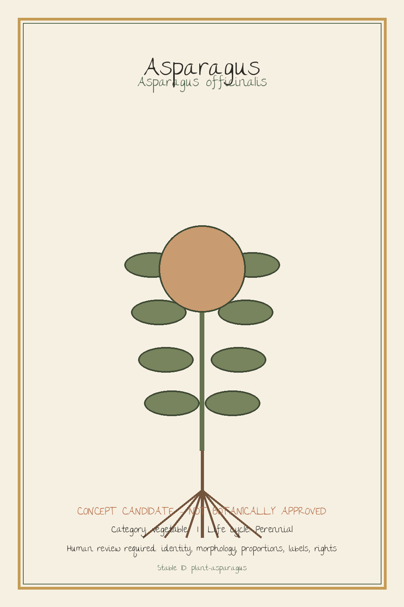

**Source status:** Not botanically or horticulturally approved. Recorded fields are derived
from the retained registry and remain subject to claim-level source review.

### Beans

**Stable plant ID:** `plant-beans`
**Category:** vegetable
**Recorded botanical name:** Phaseolus vulgaris
**Recorded family:** Fabaceae
**Life cycle:** Annual
**Illustration status:** `CANDIDATE_GENERATED / REVIEW_PENDING / NOT_APPROVED`

**Identification and morphology**

- Growth habit: Growth habit should be resolved to the exact species or cultivar; this entry provides a category-level source scaffold.
- Root or storage organ: Species-specific root, crown, or storage organ; verify the exact form before illustrating.
- Leaf arrangement and shape: Species-specific arrangement and blade shape; verify exact genus and cultivar.
- Flower structure: Species-specific inflorescence or flower structure.
- Fruit or seed structure: Species-specific fruit, seed pod, achene, capsule, berry, or nut.

**Errington timing fields**

- Indoor sow: Source timing not reviewed
- Direct sow: Source timing not reviewed
- Transplant: Source timing not reviewed
- Bloom: Source timing not reviewed
- Harvest: Source timing not reviewed
- Frost: Source timing not reviewed

**Cultivation**

- Soil: Well-drained, fertile soil with organic matter; adjust for the crop's root depth.
- Water: Keep moisture even during establishment and harvest formation; avoid prolonged waterlogging.
- Spacing: Use the calendar, seed packet, or mature crop size; do not rely on a registry-wide spacing value.
- Light: Full sun is usual; leafy cool-season crops tolerate more partial shade.
- Maintenance: Thin, weed, mulch, and monitor; support or stake as the crop requires.
- Pests/diseases: Monitor locally for aphids, slugs, caterpillars, fungal leaf spots, and soil-borne disease; identify before treatment.

**Candidate plate:**

**Source status:** Not botanically or horticulturally approved. Recorded fields are derived
from the retained registry and remain subject to claim-level source review.

### Beets

**Stable plant ID:** `plant-beets`
**Category:** vegetable
**Recorded botanical name:** Beta vulgaris
**Recorded family:** Amaranthaceae
**Life cycle:** Annual
**Illustration status:** `CANDIDATE_GENERATED / REVIEW_PENDING / NOT_APPROVED`

**Identification and morphology**

- Growth habit: Growth habit should be resolved to the exact species or cultivar; this entry provides a category-level source scaffold.
- Root or storage organ: Species-specific root, crown, or storage organ; verify the exact form before illustrating.
- Leaf arrangement and shape: Species-specific arrangement and blade shape; verify exact genus and cultivar.
- Flower structure: Species-specific inflorescence or flower structure.
- Fruit or seed structure: Species-specific fruit, seed pod, achene, capsule, berry, or nut.

**Errington timing fields**

- Indoor sow: Source timing not reviewed
- Direct sow: Source timing not reviewed
- Transplant: Source timing not reviewed
- Bloom: Source timing not reviewed
- Harvest: Source timing not reviewed
- Frost: Source timing not reviewed

**Cultivation**

- Soil: Well-drained, fertile soil with organic matter; adjust for the crop's root depth.
- Water: Keep moisture even during establishment and harvest formation; avoid prolonged waterlogging.
- Spacing: Use the calendar, seed packet, or mature crop size; do not rely on a registry-wide spacing value.
- Light: Full sun is usual; leafy cool-season crops tolerate more partial shade.
- Maintenance: Thin, weed, mulch, and monitor; support or stake as the crop requires.
- Pests/diseases: Monitor locally for aphids, slugs, caterpillars, fungal leaf spots, and soil-borne disease; identify before treatment.

**Candidate plate:**

**Source status:** Not botanically or horticulturally approved. Recorded fields are derived
from the retained registry and remain subject to claim-level source review.

### Bell Pepper

**Stable plant ID:** `plant-bell-pepper`
**Category:** vegetable
**Recorded botanical name:** Capsicum annuum
**Recorded family:** Solanaceae
**Life cycle:** Annual
**Illustration status:** `CANDIDATE_GENERATED / REVIEW_PENDING / NOT_APPROVED`

**Identification and morphology**

- Growth habit: Growth habit should be resolved to the exact species or cultivar; this entry provides a category-level source scaffold.
- Root or storage organ: Species-specific root, crown, or storage organ; verify the exact form before illustrating.
- Leaf arrangement and shape: Species-specific arrangement and blade shape; verify exact genus and cultivar.
- Flower structure: Species-specific inflorescence or flower structure.
- Fruit or seed structure: Species-specific fruit, seed pod, achene, capsule, berry, or nut.

**Errington timing fields**

- Indoor sow: Source timing not reviewed
- Direct sow: Source timing not reviewed
- Transplant: Source timing not reviewed
- Bloom: Source timing not reviewed
- Harvest: Source timing not reviewed
- Frost: Source timing not reviewed

**Cultivation**

- Soil: Well-drained, fertile soil with organic matter; adjust for the crop's root depth.
- Water: Keep moisture even during establishment and harvest formation; avoid prolonged waterlogging.
- Spacing: Use the calendar, seed packet, or mature crop size; do not rely on a registry-wide spacing value.
- Light: Full sun is usual; leafy cool-season crops tolerate more partial shade.
- Maintenance: Thin, weed, mulch, and monitor; support or stake as the crop requires.
- Pests/diseases: Monitor locally for aphids, slugs, caterpillars, fungal leaf spots, and soil-borne disease; identify before treatment.

**Candidate plate:**

**Source status:** Not botanically or horticulturally approved. Recorded fields are derived
from the retained registry and remain subject to claim-level source review.

### Broccoli

**Stable plant ID:** `plant-broccoli`
**Category:** vegetable
**Recorded botanical name:** Brassica oleracea var. italica
**Recorded family:** Brassicaceae
**Life cycle:** Annual
**Illustration status:** `CANDIDATE_GENERATED / REVIEW_PENDING / NOT_APPROVED`

**Identification and morphology**

- Growth habit: Growth habit should be resolved to the exact species or cultivar; this entry provides a category-level source scaffold.
- Root or storage organ: Species-specific root, crown, or storage organ; verify the exact form before illustrating.
- Leaf arrangement and shape: Species-specific arrangement and blade shape; verify exact genus and cultivar.
- Flower structure: Species-specific inflorescence or flower structure.
- Fruit or seed structure: Species-specific fruit, seed pod, achene, capsule, berry, or nut.

**Errington timing fields**

- Indoor sow: Source timing not reviewed
- Direct sow: Source timing not reviewed
- Transplant: Source timing not reviewed
- Bloom: Source timing not reviewed
- Harvest: Source timing not reviewed
- Frost: Source timing not reviewed

**Cultivation**

- Soil: Well-drained, fertile soil with organic matter; adjust for the crop's root depth.
- Water: Keep moisture even during establishment and harvest formation; avoid prolonged waterlogging.
- Spacing: Use the calendar, seed packet, or mature crop size; do not rely on a registry-wide spacing value.
- Light: Full sun is usual; leafy cool-season crops tolerate more partial shade.
- Maintenance: Thin, weed, mulch, and monitor; support or stake as the crop requires.
- Pests/diseases: Monitor locally for aphids, slugs, caterpillars, fungal leaf spots, and soil-borne disease; identify before treatment.

**Candidate plate:**

**Source status:** Not botanically or horticulturally approved. Recorded fields are derived
from the retained registry and remain subject to claim-level source review.

### Brussels Sprouts

**Stable plant ID:** `plant-brussels-sprouts`
**Category:** vegetable
**Recorded botanical name:** Brassica oleracea var. gemmifera
**Recorded family:** Brassicaceae
**Life cycle:** Annual
**Illustration status:** `CANDIDATE_GENERATED / REVIEW_PENDING / NOT_APPROVED`

**Identification and morphology**

- Growth habit: Growth habit should be resolved to the exact species or cultivar; this entry provides a category-level source scaffold.
- Root or storage organ: Species-specific root, crown, or storage organ; verify the exact form before illustrating.
- Leaf arrangement and shape: Species-specific arrangement and blade shape; verify exact genus and cultivar.
- Flower structure: Species-specific inflorescence or flower structure.
- Fruit or seed structure: Species-specific fruit, seed pod, achene, capsule, berry, or nut.

**Errington timing fields**

- Indoor sow: Source timing not reviewed
- Direct sow: Source timing not reviewed
- Transplant: Source timing not reviewed
- Bloom: Source timing not reviewed
- Harvest: Source timing not reviewed
- Frost: Source timing not reviewed

**Cultivation**

- Soil: Well-drained, fertile soil with organic matter; adjust for the crop's root depth.
- Water: Keep moisture even during establishment and harvest formation; avoid prolonged waterlogging.
- Spacing: Use the calendar, seed packet, or mature crop size; do not rely on a registry-wide spacing value.
- Light: Full sun is usual; leafy cool-season crops tolerate more partial shade.
- Maintenance: Thin, weed, mulch, and monitor; support or stake as the crop requires.
- Pests/diseases: Monitor locally for aphids, slugs, caterpillars, fungal leaf spots, and soil-borne disease; identify before treatment.

**Candidate plate:**
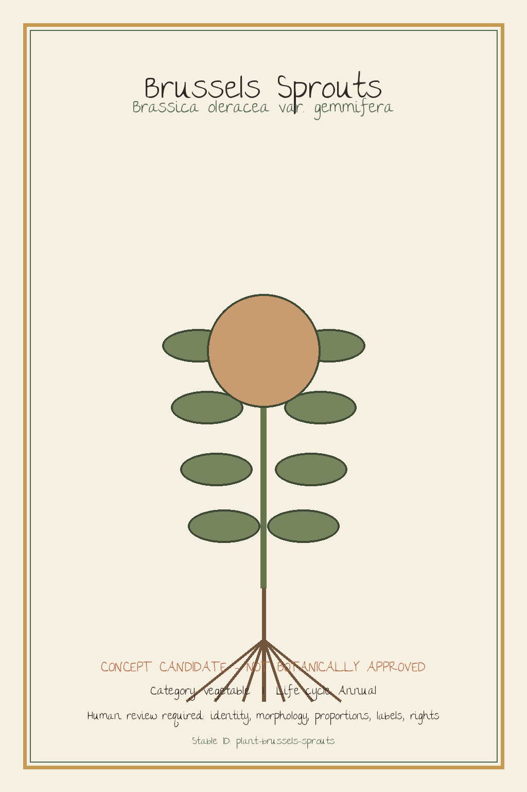

**Source status:** Not botanically or horticulturally approved. Recorded fields are derived
from the retained registry and remain subject to claim-level source review.

### Cabbage

**Stable plant ID:** `plant-cabbage`
**Category:** vegetable
**Recorded botanical name:** Brassica oleracea var. capitata
**Recorded family:** Brassicaceae
**Life cycle:** Annual
**Illustration status:** `CANDIDATE_GENERATED / REVIEW_PENDING / NOT_APPROVED`

**Identification and morphology**

- Growth habit: Growth habit should be resolved to the exact species or cultivar; this entry provides a category-level source scaffold.
- Root or storage organ: Species-specific root, crown, or storage organ; verify the exact form before illustrating.
- Leaf arrangement and shape: Species-specific arrangement and blade shape; verify exact genus and cultivar.
- Flower structure: Species-specific inflorescence or flower structure.
- Fruit or seed structure: Species-specific fruit, seed pod, achene, capsule, berry, or nut.

**Errington timing fields**

- Indoor sow: Source timing not reviewed
- Direct sow: Source timing not reviewed
- Transplant: Source timing not reviewed
- Bloom: Source timing not reviewed
- Harvest: Source timing not reviewed
- Frost: Source timing not reviewed

**Cultivation**

- Soil: Well-drained, fertile soil with organic matter; adjust for the crop's root depth.
- Water: Keep moisture even during establishment and harvest formation; avoid prolonged waterlogging.
- Spacing: Use the calendar, seed packet, or mature crop size; do not rely on a registry-wide spacing value.
- Light: Full sun is usual; leafy cool-season crops tolerate more partial shade.
- Maintenance: Thin, weed, mulch, and monitor; support or stake as the crop requires.
- Pests/diseases: Monitor locally for aphids, slugs, caterpillars, fungal leaf spots, and soil-borne disease; identify before treatment.

**Candidate plate:**
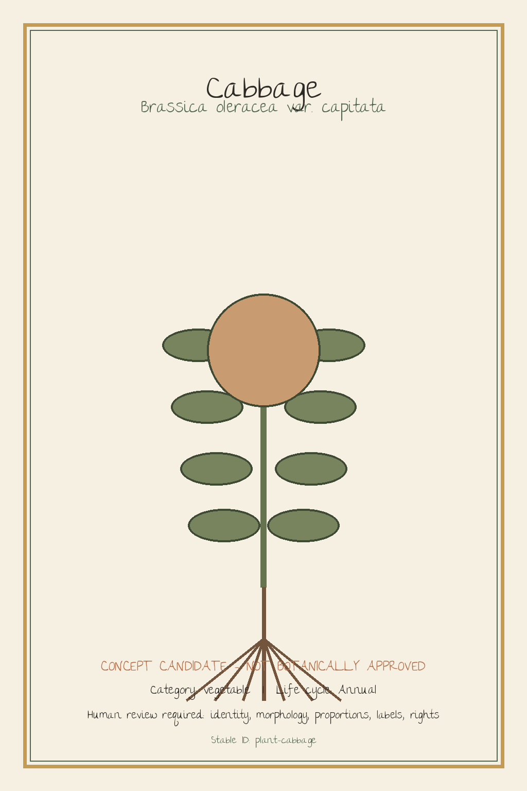

**Source status:** Not botanically or horticulturally approved. Recorded fields are derived
from the retained registry and remain subject to claim-level source review.

### Cantaloupe

**Stable plant ID:** `plant-cantaloupe`
**Category:** vegetable
**Recorded botanical name:** Cucumis melo
**Recorded family:** Cucurbitaceae
**Life cycle:** Annual
**Illustration status:** `CANDIDATE_GENERATED / REVIEW_PENDING / NOT_APPROVED`

**Identification and morphology**

- Growth habit: Growth habit should be resolved to the exact species or cultivar; this entry provides a category-level source scaffold.
- Root or storage organ: Species-specific root, crown, or storage organ; verify the exact form before illustrating.
- Leaf arrangement and shape: Species-specific arrangement and blade shape; verify exact genus and cultivar.
- Flower structure: Species-specific inflorescence or flower structure.
- Fruit or seed structure: Species-specific fruit, seed pod, achene, capsule, berry, or nut.

**Errington timing fields**

- Indoor sow: Source timing not reviewed
- Direct sow: Source timing not reviewed
- Transplant: Source timing not reviewed
- Bloom: Source timing not reviewed
- Harvest: Source timing not reviewed
- Frost: Source timing not reviewed

**Cultivation**

- Soil: Well-drained, fertile soil with organic matter; adjust for the crop's root depth.
- Water: Keep moisture even during establishment and harvest formation; avoid prolonged waterlogging.
- Spacing: Use the calendar, seed packet, or mature crop size; do not rely on a registry-wide spacing value.
- Light: Full sun is usual; leafy cool-season crops tolerate more partial shade.
- Maintenance: Thin, weed, mulch, and monitor; support or stake as the crop requires.
- Pests/diseases: Monitor locally for aphids, slugs, caterpillars, fungal leaf spots, and soil-borne disease; identify before treatment.

**Candidate plate:**

**Source status:** Not botanically or horticulturally approved. Recorded fields are derived
from the retained registry and remain subject to claim-level source review.

### Carrots

**Stable plant ID:** `plant-carrots`
**Category:** vegetable
**Recorded botanical name:** Daucus carota subsp. sativus
**Recorded family:** Apiaceae
**Life cycle:** Annual
**Illustration status:** `CANDIDATE_GENERATED / REVIEW_PENDING / NOT_APPROVED`

**Identification and morphology**

- Growth habit: Growth habit should be resolved to the exact species or cultivar; this entry provides a category-level source scaffold.
- Root or storage organ: Species-specific root, crown, or storage organ; verify the exact form before illustrating.
- Leaf arrangement and shape: Species-specific arrangement and blade shape; verify exact genus and cultivar.
- Flower structure: Species-specific inflorescence or flower structure.
- Fruit or seed structure: Species-specific fruit, seed pod, achene, capsule, berry, or nut.

**Errington timing fields**

- Indoor sow: Source timing not reviewed
- Direct sow: Source timing not reviewed
- Transplant: Source timing not reviewed
- Bloom: Source timing not reviewed
- Harvest: Source timing not reviewed
- Frost: Source timing not reviewed

**Cultivation**

- Soil: Well-drained, fertile soil with organic matter; adjust for the crop's root depth.
- Water: Keep moisture even during establishment and harvest formation; avoid prolonged waterlogging.
- Spacing: Use the calendar, seed packet, or mature crop size; do not rely on a registry-wide spacing value.
- Light: Full sun is usual; leafy cool-season crops tolerate more partial shade.
- Maintenance: Thin, weed, mulch, and monitor; support or stake as the crop requires.
- Pests/diseases: Monitor locally for aphids, slugs, caterpillars, fungal leaf spots, and soil-borne disease; identify before treatment.

**Candidate plate:**

**Source status:** Not botanically or horticulturally approved. Recorded fields are derived
from the retained registry and remain subject to claim-level source review.

### Cauliflower

**Stable plant ID:** `plant-cauliflower`
**Category:** vegetable
**Recorded botanical name:** Brassica oleracea var. botrytis
**Recorded family:** Brassicaceae
**Life cycle:** Annual
**Illustration status:** `CANDIDATE_GENERATED / REVIEW_PENDING / NOT_APPROVED`

**Identification and morphology**

- Growth habit: Growth habit should be resolved to the exact species or cultivar; this entry provides a category-level source scaffold.
- Root or storage organ: Species-specific root, crown, or storage organ; verify the exact form before illustrating.
- Leaf arrangement and shape: Species-specific arrangement and blade shape; verify exact genus and cultivar.
- Flower structure: Species-specific inflorescence or flower structure.
- Fruit or seed structure: Species-specific fruit, seed pod, achene, capsule, berry, or nut.

**Errington timing fields**

- Indoor sow: Source timing not reviewed
- Direct sow: Source timing not reviewed
- Transplant: Source timing not reviewed
- Bloom: Source timing not reviewed
- Harvest: Source timing not reviewed
- Frost: Source timing not reviewed

**Cultivation**

- Soil: Well-drained, fertile soil with organic matter; adjust for the crop's root depth.
- Water: Keep moisture even during establishment and harvest formation; avoid prolonged waterlogging.
- Spacing: Use the calendar, seed packet, or mature crop size; do not rely on a registry-wide spacing value.
- Light: Full sun is usual; leafy cool-season crops tolerate more partial shade.
- Maintenance: Thin, weed, mulch, and monitor; support or stake as the crop requires.
- Pests/diseases: Monitor locally for aphids, slugs, caterpillars, fungal leaf spots, and soil-borne disease; identify before treatment.

**Candidate plate:**

**Source status:** Not botanically or horticulturally approved. Recorded fields are derived
from the retained registry and remain subject to claim-level source review.

### Celery

**Stable plant ID:** `plant-celery`
**Category:** vegetable
**Recorded botanical name:** Apium graveolens var. dulce
**Recorded family:** Apiaceae
**Life cycle:** Annual
**Illustration status:** `CANDIDATE_GENERATED / REVIEW_PENDING / NOT_APPROVED`

**Identification and morphology**

- Growth habit: Growth habit should be resolved to the exact species or cultivar; this entry provides a category-level source scaffold.
- Root or storage organ: Species-specific root, crown, or storage organ; verify the exact form before illustrating.
- Leaf arrangement and shape: Species-specific arrangement and blade shape; verify exact genus and cultivar.
- Flower structure: Species-specific inflorescence or flower structure.
- Fruit or seed structure: Species-specific fruit, seed pod, achene, capsule, berry, or nut.

**Errington timing fields**

- Indoor sow: Source timing not reviewed
- Direct sow: Source timing not reviewed
- Transplant: Source timing not reviewed
- Bloom: Source timing not reviewed
- Harvest: Source timing not reviewed
- Frost: Source timing not reviewed

**Cultivation**

- Soil: Well-drained, fertile soil with organic matter; adjust for the crop's root depth.
- Water: Keep moisture even during establishment and harvest formation; avoid prolonged waterlogging.
- Spacing: Use the calendar, seed packet, or mature crop size; do not rely on a registry-wide spacing value.
- Light: Full sun is usual; leafy cool-season crops tolerate more partial shade.
- Maintenance: Thin, weed, mulch, and monitor; support or stake as the crop requires.
- Pests/diseases: Monitor locally for aphids, slugs, caterpillars, fungal leaf spots, and soil-borne disease; identify before treatment.

**Candidate plate:**

**Source status:** Not botanically or horticulturally approved. Recorded fields are derived
from the retained registry and remain subject to claim-level source review.

### Corn

**Stable plant ID:** `plant-corn`
**Category:** vegetable
**Recorded botanical name:** Zea mays
**Recorded family:** Poaceae
**Life cycle:** Annual
**Illustration status:** `CANDIDATE_GENERATED / REVIEW_PENDING / NOT_APPROVED`

**Identification and morphology**

- Growth habit: Growth habit should be resolved to the exact species or cultivar; this entry provides a category-level source scaffold.
- Root or storage organ: Species-specific root, crown, or storage organ; verify the exact form before illustrating.
- Leaf arrangement and shape: Species-specific arrangement and blade shape; verify exact genus and cultivar.
- Flower structure: Species-specific inflorescence or flower structure.
- Fruit or seed structure: Species-specific fruit, seed pod, achene, capsule, berry, or nut.

**Errington timing fields**

- Indoor sow: Source timing not reviewed
- Direct sow: Source timing not reviewed
- Transplant: Source timing not reviewed
- Bloom: Source timing not reviewed
- Harvest: Source timing not reviewed
- Frost: Source timing not reviewed

**Cultivation**

- Soil: Well-drained, fertile soil with organic matter; adjust for the crop's root depth.
- Water: Keep moisture even during establishment and harvest formation; avoid prolonged waterlogging.
- Spacing: Use the calendar, seed packet, or mature crop size; do not rely on a registry-wide spacing value.
- Light: Full sun is usual; leafy cool-season crops tolerate more partial shade.
- Maintenance: Thin, weed, mulch, and monitor; support or stake as the crop requires.
- Pests/diseases: Monitor locally for aphids, slugs, caterpillars, fungal leaf spots, and soil-borne disease; identify before treatment.

**Candidate plate:**

**Source status:** Not botanically or horticulturally approved. Recorded fields are derived
from the retained registry and remain subject to claim-level source review.

### Cucumber

**Stable plant ID:** `plant-cucumber`
**Category:** vegetable
**Recorded botanical name:** Cucumis sativus
**Recorded family:** Cucurbitaceae
**Life cycle:** Annual
**Illustration status:** `CANDIDATE_GENERATED / REVIEW_PENDING / NOT_APPROVED`

**Identification and morphology**

- Growth habit: Growth habit should be resolved to the exact species or cultivar; this entry provides a category-level source scaffold.
- Root or storage organ: Species-specific root, crown, or storage organ; verify the exact form before illustrating.
- Leaf arrangement and shape: Species-specific arrangement and blade shape; verify exact genus and cultivar.
- Flower structure: Species-specific inflorescence or flower structure.
- Fruit or seed structure: Species-specific fruit, seed pod, achene, capsule, berry, or nut.

**Errington timing fields**

- Indoor sow: Source timing not reviewed
- Direct sow: Source timing not reviewed
- Transplant: Source timing not reviewed
- Bloom: Source timing not reviewed
- Harvest: Source timing not reviewed
- Frost: Source timing not reviewed

**Cultivation**

- Soil: Well-drained, fertile soil with organic matter; adjust for the crop's root depth.
- Water: Keep moisture even during establishment and harvest formation; avoid prolonged waterlogging.
- Spacing: Use the calendar, seed packet, or mature crop size; do not rely on a registry-wide spacing value.
- Light: Full sun is usual; leafy cool-season crops tolerate more partial shade.
- Maintenance: Thin, weed, mulch, and monitor; support or stake as the crop requires.
- Pests/diseases: Monitor locally for aphids, slugs, caterpillars, fungal leaf spots, and soil-borne disease; identify before treatment.

**Candidate plate:**

**Source status:** Not botanically or horticulturally approved. Recorded fields are derived
from the retained registry and remain subject to claim-level source review.

### Garlic

**Stable plant ID:** `plant-garlic`
**Category:** vegetable
**Recorded botanical name:** Allium sativum
**Recorded family:** Amaryllidaceae
**Life cycle:** Annual
**Illustration status:** `CANDIDATE_GENERATED / REVIEW_PENDING / NOT_APPROVED`

**Identification and morphology**

- Growth habit: Growth habit should be resolved to the exact species or cultivar; this entry provides a category-level source scaffold.
- Root or storage organ: Species-specific root, crown, or storage organ; verify the exact form before illustrating.
- Leaf arrangement and shape: Species-specific arrangement and blade shape; verify exact genus and cultivar.
- Flower structure: Species-specific inflorescence or flower structure.
- Fruit or seed structure: Species-specific fruit, seed pod, achene, capsule, berry, or nut.

**Errington timing fields**

- Indoor sow: Source timing not reviewed
- Direct sow: Source timing not reviewed
- Transplant: Source timing not reviewed
- Bloom: Source timing not reviewed
- Harvest: Source timing not reviewed
- Frost: Source timing not reviewed

**Cultivation**

- Soil: Well-drained, fertile soil with organic matter; adjust for the crop's root depth.
- Water: Keep moisture even during establishment and harvest formation; avoid prolonged waterlogging.
- Spacing: Use the calendar, seed packet, or mature crop size; do not rely on a registry-wide spacing value.
- Light: Full sun is usual; leafy cool-season crops tolerate more partial shade.
- Maintenance: Thin, weed, mulch, and monitor; support or stake as the crop requires.
- Pests/diseases: Monitor locally for aphids, slugs, caterpillars, fungal leaf spots, and soil-borne disease; identify before treatment.

**Candidate plate:**
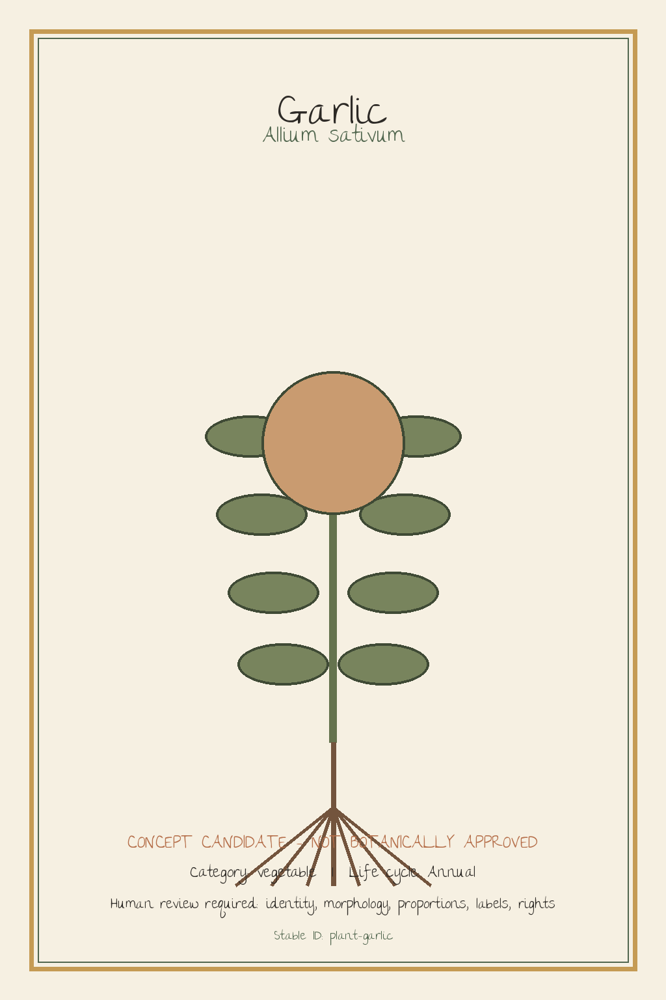

**Source status:** Not botanically or horticulturally approved. Recorded fields are derived
from the retained registry and remain subject to claim-level source review.

### Kohlrabi

**Stable plant ID:** `plant-kohlrabi`
**Category:** vegetable
**Recorded botanical name:** Brassica oleracea var. gongylodes
**Recorded family:** Brassicaceae
**Life cycle:** Annual
**Illustration status:** `CANDIDATE_GENERATED / REVIEW_PENDING / NOT_APPROVED`

**Identification and morphology**

- Growth habit: Growth habit should be resolved to the exact species or cultivar; this entry provides a category-level source scaffold.
- Root or storage organ: Species-specific root, crown, or storage organ; verify the exact form before illustrating.
- Leaf arrangement and shape: Species-specific arrangement and blade shape; verify exact genus and cultivar.
- Flower structure: Species-specific inflorescence or flower structure.
- Fruit or seed structure: Species-specific fruit, seed pod, achene, capsule, berry, or nut.

**Errington timing fields**

- Indoor sow: Source timing not reviewed
- Direct sow: Source timing not reviewed
- Transplant: Source timing not reviewed
- Bloom: Source timing not reviewed
- Harvest: Source timing not reviewed
- Frost: Source timing not reviewed

**Cultivation**

- Soil: Well-drained, fertile soil with organic matter; adjust for the crop's root depth.
- Water: Keep moisture even during establishment and harvest formation; avoid prolonged waterlogging.
- Spacing: Use the calendar, seed packet, or mature crop size; do not rely on a registry-wide spacing value.
- Light: Full sun is usual; leafy cool-season crops tolerate more partial shade.
- Maintenance: Thin, weed, mulch, and monitor; support or stake as the crop requires.
- Pests/diseases: Monitor locally for aphids, slugs, caterpillars, fungal leaf spots, and soil-borne disease; identify before treatment.

**Candidate plate:**

**Source status:** Not botanically or horticulturally approved. Recorded fields are derived
from the retained registry and remain subject to claim-level source review.

### Leeks

**Stable plant ID:** `plant-leeks`
**Category:** vegetable
**Recorded botanical name:** Allium ampeloprasum
**Recorded family:** Amaryllidaceae
**Life cycle:** Annual
**Illustration status:** `CANDIDATE_GENERATED / REVIEW_PENDING / NOT_APPROVED`

**Identification and morphology**

- Growth habit: Growth habit should be resolved to the exact species or cultivar; this entry provides a category-level source scaffold.
- Root or storage organ: Species-specific root, crown, or storage organ; verify the exact form before illustrating.
- Leaf arrangement and shape: Species-specific arrangement and blade shape; verify exact genus and cultivar.
- Flower structure: Species-specific inflorescence or flower structure.
- Fruit or seed structure: Species-specific fruit, seed pod, achene, capsule, berry, or nut.

**Errington timing fields**

- Indoor sow: Source timing not reviewed
- Direct sow: Source timing not reviewed
- Transplant: Source timing not reviewed
- Bloom: Source timing not reviewed
- Harvest: Source timing not reviewed
- Frost: Source timing not reviewed

**Cultivation**

- Soil: Well-drained, fertile soil with organic matter; adjust for the crop's root depth.
- Water: Keep moisture even during establishment and harvest formation; avoid prolonged waterlogging.
- Spacing: Use the calendar, seed packet, or mature crop size; do not rely on a registry-wide spacing value.
- Light: Full sun is usual; leafy cool-season crops tolerate more partial shade.
- Maintenance: Thin, weed, mulch, and monitor; support or stake as the crop requires.
- Pests/diseases: Monitor locally for aphids, slugs, caterpillars, fungal leaf spots, and soil-borne disease; identify before treatment.

**Candidate plate:**
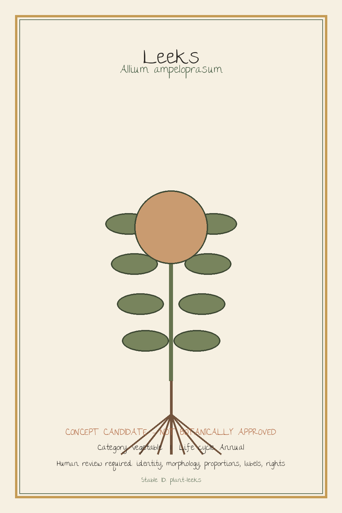

**Source status:** Not botanically or horticulturally approved. Recorded fields are derived
from the retained registry and remain subject to claim-level source review.

### Lettuce

**Stable plant ID:** `plant-lettuce`
**Category:** vegetable
**Recorded botanical name:** Lactuca sativa
**Recorded family:** Asteraceae
**Life cycle:** Annual
**Illustration status:** `CANDIDATE_GENERATED / REVIEW_PENDING / NOT_APPROVED`

**Identification and morphology**

- Growth habit: Growth habit should be resolved to the exact species or cultivar; this entry provides a category-level source scaffold.
- Root or storage organ: Species-specific root, crown, or storage organ; verify the exact form before illustrating.
- Leaf arrangement and shape: Species-specific arrangement and blade shape; verify exact genus and cultivar.
- Flower structure: Species-specific inflorescence or flower structure.
- Fruit or seed structure: Species-specific fruit, seed pod, achene, capsule, berry, or nut.

**Errington timing fields**

- Indoor sow: Source timing not reviewed
- Direct sow: Source timing not reviewed
- Transplant: Source timing not reviewed
- Bloom: Source timing not reviewed
- Harvest: Source timing not reviewed
- Frost: Source timing not reviewed

**Cultivation**

- Soil: Well-drained, fertile soil with organic matter; adjust for the crop's root depth.
- Water: Keep moisture even during establishment and harvest formation; avoid prolonged waterlogging.
- Spacing: Use the calendar, seed packet, or mature crop size; do not rely on a registry-wide spacing value.
- Light: Full sun is usual; leafy cool-season crops tolerate more partial shade.
- Maintenance: Thin, weed, mulch, and monitor; support or stake as the crop requires.
- Pests/diseases: Monitor locally for aphids, slugs, caterpillars, fungal leaf spots, and soil-borne disease; identify before treatment.

**Candidate plate:**

**Source status:** Not botanically or horticulturally approved. Recorded fields are derived
from the retained registry and remain subject to claim-level source review.

### Eggplant

**Stable plant ID:** `plant-eggplant`
**Category:** vegetable
**Recorded botanical name:** Solanum melongena
**Recorded family:** Solanaceae
**Life cycle:** Annual
**Illustration status:** `CANDIDATE_GENERATED / REVIEW_PENDING / NOT_APPROVED`

**Identification and morphology**

- Growth habit: Growth habit should be resolved to the exact species or cultivar; this entry provides a category-level source scaffold.
- Root or storage organ: Species-specific root, crown, or storage organ; verify the exact form before illustrating.
- Leaf arrangement and shape: Species-specific arrangement and blade shape; verify exact genus and cultivar.
- Flower structure: Species-specific inflorescence or flower structure.
- Fruit or seed structure: Species-specific fruit, seed pod, achene, capsule, berry, or nut.

**Errington timing fields**

- Indoor sow: Source timing not reviewed
- Direct sow: Source timing not reviewed
- Transplant: Source timing not reviewed
- Bloom: Source timing not reviewed
- Harvest: Source timing not reviewed
- Frost: Source timing not reviewed

**Cultivation**

- Soil: Well-drained, fertile soil with organic matter; adjust for the crop's root depth.
- Water: Keep moisture even during establishment and harvest formation; avoid prolonged waterlogging.
- Spacing: Use the calendar, seed packet, or mature crop size; do not rely on a registry-wide spacing value.
- Light: Full sun is usual; leafy cool-season crops tolerate more partial shade.
- Maintenance: Thin, weed, mulch, and monitor; support or stake as the crop requires.
- Pests/diseases: Monitor locally for aphids, slugs, caterpillars, fungal leaf spots, and soil-borne disease; identify before treatment.

**Candidate plate:**
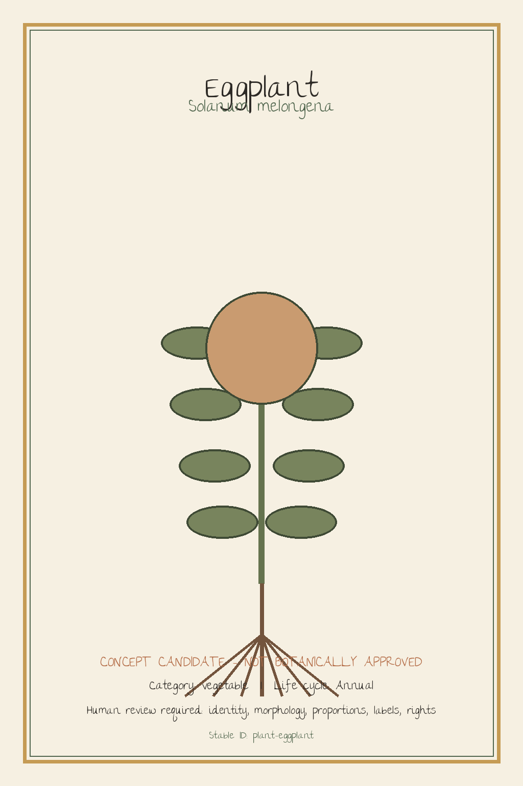

**Source status:** Not botanically or horticulturally approved. Recorded fields are derived
from the retained registry and remain subject to claim-level source review.

### Melons

**Stable plant ID:** `plant-melons`
**Category:** vegetable
**Recorded botanical name:** Cucumis melo
**Recorded family:** Cucurbitaceae
**Life cycle:** Annual
**Illustration status:** `CANDIDATE_GENERATED / REVIEW_PENDING / NOT_APPROVED`

**Identification and morphology**

- Growth habit: Growth habit should be resolved to the exact species or cultivar; this entry provides a category-level source scaffold.
- Root or storage organ: Species-specific root, crown, or storage organ; verify the exact form before illustrating.
- Leaf arrangement and shape: Species-specific arrangement and blade shape; verify exact genus and cultivar.
- Flower structure: Species-specific inflorescence or flower structure.
- Fruit or seed structure: Species-specific fruit, seed pod, achene, capsule, berry, or nut.

**Errington timing fields**

- Indoor sow: Source timing not reviewed
- Direct sow: Source timing not reviewed
- Transplant: Source timing not reviewed
- Bloom: Source timing not reviewed
- Harvest: Source timing not reviewed
- Frost: Source timing not reviewed

**Cultivation**

- Soil: Well-drained, fertile soil with organic matter; adjust for the crop's root depth.
- Water: Keep moisture even during establishment and harvest formation; avoid prolonged waterlogging.
- Spacing: Use the calendar, seed packet, or mature crop size; do not rely on a registry-wide spacing value.
- Light: Full sun is usual; leafy cool-season crops tolerate more partial shade.
- Maintenance: Thin, weed, mulch, and monitor; support or stake as the crop requires.
- Pests/diseases: Monitor locally for aphids, slugs, caterpillars, fungal leaf spots, and soil-borne disease; identify before treatment.

**Candidate plate:**

**Source status:** Not botanically or horticulturally approved. Recorded fields are derived
from the retained registry and remain subject to claim-level source review.

### Okra

**Stable plant ID:** `plant-okra`
**Category:** vegetable
**Recorded botanical name:** Abelmoschus esculentus
**Recorded family:** Malvaceae
**Life cycle:** Annual
**Illustration status:** `CANDIDATE_GENERATED / REVIEW_PENDING / NOT_APPROVED`

**Identification and morphology**

- Growth habit: Growth habit should be resolved to the exact species or cultivar; this entry provides a category-level source scaffold.
- Root or storage organ: Species-specific root, crown, or storage organ; verify the exact form before illustrating.
- Leaf arrangement and shape: Species-specific arrangement and blade shape; verify exact genus and cultivar.
- Flower structure: Species-specific inflorescence or flower structure.
- Fruit or seed structure: Species-specific fruit, seed pod, achene, capsule, berry, or nut.

**Errington timing fields**

- Indoor sow: Source timing not reviewed
- Direct sow: Source timing not reviewed
- Transplant: Source timing not reviewed
- Bloom: Source timing not reviewed
- Harvest: Source timing not reviewed
- Frost: Source timing not reviewed

**Cultivation**

- Soil: Well-drained, fertile soil with organic matter; adjust for the crop's root depth.
- Water: Keep moisture even during establishment and harvest formation; avoid prolonged waterlogging.
- Spacing: Use the calendar, seed packet, or mature crop size; do not rely on a registry-wide spacing value.
- Light: Full sun is usual; leafy cool-season crops tolerate more partial shade.
- Maintenance: Thin, weed, mulch, and monitor; support or stake as the crop requires.
- Pests/diseases: Monitor locally for aphids, slugs, caterpillars, fungal leaf spots, and soil-borne disease; identify before treatment.

**Candidate plate:**

**Source status:** Not botanically or horticulturally approved. Recorded fields are derived
from the retained registry and remain subject to claim-level source review.

### Parsnips

**Stable plant ID:** `plant-parsnips`
**Category:** vegetable
**Recorded botanical name:** Pastinaca sativa
**Recorded family:** Apiaceae
**Life cycle:** Annual
**Illustration status:** `CANDIDATE_GENERATED / REVIEW_PENDING / NOT_APPROVED`

**Identification and morphology**

- Growth habit: Growth habit should be resolved to the exact species or cultivar; this entry provides a category-level source scaffold.
- Root or storage organ: Species-specific root, crown, or storage organ; verify the exact form before illustrating.
- Leaf arrangement and shape: Species-specific arrangement and blade shape; verify exact genus and cultivar.
- Flower structure: Species-specific inflorescence or flower structure.
- Fruit or seed structure: Species-specific fruit, seed pod, achene, capsule, berry, or nut.

**Errington timing fields**

- Indoor sow: Source timing not reviewed
- Direct sow: Source timing not reviewed
- Transplant: Source timing not reviewed
- Bloom: Source timing not reviewed
- Harvest: Source timing not reviewed
- Frost: Source timing not reviewed

**Cultivation**

- Soil: Well-drained, fertile soil with organic matter; adjust for the crop's root depth.
- Water: Keep moisture even during establishment and harvest formation; avoid prolonged waterlogging.
- Spacing: Use the calendar, seed packet, or mature crop size; do not rely on a registry-wide spacing value.
- Light: Full sun is usual; leafy cool-season crops tolerate more partial shade.
- Maintenance: Thin, weed, mulch, and monitor; support or stake as the crop requires.
- Pests/diseases: Monitor locally for aphids, slugs, caterpillars, fungal leaf spots, and soil-borne disease; identify before treatment.

**Candidate plate:**

**Source status:** Not botanically or horticulturally approved. Recorded fields are derived
from the retained registry and remain subject to claim-level source review.

### Peas

**Stable plant ID:** `plant-peas`
**Category:** vegetable
**Recorded botanical name:** Pisum sativum
**Recorded family:** Fabaceae
**Life cycle:** Annual
**Illustration status:** `CANDIDATE_GENERATED / REVIEW_PENDING / NOT_APPROVED`

**Identification and morphology**

- Growth habit: Growth habit should be resolved to the exact species or cultivar; this entry provides a category-level source scaffold.
- Root or storage organ: Species-specific root, crown, or storage organ; verify the exact form before illustrating.
- Leaf arrangement and shape: Species-specific arrangement and blade shape; verify exact genus and cultivar.
- Flower structure: Species-specific inflorescence or flower structure.
- Fruit or seed structure: Species-specific fruit, seed pod, achene, capsule, berry, or nut.

**Errington timing fields**

- Indoor sow: Source timing not reviewed
- Direct sow: Source timing not reviewed
- Transplant: Source timing not reviewed
- Bloom: Source timing not reviewed
- Harvest: Source timing not reviewed
- Frost: Source timing not reviewed

**Cultivation**

- Soil: Well-drained, fertile soil with organic matter; adjust for the crop's root depth.
- Water: Keep moisture even during establishment and harvest formation; avoid prolonged waterlogging.
- Spacing: Use the calendar, seed packet, or mature crop size; do not rely on a registry-wide spacing value.
- Light: Full sun is usual; leafy cool-season crops tolerate more partial shade.
- Maintenance: Thin, weed, mulch, and monitor; support or stake as the crop requires.
- Pests/diseases: Monitor locally for aphids, slugs, caterpillars, fungal leaf spots, and soil-borne disease; identify before treatment.

**Candidate plate:**

**Source status:** Not botanically or horticulturally approved. Recorded fields are derived
from the retained registry and remain subject to claim-level source review.

### Potatoes

**Stable plant ID:** `plant-potatoes`
**Category:** vegetable
**Recorded botanical name:** Solanum tuberosum
**Recorded family:** Solanaceae
**Life cycle:** Annual
**Illustration status:** `CANDIDATE_GENERATED / REVIEW_PENDING / NOT_APPROVED`

**Identification and morphology**

- Growth habit: Growth habit should be resolved to the exact species or cultivar; this entry provides a category-level source scaffold.
- Root or storage organ: Species-specific root, crown, or storage organ; verify the exact form before illustrating.
- Leaf arrangement and shape: Species-specific arrangement and blade shape; verify exact genus and cultivar.
- Flower structure: Species-specific inflorescence or flower structure.
- Fruit or seed structure: Species-specific fruit, seed pod, achene, capsule, berry, or nut.

**Errington timing fields**

- Indoor sow: Source timing not reviewed
- Direct sow: Source timing not reviewed
- Transplant: Source timing not reviewed
- Bloom: Source timing not reviewed
- Harvest: Source timing not reviewed
- Frost: Source timing not reviewed

**Cultivation**

- Soil: Well-drained, fertile soil with organic matter; adjust for the crop's root depth.
- Water: Keep moisture even during establishment and harvest formation; avoid prolonged waterlogging.
- Spacing: Use the calendar, seed packet, or mature crop size; do not rely on a registry-wide spacing value.
- Light: Full sun is usual; leafy cool-season crops tolerate more partial shade.
- Maintenance: Thin, weed, mulch, and monitor; support or stake as the crop requires.
- Pests/diseases: Monitor locally for aphids, slugs, caterpillars, fungal leaf spots, and soil-borne disease; identify before treatment.

**Candidate plate:**

**Source status:** Not botanically or horticulturally approved. Recorded fields are derived
from the retained registry and remain subject to claim-level source review.

### Spinach

**Stable plant ID:** `plant-spinach`
**Category:** vegetable
**Recorded botanical name:** Spinacia oleracea
**Recorded family:** Amaranthaceae
**Life cycle:** Annual
**Illustration status:** `CANDIDATE_GENERATED / REVIEW_PENDING / NOT_APPROVED`

**Identification and morphology**

- Growth habit: Growth habit should be resolved to the exact species or cultivar; this entry provides a category-level source scaffold.
- Root or storage organ: Species-specific root, crown, or storage organ; verify the exact form before illustrating.
- Leaf arrangement and shape: Species-specific arrangement and blade shape; verify exact genus and cultivar.
- Flower structure: Species-specific inflorescence or flower structure.
- Fruit or seed structure: Species-specific fruit, seed pod, achene, capsule, berry, or nut.

**Errington timing fields**

- Indoor sow: Source timing not reviewed
- Direct sow: Source timing not reviewed
- Transplant: Source timing not reviewed
- Bloom: Source timing not reviewed
- Harvest: Source timing not reviewed
- Frost: Source timing not reviewed

**Cultivation**

- Soil: Well-drained, fertile soil with organic matter; adjust for the crop's root depth.
- Water: Keep moisture even during establishment and harvest formation; avoid prolonged waterlogging.
- Spacing: Use the calendar, seed packet, or mature crop size; do not rely on a registry-wide spacing value.
- Light: Full sun is usual; leafy cool-season crops tolerate more partial shade.
- Maintenance: Thin, weed, mulch, and monitor; support or stake as the crop requires.
- Pests/diseases: Monitor locally for aphids, slugs, caterpillars, fungal leaf spots, and soil-borne disease; identify before treatment.

**Candidate plate:**

**Source status:** Not botanically or horticulturally approved. Recorded fields are derived
from the retained registry and remain subject to claim-level source review.

### Sweet Potato

**Stable plant ID:** `plant-sweet-potato`
**Category:** vegetable
**Recorded botanical name:** Ipomoea batatas
**Recorded family:** Convolvulaceae
**Life cycle:** Annual
**Illustration status:** `CANDIDATE_GENERATED / REVIEW_PENDING / NOT_APPROVED`

**Identification and morphology**

- Growth habit: Growth habit should be resolved to the exact species or cultivar; this entry provides a category-level source scaffold.
- Root or storage organ: Species-specific root, crown, or storage organ; verify the exact form before illustrating.
- Leaf arrangement and shape: Species-specific arrangement and blade shape; verify exact genus and cultivar.
- Flower structure: Species-specific inflorescence or flower structure.
- Fruit or seed structure: Species-specific fruit, seed pod, achene, capsule, berry, or nut.

**Errington timing fields**

- Indoor sow: Source timing not reviewed
- Direct sow: Source timing not reviewed
- Transplant: Source timing not reviewed
- Bloom: Source timing not reviewed
- Harvest: Source timing not reviewed
- Frost: Source timing not reviewed

**Cultivation**

- Soil: Well-drained, fertile soil with organic matter; adjust for the crop's root depth.
- Water: Keep moisture even during establishment and harvest formation; avoid prolonged waterlogging.
- Spacing: Use the calendar, seed packet, or mature crop size; do not rely on a registry-wide spacing value.
- Light: Full sun is usual; leafy cool-season crops tolerate more partial shade.
- Maintenance: Thin, weed, mulch, and monitor; support or stake as the crop requires.
- Pests/diseases: Monitor locally for aphids, slugs, caterpillars, fungal leaf spots, and soil-borne disease; identify before treatment.

**Candidate plate:**
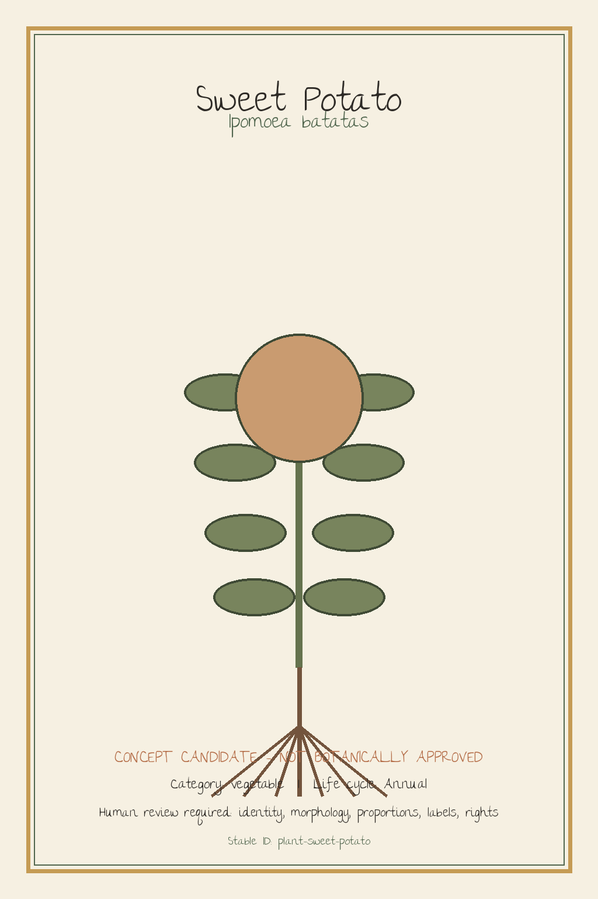

**Source status:** Not botanically or horticulturally approved. Recorded fields are derived
from the retained registry and remain subject to claim-level source review.

### Summer Squash

**Stable plant ID:** `plant-summer-squash`
**Category:** vegetable
**Recorded botanical name:** Cucurbita pepo
**Recorded family:** Cucurbitaceae
**Life cycle:** Annual
**Illustration status:** `CANDIDATE_GENERATED / REVIEW_PENDING / NOT_APPROVED`

**Identification and morphology**

- Growth habit: Growth habit should be resolved to the exact species or cultivar; this entry provides a category-level source scaffold.
- Root or storage organ: Species-specific root, crown, or storage organ; verify the exact form before illustrating.
- Leaf arrangement and shape: Species-specific arrangement and blade shape; verify exact genus and cultivar.
- Flower structure: Species-specific inflorescence or flower structure.
- Fruit or seed structure: Species-specific fruit, seed pod, achene, capsule, berry, or nut.

**Errington timing fields**

- Indoor sow: Source timing not reviewed
- Direct sow: Source timing not reviewed
- Transplant: Source timing not reviewed
- Bloom: Source timing not reviewed
- Harvest: Source timing not reviewed
- Frost: Source timing not reviewed

**Cultivation**

- Soil: Well-drained, fertile soil with organic matter; adjust for the crop's root depth.
- Water: Keep moisture even during establishment and harvest formation; avoid prolonged waterlogging.
- Spacing: Use the calendar, seed packet, or mature crop size; do not rely on a registry-wide spacing value.
- Light: Full sun is usual; leafy cool-season crops tolerate more partial shade.
- Maintenance: Thin, weed, mulch, and monitor; support or stake as the crop requires.
- Pests/diseases: Monitor locally for aphids, slugs, caterpillars, fungal leaf spots, and soil-borne disease; identify before treatment.

**Candidate plate:**

**Source status:** Not botanically or horticulturally approved. Recorded fields are derived
from the retained registry and remain subject to claim-level source review.

### Swiss Chard

**Stable plant ID:** `plant-swiss-chard`
**Category:** vegetable
**Recorded botanical name:** Beta vulgaris subsp. cicla
**Recorded family:** Amaranthaceae
**Life cycle:** Annual
**Illustration status:** `CANDIDATE_GENERATED / REVIEW_PENDING / NOT_APPROVED`

**Identification and morphology**

- Growth habit: Growth habit should be resolved to the exact species or cultivar; this entry provides a category-level source scaffold.
- Root or storage organ: Species-specific root, crown, or storage organ; verify the exact form before illustrating.
- Leaf arrangement and shape: Species-specific arrangement and blade shape; verify exact genus and cultivar.
- Flower structure: Species-specific inflorescence or flower structure.
- Fruit or seed structure: Species-specific fruit, seed pod, achene, capsule, berry, or nut.

**Errington timing fields**

- Indoor sow: Source timing not reviewed
- Direct sow: Source timing not reviewed
- Transplant: Source timing not reviewed
- Bloom: Source timing not reviewed
- Harvest: Source timing not reviewed
- Frost: Source timing not reviewed

**Cultivation**

- Soil: Well-drained, fertile soil with organic matter; adjust for the crop's root depth.
- Water: Keep moisture even during establishment and harvest formation; avoid prolonged waterlogging.
- Spacing: Use the calendar, seed packet, or mature crop size; do not rely on a registry-wide spacing value.
- Light: Full sun is usual; leafy cool-season crops tolerate more partial shade.
- Maintenance: Thin, weed, mulch, and monitor; support or stake as the crop requires.
- Pests/diseases: Monitor locally for aphids, slugs, caterpillars, fungal leaf spots, and soil-borne disease; identify before treatment.

**Candidate plate:**
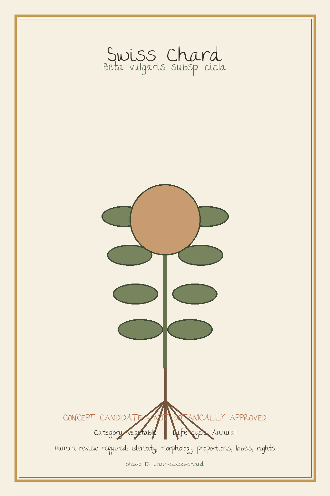

**Source status:** Not botanically or horticulturally approved. Recorded fields are derived
from the retained registry and remain subject to claim-level source review.

### Tomatoes

**Stable plant ID:** `plant-tomatoes`
**Category:** vegetable
**Recorded botanical name:** Solanum lycopersicum
**Recorded family:** Solanaceae
**Life cycle:** Annual
**Illustration status:** `CANDIDATE_GENERATED / REVIEW_PENDING / NOT_APPROVED`

**Identification and morphology**

- Growth habit: Growth habit should be resolved to the exact species or cultivar; this entry provides a category-level source scaffold.
- Root or storage organ: Species-specific root, crown, or storage organ; verify the exact form before illustrating.
- Leaf arrangement and shape: Species-specific arrangement and blade shape; verify exact genus and cultivar.
- Flower structure: Species-specific inflorescence or flower structure.
- Fruit or seed structure: Species-specific fruit, seed pod, achene, capsule, berry, or nut.

**Errington timing fields**

- Indoor sow: Source timing not reviewed
- Direct sow: Source timing not reviewed
- Transplant: Source timing not reviewed
- Bloom: Source timing not reviewed
- Harvest: Source timing not reviewed
- Frost: Source timing not reviewed

**Cultivation**

- Soil: Well-drained, fertile soil with organic matter; adjust for the crop's root depth.
- Water: Keep moisture even during establishment and harvest formation; avoid prolonged waterlogging.
- Spacing: Use the calendar, seed packet, or mature crop size; do not rely on a registry-wide spacing value.
- Light: Full sun is usual; leafy cool-season crops tolerate more partial shade.
- Maintenance: Thin, weed, mulch, and monitor; support or stake as the crop requires.
- Pests/diseases: Monitor locally for aphids, slugs, caterpillars, fungal leaf spots, and soil-borne disease; identify before treatment.

**Candidate plate:**

**Source status:** Not botanically or horticulturally approved. Recorded fields are derived
from the retained registry and remain subject to claim-level source review.

### Marigold

**Stable plant ID:** `plant-marigold`
**Category:** flower
**Recorded botanical name:** Tagetes patula
**Recorded family:** Asteraceae
**Life cycle:** Annual
**Illustration status:** `CANDIDATE_GENERATED / REVIEW_PENDING / NOT_APPROVED`

**Identification and morphology**

- Growth habit: Growth habit should be resolved to the exact species or cultivar; this entry provides a category-level source scaffold.
- Root or storage organ: Species-specific root, crown, or storage organ; verify the exact form before illustrating.
- Leaf arrangement and shape: Species-specific arrangement and blade shape; verify exact genus and cultivar.
- Flower structure: Species-specific inflorescence or flower structure.
- Fruit or seed structure: Species-specific fruit, seed pod, achene, capsule, berry, or nut.

**Errington timing fields**

- Indoor sow: Source timing not reviewed
- Direct sow: Source timing not reviewed
- Transplant: Source timing not reviewed
- Bloom: Source timing not reviewed
- Harvest: Source timing not reviewed
- Frost: Source timing not reviewed

**Cultivation**

- Soil: Fertile, well-drained soil with organic matter unless the species has a known exceptional preference.
- Water: Provide even establishment moisture; then follow the species' drought, moisture, or wetness preference.
- Spacing: Base spacing on mature height and spread, not just the common name.
- Light: Sun requirement is species-specific; the common name alone is not a reliable light label.
- Maintenance: Mulch, deadhead or divide as appropriate, and monitor for structural or seasonal maintenance.
- Pests/diseases: Identify the pest or disease locally before control; favor sanitation, cultural prevention, and targeted action.

**Candidate plate:**

**Source status:** Not botanically or horticulturally approved. Recorded fields are derived
from the retained registry and remain subject to claim-level source review.

### Zinnia

**Stable plant ID:** `plant-zinnia`
**Category:** flower
**Recorded botanical name:** Zinnia elegans
**Recorded family:** Asteraceae
**Life cycle:** Annual
**Illustration status:** `CANDIDATE_GENERATED / REVIEW_PENDING / NOT_APPROVED`

**Identification and morphology**

- Growth habit: Growth habit should be resolved to the exact species or cultivar; this entry provides a category-level source scaffold.
- Root or storage organ: Species-specific root, crown, or storage organ; verify the exact form before illustrating.
- Leaf arrangement and shape: Species-specific arrangement and blade shape; verify exact genus and cultivar.
- Flower structure: Species-specific inflorescence or flower structure.
- Fruit or seed structure: Species-specific fruit, seed pod, achene, capsule, berry, or nut.

**Errington timing fields**

- Indoor sow: Source timing not reviewed
- Direct sow: Source timing not reviewed
- Transplant: Source timing not reviewed
- Bloom: Source timing not reviewed
- Harvest: Source timing not reviewed
- Frost: Source timing not reviewed

**Cultivation**

- Soil: Fertile, well-drained soil with organic matter unless the species has a known exceptional preference.
- Water: Provide even establishment moisture; then follow the species' drought, moisture, or wetness preference.
- Spacing: Base spacing on mature height and spread, not just the common name.
- Light: Sun requirement is species-specific; the common name alone is not a reliable light label.
- Maintenance: Mulch, deadhead or divide as appropriate, and monitor for structural or seasonal maintenance.
- Pests/diseases: Identify the pest or disease locally before control; favor sanitation, cultural prevention, and targeted action.

**Candidate plate:**
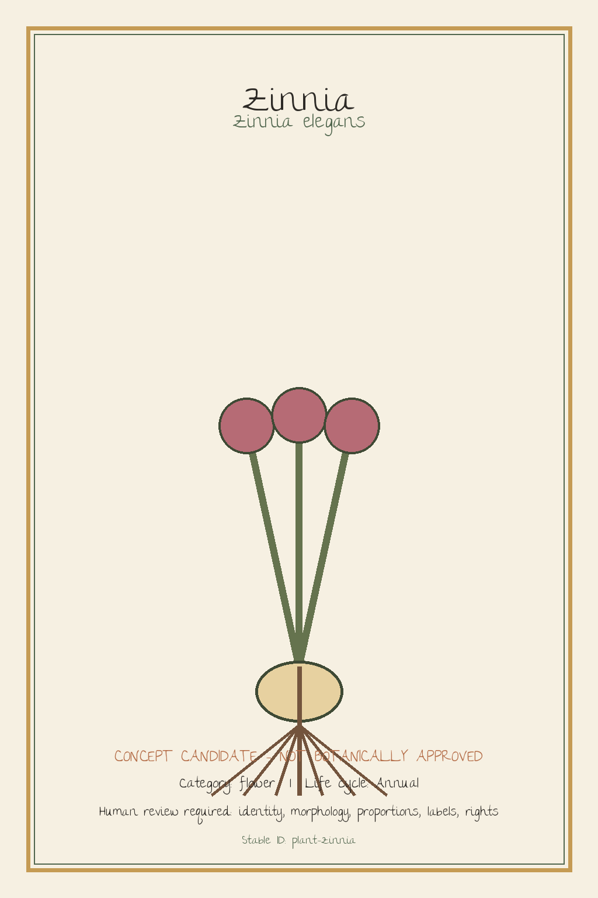

**Source status:** Not botanically or horticulturally approved. Recorded fields are derived
from the retained registry and remain subject to claim-level source review.

### Cosmos

**Stable plant ID:** `plant-cosmos`
**Category:** flower
**Recorded botanical name:** Cosmos bipinnatus
**Recorded family:** Asteraceae
**Life cycle:** Annual
**Illustration status:** `CANDIDATE_GENERATED / REVIEW_PENDING / NOT_APPROVED`

**Identification and morphology**

- Growth habit: Growth habit should be resolved to the exact species or cultivar; this entry provides a category-level source scaffold.
- Root or storage organ: Species-specific root, crown, or storage organ; verify the exact form before illustrating.
- Leaf arrangement and shape: Species-specific arrangement and blade shape; verify exact genus and cultivar.
- Flower structure: Species-specific inflorescence or flower structure.
- Fruit or seed structure: Species-specific fruit, seed pod, achene, capsule, berry, or nut.

**Errington timing fields**

- Indoor sow: Source timing not reviewed
- Direct sow: Source timing not reviewed
- Transplant: Source timing not reviewed
- Bloom: Source timing not reviewed
- Harvest: Source timing not reviewed
- Frost: Source timing not reviewed

**Cultivation**

- Soil: Fertile, well-drained soil with organic matter unless the species has a known exceptional preference.
- Water: Provide even establishment moisture; then follow the species' drought, moisture, or wetness preference.
- Spacing: Base spacing on mature height and spread, not just the common name.
- Light: Sun requirement is species-specific; the common name alone is not a reliable light label.
- Maintenance: Mulch, deadhead or divide as appropriate, and monitor for structural or seasonal maintenance.
- Pests/diseases: Identify the pest or disease locally before control; favor sanitation, cultural prevention, and targeted action.

**Candidate plate:**

**Source status:** Not botanically or horticulturally approved. Recorded fields are derived
from the retained registry and remain subject to claim-level source review.

### Nasturtium

**Stable plant ID:** `plant-nasturtium`
**Category:** flower
**Recorded botanical name:** Tropaeolum majus
**Recorded family:** Tropaeolaceae
**Life cycle:** Annual
**Illustration status:** `CANDIDATE_GENERATED / REVIEW_PENDING / NOT_APPROVED`

**Identification and morphology**

- Growth habit: Growth habit should be resolved to the exact species or cultivar; this entry provides a category-level source scaffold.
- Root or storage organ: Species-specific root, crown, or storage organ; verify the exact form before illustrating.
- Leaf arrangement and shape: Species-specific arrangement and blade shape; verify exact genus and cultivar.
- Flower structure: Species-specific inflorescence or flower structure.
- Fruit or seed structure: Species-specific fruit, seed pod, achene, capsule, berry, or nut.

**Errington timing fields**

- Indoor sow: Source timing not reviewed
- Direct sow: Source timing not reviewed
- Transplant: Source timing not reviewed
- Bloom: Source timing not reviewed
- Harvest: Source timing not reviewed
- Frost: Source timing not reviewed

**Cultivation**

- Soil: Fertile, well-drained soil with organic matter unless the species has a known exceptional preference.
- Water: Provide even establishment moisture; then follow the species' drought, moisture, or wetness preference.
- Spacing: Base spacing on mature height and spread, not just the common name.
- Light: Sun requirement is species-specific; the common name alone is not a reliable light label.
- Maintenance: Mulch, deadhead or divide as appropriate, and monitor for structural or seasonal maintenance.
- Pests/diseases: Identify the pest or disease locally before control; favor sanitation, cultural prevention, and targeted action.

**Candidate plate:**

**Source status:** Not botanically or horticulturally approved. Recorded fields are derived
from the retained registry and remain subject to claim-level source review.

### Sunflower

**Stable plant ID:** `plant-sunflower`
**Category:** flower
**Recorded botanical name:** Helianthus annuus
**Recorded family:** Asteraceae
**Life cycle:** Annual
**Illustration status:** `CANDIDATE_GENERATED / REVIEW_PENDING / NOT_APPROVED`

**Identification and morphology**

- Growth habit: Growth habit should be resolved to the exact species or cultivar; this entry provides a category-level source scaffold.
- Root or storage organ: Species-specific root, crown, or storage organ; verify the exact form before illustrating.
- Leaf arrangement and shape: Species-specific arrangement and blade shape; verify exact genus and cultivar.
- Flower structure: Species-specific inflorescence or flower structure.
- Fruit or seed structure: Species-specific fruit, seed pod, achene, capsule, berry, or nut.

**Errington timing fields**

- Indoor sow: Source timing not reviewed
- Direct sow: Source timing not reviewed
- Transplant: Source timing not reviewed
- Bloom: Source timing not reviewed
- Harvest: Source timing not reviewed
- Frost: Source timing not reviewed

**Cultivation**

- Soil: Fertile, well-drained soil with organic matter unless the species has a known exceptional preference.
- Water: Provide even establishment moisture; then follow the species' drought, moisture, or wetness preference.
- Spacing: Base spacing on mature height and spread, not just the common name.
- Light: Sun requirement is species-specific; the common name alone is not a reliable light label.
- Maintenance: Mulch, deadhead or divide as appropriate, and monitor for structural or seasonal maintenance.
- Pests/diseases: Identify the pest or disease locally before control; favor sanitation, cultural prevention, and targeted action.

**Candidate plate:**

**Source status:** Not botanically or horticulturally approved. Recorded fields are derived
from the retained registry and remain subject to claim-level source review.

### Sweet Pea

**Stable plant ID:** `plant-sweet-pea`
**Category:** flower
**Recorded botanical name:** Lathyrus odoratus
**Recorded family:** Fabaceae
**Life cycle:** Annual
**Illustration status:** `CANDIDATE_GENERATED / REVIEW_PENDING / NOT_APPROVED`

**Identification and morphology**

- Growth habit: Growth habit should be resolved to the exact species or cultivar; this entry provides a category-level source scaffold.
- Root or storage organ: Species-specific root, crown, or storage organ; verify the exact form before illustrating.
- Leaf arrangement and shape: Species-specific arrangement and blade shape; verify exact genus and cultivar.
- Flower structure: Species-specific inflorescence or flower structure.
- Fruit or seed structure: Species-specific fruit, seed pod, achene, capsule, berry, or nut.

**Errington timing fields**

- Indoor sow: Source timing not reviewed
- Direct sow: Source timing not reviewed
- Transplant: Source timing not reviewed
- Bloom: Source timing not reviewed
- Harvest: Source timing not reviewed
- Frost: Source timing not reviewed

**Cultivation**

- Soil: Fertile, well-drained soil with organic matter unless the species has a known exceptional preference.
- Water: Provide even establishment moisture; then follow the species' drought, moisture, or wetness preference.
- Spacing: Base spacing on mature height and spread, not just the common name.
- Light: Sun requirement is species-specific; the common name alone is not a reliable light label.
- Maintenance: Mulch, deadhead or divide as appropriate, and monitor for structural or seasonal maintenance.
- Pests/diseases: Identify the pest or disease locally before control; favor sanitation, cultural prevention, and targeted action.

**Candidate plate:**

**Source status:** Not botanically or horticulturally approved. Recorded fields are derived
from the retained registry and remain subject to claim-level source review.

### Calendula

**Stable plant ID:** `plant-calendula`
**Category:** flower
**Recorded botanical name:** Calendula officinalis
**Recorded family:** Asteraceae
**Life cycle:** Annual
**Illustration status:** `CANDIDATE_GENERATED / REVIEW_PENDING / NOT_APPROVED`

**Identification and morphology**

- Growth habit: Growth habit should be resolved to the exact species or cultivar; this entry provides a category-level source scaffold.
- Root or storage organ: Species-specific root, crown, or storage organ; verify the exact form before illustrating.
- Leaf arrangement and shape: Species-specific arrangement and blade shape; verify exact genus and cultivar.
- Flower structure: Species-specific inflorescence or flower structure.
- Fruit or seed structure: Species-specific fruit, seed pod, achene, capsule, berry, or nut.

**Errington timing fields**

- Indoor sow: Source timing not reviewed
- Direct sow: Source timing not reviewed
- Transplant: Source timing not reviewed
- Bloom: Source timing not reviewed
- Harvest: Source timing not reviewed
- Frost: Source timing not reviewed

**Cultivation**

- Soil: Fertile, well-drained soil with organic matter unless the species has a known exceptional preference.
- Water: Provide even establishment moisture; then follow the species' drought, moisture, or wetness preference.
- Spacing: Base spacing on mature height and spread, not just the common name.
- Light: Sun requirement is species-specific; the common name alone is not a reliable light label.
- Maintenance: Mulch, deadhead or divide as appropriate, and monitor for structural or seasonal maintenance.
- Pests/diseases: Identify the pest or disease locally before control; favor sanitation, cultural prevention, and targeted action.

**Candidate plate:**

**Source status:** Not botanically or horticulturally approved. Recorded fields are derived
from the retained registry and remain subject to claim-level source review.

### Dahlia

**Stable plant ID:** `plant-dahlia`
**Category:** flower
**Recorded botanical name:** Dahlia pinnata
**Recorded family:** Asteraceae
**Life cycle:** Perennial
**Illustration status:** `CANDIDATE_GENERATED / REVIEW_PENDING / NOT_APPROVED`

**Identification and morphology**

- Growth habit: Growth habit should be resolved to the exact species or cultivar; this entry provides a category-level source scaffold.
- Root or storage organ: Species-specific root, crown, or storage organ; verify the exact form before illustrating.
- Leaf arrangement and shape: Species-specific arrangement and blade shape; verify exact genus and cultivar.
- Flower structure: Species-specific inflorescence or flower structure.
- Fruit or seed structure: Species-specific fruit, seed pod, achene, capsule, berry, or nut.

**Errington timing fields**

- Indoor sow: Source timing not reviewed
- Direct sow: Source timing not reviewed
- Transplant: Source timing not reviewed
- Bloom: Source timing not reviewed
- Harvest: Source timing not reviewed
- Frost: Source timing not reviewed

**Cultivation**

- Soil: Fertile, well-drained soil with organic matter unless the species has a known exceptional preference.
- Water: Provide even establishment moisture; then follow the species' drought, moisture, or wetness preference.
- Spacing: Base spacing on mature height and spread, not just the common name.
- Light: Sun requirement is species-specific; the common name alone is not a reliable light label.
- Maintenance: Mulch, deadhead or divide as appropriate, and monitor for structural or seasonal maintenance.
- Pests/diseases: Identify the pest or disease locally before control; favor sanitation, cultural prevention, and targeted action.

**Candidate plate:**

**Source status:** Not botanically or horticulturally approved. Recorded fields are derived
from the retained registry and remain subject to claim-level source review.

### Peony

**Stable plant ID:** `plant-peony`
**Category:** flower
**Recorded botanical name:** Paeonia lactiflora
**Recorded family:** Paeoniaceae
**Life cycle:** Perennial
**Illustration status:** `CANDIDATE_GENERATED / REVIEW_PENDING / NOT_APPROVED`

**Identification and morphology**

- Growth habit: Growth habit should be resolved to the exact species or cultivar; this entry provides a category-level source scaffold.
- Root or storage organ: Species-specific root, crown, or storage organ; verify the exact form before illustrating.
- Leaf arrangement and shape: Species-specific arrangement and blade shape; verify exact genus and cultivar.
- Flower structure: Species-specific inflorescence or flower structure.
- Fruit or seed structure: Species-specific fruit, seed pod, achene, capsule, berry, or nut.

**Errington timing fields**

- Indoor sow: Source timing not reviewed
- Direct sow: Source timing not reviewed
- Transplant: Source timing not reviewed
- Bloom: Source timing not reviewed
- Harvest: Source timing not reviewed
- Frost: Source timing not reviewed

**Cultivation**

- Soil: Fertile, well-drained soil with organic matter unless the species has a known exceptional preference.
- Water: Provide even establishment moisture; then follow the species' drought, moisture, or wetness preference.
- Spacing: Base spacing on mature height and spread, not just the common name.
- Light: Sun requirement is species-specific; the common name alone is not a reliable light label.
- Maintenance: Mulch, deadhead or divide as appropriate, and monitor for structural or seasonal maintenance.
- Pests/diseases: Identify the pest or disease locally before control; favor sanitation, cultural prevention, and targeted action.

**Candidate plate:**

**Source status:** Not botanically or horticulturally approved. Recorded fields are derived
from the retained registry and remain subject to claim-level source review.

### Iris

**Stable plant ID:** `plant-iris`
**Category:** flower
**Recorded botanical name:** Iris × germanica
**Recorded family:** Iridaceae
**Life cycle:** Perennial
**Illustration status:** `CANDIDATE_GENERATED / REVIEW_PENDING / NOT_APPROVED`

**Identification and morphology**

- Growth habit: Growth habit should be resolved to the exact species or cultivar; this entry provides a category-level source scaffold.
- Root or storage organ: Species-specific root, crown, or storage organ; verify the exact form before illustrating.
- Leaf arrangement and shape: Species-specific arrangement and blade shape; verify exact genus and cultivar.
- Flower structure: Species-specific inflorescence or flower structure.
- Fruit or seed structure: Species-specific fruit, seed pod, achene, capsule, berry, or nut.

**Errington timing fields**

- Indoor sow: Source timing not reviewed
- Direct sow: Source timing not reviewed
- Transplant: Source timing not reviewed
- Bloom: Source timing not reviewed
- Harvest: Source timing not reviewed
- Frost: Source timing not reviewed

**Cultivation**

- Soil: Fertile, well-drained soil with organic matter unless the species has a known exceptional preference.
- Water: Provide even establishment moisture; then follow the species' drought, moisture, or wetness preference.
- Spacing: Base spacing on mature height and spread, not just the common name.
- Light: Sun requirement is species-specific; the common name alone is not a reliable light label.
- Maintenance: Mulch, deadhead or divide as appropriate, and monitor for structural or seasonal maintenance.
- Pests/diseases: Identify the pest or disease locally before control; favor sanitation, cultural prevention, and targeted action.

**Candidate plate:**
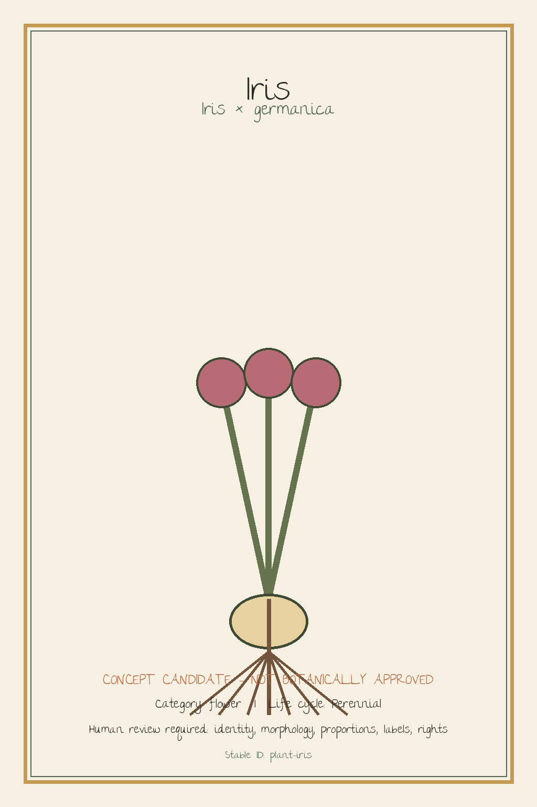

**Source status:** Not botanically or horticulturally approved. Recorded fields are derived
from the retained registry and remain subject to claim-level source review.

### Daylily

**Stable plant ID:** `plant-daylily`
**Category:** flower
**Recorded botanical name:** Hemerocallis × hybrida
**Recorded family:** Asphodelaceae
**Life cycle:** Perennial
**Illustration status:** `CANDIDATE_GENERATED / REVIEW_PENDING / NOT_APPROVED`

**Identification and morphology**

- Growth habit: Growth habit should be resolved to the exact species or cultivar; this entry provides a category-level source scaffold.
- Root or storage organ: Species-specific root, crown, or storage organ; verify the exact form before illustrating.
- Leaf arrangement and shape: Species-specific arrangement and blade shape; verify exact genus and cultivar.
- Flower structure: Species-specific inflorescence or flower structure.
- Fruit or seed structure: Species-specific fruit, seed pod, achene, capsule, berry, or nut.

**Errington timing fields**

- Indoor sow: Source timing not reviewed
- Direct sow: Source timing not reviewed
- Transplant: Source timing not reviewed
- Bloom: Source timing not reviewed
- Harvest: Source timing not reviewed
- Frost: Source timing not reviewed

**Cultivation**

- Soil: Fertile, well-drained soil with organic matter unless the species has a known exceptional preference.
- Water: Provide even establishment moisture; then follow the species' drought, moisture, or wetness preference.
- Spacing: Base spacing on mature height and spread, not just the common name.
- Light: Sun requirement is species-specific; the common name alone is not a reliable light label.
- Maintenance: Mulch, deadhead or divide as appropriate, and monitor for structural or seasonal maintenance.
- Pests/diseases: Identify the pest or disease locally before control; favor sanitation, cultural prevention, and targeted action.

**Candidate plate:**

**Source status:** Not botanically or horticulturally approved. Recorded fields are derived
from the retained registry and remain subject to claim-level source review.

### Lavender

**Stable plant ID:** `plant-lavender`
**Category:** flower
**Recorded botanical name:** Lavandula angustifolia
**Recorded family:** Lamiaceae
**Life cycle:** Perennial
**Illustration status:** `CANDIDATE_GENERATED / REVIEW_PENDING / NOT_APPROVED`

**Identification and morphology**

- Growth habit: Growth habit should be resolved to the exact species or cultivar; this entry provides a category-level source scaffold.
- Root or storage organ: Species-specific root, crown, or storage organ; verify the exact form before illustrating.
- Leaf arrangement and shape: Species-specific arrangement and blade shape; verify exact genus and cultivar.
- Flower structure: Species-specific inflorescence or flower structure.
- Fruit or seed structure: Species-specific fruit, seed pod, achene, capsule, berry, or nut.

**Errington timing fields**

- Indoor sow: Source timing not reviewed
- Direct sow: Source timing not reviewed
- Transplant: Source timing not reviewed
- Bloom: Source timing not reviewed
- Harvest: Source timing not reviewed
- Frost: Source timing not reviewed

**Cultivation**

- Soil: Fertile, well-drained soil with organic matter unless the species has a known exceptional preference.
- Water: Provide even establishment moisture; then follow the species' drought, moisture, or wetness preference.
- Spacing: Base spacing on mature height and spread, not just the common name.
- Light: Sun requirement is species-specific; the common name alone is not a reliable light label.
- Maintenance: Mulch, deadhead or divide as appropriate, and monitor for structural or seasonal maintenance.
- Pests/diseases: Identify the pest or disease locally before control; favor sanitation, cultural prevention, and targeted action.

**Candidate plate:**

**Source status:** Not botanically or horticulturally approved. Recorded fields are derived
from the retained registry and remain subject to claim-level source review.

### Echinacea

**Stable plant ID:** `plant-echinacea`
**Category:** flower
**Recorded botanical name:** Echinacea purpurea
**Recorded family:** Asteraceae
**Life cycle:** Perennial
**Illustration status:** `CANDIDATE_GENERATED / REVIEW_PENDING / NOT_APPROVED`

**Identification and morphology**

- Growth habit: Growth habit should be resolved to the exact species or cultivar; this entry provides a category-level source scaffold.
- Root or storage organ: Species-specific root, crown, or storage organ; verify the exact form before illustrating.
- Leaf arrangement and shape: Species-specific arrangement and blade shape; verify exact genus and cultivar.
- Flower structure: Species-specific inflorescence or flower structure.
- Fruit or seed structure: Species-specific fruit, seed pod, achene, capsule, berry, or nut.

**Errington timing fields**

- Indoor sow: Source timing not reviewed
- Direct sow: Source timing not reviewed
- Transplant: Source timing not reviewed
- Bloom: Source timing not reviewed
- Harvest: Source timing not reviewed
- Frost: Source timing not reviewed

**Cultivation**

- Soil: Fertile, well-drained soil with organic matter unless the species has a known exceptional preference.
- Water: Provide even establishment moisture; then follow the species' drought, moisture, or wetness preference.
- Spacing: Base spacing on mature height and spread, not just the common name.
- Light: Sun requirement is species-specific; the common name alone is not a reliable light label.
- Maintenance: Mulch, deadhead or divide as appropriate, and monitor for structural or seasonal maintenance.
- Pests/diseases: Identify the pest or disease locally before control; favor sanitation, cultural prevention, and targeted action.

**Candidate plate:**

**Source status:** Not botanically or horticulturally approved. Recorded fields are derived
from the retained registry and remain subject to claim-level source review.

### Rudbeckia

**Stable plant ID:** `plant-rudbeckia`
**Category:** flower
**Recorded botanical name:** Rudbeckia hirta
**Recorded family:** Asteraceae
**Life cycle:** Perennial
**Illustration status:** `CANDIDATE_GENERATED / REVIEW_PENDING / NOT_APPROVED`

**Identification and morphology**

- Growth habit: Growth habit should be resolved to the exact species or cultivar; this entry provides a category-level source scaffold.
- Root or storage organ: Species-specific root, crown, or storage organ; verify the exact form before illustrating.
- Leaf arrangement and shape: Species-specific arrangement and blade shape; verify exact genus and cultivar.
- Flower structure: Species-specific inflorescence or flower structure.
- Fruit or seed structure: Species-specific fruit, seed pod, achene, capsule, berry, or nut.

**Errington timing fields**

- Indoor sow: Source timing not reviewed
- Direct sow: Source timing not reviewed
- Transplant: Source timing not reviewed
- Bloom: Source timing not reviewed
- Harvest: Source timing not reviewed
- Frost: Source timing not reviewed

**Cultivation**

- Soil: Fertile, well-drained soil with organic matter unless the species has a known exceptional preference.
- Water: Provide even establishment moisture; then follow the species' drought, moisture, or wetness preference.
- Spacing: Base spacing on mature height and spread, not just the common name.
- Light: Sun requirement is species-specific; the common name alone is not a reliable light label.
- Maintenance: Mulch, deadhead or divide as appropriate, and monitor for structural or seasonal maintenance.
- Pests/diseases: Identify the pest or disease locally before control; favor sanitation, cultural prevention, and targeted action.

**Candidate plate:**

**Source status:** Not botanically or horticulturally approved. Recorded fields are derived
from the retained registry and remain subject to claim-level source review.

### Tulip

**Stable plant ID:** `plant-tulip`
**Category:** flower
**Recorded botanical name:** Tulipa gesneriana
**Recorded family:** Liliaceae
**Life cycle:** Perennial; grown from a bulb, corm, or storage organ
**Illustration status:** `CANDIDATE_GENERATED / REVIEW_PENDING / NOT_APPROVED`

**Identification and morphology**

- Growth habit: Growth habit should be resolved to the exact species or cultivar; this entry provides a category-level source scaffold.
- Root or storage organ: Basal plate and fibrous roots; bulb or corm storage organ.
- Leaf arrangement and shape: Basal or sheathing leaves; strap, linear, or species-specific blades.
- Flower structure: Species-specific flower or inflorescence; generally showy and arranged to attract pollinators.
- Fruit or seed structure: Seed capsule or berry may follow flowering.

**Errington timing fields**

- Indoor sow: Source timing not reviewed
- Direct sow: Source timing not reviewed
- Transplant: Source timing not reviewed
- Bloom: Source timing not reviewed
- Harvest: Source timing not reviewed
- Frost: Source timing not reviewed

**Cultivation**

- Soil: Fertile, well-drained soil with organic matter unless the species has a known exceptional preference.
- Water: Provide even establishment moisture; then follow the species' drought, moisture, or wetness preference.
- Spacing: Base spacing on mature height and spread, not just the common name.
- Light: Sun requirement is species-specific; the common name alone is not a reliable light label.
- Maintenance: Mulch, deadhead or divide as appropriate, and monitor for structural or seasonal maintenance.
- Pests/diseases: Identify the pest or disease locally before control; favor sanitation, cultural prevention, and targeted action.

**Candidate plate:**
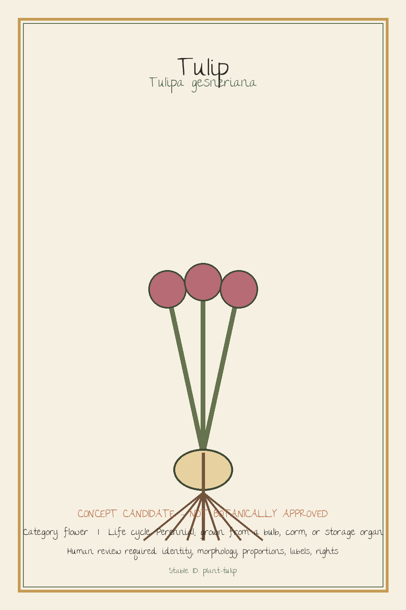

**Source status:** Not botanically or horticulturally approved. Recorded fields are derived
from the retained registry and remain subject to claim-level source review.

### Daffodil

**Stable plant ID:** `plant-daffodil`
**Category:** flower
**Recorded botanical name:** Narcissus pseudonarcissus
**Recorded family:** Amaryllidaceae
**Life cycle:** Perennial; grown from a bulb, corm, or storage organ
**Illustration status:** `CANDIDATE_GENERATED / REVIEW_PENDING / NOT_APPROVED`

**Identification and morphology**

- Growth habit: Growth habit should be resolved to the exact species or cultivar; this entry provides a category-level source scaffold.
- Root or storage organ: Basal plate and fibrous roots; bulb or corm storage organ.
- Leaf arrangement and shape: Basal or sheathing leaves; strap, linear, or species-specific blades.
- Flower structure: Species-specific flower or inflorescence; generally showy and arranged to attract pollinators.
- Fruit or seed structure: Seed capsule or berry may follow flowering.

**Errington timing fields**

- Indoor sow: Source timing not reviewed
- Direct sow: Source timing not reviewed
- Transplant: Source timing not reviewed
- Bloom: Source timing not reviewed
- Harvest: Source timing not reviewed
- Frost: Source timing not reviewed

**Cultivation**

- Soil: Fertile, well-drained soil with organic matter unless the species has a known exceptional preference.
- Water: Provide even establishment moisture; then follow the species' drought, moisture, or wetness preference.
- Spacing: Base spacing on mature height and spread, not just the common name.
- Light: Sun requirement is species-specific; the common name alone is not a reliable light label.
- Maintenance: Mulch, deadhead or divide as appropriate, and monitor for structural or seasonal maintenance.
- Pests/diseases: Identify the pest or disease locally before control; favor sanitation, cultural prevention, and targeted action.

**Candidate plate:**

**Source status:** Not botanically or horticulturally approved. Recorded fields are derived
from the retained registry and remain subject to claim-level source review.

### Crocus

**Stable plant ID:** `plant-crocus`
**Category:** flower
**Recorded botanical name:** Crocus vernus
**Recorded family:** Iridaceae
**Life cycle:** Perennial; grown from a bulb, corm, or storage organ
**Illustration status:** `CANDIDATE_GENERATED / REVIEW_PENDING / NOT_APPROVED`

**Identification and morphology**

- Growth habit: Growth habit should be resolved to the exact species or cultivar; this entry provides a category-level source scaffold.
- Root or storage organ: Basal plate and fibrous roots; bulb or corm storage organ.
- Leaf arrangement and shape: Basal or sheathing leaves; strap, linear, or species-specific blades.
- Flower structure: Species-specific flower or inflorescence; generally showy and arranged to attract pollinators.
- Fruit or seed structure: Seed capsule or berry may follow flowering.

**Errington timing fields**

- Indoor sow: Source timing not reviewed
- Direct sow: Source timing not reviewed
- Transplant: Source timing not reviewed
- Bloom: Source timing not reviewed
- Harvest: Source timing not reviewed
- Frost: Source timing not reviewed

**Cultivation**

- Soil: Fertile, well-drained soil with organic matter unless the species has a known exceptional preference.
- Water: Provide even establishment moisture; then follow the species' drought, moisture, or wetness preference.
- Spacing: Base spacing on mature height and spread, not just the common name.
- Light: Sun requirement is species-specific; the common name alone is not a reliable light label.
- Maintenance: Mulch, deadhead or divide as appropriate, and monitor for structural or seasonal maintenance.
- Pests/diseases: Identify the pest or disease locally before control; favor sanitation, cultural prevention, and targeted action.

**Candidate plate:**
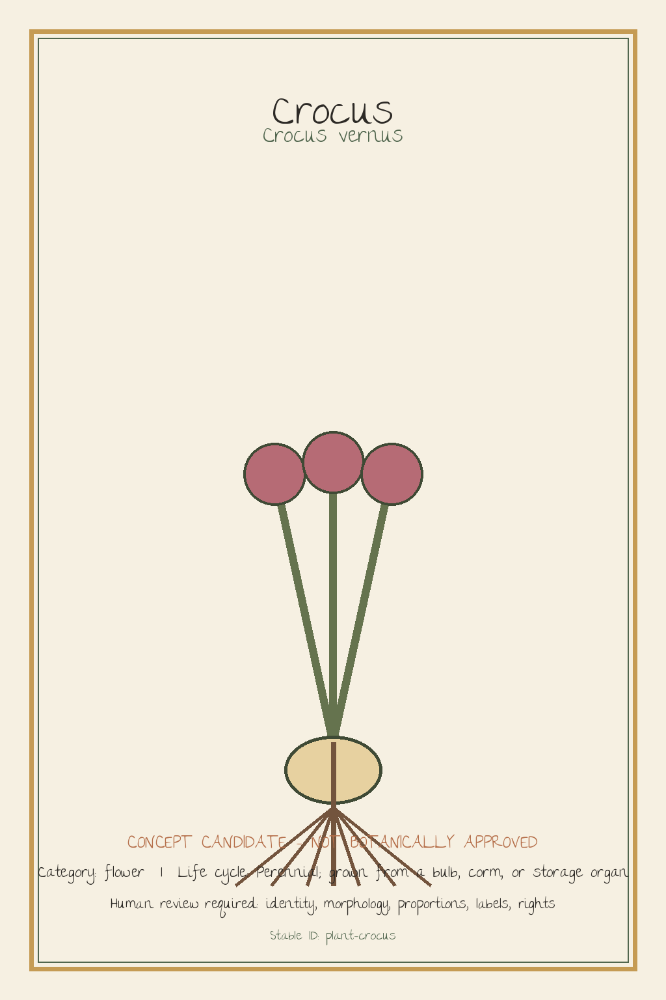

**Source status:** Not botanically or horticulturally approved. Recorded fields are derived
from the retained registry and remain subject to claim-level source review.

### Allium

**Stable plant ID:** `plant-allium`
**Category:** flower
**Recorded botanical name:** Allium hollandicum
**Recorded family:** Amaryllidaceae
**Life cycle:** Perennial; grown from a bulb, corm, or storage organ
**Illustration status:** `CANDIDATE_GENERATED / REVIEW_PENDING / NOT_APPROVED`

**Identification and morphology**

- Growth habit: Growth habit should be resolved to the exact species or cultivar; this entry provides a category-level source scaffold.
- Root or storage organ: Basal plate and fibrous roots; bulb or corm storage organ.
- Leaf arrangement and shape: Basal or sheathing leaves; strap, linear, or species-specific blades.
- Flower structure: Species-specific flower or inflorescence; generally showy and arranged to attract pollinators.
- Fruit or seed structure: Seed capsule or berry may follow flowering.

**Errington timing fields**

- Indoor sow: Source timing not reviewed
- Direct sow: Source timing not reviewed
- Transplant: Source timing not reviewed
- Bloom: Source timing not reviewed
- Harvest: Source timing not reviewed
- Frost: Source timing not reviewed

**Cultivation**

- Soil: Fertile, well-drained soil with organic matter unless the species has a known exceptional preference.
- Water: Provide even establishment moisture; then follow the species' drought, moisture, or wetness preference.
- Spacing: Base spacing on mature height and spread, not just the common name.
- Light: Sun requirement is species-specific; the common name alone is not a reliable light label.
- Maintenance: Mulch, deadhead or divide as appropriate, and monitor for structural or seasonal maintenance.
- Pests/diseases: Identify the pest or disease locally before control; favor sanitation, cultural prevention, and targeted action.

**Candidate plate:**
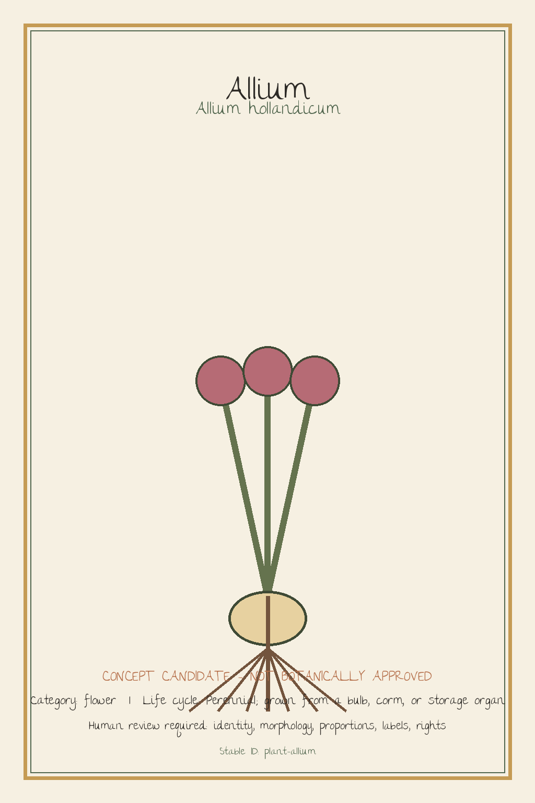

**Source status:** Not botanically or horticulturally approved. Recorded fields are derived
from the retained registry and remain subject to claim-level source review.

### Hyacinth

**Stable plant ID:** `plant-hyacinth`
**Category:** flower
**Recorded botanical name:** Hyacinthus orientalis
**Recorded family:** Asparagaceae
**Life cycle:** Perennial; grown from a bulb, corm, or storage organ
**Illustration status:** `CANDIDATE_GENERATED / REVIEW_PENDING / NOT_APPROVED`

**Identification and morphology**

- Growth habit: Growth habit should be resolved to the exact species or cultivar; this entry provides a category-level source scaffold.
- Root or storage organ: Basal plate and fibrous roots; bulb or corm storage organ.
- Leaf arrangement and shape: Basal or sheathing leaves; strap, linear, or species-specific blades.
- Flower structure: Species-specific flower or inflorescence; generally showy and arranged to attract pollinators.
- Fruit or seed structure: Seed capsule or berry may follow flowering.

**Errington timing fields**

- Indoor sow: Source timing not reviewed
- Direct sow: Source timing not reviewed
- Transplant: Source timing not reviewed
- Bloom: Source timing not reviewed
- Harvest: Source timing not reviewed
- Frost: Source timing not reviewed

**Cultivation**

- Soil: Fertile, well-drained soil with organic matter unless the species has a known exceptional preference.
- Water: Provide even establishment moisture; then follow the species' drought, moisture, or wetness preference.
- Spacing: Base spacing on mature height and spread, not just the common name.
- Light: Sun requirement is species-specific; the common name alone is not a reliable light label.
- Maintenance: Mulch, deadhead or divide as appropriate, and monitor for structural or seasonal maintenance.
- Pests/diseases: Identify the pest or disease locally before control; favor sanitation, cultural prevention, and targeted action.

**Candidate plate:**
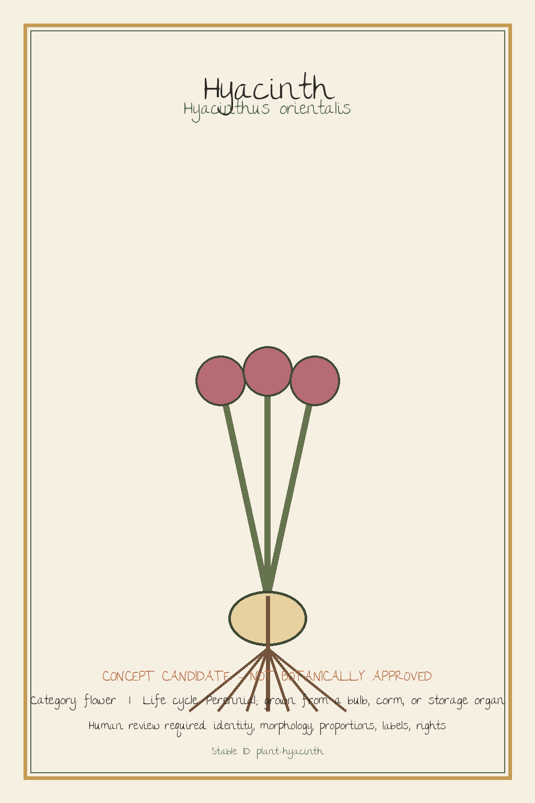

**Source status:** Not botanically or horticulturally approved. Recorded fields are derived
from the retained registry and remain subject to claim-level source review.

### Hostas

**Stable plant ID:** `plant-hostas`
**Category:** ornamental
**Recorded botanical name:** Hosta spp.
**Recorded family:** Asparagaceae
**Life cycle:** Perennial or variable; species-level resolution required
**Illustration status:** `CANDIDATE_GENERATED / REVIEW_PENDING / NOT_APPROVED`

**Identification and morphology**

- Growth habit: Growth habit should be resolved to the exact species or cultivar; this entry provides a category-level source scaffold.
- Root or storage organ: Fibrous, rhizomatous, clumping, or fleshy according to the species.
- Leaf arrangement and shape: Species- or genus-specific leaf arrangement and shape; generic label needs disambiguation.
- Flower structure: Species-specific flower form; local bloom timing comes from the Errington calendar if matched.
- Fruit or seed structure: Seed capsule, achene, berry, or no conspicuous fruit according to species.

**Errington timing fields**

- Indoor sow: Source timing not reviewed
- Direct sow: Source timing not reviewed
- Transplant: Source timing not reviewed
- Bloom: Source timing not reviewed
- Harvest: Source timing not reviewed
- Frost: Source timing not reviewed

**Cultivation**

- Soil: Choose a well-drained soil matched to the plant; the label and species can vary widely.
- Water: Water to establish, then match moisture to the specific ornamental's type.
- Spacing: Allow for mature clump or canopy width; label or cultivar may change the correct spacing.
- Light: Check the specific species; full sun, shade, and moisture labels may vary across genera.
- Maintenance: Remove damaged growth, divide where applicable, mulch carefully, and avoid overwatering.
- Pests/diseases: Monitor for slugs, aphids, mites, scale, and fungal leaf problems; use identification and prevention first.

**Candidate plate:**
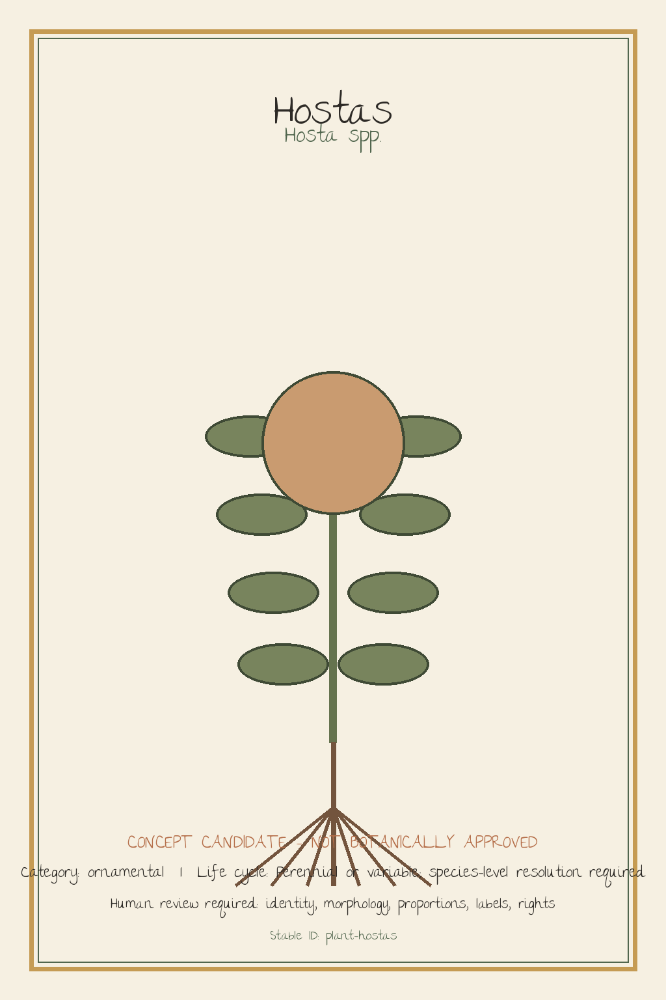

**Source status:** Not botanically or horticulturally approved. Recorded fields are derived
from the retained registry and remain subject to claim-level source review.

### Ferns

**Stable plant ID:** `plant-ferns`
**Category:** ornamental
**Recorded botanical name:** Fern species / multiple genera
**Recorded family:** Multiple families
**Life cycle:** Perennial or variable; species-level resolution required
**Illustration status:** `CANDIDATE_GENERATED / REVIEW_PENDING / NOT_APPROVED`

**Identification and morphology**

- Growth habit: Growth habit should be resolved to the exact species or cultivar; this entry provides a category-level source scaffold.
- Root or storage organ: Fibrous, rhizomatous, clumping, or fleshy according to the species.
- Leaf arrangement and shape: Species- or genus-specific leaf arrangement and shape; generic label needs disambiguation.
- Flower structure: Species-specific flower form; local bloom timing comes from the Errington calendar if matched.
- Fruit or seed structure: Seed capsule, achene, berry, or no conspicuous fruit according to species.

**Errington timing fields**

- Indoor sow: Source timing not reviewed
- Direct sow: Source timing not reviewed
- Transplant: Source timing not reviewed
- Bloom: Source timing not reviewed
- Harvest: Source timing not reviewed
- Frost: Source timing not reviewed

**Cultivation**

- Soil: Choose a well-drained soil matched to the plant; the label and species can vary widely.
- Water: Water to establish, then match moisture to the specific ornamental's type.
- Spacing: Allow for mature clump or canopy width; label or cultivar may change the correct spacing.
- Light: Check the specific species; full sun, shade, and moisture labels may vary across genera.
- Maintenance: Remove damaged growth, divide where applicable, mulch carefully, and avoid overwatering.
- Pests/diseases: Monitor for slugs, aphids, mites, scale, and fungal leaf problems; use identification and prevention first.

**Candidate plate:**
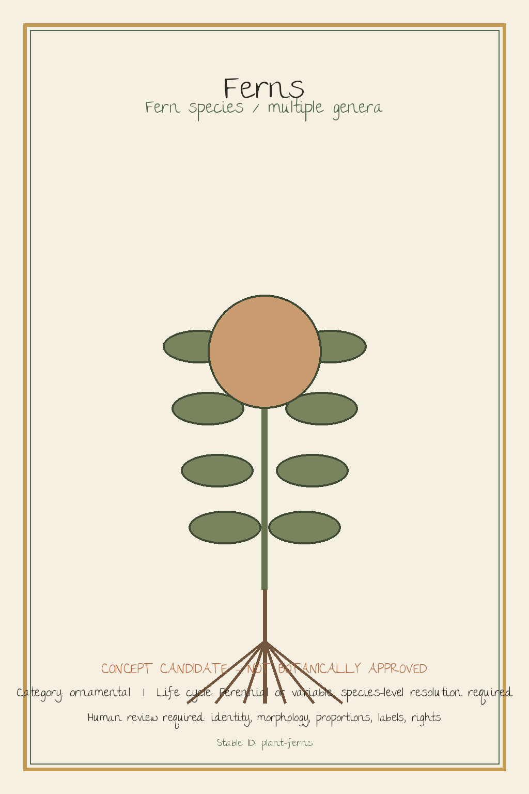

**Source status:** Not botanically or horticulturally approved. Recorded fields are derived
from the retained registry and remain subject to claim-level source review.

### Ornamental Grasses

**Stable plant ID:** `plant-ornamental-grasses`
**Category:** ornamental
**Recorded botanical name:** Ornamental grass species / multiple genera
**Recorded family:** Poaceae
**Life cycle:** Perennial or variable; species-level resolution required
**Illustration status:** `CANDIDATE_GENERATED / REVIEW_PENDING / NOT_APPROVED`

**Identification and morphology**

- Growth habit: Growth habit should be resolved to the exact species or cultivar; this entry provides a category-level source scaffold.
- Root or storage organ: Fibrous, rhizomatous, clumping, or fleshy according to the species.
- Leaf arrangement and shape: Species- or genus-specific leaf arrangement and shape; generic label needs disambiguation.
- Flower structure: Species-specific flower form; local bloom timing comes from the Errington calendar if matched.
- Fruit or seed structure: Seed capsule, achene, berry, or no conspicuous fruit according to species.

**Errington timing fields**

- Indoor sow: Source timing not reviewed
- Direct sow: Source timing not reviewed
- Transplant: Source timing not reviewed
- Bloom: Source timing not reviewed
- Harvest: Source timing not reviewed
- Frost: Source timing not reviewed

**Cultivation**

- Soil: Choose a well-drained soil matched to the plant; the label and species can vary widely.
- Water: Water to establish, then match moisture to the specific ornamental's type.
- Spacing: Allow for mature clump or canopy width; label or cultivar may change the correct spacing.
- Light: Check the specific species; full sun, shade, and moisture labels may vary across genera.
- Maintenance: Remove damaged growth, divide where applicable, mulch carefully, and avoid overwatering.
- Pests/diseases: Monitor for slugs, aphids, mites, scale, and fungal leaf problems; use identification and prevention first.

**Candidate plate:**

**Source status:** Not botanically or horticulturally approved. Recorded fields are derived
from the retained registry and remain subject to claim-level source review.

### Sedum

**Stable plant ID:** `plant-sedum`
**Category:** ornamental
**Recorded botanical name:** Hylotelephium telephium
**Recorded family:** Crassulaceae
**Life cycle:** Perennial or variable; species-level resolution required
**Illustration status:** `CANDIDATE_GENERATED / REVIEW_PENDING / NOT_APPROVED`

**Identification and morphology**

- Growth habit: Growth habit should be resolved to the exact species or cultivar; this entry provides a category-level source scaffold.
- Root or storage organ: Fibrous, rhizomatous, clumping, or fleshy according to the species.
- Leaf arrangement and shape: Species- or genus-specific leaf arrangement and shape; generic label needs disambiguation.
- Flower structure: Species-specific flower form; local bloom timing comes from the Errington calendar if matched.
- Fruit or seed structure: Seed capsule, achene, berry, or no conspicuous fruit according to species.

**Errington timing fields**

- Indoor sow: Source timing not reviewed
- Direct sow: Source timing not reviewed
- Transplant: Source timing not reviewed
- Bloom: Source timing not reviewed
- Harvest: Source timing not reviewed
- Frost: Source timing not reviewed

**Cultivation**

- Soil: Choose a well-drained soil matched to the plant; the label and species can vary widely.
- Water: Water to establish, then match moisture to the specific ornamental's type.
- Spacing: Allow for mature clump or canopy width; label or cultivar may change the correct spacing.
- Light: Check the specific species; full sun, shade, and moisture labels may vary across genera.
- Maintenance: Remove damaged growth, divide where applicable, mulch carefully, and avoid overwatering.
- Pests/diseases: Monitor for slugs, aphids, mites, scale, and fungal leaf problems; use identification and prevention first.

**Candidate plate:**

**Source status:** Not botanically or horticulturally approved. Recorded fields are derived
from the retained registry and remain subject to claim-level source review.

### Heuchera

**Stable plant ID:** `plant-heuchera`
**Category:** ornamental
**Recorded botanical name:** Heuchera sanguinea
**Recorded family:** Saxifragaceae
**Life cycle:** Perennial or variable; species-level resolution required
**Illustration status:** `CANDIDATE_GENERATED / REVIEW_PENDING / NOT_APPROVED`

**Identification and morphology**

- Growth habit: Growth habit should be resolved to the exact species or cultivar; this entry provides a category-level source scaffold.
- Root or storage organ: Fibrous, rhizomatous, clumping, or fleshy according to the species.
- Leaf arrangement and shape: Species- or genus-specific leaf arrangement and shape; generic label needs disambiguation.
- Flower structure: Species-specific flower form; local bloom timing comes from the Errington calendar if matched.
- Fruit or seed structure: Seed capsule, achene, berry, or no conspicuous fruit according to species.

**Errington timing fields**

- Indoor sow: Source timing not reviewed
- Direct sow: Source timing not reviewed
- Transplant: Source timing not reviewed
- Bloom: Source timing not reviewed
- Harvest: Source timing not reviewed
- Frost: Source timing not reviewed

**Cultivation**

- Soil: Choose a well-drained soil matched to the plant; the label and species can vary widely.
- Water: Water to establish, then match moisture to the specific ornamental's type.
- Spacing: Allow for mature clump or canopy width; label or cultivar may change the correct spacing.
- Light: Check the specific species; full sun, shade, and moisture labels may vary across genera.
- Maintenance: Remove damaged growth, divide where applicable, mulch carefully, and avoid overwatering.
- Pests/diseases: Monitor for slugs, aphids, mites, scale, and fungal leaf problems; use identification and prevention first.

**Candidate plate:**

**Source status:** Not botanically or horticulturally approved. Recorded fields are derived
from the retained registry and remain subject to claim-level source review.

### Astilbe

**Stable plant ID:** `plant-astilbe`
**Category:** ornamental
**Recorded botanical name:** Astilbe × arendsii
**Recorded family:** Saxifragaceae
**Life cycle:** Perennial or variable; species-level resolution required
**Illustration status:** `CANDIDATE_GENERATED / REVIEW_PENDING / NOT_APPROVED`

**Identification and morphology**

- Growth habit: Growth habit should be resolved to the exact species or cultivar; this entry provides a category-level source scaffold.
- Root or storage organ: Fibrous, rhizomatous, clumping, or fleshy according to the species.
- Leaf arrangement and shape: Species- or genus-specific leaf arrangement and shape; generic label needs disambiguation.
- Flower structure: Species-specific flower form; local bloom timing comes from the Errington calendar if matched.
- Fruit or seed structure: Seed capsule, achene, berry, or no conspicuous fruit according to species.

**Errington timing fields**

- Indoor sow: Source timing not reviewed
- Direct sow: Source timing not reviewed
- Transplant: Source timing not reviewed
- Bloom: Source timing not reviewed
- Harvest: Source timing not reviewed
- Frost: Source timing not reviewed

**Cultivation**

- Soil: Choose a well-drained soil matched to the plant; the label and species can vary widely.
- Water: Water to establish, then match moisture to the specific ornamental's type.
- Spacing: Allow for mature clump or canopy width; label or cultivar may change the correct spacing.
- Light: Check the specific species; full sun, shade, and moisture labels may vary across genera.
- Maintenance: Remove damaged growth, divide where applicable, mulch carefully, and avoid overwatering.
- Pests/diseases: Monitor for slugs, aphids, mites, scale, and fungal leaf problems; use identification and prevention first.

**Candidate plate:**

**Source status:** Not botanically or horticulturally approved. Recorded fields are derived
from the retained registry and remain subject to claim-level source review.

### Rosemary

**Stable plant ID:** `plant-rosemary`
**Category:** herb
**Recorded botanical name:** Salvia rosmarinus
**Recorded family:** Lamiaceae
**Life cycle:** Perennial
**Illustration status:** `CANDIDATE_GENERATED / REVIEW_PENDING / NOT_APPROVED`

**Identification and morphology**

- Growth habit: Growth habit should be resolved to the exact species or cultivar; this entry provides a category-level source scaffold.
- Root or storage organ: Species-specific root, crown, or storage organ; verify the exact form before illustrating.
- Leaf arrangement and shape: Species-specific arrangement and blade shape; verify exact genus and cultivar.
- Flower structure: Species-specific inflorescence or flower structure.
- Fruit or seed structure: Species-specific fruit, seed pod, achene, capsule, berry, or nut.

**Errington timing fields**

- Indoor sow: Source timing not reviewed
- Direct sow: Source timing not reviewed
- Transplant: Source timing not reviewed
- Bloom: Source timing not reviewed
- Harvest: Source timing not reviewed
- Frost: Source timing not reviewed

**Cultivation**

- Soil: Fertile, well-drained soil with organic matter unless the species has a known exceptional preference.
- Water: Provide even establishment moisture; then follow the species' drought, moisture, or wetness preference.
- Spacing: Base spacing on mature height and spread, not just the common name.
- Light: Sun requirement is species-specific; the common name alone is not a reliable light label.
- Maintenance: Mulch, deadhead or divide as appropriate, and monitor for structural or seasonal maintenance.
- Pests/diseases: Identify the pest or disease locally before control; favor sanitation, cultural prevention, and targeted action.

**Candidate plate:**
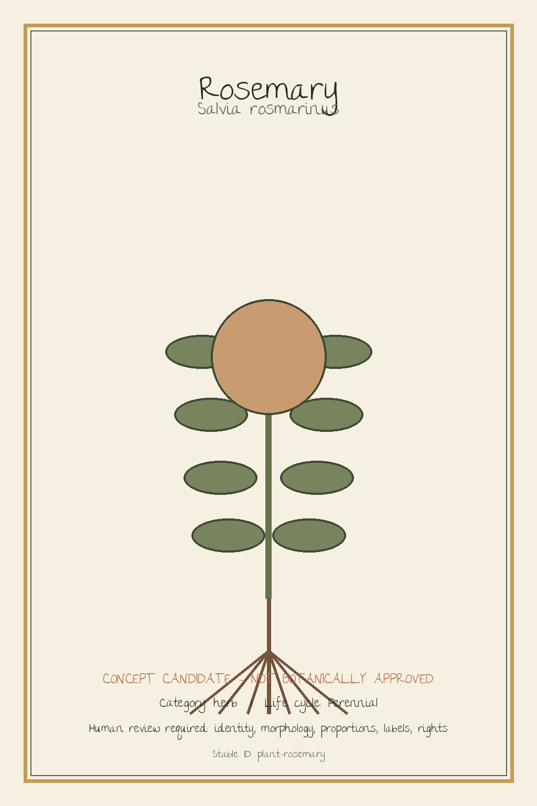

**Source status:** Not botanically or horticulturally approved. Recorded fields are derived
from the retained registry and remain subject to claim-level source review.

### Thyme

**Stable plant ID:** `plant-thyme`
**Category:** herb
**Recorded botanical name:** Thymus vulgaris
**Recorded family:** Lamiaceae
**Life cycle:** Perennial
**Illustration status:** `CANDIDATE_GENERATED / REVIEW_PENDING / NOT_APPROVED`

**Identification and morphology**

- Growth habit: Growth habit should be resolved to the exact species or cultivar; this entry provides a category-level source scaffold.
- Root or storage organ: Species-specific root, crown, or storage organ; verify the exact form before illustrating.
- Leaf arrangement and shape: Species-specific arrangement and blade shape; verify exact genus and cultivar.
- Flower structure: Species-specific inflorescence or flower structure.
- Fruit or seed structure: Species-specific fruit, seed pod, achene, capsule, berry, or nut.

**Errington timing fields**

- Indoor sow: Source timing not reviewed
- Direct sow: Source timing not reviewed
- Transplant: Source timing not reviewed
- Bloom: Source timing not reviewed
- Harvest: Source timing not reviewed
- Frost: Source timing not reviewed

**Cultivation**

- Soil: Fertile, well-drained soil with organic matter unless the species has a known exceptional preference.
- Water: Provide even establishment moisture; then follow the species' drought, moisture, or wetness preference.
- Spacing: Base spacing on mature height and spread, not just the common name.
- Light: Sun requirement is species-specific; the common name alone is not a reliable light label.
- Maintenance: Mulch, deadhead or divide as appropriate, and monitor for structural or seasonal maintenance.
- Pests/diseases: Identify the pest or disease locally before control; favor sanitation, cultural prevention, and targeted action.

**Candidate plate:**

**Source status:** Not botanically or horticulturally approved. Recorded fields are derived
from the retained registry and remain subject to claim-level source review.

### Oregano

**Stable plant ID:** `plant-oregano`
**Category:** herb
**Recorded botanical name:** Origanum vulgare
**Recorded family:** Lamiaceae
**Life cycle:** Perennial
**Illustration status:** `CANDIDATE_GENERATED / REVIEW_PENDING / NOT_APPROVED`

**Identification and morphology**

- Growth habit: Growth habit should be resolved to the exact species or cultivar; this entry provides a category-level source scaffold.
- Root or storage organ: Species-specific root, crown, or storage organ; verify the exact form before illustrating.
- Leaf arrangement and shape: Species-specific arrangement and blade shape; verify exact genus and cultivar.
- Flower structure: Species-specific inflorescence or flower structure.
- Fruit or seed structure: Species-specific fruit, seed pod, achene, capsule, berry, or nut.

**Errington timing fields**

- Indoor sow: Source timing not reviewed
- Direct sow: Source timing not reviewed
- Transplant: Source timing not reviewed
- Bloom: Source timing not reviewed
- Harvest: Source timing not reviewed
- Frost: Source timing not reviewed

**Cultivation**

- Soil: Fertile, well-drained soil with organic matter unless the species has a known exceptional preference.
- Water: Provide even establishment moisture; then follow the species' drought, moisture, or wetness preference.
- Spacing: Base spacing on mature height and spread, not just the common name.
- Light: Sun requirement is species-specific; the common name alone is not a reliable light label.
- Maintenance: Mulch, deadhead or divide as appropriate, and monitor for structural or seasonal maintenance.
- Pests/diseases: Identify the pest or disease locally before control; favor sanitation, cultural prevention, and targeted action.

**Candidate plate:**

**Source status:** Not botanically or horticulturally approved. Recorded fields are derived
from the retained registry and remain subject to claim-level source review.

### Parsley

**Stable plant ID:** `plant-parsley`
**Category:** herb
**Recorded botanical name:** Petroselinum crispum
**Recorded family:** Apiaceae
**Life cycle:** Biennial, often grown as an annual
**Illustration status:** `CANDIDATE_GENERATED / REVIEW_PENDING / NOT_APPROVED`

**Identification and morphology**

- Growth habit: Growth habit should be resolved to the exact species or cultivar; this entry provides a category-level source scaffold.
- Root or storage organ: Species-specific root, crown, or storage organ; verify the exact form before illustrating.
- Leaf arrangement and shape: Species-specific arrangement and blade shape; verify exact genus and cultivar.
- Flower structure: Species-specific inflorescence or flower structure.
- Fruit or seed structure: Species-specific fruit, seed pod, achene, capsule, berry, or nut.

**Errington timing fields**

- Indoor sow: Source timing not reviewed
- Direct sow: Source timing not reviewed
- Transplant: Source timing not reviewed
- Bloom: Source timing not reviewed
- Harvest: Source timing not reviewed
- Frost: Source timing not reviewed

**Cultivation**

- Soil: Fertile, well-drained soil with organic matter unless the species has a known exceptional preference.
- Water: Provide even establishment moisture; then follow the species' drought, moisture, or wetness preference.
- Spacing: Base spacing on mature height and spread, not just the common name.
- Light: Sun requirement is species-specific; the common name alone is not a reliable light label.
- Maintenance: Mulch, deadhead or divide as appropriate, and monitor for structural or seasonal maintenance.
- Pests/diseases: Identify the pest or disease locally before control; favor sanitation, cultural prevention, and targeted action.

**Candidate plate:**

**Source status:** Not botanically or horticulturally approved. Recorded fields are derived
from the retained registry and remain subject to claim-level source review.

### Chives

**Stable plant ID:** `plant-chives`
**Category:** herb
**Recorded botanical name:** Allium schoenoprasum
**Recorded family:** Amaryllidaceae
**Life cycle:** Perennial
**Illustration status:** `CANDIDATE_GENERATED / REVIEW_PENDING / NOT_APPROVED`

**Identification and morphology**

- Growth habit: Growth habit should be resolved to the exact species or cultivar; this entry provides a category-level source scaffold.
- Root or storage organ: Species-specific root, crown, or storage organ; verify the exact form before illustrating.
- Leaf arrangement and shape: Species-specific arrangement and blade shape; verify exact genus and cultivar.
- Flower structure: Species-specific inflorescence or flower structure.
- Fruit or seed structure: Species-specific fruit, seed pod, achene, capsule, berry, or nut.

**Errington timing fields**

- Indoor sow: Source timing not reviewed
- Direct sow: Source timing not reviewed
- Transplant: Source timing not reviewed
- Bloom: Source timing not reviewed
- Harvest: Source timing not reviewed
- Frost: Source timing not reviewed

**Cultivation**

- Soil: Fertile, well-drained soil with organic matter unless the species has a known exceptional preference.
- Water: Provide even establishment moisture; then follow the species' drought, moisture, or wetness preference.
- Spacing: Base spacing on mature height and spread, not just the common name.
- Light: Sun requirement is species-specific; the common name alone is not a reliable light label.
- Maintenance: Mulch, deadhead or divide as appropriate, and monitor for structural or seasonal maintenance.
- Pests/diseases: Identify the pest or disease locally before control; favor sanitation, cultural prevention, and targeted action.

**Candidate plate:**
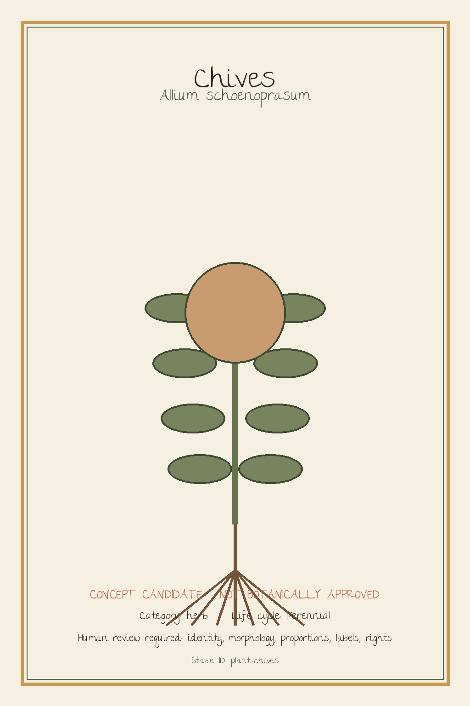

**Source status:** Not botanically or horticulturally approved. Recorded fields are derived
from the retained registry and remain subject to claim-level source review.

### Basil

**Stable plant ID:** `plant-basil`
**Category:** herb
**Recorded botanical name:** Ocimum basilicum
**Recorded family:** Lamiaceae
**Life cycle:** Annual
**Illustration status:** `CANDIDATE_GENERATED / REVIEW_PENDING / NOT_APPROVED`

**Identification and morphology**

- Growth habit: Growth habit should be resolved to the exact species or cultivar; this entry provides a category-level source scaffold.
- Root or storage organ: Species-specific root, crown, or storage organ; verify the exact form before illustrating.
- Leaf arrangement and shape: Species-specific arrangement and blade shape; verify exact genus and cultivar.
- Flower structure: Species-specific inflorescence or flower structure.
- Fruit or seed structure: Species-specific fruit, seed pod, achene, capsule, berry, or nut.

**Errington timing fields**

- Indoor sow: Source timing not reviewed
- Direct sow: Source timing not reviewed
- Transplant: Source timing not reviewed
- Bloom: Source timing not reviewed
- Harvest: Source timing not reviewed
- Frost: Source timing not reviewed

**Cultivation**

- Soil: Fertile, well-drained soil with organic matter unless the species has a known exceptional preference.
- Water: Provide even establishment moisture; then follow the species' drought, moisture, or wetness preference.
- Spacing: Base spacing on mature height and spread, not just the common name.
- Light: Sun requirement is species-specific; the common name alone is not a reliable light label.
- Maintenance: Mulch, deadhead or divide as appropriate, and monitor for structural or seasonal maintenance.
- Pests/diseases: Identify the pest or disease locally before control; favor sanitation, cultural prevention, and targeted action.

**Candidate plate:**
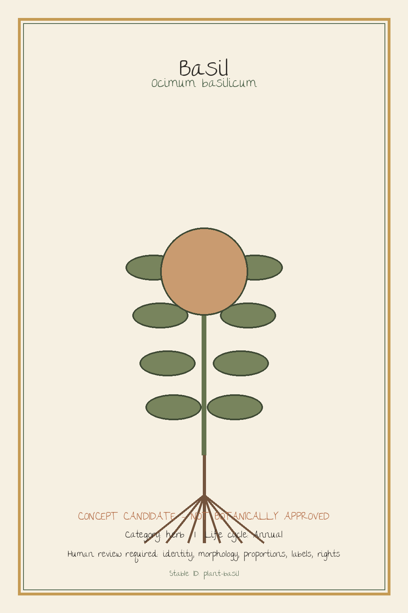

**Source status:** Not botanically or horticulturally approved. Recorded fields are derived
from the retained registry and remain subject to claim-level source review.

### Dill

**Stable plant ID:** `plant-dill`
**Category:** herb
**Recorded botanical name:** Anethum graveolens
**Recorded family:** Apiaceae
**Life cycle:** Annual
**Illustration status:** `CANDIDATE_GENERATED / REVIEW_PENDING / NOT_APPROVED`

**Identification and morphology**

- Growth habit: Growth habit should be resolved to the exact species or cultivar; this entry provides a category-level source scaffold.
- Root or storage organ: Species-specific root, crown, or storage organ; verify the exact form before illustrating.
- Leaf arrangement and shape: Species-specific arrangement and blade shape; verify exact genus and cultivar.
- Flower structure: Species-specific inflorescence or flower structure.
- Fruit or seed structure: Species-specific fruit, seed pod, achene, capsule, berry, or nut.

**Errington timing fields**

- Indoor sow: Source timing not reviewed
- Direct sow: Source timing not reviewed
- Transplant: Source timing not reviewed
- Bloom: Source timing not reviewed
- Harvest: Source timing not reviewed
- Frost: Source timing not reviewed

**Cultivation**

- Soil: Fertile, well-drained soil with organic matter unless the species has a known exceptional preference.
- Water: Provide even establishment moisture; then follow the species' drought, moisture, or wetness preference.
- Spacing: Base spacing on mature height and spread, not just the common name.
- Light: Sun requirement is species-specific; the common name alone is not a reliable light label.
- Maintenance: Mulch, deadhead or divide as appropriate, and monitor for structural or seasonal maintenance.
- Pests/diseases: Identify the pest or disease locally before control; favor sanitation, cultural prevention, and targeted action.

**Candidate plate:**

**Source status:** Not botanically or horticulturally approved. Recorded fields are derived
from the retained registry and remain subject to claim-level source review.

### Cilantro

**Stable plant ID:** `plant-cilantro`
**Category:** herb
**Recorded botanical name:** Coriandrum sativum
**Recorded family:** Apiaceae
**Life cycle:** Annual
**Illustration status:** `CANDIDATE_GENERATED / REVIEW_PENDING / NOT_APPROVED`

**Identification and morphology**

- Growth habit: Growth habit should be resolved to the exact species or cultivar; this entry provides a category-level source scaffold.
- Root or storage organ: Species-specific root, crown, or storage organ; verify the exact form before illustrating.
- Leaf arrangement and shape: Species-specific arrangement and blade shape; verify exact genus and cultivar.
- Flower structure: Species-specific inflorescence or flower structure.
- Fruit or seed structure: Species-specific fruit, seed pod, achene, capsule, berry, or nut.

**Errington timing fields**

- Indoor sow: Source timing not reviewed
- Direct sow: Source timing not reviewed
- Transplant: Source timing not reviewed
- Bloom: Source timing not reviewed
- Harvest: Source timing not reviewed
- Frost: Source timing not reviewed

**Cultivation**

- Soil: Fertile, well-drained soil with organic matter unless the species has a known exceptional preference.
- Water: Provide even establishment moisture; then follow the species' drought, moisture, or wetness preference.
- Spacing: Base spacing on mature height and spread, not just the common name.
- Light: Sun requirement is species-specific; the common name alone is not a reliable light label.
- Maintenance: Mulch, deadhead or divide as appropriate, and monitor for structural or seasonal maintenance.
- Pests/diseases: Identify the pest or disease locally before control; favor sanitation, cultural prevention, and targeted action.

**Candidate plate:**

**Source status:** Not botanically or horticulturally approved. Recorded fields are derived
from the retained registry and remain subject to claim-level source review.

### Chervil

**Stable plant ID:** `plant-chervil`
**Category:** herb
**Recorded botanical name:** Anthriscus cerefolium
**Recorded family:** Apiaceae
**Life cycle:** Annual
**Illustration status:** `CANDIDATE_GENERATED / REVIEW_PENDING / NOT_APPROVED`

**Identification and morphology**

- Growth habit: Growth habit should be resolved to the exact species or cultivar; this entry provides a category-level source scaffold.
- Root or storage organ: Species-specific root, crown, or storage organ; verify the exact form before illustrating.
- Leaf arrangement and shape: Species-specific arrangement and blade shape; verify exact genus and cultivar.
- Flower structure: Species-specific inflorescence or flower structure.
- Fruit or seed structure: Species-specific fruit, seed pod, achene, capsule, berry, or nut.

**Errington timing fields**

- Indoor sow: Source timing not reviewed
- Direct sow: Source timing not reviewed
- Transplant: Source timing not reviewed
- Bloom: Source timing not reviewed
- Harvest: Source timing not reviewed
- Frost: Source timing not reviewed

**Cultivation**

- Soil: Fertile, well-drained soil with organic matter unless the species has a known exceptional preference.
- Water: Provide even establishment moisture; then follow the species' drought, moisture, or wetness preference.
- Spacing: Base spacing on mature height and spread, not just the common name.
- Light: Sun requirement is species-specific; the common name alone is not a reliable light label.
- Maintenance: Mulch, deadhead or divide as appropriate, and monitor for structural or seasonal maintenance.
- Pests/diseases: Identify the pest or disease locally before control; favor sanitation, cultural prevention, and targeted action.

**Candidate plate:**

**Source status:** Not botanically or horticulturally approved. Recorded fields are derived
from the retained registry and remain subject to claim-level source review.

### Fennel

**Stable plant ID:** `plant-fennel`
**Category:** herb
**Recorded botanical name:** Foeniculum vulgare
**Recorded family:** Apiaceae
**Life cycle:** Perennial
**Illustration status:** `CANDIDATE_GENERATED / REVIEW_PENDING / NOT_APPROVED`

**Identification and morphology**

- Growth habit: Growth habit should be resolved to the exact species or cultivar; this entry provides a category-level source scaffold.
- Root or storage organ: Species-specific root, crown, or storage organ; verify the exact form before illustrating.
- Leaf arrangement and shape: Species-specific arrangement and blade shape; verify exact genus and cultivar.
- Flower structure: Species-specific inflorescence or flower structure.
- Fruit or seed structure: Species-specific fruit, seed pod, achene, capsule, berry, or nut.

**Errington timing fields**

- Indoor sow: Source timing not reviewed
- Direct sow: Source timing not reviewed
- Transplant: Source timing not reviewed
- Bloom: Source timing not reviewed
- Harvest: Source timing not reviewed
- Frost: Source timing not reviewed

**Cultivation**

- Soil: Fertile, well-drained soil with organic matter unless the species has a known exceptional preference.
- Water: Provide even establishment moisture; then follow the species' drought, moisture, or wetness preference.
- Spacing: Base spacing on mature height and spread, not just the common name.
- Light: Sun requirement is species-specific; the common name alone is not a reliable light label.
- Maintenance: Mulch, deadhead or divide as appropriate, and monitor for structural or seasonal maintenance.
- Pests/diseases: Identify the pest or disease locally before control; favor sanitation, cultural prevention, and targeted action.

**Candidate plate:**

**Source status:** Not botanically or horticulturally approved. Recorded fields are derived
from the retained registry and remain subject to claim-level source review.

### Apple

**Stable plant ID:** `plant-apple`
**Category:** fruit
**Recorded botanical name:** Malus domestica
**Recorded family:** Rosaceae
**Life cycle:** Perennial
**Illustration status:** `CANDIDATE_GENERATED / REVIEW_PENDING / NOT_APPROVED`

**Identification and morphology**

- Growth habit: Growth habit should be resolved to the exact species or cultivar; this entry provides a category-level source scaffold.
- Root or storage organ: Woody perennial root system; grafted trees may include rootstock-specific traits.
- Leaf arrangement and shape: Alternate or opposite foliage according to the exact genus; use species-level morphology.
- Flower structure: Flowers arranged in species-specific racemes, clusters, umbels, or catkins.
- Fruit or seed structure: Botanical fruit type is species-specific: pome, drupe, berry, aggregate fruit, or grape.

**Errington timing fields**

- Indoor sow: Source timing not reviewed
- Direct sow: Source timing not reviewed
- Transplant: Source timing not reviewed
- Bloom: Source timing not reviewed
- Harvest: Source timing not reviewed
- Frost: Source timing not reviewed

**Cultivation**

- Soil: Fertile, well-drained soil with organic matter unless the species has a known exceptional preference.
- Water: Provide even establishment moisture; then follow the species' drought, moisture, or wetness preference.
- Spacing: Base spacing on mature height and spread, not just the common name.
- Light: Sun requirement is species-specific; the common name alone is not a reliable light label.
- Maintenance: Mulch, deadhead or divide as appropriate, and monitor for structural or seasonal maintenance.
- Pests/diseases: Identify the pest or disease locally before control; favor sanitation, cultural prevention, and targeted action.

**Candidate plate:**
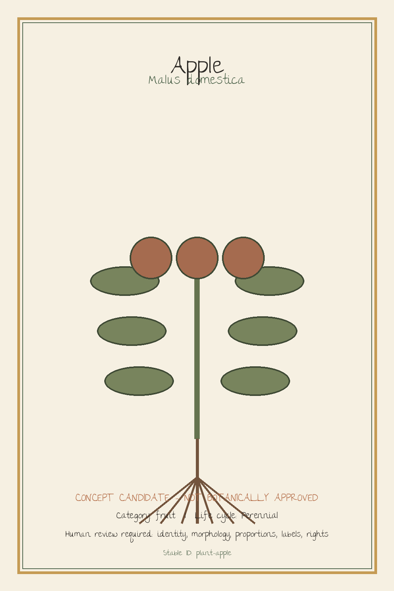

**Source status:** Not botanically or horticulturally approved. Recorded fields are derived
from the retained registry and remain subject to claim-level source review.

### Pear

**Stable plant ID:** `plant-pear`
**Category:** fruit
**Recorded botanical name:** Pyrus communis
**Recorded family:** Rosaceae
**Life cycle:** Perennial
**Illustration status:** `CANDIDATE_GENERATED / REVIEW_PENDING / NOT_APPROVED`

**Identification and morphology**

- Growth habit: Growth habit should be resolved to the exact species or cultivar; this entry provides a category-level source scaffold.
- Root or storage organ: Woody perennial root system; grafted trees may include rootstock-specific traits.
- Leaf arrangement and shape: Alternate or opposite foliage according to the exact genus; use species-level morphology.
- Flower structure: Flowers arranged in species-specific racemes, clusters, umbels, or catkins.
- Fruit or seed structure: Botanical fruit type is species-specific: pome, drupe, berry, aggregate fruit, or grape.

**Errington timing fields**

- Indoor sow: Source timing not reviewed
- Direct sow: Source timing not reviewed
- Transplant: Source timing not reviewed
- Bloom: Source timing not reviewed
- Harvest: Source timing not reviewed
- Frost: Source timing not reviewed

**Cultivation**

- Soil: Fertile, well-drained soil with organic matter unless the species has a known exceptional preference.
- Water: Provide even establishment moisture; then follow the species' drought, moisture, or wetness preference.
- Spacing: Base spacing on mature height and spread, not just the common name.
- Light: Sun requirement is species-specific; the common name alone is not a reliable light label.
- Maintenance: Mulch, deadhead or divide as appropriate, and monitor for structural or seasonal maintenance.
- Pests/diseases: Identify the pest or disease locally before control; favor sanitation, cultural prevention, and targeted action.

**Candidate plate:**

**Source status:** Not botanically or horticulturally approved. Recorded fields are derived
from the retained registry and remain subject to claim-level source review.

### Plum

**Stable plant ID:** `plant-plum`
**Category:** fruit
**Recorded botanical name:** Prunus domestica
**Recorded family:** Rosaceae
**Life cycle:** Perennial
**Illustration status:** `CANDIDATE_GENERATED / REVIEW_PENDING / NOT_APPROVED`

**Identification and morphology**

- Growth habit: Growth habit should be resolved to the exact species or cultivar; this entry provides a category-level source scaffold.
- Root or storage organ: Woody perennial root system; grafted trees may include rootstock-specific traits.
- Leaf arrangement and shape: Alternate or opposite foliage according to the exact genus; use species-level morphology.
- Flower structure: Flowers arranged in species-specific racemes, clusters, umbels, or catkins.
- Fruit or seed structure: Botanical fruit type is species-specific: pome, drupe, berry, aggregate fruit, or grape.

**Errington timing fields**

- Indoor sow: Source timing not reviewed
- Direct sow: Source timing not reviewed
- Transplant: Source timing not reviewed
- Bloom: Source timing not reviewed
- Harvest: Source timing not reviewed
- Frost: Source timing not reviewed

**Cultivation**

- Soil: Fertile, well-drained soil with organic matter unless the species has a known exceptional preference.
- Water: Provide even establishment moisture; then follow the species' drought, moisture, or wetness preference.
- Spacing: Base spacing on mature height and spread, not just the common name.
- Light: Sun requirement is species-specific; the common name alone is not a reliable light label.
- Maintenance: Mulch, deadhead or divide as appropriate, and monitor for structural or seasonal maintenance.
- Pests/diseases: Identify the pest or disease locally before control; favor sanitation, cultural prevention, and targeted action.

**Candidate plate:**

**Source status:** Not botanically or horticulturally approved. Recorded fields are derived
from the retained registry and remain subject to claim-level source review.

### Cherry

**Stable plant ID:** `plant-cherry`
**Category:** fruit
**Recorded botanical name:** Prunus avium
**Recorded family:** Rosaceae
**Life cycle:** Perennial
**Illustration status:** `CANDIDATE_GENERATED / REVIEW_PENDING / NOT_APPROVED`

**Identification and morphology**

- Growth habit: Growth habit should be resolved to the exact species or cultivar; this entry provides a category-level source scaffold.
- Root or storage organ: Woody perennial root system; grafted trees may include rootstock-specific traits.
- Leaf arrangement and shape: Alternate or opposite foliage according to the exact genus; use species-level morphology.
- Flower structure: Flowers arranged in species-specific racemes, clusters, umbels, or catkins.
- Fruit or seed structure: Botanical fruit type is species-specific: pome, drupe, berry, aggregate fruit, or grape.

**Errington timing fields**

- Indoor sow: Source timing not reviewed
- Direct sow: Source timing not reviewed
- Transplant: Source timing not reviewed
- Bloom: Source timing not reviewed
- Harvest: Source timing not reviewed
- Frost: Source timing not reviewed

**Cultivation**

- Soil: Fertile, well-drained soil with organic matter unless the species has a known exceptional preference.
- Water: Provide even establishment moisture; then follow the species' drought, moisture, or wetness preference.
- Spacing: Base spacing on mature height and spread, not just the common name.
- Light: Sun requirement is species-specific; the common name alone is not a reliable light label.
- Maintenance: Mulch, deadhead or divide as appropriate, and monitor for structural or seasonal maintenance.
- Pests/diseases: Identify the pest or disease locally before control; favor sanitation, cultural prevention, and targeted action.

**Candidate plate:**

**Source status:** Not botanically or horticulturally approved. Recorded fields are derived
from the retained registry and remain subject to claim-level source review.

### Grapes

**Stable plant ID:** `plant-grapes`
**Category:** fruit
**Recorded botanical name:** Vitis vinifera
**Recorded family:** Vitaceae
**Life cycle:** Perennial
**Illustration status:** `CANDIDATE_GENERATED / REVIEW_PENDING / NOT_APPROVED`

**Identification and morphology**

- Growth habit: Growth habit should be resolved to the exact species or cultivar; this entry provides a category-level source scaffold.
- Root or storage organ: Woody perennial root system; grafted trees may include rootstock-specific traits.
- Leaf arrangement and shape: Alternate or opposite foliage according to the exact genus; use species-level morphology.
- Flower structure: Flowers arranged in species-specific racemes, clusters, umbels, or catkins.
- Fruit or seed structure: Botanical fruit type is species-specific: pome, drupe, berry, aggregate fruit, or grape.

**Errington timing fields**

- Indoor sow: Source timing not reviewed
- Direct sow: Source timing not reviewed
- Transplant: Source timing not reviewed
- Bloom: Source timing not reviewed
- Harvest: Source timing not reviewed
- Frost: Source timing not reviewed

**Cultivation**

- Soil: Fertile, well-drained soil with organic matter unless the species has a known exceptional preference.
- Water: Provide even establishment moisture; then follow the species' drought, moisture, or wetness preference.
- Spacing: Base spacing on mature height and spread, not just the common name.
- Light: Sun requirement is species-specific; the common name alone is not a reliable light label.
- Maintenance: Mulch, deadhead or divide as appropriate, and monitor for structural or seasonal maintenance.
- Pests/diseases: Identify the pest or disease locally before control; favor sanitation, cultural prevention, and targeted action.

**Candidate plate:**

**Source status:** Not botanically or horticulturally approved. Recorded fields are derived
from the retained registry and remain subject to claim-level source review.

### Strawberries

**Stable plant ID:** `plant-strawberries`
**Category:** fruit
**Recorded botanical name:** Fragaria × ananassa
**Recorded family:** Rosaceae
**Life cycle:** Perennial
**Illustration status:** `CANDIDATE_GENERATED / REVIEW_PENDING / NOT_APPROVED`

**Identification and morphology**

- Growth habit: Growth habit should be resolved to the exact species or cultivar; this entry provides a category-level source scaffold.
- Root or storage organ: Woody perennial root system; grafted trees may include rootstock-specific traits.
- Leaf arrangement and shape: Alternate or opposite foliage according to the exact genus; use species-level morphology.
- Flower structure: Flowers arranged in species-specific racemes, clusters, umbels, or catkins.
- Fruit or seed structure: Botanical fruit type is species-specific: pome, drupe, berry, aggregate fruit, or grape.

**Errington timing fields**

- Indoor sow: Source timing not reviewed
- Direct sow: Source timing not reviewed
- Transplant: Source timing not reviewed
- Bloom: Source timing not reviewed
- Harvest: Source timing not reviewed
- Frost: Source timing not reviewed

**Cultivation**

- Soil: Fertile, well-drained soil with organic matter unless the species has a known exceptional preference.
- Water: Provide even establishment moisture; then follow the species' drought, moisture, or wetness preference.
- Spacing: Base spacing on mature height and spread, not just the common name.
- Light: Sun requirement is species-specific; the common name alone is not a reliable light label.
- Maintenance: Mulch, deadhead or divide as appropriate, and monitor for structural or seasonal maintenance.
- Pests/diseases: Identify the pest or disease locally before control; favor sanitation, cultural prevention, and targeted action.

**Candidate plate:**

**Source status:** Not botanically or horticulturally approved. Recorded fields are derived
from the retained registry and remain subject to claim-level source review.

### Raspberries

**Stable plant ID:** `plant-raspberries`
**Category:** fruit
**Recorded botanical name:** Rubus idaeus
**Recorded family:** Rosaceae
**Life cycle:** Perennial
**Illustration status:** `CANDIDATE_GENERATED / REVIEW_PENDING / NOT_APPROVED`

**Identification and morphology**

- Growth habit: Growth habit should be resolved to the exact species or cultivar; this entry provides a category-level source scaffold.
- Root or storage organ: Woody perennial root system; grafted trees may include rootstock-specific traits.
- Leaf arrangement and shape: Alternate or opposite foliage according to the exact genus; use species-level morphology.
- Flower structure: Flowers arranged in species-specific racemes, clusters, umbels, or catkins.
- Fruit or seed structure: Botanical fruit type is species-specific: pome, drupe, berry, aggregate fruit, or grape.

**Errington timing fields**

- Indoor sow: Source timing not reviewed
- Direct sow: Source timing not reviewed
- Transplant: Source timing not reviewed
- Bloom: Source timing not reviewed
- Harvest: Source timing not reviewed
- Frost: Source timing not reviewed

**Cultivation**

- Soil: Fertile, well-drained soil with organic matter unless the species has a known exceptional preference.
- Water: Provide even establishment moisture; then follow the species' drought, moisture, or wetness preference.
- Spacing: Base spacing on mature height and spread, not just the common name.
- Light: Sun requirement is species-specific; the common name alone is not a reliable light label.
- Maintenance: Mulch, deadhead or divide as appropriate, and monitor for structural or seasonal maintenance.
- Pests/diseases: Identify the pest or disease locally before control; favor sanitation, cultural prevention, and targeted action.

**Candidate plate:**
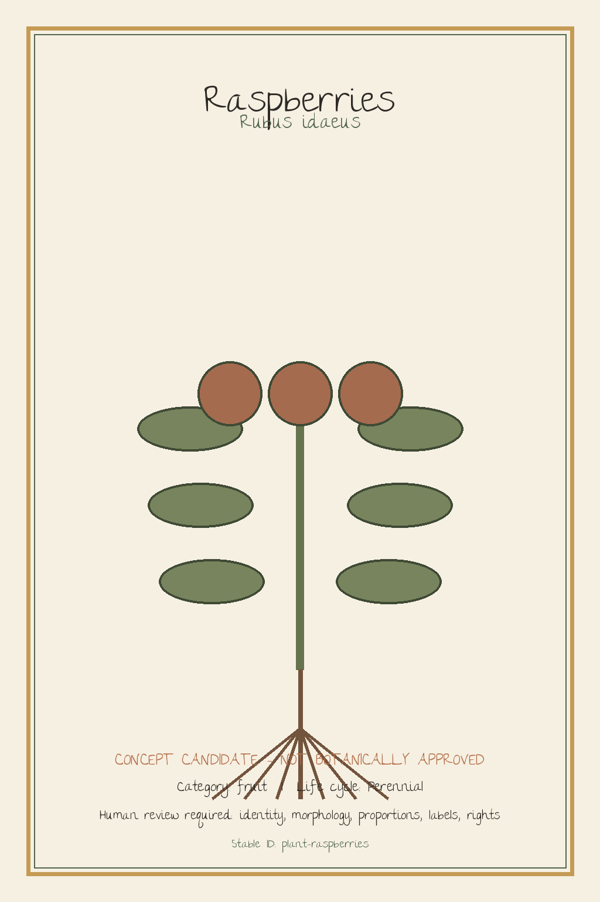

**Source status:** Not botanically or horticulturally approved. Recorded fields are derived
from the retained registry and remain subject to claim-level source review.

### Blueberries

**Stable plant ID:** `plant-blueberries`
**Category:** fruit
**Recorded botanical name:** Vaccinium corymbosum
**Recorded family:** Ericaceae
**Life cycle:** Perennial
**Illustration status:** `CANDIDATE_GENERATED / REVIEW_PENDING / NOT_APPROVED`

**Identification and morphology**

- Growth habit: Growth habit should be resolved to the exact species or cultivar; this entry provides a category-level source scaffold.
- Root or storage organ: Woody perennial root system; grafted trees may include rootstock-specific traits.
- Leaf arrangement and shape: Alternate or opposite foliage according to the exact genus; use species-level morphology.
- Flower structure: Flowers arranged in species-specific racemes, clusters, umbels, or catkins.
- Fruit or seed structure: Botanical fruit type is species-specific: pome, drupe, berry, aggregate fruit, or grape.

**Errington timing fields**

- Indoor sow: Source timing not reviewed
- Direct sow: Source timing not reviewed
- Transplant: Source timing not reviewed
- Bloom: Source timing not reviewed
- Harvest: Source timing not reviewed
- Frost: Source timing not reviewed

**Cultivation**

- Soil: Fertile, well-drained soil with organic matter unless the species has a known exceptional preference.
- Water: Provide even establishment moisture; then follow the species' drought, moisture, or wetness preference.
- Spacing: Base spacing on mature height and spread, not just the common name.
- Light: Sun requirement is species-specific; the common name alone is not a reliable light label.
- Maintenance: Mulch, deadhead or divide as appropriate, and monitor for structural or seasonal maintenance.
- Pests/diseases: Identify the pest or disease locally before control; favor sanitation, cultural prevention, and targeted action.

**Candidate plate:**

**Source status:** Not botanically or horticulturally approved. Recorded fields are derived
from the retained registry and remain subject to claim-level source review.

### Currants

**Stable plant ID:** `plant-currants`
**Category:** fruit
**Recorded botanical name:** Ribes rubrum
**Recorded family:** Grossulariaceae
**Life cycle:** Perennial
**Illustration status:** `CANDIDATE_GENERATED / REVIEW_PENDING / NOT_APPROVED`

**Identification and morphology**

- Growth habit: Growth habit should be resolved to the exact species or cultivar; this entry provides a category-level source scaffold.
- Root or storage organ: Woody perennial root system; grafted trees may include rootstock-specific traits.
- Leaf arrangement and shape: Alternate or opposite foliage according to the exact genus; use species-level morphology.
- Flower structure: Flowers arranged in species-specific racemes, clusters, umbels, or catkins.
- Fruit or seed structure: Botanical fruit type is species-specific: pome, drupe, berry, aggregate fruit, or grape.

**Errington timing fields**

- Indoor sow: Source timing not reviewed
- Direct sow: Source timing not reviewed
- Transplant: Source timing not reviewed
- Bloom: Source timing not reviewed
- Harvest: Source timing not reviewed
- Frost: Source timing not reviewed

**Cultivation**

- Soil: Fertile, well-drained soil with organic matter unless the species has a known exceptional preference.
- Water: Provide even establishment moisture; then follow the species' drought, moisture, or wetness preference.
- Spacing: Base spacing on mature height and spread, not just the common name.
- Light: Sun requirement is species-specific; the common name alone is not a reliable light label.
- Maintenance: Mulch, deadhead or divide as appropriate, and monitor for structural or seasonal maintenance.
- Pests/diseases: Identify the pest or disease locally before control; favor sanitation, cultural prevention, and targeted action.

**Candidate plate:**
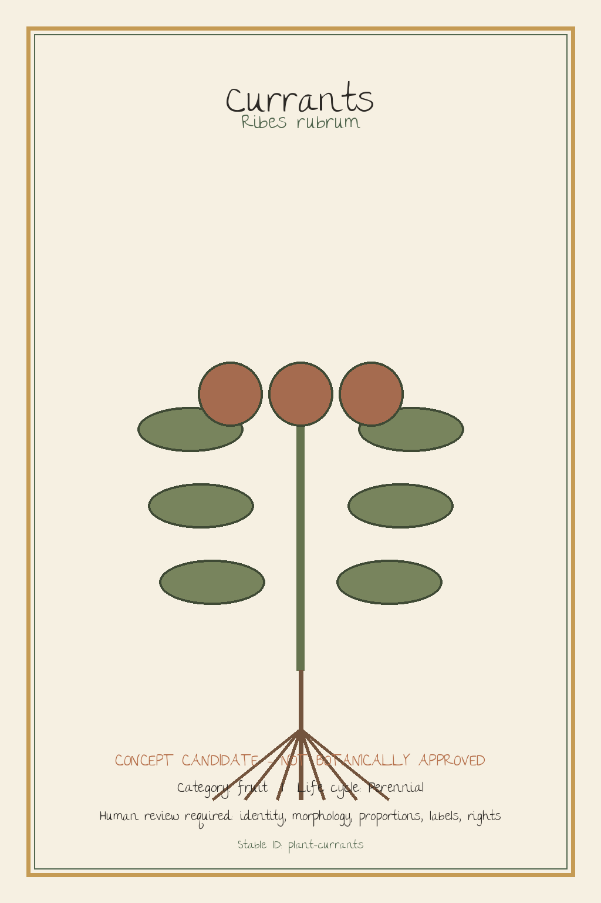

**Source status:** Not botanically or horticulturally approved. Recorded fields are derived
from the retained registry and remain subject to claim-level source review.

### Gooseberries

**Stable plant ID:** `plant-gooseberries`
**Category:** fruit
**Recorded botanical name:** Ribes uva-crispa
**Recorded family:** Grossulariaceae
**Life cycle:** Perennial
**Illustration status:** `CANDIDATE_GENERATED / REVIEW_PENDING / NOT_APPROVED`

**Identification and morphology**

- Growth habit: Growth habit should be resolved to the exact species or cultivar; this entry provides a category-level source scaffold.
- Root or storage organ: Woody perennial root system; grafted trees may include rootstock-specific traits.
- Leaf arrangement and shape: Alternate or opposite foliage according to the exact genus; use species-level morphology.
- Flower structure: Flowers arranged in species-specific racemes, clusters, umbels, or catkins.
- Fruit or seed structure: Botanical fruit type is species-specific: pome, drupe, berry, aggregate fruit, or grape.

**Errington timing fields**

- Indoor sow: Source timing not reviewed
- Direct sow: Source timing not reviewed
- Transplant: Source timing not reviewed
- Bloom: Source timing not reviewed
- Harvest: Source timing not reviewed
- Frost: Source timing not reviewed

**Cultivation**

- Soil: Fertile, well-drained soil with organic matter unless the species has a known exceptional preference.
- Water: Provide even establishment moisture; then follow the species' drought, moisture, or wetness preference.
- Spacing: Base spacing on mature height and spread, not just the common name.
- Light: Sun requirement is species-specific; the common name alone is not a reliable light label.
- Maintenance: Mulch, deadhead or divide as appropriate, and monitor for structural or seasonal maintenance.
- Pests/diseases: Identify the pest or disease locally before control; favor sanitation, cultural prevention, and targeted action.

**Candidate plate:**
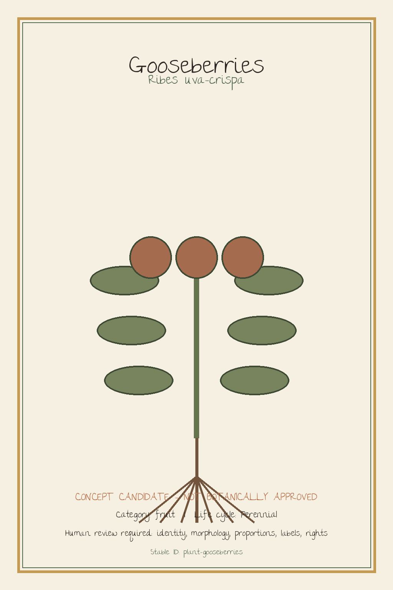

**Source status:** Not botanically or horticulturally approved. Recorded fields are derived
from the retained registry and remain subject to claim-level source review.

### Rhubarb

**Stable plant ID:** `plant-rhubarb`
**Category:** perennial-edible
**Recorded botanical name:** Rheum × hybridum
**Recorded family:** Polygonaceae
**Life cycle:** Perennial
**Illustration status:** `CANDIDATE_GENERATED / REVIEW_PENDING / NOT_APPROVED`

**Identification and morphology**

- Growth habit: Growth habit should be resolved to the exact species or cultivar; this entry provides a category-level source scaffold.
- Root or storage organ: Species-specific root, crown, or storage organ; verify the exact form before illustrating.
- Leaf arrangement and shape: Species-specific arrangement and blade shape; verify exact genus and cultivar.
- Flower structure: Species-specific inflorescence or flower structure.
- Fruit or seed structure: Species-specific fruit, seed pod, achene, capsule, berry, or nut.

**Errington timing fields**

- Indoor sow: Source timing not reviewed
- Direct sow: Source timing not reviewed
- Transplant: Source timing not reviewed
- Bloom: Source timing not reviewed
- Harvest: Source timing not reviewed
- Frost: Source timing not reviewed

**Cultivation**

- Soil: Fertile, well-drained soil with organic matter unless the species has a known exceptional preference.
- Water: Provide even establishment moisture; then follow the species' drought, moisture, or wetness preference.
- Spacing: Base spacing on mature height and spread, not just the common name.
- Light: Sun requirement is species-specific; the common name alone is not a reliable light label.
- Maintenance: Mulch, deadhead or divide as appropriate, and monitor for structural or seasonal maintenance.
- Pests/diseases: Identify the pest or disease locally before control; favor sanitation, cultural prevention, and targeted action.

**Candidate plate:**
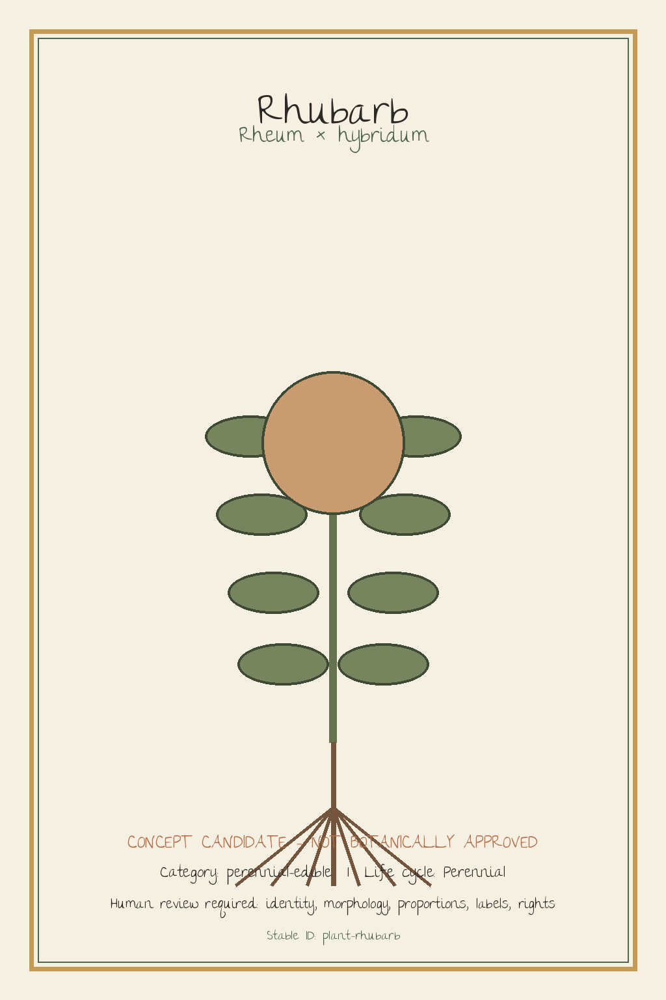

**Source status:** Not botanically or horticulturally approved. Recorded fields are derived
from the retained registry and remain subject to claim-level source review.

### Globe Artichoke

**Stable plant ID:** `plant-globe-artichoke`
**Category:** perennial-edible
**Recorded botanical name:** Cynara cardunculus var. scolymus
**Recorded family:** Asteraceae
**Life cycle:** Perennial
**Illustration status:** `CANDIDATE_GENERATED / REVIEW_PENDING / NOT_APPROVED`

**Identification and morphology**

- Growth habit: Growth habit should be resolved to the exact species or cultivar; this entry provides a category-level source scaffold.
- Root or storage organ: Species-specific root, crown, or storage organ; verify the exact form before illustrating.
- Leaf arrangement and shape: Species-specific arrangement and blade shape; verify exact genus and cultivar.
- Flower structure: Species-specific inflorescence or flower structure.
- Fruit or seed structure: Species-specific fruit, seed pod, achene, capsule, berry, or nut.

**Errington timing fields**

- Indoor sow: Source timing not reviewed
- Direct sow: Source timing not reviewed
- Transplant: Source timing not reviewed
- Bloom: Source timing not reviewed
- Harvest: Source timing not reviewed
- Frost: Source timing not reviewed

**Cultivation**

- Soil: Fertile, well-drained soil with organic matter unless the species has a known exceptional preference.
- Water: Provide even establishment moisture; then follow the species' drought, moisture, or wetness preference.
- Spacing: Base spacing on mature height and spread, not just the common name.
- Light: Sun requirement is species-specific; the common name alone is not a reliable light label.
- Maintenance: Mulch, deadhead or divide as appropriate, and monitor for structural or seasonal maintenance.
- Pests/diseases: Identify the pest or disease locally before control; favor sanitation, cultural prevention, and targeted action.

**Candidate plate:**
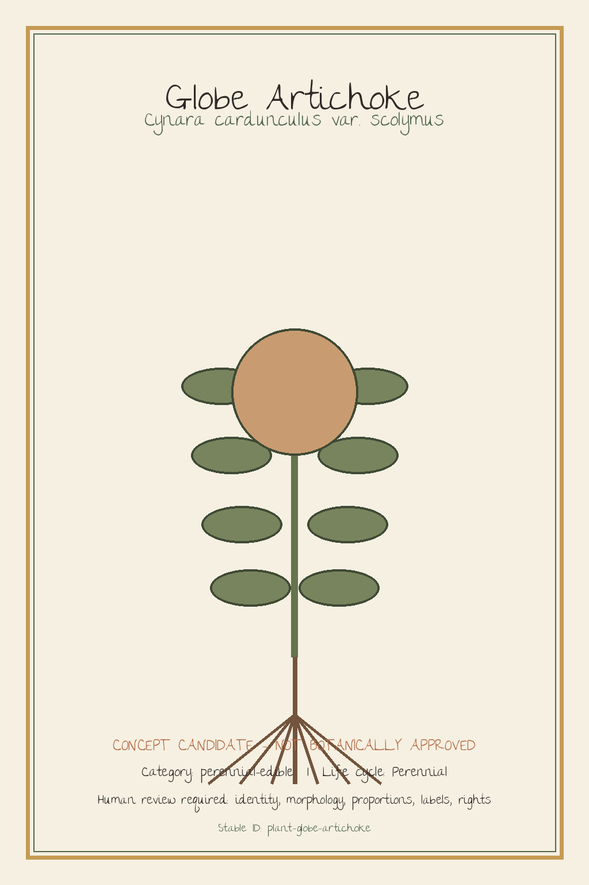

**Source status:** Not botanically or horticulturally approved. Recorded fields are derived
from the retained registry and remain subject to claim-level source review.

### Snapdragons

**Stable plant ID:** `plant-snapdragons`
**Category:** flower
**Recorded botanical name:** Antirrhinum majus
**Recorded family:** Plantaginaceae
**Life cycle:** Annual
**Illustration status:** `CANDIDATE_GENERATED / REVIEW_PENDING / NOT_APPROVED`

**Identification and morphology**

- Growth habit: Growth habit should be resolved to the exact species or cultivar; this entry provides a category-level source scaffold.
- Root or storage organ: Species-specific root, crown, or storage organ; verify the exact form before illustrating.
- Leaf arrangement and shape: Species-specific arrangement and blade shape; verify exact genus and cultivar.
- Flower structure: Species-specific inflorescence or flower structure.
- Fruit or seed structure: Species-specific fruit, seed pod, achene, capsule, berry, or nut.

**Errington timing fields**

- Indoor sow: Source timing not reviewed
- Direct sow: Source timing not reviewed
- Transplant: Source timing not reviewed
- Bloom: Source timing not reviewed
- Harvest: Source timing not reviewed
- Frost: Source timing not reviewed

**Cultivation**

- Soil: Fertile, well-drained soil with organic matter unless the species has a known exceptional preference.
- Water: Provide even establishment moisture; then follow the species' drought, moisture, or wetness preference.
- Spacing: Base spacing on mature height and spread, not just the common name.
- Light: Sun requirement is species-specific; the common name alone is not a reliable light label.
- Maintenance: Mulch, deadhead or divide as appropriate, and monitor for structural or seasonal maintenance.
- Pests/diseases: Identify the pest or disease locally before control; favor sanitation, cultural prevention, and targeted action.

**Candidate plate:**

**Source status:** Not botanically or horticulturally approved. Recorded fields are derived
from the retained registry and remain subject to claim-level source review.

### Petunias

**Stable plant ID:** `plant-petunias`
**Category:** flower
**Recorded botanical name:** Petunia × atkinsiana
**Recorded family:** Solanaceae
**Life cycle:** Annual
**Illustration status:** `CANDIDATE_GENERATED / REVIEW_PENDING / NOT_APPROVED`

**Identification and morphology**

- Growth habit: Growth habit should be resolved to the exact species or cultivar; this entry provides a category-level source scaffold.
- Root or storage organ: Species-specific root, crown, or storage organ; verify the exact form before illustrating.
- Leaf arrangement and shape: Species-specific arrangement and blade shape; verify exact genus and cultivar.
- Flower structure: Species-specific inflorescence or flower structure.
- Fruit or seed structure: Species-specific fruit, seed pod, achene, capsule, berry, or nut.

**Errington timing fields**

- Indoor sow: Source timing not reviewed
- Direct sow: Source timing not reviewed
- Transplant: Source timing not reviewed
- Bloom: Source timing not reviewed
- Harvest: Source timing not reviewed
- Frost: Source timing not reviewed

**Cultivation**

- Soil: Fertile, well-drained soil with organic matter unless the species has a known exceptional preference.
- Water: Provide even establishment moisture; then follow the species' drought, moisture, or wetness preference.
- Spacing: Base spacing on mature height and spread, not just the common name.
- Light: Sun requirement is species-specific; the common name alone is not a reliable light label.
- Maintenance: Mulch, deadhead or divide as appropriate, and monitor for structural or seasonal maintenance.
- Pests/diseases: Identify the pest or disease locally before control; favor sanitation, cultural prevention, and targeted action.

**Candidate plate:**

**Source status:** Not botanically or horticulturally approved. Recorded fields are derived
from the retained registry and remain subject to claim-level source review.

### Lobelia

**Stable plant ID:** `plant-lobelia`
**Category:** flower
**Recorded botanical name:** Lobelia erinus
**Recorded family:** Campanulaceae
**Life cycle:** Annual
**Illustration status:** `CANDIDATE_GENERATED / REVIEW_PENDING / NOT_APPROVED`

**Identification and morphology**

- Growth habit: Growth habit should be resolved to the exact species or cultivar; this entry provides a category-level source scaffold.
- Root or storage organ: Species-specific root, crown, or storage organ; verify the exact form before illustrating.
- Leaf arrangement and shape: Species-specific arrangement and blade shape; verify exact genus and cultivar.
- Flower structure: Species-specific inflorescence or flower structure.
- Fruit or seed structure: Species-specific fruit, seed pod, achene, capsule, berry, or nut.

**Errington timing fields**

- Indoor sow: Source timing not reviewed
- Direct sow: Source timing not reviewed
- Transplant: Source timing not reviewed
- Bloom: Source timing not reviewed
- Harvest: Source timing not reviewed
- Frost: Source timing not reviewed

**Cultivation**

- Soil: Fertile, well-drained soil with organic matter unless the species has a known exceptional preference.
- Water: Provide even establishment moisture; then follow the species' drought, moisture, or wetness preference.
- Spacing: Base spacing on mature height and spread, not just the common name.
- Light: Sun requirement is species-specific; the common name alone is not a reliable light label.
- Maintenance: Mulch, deadhead or divide as appropriate, and monitor for structural or seasonal maintenance.
- Pests/diseases: Identify the pest or disease locally before control; favor sanitation, cultural prevention, and targeted action.

**Candidate plate:**

**Source status:** Not botanically or horticulturally approved. Recorded fields are derived
from the retained registry and remain subject to claim-level source review.

### Pansy

**Stable plant ID:** `plant-pansy`
**Category:** flower
**Recorded botanical name:** Viola × wittrockiana
**Recorded family:** Violaceae
**Life cycle:** Annual
**Illustration status:** `CANDIDATE_GENERATED / REVIEW_PENDING / NOT_APPROVED`

**Identification and morphology**

- Growth habit: Growth habit should be resolved to the exact species or cultivar; this entry provides a category-level source scaffold.
- Root or storage organ: Species-specific root, crown, or storage organ; verify the exact form before illustrating.
- Leaf arrangement and shape: Species-specific arrangement and blade shape; verify exact genus and cultivar.
- Flower structure: Species-specific inflorescence or flower structure.
- Fruit or seed structure: Species-specific fruit, seed pod, achene, capsule, berry, or nut.

**Errington timing fields**

- Indoor sow: Source timing not reviewed
- Direct sow: Source timing not reviewed
- Transplant: Source timing not reviewed
- Bloom: Source timing not reviewed
- Harvest: Source timing not reviewed
- Frost: Source timing not reviewed

**Cultivation**

- Soil: Fertile, well-drained soil with organic matter unless the species has a known exceptional preference.
- Water: Provide even establishment moisture; then follow the species' drought, moisture, or wetness preference.
- Spacing: Base spacing on mature height and spread, not just the common name.
- Light: Sun requirement is species-specific; the common name alone is not a reliable light label.
- Maintenance: Mulch, deadhead or divide as appropriate, and monitor for structural or seasonal maintenance.
- Pests/diseases: Identify the pest or disease locally before control; favor sanitation, cultural prevention, and targeted action.

**Candidate plate:**

**Source status:** Not botanically or horticulturally approved. Recorded fields are derived
from the retained registry and remain subject to claim-level source review.

### Stocks

**Stable plant ID:** `plant-stocks`
**Category:** flower
**Recorded botanical name:** Matthiola incana
**Recorded family:** Brassicaceae
**Life cycle:** Annual
**Illustration status:** `CANDIDATE_GENERATED / REVIEW_PENDING / NOT_APPROVED`

**Identification and morphology**

- Growth habit: Growth habit should be resolved to the exact species or cultivar; this entry provides a category-level source scaffold.
- Root or storage organ: Species-specific root, crown, or storage organ; verify the exact form before illustrating.
- Leaf arrangement and shape: Species-specific arrangement and blade shape; verify exact genus and cultivar.
- Flower structure: Species-specific inflorescence or flower structure.
- Fruit or seed structure: Species-specific fruit, seed pod, achene, capsule, berry, or nut.

**Errington timing fields**

- Indoor sow: Source timing not reviewed
- Direct sow: Source timing not reviewed
- Transplant: Source timing not reviewed
- Bloom: Source timing not reviewed
- Harvest: Source timing not reviewed
- Frost: Source timing not reviewed

**Cultivation**

- Soil: Fertile, well-drained soil with organic matter unless the species has a known exceptional preference.
- Water: Provide even establishment moisture; then follow the species' drought, moisture, or wetness preference.
- Spacing: Base spacing on mature height and spread, not just the common name.
- Light: Sun requirement is species-specific; the common name alone is not a reliable light label.
- Maintenance: Mulch, deadhead or divide as appropriate, and monitor for structural or seasonal maintenance.
- Pests/diseases: Identify the pest or disease locally before control; favor sanitation, cultural prevention, and targeted action.

**Candidate plate:**

**Source status:** Not botanically or horticulturally approved. Recorded fields are derived
from the retained registry and remain subject to claim-level source review.

### Statice

**Stable plant ID:** `plant-statice`
**Category:** flower
**Recorded botanical name:** Limonium sinuatum
**Recorded family:** Plumbaginaceae
**Life cycle:** Annual
**Illustration status:** `CANDIDATE_GENERATED / REVIEW_PENDING / NOT_APPROVED`

**Identification and morphology**

- Growth habit: Growth habit should be resolved to the exact species or cultivar; this entry provides a category-level source scaffold.
- Root or storage organ: Species-specific root, crown, or storage organ; verify the exact form before illustrating.
- Leaf arrangement and shape: Species-specific arrangement and blade shape; verify exact genus and cultivar.
- Flower structure: Species-specific inflorescence or flower structure.
- Fruit or seed structure: Species-specific fruit, seed pod, achene, capsule, berry, or nut.

**Errington timing fields**

- Indoor sow: Source timing not reviewed
- Direct sow: Source timing not reviewed
- Transplant: Source timing not reviewed
- Bloom: Source timing not reviewed
- Harvest: Source timing not reviewed
- Frost: Source timing not reviewed

**Cultivation**

- Soil: Fertile, well-drained soil with organic matter unless the species has a known exceptional preference.
- Water: Provide even establishment moisture; then follow the species' drought, moisture, or wetness preference.
- Spacing: Base spacing on mature height and spread, not just the common name.
- Light: Sun requirement is species-specific; the common name alone is not a reliable light label.
- Maintenance: Mulch, deadhead or divide as appropriate, and monitor for structural or seasonal maintenance.
- Pests/diseases: Identify the pest or disease locally before control; favor sanitation, cultural prevention, and targeted action.

**Candidate plate:**

**Source status:** Not botanically or horticulturally approved. Recorded fields are derived
from the retained registry and remain subject to claim-level source review.

### Antirrhinum

**Stable plant ID:** `plant-antirrhinum`
**Category:** flower
**Recorded botanical name:** Antirrhinum majus
**Recorded family:** Plantaginaceae
**Life cycle:** Annual
**Illustration status:** `CANDIDATE_GENERATED / REVIEW_PENDING / NOT_APPROVED`

**Identification and morphology**

- Growth habit: Growth habit should be resolved to the exact species or cultivar; this entry provides a category-level source scaffold.
- Root or storage organ: Species-specific root, crown, or storage organ; verify the exact form before illustrating.
- Leaf arrangement and shape: Species-specific arrangement and blade shape; verify exact genus and cultivar.
- Flower structure: Species-specific inflorescence or flower structure.
- Fruit or seed structure: Species-specific fruit, seed pod, achene, capsule, berry, or nut.

**Errington timing fields**

- Indoor sow: Source timing not reviewed
- Direct sow: Source timing not reviewed
- Transplant: Source timing not reviewed
- Bloom: Source timing not reviewed
- Harvest: Source timing not reviewed
- Frost: Source timing not reviewed

**Cultivation**

- Soil: Fertile, well-drained soil with organic matter unless the species has a known exceptional preference.
- Water: Provide even establishment moisture; then follow the species' drought, moisture, or wetness preference.
- Spacing: Base spacing on mature height and spread, not just the common name.
- Light: Sun requirement is species-specific; the common name alone is not a reliable light label.
- Maintenance: Mulch, deadhead or divide as appropriate, and monitor for structural or seasonal maintenance.
- Pests/diseases: Identify the pest or disease locally before control; favor sanitation, cultural prevention, and targeted action.

**Candidate plate:**
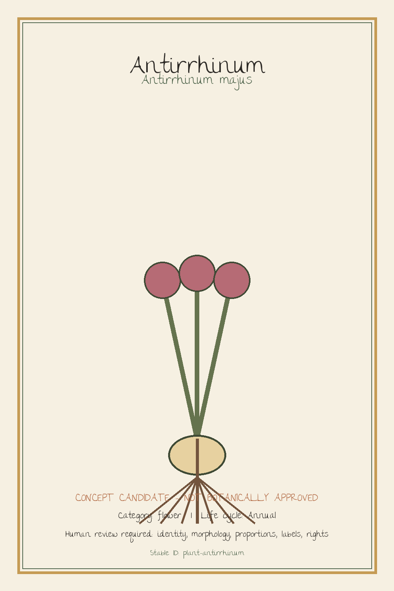

**Source status:** Not botanically or horticulturally approved. Recorded fields are derived
from the retained registry and remain subject to claim-level source review.

### Impatiens

**Stable plant ID:** `plant-impatiens`
**Category:** flower
**Recorded botanical name:** Impatiens walleriana
**Recorded family:** Balsaminaceae
**Life cycle:** Annual
**Illustration status:** `CANDIDATE_GENERATED / REVIEW_PENDING / NOT_APPROVED`

**Identification and morphology**

- Growth habit: Growth habit should be resolved to the exact species or cultivar; this entry provides a category-level source scaffold.
- Root or storage organ: Species-specific root, crown, or storage organ; verify the exact form before illustrating.
- Leaf arrangement and shape: Species-specific arrangement and blade shape; verify exact genus and cultivar.
- Flower structure: Species-specific inflorescence or flower structure.
- Fruit or seed structure: Species-specific fruit, seed pod, achene, capsule, berry, or nut.

**Errington timing fields**

- Indoor sow: Source timing not reviewed
- Direct sow: Source timing not reviewed
- Transplant: Source timing not reviewed
- Bloom: Source timing not reviewed
- Harvest: Source timing not reviewed
- Frost: Source timing not reviewed

**Cultivation**

- Soil: Fertile, well-drained soil with organic matter unless the species has a known exceptional preference.
- Water: Provide even establishment moisture; then follow the species' drought, moisture, or wetness preference.
- Spacing: Base spacing on mature height and spread, not just the common name.
- Light: Sun requirement is species-specific; the common name alone is not a reliable light label.
- Maintenance: Mulch, deadhead or divide as appropriate, and monitor for structural or seasonal maintenance.
- Pests/diseases: Identify the pest or disease locally before control; favor sanitation, cultural prevention, and targeted action.

**Candidate plate:**

**Source status:** Not botanically or horticulturally approved. Recorded fields are derived
from the retained registry and remain subject to claim-level source review.

### Nicotiana

**Stable plant ID:** `plant-nicotiana`
**Category:** flower
**Recorded botanical name:** Nicotiana alata
**Recorded family:** Solanaceae
**Life cycle:** Annual
**Illustration status:** `CANDIDATE_GENERATED / REVIEW_PENDING / NOT_APPROVED`

**Identification and morphology**

- Growth habit: Growth habit should be resolved to the exact species or cultivar; this entry provides a category-level source scaffold.
- Root or storage organ: Species-specific root, crown, or storage organ; verify the exact form before illustrating.
- Leaf arrangement and shape: Species-specific arrangement and blade shape; verify exact genus and cultivar.
- Flower structure: Species-specific inflorescence or flower structure.
- Fruit or seed structure: Species-specific fruit, seed pod, achene, capsule, berry, or nut.

**Errington timing fields**

- Indoor sow: Source timing not reviewed
- Direct sow: Source timing not reviewed
- Transplant: Source timing not reviewed
- Bloom: Source timing not reviewed
- Harvest: Source timing not reviewed
- Frost: Source timing not reviewed

**Cultivation**

- Soil: Fertile, well-drained soil with organic matter unless the species has a known exceptional preference.
- Water: Provide even establishment moisture; then follow the species' drought, moisture, or wetness preference.
- Spacing: Base spacing on mature height and spread, not just the common name.
- Light: Sun requirement is species-specific; the common name alone is not a reliable light label.
- Maintenance: Mulch, deadhead or divide as appropriate, and monitor for structural or seasonal maintenance.
- Pests/diseases: Identify the pest or disease locally before control; favor sanitation, cultural prevention, and targeted action.

**Candidate plate:**

**Source status:** Not botanically or horticulturally approved. Recorded fields are derived
from the retained registry and remain subject to claim-level source review.

### Cleome

**Stable plant ID:** `plant-cleome`
**Category:** flower
**Recorded botanical name:** Cleome hassleriana
**Recorded family:** Cleomaceae
**Life cycle:** Annual
**Illustration status:** `CANDIDATE_GENERATED / REVIEW_PENDING / NOT_APPROVED`

**Identification and morphology**

- Growth habit: Growth habit should be resolved to the exact species or cultivar; this entry provides a category-level source scaffold.
- Root or storage organ: Species-specific root, crown, or storage organ; verify the exact form before illustrating.
- Leaf arrangement and shape: Species-specific arrangement and blade shape; verify exact genus and cultivar.
- Flower structure: Species-specific inflorescence or flower structure.
- Fruit or seed structure: Species-specific fruit, seed pod, achene, capsule, berry, or nut.

**Errington timing fields**

- Indoor sow: Source timing not reviewed
- Direct sow: Source timing not reviewed
- Transplant: Source timing not reviewed
- Bloom: Source timing not reviewed
- Harvest: Source timing not reviewed
- Frost: Source timing not reviewed

**Cultivation**

- Soil: Fertile, well-drained soil with organic matter unless the species has a known exceptional preference.
- Water: Provide even establishment moisture; then follow the species' drought, moisture, or wetness preference.
- Spacing: Base spacing on mature height and spread, not just the common name.
- Light: Sun requirement is species-specific; the common name alone is not a reliable light label.
- Maintenance: Mulch, deadhead or divide as appropriate, and monitor for structural or seasonal maintenance.
- Pests/diseases: Identify the pest or disease locally before control; favor sanitation, cultural prevention, and targeted action.

**Candidate plate:**
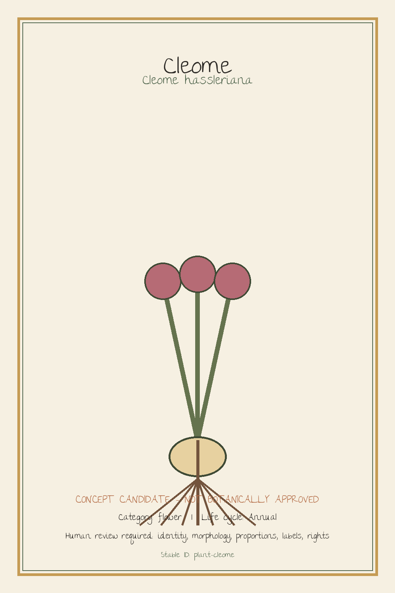

**Source status:** Not botanically or horticulturally approved. Recorded fields are derived
from the retained registry and remain subject to claim-level source review.

### Larkspur

**Stable plant ID:** `plant-larkspur`
**Category:** flower
**Recorded botanical name:** Consolida ajacis
**Recorded family:** Ranunculaceae
**Life cycle:** Annual
**Illustration status:** `CANDIDATE_GENERATED / REVIEW_PENDING / NOT_APPROVED`

**Identification and morphology**

- Growth habit: Growth habit should be resolved to the exact species or cultivar; this entry provides a category-level source scaffold.
- Root or storage organ: Species-specific root, crown, or storage organ; verify the exact form before illustrating.
- Leaf arrangement and shape: Species-specific arrangement and blade shape; verify exact genus and cultivar.
- Flower structure: Species-specific inflorescence or flower structure.
- Fruit or seed structure: Species-specific fruit, seed pod, achene, capsule, berry, or nut.

**Errington timing fields**

- Indoor sow: Source timing not reviewed
- Direct sow: Source timing not reviewed
- Transplant: Source timing not reviewed
- Bloom: Source timing not reviewed
- Harvest: Source timing not reviewed
- Frost: Source timing not reviewed

**Cultivation**

- Soil: Fertile, well-drained soil with organic matter unless the species has a known exceptional preference.
- Water: Provide even establishment moisture; then follow the species' drought, moisture, or wetness preference.
- Spacing: Base spacing on mature height and spread, not just the common name.
- Light: Sun requirement is species-specific; the common name alone is not a reliable light label.
- Maintenance: Mulch, deadhead or divide as appropriate, and monitor for structural or seasonal maintenance.
- Pests/diseases: Identify the pest or disease locally before control; favor sanitation, cultural prevention, and targeted action.

**Candidate plate:**
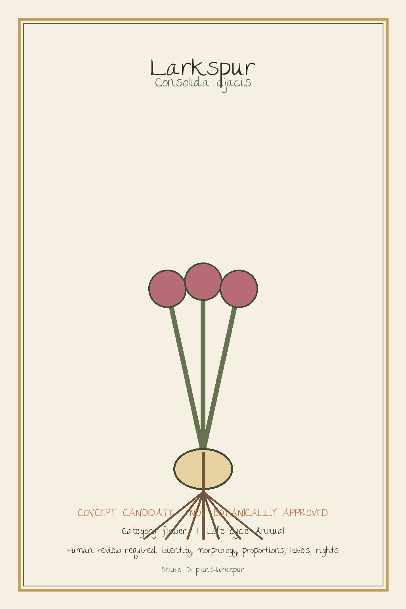

**Source status:** Not botanically or horticulturally approved. Recorded fields are derived
from the retained registry and remain subject to claim-level source review.

### Poppy

**Stable plant ID:** `plant-poppy`
**Category:** flower
**Recorded botanical name:** Papaver rhoeas
**Recorded family:** Papaveraceae
**Life cycle:** Annual
**Illustration status:** `CANDIDATE_GENERATED / REVIEW_PENDING / NOT_APPROVED`

**Identification and morphology**

- Growth habit: Growth habit should be resolved to the exact species or cultivar; this entry provides a category-level source scaffold.
- Root or storage organ: Species-specific root, crown, or storage organ; verify the exact form before illustrating.
- Leaf arrangement and shape: Species-specific arrangement and blade shape; verify exact genus and cultivar.
- Flower structure: Species-specific inflorescence or flower structure.
- Fruit or seed structure: Species-specific fruit, seed pod, achene, capsule, berry, or nut.

**Errington timing fields**

- Indoor sow: Source timing not reviewed
- Direct sow: Source timing not reviewed
- Transplant: Source timing not reviewed
- Bloom: Source timing not reviewed
- Harvest: Source timing not reviewed
- Frost: Source timing not reviewed

**Cultivation**

- Soil: Fertile, well-drained soil with organic matter unless the species has a known exceptional preference.
- Water: Provide even establishment moisture; then follow the species' drought, moisture, or wetness preference.
- Spacing: Base spacing on mature height and spread, not just the common name.
- Light: Sun requirement is species-specific; the common name alone is not a reliable light label.
- Maintenance: Mulch, deadhead or divide as appropriate, and monitor for structural or seasonal maintenance.
- Pests/diseases: Identify the pest or disease locally before control; favor sanitation, cultural prevention, and targeted action.

**Candidate plate:**

**Source status:** Not botanically or horticulturally approved. Recorded fields are derived
from the retained registry and remain subject to claim-level source review.

### Nigella

**Stable plant ID:** `plant-nigella`
**Category:** flower
**Recorded botanical name:** Nigella damascena
**Recorded family:** Ranunculaceae
**Life cycle:** Annual
**Illustration status:** `CANDIDATE_GENERATED / REVIEW_PENDING / NOT_APPROVED`

**Identification and morphology**

- Growth habit: Growth habit should be resolved to the exact species or cultivar; this entry provides a category-level source scaffold.
- Root or storage organ: Species-specific root, crown, or storage organ; verify the exact form before illustrating.
- Leaf arrangement and shape: Species-specific arrangement and blade shape; verify exact genus and cultivar.
- Flower structure: Species-specific inflorescence or flower structure.
- Fruit or seed structure: Species-specific fruit, seed pod, achene, capsule, berry, or nut.

**Errington timing fields**

- Indoor sow: Source timing not reviewed
- Direct sow: Source timing not reviewed
- Transplant: Source timing not reviewed
- Bloom: Source timing not reviewed
- Harvest: Source timing not reviewed
- Frost: Source timing not reviewed

**Cultivation**

- Soil: Fertile, well-drained soil with organic matter unless the species has a known exceptional preference.
- Water: Provide even establishment moisture; then follow the species' drought, moisture, or wetness preference.
- Spacing: Base spacing on mature height and spread, not just the common name.
- Light: Sun requirement is species-specific; the common name alone is not a reliable light label.
- Maintenance: Mulch, deadhead or divide as appropriate, and monitor for structural or seasonal maintenance.
- Pests/diseases: Identify the pest or disease locally before control; favor sanitation, cultural prevention, and targeted action.

**Candidate plate:**

**Source status:** Not botanically or horticulturally approved. Recorded fields are derived
from the retained registry and remain subject to claim-level source review.

### Borage

**Stable plant ID:** `plant-borage`
**Category:** flower
**Recorded botanical name:** Borago officinalis
**Recorded family:** Boraginaceae
**Life cycle:** Annual
**Illustration status:** `CANDIDATE_GENERATED / REVIEW_PENDING / NOT_APPROVED`

**Identification and morphology**

- Growth habit: Growth habit should be resolved to the exact species or cultivar; this entry provides a category-level source scaffold.
- Root or storage organ: Species-specific root, crown, or storage organ; verify the exact form before illustrating.
- Leaf arrangement and shape: Species-specific arrangement and blade shape; verify exact genus and cultivar.
- Flower structure: Species-specific inflorescence or flower structure.
- Fruit or seed structure: Species-specific fruit, seed pod, achene, capsule, berry, or nut.

**Errington timing fields**

- Indoor sow: Source timing not reviewed
- Direct sow: Source timing not reviewed
- Transplant: Source timing not reviewed
- Bloom: Source timing not reviewed
- Harvest: Source timing not reviewed
- Frost: Source timing not reviewed

**Cultivation**

- Soil: Fertile, well-drained soil with organic matter unless the species has a known exceptional preference.
- Water: Provide even establishment moisture; then follow the species' drought, moisture, or wetness preference.
- Spacing: Base spacing on mature height and spread, not just the common name.
- Light: Sun requirement is species-specific; the common name alone is not a reliable light label.
- Maintenance: Mulch, deadhead or divide as appropriate, and monitor for structural or seasonal maintenance.
- Pests/diseases: Identify the pest or disease locally before control; favor sanitation, cultural prevention, and targeted action.

**Candidate plate:**

**Source status:** Not botanically or horticulturally approved. Recorded fields are derived
from the retained registry and remain subject to claim-level source review.

### Cornflower

**Stable plant ID:** `plant-cornflower`
**Category:** flower
**Recorded botanical name:** Centaurea cyanus
**Recorded family:** Asteraceae
**Life cycle:** Annual
**Illustration status:** `CANDIDATE_GENERATED / REVIEW_PENDING / NOT_APPROVED`

**Identification and morphology**

- Growth habit: Growth habit should be resolved to the exact species or cultivar; this entry provides a category-level source scaffold.
- Root or storage organ: Species-specific root, crown, or storage organ; verify the exact form before illustrating.
- Leaf arrangement and shape: Species-specific arrangement and blade shape; verify exact genus and cultivar.
- Flower structure: Species-specific inflorescence or flower structure.
- Fruit or seed structure: Species-specific fruit, seed pod, achene, capsule, berry, or nut.

**Errington timing fields**

- Indoor sow: Source timing not reviewed
- Direct sow: Source timing not reviewed
- Transplant: Source timing not reviewed
- Bloom: Source timing not reviewed
- Harvest: Source timing not reviewed
- Frost: Source timing not reviewed

**Cultivation**

- Soil: Fertile, well-drained soil with organic matter unless the species has a known exceptional preference.
- Water: Provide even establishment moisture; then follow the species' drought, moisture, or wetness preference.
- Spacing: Base spacing on mature height and spread, not just the common name.
- Light: Sun requirement is species-specific; the common name alone is not a reliable light label.
- Maintenance: Mulch, deadhead or divide as appropriate, and monitor for structural or seasonal maintenance.
- Pests/diseases: Identify the pest or disease locally before control; favor sanitation, cultural prevention, and targeted action.

**Candidate plate:**
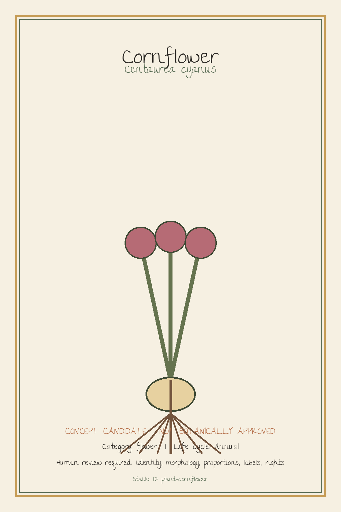

**Source status:** Not botanically or horticulturally approved. Recorded fields are derived
from the retained registry and remain subject to claim-level source review.

### Ammi majus

**Stable plant ID:** `plant-ammi-majus`
**Category:** flower
**Recorded botanical name:** Ammi majus
**Recorded family:** Apiaceae
**Life cycle:** Annual
**Illustration status:** `CANDIDATE_GENERATED / REVIEW_PENDING / NOT_APPROVED`

**Identification and morphology**

- Growth habit: Growth habit should be resolved to the exact species or cultivar; this entry provides a category-level source scaffold.
- Root or storage organ: Species-specific root, crown, or storage organ; verify the exact form before illustrating.
- Leaf arrangement and shape: Species-specific arrangement and blade shape; verify exact genus and cultivar.
- Flower structure: Species-specific inflorescence or flower structure.
- Fruit or seed structure: Species-specific fruit, seed pod, achene, capsule, berry, or nut.

**Errington timing fields**

- Indoor sow: Source timing not reviewed
- Direct sow: Source timing not reviewed
- Transplant: Source timing not reviewed
- Bloom: Source timing not reviewed
- Harvest: Source timing not reviewed
- Frost: Source timing not reviewed

**Cultivation**

- Soil: Fertile, well-drained soil with organic matter unless the species has a known exceptional preference.
- Water: Provide even establishment moisture; then follow the species' drought, moisture, or wetness preference.
- Spacing: Base spacing on mature height and spread, not just the common name.
- Light: Sun requirement is species-specific; the common name alone is not a reliable light label.
- Maintenance: Mulch, deadhead or divide as appropriate, and monitor for structural or seasonal maintenance.
- Pests/diseases: Identify the pest or disease locally before control; favor sanitation, cultural prevention, and targeted action.

**Candidate plate:**
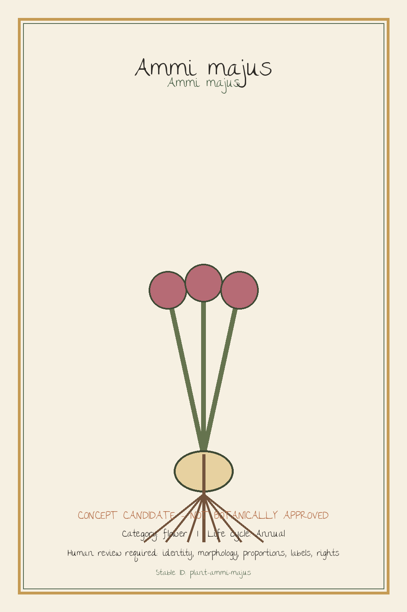

**Source status:** Not botanically or horticulturally approved. Recorded fields are derived
from the retained registry and remain subject to claim-level source review.

### Orlaya

**Stable plant ID:** `plant-orlaya`
**Category:** flower
**Recorded botanical name:** Orlaya grandiflora
**Recorded family:** Apiaceae
**Life cycle:** Annual
**Illustration status:** `CANDIDATE_GENERATED / REVIEW_PENDING / NOT_APPROVED`

**Identification and morphology**

- Growth habit: Growth habit should be resolved to the exact species or cultivar; this entry provides a category-level source scaffold.
- Root or storage organ: Species-specific root, crown, or storage organ; verify the exact form before illustrating.
- Leaf arrangement and shape: Species-specific arrangement and blade shape; verify exact genus and cultivar.
- Flower structure: Species-specific inflorescence or flower structure.
- Fruit or seed structure: Species-specific fruit, seed pod, achene, capsule, berry, or nut.

**Errington timing fields**

- Indoor sow: Source timing not reviewed
- Direct sow: Source timing not reviewed
- Transplant: Source timing not reviewed
- Bloom: Source timing not reviewed
- Harvest: Source timing not reviewed
- Frost: Source timing not reviewed

**Cultivation**

- Soil: Fertile, well-drained soil with organic matter unless the species has a known exceptional preference.
- Water: Provide even establishment moisture; then follow the species' drought, moisture, or wetness preference.
- Spacing: Base spacing on mature height and spread, not just the common name.
- Light: Sun requirement is species-specific; the common name alone is not a reliable light label.
- Maintenance: Mulch, deadhead or divide as appropriate, and monitor for structural or seasonal maintenance.
- Pests/diseases: Identify the pest or disease locally before control; favor sanitation, cultural prevention, and targeted action.

**Candidate plate:**

**Source status:** Not botanically or horticulturally approved. Recorded fields are derived
from the retained registry and remain subject to claim-level source review.

### Celosia

**Stable plant ID:** `plant-celosia`
**Category:** flower
**Recorded botanical name:** Celosia argentea
**Recorded family:** Amaranthaceae
**Life cycle:** Annual
**Illustration status:** `CANDIDATE_GENERATED / REVIEW_PENDING / NOT_APPROVED`

**Identification and morphology**

- Growth habit: Growth habit should be resolved to the exact species or cultivar; this entry provides a category-level source scaffold.
- Root or storage organ: Species-specific root, crown, or storage organ; verify the exact form before illustrating.
- Leaf arrangement and shape: Species-specific arrangement and blade shape; verify exact genus and cultivar.
- Flower structure: Species-specific inflorescence or flower structure.
- Fruit or seed structure: Species-specific fruit, seed pod, achene, capsule, berry, or nut.

**Errington timing fields**

- Indoor sow: Source timing not reviewed
- Direct sow: Source timing not reviewed
- Transplant: Source timing not reviewed
- Bloom: Source timing not reviewed
- Harvest: Source timing not reviewed
- Frost: Source timing not reviewed

**Cultivation**

- Soil: Fertile, well-drained soil with organic matter unless the species has a known exceptional preference.
- Water: Provide even establishment moisture; then follow the species' drought, moisture, or wetness preference.
- Spacing: Base spacing on mature height and spread, not just the common name.
- Light: Sun requirement is species-specific; the common name alone is not a reliable light label.
- Maintenance: Mulch, deadhead or divide as appropriate, and monitor for structural or seasonal maintenance.
- Pests/diseases: Identify the pest or disease locally before control; favor sanitation, cultural prevention, and targeted action.

**Candidate plate:**

**Source status:** Not botanically or horticulturally approved. Recorded fields are derived
from the retained registry and remain subject to claim-level source review.

### Strawflower

**Stable plant ID:** `plant-strawflower`
**Category:** flower
**Recorded botanical name:** Xerochrysum bracteatum
**Recorded family:** Asteraceae
**Life cycle:** Annual
**Illustration status:** `CANDIDATE_GENERATED / REVIEW_PENDING / NOT_APPROVED`

**Identification and morphology**

- Growth habit: Growth habit should be resolved to the exact species or cultivar; this entry provides a category-level source scaffold.
- Root or storage organ: Species-specific root, crown, or storage organ; verify the exact form before illustrating.
- Leaf arrangement and shape: Species-specific arrangement and blade shape; verify exact genus and cultivar.
- Flower structure: Species-specific inflorescence or flower structure.
- Fruit or seed structure: Species-specific fruit, seed pod, achene, capsule, berry, or nut.

**Errington timing fields**

- Indoor sow: Source timing not reviewed
- Direct sow: Source timing not reviewed
- Transplant: Source timing not reviewed
- Bloom: Source timing not reviewed
- Harvest: Source timing not reviewed
- Frost: Source timing not reviewed

**Cultivation**

- Soil: Fertile, well-drained soil with organic matter unless the species has a known exceptional preference.
- Water: Provide even establishment moisture; then follow the species' drought, moisture, or wetness preference.
- Spacing: Base spacing on mature height and spread, not just the common name.
- Light: Sun requirement is species-specific; the common name alone is not a reliable light label.
- Maintenance: Mulch, deadhead or divide as appropriate, and monitor for structural or seasonal maintenance.
- Pests/diseases: Identify the pest or disease locally before control; favor sanitation, cultural prevention, and targeted action.

**Candidate plate:**

**Source status:** Not botanically or horticulturally approved. Recorded fields are derived
from the retained registry and remain subject to claim-level source review.

### Scabiosa

**Stable plant ID:** `plant-scabiosa`
**Category:** flower
**Recorded botanical name:** Scabiosa atropurpurea
**Recorded family:** Caprifoliaceae
**Life cycle:** Annual
**Illustration status:** `CANDIDATE_GENERATED / REVIEW_PENDING / NOT_APPROVED`

**Identification and morphology**

- Growth habit: Growth habit should be resolved to the exact species or cultivar; this entry provides a category-level source scaffold.
- Root or storage organ: Species-specific root, crown, or storage organ; verify the exact form before illustrating.
- Leaf arrangement and shape: Species-specific arrangement and blade shape; verify exact genus and cultivar.
- Flower structure: Species-specific inflorescence or flower structure.
- Fruit or seed structure: Species-specific fruit, seed pod, achene, capsule, berry, or nut.

**Errington timing fields**

- Indoor sow: Source timing not reviewed
- Direct sow: Source timing not reviewed
- Transplant: Source timing not reviewed
- Bloom: Source timing not reviewed
- Harvest: Source timing not reviewed
- Frost: Source timing not reviewed

**Cultivation**

- Soil: Fertile, well-drained soil with organic matter unless the species has a known exceptional preference.
- Water: Provide even establishment moisture; then follow the species' drought, moisture, or wetness preference.
- Spacing: Base spacing on mature height and spread, not just the common name.
- Light: Sun requirement is species-specific; the common name alone is not a reliable light label.
- Maintenance: Mulch, deadhead or divide as appropriate, and monitor for structural or seasonal maintenance.
- Pests/diseases: Identify the pest or disease locally before control; favor sanitation, cultural prevention, and targeted action.

**Candidate plate:**

**Source status:** Not botanically or horticulturally approved. Recorded fields are derived
from the retained registry and remain subject to claim-level source review.

### Hellebores

**Stable plant ID:** `plant-hellebores`
**Category:** flower
**Recorded botanical name:** Helleborus orientalis
**Recorded family:** Ranunculaceae
**Life cycle:** Perennial
**Illustration status:** `CANDIDATE_GENERATED / REVIEW_PENDING / NOT_APPROVED`

**Identification and morphology**

- Growth habit: Growth habit should be resolved to the exact species or cultivar; this entry provides a category-level source scaffold.
- Root or storage organ: Species-specific root, crown, or storage organ; verify the exact form before illustrating.
- Leaf arrangement and shape: Species-specific arrangement and blade shape; verify exact genus and cultivar.
- Flower structure: Species-specific inflorescence or flower structure.
- Fruit or seed structure: Species-specific fruit, seed pod, achene, capsule, berry, or nut.

**Errington timing fields**

- Indoor sow: Source timing not reviewed
- Direct sow: Source timing not reviewed
- Transplant: Source timing not reviewed
- Bloom: Source timing not reviewed
- Harvest: Source timing not reviewed
- Frost: Source timing not reviewed

**Cultivation**

- Soil: Fertile, well-drained soil with organic matter unless the species has a known exceptional preference.
- Water: Provide even establishment moisture; then follow the species' drought, moisture, or wetness preference.
- Spacing: Base spacing on mature height and spread, not just the common name.
- Light: Sun requirement is species-specific; the common name alone is not a reliable light label.
- Maintenance: Mulch, deadhead or divide as appropriate, and monitor for structural or seasonal maintenance.
- Pests/diseases: Identify the pest or disease locally before control; favor sanitation, cultural prevention, and targeted action.

**Candidate plate:**
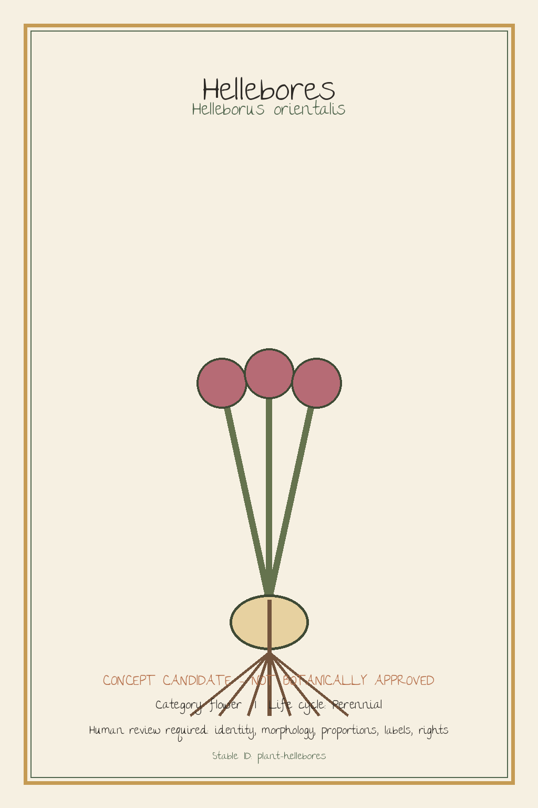

**Source status:** Not botanically or horticulturally approved. Recorded fields are derived
from the retained registry and remain subject to claim-level source review.

### Snowdrops

**Stable plant ID:** `plant-snowdrops`
**Category:** flower
**Recorded botanical name:** Galanthus nivalis
**Recorded family:** Amaryllidaceae
**Life cycle:** Perennial
**Illustration status:** `CANDIDATE_GENERATED / REVIEW_PENDING / NOT_APPROVED`

**Identification and morphology**

- Growth habit: Growth habit should be resolved to the exact species or cultivar; this entry provides a category-level source scaffold.
- Root or storage organ: Species-specific root, crown, or storage organ; verify the exact form before illustrating.
- Leaf arrangement and shape: Species-specific arrangement and blade shape; verify exact genus and cultivar.
- Flower structure: Species-specific inflorescence or flower structure.
- Fruit or seed structure: Species-specific fruit, seed pod, achene, capsule, berry, or nut.

**Errington timing fields**

- Indoor sow: Source timing not reviewed
- Direct sow: Source timing not reviewed
- Transplant: Source timing not reviewed
- Bloom: Source timing not reviewed
- Harvest: Source timing not reviewed
- Frost: Source timing not reviewed

**Cultivation**

- Soil: Fertile, well-drained soil with organic matter unless the species has a known exceptional preference.
- Water: Provide even establishment moisture; then follow the species' drought, moisture, or wetness preference.
- Spacing: Base spacing on mature height and spread, not just the common name.
- Light: Sun requirement is species-specific; the common name alone is not a reliable light label.
- Maintenance: Mulch, deadhead or divide as appropriate, and monitor for structural or seasonal maintenance.
- Pests/diseases: Identify the pest or disease locally before control; favor sanitation, cultural prevention, and targeted action.

**Candidate plate:**

**Source status:** Not botanically or horticulturally approved. Recorded fields are derived
from the retained registry and remain subject to claim-level source review.

### Delphinium

**Stable plant ID:** `plant-delphinium`
**Category:** flower
**Recorded botanical name:** Delphinium elatum
**Recorded family:** Ranunculaceae
**Life cycle:** Perennial
**Illustration status:** `CANDIDATE_GENERATED / REVIEW_PENDING / NOT_APPROVED`

**Identification and morphology**

- Growth habit: Growth habit should be resolved to the exact species or cultivar; this entry provides a category-level source scaffold.
- Root or storage organ: Species-specific root, crown, or storage organ; verify the exact form before illustrating.
- Leaf arrangement and shape: Species-specific arrangement and blade shape; verify exact genus and cultivar.
- Flower structure: Species-specific inflorescence or flower structure.
- Fruit or seed structure: Species-specific fruit, seed pod, achene, capsule, berry, or nut.

**Errington timing fields**

- Indoor sow: Source timing not reviewed
- Direct sow: Source timing not reviewed
- Transplant: Source timing not reviewed
- Bloom: Source timing not reviewed
- Harvest: Source timing not reviewed
- Frost: Source timing not reviewed

**Cultivation**

- Soil: Fertile, well-drained soil with organic matter unless the species has a known exceptional preference.
- Water: Provide even establishment moisture; then follow the species' drought, moisture, or wetness preference.
- Spacing: Base spacing on mature height and spread, not just the common name.
- Light: Sun requirement is species-specific; the common name alone is not a reliable light label.
- Maintenance: Mulch, deadhead or divide as appropriate, and monitor for structural or seasonal maintenance.
- Pests/diseases: Identify the pest or disease locally before control; favor sanitation, cultural prevention, and targeted action.

**Candidate plate:**

**Source status:** Not botanically or horticulturally approved. Recorded fields are derived
from the retained registry and remain subject to claim-level source review.

### Salvia nemorosa

**Stable plant ID:** `plant-salvia-nemorosa`
**Category:** flower
**Recorded botanical name:** Salvia nemorosa
**Recorded family:** Lamiaceae
**Life cycle:** Perennial
**Illustration status:** `CANDIDATE_GENERATED / REVIEW_PENDING / NOT_APPROVED`

**Identification and morphology**

- Growth habit: Growth habit should be resolved to the exact species or cultivar; this entry provides a category-level source scaffold.
- Root or storage organ: Species-specific root, crown, or storage organ; verify the exact form before illustrating.
- Leaf arrangement and shape: Species-specific arrangement and blade shape; verify exact genus and cultivar.
- Flower structure: Species-specific inflorescence or flower structure.
- Fruit or seed structure: Species-specific fruit, seed pod, achene, capsule, berry, or nut.

**Errington timing fields**

- Indoor sow: Source timing not reviewed
- Direct sow: Source timing not reviewed
- Transplant: Source timing not reviewed
- Bloom: Source timing not reviewed
- Harvest: Source timing not reviewed
- Frost: Source timing not reviewed

**Cultivation**

- Soil: Fertile, well-drained soil with organic matter unless the species has a known exceptional preference.
- Water: Provide even establishment moisture; then follow the species' drought, moisture, or wetness preference.
- Spacing: Base spacing on mature height and spread, not just the common name.
- Light: Sun requirement is species-specific; the common name alone is not a reliable light label.
- Maintenance: Mulch, deadhead or divide as appropriate, and monitor for structural or seasonal maintenance.
- Pests/diseases: Identify the pest or disease locally before control; favor sanitation, cultural prevention, and targeted action.

**Candidate plate:**

**Source status:** Not botanically or horticulturally approved. Recorded fields are derived
from the retained registry and remain subject to claim-level source review.

### Gaillardia

**Stable plant ID:** `plant-gaillardia`
**Category:** flower
**Recorded botanical name:** Gaillardia aristata
**Recorded family:** Asteraceae
**Life cycle:** Perennial
**Illustration status:** `CANDIDATE_GENERATED / REVIEW_PENDING / NOT_APPROVED`

**Identification and morphology**

- Growth habit: Growth habit should be resolved to the exact species or cultivar; this entry provides a category-level source scaffold.
- Root or storage organ: Species-specific root, crown, or storage organ; verify the exact form before illustrating.
- Leaf arrangement and shape: Species-specific arrangement and blade shape; verify exact genus and cultivar.
- Flower structure: Species-specific inflorescence or flower structure.
- Fruit or seed structure: Species-specific fruit, seed pod, achene, capsule, berry, or nut.

**Errington timing fields**

- Indoor sow: Source timing not reviewed
- Direct sow: Source timing not reviewed
- Transplant: Source timing not reviewed
- Bloom: Source timing not reviewed
- Harvest: Source timing not reviewed
- Frost: Source timing not reviewed

**Cultivation**

- Soil: Fertile, well-drained soil with organic matter unless the species has a known exceptional preference.
- Water: Provide even establishment moisture; then follow the species' drought, moisture, or wetness preference.
- Spacing: Base spacing on mature height and spread, not just the common name.
- Light: Sun requirement is species-specific; the common name alone is not a reliable light label.
- Maintenance: Mulch, deadhead or divide as appropriate, and monitor for structural or seasonal maintenance.
- Pests/diseases: Identify the pest or disease locally before control; favor sanitation, cultural prevention, and targeted action.

**Candidate plate:**
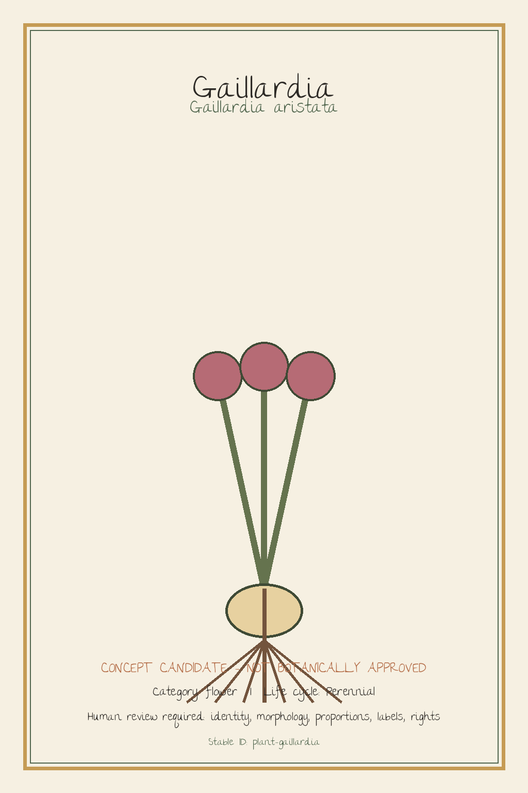

**Source status:** Not botanically or horticulturally approved. Recorded fields are derived
from the retained registry and remain subject to claim-level source review.

### Asters

**Stable plant ID:** `plant-asters`
**Category:** flower
**Recorded botanical name:** Symphyotrichum novi-belgii
**Recorded family:** Asteraceae
**Life cycle:** Perennial
**Illustration status:** `CANDIDATE_GENERATED / REVIEW_PENDING / NOT_APPROVED`

**Identification and morphology**

- Growth habit: Growth habit should be resolved to the exact species or cultivar; this entry provides a category-level source scaffold.
- Root or storage organ: Species-specific root, crown, or storage organ; verify the exact form before illustrating.
- Leaf arrangement and shape: Species-specific arrangement and blade shape; verify exact genus and cultivar.
- Flower structure: Species-specific inflorescence or flower structure.
- Fruit or seed structure: Species-specific fruit, seed pod, achene, capsule, berry, or nut.

**Errington timing fields**

- Indoor sow: Source timing not reviewed
- Direct sow: Source timing not reviewed
- Transplant: Source timing not reviewed
- Bloom: Source timing not reviewed
- Harvest: Source timing not reviewed
- Frost: Source timing not reviewed

**Cultivation**

- Soil: Fertile, well-drained soil with organic matter unless the species has a known exceptional preference.
- Water: Provide even establishment moisture; then follow the species' drought, moisture, or wetness preference.
- Spacing: Base spacing on mature height and spread, not just the common name.
- Light: Sun requirement is species-specific; the common name alone is not a reliable light label.
- Maintenance: Mulch, deadhead or divide as appropriate, and monitor for structural or seasonal maintenance.
- Pests/diseases: Identify the pest or disease locally before control; favor sanitation, cultural prevention, and targeted action.

**Candidate plate:**

**Source status:** Not botanically or horticulturally approved. Recorded fields are derived
from the retained registry and remain subject to claim-level source review.

### Primula

**Stable plant ID:** `plant-primula`
**Category:** flower
**Recorded botanical name:** Primula vulgaris
**Recorded family:** Primulaceae
**Life cycle:** Perennial
**Illustration status:** `CANDIDATE_GENERATED / REVIEW_PENDING / NOT_APPROVED`

**Identification and morphology**

- Growth habit: Growth habit should be resolved to the exact species or cultivar; this entry provides a category-level source scaffold.
- Root or storage organ: Species-specific root, crown, or storage organ; verify the exact form before illustrating.
- Leaf arrangement and shape: Species-specific arrangement and blade shape; verify exact genus and cultivar.
- Flower structure: Species-specific inflorescence or flower structure.
- Fruit or seed structure: Species-specific fruit, seed pod, achene, capsule, berry, or nut.

**Errington timing fields**

- Indoor sow: Source timing not reviewed
- Direct sow: Source timing not reviewed
- Transplant: Source timing not reviewed
- Bloom: Source timing not reviewed
- Harvest: Source timing not reviewed
- Frost: Source timing not reviewed

**Cultivation**

- Soil: Fertile, well-drained soil with organic matter unless the species has a known exceptional preference.
- Water: Provide even establishment moisture; then follow the species' drought, moisture, or wetness preference.
- Spacing: Base spacing on mature height and spread, not just the common name.
- Light: Sun requirement is species-specific; the common name alone is not a reliable light label.
- Maintenance: Mulch, deadhead or divide as appropriate, and monitor for structural or seasonal maintenance.
- Pests/diseases: Identify the pest or disease locally before control; favor sanitation, cultural prevention, and targeted action.

**Candidate plate:**

**Source status:** Not botanically or horticulturally approved. Recorded fields are derived
from the retained registry and remain subject to claim-level source review.

### Wallflower

**Stable plant ID:** `plant-wallflower`
**Category:** flower
**Recorded botanical name:** Erysimum cheiri
**Recorded family:** Brassicaceae
**Life cycle:** Perennial
**Illustration status:** `CANDIDATE_GENERATED / REVIEW_PENDING / NOT_APPROVED`

**Identification and morphology**

- Growth habit: Growth habit should be resolved to the exact species or cultivar; this entry provides a category-level source scaffold.
- Root or storage organ: Species-specific root, crown, or storage organ; verify the exact form before illustrating.
- Leaf arrangement and shape: Species-specific arrangement and blade shape; verify exact genus and cultivar.
- Flower structure: Species-specific inflorescence or flower structure.
- Fruit or seed structure: Species-specific fruit, seed pod, achene, capsule, berry, or nut.

**Errington timing fields**

- Indoor sow: Source timing not reviewed
- Direct sow: Source timing not reviewed
- Transplant: Source timing not reviewed
- Bloom: Source timing not reviewed
- Harvest: Source timing not reviewed
- Frost: Source timing not reviewed

**Cultivation**

- Soil: Fertile, well-drained soil with organic matter unless the species has a known exceptional preference.
- Water: Provide even establishment moisture; then follow the species' drought, moisture, or wetness preference.
- Spacing: Base spacing on mature height and spread, not just the common name.
- Light: Sun requirement is species-specific; the common name alone is not a reliable light label.
- Maintenance: Mulch, deadhead or divide as appropriate, and monitor for structural or seasonal maintenance.
- Pests/diseases: Identify the pest or disease locally before control; favor sanitation, cultural prevention, and targeted action.

**Candidate plate:**

**Source status:** Not botanically or horticulturally approved. Recorded fields are derived
from the retained registry and remain subject to claim-level source review.

### Aubretia

**Stable plant ID:** `plant-aubretia`
**Category:** flower
**Recorded botanical name:** Aubrieta deltoidea
**Recorded family:** Brassicaceae
**Life cycle:** Perennial
**Illustration status:** `CANDIDATE_GENERATED / REVIEW_PENDING / NOT_APPROVED`

**Identification and morphology**

- Growth habit: Growth habit should be resolved to the exact species or cultivar; this entry provides a category-level source scaffold.
- Root or storage organ: Species-specific root, crown, or storage organ; verify the exact form before illustrating.
- Leaf arrangement and shape: Species-specific arrangement and blade shape; verify exact genus and cultivar.
- Flower structure: Species-specific inflorescence or flower structure.
- Fruit or seed structure: Species-specific fruit, seed pod, achene, capsule, berry, or nut.

**Errington timing fields**

- Indoor sow: Source timing not reviewed
- Direct sow: Source timing not reviewed
- Transplant: Source timing not reviewed
- Bloom: Source timing not reviewed
- Harvest: Source timing not reviewed
- Frost: Source timing not reviewed

**Cultivation**

- Soil: Fertile, well-drained soil with organic matter unless the species has a known exceptional preference.
- Water: Provide even establishment moisture; then follow the species' drought, moisture, or wetness preference.
- Spacing: Base spacing on mature height and spread, not just the common name.
- Light: Sun requirement is species-specific; the common name alone is not a reliable light label.
- Maintenance: Mulch, deadhead or divide as appropriate, and monitor for structural or seasonal maintenance.
- Pests/diseases: Identify the pest or disease locally before control; favor sanitation, cultural prevention, and targeted action.

**Candidate plate:**

**Source status:** Not botanically or horticulturally approved. Recorded fields are derived
from the retained registry and remain subject to claim-level source review.

### Iberis

**Stable plant ID:** `plant-iberis`
**Category:** flower
**Recorded botanical name:** Iberis sempervirens
**Recorded family:** Brassicaceae
**Life cycle:** Perennial
**Illustration status:** `CANDIDATE_GENERATED / REVIEW_PENDING / NOT_APPROVED`

**Identification and morphology**

- Growth habit: Growth habit should be resolved to the exact species or cultivar; this entry provides a category-level source scaffold.
- Root or storage organ: Species-specific root, crown, or storage organ; verify the exact form before illustrating.
- Leaf arrangement and shape: Species-specific arrangement and blade shape; verify exact genus and cultivar.
- Flower structure: Species-specific inflorescence or flower structure.
- Fruit or seed structure: Species-specific fruit, seed pod, achene, capsule, berry, or nut.

**Errington timing fields**

- Indoor sow: Source timing not reviewed
- Direct sow: Source timing not reviewed
- Transplant: Source timing not reviewed
- Bloom: Source timing not reviewed
- Harvest: Source timing not reviewed
- Frost: Source timing not reviewed

**Cultivation**

- Soil: Fertile, well-drained soil with organic matter unless the species has a known exceptional preference.
- Water: Provide even establishment moisture; then follow the species' drought, moisture, or wetness preference.
- Spacing: Base spacing on mature height and spread, not just the common name.
- Light: Sun requirement is species-specific; the common name alone is not a reliable light label.
- Maintenance: Mulch, deadhead or divide as appropriate, and monitor for structural or seasonal maintenance.
- Pests/diseases: Identify the pest or disease locally before control; favor sanitation, cultural prevention, and targeted action.

**Candidate plate:**

**Source status:** Not botanically or horticulturally approved. Recorded fields are derived
from the retained registry and remain subject to claim-level source review.

### Hyacinths

**Stable plant ID:** `plant-hyacinths`
**Category:** flower
**Recorded botanical name:** Hyacinthus orientalis
**Recorded family:** Asparagaceae
**Life cycle:** Perennial; grown from a bulb, corm, or storage organ
**Illustration status:** `CANDIDATE_GENERATED / REVIEW_PENDING / NOT_APPROVED`

**Identification and morphology**

- Growth habit: Growth habit should be resolved to the exact species or cultivar; this entry provides a category-level source scaffold.
- Root or storage organ: Basal plate and fibrous roots; bulb or corm storage organ.
- Leaf arrangement and shape: Basal or sheathing leaves; strap, linear, or species-specific blades.
- Flower structure: Species-specific flower or inflorescence; generally showy and arranged to attract pollinators.
- Fruit or seed structure: Seed capsule or berry may follow flowering.

**Errington timing fields**

- Indoor sow: Source timing not reviewed
- Direct sow: Source timing not reviewed
- Transplant: Source timing not reviewed
- Bloom: Source timing not reviewed
- Harvest: Source timing not reviewed
- Frost: Source timing not reviewed

**Cultivation**

- Soil: Fertile, well-drained soil with organic matter unless the species has a known exceptional preference.
- Water: Provide even establishment moisture; then follow the species' drought, moisture, or wetness preference.
- Spacing: Base spacing on mature height and spread, not just the common name.
- Light: Sun requirement is species-specific; the common name alone is not a reliable light label.
- Maintenance: Mulch, deadhead or divide as appropriate, and monitor for structural or seasonal maintenance.
- Pests/diseases: Identify the pest or disease locally before control; favor sanitation, cultural prevention, and targeted action.

**Candidate plate:**

**Source status:** Not botanically or horticulturally approved. Recorded fields are derived
from the retained registry and remain subject to claim-level source review.

### Muscari

**Stable plant ID:** `plant-muscari`
**Category:** flower
**Recorded botanical name:** Muscari armeniacum
**Recorded family:** Asparagaceae
**Life cycle:** Perennial; grown from a bulb, corm, or storage organ
**Illustration status:** `CANDIDATE_GENERATED / REVIEW_PENDING / NOT_APPROVED`

**Identification and morphology**

- Growth habit: Growth habit should be resolved to the exact species or cultivar; this entry provides a category-level source scaffold.
- Root or storage organ: Basal plate and fibrous roots; bulb or corm storage organ.
- Leaf arrangement and shape: Basal or sheathing leaves; strap, linear, or species-specific blades.
- Flower structure: Species-specific flower or inflorescence; generally showy and arranged to attract pollinators.
- Fruit or seed structure: Seed capsule or berry may follow flowering.

**Errington timing fields**

- Indoor sow: Source timing not reviewed
- Direct sow: Source timing not reviewed
- Transplant: Source timing not reviewed
- Bloom: Source timing not reviewed
- Harvest: Source timing not reviewed
- Frost: Source timing not reviewed

**Cultivation**

- Soil: Fertile, well-drained soil with organic matter unless the species has a known exceptional preference.
- Water: Provide even establishment moisture; then follow the species' drought, moisture, or wetness preference.
- Spacing: Base spacing on mature height and spread, not just the common name.
- Light: Sun requirement is species-specific; the common name alone is not a reliable light label.
- Maintenance: Mulch, deadhead or divide as appropriate, and monitor for structural or seasonal maintenance.
- Pests/diseases: Identify the pest or disease locally before control; favor sanitation, cultural prevention, and targeted action.

**Candidate plate:**

**Source status:** Not botanically or horticulturally approved. Recorded fields are derived
from the retained registry and remain subject to claim-level source review.

### Gladiolus

**Stable plant ID:** `plant-gladiolus`
**Category:** flower
**Recorded botanical name:** Gladiolus × hortulanus
**Recorded family:** Iridaceae
**Life cycle:** Perennial; grown from a bulb, corm, or storage organ
**Illustration status:** `CANDIDATE_GENERATED / REVIEW_PENDING / NOT_APPROVED`

**Identification and morphology**

- Growth habit: Growth habit should be resolved to the exact species or cultivar; this entry provides a category-level source scaffold.
- Root or storage organ: Basal plate and fibrous roots; bulb or corm storage organ.
- Leaf arrangement and shape: Basal or sheathing leaves; strap, linear, or species-specific blades.
- Flower structure: Species-specific flower or inflorescence; generally showy and arranged to attract pollinators.
- Fruit or seed structure: Seed capsule or berry may follow flowering.

**Errington timing fields**

- Indoor sow: Source timing not reviewed
- Direct sow: Source timing not reviewed
- Transplant: Source timing not reviewed
- Bloom: Source timing not reviewed
- Harvest: Source timing not reviewed
- Frost: Source timing not reviewed

**Cultivation**

- Soil: Fertile, well-drained soil with organic matter unless the species has a known exceptional preference.
- Water: Provide even establishment moisture; then follow the species' drought, moisture, or wetness preference.
- Spacing: Base spacing on mature height and spread, not just the common name.
- Light: Sun requirement is species-specific; the common name alone is not a reliable light label.
- Maintenance: Mulch, deadhead or divide as appropriate, and monitor for structural or seasonal maintenance.
- Pests/diseases: Identify the pest or disease locally before control; favor sanitation, cultural prevention, and targeted action.

**Candidate plate:**

**Source status:** Not botanically or horticulturally approved. Recorded fields are derived
from the retained registry and remain subject to claim-level source review.

### Anemone

**Stable plant ID:** `plant-anemone`
**Category:** flower
**Recorded botanical name:** Anemone coronaria
**Recorded family:** Ranunculaceae
**Life cycle:** Perennial; grown from a bulb, corm, or storage organ
**Illustration status:** `CANDIDATE_GENERATED / REVIEW_PENDING / NOT_APPROVED`

**Identification and morphology**

- Growth habit: Growth habit should be resolved to the exact species or cultivar; this entry provides a category-level source scaffold.
- Root or storage organ: Basal plate and fibrous roots; bulb or corm storage organ.
- Leaf arrangement and shape: Basal or sheathing leaves; strap, linear, or species-specific blades.
- Flower structure: Species-specific flower or inflorescence; generally showy and arranged to attract pollinators.
- Fruit or seed structure: Seed capsule or berry may follow flowering.

**Errington timing fields**

- Indoor sow: Source timing not reviewed
- Direct sow: Source timing not reviewed
- Transplant: Source timing not reviewed
- Bloom: Source timing not reviewed
- Harvest: Source timing not reviewed
- Frost: Source timing not reviewed

**Cultivation**

- Soil: Fertile, well-drained soil with organic matter unless the species has a known exceptional preference.
- Water: Provide even establishment moisture; then follow the species' drought, moisture, or wetness preference.
- Spacing: Base spacing on mature height and spread, not just the common name.
- Light: Sun requirement is species-specific; the common name alone is not a reliable light label.
- Maintenance: Mulch, deadhead or divide as appropriate, and monitor for structural or seasonal maintenance.
- Pests/diseases: Identify the pest or disease locally before control; favor sanitation, cultural prevention, and targeted action.

**Candidate plate:**

**Source status:** Not botanically or horticulturally approved. Recorded fields are derived
from the retained registry and remain subject to claim-level source review.

### Camassia

**Stable plant ID:** `plant-camassia`
**Category:** flower
**Recorded botanical name:** Camassia quamash
**Recorded family:** Asparagaceae
**Life cycle:** Perennial; grown from a bulb, corm, or storage organ
**Illustration status:** `CANDIDATE_GENERATED / REVIEW_PENDING / NOT_APPROVED`

**Identification and morphology**

- Growth habit: Growth habit should be resolved to the exact species or cultivar; this entry provides a category-level source scaffold.
- Root or storage organ: Basal plate and fibrous roots; bulb or corm storage organ.
- Leaf arrangement and shape: Basal or sheathing leaves; strap, linear, or species-specific blades.
- Flower structure: Species-specific flower or inflorescence; generally showy and arranged to attract pollinators.
- Fruit or seed structure: Seed capsule or berry may follow flowering.

**Errington timing fields**

- Indoor sow: Source timing not reviewed
- Direct sow: Source timing not reviewed
- Transplant: Source timing not reviewed
- Bloom: Source timing not reviewed
- Harvest: Source timing not reviewed
- Frost: Source timing not reviewed

**Cultivation**

- Soil: Fertile, well-drained soil with organic matter unless the species has a known exceptional preference.
- Water: Provide even establishment moisture; then follow the species' drought, moisture, or wetness preference.
- Spacing: Base spacing on mature height and spread, not just the common name.
- Light: Sun requirement is species-specific; the common name alone is not a reliable light label.
- Maintenance: Mulch, deadhead or divide as appropriate, and monitor for structural or seasonal maintenance.
- Pests/diseases: Identify the pest or disease locally before control; favor sanitation, cultural prevention, and targeted action.

**Candidate plate:**

**Source status:** Not botanically or horticulturally approved. Recorded fields are derived
from the retained registry and remain subject to claim-level source review.

### Witch Hazel

**Stable plant ID:** `plant-witch-hazel`
**Category:** shrub-tree
**Recorded botanical name:** Hamamelis virginiana
**Recorded family:** Hamamelidaceae
**Life cycle:** Perennial
**Illustration status:** `CANDIDATE_GENERATED / REVIEW_PENDING / NOT_APPROVED`

**Identification and morphology**

- Growth habit: Growth habit should be resolved to the exact species or cultivar; this entry provides a category-level source scaffold.
- Root or storage organ: Species-specific root, crown, or storage organ; verify the exact form before illustrating.
- Leaf arrangement and shape: Species-specific arrangement and blade shape; verify exact genus and cultivar.
- Flower structure: Species-specific inflorescence or flower structure.
- Fruit or seed structure: Species-specific fruit, seed pod, achene, capsule, berry, or nut.

**Errington timing fields**

- Indoor sow: Source timing not reviewed
- Direct sow: Source timing not reviewed
- Transplant: Source timing not reviewed
- Bloom: Source timing not reviewed
- Harvest: Source timing not reviewed
- Frost: Source timing not reviewed

**Cultivation**

- Soil: Fertile, well-drained soil with organic matter unless the species has a known exceptional preference.
- Water: Provide even establishment moisture; then follow the species' drought, moisture, or wetness preference.
- Spacing: Base spacing on mature height and spread, not just the common name.
- Light: Sun requirement is species-specific; the common name alone is not a reliable light label.
- Maintenance: Mulch, deadhead or divide as appropriate, and monitor for structural or seasonal maintenance.
- Pests/diseases: Identify the pest or disease locally before control; favor sanitation, cultural prevention, and targeted action.

**Candidate plate:**
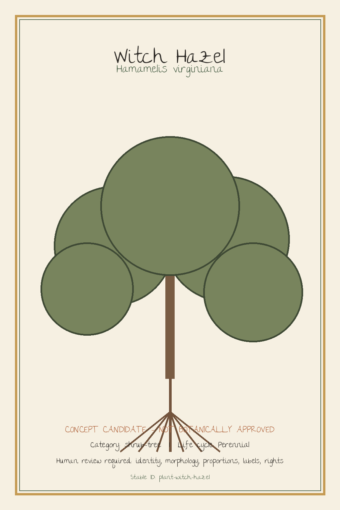

**Source status:** Not botanically or horticulturally approved. Recorded fields are derived
from the retained registry and remain subject to claim-level source review.

### Buddleja

**Stable plant ID:** `plant-buddleja`
**Category:** shrub-tree
**Recorded botanical name:** Buddleja davidii
**Recorded family:** Scrophulariaceae
**Life cycle:** Perennial
**Illustration status:** `CANDIDATE_GENERATED / REVIEW_PENDING / NOT_APPROVED`

**Identification and morphology**

- Growth habit: Growth habit should be resolved to the exact species or cultivar; this entry provides a category-level source scaffold.
- Root or storage organ: Species-specific root, crown, or storage organ; verify the exact form before illustrating.
- Leaf arrangement and shape: Species-specific arrangement and blade shape; verify exact genus and cultivar.
- Flower structure: Species-specific inflorescence or flower structure.
- Fruit or seed structure: Species-specific fruit, seed pod, achene, capsule, berry, or nut.

**Errington timing fields**

- Indoor sow: Source timing not reviewed
- Direct sow: Source timing not reviewed
- Transplant: Source timing not reviewed
- Bloom: Source timing not reviewed
- Harvest: Source timing not reviewed
- Frost: Source timing not reviewed

**Cultivation**

- Soil: Fertile, well-drained soil with organic matter unless the species has a known exceptional preference.
- Water: Provide even establishment moisture; then follow the species' drought, moisture, or wetness preference.
- Spacing: Base spacing on mature height and spread, not just the common name.
- Light: Sun requirement is species-specific; the common name alone is not a reliable light label.
- Maintenance: Mulch, deadhead or divide as appropriate, and monitor for structural or seasonal maintenance.
- Pests/diseases: Identify the pest or disease locally before control; favor sanitation, cultural prevention, and targeted action.

**Candidate plate:**
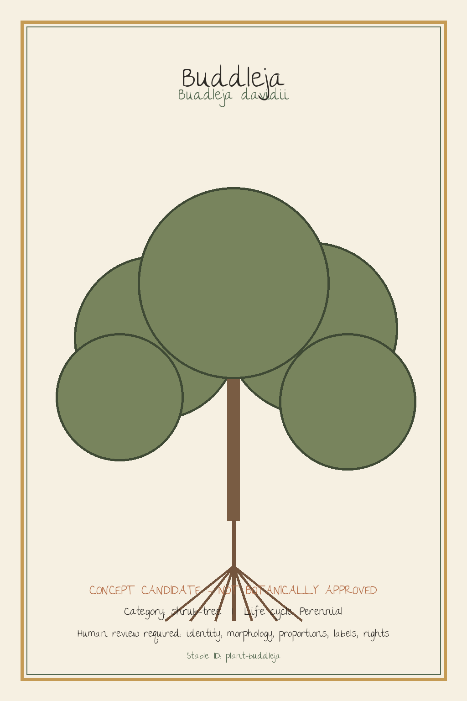

**Source status:** Not botanically or horticulturally approved. Recorded fields are derived
from the retained registry and remain subject to claim-level source review.

### Deutzia

**Stable plant ID:** `plant-deutzia`
**Category:** shrub-tree
**Recorded botanical name:** Deutzia gracilis
**Recorded family:** Hydrangeaceae
**Life cycle:** Perennial
**Illustration status:** `CANDIDATE_GENERATED / REVIEW_PENDING / NOT_APPROVED`

**Identification and morphology**

- Growth habit: Growth habit should be resolved to the exact species or cultivar; this entry provides a category-level source scaffold.
- Root or storage organ: Species-specific root, crown, or storage organ; verify the exact form before illustrating.
- Leaf arrangement and shape: Species-specific arrangement and blade shape; verify exact genus and cultivar.
- Flower structure: Species-specific inflorescence or flower structure.
- Fruit or seed structure: Species-specific fruit, seed pod, achene, capsule, berry, or nut.

**Errington timing fields**

- Indoor sow: Source timing not reviewed
- Direct sow: Source timing not reviewed
- Transplant: Source timing not reviewed
- Bloom: Source timing not reviewed
- Harvest: Source timing not reviewed
- Frost: Source timing not reviewed

**Cultivation**

- Soil: Fertile, well-drained soil with organic matter unless the species has a known exceptional preference.
- Water: Provide even establishment moisture; then follow the species' drought, moisture, or wetness preference.
- Spacing: Base spacing on mature height and spread, not just the common name.
- Light: Sun requirement is species-specific; the common name alone is not a reliable light label.
- Maintenance: Mulch, deadhead or divide as appropriate, and monitor for structural or seasonal maintenance.
- Pests/diseases: Identify the pest or disease locally before control; favor sanitation, cultural prevention, and targeted action.

**Candidate plate:**

**Source status:** Not botanically or horticulturally approved. Recorded fields are derived
from the retained registry and remain subject to claim-level source review.

### Hydrangea paniculata

**Stable plant ID:** `plant-hydrangea-paniculata`
**Category:** shrub-tree
**Recorded botanical name:** Hydrangea paniculata
**Recorded family:** Hydrangeaceae
**Life cycle:** Perennial
**Illustration status:** `CANDIDATE_GENERATED / REVIEW_PENDING / NOT_APPROVED`

**Identification and morphology**

- Growth habit: Growth habit should be resolved to the exact species or cultivar; this entry provides a category-level source scaffold.
- Root or storage organ: Species-specific root, crown, or storage organ; verify the exact form before illustrating.
- Leaf arrangement and shape: Species-specific arrangement and blade shape; verify exact genus and cultivar.
- Flower structure: Species-specific inflorescence or flower structure.
- Fruit or seed structure: Species-specific fruit, seed pod, achene, capsule, berry, or nut.

**Errington timing fields**

- Indoor sow: Source timing not reviewed
- Direct sow: Source timing not reviewed
- Transplant: Source timing not reviewed
- Bloom: Source timing not reviewed
- Harvest: Source timing not reviewed
- Frost: Source timing not reviewed

**Cultivation**

- Soil: Fertile, well-drained soil with organic matter unless the species has a known exceptional preference.
- Water: Provide even establishment moisture; then follow the species' drought, moisture, or wetness preference.
- Spacing: Base spacing on mature height and spread, not just the common name.
- Light: Sun requirement is species-specific; the common name alone is not a reliable light label.
- Maintenance: Mulch, deadhead or divide as appropriate, and monitor for structural or seasonal maintenance.
- Pests/diseases: Identify the pest or disease locally before control; favor sanitation, cultural prevention, and targeted action.

**Candidate plate:**

**Source status:** Not botanically or horticulturally approved. Recorded fields are derived
from the retained registry and remain subject to claim-level source review.

### Roses

**Stable plant ID:** `plant-roses`
**Category:** shrub-tree
**Recorded botanical name:** Rosa spp.
**Recorded family:** Rosaceae
**Life cycle:** Perennial
**Illustration status:** `CANDIDATE_GENERATED / REVIEW_PENDING / NOT_APPROVED`

**Identification and morphology**

- Growth habit: Growth habit should be resolved to the exact species or cultivar; this entry provides a category-level source scaffold.
- Root or storage organ: Species-specific root, crown, or storage organ; verify the exact form before illustrating.
- Leaf arrangement and shape: Species-specific arrangement and blade shape; verify exact genus and cultivar.
- Flower structure: Species-specific inflorescence or flower structure.
- Fruit or seed structure: Species-specific fruit, seed pod, achene, capsule, berry, or nut.

**Errington timing fields**

- Indoor sow: Source timing not reviewed
- Direct sow: Source timing not reviewed
- Transplant: Source timing not reviewed
- Bloom: Source timing not reviewed
- Harvest: Source timing not reviewed
- Frost: Source timing not reviewed

**Cultivation**

- Soil: Fertile, well-drained soil with organic matter unless the species has a known exceptional preference.
- Water: Provide even establishment moisture; then follow the species' drought, moisture, or wetness preference.
- Spacing: Base spacing on mature height and spread, not just the common name.
- Light: Sun requirement is species-specific; the common name alone is not a reliable light label.
- Maintenance: Mulch, deadhead or divide as appropriate, and monitor for structural or seasonal maintenance.
- Pests/diseases: Identify the pest or disease locally before control; favor sanitation, cultural prevention, and targeted action.

**Candidate plate:**

**Source status:** Not botanically or horticulturally approved. Recorded fields are derived
from the retained registry and remain subject to claim-level source review.

### Forsythia

**Stable plant ID:** `plant-forsythia`
**Category:** shrub-tree
**Recorded botanical name:** Forsythia × intermedia
**Recorded family:** Oleaceae
**Life cycle:** Perennial
**Illustration status:** `CANDIDATE_GENERATED / REVIEW_PENDING / NOT_APPROVED`

**Identification and morphology**

- Growth habit: Growth habit should be resolved to the exact species or cultivar; this entry provides a category-level source scaffold.
- Root or storage organ: Species-specific root, crown, or storage organ; verify the exact form before illustrating.
- Leaf arrangement and shape: Species-specific arrangement and blade shape; verify exact genus and cultivar.
- Flower structure: Species-specific inflorescence or flower structure.
- Fruit or seed structure: Species-specific fruit, seed pod, achene, capsule, berry, or nut.

**Errington timing fields**

- Indoor sow: Source timing not reviewed
- Direct sow: Source timing not reviewed
- Transplant: Source timing not reviewed
- Bloom: Source timing not reviewed
- Harvest: Source timing not reviewed
- Frost: Source timing not reviewed

**Cultivation**

- Soil: Fertile, well-drained soil with organic matter unless the species has a known exceptional preference.
- Water: Provide even establishment moisture; then follow the species' drought, moisture, or wetness preference.
- Spacing: Base spacing on mature height and spread, not just the common name.
- Light: Sun requirement is species-specific; the common name alone is not a reliable light label.
- Maintenance: Mulch, deadhead or divide as appropriate, and monitor for structural or seasonal maintenance.
- Pests/diseases: Identify the pest or disease locally before control; favor sanitation, cultural prevention, and targeted action.

**Candidate plate:**
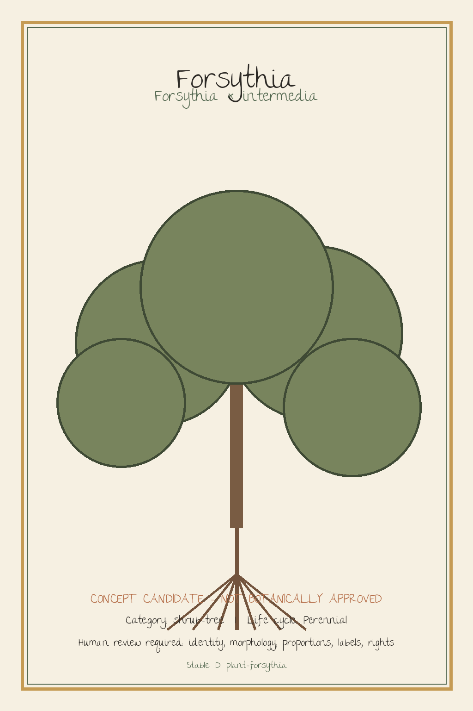

**Source status:** Not botanically or horticulturally approved. Recorded fields are derived
from the retained registry and remain subject to claim-level source review.

### Philadelphus

**Stable plant ID:** `plant-philadelphus`
**Category:** shrub-tree
**Recorded botanical name:** Philadelphus coronarius
**Recorded family:** Hydrangeaceae
**Life cycle:** Perennial
**Illustration status:** `CANDIDATE_GENERATED / REVIEW_PENDING / NOT_APPROVED`

**Identification and morphology**

- Growth habit: Growth habit should be resolved to the exact species or cultivar; this entry provides a category-level source scaffold.
- Root or storage organ: Species-specific root, crown, or storage organ; verify the exact form before illustrating.
- Leaf arrangement and shape: Species-specific arrangement and blade shape; verify exact genus and cultivar.
- Flower structure: Species-specific inflorescence or flower structure.
- Fruit or seed structure: Species-specific fruit, seed pod, achene, capsule, berry, or nut.

**Errington timing fields**

- Indoor sow: Source timing not reviewed
- Direct sow: Source timing not reviewed
- Transplant: Source timing not reviewed
- Bloom: Source timing not reviewed
- Harvest: Source timing not reviewed
- Frost: Source timing not reviewed

**Cultivation**

- Soil: Fertile, well-drained soil with organic matter unless the species has a known exceptional preference.
- Water: Provide even establishment moisture; then follow the species' drought, moisture, or wetness preference.
- Spacing: Base spacing on mature height and spread, not just the common name.
- Light: Sun requirement is species-specific; the common name alone is not a reliable light label.
- Maintenance: Mulch, deadhead or divide as appropriate, and monitor for structural or seasonal maintenance.
- Pests/diseases: Identify the pest or disease locally before control; favor sanitation, cultural prevention, and targeted action.

**Candidate plate:**

**Source status:** Not botanically or horticulturally approved. Recorded fields are derived
from the retained registry and remain subject to claim-level source review.

### Pieris

**Stable plant ID:** `plant-pieris`
**Category:** shrub-tree
**Recorded botanical name:** Pieris japonica
**Recorded family:** Ericaceae
**Life cycle:** Perennial
**Illustration status:** `CANDIDATE_GENERATED / REVIEW_PENDING / NOT_APPROVED`

**Identification and morphology**

- Growth habit: Growth habit should be resolved to the exact species or cultivar; this entry provides a category-level source scaffold.
- Root or storage organ: Species-specific root, crown, or storage organ; verify the exact form before illustrating.
- Leaf arrangement and shape: Species-specific arrangement and blade shape; verify exact genus and cultivar.
- Flower structure: Species-specific inflorescence or flower structure.
- Fruit or seed structure: Species-specific fruit, seed pod, achene, capsule, berry, or nut.

**Errington timing fields**

- Indoor sow: Source timing not reviewed
- Direct sow: Source timing not reviewed
- Transplant: Source timing not reviewed
- Bloom: Source timing not reviewed
- Harvest: Source timing not reviewed
- Frost: Source timing not reviewed

**Cultivation**

- Soil: Fertile, well-drained soil with organic matter unless the species has a known exceptional preference.
- Water: Provide even establishment moisture; then follow the species' drought, moisture, or wetness preference.
- Spacing: Base spacing on mature height and spread, not just the common name.
- Light: Sun requirement is species-specific; the common name alone is not a reliable light label.
- Maintenance: Mulch, deadhead or divide as appropriate, and monitor for structural or seasonal maintenance.
- Pests/diseases: Identify the pest or disease locally before control; favor sanitation, cultural prevention, and targeted action.

**Candidate plate:**

**Source status:** Not botanically or horticulturally approved. Recorded fields are derived
from the retained registry and remain subject to claim-level source review.

### Magnolia

**Stable plant ID:** `plant-magnolia`
**Category:** shrub-tree
**Recorded botanical name:** Magnolia stellata
**Recorded family:** Magnoliaceae
**Life cycle:** Perennial
**Illustration status:** `CANDIDATE_GENERATED / REVIEW_PENDING / NOT_APPROVED`

**Identification and morphology**

- Growth habit: Growth habit should be resolved to the exact species or cultivar; this entry provides a category-level source scaffold.
- Root or storage organ: Species-specific root, crown, or storage organ; verify the exact form before illustrating.
- Leaf arrangement and shape: Species-specific arrangement and blade shape; verify exact genus and cultivar.
- Flower structure: Species-specific inflorescence or flower structure.
- Fruit or seed structure: Species-specific fruit, seed pod, achene, capsule, berry, or nut.

**Errington timing fields**

- Indoor sow: Source timing not reviewed
- Direct sow: Source timing not reviewed
- Transplant: Source timing not reviewed
- Bloom: Source timing not reviewed
- Harvest: Source timing not reviewed
- Frost: Source timing not reviewed

**Cultivation**

- Soil: Fertile, well-drained soil with organic matter unless the species has a known exceptional preference.
- Water: Provide even establishment moisture; then follow the species' drought, moisture, or wetness preference.
- Spacing: Base spacing on mature height and spread, not just the common name.
- Light: Sun requirement is species-specific; the common name alone is not a reliable light label.
- Maintenance: Mulch, deadhead or divide as appropriate, and monitor for structural or seasonal maintenance.
- Pests/diseases: Identify the pest or disease locally before control; favor sanitation, cultural prevention, and targeted action.

**Candidate plate:**

**Source status:** Not botanically or horticulturally approved. Recorded fields are derived
from the retained registry and remain subject to claim-level source review.

### Camellia

**Stable plant ID:** `plant-camellia`
**Category:** shrub-tree
**Recorded botanical name:** Camellia japonica
**Recorded family:** Theaceae
**Life cycle:** Perennial
**Illustration status:** `CANDIDATE_GENERATED / REVIEW_PENDING / NOT_APPROVED`

**Identification and morphology**

- Growth habit: Growth habit should be resolved to the exact species or cultivar; this entry provides a category-level source scaffold.
- Root or storage organ: Species-specific root, crown, or storage organ; verify the exact form before illustrating.
- Leaf arrangement and shape: Species-specific arrangement and blade shape; verify exact genus and cultivar.
- Flower structure: Species-specific inflorescence or flower structure.
- Fruit or seed structure: Species-specific fruit, seed pod, achene, capsule, berry, or nut.

**Errington timing fields**

- Indoor sow: Source timing not reviewed
- Direct sow: Source timing not reviewed
- Transplant: Source timing not reviewed
- Bloom: Source timing not reviewed
- Harvest: Source timing not reviewed
- Frost: Source timing not reviewed

**Cultivation**

- Soil: Fertile, well-drained soil with organic matter unless the species has a known exceptional preference.
- Water: Provide even establishment moisture; then follow the species' drought, moisture, or wetness preference.
- Spacing: Base spacing on mature height and spread, not just the common name.
- Light: Sun requirement is species-specific; the common name alone is not a reliable light label.
- Maintenance: Mulch, deadhead or divide as appropriate, and monitor for structural or seasonal maintenance.
- Pests/diseases: Identify the pest or disease locally before control; favor sanitation, cultural prevention, and targeted action.

**Candidate plate:**

**Source status:** Not botanically or horticulturally approved. Recorded fields are derived
from the retained registry and remain subject to claim-level source review.

### Rhododendron

**Stable plant ID:** `plant-rhododendron`
**Category:** shrub-tree
**Recorded botanical name:** Rhododendron spp.
**Recorded family:** Ericaceae
**Life cycle:** Perennial
**Illustration status:** `CANDIDATE_GENERATED / REVIEW_PENDING / NOT_APPROVED`

**Identification and morphology**

- Growth habit: Growth habit should be resolved to the exact species or cultivar; this entry provides a category-level source scaffold.
- Root or storage organ: Species-specific root, crown, or storage organ; verify the exact form before illustrating.
- Leaf arrangement and shape: Species-specific arrangement and blade shape; verify exact genus and cultivar.
- Flower structure: Species-specific inflorescence or flower structure.
- Fruit or seed structure: Species-specific fruit, seed pod, achene, capsule, berry, or nut.

**Errington timing fields**

- Indoor sow: Source timing not reviewed
- Direct sow: Source timing not reviewed
- Transplant: Source timing not reviewed
- Bloom: Source timing not reviewed
- Harvest: Source timing not reviewed
- Frost: Source timing not reviewed

**Cultivation**

- Soil: Fertile, well-drained soil with organic matter unless the species has a known exceptional preference.
- Water: Provide even establishment moisture; then follow the species' drought, moisture, or wetness preference.
- Spacing: Base spacing on mature height and spread, not just the common name.
- Light: Sun requirement is species-specific; the common name alone is not a reliable light label.
- Maintenance: Mulch, deadhead or divide as appropriate, and monitor for structural or seasonal maintenance.
- Pests/diseases: Identify the pest or disease locally before control; favor sanitation, cultural prevention, and targeted action.

**Candidate plate:**

**Source status:** Not botanically or horticulturally approved. Recorded fields are derived
from the retained registry and remain subject to claim-level source review.

### Spiraea

**Stable plant ID:** `plant-spiraea`
**Category:** shrub-tree
**Recorded botanical name:** Spiraea japonica
**Recorded family:** Rosaceae
**Life cycle:** Perennial
**Illustration status:** `CANDIDATE_GENERATED / REVIEW_PENDING / NOT_APPROVED`

**Identification and morphology**

- Growth habit: Growth habit should be resolved to the exact species or cultivar; this entry provides a category-level source scaffold.
- Root or storage organ: Species-specific root, crown, or storage organ; verify the exact form before illustrating.
- Leaf arrangement and shape: Species-specific arrangement and blade shape; verify exact genus and cultivar.
- Flower structure: Species-specific inflorescence or flower structure.
- Fruit or seed structure: Species-specific fruit, seed pod, achene, capsule, berry, or nut.

**Errington timing fields**

- Indoor sow: Source timing not reviewed
- Direct sow: Source timing not reviewed
- Transplant: Source timing not reviewed
- Bloom: Source timing not reviewed
- Harvest: Source timing not reviewed
- Frost: Source timing not reviewed

**Cultivation**

- Soil: Fertile, well-drained soil with organic matter unless the species has a known exceptional preference.
- Water: Provide even establishment moisture; then follow the species' drought, moisture, or wetness preference.
- Spacing: Base spacing on mature height and spread, not just the common name.
- Light: Sun requirement is species-specific; the common name alone is not a reliable light label.
- Maintenance: Mulch, deadhead or divide as appropriate, and monitor for structural or seasonal maintenance.
- Pests/diseases: Identify the pest or disease locally before control; favor sanitation, cultural prevention, and targeted action.

**Candidate plate:**

**Source status:** Not botanically or horticulturally approved. Recorded fields are derived
from the retained registry and remain subject to claim-level source review.

### Azalea

**Stable plant ID:** `plant-azalea`
**Category:** shrub-tree
**Recorded botanical name:** Rhododendron spp.
**Recorded family:** Ericaceae
**Life cycle:** Perennial
**Illustration status:** `CANDIDATE_GENERATED / REVIEW_PENDING / NOT_APPROVED`

**Identification and morphology**

- Growth habit: Growth habit should be resolved to the exact species or cultivar; this entry provides a category-level source scaffold.
- Root or storage organ: Species-specific root, crown, or storage organ; verify the exact form before illustrating.
- Leaf arrangement and shape: Species-specific arrangement and blade shape; verify exact genus and cultivar.
- Flower structure: Species-specific inflorescence or flower structure.
- Fruit or seed structure: Species-specific fruit, seed pod, achene, capsule, berry, or nut.

**Errington timing fields**

- Indoor sow: Source timing not reviewed
- Direct sow: Source timing not reviewed
- Transplant: Source timing not reviewed
- Bloom: Source timing not reviewed
- Harvest: Source timing not reviewed
- Frost: Source timing not reviewed

**Cultivation**

- Soil: Fertile, well-drained soil with organic matter unless the species has a known exceptional preference.
- Water: Provide even establishment moisture; then follow the species' drought, moisture, or wetness preference.
- Spacing: Base spacing on mature height and spread, not just the common name.
- Light: Sun requirement is species-specific; the common name alone is not a reliable light label.
- Maintenance: Mulch, deadhead or divide as appropriate, and monitor for structural or seasonal maintenance.
- Pests/diseases: Identify the pest or disease locally before control; favor sanitation, cultural prevention, and targeted action.

**Candidate plate:**

**Source status:** Not botanically or horticulturally approved. Recorded fields are derived
from the retained registry and remain subject to claim-level source review.

### Kerria

**Stable plant ID:** `plant-kerria`
**Category:** shrub-tree
**Recorded botanical name:** Kerria japonica
**Recorded family:** Rosaceae
**Life cycle:** Perennial
**Illustration status:** `CANDIDATE_GENERATED / REVIEW_PENDING / NOT_APPROVED`

**Identification and morphology**

- Growth habit: Growth habit should be resolved to the exact species or cultivar; this entry provides a category-level source scaffold.
- Root or storage organ: Species-specific root, crown, or storage organ; verify the exact form before illustrating.
- Leaf arrangement and shape: Species-specific arrangement and blade shape; verify exact genus and cultivar.
- Flower structure: Species-specific inflorescence or flower structure.
- Fruit or seed structure: Species-specific fruit, seed pod, achene, capsule, berry, or nut.

**Errington timing fields**

- Indoor sow: Source timing not reviewed
- Direct sow: Source timing not reviewed
- Transplant: Source timing not reviewed
- Bloom: Source timing not reviewed
- Harvest: Source timing not reviewed
- Frost: Source timing not reviewed

**Cultivation**

- Soil: Fertile, well-drained soil with organic matter unless the species has a known exceptional preference.
- Water: Provide even establishment moisture; then follow the species' drought, moisture, or wetness preference.
- Spacing: Base spacing on mature height and spread, not just the common name.
- Light: Sun requirement is species-specific; the common name alone is not a reliable light label.
- Maintenance: Mulch, deadhead or divide as appropriate, and monitor for structural or seasonal maintenance.
- Pests/diseases: Identify the pest or disease locally before control; favor sanitation, cultural prevention, and targeted action.

**Candidate plate:**

**Source status:** Not botanically or horticulturally approved. Recorded fields are derived
from the retained registry and remain subject to claim-level source review.

### Garry Oak

**Stable plant ID:** `plant-garry-oak`
**Category:** shrub-tree
**Recorded botanical name:** Quercus garryana
**Recorded family:** Fagaceae
**Life cycle:** Perennial
**Illustration status:** `CANDIDATE_GENERATED / REVIEW_PENDING / NOT_APPROVED`

**Identification and morphology**

- Growth habit: Growth habit should be resolved to the exact species or cultivar; this entry provides a category-level source scaffold.
- Root or storage organ: Species-specific root, crown, or storage organ; verify the exact form before illustrating.
- Leaf arrangement and shape: Species-specific arrangement and blade shape; verify exact genus and cultivar.
- Flower structure: Species-specific inflorescence or flower structure.
- Fruit or seed structure: Species-specific fruit, seed pod, achene, capsule, berry, or nut.

**Errington timing fields**

- Indoor sow: Source timing not reviewed
- Direct sow: Source timing not reviewed
- Transplant: Source timing not reviewed
- Bloom: Source timing not reviewed
- Harvest: Source timing not reviewed
- Frost: Source timing not reviewed

**Cultivation**

- Soil: Fertile, well-drained soil with organic matter unless the species has a known exceptional preference.
- Water: Provide even establishment moisture; then follow the species' drought, moisture, or wetness preference.
- Spacing: Base spacing on mature height and spread, not just the common name.
- Light: Sun requirement is species-specific; the common name alone is not a reliable light label.
- Maintenance: Mulch, deadhead or divide as appropriate, and monitor for structural or seasonal maintenance.
- Pests/diseases: Identify the pest or disease locally before control; favor sanitation, cultural prevention, and targeted action.

**Candidate plate:**

**Source status:** Not botanically or horticulturally approved. Recorded fields are derived
from the retained registry and remain subject to claim-level source review.

### Wisteria

**Stable plant ID:** `plant-wisteria`
**Category:** vine
**Recorded botanical name:** Wisteria sinensis
**Recorded family:** Fabaceae
**Life cycle:** Perennial
**Illustration status:** `CANDIDATE_GENERATED / REVIEW_PENDING / NOT_APPROVED`

**Identification and morphology**

- Growth habit: Growth habit should be resolved to the exact species or cultivar; this entry provides a category-level source scaffold.
- Root or storage organ: Perennial or annual anchored root system; species-specific climbing or trailing habit.
- Leaf arrangement and shape: Alternate or opposite leaves according to genus; vine support is an identifying feature.
- Flower structure: Species-specific inflorescence or solitary bloom.
- Fruit or seed structure: Pod, capsule, berry, or dry seed structure according to species.

**Errington timing fields**

- Indoor sow: Source timing not reviewed
- Direct sow: Source timing not reviewed
- Transplant: Source timing not reviewed
- Bloom: Source timing not reviewed
- Harvest: Source timing not reviewed
- Frost: Source timing not reviewed

**Cultivation**

- Soil: Fertile, well-drained soil with organic matter unless the species has a known exceptional preference.
- Water: Provide even establishment moisture; then follow the species' drought, moisture, or wetness preference.
- Spacing: Base spacing on mature height and spread, not just the common name.
- Light: Sun requirement is species-specific; the common name alone is not a reliable light label.
- Maintenance: Mulch, deadhead or divide as appropriate, and monitor for structural or seasonal maintenance.
- Pests/diseases: Identify the pest or disease locally before control; favor sanitation, cultural prevention, and targeted action.

**Candidate plate:**

**Source status:** Not botanically or horticulturally approved. Recorded fields are derived
from the retained registry and remain subject to claim-level source review.

### Clematis Group 3

**Stable plant ID:** `plant-clematis-group-3`
**Category:** vine
**Recorded botanical name:** Clematis spp. (pruning Group 3)
**Recorded family:** Ranunculaceae
**Life cycle:** Perennial
**Illustration status:** `CANDIDATE_GENERATED / REVIEW_PENDING / NOT_APPROVED`

**Identification and morphology**

- Growth habit: Growth habit should be resolved to the exact species or cultivar; this entry provides a category-level source scaffold.
- Root or storage organ: Perennial or annual anchored root system; species-specific climbing or trailing habit.
- Leaf arrangement and shape: Alternate or opposite leaves according to genus; vine support is an identifying feature.
- Flower structure: Species-specific inflorescence or solitary bloom.
- Fruit or seed structure: Pod, capsule, berry, or dry seed structure according to species.

**Errington timing fields**

- Indoor sow: Source timing not reviewed
- Direct sow: Source timing not reviewed
- Transplant: Source timing not reviewed
- Bloom: Source timing not reviewed
- Harvest: Source timing not reviewed
- Frost: Source timing not reviewed

**Cultivation**

- Soil: Fertile, well-drained soil with organic matter unless the species has a known exceptional preference.
- Water: Provide even establishment moisture; then follow the species' drought, moisture, or wetness preference.
- Spacing: Base spacing on mature height and spread, not just the common name.
- Light: Sun requirement is species-specific; the common name alone is not a reliable light label.
- Maintenance: Mulch, deadhead or divide as appropriate, and monitor for structural or seasonal maintenance.
- Pests/diseases: Identify the pest or disease locally before control; favor sanitation, cultural prevention, and targeted action.

**Candidate plate:**

**Source status:** Not botanically or horticulturally approved. Recorded fields are derived
from the retained registry and remain subject to claim-level source review.

### Clematis montana

**Stable plant ID:** `plant-clematis-montana`
**Category:** vine
**Recorded botanical name:** Clematis montana
**Recorded family:** Ranunculaceae
**Life cycle:** Perennial
**Illustration status:** `CANDIDATE_GENERATED / REVIEW_PENDING / NOT_APPROVED`

**Identification and morphology**

- Growth habit: Growth habit should be resolved to the exact species or cultivar; this entry provides a category-level source scaffold.
- Root or storage organ: Perennial or annual anchored root system; species-specific climbing or trailing habit.
- Leaf arrangement and shape: Alternate or opposite leaves according to genus; vine support is an identifying feature.
- Flower structure: Species-specific inflorescence or solitary bloom.
- Fruit or seed structure: Pod, capsule, berry, or dry seed structure according to species.

**Errington timing fields**

- Indoor sow: Source timing not reviewed
- Direct sow: Source timing not reviewed
- Transplant: Source timing not reviewed
- Bloom: Source timing not reviewed
- Harvest: Source timing not reviewed
- Frost: Source timing not reviewed

**Cultivation**

- Soil: Fertile, well-drained soil with organic matter unless the species has a known exceptional preference.
- Water: Provide even establishment moisture; then follow the species' drought, moisture, or wetness preference.
- Spacing: Base spacing on mature height and spread, not just the common name.
- Light: Sun requirement is species-specific; the common name alone is not a reliable light label.
- Maintenance: Mulch, deadhead or divide as appropriate, and monitor for structural or seasonal maintenance.
- Pests/diseases: Identify the pest or disease locally before control; favor sanitation, cultural prevention, and targeted action.

**Candidate plate:**

**Source status:** Not botanically or horticulturally approved. Recorded fields are derived
from the retained registry and remain subject to claim-level source review.

### Honeysuckle

**Stable plant ID:** `plant-honeysuckle`
**Category:** vine
**Recorded botanical name:** Lonicera spp.
**Recorded family:** Caprifoliaceae
**Life cycle:** Perennial
**Illustration status:** `CANDIDATE_GENERATED / REVIEW_PENDING / NOT_APPROVED`

**Identification and morphology**

- Growth habit: Growth habit should be resolved to the exact species or cultivar; this entry provides a category-level source scaffold.
- Root or storage organ: Perennial or annual anchored root system; species-specific climbing or trailing habit.
- Leaf arrangement and shape: Alternate or opposite leaves according to genus; vine support is an identifying feature.
- Flower structure: Species-specific inflorescence or solitary bloom.
- Fruit or seed structure: Pod, capsule, berry, or dry seed structure according to species.

**Errington timing fields**

- Indoor sow: Source timing not reviewed
- Direct sow: Source timing not reviewed
- Transplant: Source timing not reviewed
- Bloom: Source timing not reviewed
- Harvest: Source timing not reviewed
- Frost: Source timing not reviewed

**Cultivation**

- Soil: Fertile, well-drained soil with organic matter unless the species has a known exceptional preference.
- Water: Provide even establishment moisture; then follow the species' drought, moisture, or wetness preference.
- Spacing: Base spacing on mature height and spread, not just the common name.
- Light: Sun requirement is species-specific; the common name alone is not a reliable light label.
- Maintenance: Mulch, deadhead or divide as appropriate, and monitor for structural or seasonal maintenance.
- Pests/diseases: Identify the pest or disease locally before control; favor sanitation, cultural prevention, and targeted action.

**Candidate plate:**
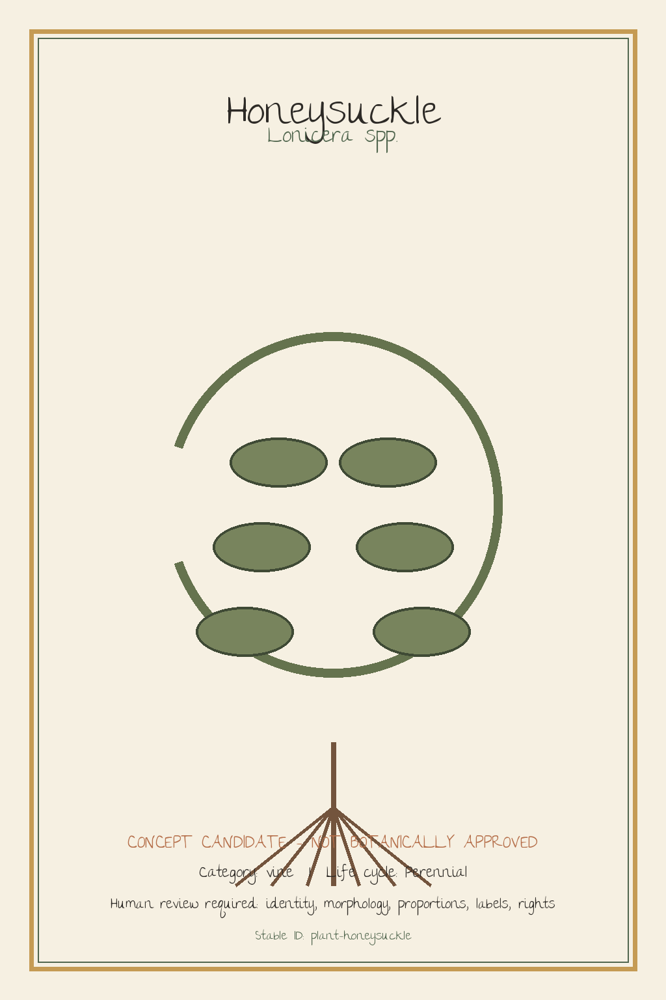

**Source status:** Not botanically or horticulturally approved. Recorded fields are derived
from the retained registry and remain subject to claim-level source review.

### Morning Glory

**Stable plant ID:** `plant-morning-glory`
**Category:** vine
**Recorded botanical name:** Ipomoea purpurea
**Recorded family:** Convolvulaceae
**Life cycle:** Perennial
**Illustration status:** `CANDIDATE_GENERATED / REVIEW_PENDING / NOT_APPROVED`

**Identification and morphology**

- Growth habit: Growth habit should be resolved to the exact species or cultivar; this entry provides a category-level source scaffold.
- Root or storage organ: Perennial or annual anchored root system; species-specific climbing or trailing habit.
- Leaf arrangement and shape: Alternate or opposite leaves according to genus; vine support is an identifying feature.
- Flower structure: Species-specific inflorescence or solitary bloom.
- Fruit or seed structure: Pod, capsule, berry, or dry seed structure according to species.

**Errington timing fields**

- Indoor sow: Source timing not reviewed
- Direct sow: Source timing not reviewed
- Transplant: Source timing not reviewed
- Bloom: Source timing not reviewed
- Harvest: Source timing not reviewed
- Frost: Source timing not reviewed

**Cultivation**

- Soil: Fertile, well-drained soil with organic matter unless the species has a known exceptional preference.
- Water: Provide even establishment moisture; then follow the species' drought, moisture, or wetness preference.
- Spacing: Base spacing on mature height and spread, not just the common name.
- Light: Sun requirement is species-specific; the common name alone is not a reliable light label.
- Maintenance: Mulch, deadhead or divide as appropriate, and monitor for structural or seasonal maintenance.
- Pests/diseases: Identify the pest or disease locally before control; favor sanitation, cultural prevention, and targeted action.

**Candidate plate:**

**Source status:** Not botanically or horticulturally approved. Recorded fields are derived
from the retained registry and remain subject to claim-level source review.

### Osoberry

**Stable plant ID:** `plant-osoberry`
**Category:** native
**Recorded botanical name:** Oemleria cerasiformis
**Recorded family:** Rosaceae
**Life cycle:** Perennial
**Illustration status:** `CANDIDATE_GENERATED / REVIEW_PENDING / NOT_APPROVED`

**Identification and morphology**

- Growth habit: Growth habit should be resolved to the exact species or cultivar; this entry provides a category-level source scaffold.
- Root or storage organ: Species-specific perennial root or rhizome system; do not infer a single organ from the common name.
- Leaf arrangement and shape: Leaves follow the characteristic genus or species; arrangement and shape require species-level verification.
- Flower structure: Species-specific bloom structure; bloom timing in Errington remains calendar-dependent.
- Fruit or seed structure: Fruit or seed structure follows the species; verify before illustration or propagation.

**Errington timing fields**

- Indoor sow: Source timing not reviewed
- Direct sow: Source timing not reviewed
- Transplant: Source timing not reviewed
- Bloom: Source timing not reviewed
- Harvest: Source timing not reviewed
- Frost: Source timing not reviewed

**Cultivation**

- Soil: Use a native-plant soil profile matching the species' natural moisture and exposure.
- Water: Provide supplemental water only during establishment unless the species is naturally moisture-demanding.
- Spacing: Use mature native-plant size and avoid crowding at establishment.
- Light: Match sun or shade to the species and local site.
- Maintenance: Protect soil and leaf litter where appropriate; avoid heavy fertilizer; prune only for structure or safety.
- Pests/diseases: Favor prevention and local beneficial organisms; treat only confirmed damage.

**Candidate plate:**

**Source status:** Not botanically or horticulturally approved. Recorded fields are derived
from the retained registry and remain subject to claim-level source review.

### Red-flowering Currant

**Stable plant ID:** `plant-red-flowering-currant`
**Category:** native
**Recorded botanical name:** Ribes sanguineum
**Recorded family:** Grossulariaceae
**Life cycle:** Perennial
**Illustration status:** `CANDIDATE_GENERATED / REVIEW_PENDING / NOT_APPROVED`

**Identification and morphology**

- Growth habit: Growth habit should be resolved to the exact species or cultivar; this entry provides a category-level source scaffold.
- Root or storage organ: Species-specific perennial root or rhizome system; do not infer a single organ from the common name.
- Leaf arrangement and shape: Leaves follow the characteristic genus or species; arrangement and shape require species-level verification.
- Flower structure: Species-specific bloom structure; bloom timing in Errington remains calendar-dependent.
- Fruit or seed structure: Fruit or seed structure follows the species; verify before illustration or propagation.

**Errington timing fields**

- Indoor sow: Source timing not reviewed
- Direct sow: Source timing not reviewed
- Transplant: Source timing not reviewed
- Bloom: Source timing not reviewed
- Harvest: Source timing not reviewed
- Frost: Source timing not reviewed

**Cultivation**

- Soil: Use a native-plant soil profile matching the species' natural moisture and exposure.
- Water: Provide supplemental water only during establishment unless the species is naturally moisture-demanding.
- Spacing: Use mature native-plant size and avoid crowding at establishment.
- Light: Match sun or shade to the species and local site.
- Maintenance: Protect soil and leaf litter where appropriate; avoid heavy fertilizer; prune only for structure or safety.
- Pests/diseases: Favor prevention and local beneficial organisms; treat only confirmed damage.

**Candidate plate:**
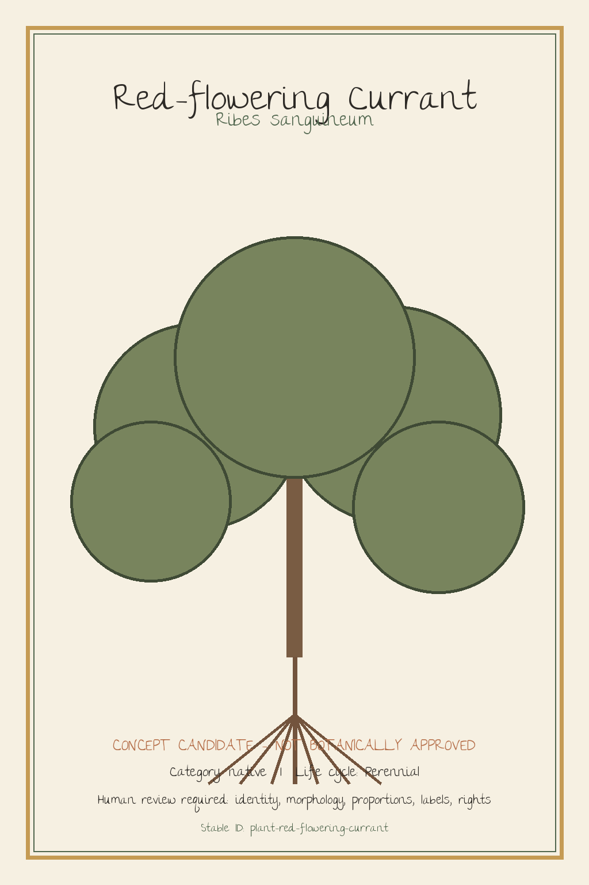

**Source status:** Not botanically or horticulturally approved. Recorded fields are derived
from the retained registry and remain subject to claim-level source review.

### Trillium

**Stable plant ID:** `plant-trillium`
**Category:** native
**Recorded botanical name:** Trillium ovatum
**Recorded family:** Melanthiaceae
**Life cycle:** Perennial
**Illustration status:** `CANDIDATE_GENERATED / REVIEW_PENDING / NOT_APPROVED`

**Identification and morphology**

- Growth habit: Growth habit should be resolved to the exact species or cultivar; this entry provides a category-level source scaffold.
- Root or storage organ: Species-specific perennial root or rhizome system; do not infer a single organ from the common name.
- Leaf arrangement and shape: Leaves follow the characteristic genus or species; arrangement and shape require species-level verification.
- Flower structure: Species-specific bloom structure; bloom timing in Errington remains calendar-dependent.
- Fruit or seed structure: Fruit or seed structure follows the species; verify before illustration or propagation.

**Errington timing fields**

- Indoor sow: Source timing not reviewed
- Direct sow: Source timing not reviewed
- Transplant: Source timing not reviewed
- Bloom: Source timing not reviewed
- Harvest: Source timing not reviewed
- Frost: Source timing not reviewed

**Cultivation**

- Soil: Use a native-plant soil profile matching the species' natural moisture and exposure.
- Water: Provide supplemental water only during establishment unless the species is naturally moisture-demanding.
- Spacing: Use mature native-plant size and avoid crowding at establishment.
- Light: Match sun or shade to the species and local site.
- Maintenance: Protect soil and leaf litter where appropriate; avoid heavy fertilizer; prune only for structure or safety.
- Pests/diseases: Favor prevention and local beneficial organisms; treat only confirmed damage.

**Candidate plate:**

**Source status:** Not botanically or horticulturally approved. Recorded fields are derived
from the retained registry and remain subject to claim-level source review.

### Bleeding Heart

**Stable plant ID:** `plant-bleeding-heart`
**Category:** native
**Recorded botanical name:** Dicentra formosa
**Recorded family:** Papaveraceae
**Life cycle:** Perennial
**Illustration status:** `CANDIDATE_GENERATED / REVIEW_PENDING / NOT_APPROVED`

**Identification and morphology**

- Growth habit: Growth habit should be resolved to the exact species or cultivar; this entry provides a category-level source scaffold.
- Root or storage organ: Species-specific perennial root or rhizome system; do not infer a single organ from the common name.
- Leaf arrangement and shape: Leaves follow the characteristic genus or species; arrangement and shape require species-level verification.
- Flower structure: Species-specific bloom structure; bloom timing in Errington remains calendar-dependent.
- Fruit or seed structure: Fruit or seed structure follows the species; verify before illustration or propagation.

**Errington timing fields**

- Indoor sow: Source timing not reviewed
- Direct sow: Source timing not reviewed
- Transplant: Source timing not reviewed
- Bloom: Source timing not reviewed
- Harvest: Source timing not reviewed
- Frost: Source timing not reviewed

**Cultivation**

- Soil: Use a native-plant soil profile matching the species' natural moisture and exposure.
- Water: Provide supplemental water only during establishment unless the species is naturally moisture-demanding.
- Spacing: Use mature native-plant size and avoid crowding at establishment.
- Light: Match sun or shade to the species and local site.
- Maintenance: Protect soil and leaf litter where appropriate; avoid heavy fertilizer; prune only for structure or safety.
- Pests/diseases: Favor prevention and local beneficial organisms; treat only confirmed damage.

**Candidate plate:**

**Source status:** Not botanically or horticulturally approved. Recorded fields are derived
from the retained registry and remain subject to claim-level source review.

### Camas

**Stable plant ID:** `plant-camas`
**Category:** native
**Recorded botanical name:** Camassia quamash
**Recorded family:** Asparagaceae
**Life cycle:** Perennial
**Illustration status:** `CANDIDATE_GENERATED / REVIEW_PENDING / NOT_APPROVED`

**Identification and morphology**

- Growth habit: Growth habit should be resolved to the exact species or cultivar; this entry provides a category-level source scaffold.
- Root or storage organ: Species-specific perennial root or rhizome system; do not infer a single organ from the common name.
- Leaf arrangement and shape: Leaves follow the characteristic genus or species; arrangement and shape require species-level verification.
- Flower structure: Species-specific bloom structure; bloom timing in Errington remains calendar-dependent.
- Fruit or seed structure: Fruit or seed structure follows the species; verify before illustration or propagation.

**Errington timing fields**

- Indoor sow: Source timing not reviewed
- Direct sow: Source timing not reviewed
- Transplant: Source timing not reviewed
- Bloom: Source timing not reviewed
- Harvest: Source timing not reviewed
- Frost: Source timing not reviewed

**Cultivation**

- Soil: Use a native-plant soil profile matching the species' natural moisture and exposure.
- Water: Provide supplemental water only during establishment unless the species is naturally moisture-demanding.
- Spacing: Use mature native-plant size and avoid crowding at establishment.
- Light: Match sun or shade to the species and local site.
- Maintenance: Protect soil and leaf litter where appropriate; avoid heavy fertilizer; prune only for structure or safety.
- Pests/diseases: Favor prevention and local beneficial organisms; treat only confirmed damage.

**Candidate plate:**

**Source status:** Not botanically or horticulturally approved. Recorded fields are derived
from the retained registry and remain subject to claim-level source review.

### Sword Fern

**Stable plant ID:** `plant-sword-fern`
**Category:** native
**Recorded botanical name:** Polystichum munitum
**Recorded family:** Dryopteridaceae
**Life cycle:** Perennial
**Illustration status:** `CANDIDATE_GENERATED / REVIEW_PENDING / NOT_APPROVED`

**Identification and morphology**

- Growth habit: Growth habit should be resolved to the exact species or cultivar; this entry provides a category-level source scaffold.
- Root or storage organ: Species-specific perennial root or rhizome system; do not infer a single organ from the common name.
- Leaf arrangement and shape: Leaves follow the characteristic genus or species; arrangement and shape require species-level verification.
- Flower structure: Species-specific bloom structure; bloom timing in Errington remains calendar-dependent.
- Fruit or seed structure: Fruit or seed structure follows the species; verify before illustration or propagation.

**Errington timing fields**

- Indoor sow: Source timing not reviewed
- Direct sow: Source timing not reviewed
- Transplant: Source timing not reviewed
- Bloom: Source timing not reviewed
- Harvest: Source timing not reviewed
- Frost: Source timing not reviewed

**Cultivation**

- Soil: Use a native-plant soil profile matching the species' natural moisture and exposure.
- Water: Provide supplemental water only during establishment unless the species is naturally moisture-demanding.
- Spacing: Use mature native-plant size and avoid crowding at establishment.
- Light: Match sun or shade to the species and local site.
- Maintenance: Protect soil and leaf litter where appropriate; avoid heavy fertilizer; prune only for structure or safety.
- Pests/diseases: Favor prevention and local beneficial organisms; treat only confirmed damage.

**Candidate plate:**
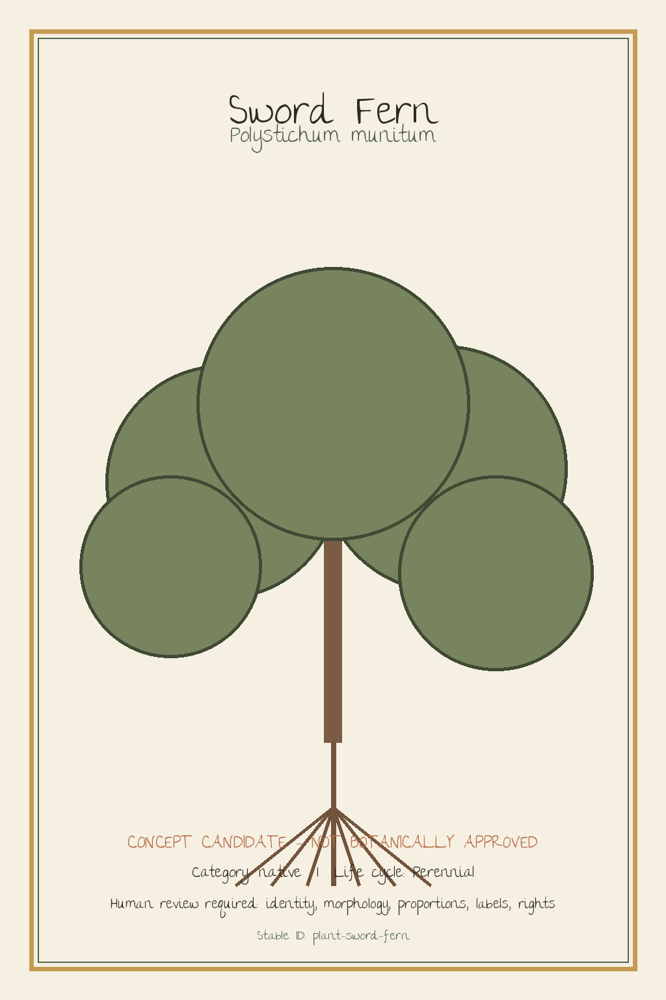

**Source status:** Not botanically or horticulturally approved. Recorded fields are derived
from the retained registry and remain subject to claim-level source review.

# Educational Figure Library

These figures are concept productions. Captions and accessibility text are
present, but botanical and horticultural source references remain to be attached
before final human approval.

## Figure 001. Flowering Plant Anatomy. Whole plant, leaves, stem, flowers, fruit and roots.

**Figure ID:** `FIG-001`
**Description:** Whole plant, leaves, stem, flowers, fruit and roots.
**Accessibility text:** Flowering Plant Anatomy: Whole plant, leaves, stem, flowers, fruit and roots.
**Publication location:** Errington Gardening Encyclopedia
**Status:** CONCEPT_PENDING_REVIEW

## Figure 002. Taproot and Fibrous Root Comparison. Conceptual comparison; exact species varies.

**Figure ID:** `FIG-002`
**Description:** Conceptual comparison; exact species varies.
**Accessibility text:** Taproot and Fibrous Root Comparison: Conceptual comparison; exact species varies.
**Publication location:** Errington Gardening Encyclopedia
**Status:** CONCEPT_PENDING_REVIEW

## Figure 003. Leaf Arrangement. Alternate, opposite and whorled attachment patterns.

**Figure ID:** `FIG-003`
**Description:** Alternate, opposite and whorled attachment patterns.
**Accessibility text:** Leaf Arrangement: Alternate, opposite and whorled attachment patterns.
**Publication location:** Errington Gardening Encyclopedia
**Status:** CONCEPT_PENDING_REVIEW

## Figure 004. Flower Anatomy. Sepals, petals, stamens and pistil.

**Figure ID:** `FIG-004`
**Description:** Sepals, petals, stamens and pistil.
**Accessibility text:** Flower Anatomy: Sepals, petals, stamens and pistil.
**Publication location:** Errington Gardening Encyclopedia
**Status:** CONCEPT_PENDING_REVIEW

## Figure 005. Pollination. Flower, pollen transfer, pollinator and resulting fruit.

**Figure ID:** `FIG-005`
**Description:** Flower, pollen transfer, pollinator and resulting fruit.
**Accessibility text:** Pollination: Flower, pollen transfer, pollinator and resulting fruit.
**Publication location:** Errington Gardening Encyclopedia
**Status:** CONCEPT_PENDING_REVIEW

## Figure 006. Seed and Fruit Development. Flower, fertilization, fruit and seed sequence.

**Figure ID:** `FIG-006`
**Description:** Flower, fertilization, fruit and seed sequence.
**Accessibility text:** Seed and Fruit Development: Flower, fertilization, fruit and seed sequence.
**Publication location:** Errington Gardening Encyclopedia
**Status:** CONCEPT_PENDING_REVIEW

## Figure 007. Bulbs, Corms, Tubers and Rhizomes. Four storage organs distinguished.

**Figure ID:** `FIG-007`
**Description:** Four storage organs distinguished.
**Accessibility text:** Bulbs, Corms, Tubers and Rhizomes: Four storage organs distinguished.
**Publication location:** Errington Gardening Encyclopedia
**Status:** CONCEPT_PENDING_REVIEW
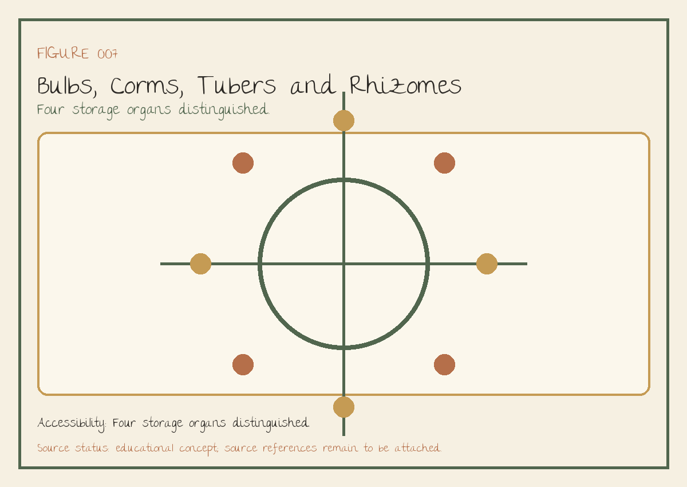

## Figure 008. Monocot and Dicot Comparison. General contrasts with botanical qualifications.

**Figure ID:** `FIG-008`
**Description:** General contrasts with botanical qualifications.
**Accessibility text:** Monocot and Dicot Comparison: General contrasts with botanical qualifications.
**Publication location:** Errington Gardening Encyclopedia
**Status:** CONCEPT_PENDING_REVIEW

## Figure 009. Fern Reproduction. Frond, sori, spores and gametophyte sequence.

**Figure ID:** `FIG-009`
**Description:** Frond, sori, spores and gametophyte sequence.
**Accessibility text:** Fern Reproduction: Frond, sori, spores and gametophyte sequence.
**Publication location:** Errington Gardening Encyclopedia
**Status:** CONCEPT_PENDING_REVIEW

## Figure 010. Soil Horizons. O, A, B, C and bedrock context.

**Figure ID:** `FIG-010`
**Description:** O, A, B, C and bedrock context.
**Accessibility text:** Soil Horizons: O, A, B, C and bedrock context.
**Publication location:** Errington Gardening Encyclopedia
**Status:** CONCEPT_PENDING_REVIEW
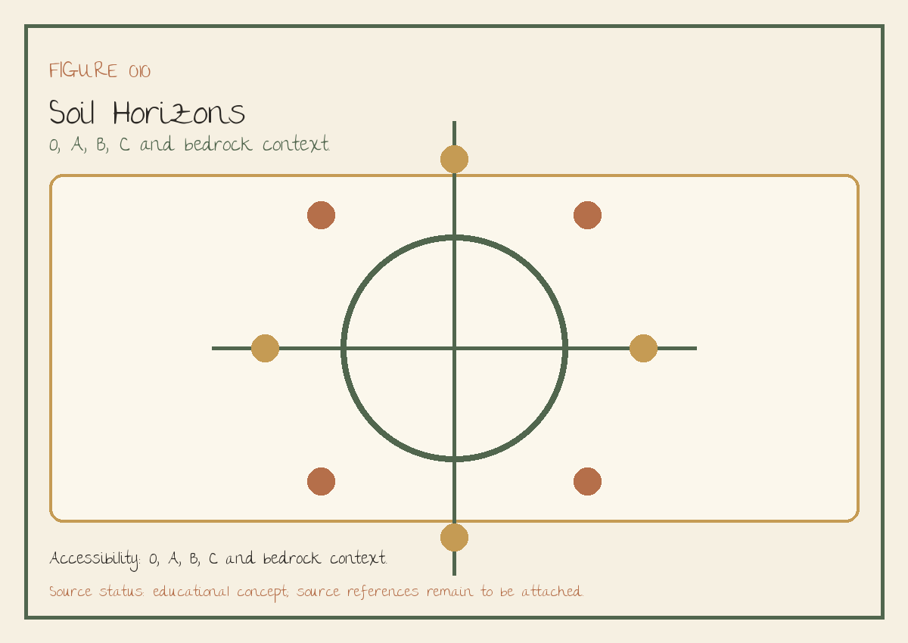

## Figure 011. Soil Texture Triangle. Sand, silt and clay texture classes.

**Figure ID:** `FIG-011`
**Description:** Sand, silt and clay texture classes.
**Accessibility text:** Soil Texture Triangle: Sand, silt and clay texture classes.
**Publication location:** Errington Gardening Encyclopedia
**Status:** CONCEPT_PENDING_REVIEW

## Figure 012. Drainage and Compaction. Percolation, pore space and a compacted layer.

**Figure ID:** `FIG-012`
**Description:** Percolation, pore space and a compacted layer.
**Accessibility text:** Drainage and Compaction: Percolation, pore space and a compacted layer.
**Publication location:** Errington Gardening Encyclopedia
**Status:** CONCEPT_PENDING_REVIEW

## Figure 013. Compost Development. Green, brown, air and moisture inputs.

**Figure ID:** `FIG-013`
**Description:** Green, brown, air and moisture inputs.
**Accessibility text:** Compost Development: Green, brown, air and moisture inputs.
**Publication location:** Errington Gardening Encyclopedia
**Status:** CONCEPT_PENDING_REVIEW
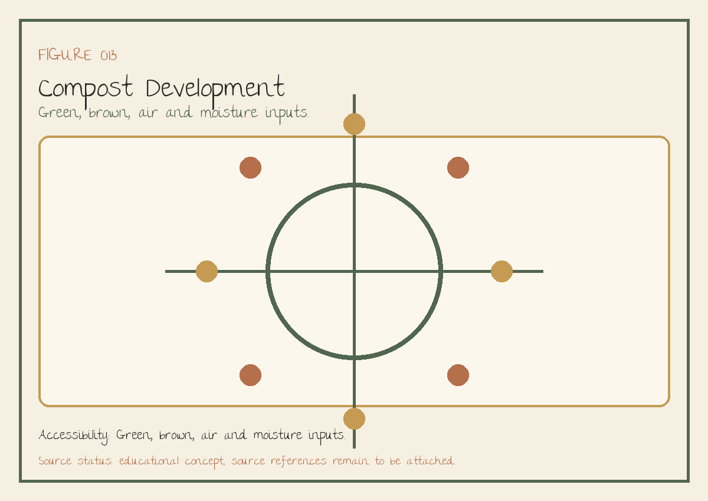

## Figure 014. Mulch Management. Organic mulch, gap at stems, and moisture retention.

**Figure ID:** `FIG-014`
**Description:** Organic mulch, gap at stems, and moisture retention.
**Accessibility text:** Mulch Management: Organic mulch, gap at stems, and moisture retention.
**Publication location:** Errington Gardening Encyclopedia
**Status:** CONCEPT_PENDING_REVIEW

## Figure 015. Raised-Bed Construction. Retaining sides, soil depth and drainage.

**Figure ID:** `FIG-015`
**Description:** Retaining sides, soil depth and drainage.
**Accessibility text:** Raised-Bed Construction: Retaining sides, soil depth and drainage.
**Publication location:** Errington Gardening Encyclopedia
**Status:** CONCEPT_PENDING_REVIEW

## Figure 016. Root-Zone Moisture. Dry, ideal and waterlogged zones.

**Figure ID:** `FIG-016`
**Description:** Dry, ideal and waterlogged zones.
**Accessibility text:** Root-Zone Moisture: Dry, ideal and waterlogged zones.
**Publication location:** Errington Gardening Encyclopedia
**Status:** CONCEPT_PENDING_REVIEW
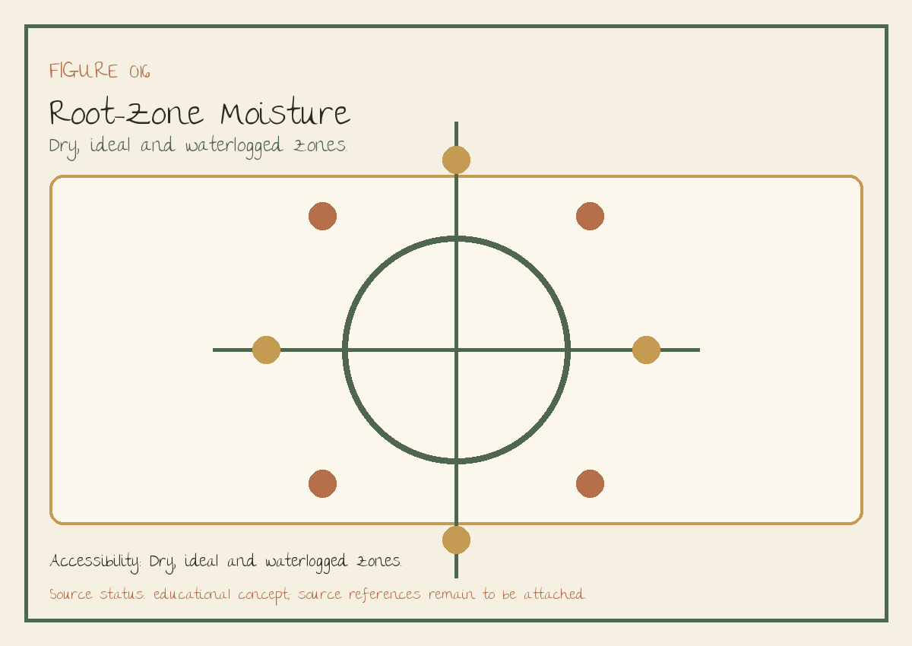

## Figure 017. Germination Sequence. Imbibition, radicle, shoot and cotyledons.

**Figure ID:** `FIG-017`
**Description:** Imbibition, radicle, shoot and cotyledons.
**Accessibility text:** Germination Sequence: Imbibition, radicle, shoot and cotyledons.
**Publication location:** Errington Gardening Encyclopedia
**Status:** CONCEPT_PENDING_REVIEW

## Figure 018. Indoor Seed Starting. Tray, sterile medium, light and labels.

**Figure ID:** `FIG-018`
**Description:** Tray, sterile medium, light and labels.
**Accessibility text:** Indoor Seed Starting: Tray, sterile medium, light and labels.
**Publication location:** Errington Gardening Encyclopedia
**Status:** CONCEPT_PENDING_REVIEW

## Figure 019. Hardening-Off Sequence. Seven-day staged outdoor exposure.

**Figure ID:** `FIG-019`
**Description:** Seven-day staged outdoor exposure.
**Accessibility text:** Hardening-Off Sequence: Seven-day staged outdoor exposure.
**Publication location:** Errington Gardening Encyclopedia
**Status:** CONCEPT_PENDING_REVIEW

## Figure 020. Transplanting Seedlings. Hole depth, set, backfill and water.

**Figure ID:** `FIG-020`
**Description:** Hole depth, set, backfill and water.
**Accessibility text:** Transplanting Seedlings: Hole depth, set, backfill and water.
**Publication location:** Errington Gardening Encyclopedia
**Status:** CONCEPT_PENDING_REVIEW

## Figure 021. Stem Cuttings. Cut below a node, remove lower leaves, medium.

**Figure ID:** `FIG-021`
**Description:** Cut below a node, remove lower leaves, medium.
**Accessibility text:** Stem Cuttings: Cut below a node, remove lower leaves, medium.
**Publication location:** Errington Gardening Encyclopedia
**Status:** CONCEPT_PENDING_REVIEW

## Figure 022. Perennial Division. Lift, separate, replant and water.

**Figure ID:** `FIG-022`
**Description:** Lift, separate, replant and water.
**Accessibility text:** Perennial Division: Lift, separate, replant and water.
**Publication location:** Errington Gardening Encyclopedia
**Status:** CONCEPT_PENDING_REVIEW

## Figure 023. Raised-Bed Layout. Four-by-four sample layout and access paths.

**Figure ID:** `FIG-023`
**Description:** Four-by-four sample layout and access paths.
**Accessibility text:** Raised-Bed Layout: Four-by-four sample layout and access paths.
**Publication location:** Errington Gardening Encyclopedia
**Status:** CONCEPT_PENDING_REVIEW
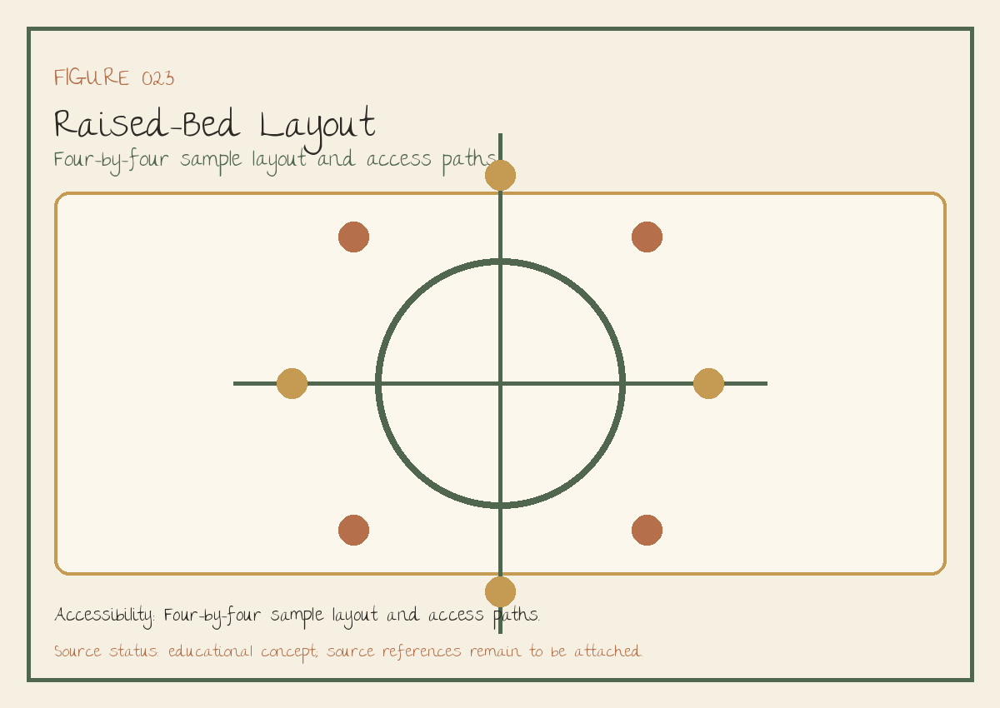

## Figure 024. Spacing Calculation. Length divided by spacing yields plant positions.

**Figure ID:** `FIG-024`
**Description:** Length divided by spacing yields plant positions.
**Accessibility text:** Spacing Calculation: Length divided by spacing yields plant positions.
**Publication location:** Errington Gardening Encyclopedia
**Status:** CONCEPT_PENDING_REVIEW

## Figure 025. Succession Planting. Three staggered sowing blocks.

**Figure ID:** `FIG-025`
**Description:** Three staggered sowing blocks.
**Accessibility text:** Succession Planting: Three staggered sowing blocks.
**Publication location:** Errington Gardening Encyclopedia
**Status:** CONCEPT_PENDING_REVIEW

## Figure 026. Crop-Rotation Families. Four-season rotation cycle.

**Figure ID:** `FIG-026`
**Description:** Four-season rotation cycle.
**Accessibility text:** Crop-Rotation Families: Four-season rotation cycle.
**Publication location:** Errington Gardening Encyclopedia
**Status:** CONCEPT_PENDING_REVIEW

## Figure 027. Companion Planting Qualifications. Benefits vary; avoid unsupported certainty.

**Figure ID:** `FIG-027`
**Description:** Benefits vary; avoid unsupported certainty.
**Accessibility text:** Companion Planting Qualifications: Benefits vary; avoid unsupported certainty.
**Publication location:** Errington Gardening Encyclopedia
**Status:** CONCEPT_PENDING_REVIEW

## Figure 028. Container Layout. Drainage, root volume and watering.

**Figure ID:** `FIG-028`
**Description:** Drainage, root volume and watering.
**Accessibility text:** Container Layout: Drainage, root volume and watering.
**Publication location:** Errington Gardening Encyclopedia
**Status:** CONCEPT_PENDING_REVIEW
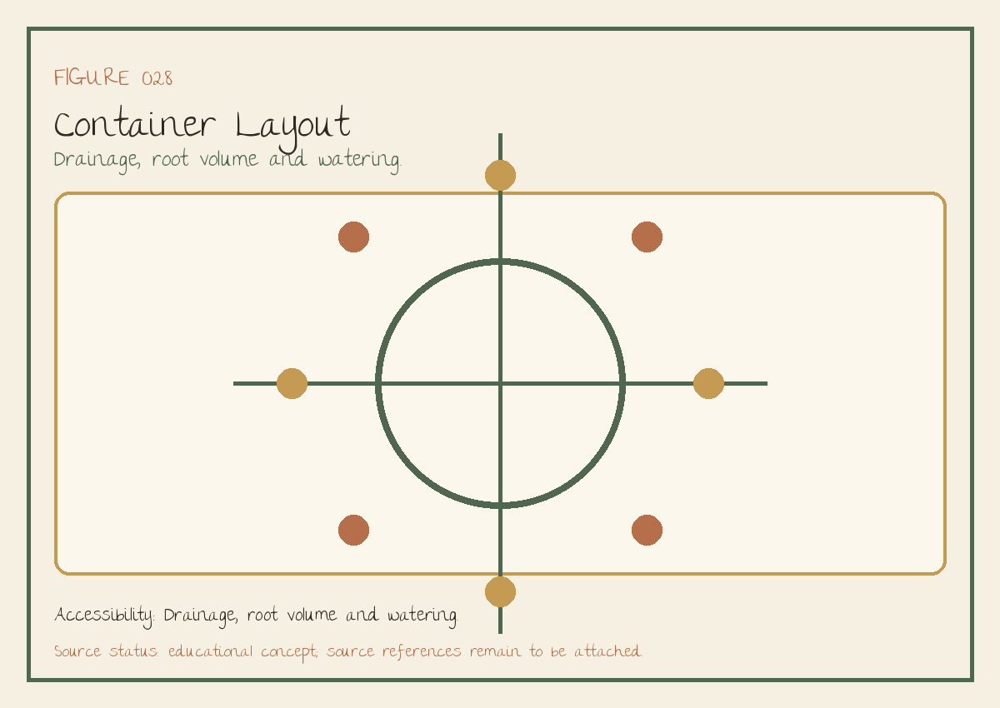

## Figure 029. Vertical Growing. Trellis, tie points and airflow.

**Figure ID:** `FIG-029`
**Description:** Trellis, tie points and airflow.
**Accessibility text:** Vertical Growing: Trellis, tie points and airflow.
**Publication location:** Errington Gardening Encyclopedia
**Status:** CONCEPT_PENDING_REVIEW

## Figure 030. Beneficial Insects. Lady beetle, lacewing, hoverfly and bee.

**Figure ID:** `FIG-030`
**Description:** Lady beetle, lacewing, hoverfly and bee.
**Accessibility text:** Beneficial Insects: Lady beetle, lacewing, hoverfly and bee.
**Publication location:** Errington Gardening Encyclopedia
**Status:** CONCEPT_PENDING_REVIEW

## Figure 031. Integrated Pest Management. Prevent, monitor, identify, act, evaluate.

**Figure ID:** `FIG-031`
**Description:** Prevent, monitor, identify, act, evaluate.
**Accessibility text:** Integrated Pest Management: Prevent, monitor, identify, act, evaluate.
**Publication location:** Errington Gardening Encyclopedia
**Status:** CONCEPT_PENDING_REVIEW
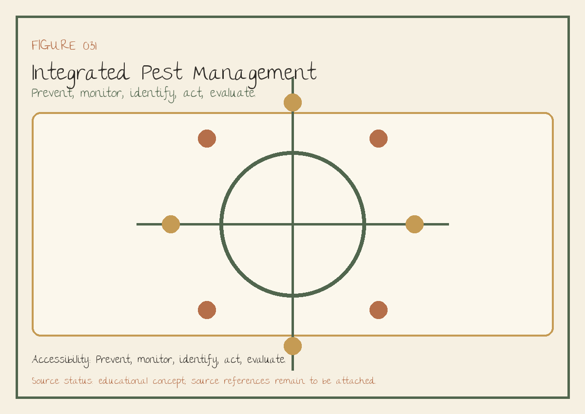

## Figure 032. Plant-Problem Decision Tree. Symptoms to water, pests, disease or nutrients.

**Figure ID:** `FIG-032`
**Description:** Symptoms to water, pests, disease or nutrients.
**Accessibility text:** Plant-Problem Decision Tree: Symptoms to water, pests, disease or nutrients.
**Publication location:** Errington Gardening Encyclopedia
**Status:** CONCEPT_PENDING_REVIEW

## Figure 033. Annual Growing Cycle. Prepare, sow, grow, harvest and preserve.

**Figure ID:** `FIG-033`
**Description:** Prepare, sow, grow, harvest and preserve.
**Accessibility text:** Annual Growing Cycle: Prepare, sow, grow, harvest and preserve.
**Publication location:** Errington Gardening Encyclopedia
**Status:** CONCEPT_PENDING_REVIEW

## Figure 034. Frost Protection. Cover, anchor and remove in morning.

**Figure ID:** `FIG-034`
**Description:** Cover, anchor and remove in morning.
**Accessibility text:** Frost Protection: Cover, anchor and remove in morning.
**Publication location:** Errington Gardening Encyclopedia
**Status:** CONCEPT_PENDING_REVIEW

## Figure 035. Harvest Maturity Checks. Colour, size, firmness and time of day.

**Figure ID:** `FIG-035`
**Description:** Colour, size, firmness and time of day.
**Accessibility text:** Harvest Maturity Checks: Colour, size, firmness and time of day.
**Publication location:** Errington Gardening Encyclopedia
**Status:** CONCEPT_PENDING_REVIEW
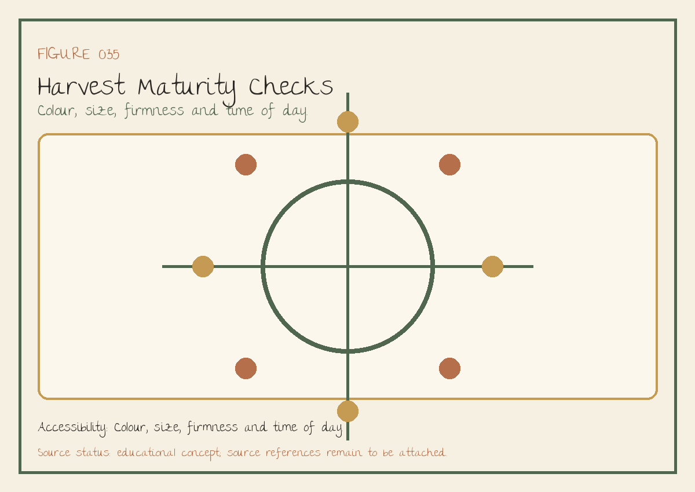

## Figure 036. Native-Pollinator Habitat. Nectar, host plants, water and shelter.

**Figure ID:** `FIG-036`
**Description:** Nectar, host plants, water and shelter.
**Accessibility text:** Native-Pollinator Habitat: Nectar, host plants, water and shelter.
**Publication location:** Errington Gardening Encyclopedia
**Status:** CONCEPT_PENDING_REVIEW

# Practical worked examples

Each example gives an objective, materials, preparation, procedure, expected result, common mistakes and troubleshooting.

## Example 01: Planning a raised vegetable bed

**Objective:** Use one 4 ft x 8 ft bed; 32 sq ft.
**Materials:** Tape, stakes, compost, soil test.
**Preparation:** Map orientation and access; mark corners; add 8-12 in of soil mix; leave 24 in paths.
**Procedure:** A flat, accessible bed with full sun and 32 sq ft planting area.
**Expected result:** Deep paths, untreated edging, and compacted soil.
**Common mistakes:** Measure sun and drainage before planting; correct compaction.
**Troubleshooting:** Not specified

## Example 02: Preparing soil

**Objective:** Assess and improve a loam bed.
**Materials:** Soil test, fork, compost.
**Preparation:** Avoid wet digging; remove weeds; incorporate mature compost only as indicated; rake level.
**Procedure:** Stable, friable soil and even drainage.
**Expected result:** Working saturated soil or adding excess amendments.
**Common mistakes:** Retest and correct drainage before replanting.
**Troubleshooting:** Not specified

## Example 03: Starting seeds indoors

**Objective:** Start a cool-season tray.
**Materials:** Seed tray, sterile mix, labels, light.
**Preparation:** Sanitize tray; fill; sow at packet depth; label; mist; provide 14-16 hr light.
**Procedure:** Even germination and compact seedlings.
**Expected result:** Overwatering, deep sowing and heat mats misused for cool crops.
**Common mistakes:** Vent, thin and reduce moisture.
**Troubleshooting:** Not specified

## Example 04: Calculating planting spacing

**Objective:** Fit 32 lettuce transplants in 32 sq ft.
**Materials:** Tape, seed packet spacing.
**Preparation:** Use 12 in on-center spacing; 4 columns x 8 rows on a 4 x 8 bed.
**Procedure:** Eight staggered short rows.
**Expected result:** Mixing mature spread and row spacing.
**Common mistakes:** Check the exact cultivar and recalculate.
**Troubleshooting:** Not specified

## Example 05: Transplanting seedlings

**Objective:** Move hardened starts safely.
**Materials:** Plant tags, trowel, water.
**Preparation:** Water before; plant to correct depth; firm gently; water at soil line.
**Procedure:** No wilt after establishment.
**Expected result:** Planting too deep or leaving air pockets.
**Common mistakes:** Rewater and add mulch away from stems.
**Troubleshooting:** Not specified

## Example 06: Hardening off plants

**Objective:** Adapt indoor plants to outdoor conditions.
**Materials:** Tray, sheltered location.
**Preparation:** Day 1-2 shade and wind protection; increase light and exposure; bring in if frost threatens.
**Procedure:** Plants tolerate direct outdoor conditions.
**Expected result:** Sunburn, wind damage or skipped frost protection.
**Common mistakes:** Restart gradual exposure.
**Troubleshooting:** Not specified

## Example 07: Planning succession crops

**Objective:** Sow radish or lettuce every 14 days.
**Materials:** Seed, labels, calendar.
**Preparation:** Divide a bed into blocks; sow block one; repeat after 14 days.
**Procedure:** Continuous small harvests.
**Expected result:** Oversowing one large harvest window.
**Common mistakes:** Thin and stagger sowings.
**Troubleshooting:** Not specified

## Example 08: Crop rotation

**Objective:** Rotate four crop families.
**Materials:** Bed map and labels.
**Preparation:** Group nightshades, brassicas, legumes and roots; move each group one bed annually.
**Procedure:** Rotation notes and reduced repeated-family pressure.
**Expected result:** Assuming rotation replaces pest diagnosis.
**Common mistakes:** Keep records and diagnose symptoms.
**Troubleshooting:** Not specified

## Example 09: Supporting climbing plants

**Objective:** Support peas or pole beans.
**Materials:** Netting, stakes, ties.
**Preparation:** Install support before planting; direct seedlings beside support; loose-tie growth.
**Procedure:** Stable vines and harvest access.
**Expected result:** Tying tightly or staking after roots are disturbed.
**Common mistakes:** Replace damaged ties with soft, slack loops.
**Troubleshooting:** Not specified

## Example 10: Pruning shrubs and perennials

**Objective:** Remove dead or crossing growth safely.
**Materials:** Clean shears, gloves.
**Preparation:** Identify live wood and branch union; remove dead wood; avoid spring-blooming shrub cuts after bud set.
**Procedure:** Healthy structure and accurate timing.
**Expected result:** Heavy pruning at the wrong season.
**Common mistakes:** Stop and confirm species timing.
**Troubleshooting:** Not specified

## Example 11: Dividing perennials

**Objective:** Divide a crowded clump.
**Materials:** Fork, knife, labels.
**Preparation:** Lift dormant or post-bloom clump; divide at natural joins; replant promptly.
**Procedure:** Two or more viable divisions.
**Expected result:** Planting pieces too deep or dividing in frost/heat.
**Common mistakes:** Replant and water; reserve uncertain species for review.
**Troubleshooting:** Not specified

## Example 12: Growing berries

**Objective:** Establish a small berry row.
**Materials:** Berry starts, mulch, supports.
**Preparation:** Improve drainage; set at nursery depth; mulch; net if appropriate.
**Procedure:** Healthy growth and harvestable fruit.
**Expected result:** Mulch against crowns or overfeeding.
**Common mistakes:** Remove mulch from crowns and verify nutrient needs.
**Troubleshooting:** Not specified

## Example 13: Managing irrigation

**Objective:** Water a 4 x 8 bed efficiently.
**Materials:** Irrigation tubing, controller, catch cups.
**Preparation:** Zone bed; measure application; water the root zone in the morning as needed.
**Procedure:** Even moisture without runoff.
**Expected result:** Daily shallow watering or saturated soil.
**Common mistakes:** Check soil below surface and adjust.
**Troubleshooting:** Not specified

## Example 14: Diagnosing plant problems

**Objective:** Separate similar symptoms.
**Materials:** Notebook, hand lens.
**Preparation:** Observe distribution, soil moisture, roots and damage pattern; use an IPM decision tree.
**Procedure:** Narrowed diagnosis and a conservative next step.
**Expected result:** Treating every yellow leaf as deficiency.
**Common mistakes:** Review pest/disease evidence and consult qualified local support.
**Troubleshooting:** Not specified

## Example 15: Protecting from frost

**Objective:** Protect a tender transplant row.
**Materials:** Cover, stakes, weight.
**Preparation:** Anchor cover before frost; keep fabric from stems; remove in morning if warming.
**Procedure:** Reduced radiative frost exposure.
**Expected result:** Sealing plants in wet plastic or leaving covers in sun.
**Common mistakes:** Use breathable cover and remove promptly.
**Troubleshooting:** Not specified

## Example 16: Harvesting and preserving produce

**Objective:** Harvest and preserve small beans.
**Materials:** Basket, clean knife, freezer boxes.
**Preparation:** Harvest when tender; chill promptly; blanch or freeze according to verified guidance.
**Procedure:** Fresh, labelled preserved produce.
**Expected result:** Freezing raw unverified produce or unsafe water-bath assumptions.
**Common mistakes:** Use tested preservation directions.
**Troubleshooting:** Not specified

## Example 17: Establishing pollinator habitat

**Objective:** Create a season-long pollinator strip.
**Materials:** Native plants, mulch, water.
**Preparation:** Plan spring to fall bloom, avoid pesticides, preserve bare-soil and shelter zones.
**Procedure:** Diverse, pesticide-minimized habitat.
**Expected result:** Claiming that every exotic ornamental is native support.
**Common mistakes:** Use verified regional native lists.
**Troubleshooting:** Not specified

## Example 18: Establishing a compost bin

**Objective:** Produce a stable compost pile.
**Materials:** Lidded bin, browns, greens, fork.
**Preparation:** Layer browns and greens, maintain damp sponge moisture and aerate.
**Procedure:** Dark, earthy compost with little odour.
**Expected result:** Adding meat/disease material or soggy greens.
**Common mistakes:** Balance carbon, moisture and aeration.
**Troubleshooting:** Not specified

