# Errington Gardening Encyclopedia

Source transcriptions and working plant registry for Errington, BC

# Core Handbook

# Errington Gardening Encyclopedia

## Errington Reference Manuscript

## Editorial Standard

This working manuscript preserves supplied source material and earlier editorial notes. Claims not supported by accessible, claim-level citations are unverified and are not publication-ready. The supplied calendar PDF is present, but its author and source history are unknown. The referenced 2017 pollinator guide and web reference books are not checked into this repository, so the existing summary and citations to them have not been independently rechecked. This manuscript does not reproduce the books' prose or illustrations.

### Sources In Scope

1. The supplied 89-page Errington calendar PDF, its derived text extraction in [ERRINGTON_CALENDAR_FULL_TEXT.md](ERRINGTON_CALENDAR_FULL_TEXT.md), and the crop and ornamental chart images in this repository. The PDF's source history is not established; the extraction is not independent confirmation.
2. The 2017 *Selecting Plants for Pollinators: Eastern Vancouver Island* guide, cited in an earlier draft as the regional pollinator guide [1]. The guide is not checked into this repository and its cited content has not been rechecked for this build.
3. The supplied *Encyclopedia of Plants and Flowers* ([Internet Archive item](https://archive.org/details/encyclopediaofplantsandflowers)), *Trees, Leaves, Flowers and Seeds: A Visual Encyclopedia of the Plant Kingdom* (DK, 2019; [Internet Archive item](https://archive.org/details/trees-leaves-flowers-and-seeds-a-visual-encyclopedia-of-the-plant-kingdom-dk-2019/mode/2up)), and *Illustrated Encyclopedia* ([Internet Archive item](https://archive.org/details/illustratedencyc00wrig/page/38/mode/2up)). Use these as references for supported plant facts; verify the exact edition and page before adding page-specific citations.
4. The supplied [Reader's Digest gardening reference PDF](Vegetable_Gardening_Encyclopedia_With_Sp.pdf), used only for general gardening topics and not as an Errington timing authority.

## 1. Welcome To Gardening In Errington

The available Errington calendar materials give approximate last- and first-frost dates of April 15 and October 15. The calendar text extraction identifies Zone 8a, while both summary-chart images are branded Zone 8b. The zone labels conflict and are retained as printed; neither label should be treated as a measured property-level rating. The frost dates are planning anchors, not guarantees.

This encyclopedia organizes local timing, plant scope, general gardening topics, and regional pollinator guidance for gardeners in Errington. Local calendar timing remains distinct from broader horticultural advice.

## 2. How To Use This Encyclopedia

Use this working manuscript in three passes rather than reading it front to back every time.

1. Start with the climate and frost sections to understand the operational limits of the season.
2. Read the garden-foundation chapters before preparing beds, sowing seed, or transplanting.
3. Use the crop and ornamental inventories only as a list of names visible in the supplied local charts; transcription and taxonomic identity remain under review.

This manuscript distinguishes between three kinds of information, none of which should be considered independently verified solely because it appears here.

1. Local calendar evidence: entries in the available text extraction and visible chart legends, plant lists, and frost anchors.
2. Regional ecological guidance: information in the Eastern Vancouver Island pollinator guide, which covers an ecoregion and must not be presented as Errington-only data.
3. General reference guidance: horticultural material from the supplied reference books, used with attribution and without overriding local calendar timing.

## 3. Errington Climate Profile

The source set contains a hardiness-zone discrepancy:

1. The 89-page calendar text extraction identifies Errington as Zone 8a and reports an approximate 183-day frost-free period, approximately 1,200 mm annual rainfall, and winter lows rarely below -12 C. These are values reported by the calendar, not independently verified measurements [E1, pp. 1-3].
2. The crop and ornamental summary images are both branded as Errington Zone 8b.
3. Both forms of calendar material show approximate frost anchors of April 15 and October 15 [E1, pp. 1, 4; crop and ornamental charts].

The calendar extraction describes mild maritime winters, dry spells in July and August, and long summer daylight. Those are source-reported regional descriptions, not a substitute for observing a specific garden's exposure, drainage, elevation, wind, cold-air drainage, or frost pockets.

The USDA Plant Hardiness Zone Map describes average annual extreme minimum winter temperatures; Natural Resources Canada's Plant Hardiness Zones use a different model based on multiple climate variables. Neither is interchangeable with an average last spring frost, an average first autumn frost, or an observed frost in a particular year. Consult the current [USDA map](https://planthardiness.ars.usda.gov/) and [Natural Resources Canada hardiness information](https://planthardiness.gc.ca/index.php?lang=en&m=17) for their definitions. The repository has not established which zone system the supplied Errington documents intend.

Use the frost anchors only as approximate source planning indicators, not assurances that frost cannot occur outside those dates. A garden's exposure, elevation, cold-air drainage, wind, soil drainage, raised beds, shelter, and season-extension methods can affect local conditions. The calendar legend also supports a mixed seasonal strategy:

1. Some plants are started indoors before outdoor conditions are stable.
2. Some are direct sown once conditions allow.
3. Ornamentals are also managed through bloom and divide cycles, not only sowing and transplant dates.

Errington gardening therefore involves protected starts, outdoor transitions, harvest timing, bloom display, and perennial maintenance throughout the year.

### Turning a climate label into a garden decision

A hardiness zone describes winter survival potential under a particular mapping system; it does not promise a frost-free growing season or predict the weather in a particular garden. USDA and Natural Resources Canada use different systems and inputs. A zone, a frost-date estimate, the length of a frost-free period, and a thermometer reading are four different kinds of information. Do not convert one into another.

For each planting decision, keep four questions separate:

1. **Can this perennial survive typical winter cold here?** Check a stated hardiness rating and its system, plus local survival records. This does not establish whether a seedling is ready to go outdoors this week.
2. **Is frost plausible soon?** Check the current local forecast and your own garden observations. These do not establish a guaranteed frost-free date.
3. **Is the soil workable?** Check moisture and structure by hand. This does not establish the plant's exact temperature requirement.
4. **Is this crop appropriate here?** Check guidance for the named crop or cultivar and compare it with your own season records. One garden's result does not guarantee success across Errington.

Use the plant profile's evidence and current conditions together. If either is unknown, record the uncertainty and choose a reversible, low-cost step—such as sowing a small trial or keeping a transplant protected—rather than committing the whole bed.

### Observe before assigning a microclimate

Map the growing area and mark buildings, fences, trees, slope, drains, paths, and water access. For at least a week in the season you plan to garden, note where direct sun falls in the morning, midday, and late afternoon. Repeat when tree leaves or sun angle change. Mark observations, not assumptions: “sun until 11 a.m.” is more useful than “part shade.”

After rain or irrigation, record where water stands and where surfaces dry first. Note wind direction and shelter, especially at plant height. Low points may collect cold air; a wall may shelter wind but reflect heat. Treat these as hypotheses until repeated observations support them. One thermometer reading from one night is not a climate normal. If you use a min/max thermometer, record its location, height, date, and protection so readings from different places can be compared honestly.

## 4. Frost Dates, Risk Windows, And Seasonal Rules

The source-reported April 15 and October 15 anchors are not guaranteed frost dates or independently calculated local averages. Check current forecasts and observe the garden before acting.

### Spring Rule Set

1. Treat frost-sensitive plants according to their verified hardiness and current forecast, not a fixed calendar date.
2. Use indoor sowing and protection only where plant-specific guidance supports it.
3. Harden off transplants and assess soil and weather conditions before planting out.

### Summer Rule Set

1. Continue to respond to weather and site conditions rather than assuming frost risk has passed on a fixed date.
2. The season's main work becomes watering, weeding, mulching, support, and monitoring for health issues.
3. Growth management matters as much as planting timing.

### Autumn Rule Set

1. Treat autumn frost risk as variable; monitor forecasts and protect or harvest tender crops when conditions require.
2. Plan harvest and preservation around crop maturity and actual conditions, not an assumed frost deadline.
3. Perennial maintenance and division tasks should be timed around dormancy rather than peak bloom.

### Winter Rule Set

1. Winter is the planning and recordkeeping season.
2. It is the right time to review what the garden produced, what failed, and what should be changed.
3. It is also the right time to prepare indoor sowing plans for the coming season.

### Spring frost decision routine

1. **Identify the plant and stage.** A newly emerged seedling, hardened transplant, established perennial, and dormant bulb do not have the same risk.
2. **Check the forecast for the garden area.** Note the forecast minimum, wind, cloud cover, and whether protection can be installed before evening. A forecast is still uncertain.
3. **Check the site and soil.** A protected patio may differ from an exposed low bed. Wet, cold soil can delay establishment even when air temperatures look acceptable.
4. **Choose a response.** Delay, plant a small trial, harden off, or apply a suitable temporary cover. Follow plant-specific guidance for temperature limits and cover handling.
5. **Record what happened.** Note minimum temperature, location, protection, and plant response. Repeated notes are more useful than memory.

### Frost-protection checklist

- Have the cover, hoops, clips, and weights ready before the forecast event.
- Use a cover that will not crush or abrade foliage; secure it against wind.
- Keep plastic from resting directly on leaves unless the product is specifically designed for that use.
- Remove, vent, or adjust covers when conditions warm, following the material's instructions; a covered bed can overheat.
- Inspect after the event and distinguish cold injury from drought, disease, or physical damage before treating.

**Worked example — a tender transplant with a cool forecast.** A gardener has a tomato transplant ready, but the forecast and exposed bed suggest a cold night. The calendar date alone does not settle the decision. The gardener checks the plant's verified temperature guidance, compares the forecast with a sheltered site, and either delays planting or uses a suitable cover with a plan to remove or vent it. Only one or two plants go out first. The gardener records the minimum temperature, cover, and result before scaling up. This is a risk-management trial, not a claim that a particular date is safe in Errington.

## 5. Planning The Garden

The local vegetable encyclopedia PDF is clear on one point that applies directly to Errington: a successful garden begins with a plan, not with impulse planting. The source argues that it is easier to revise beds, spacing, and planting order on paper than to correct mistakes after the ground is full.

That principle fits the Errington calendars well. Because the local project includes indoor sowing, outdoor transplanting, direct sowing, bloom periods, and division windows, gardeners in Errington benefit from a written plan that includes more than crop names.

Every annual garden plan should define:

1. What is being grown.
2. Where each crop or ornamental block will sit.
3. Which items require indoor starts.
4. Which items can be direct sown.
5. Which items need supports, cages, or trellises.
6. Which areas are reserved for perennials, bulbs, or long-term plantings.

The PDF also emphasizes recordkeeping. That advice is worth adopting directly. A working garden ledger for Errington should include:

1. Bed plans.
2. Sowing dates.
3. Transplant dates.
4. Harvest results.
5. Pest and disease observations.
6. Watering and fertility notes.
7. Overwintering or division notes for ornamentals.

### Site survey and map

Sketch the property or growing area and mark fixed features: buildings, fences, trees, paths, taps, drains, slopes, and existing beds. Add a north arrow. Record direct sun at morning, midday, and late afternoon; repeat in the season when you intend to grow because tree leaf-out, shadows, and sun angle change. Note wind exposure, places where water stands, dry edges near roofs or tree roots, and practical routes for a hose, wheelbarrow, and harvest basket.

Do not assume a south-facing wall is always beneficial: reflected heat can stress some plants, and shelter can reduce air movement. Match the micro-site to the plant rather than labeling an entire yard “sunny” or “sheltered.”

### Access, mature size, and bed layout

Draw each bed to scale. Keep its center reachable from an edge, or split it into narrower sections with a path. Avoid layouts that require stepping on growing soil: repeated traffic compacts it. Put tall or trellised plants where their shade will not unintentionally fall over smaller sun-demanding crops; verify mature size and support needs for the actual plant, not just its common name. Mark supports, irrigation lines, permanent plantings, and paths before digging.

For a rectangular bed, convert the planting area to the same units as the recommended spacing. If the plant-specific source recommends spacing of `s` inches in both directions, a rough upper-bound grid count is:

`floor(bed length in inches / s) × floor(bed width in inches / s)`

This estimate ignores edge clearance, access, staggered arrangements, mature canopy, trellis orientation, and whether the source describes spacing between plants or rows. Always follow the plant-specific recommendation and allow working room.

**Worked example — marking a 4-by-8-foot bed.** The bed is 48 by 96 inches. A hypothetical crop with a verified 12-inch spacing could fit at most 4 × 8 positions on a simple 12-inch grid before edge clearance or access is considered. The gardener draws that grid, checks the crop source for row and edge recommendations, then reduces the count if needed. The 12-inch value demonstrates arithmetic; it is not a recommendation for any named crop.

### Succession planning and the garden ledger

Divide the growing area into labeled blocks. For each block, record the first crop, the condition that will signal its finish, the next crop's verified requirements, and the time needed to prepare the bed. When local timing is uncertain, use observable triggers—such as a crop being harvested or a bed becoming available—instead of inventing a date. Do not schedule a second crop solely because a generic calendar says it should fit.

Record the map, seed or plant source, sowing and transplant dates, weather notes, harvest quantity, pest observations, and changes for next year. Record failures as well as successes; an unsuccessful planting still reveals something if its location and method were noted.

## 6. Soil Preparation And Bed Building

The soil chapter in the PDF provides the right general backbone: soil must supply water, nutrients, gases, and stable support for roots. That principle transfers cleanly to the Errington project because every plant in the local scope depends on the same fundamentals even when exact timing differs.

For this manuscript, the practical soil-preparation rule is simple: do not assume the existing ground is ideal. Build productivity deliberately.

Key soil principles for this project:

1. Productive beds require structure as well as fertility.
2. Root growth depends on both moisture access and aeration.
3. Soil preparation is not a one-time task; it is a seasonal maintenance system.

Recommended bed-building workflow:

1. Choose the growing area before buying plants or seed in volume.
2. Remove obvious construction debris, compaction, and persistent weeds.
3. Build beds that are easy to reach, weed, water, and replant.
4. Keep annual production zones distinct from perennial ornamental zones where possible.
5. Prepare support locations early for crops that climb, sprawl, or need staking.

The PDF also reinforces a practical economic point: good tools and deliberate bed preparation save corrective labor later. For this encyclopedia, that means bed layout and soil improvement are part of the crop plan, not separate chores.

### Diagnose before amending

“Rich soil” is not a diagnosis. Compaction, poor drainage, unsuitable pH, salinity, or an imbalance of nutrients cannot be reliably corrected by adding compost or fertilizer at random.

- **Texture** is the relative proportion of sand, silt, and clay particles. It changes slowly.
- **Structure** is how particles form aggregates and pore spaces. Traffic, wet cultivation, roots, and organic matter influence it.
- **Drainage** describes how water moves through and away from the rooting zone. A heavy-looking soil is not automatically waterlogged, and a sandy-looking surface is not proof that the full root zone drains well.
- **Organic matter** supports soil structure and biological activity, but it does not replace a nutrient test or guarantee that a mix is suitable.
- **pH and nutrients** are measured with a defined method. Visual guesses are not a substitute for an appropriate soil analysis.

Compare several parts of the proposed bed after rain and again after a dry interval. Note standing water, crusting, cracking, compaction, root penetration, and how long the surface remains wet. Dig a small inspection hole in an inconspicuous spot and look for abrupt fill layers, construction debris, dense pans, or persistent water. A hand-texture or settling-jar demonstration can help compare samples, but it is only rough screening; it does not provide reliable pH, nutrient, salinity, or drainage diagnosis.

When crop performance, soil history, or proposed amendments raise a nutrient or pH question, use a reputable laboratory and follow its sampling instructions. The result is useful only if it represents the area being managed and is interpreted for the intended crop. BC soil-management guidance emphasizes matching management to soil conditions and test information rather than applying nutrients without a basis [S1].

### Work soil at the right moisture

Take a handful from the working depth and squeeze gently. If it smears, glistens, or stays in a dense sticky mass, wait. If it crumbles into aggregates with gentle pressure, it is more workable. This is a practical field check, not a laboratory measurement. Working wet soil can destroy structure and leave compacted clods that persist after drying.

For established beds, prefer the least disturbance needed to prepare a planting space. Remove perennial weeds carefully, loosen only where compaction is present and soil is workable, and keep regular paths in paths. Do not dig deeply through tree roots or unknown utilities.

### Amend conservatively

Before adding lime, sulfur, fertilizer, manure, or a concentrated amendment, identify the problem and check a soil test or authoritative crop-specific recommendation. The wrong amendment can make a bed harder to manage. Mature, known compost can be used as an organic-matter input, but its source and quality matter; avoid assuming any material labeled “compost” is low in salts, weed seeds, or contaminants. Keep amendments off plant crowns and follow the product label.

### Raised-bed design and volume calculation

Raised beds can make access and soil management easier, but a frame alone does not solve a drainage or contaminated-soil problem. Decide first whether an in-ground bed, low mound, or framed bed fits the site. Check access, slope, water supply, material safety, and the condition of the underlying ground. Choose a width that allows the center to be reached from the edges, and leave a path wide enough for the equipment actually used. OSU Extension's raised-bed guidance likewise recommends assessing the site, choosing a workable bed width, and using a soil test to guide nutrient decisions [S2]. Its specific recommendations are regional guidance, not a prescription for every Errington property.

For a rectangular bed, multiply length × width × fill depth in the same units, then convert cubic feet to cubic yards by dividing by 27. A 4 × 8-foot bed filled 8 inches deep has a nominal volume of:

`4 ft × 8 ft × (8/12 ft) = 21.3 cubic feet ≈ 0.79 cubic yard`

This is geometric volume, not a guaranteed purchase quantity. Settling, the bed's shape, existing soil, and the material's moisture and compaction alter the delivered amount. Confirm volume and intended use with the supplier; this arithmetic does not prescribe a soil mix.

**Worked example — preparing one vegetable bed.** The gardener maps sun, access, and water; checks the native soil and site history; marks the frame and paths; removes persistent weeds; and checks whether the ground can be worked without smearing. The gardener selects a growing medium appropriate to the bed and intended crops, estimates volume from the inside dimensions, and checks whether a test is warranted before adding nutrients. After filling, the gardener waters to settle the medium, checks for low spots, and records what was delivered. The result is a reachable, documented bed—not an assumption that all raised-bed soil is fertile.

## 7. Planting Methods And Seasonal Setup

The local crop calendar and ornamental calendar both imply a multi-method planting system rather than a single workflow.

The methods named in the supplied local sources are:

1. Start seeds indoors.
2. Transplant outdoors.
3. Direct sow outdoors.
4. Track bloom periods for ornamentals.
5. Track dormancy or division periods for perennial ornamentals.

The PDF's planting chapter adds the general decision framework behind those methods: the choice between seed and transplant depends on climate, crop type, available time, and the gardener's ability to manage young plants.

For Errington, that yields the following operating guidance:

1. Use indoor starts for plants that need an earlier launch than the outdoor frost window safely allows.
2. Use direct sowing where the plant tolerates local outdoor conditions at the time the chart indicates.
3. Use transplants to compress risk and bring established young plants into the garden after the frost threshold has passed.
4. Reserve space early for trellised, staked, or caged plants.

The PDF also highlights the value of straight, organized planting lines and deliberate spacing. Even without exact local spacing tables transcribed yet, the structural lesson still applies: orderly planting improves weeding, watering, harvesting, and observation.

### Botanical clues for choosing a task

Plant names and life histories tell you what kind of care question to ask, but they do not replace a profile for the identified plant.

- **Annual, biennial, perennial:** These describe a plant's life cycle, not its winter hardiness. A perennial may still be injured by local cold or wet soil; an annual may reseed; a biennial may be grown for leaves in its first season and reproductive structures later. Verify the plant and intended harvest.
- **Roots:** Roots anchor the plant and absorb water and minerals; some also store reserves. A shallow root zone can dry quickly, while damage to a plant's main roots can disrupt establishment. Look for roots before dividing or transplanting, and do not assume every below-ground storage organ is a root.
- **Stems and growing points:** Stems support leaves and flowers and carry growth points. A pruning cut can remove a flowering or regrowth point, so identify where a plant forms new shoots and flowers before pruning. The correct cut and season depend on the species and whether it flowers on old or new growth.
- **Leaves:** Leaf arrangement, shape, margin, attachment, and venation help describe a plant. Record several traits from mature and young growth; a single leaf or damaged specimen is rarely enough to settle an identification.
- **Flowers, fruits, and seeds:** Flower structure can support identification and indicates the reproductive stage. Fruits generally contain seeds, though seedless forms occur; familiar culinary labels do not always map neatly to botanical fruit types. For garden work, record whether a crop is being grown for leaves, roots, flowers, fruits, or seeds, because harvest stage changes what part is protected or removed.
- **Storage organs and spores:** Bulbs, corms, tubers, and rhizomes differ in structure and should not be used as interchangeable names. Ferns reproduce by spores rather than flowers and seeds. Check the plant's identified profile before lifting, dividing, or storing an underground structure.

Plant families group related taxa and can help organize a collection or flag questions for succession planning, shared pests, or compatible care. Family membership alone does not prove that two plants have the same requirements or that a companion-planting claim is valid. Use the accepted name and family from a taxonomic source, then verify the cultivation claim for the plant concerned. Common names can refer to unrelated plants, so a family-level guess is not a substitute for resolving the registry identity.

### Indoor seed-starting sequence

Seeds vary in germination temperature, light response, depth, and storage life. Follow the packet or a reliable plant-specific reference. Do not bury every seed at the same depth: where the source gives no depth, mark the value as unknown and seek a source before sowing a large batch.

1. **Select the crop and quantity.** Check whether the plant is normally started indoors or direct sown, and whether the seed is still viable. Label every container with crop, cultivar if known, and sowing date.
2. **Prepare clean containers.** Provide drainage holes and a clean, suitable seed-starting medium. Clean reused containers. Garden soil may compact in small containers and can bring weeds or organisms with it.
3. **Sow to the plant-specific depth.** Moisten the medium evenly, sow the seed, cover only as directed, and label immediately.
4. **Provide stated germination conditions.** Check the seed source for temperature and light needs. Keep the medium moist, not saturated; standing water limits air around roots.
5. **After emergence, provide strong light and air movement.** Keep seedlings from becoming elongated and weak. Follow the light fixture's safe distance and operating instructions. Rotate trays if light is uneven.
6. **Thin or transplant carefully.** Keep the strongest seedlings at appropriate spacing. Handle by a leaf rather than crushing the delicate stem; water the medium first if roots are stuck.
7. **Harden off gradually.** Before permanent outdoor planting, increase exposure to outdoor light, wind, and temperature over several days. Begin in a protected, shaded location and increase exposure as plants tolerate it. Bring plants in or protect them when conditions exceed their known tolerance. A calendar date alone does not complete hardening. OSU Extension describes gradual exposure before transplanting in its Pacific Northwest coastal guidance; that regional source does not establish Errington-specific dates [S3].

### Direct-sowing procedure

Prepare a fine, level seedbed only when soil is workable. Follow the crop's depth and spacing guidance, water gently so seeds are not displaced, and keep the surface from drying during germination. Mark rows and labels before sowing. If a row fails, check moisture, depth, temperature, seed age, and disturbance before sowing again; changing one variable at a time makes the result informative.

### Transplanting checklist

- The plant identity and planting depth are known.
- The transplant is healthy and has been hardened off.
- Soil is workable and the site is ready; forecast risk has been considered.
- The root ball is moist but not waterlogged.
- The hole accommodates roots without bending them sharply.
- The plant is set at the depth appropriate to its species.
- Soil is firmed gently, watered in as appropriate, and labeled.
- Temporary protection and support are ready if needed.
- The plant is checked again for establishment, moisture, and pests.

**Worked example — a tray of seedlings.** A gardener starts a small test batch from one seed packet, labels each cell, and notes the source's depth and temperature instructions. Once seedlings emerge, the gardener gives them adequate light and checks moisture by feel instead of watering by the clock. Before transplanting, the gardener gradually exposes them to outdoor conditions, then plants a few first in a prepared bed. If they wilt or scorch, the gardener checks the root ball, exposure, wind, and moisture before changing the rest of the batch.

## 8. Garden Care, Water, Mulch, And Maintenance

The PDF's care chapter frames the garden correctly: planting is only the beginning. Once the garden is established, the main production risks come from neglect of routine tasks.

The core maintenance system for this project is:

1. Weed early and regularly.
2. Water consistently enough to prevent stress and weak growth.
3. Support sprawling or climbing crops before they collapse into disorder.
4. Remove declining or damaged material before it becomes a larger health issue.
5. Treat mulching as part of moisture and weed management, not as decoration.

The local ornamental chart reinforces that flower gardening in Errington is not only about bloom. It also includes recurring tasks such as deadheading and dividing. Those notes matter because they shift the gardener's attention from display alone to longevity and repeat performance.

Practical maintenance principles for this manuscript:

1. Annual beds need close seasonal attention.
2. Perennials reward intervention at the right maintenance moment rather than constant disturbance.
3. The garden should be inspected often enough that weeds, drought stress, and pest pressure are caught early.

### Decide whether to water

Water needs depend on plant species, growth stage, root depth, soil, exposure, wind, rainfall, and container size. A fixed “water every few days” schedule can overwater one bed and underwater another. Check moisture below the dry surface, near active roots, in several places: under a canopy, near an edge, and at the end of a drip line. A trowel or finger is enough for a shallow check; a soil probe helps compare deeper locations.

Look for plants whose leaves wilt at a time of day when the species normally remains firm, but confirm soil moisture before concluding drought—waterlogging and root injury can also cause wilt. When watering is needed, apply it slowly enough to soak the intended rooting depth without runoff, then recheck. Drip lines and soaker hoses can reduce wet foliage, but only if their output is checked; a clogged emitter can leave one plant dry while its neighbor receives water. Place a simple catch container along a line to compare delivery at different points.

**Water-volume calculation (conversion only).** One inch of water spread over one square foot is about 0.623 US gallons. A 4 × 8-foot bed covers 32 square feet, so one inch over that area would be about 20 US gallons before runoff, evaporation, or uneven delivery. This conversion explains volume; it is not a recommendation to apply an inch at each watering.

### Mulch with a purpose

Mulch can buffer surface moisture and reduce weed emergence, but material, depth, timing, and plant type matter. Keep mulch from resting against stems or crowns, avoid burying low-growing foliage, and leave an appropriate area open around seedlings until established. A heavy layer can obstruct small seedlings; a dry mulch layer can intercept light rain before it reaches soil. Lift a corner and check below rather than judging by surface appearance.

### Ten-minute bed inspection

Walk the bed slowly and look at the same things each time:

1. New growth, leaf undersides, stems, and the soil line.
2. Moisture at root depth in more than one location.
3. Weeds before they set seed or entangle crops.
4. Ties, stakes, cages, and trellis anchors before plants lean.
5. Mulch gaps, exposed irrigation fittings, and standing water.
6. Anything unusual; photograph and date it before removing or treating.

This routine turns maintenance into early observation. It is not a substitute for identifying an issue before choosing a treatment.

## 9. Garden Health And Preventive Management

The PDF describes the correct general pattern: pests and diseases exploit stress, crowding, neglect, and delayed response. That guidance remains useful even though the local source set does not yet contain a verified Errington-specific pest matrix.

The preventive system supported by the source set is therefore conservative and practical.

1. Keep weeds down so they do not compete with crops or shelter pests.
2. Inspect leaves, stems, and young plants early rather than waiting for major damage.
3. Remove obviously failing plant material when it threatens the health of the rest of the bed.
4. Treat records as a plant-health tool so recurring issues can be traced and reduced over time.

This manuscript does not yet assert a finalized local pest-by-pest catalog because that would require source verification not currently present in the workspace.

### A repeatable diagnostic method

1. **Describe without diagnosing.** Record the plant's accepted name if known, affected part, symptom, date first noticed, and how quickly it is changing.
2. **Map the pattern.** One plant, one species, one bed edge, or many unrelated plants? A sharp boundary can suggest a site or irrigation issue; a spreading pattern merits closer inspection.
3. **Inspect both sides and the root zone.** Look for insects, eggs, webbing, feeding marks, lesions, stem injury, root discoloration, standing water, and dry soil. Use a hand lens or photograph for small details.
4. **Check recent changes.** Planting, pruning, weather, irrigation adjustments, fertilizer, mulch, or nearby construction can help explain timing.
5. **Compare with a reliable diagnostic reference.** Match several diagnostic features, not just one photograph or symptom. Ask a qualified diagnostic service when the stakes or uncertainty are high.
6. **Choose the least disruptive effective action.** Correct a confirmed watering or cultural issue first. Protect beneficial organisms and follow current product labels and local rules if a treatment is justified.
7. **Recheck and record.** Note what changed and when. If the problem worsens, revisit the diagnosis rather than escalating automatically.

Use these symptom checks to guide observation, not to make a diagnosis:

- **Wilting:** Check moisture at root depth, drainage, stem damage, recent heat, or transplanting. Do not assume the plant simply needs more water.
- **General yellowing:** Note which leaves are affected, check root moisture, and consider a soil test or normal aging. Do not infer a specific nutrient deficiency from color alone.
- **Holes or missing edges:** Inspect leaf undersides, timing, feeding pattern, and nearby hosts. Do not assume every hole requires pesticide.
- **Spots or mildew-like growth:** Check whether marks affect one leaf age or are spreading, and note air movement and wetness. Do not identify a disease from a single image.
- **Stunting:** Check roots, compaction, crowding, light, water, and planting depth. Do not assume additional fertilizer will solve it.

### Integrated pest management in practice

Prevention begins with correct identification, suitable plant choice, healthy establishment, sanitation where appropriate, and regular observation. Tolerate minor damage when the plant is not at meaningful risk. Use physical exclusion or hand removal only where safe and appropriate. Preserve beneficial organisms and habitat. If a pesticide is being considered, identify the target, confirm the product is labeled for that plant and use, read all directions, protect pollinators, and obey applicable rules. Never apply a product “just in case.”

**Worked example — leaves with new holes.** The gardener photographs the leaf and both surfaces, checks nearby plants, looks for an insect or fresh feeding, and checks whether damage is increasing. If one mature plant has a few holes and no organism is found, the gardener records and rechecks rather than spraying. If damage spreads, the gardener seeks an identification using clear photographs and plant details. The result is a better-supported decision, not a promise that the damage is harmless.

## 10. Pollinator-Supportive Gardening On Eastern Vancouver Island

**Source limitation:** The 2017 guide cited below is not available in this repository. The existing summary and page citations are preserved as unverified draft material and must be checked against the guide before publication. The figures are not Errington-specific measurements.

The earlier draft attributes an ecoregion description to the 2017 Eastern Vancouver Island pollinator guide, including a range of communities and regional precipitation estimates [1, pp. 3, 6]. These details have not been independently rechecked in this build and must not be substituted for Errington-specific measurements.

The guide's practical message is to provide habitat resources across the seasons, not merely a few attractive flowers. Pollinators need food, nesting or shelter opportunities, and water. Flowers can provide nectar and pollen; host plants support larvae of some pollinators. A diverse sequence of flowering plants can extend food availability from early spring into late fall. Grouping plants and varying flower forms, heights, and bloom periods can support a wider range of visitors [1, pp. 10, 12-15].

For home gardens, the guide recommends maintaining a mix of native and suitable garden plants, avoiding invasive non-native choices, and checking whether highly modified cultivars remain accessible to pollinators. It also recommends retaining some suitable nesting habitat, such as patches of bare ground, dead stems or wood, and leaf litter, rather than making every area uniformly manicured or heavily mulched. These are habitat options, not instructions to remove mulch everywhere; protect soil and plant roots while leaving selected nesting areas where appropriate [1, pp. 12-15, 21].

Provide a clean water source with a shallow or sloping edge so insects can approach safely. Use integrated pest management and minimize pesticide exposure; where pesticide use is unavoidable, the guide calls for extreme caution and targeted application [1, p. 12].

The guide describes different nesting needs among bee groups, including cavities, dead wood or stems, and exposed soil. Avoid disturbing active nests or managed honey-bee hives. The plant tables on pages 16-19 list regionally relevant plants and their bloom periods, but those dates describe the Eastern Vancouver Island source area and are not automatically Errington calendar dates. Use the local calendar for timing and the guide for habitat context [1, pp. 16-21].

## 11. Source-Listed Edible Crops (Unverified Transcription)

The following names appear in the supplied crop chart transcription. This inventory does not establish a species identity, a correct chart reading, or suitability for every Errington garden.

1. Arugula
2. Asparagus
3. Beans
4. Beets
5. Bell Pepper
6. Broccoli
7. Brussels Sprouts
8. Cabbage
9. Cantaloupe
10. Carrots
11. Cauliflower
12. Celery
13. Corn
14. Cucumber
15. Garlic
16. Kohlrabi
17. Leeks
18. Lettuce
19. Eggplant
20. Melons
21. Okra
22. Parsnips
23. Peas
24. Potatoes
25. Spinach
26. Sweet Potato
27. Summer Squash
28. Swiss Chard
29. Tomatoes

The normalized forms and original source spellings are preserved in [plant_registry.csv](plant_registry.csv). Corrections to chart spellings require editorial review.

## 12. Source-Listed Flowers And Ornamentals (Unverified Transcription)

The following names appear in the supplied ornamental chart transcription; they are not all resolved to species or cultivars.

### Annual Flowers

1. Marigold
2. Zinnia
3. Cosmos
4. Nasturtium
5. Sunflower
6. Sweet Pea
7. Calendula

### Perennials

1. Dahlia
2. Peony
3. Iris
4. Daylily
5. Lavender
6. Echinacea
7. Rudbeckia

### Bulbs

1. Tulip
2. Daffodil
3. Crocus
4. Allium
5. Hyacinth

### Ornamentals

1. Hostas
2. Ferns
3. Ornamental Grasses
4. Sedum
5. Heuchera
6. Astilbe

The ornamental chart also preserves management cues such as bloom tracking, dormancy or divide periods, and notes like deadheading and dividing. Those cues are central to the final ornamental chapters once the image can be transcribed with higher fidelity.

## 13. Harvest, Storage, And Preservation

The supplied Reader's Digest gardening reference provides a general preservation backbone for the edible side of the encyclopedia.

### Storage

The storage chapter in the PDF emphasizes a simple point: not every surplus has to be frozen, canned, or dried immediately. Some crops are best handled through short-term cold storage or other low-effort methods depending on the crop.

### Freezing

The PDF presents freezing as one of the simplest preservation methods and stresses rotation: frozen food should be stored in a steady turnover system rather than forgotten at the back of a freezer. For an Errington household garden, that means freezing should be treated as a seasonal management tool, not just an emergency response to surplus.

### Drying

The drying chapter frames drying as cheap, space-efficient, and independent of electrical storage once the food is fully processed. The practical lesson is that drying works best when the gardener plans for it instead of trying to improvise during a harvest rush.

### Sprouting

The sprouting chapter extends the encyclopedia beyond outdoor beds. It shows that fresh edible growth can be produced indoors through a low-equipment system using jars, screens, and moisture management. That fits naturally into an Errington gardening year because it keeps food production active even when the outdoor garden is dormant or limited.

### Herb Storage

The herb-storage chapter supports treating culinary herbs as a year-round resource. Fresh use, drying, and freezing are all part of a complete herb system, and that approach should eventually be paired with the local herb list once those plants are directly verified from primary local sources.

## 14. Operational Guidance For The Final Edition

The current source set supports a clear operating model for the final book.

1. Errington-local calendar materials govern timing, with the Zone 8a/8b label conflict left unresolved.
2. The Reader's Digest gardening reference supplies general structure, process, and preservation guidance.
3. The Eastern Vancouver Island pollinator guide supplies regional habitat context, not Errington-specific climate or timing.
4. The registry governs normalized naming, verification state, and eventual per-plant enrichment.
5. The final illustrated edition should only assert plant-level sowing, transplanting, bloom, and harvest windows once those details are directly transcribed from reliable local source material.

## 15. Appendix: Current Source-Visible Scope (Unverified)

### Climate claims reported by the supplied calendar

1. The calendar PDF reports an approximate last-frost anchor of April 15.
2. The calendar PDF reports an approximate first-frost anchor of October 15.
3. The calendar PDF says Zone 8a; both chart images say Zone 8b. The conflict is unresolved.

### Crop-chart legend as transcribed

1. Red is labeled indoor sowing.
2. Yellow is labeled transplanting outdoors.
3. Teal or green is labeled direct sowing or harvest on the crop chart.

### Ornamental-chart legend as transcribed

1. Red is labeled indoor sowing.
2. Yellow is labeled transplanting outdoors.
3. Green is labeled direct sowing.
4. Blue is labeled bloom.
5. Gray is labeled dormant or divide.

### Counts in the current chart transcription

1. 29 edible names.
2. 19 flower names across annual, perennial, and bulb groupings.
3. 6 ornamental entries.

## 16. Source Notes And Publication Status

### Source Note

[E1] Supplied *Errington BC Zone 8a Planting Calendar* PDF, 89 pages, author and source history unknown, creation date shown in PDF metadata as 2026-06-28; the derived transcription is `ERRINGTON_CALENDAR_FULL_TEXT.md`. The chart images are separate source artifacts labeled Zone 8b.
[1] The earlier draft cites Pollinator Partnership Canada and the North American Pollinator Protection Campaign, *Selecting Plants for Pollinators: A Guide for Gardeners, Farmers, and Land Managers in the Eastern Vancouver Island Ecoregion* (2017), especially pp. 3, 6, 10, 12-21. The PDF is not present in the repository; citation details and claims require rechecking. The stated scope is broader than Errington.
[S1] Government of British Columbia, “Soil Nutrient Management,” including the “Management” section, https://www2.gov.bc.ca/gov/content/industry/agriculture-seafood/agricultural-land-and-environment/soil-nutrients/management. Provincial guidance; not a soil test or property-specific recommendation.
[S2] Oregon State University Extension Service, *Raised Bed Gardening*, FS 270, https://extension.oregonstate.edu/catalog/fs-270-raised-bed-gardening. General bed-design guidance; regional recommendations must be adapted to the site.
[S3] Oregon State University Extension Service, *Growing Vegetables in the Pacific Northwest Coastal Region*, EM 9695, https://extension.oregonstate.edu/catalog/em-9695-growing-vegetables-pacific-northwest-coastal-region. Coastal-region general guidance; not a local Errington calendar.

The Internet Archive references listed in the editorial standard are source works, not text to be copied into this encyclopedia. Plant-level taxonomy, morphology, care, and timing still require traceable, plant-specific citations. A blank or unmatched registry field remains unverified rather than being filled by guesswork.

### Publication Status

The registry contains 137 records and previously generated taxonomy and cultural-profile fields. Those values have no claim-level citations in this repository and are not verified; generic profile scaffolds are omitted from the generated plant index. Fifteen entries are already marked for species/cultivar resolution. No plant taxonomy, horticultural profile, or local timing is independently verified in this build. Calendar transcription and plant inventory remain separate from future reviewed recommendations.

# Monthly Reference

# Errington Monthly Garden Reference

## How to read this calendar

These are source transcriptions, not independently reviewed recommendations. The calendar PDF identifies Zone 8a while both chart images identify Zone 8b; the discrepancy remains unresolved. April 15 and October 15 are approximate source frost anchors, not guaranteed frost dates.

Action labels are mechanically classified from transcribed wording. They are not editorially verified. Plant names joined by a slash or comma are retained as a source group and must not be interpreted as interchangeable crops.

Each entry includes its original source page. Grayscale-readable labels are used instead of relying on the source chart colours.

## Text action key

| Label | Meaning in this transcription |
|---|---|
| INDOOR SOWING | Source wording indicates indoor seed starting |
| DIRECT SOWING | Source wording indicates sowing outdoors |
| TRANSPLANTING | Source wording indicates moving established plants |
| SUCCESSION SOWING | Source wording indicates repeat sowing |
| HARVESTING | Source wording indicates picking or harvest |
| FLOWERING | Source wording indicates bloom |
| PRUNING | Source wording indicates pruning or deadheading |
| DIVIDING | Source wording indicates division |
| PROPAGATION | Source wording indicates propagation |
| SEASONAL MAINTENANCE | A seasonal action not matched to another label |
| REVIEW ACTION | The action could not be classified |

## January

### Vegetables and edible crops

#### Vegetables

- **[SEASONAL MAINTENANCE]** Seed & Crop Planning — — Order seed catalogues; plan rotations — source p. 4
- **[SEASONAL MAINTENANCE]** Garlic (overwintering) — — [Frost Risk] Mulch in place; overwintering — source p. 4
- **[HARVESTING]** Kale (overwintered) — — Light harvest if [Harvest] protected — source p. 4
- **[HARVESTING]** Chard (overwintered) — — Light harvest if [Harvest] protected [Frost Risk] — source p. 4
- **[SEASONAL MAINTENANCE]** Stored Squash / Roots — — Check cold storage; remove any rot — source p. 4 — grouped source entry; individual timing unresolved

#### Fruits & Berries

- **[PRUNING]** Apple / Pear / Plum / Cherry — — [Prune/Deadhead] Prune dormant trees Jan–Feb — source p. 5 — grouped source entry; individual timing unresolved
- **[SEASONAL MAINTENANCE]** Bare-root fruit stock — — Order from nursery now — source p. 5

#### Roots & Tubers

- **[SEASONAL MAINTENANCE]** Potatoes / Carrots / Beets — — Check cold storage; remove rot — source p. 5 — grouped source entry; individual timing unresolved

#### Legumes & Grains

- **[SEASONAL MAINTENANCE]** All legumes & grains — — Nothing this month; plan rotations — source p. 5

#### Perennial Edibles

- **[REVIEW ACTION]** Rhubarb — — Fully dormant [Frost Risk] — source p. 5
- **[REVIEW ACTION]** Asparagus — — Fully dormant [Frost Risk] — source p. 5

### Flowers and ornamentals

#### Annual Flowers

- **[INDOOR SOWING]** Snapdragons Late Jan (under lights) — — — source p. 8
- **[INDOOR SOWING]** Petunias Late Jan (under lights) — — — source p. 8
- **[INDOOR SOWING]** Lobelia Late Jan (under lights) — — — source p. 8

#### Hardy Perennials

- **[FLOWERING]** Hellebores (Lenten Rose) — — Blooming outdoors; cut[Bloom] tatty foliage — source p. 8
- **[FLOWERING / DIVIDING]** Snowdrops (Galanthus) — — Blooming; divide after [Bloom] bloom if congested — source p. 8

#### Bulbs & Corms

- **[FLOWERING]** Snowdrops (Galanthus) — — Blooming outdoors [Frost Risk][Bloom] — source p. 8
- **[SEASONAL MAINTENANCE]** Forced bulbs (indoors) — — Check for growth; keep[Bloom] in bright spot — source p. 8

#### Shrubs & Trees (Ornamental)

- **[FLOWERING / REVIEW ACTION]** Witch Hazel (Hamamelis) — — Blooming — fragrant [Bloom] winter display — source p. 8
- **[PRUNING]** Buddleja / Hydrangea paniculata — — [Prune/Deadhead] Prune hard Jan–Feb — source p. 8 — grouped source entry; individual timing unresolved

#### Bc Native Plants

- **[REVIEW ACTION]** Osoberry (Oemleria) — — Buds beginning to swell; earliest native — source p. 9

#### Cut Flowers

- **[FLOWERING]** Amaryllis (forced, indoors) — — Blooming indoors; [Bloom] stake tall stems — source p. 9 — grouped source entry; individual timing unresolved
- **[FLOWERING / REVIEW ACTION]** Paperwhite Narcissus (forced) — — Blooming indoors — [Bloom] fragrant — source p. 9

## February

### Vegetables and edible crops

#### Vegetables

- **[INDOOR SOWING]** Celery / Celeriac Wk 1 (16 wks to transplant) — — — source p. 11 — grouped source entry; individual timing unresolved
- **[INDOOR SOWING]** Leeks Wk 1–2 — — — source p. 11
- **[INDOOR SOWING]** Onions Wk 2–4 — — — source p. 11
- **[INDOOR SOWING]** Peppers (early) Wk 3–4 — — — source p. 11
- **[INDOOR SOWING]** Eggplant (early) Wk 4 — — — source p. 11
- **[HARVESTING]** Kale / Chard (overwintered) — — Light harvest if not [Harvest] frozen [Frost Risk] — source p. 11 — grouped source entry; individual timing unresolved

#### Herbs

- **[INDOOR SOWING]** Parsley Wk 1–2 (slow germinator) — — — source p. 11
- **[INDOOR SOWING]** Chives Wk 1–2 — — — source p. 11
- **[INDOOR SOWING]** Basil Wk 4 (under lights, warm) — — — source p. 11

#### Fruits & Berries

- **[PRUNING]** Apple / Pear / Plum / Cherry — — [Prune/Deadhead] Prune before bud break (Feb) — source p. 12 — grouped source entry; individual timing unresolved
- **[PRUNING / REVIEW ACTION]** Grape vines — — [Prune/Deadhead] Prune Feb — before sap rises — source p. 12
- **[REVIEW ACTION]** Strawberries (bare-root) — Late Feb if ground [Direct Sow] workable — — source p. 12

#### Roots & Tubers

- **[SEASONAL MAINTENANCE]** All root crops — — Too early to sow. Check cold storage. — source p. 12

#### Legumes & Grains

- **[REVIEW ACTION]** All legumes & grains — — Nothing this month — source p. 12

#### Perennial Edibles

- **[INDOOR SOWING]** Globe Artichoke Wk 3–4 (needs vernalisation) — — — source p. 12
- **[SEASONAL MAINTENANCE / REVIEW ACTION]** Rhubarb — — Crown tips may appear — leave — source p. 12
- **[REVIEW ACTION]** Asparagus — — Still dormant [Frost Risk] — source p. 12

### Flowers and ornamentals

#### Hardy Perennials

- **[INDOOR SOWING]** Delphinium Wk 1 — — — source p. 15
- **[INDOOR SOWING]** Echinacea (Coneflower) Wk 2 — — — source p. 15
- **[INDOOR SOWING]** Salvia nemorosa Wk 2 — — — source p. 15
- **[FLOWERING]** Hellebores — — Peak bloom outdoors[Bloom] — source p. 15
- **[FLOWERING / DIVIDING]** Snowdrops — Divide "in the green" now Blooming — divide [Bloom] congested clumps — source p. 15

#### Bulbs & Corms

- **[REVIEW ACTION]** Anemone corms — Plant outdoors (if not [Plant Bulb/Tuber] frozen) — — source p. 15
- **[FLOWERING]** Snowdrops / early Crocus — — Blooming [Frost Risk][Bloom] — source p. 15 — grouped source entry; individual timing unresolved

#### Shrubs & Trees (Ornamental)

- **[FLOWERING / REVIEW ACTION]** Witch Hazel (Hamamelis) — — Blooming — fragrant in[Bloom] mild spells — source p. 15
- **[PRUNING]** Roses — — [Prune/Deadhead] Light prune late Feb — source p. 15
- **[FLOWERING]** Forsythia — — Buds swelling; bloom imminent — source p. 15

#### Bc Native Plants

- **[FLOWERING]** Indian Plum (Oemleria) — — Earliest native in [Bloom] bloom — source p. 16
- **[FLOWERING / REVIEW ACTION]** Red Flowering Currant (Ribes) — — Buds swelling — bloom coming soon — source p. 16

#### Cut Flowers

- **[INDOOR SOWING]** Lisianthus Wk 1 (16–20 wks to bloom) — — — source p. 16
- **[INDOOR SOWING]** Statice Wk 2 — — — source p. 16

## March

### Vegetables and edible crops

#### Vegetables

- **[INDOOR SOWING]** Tomatoes Wk 1–2 (8–10 wks before transplant) — — — source p. 18
- **[REVIEW ACTION]** Peppers / Eggplant Continue from Feb — — — source p. 18 — grouped source entry; individual timing unresolved
- **[INDOOR SOWING]** Broccoli / Cauliflower / Cabbage Wk 1 — — — source p. 18 — grouped source entry; individual timing unresolved
- **[INDOOR SOWING]** Brussels Sprouts Wk 1–2 — — — source p. 18
- **[INDOOR SOWING]** Kale (new crop) Wk 1–2 — — — source p. 18
- **[INDOOR SOWING]** Lettuce / Spinach Wk 1 (indoors) Wk 3–4 under cloche [Frost Risk][Direct Sow] — — source p. 18 — grouped source entry; individual timing unresolved
- **[REVIEW ACTION]** Peas — Wk 3–4 (cold-tolerant) [Direct Sow] — — source p. 18
- **[REVIEW ACTION]** Broad Beans (Fava) — Wk 3–4 [Frost Risk][Direct Sow] — — source p. 18
- **[REVIEW ACTION]** Radish / Arugula / Mâche — Wk 3–4 (under fleece)[Direct Sow] — — source p. 18 — grouped source entry; individual timing unresolved

#### Herbs

- **[INDOOR SOWING]** Basil Wk 1–2 (indoors only) — — — source p. 19
- **[INDOOR SOWING]** Dill Wk 1–2 Late Mar direct sow OK[Direct Sow] — — source p. 19
- **[DIRECT SOWING]** Cilantro — Direct sow late Mar[Direct Sow] — — source p. 19

#### Fruits & Berries

- **[INDOOR SOWING]** Strawberries (from seed) Wk 1 (long season needed) — — — source p. 19
- **[REVIEW ACTION]** Strawberries / Currants / Gooseberries (bare-root) — Mar if ground workable[Direct Sow] — — source p. 19 — grouped source entry; individual timing unresolved
- **[PRUNING]** Blueberries — — [Prune/Deadhead] Prune Mar; apply dormant spray — source p. 19
- **[REVIEW ACTION]** Apple / Pear / Cherry — — Apply dormant oil spray now — source p. 19 — grouped source entry; individual timing unresolved

#### Roots & Tubers

- **[REVIEW ACTION]** Parsnips — Wk 3–4 (needs warm [Direct Sow] soil) — — source p. 19
- **[REVIEW ACTION]** Carrots — Wk 3–4 under fleece[Direct Sow] — — source p. 19
- **[REVIEW ACTION]** Seed Potatoes Chit indoors in light (Mar) — — — source p. 19
- **[REVIEW ACTION]** LEGUMES Peas — Wk 3–4 outdoors [Frost Risk][Direct Sow] — — source p. 19
- **[REVIEW ACTION]** Broad Beans (Fava) — Wk 3–4 [Frost Risk][Direct Sow] — — source p. 19

#### Perennial Edibles

- **[REVIEW ACTION]** Globe Artichoke Continue from Feb — — — source p. 20
- **[REVIEW ACTION]** Asparagus crowns — Plant late Mar (if workable) — — source p. 20
- **[HARVESTING / REVIEW ACTION]** Rhubarb — — Emerging — do not harvest 1st yr — source p. 20

### Flowers and ornamentals

#### Annual Flowers

- **[INDOOR SOWING]** Impatiens Wk 1 — — — source p. 22
- **[INDOOR SOWING]** Nicotiana / Cleome Wk 1 — — — source p. 22 — grouped source entry; individual timing unresolved
- **[INDOOR SOWING]** Marigold Wk 2 — — — source p. 22
- **[INDOOR SOWING]** Zinnia / Cosmos Wk 3 — — — source p. 22 — grouped source entry; individual timing unresolved
- **[DIRECT SOWING]** Sweet Peas — Direct sow outdoors [Direct Sow] Wk 3–4 — — source p. 22

#### Hardy Perennials

- **[INDOOR SOWING]** Coneflower / Rudbeckia Wk 1 — — — source p. 22 — grouped source entry; individual timing unresolved
- **[INDOOR SOWING]** Gaillardia Wk 2 — — — source p. 22
- **[DIRECT SOWING]** Larkspur / Poppy — Direct sow Wk 3–4[Direct Sow] — — source p. 22 — grouped source entry; individual timing unresolved
- **[DIVIDING]** Hostas / Daylilies / Asters — Divide emerging clumps [Prune/Deadhead] Emerging from ground — source p. 22 — grouped source entry; individual timing unresolved

#### Bulbs & Corms

- **[INDOOR SOWING]** Dahlia tubers Pot up indoors Wk 3–4[Plant Bulb/Tuber] — — — source p. 22
- **[FLOWERING / REVIEW ACTION]** Daffodils / Crocus / early Tulips — — Blooming — peak [Bloom] spring display — source p. 22 — grouped source entry; individual timing unresolved

#### Shrubs & Trees (Ornamental)

- **[FLOWERING]** Forsythia / Pieris — — Blooming[Bloom] — source p. 23 — grouped source entry; individual timing unresolved
- **[PRUNING]** Summer-flowering shrubs — — [Prune/Deadhead] Prune Mar; feed roses — source p. 23

#### Climbing Vines

- **[INDOOR SOWING]** Morning Glory Wk 3 (indoors) — — — source p. 23
- **[PRUNING]** Group 3 Clematis — — [Prune/Deadhead] Prune hard early Mar if not done — source p. 23

#### Bc Native Plants

- **[FLOWERING / REVIEW ACTION]** Red Flowering Currant (Ribes) — — Blooming — [Bloom] hummingbird magnet — source p. 23
- **[HARVESTING / REVIEW ACTION]** Osoberry / Trillium — — Emerging — do not [Bloom] pick Trillium — source p. 23 — grouped source entry; individual timing unresolved

#### Cut Flowers

- **[INDOOR SOWING]** Celosia / Strawflower / Scabiosa Wk 1–2 — — — source p. 23 — grouped source entry; individual timing unresolved
- **[DIRECT SOWING]** Larkspur — Direct sow outdoors[Direct Sow] — — source p. 23

## April

### Vegetables and edible crops

#### Herbs

- **[DIRECT SOWING]** Dill / Cilantro / Chervil / Fennel — Direct sow Wk 3–4[Direct Sow] — — source p. 26 — grouped source entry; individual timing unresolved
- **[TRANSPLANTING]** Chives / Parsley (starts) — → Transplant Wk 3–4[Indoor Sow] [Indoor Sow] — — source p. 26 — grouped source entry; individual timing unresolved

#### Fruits & Berries

- **[REVIEW ACTION]** Strawberry runners — Plant outdoors Wk 3–4[Direct Sow] — — source p. 26
- **[SEASONAL MAINTENANCE]** Raspberries — — [Prune/Deadhead] Cut back old canes — source p. 26
- **[SEASONAL MAINTENANCE]** Blueberries / Currants — — New growth beginning; feed now — source p. 26 — grouped source entry; individual timing unresolved

#### Roots & Tubers

- **[REVIEW ACTION]** Seed potatoes — Plant Wk 3–4 (after last[Direct Sow] frost) — — source p. 26
- **[DIRECT SOWING]** Carrots / Beets (succession) — Direct sow Wk 3–4[Direct Sow] — — source p. 26 — grouped source entry; individual timing unresolved

#### Perennial Edibles

- **[HARVESTING]** Asparagus — — Harvest begins Wk 3–4[Harvest] — source p. 27
- **[HARVESTING]** Rhubarb — — Harvest begins Wk 3–4[Harvest] — source p. 27
- **[TRANSPLANTING]** Artichoke — → Transplant [Indoor Sow] [Indoor Sow] outdoors late Apr — — source p. 27

### Flowers and ornamentals

#### Annual Flowers

- **[TRANSPLANTING]** Snapdragons / Pansies / Stocks — → Transplant cold-[Indoor Sow] [Indoor Sow] tolerant after Apr 15 — — source p. 29 — grouped source entry; individual timing unresolved
- **[DIRECT SOWING]** Sweet Peas — Direct sow Wk 1–2[Direct Sow] — — source p. 29
- **[DIRECT SOWING]** Larkspur / Poppy / Nigella / Calendula / Borage — Direct sow Wk 2–4[Direct Sow] — — source p. 29 — grouped source entry; individual timing unresolved

#### Hardy Perennials

- **[FLOWERING]** Primula / Wallflower / Aubretia / Iberis — — Blooming[Bloom] — source p. 29 — grouped source entry; individual timing unresolved
- **[TRANSPLANTING]** Perennial seedlings (hardened-off) — → Transplant Wk 3–4[Indoor Sow] [Indoor Sow] — — source p. 29
- **[DIVIDING]** Hostas / Daylilies / Asters — Divide established clumps [Prune/Deadhead] — — source p. 29 — grouped source entry; individual timing unresolved

#### Shrubs & Trees (Ornamental)

- **[REVIEW ACTION]** Magnolia / Camellia / Rhododendron / Azalea — — Stunning spring [Bloom] display — source p. 30 — grouped source entry; individual timing unresolved
- **[FLOWERING / PRUNING]** Spring-flowering shrubs (Forsythia, Kerria) — — [Prune/Deadhead] Prune AFTER bloom; feed roses — source p. 30 — grouped source entry; individual timing unresolved

#### Climbing Vines

- **[TRANSPLANTING]** Sweet Peas — → Transplant [Indoor Sow] [Indoor Sow] outdoors Wk 3–4 — — source p. 30
- **[REVIEW ACTION]** Morning Glory — Wait until May — — source p. 30
- **[REVIEW ACTION]** Honeysuckle — — Leafing out; new growth vigorous — source p. 30

#### Bc Native Plants

- **[FLOWERING]** Bleeding Heart (Dicentra) / Pacific Trillium — — Blooming in shaded [Bloom] spots — source p. 30 — grouped source entry; individual timing unresolved
- **[FLOWERING]** Camas (Camassia) — — Beginning to bloom[Bloom] — source p. 30
- **[REVIEW ACTION]** Garry Oak — — Leafing out; catkins dropping — source p. 30

## May

### Vegetables and edible crops

#### Vegetables

- **[TRANSPLANTING]** Tomatoes — → Transplant Wk 1–2[Indoor Sow] [Indoor Sow] (hardened) — — source p. 33
- **[TRANSPLANTING]** Peppers / Eggplant — → Transplant Wk 1–2[Indoor Sow] [Indoor Sow] — — source p. 33 — grouped source entry; individual timing unresolved
- **[TRANSPLANTING]** Cucumber / Zucchini / Squash — → Transplant Wk 2–3[Indoor Sow] [Indoor Sow] — — source p. 33 — grouped source entry; individual timing unresolved
- **[DIRECT SOWING]** Beans (French / Runner) — Direct sow Wk 2–4[Direct Sow] — — source p. 33 — grouped source entry; individual timing unresolved
- **[DIRECT SOWING]** Corn — Direct sow Wk 3–4[Direct Sow] — — source p. 33
- **[SUCCESSION SOWING]** Beets / Carrots / Lettuce / Chard / Kale — Succession sow Wk 1–[Direct Sow] 4 — — source p. 33 — grouped source entry; individual timing unresolved
- **[REVIEW ACTION]** Peas (second sowing) — Wk 1–2 for late crop[Direct Sow] — — source p. 33

#### Herbs

- **[TRANSPLANTING]** Basil — → Transplant Wk 2 [Indoor Sow] [Indoor Sow] (soil must be warm) — — source p. 33
- **[TRANSPLANTING]** Rosemary / Thyme / Oregano — → Transplant now[Indoor Sow] [Indoor Sow] — — source p. 33 — grouped source entry; individual timing unresolved
- **[DIRECT SOWING / SUCCESSION SOWING]** Dill / Cilantro / Fennel — Succession direct sow[Direct Sow] — — source p. 33 — grouped source entry; individual timing unresolved

#### Fruits & Berries

- **[SEASONAL MAINTENANCE]** Strawberries — — Flowers forming; [Bloom] remove 1st-yr runners' flowers — source p. 33
- **[FLOWERING]** Blueberries / Gooseberries — — Flowering; set fruit[Bloom] — source p. 33 — grouped source entry; individual timing unresolved
- **[REVIEW ACTION]** Apple / Pear — — Thin fruitlets late May (June drop) — source p. 33 — grouped source entry; individual timing unresolved

#### Roots & Tubers

- **[SUCCESSION SOWING]** Carrots / Beets / Parsnips — Succession sow[Direct Sow] — — source p. 33 — grouped source entry; individual timing unresolved
- **[REVIEW ACTION]** Sweet potato slips — Plant late May (soil [Direct Sow] warm) — — source p. 33

#### Legumes & Grains

- **[DIRECT SOWING]** Beans (French / Runner) / Edamame — Direct sow Wk 2–4[Direct Sow] — — source p. 34 — grouped source entry; individual timing unresolved
- **[FLOWERING / REVIEW ACTION]** Broad Beans — — In flower — pinch tops [Bloom] to deter blackfly — source p. 34
- **[DIRECT SOWING]** Corn / Sunflower — Direct sow Wk 3–4[Direct Sow] — — source p. 34 — grouped source entry; individual timing unresolved

#### Perennial Edibles

- **[HARVESTING]** Asparagus — — Full harvest — pick [Harvest] daily — source p. 34
- **[HARVESTING]** Rhubarb — — Harvest stalks; leave [Harvest] some leaves — source p. 34
- **[REVIEW ACTION]** Artichoke — — Establishing in garden — source p. 34

### Flowers and ornamentals

#### Annual Flowers

- **[REVIEW ACTION]** Impatiens / Marigolds / Petunias / Begonias — → All frost-tender [Indoor Sow] [Indoor Sow] annuals outdoors Wk 1–2 — — source p. 36 — grouped source entry; individual timing unresolved
- **[TRANSPLANTING]** Zinnias / Cosmos / Nicotiana / Cleome — → Transplant Wk 1–2[Indoor Sow] [Indoor Sow] — — source p. 36 — grouped source entry; individual timing unresolved
- **[DIRECT SOWING]** Zinnia / Cosmos / Nasturtium / Sunflower / Morning Glory / Borage — Direct sow Wk 1–3[Direct Sow] — — source p. 36 — grouped source entry; individual timing unresolved

#### Hardy Perennials

- **[FLOWERING / REVIEW ACTION]** Aquilegia / Geranium / Lupine / Iris — — Blooming — peak early[Bloom] perennials — source p. 36 — grouped source entry; individual timing unresolved
- **[FLOWERING]** Allium / Centaurea — — Beginning to bloom[Bloom] — source p. 36 — grouped source entry; individual timing unresolved
- **[DIVIDING]** Late-emerging perennials — Divide early May [Prune/Deadhead] — — source p. 36

#### Shrubs & Trees (Ornamental)

- **[REVIEW ACTION]** Rhododendron / Azalea / Lilac / Ceanothus / Weigela — — Spectacular blooms[Bloom] — source p. 37 — grouped source entry; individual timing unresolved
- **[FLOWERING / PRUNING]** Forsythia / Kerria / Ribes (spring-blooming) — — [Prune/Deadhead] Prune after bloom finishes — source p. 37 — grouped source entry; individual timing unresolved

#### Climbing Vines

- **[TRANSPLANTING]** Morning Glory / Cobaea scandens — → Transplant [Indoor Sow] [Indoor Sow] outdoors now — — source p. 37 — grouped source entry; individual timing unresolved
- **[FLOWERING / REVIEW ACTION]** Clematis montana — — Peak bloom — glorious[Bloom] — source p. 37
- **[FLOWERING]** Honeysuckle — — In bud; bloom imminent — source p. 37

#### Bc Native Plants

- **[FLOWERING / REVIEW ACTION]** Camas / Bleeding Heart / Nootka Rose / Bunchberry — — Blooming — peak [Bloom] native season — source p. 37 — grouped source entry; individual timing unresolved

#### Cut Flowers

- **[DIRECT SOWING]** Sunflower — Direct sow Wk 1–2[Direct Sow] — — source p. 37
- **[PROPAGATION]** Sweet Peas / Allium / Iris / Aquilegia — — Excellent for cutting[Bloom] — source p. 37 — grouped source entry; individual timing unresolved

## June

### Vegetables and edible crops

#### Herbs

- **[HARVESTING]** Chives / Parsley / Dill / Chervil — — Harvest freely; dry or [Harvest] freeze surplus — source p. 40 — grouped source entry; individual timing unresolved
- **[HARVESTING / REVIEW ACTION]** Cilantro (before bolt) — — Harvest now — bolts [Harvest] fast in heat — source p. 40
- **[HARVESTING]** Basil — — [Prune/Deadhead] Pinch flowers to prolong leaf harvest — source p. 40

#### Fruits & Berries

- **[HARVESTING]** Strawberries — — Full harvest Wk 1–4[Harvest] — source p. 40
- **[REVIEW ACTION]** Gooseberries — — Ready late June[Harvest] — source p. 40
- **[REVIEW ACTION]** Apple / Pear — — Thin clusters to 1 fruit per spur — source p. 40 — grouped source entry; individual timing unresolved

#### Roots & Tubers

- **[INDOOR SOWING / SEASONAL MAINTENANCE / REVIEW ACTION]** Carrots / Beets (last sow for fall) — Last main sow Wk 1–2[Direct Sow] — Early new potatoes — — Check Wk 3–4 if [Harvest] planted late March — source p. 40 — grouped source entry; individual timing unresolved

#### Perennial Edibles

- **[HARVESTING]** Asparagus — — [Prune/Deadhead] Stop harvesting Wk 1– 2; allow fern growth — source p. 41
- **[HARVESTING]** Rhubarb — — Last harvest Wk 1–2; [Harvest] leave plant to rest — source p. 41
- **[REVIEW ACTION]** Artichoke — — Buds forming late June — source p. 41

### Flowers and ornamentals

#### Annual Flowers

- **[FLOWERING]** Marigold / Lobelia / Petunia / Snapdragon — — First annuals blooming[Bloom] — source p. 43 — grouped source entry; individual timing unresolved
- **[FLOWERING / PRUNING]** Nasturtium / Cosmos / Zinnia (early vars.) — — Beginning to bloom; [Bloom] deadhead [Prune/Deadhead] — source p. 43 — grouped source entry; individual timing unresolved

#### Hardy Perennials

- **[REVIEW ACTION]** Lupine / Iris / Salvia nemorosa / Allium — — Peak early summer [Bloom] perennials — source p. 43 — grouped source entry; individual timing unresolved
- **[FLOWERING]** Foxglove (Digitalis) / Veronica / Astrantia — — Blooming beautifully[Bloom] — source p. 43 — grouped source entry; individual timing unresolved
- **[SEASONAL MAINTENANCE]** Achillea (Yarrow) — — Beginning; excellent [Bloom] pollinator plant — source p. 43
- **[FLOWERING]** Geranium (Cranesbill) — — Full bloom; cut back [Bloom] after for rebloom — source p. 43

#### Bulbs & Corms

- **[FLOWERING]** Allium / late Iris / first Lily buds — — Blooming; stake tall [Bloom] — source p. 43 — grouped source entry; individual timing unresolved
- **[SEASONAL MAINTENANCE]** Allium Gladiolus — — Growing strongly; stake tall varieties — source p. 43

#### Shrubs & Trees (Ornamental)

- **[REVIEW ACTION]** Roses (first flush) / Philadelphus / Weigela / Escallonia — — Peak first flush — [Bloom] glorious — source p. 44 — grouped source entry; individual timing unresolved
- **[FLOWERING / PRUNING]** Philadelphus / Weigela — — [Prune/Deadhead] Prune after bloom finishes (late June) — source p. 44 — grouped source entry; individual timing unresolved

#### Climbing Vines

- **[HARVESTING / REVIEW ACTION]** Honeysuckle / Clematis 'Nelly Moser' type / Sweet Peas — — Peak — harvest Sweet [Bloom] — source p. 44 — grouped source entry; individual timing unresolved
- **[REVIEW ACTION]** Peas daily Morning Glory — — Climbing and budding — source p. 44

#### Bc Native Plants

- **[FLOWERING / REVIEW ACTION]** Nootka Rose / Ocean Spray (Holodiscus) — — Blooming — excellent [Bloom] for pollinators — source p. 44 — grouped source entry; individual timing unresolved
- **[FLOWERING]** Yarrow / Blue-eyed Grass (Sisyrinchium) — — Blooming in meadow [Bloom] areas — source p. 44 — grouped source entry; individual timing unresolved

#### Cut Flowers

- **[HARVESTING / PROPAGATION]** Allium / Iris / Sweet Pea / Lupine / Foxglove / Salvia — — Excellent cutting; [Bloom] harvest in morning — source p. 44 — grouped source entry; individual timing unresolved

## July

### Vegetables and edible crops

#### Vegetables

- **[SUCCESSION SOWING]** Beans (for fall) / Lettuce (bolt-resistant) — Succession Wk 1–2 [Direct Sow] only — — source p. 46 — grouped source entry; individual timing unresolved
- **[REVIEW ACTION]** Beets / Carrots / Kale / Chard — Wk 1–2 (last chance [Direct Sow] for Kale/Chard) — — source p. 46 — grouped source entry; individual timing unresolved
- **[HARVESTING]** Peas / Beans / Zucchini / Cucumber — — Full harvest swing[Harvest] — source p. 46 — grouped source entry; individual timing unresolved

#### Herbs

- **[HARVESTING]** Basil / Dill / Cilantro / Parsley / Thyme / Oregano / Mint — — Full harvest; dry and [Harvest] freeze surplus — source p. 47 — grouped source entry; individual timing unresolved
- **[REVIEW ACTION]** Basil — — [Prune/Deadhead] Pinch flowers continuously to prevent bolt — source p. 47

#### Fruits & Berries

- **[HARVESTING]** Blueberries (mid-July onward) — — Peak harvest; pick [Harvest] daily — source p. 47
- **[HARVESTING]** Raspberries (summer- bearing) — — Harvest; remove [Harvest] fruited canes after — source p. 47
- **[HARVESTING]** Red / White Currants / Gooseberries — — Harvest and preserve[Harvest] Early Plums / Tayberry / — source p. 47 — grouped source entry; individual timing unresolved
- **[REVIEW ACTION]** Everbearing Strawberries — — Beginning to fruit[Harvest] — source p. 47

#### Roots & Tubers

- **[HARVESTING]** Carrots / Beets / Turnips — Last chance Wk 1 only[Direct Sow] Harvest new potatoes[Harvest] — source p. 47 — grouped source entry; individual timing unresolved
- **[REVIEW ACTION]** Main-crop potatoes — — Lift as tops die back[Harvest] — source p. 47

#### Perennial Edibles

- **[HARVESTING]** Artichoke — — Harvest heads before [Harvest] fully open — source p. 48
- **[HARVESTING]** Rhubarb / Asparagus — — Do NOT harvest; let plants build energy — source p. 48 — grouped source entry; individual timing unresolved

### Flowers and ornamentals

#### Annual Flowers

- **[FLOWERING / PRUNING]** Zinnia / Cosmos / Marigold / Cleome / Nicotiana — — Full peak bloom; [Bloom] deadhead daily [Prune/Deadhead] — source p. 50 — grouped source entry; individual timing unresolved
- **[HARVESTING / REVIEW ACTION]** Sweet Pea — — Peak — harvest every [Bloom] day to extend — source p. 50
- **[FLOWERING]** Nasturtium / Calendula (for fall) — Last sow Wk 1[Direct Sow] Blooming continuously[Bloom] — source p. 50 — grouped source entry; individual timing unresolved

#### Hardy Perennials

- **[REVIEW ACTION]** Daylily / Echinacea / Rudbeckia / Monarda — — Peak midsummer [Bloom] perennials — source p. 50 — grouped source entry; individual timing unresolved
- **[FLOWERING / REVIEW ACTION]** Agapanthus / Veronicastrum / Penstemon / Shasta Daisy — — Blooming — pollinator [Bloom] paradise — source p. 50 — grouped source entry; individual timing unresolved
- **[PRUNING]** Achillea / Kniphofia (Red Hot Poker) — — Peak; deadhead [Prune/Deadhead] to [Bloom] extend — source p. 50 — grouped source entry; individual timing unresolved

#### Bulbs & Corms

- **[FLOWERING]** Oriental / Asiatic Lilies / Gladiolus — — Blooming; stake tall [Bloom] varieties — source p. 50 — grouped source entry; individual timing unresolved
- **[REVIEW ACTION]** Dahlia (early varieties) — — First dahlias opening[Bloom] — source p. 50

#### Shrubs & Trees (Ornamental)

- **[REVIEW ACTION]** Roses (repeat flush) / Lavender / Hydrangea macrophylla — — Stunning summer [Bloom] display — source p. 51 — grouped source entry; individual timing unresolved
- **[FLOWERING / PRUNING]** Roses — — [Prune/Deadhead] Deadhead continuously for repeat bloom — source p. 51
- **[PRUNING]** Lavender — — [Prune/Deadhead] Prune lightly after first flush Wk 2–3 — source p. 51

#### Climbing Vines

- **[FLOWERING]** Morning Glory / Clematis viticella / Honeysuckle — — All in gorgeous bloom[Bloom] — source p. 51 — grouped source entry; individual timing unresolved
- **[FLOWERING]** Cobaea scandens — — Cup-and-saucer vine [Bloom] blooming — source p. 51

#### Bc Native Plants

- **[REVIEW ACTION]** Ocean Spray / Yarrow / Spirea douglasii / Fireweed — — BC summer natives at [Bloom] their best — source p. 51 — grouped source entry; individual timing unresolved
- **[REVIEW ACTION]** Pearly Everlasting (Anaphalis) — — Beginning — excellent [Bloom] for drying — source p. 51

#### Cut Flowers

- **[HARVESTING / PROPAGATION]** Zinnia / Cosmos / Sunflower / Dahlia / Lily / Echinacea / Rudbeckia / Sweet Pea / Lavender — — Best cutting month of [Bloom] the year; harvest in morning — source p. 51 — grouped source entry; individual timing unresolved

## August

### Vegetables and edible crops

#### Herbs

- **[HARVESTING]** All herbs — — Full harvest; dry [Harvest] oregano, thyme, rosemary now — source p. 54
- **[SEASONAL MAINTENANCE]** Dill / Cilantro seeds — — Save seeds as they dry on plant — source p. 54 — grouped source entry; individual timing unresolved

#### Fruits & Berries

- **[REVIEW ACTION]** Blueberries (peak August) — — Best month for [Harvest] blueberries — source p. 54
- **[HARVESTING]** Raspberries / Blackberries / Plums — — Harvesting [Harvest] continuously Early Apples / Pears (late — source p. 54 — grouped source entry; individual timing unresolved
- **[REVIEW ACTION]** Aug) — — First apples ready; [Harvest] pears soon — source p. 54
- **[REVIEW ACTION]** Everbearing Strawberries — — Second crop flush[Harvest] — source p. 54

#### Roots & Tubers

- **[DIRECT SOWING]** Turnips / Radish — Direct sow Wk 1–2 for [Direct Sow] fall — — source p. 54 — grouped source entry; individual timing unresolved
- **[HARVESTING]** Potatoes / Carrots / Beets — — Harvest and store[Harvest] — source p. 54 — grouped source entry; individual timing unresolved

#### Legumes & Grains

- **[SEASONAL MAINTENANCE]** Beans (full harvest) — — Leave some pods to [Harvest] dry for seed/storage — source p. 55
- **[HARVESTING]** Edamame — — Harvest late Aug when[Harvest] pods are plump — source p. 55
- **[HARVESTING]** Sunflower / Corn — — Sunflower heads [Harvest] mature; corn harvest late Aug — source p. 55 — grouped source entry; individual timing unresolved

#### Perennial Edibles

- **[REVIEW ACTION]** Artichoke — — Second flush of heads[Harvest] — source p. 55
- **[SEASONAL MAINTENANCE / REVIEW ACTION]** Rhubarb / Asparagus — — Resting; asparagus fern — leave standing — source p. 55 — grouped source entry; individual timing unresolved

### Flowers and ornamentals

#### Annual Flowers

- **[PRUNING]** Zinnia / Cosmos / Marigold / Cleome / Nicotiana — — Peak late summer; [Bloom] deadhead aggressively [Prune/Deadhead] — source p. 57 — grouped source entry; individual timing unresolved
- **[REVIEW ACTION]** Calendula / Pansy / Wallflower (for autumn) — Sow now for [Direct Sow] autumn/spring display — — source p. 57 — grouped source entry; individual timing unresolved

#### Hardy Perennials

- **[REVIEW ACTION]** Rudbeckia / Echinacea / Helenium / Solidago — — Late summer gold and [Bloom] amber tones — source p. 57 — grouped source entry; individual timing unresolved
- **[FLOWERING]** Sedum 'Autumn Joy' / Anemone japonica — — Beginning to bloom [Bloom] late Aug — source p. 57 — grouped source entry; individual timing unresolved
- **[FLOWERING]** Early-summer perennials (Geranium, Salvia) — — [Prune/Deadhead] Cut back after bloom to encourage rebloom — source p. 57 — grouped source entry; individual timing unresolved

#### Bulbs & Corms

- **[FLOWERING / REVIEW ACTION]** Dahlia — — Peak bloom — [Bloom] — source p. 57

#### Shrubs & Trees (Ornamental)

- **[REVIEW ACTION]** Hydrangea (all types) / Roses (second flush) / Fuchsia — — Late summer shrub [Bloom] peak — source p. 58 — grouped source entry; individual timing unresolved
- **[PRUNING]** Roses — — [Prune/Deadhead] Deadhead; do NOT feed after Aug — source p. 58
- **[PRUNING]** Wisteria — — [Prune/Deadhead] Second summer prune (Aug); cut to 5 leaves — source p. 58
- **[PRUNING / REVIEW ACTION]** Hydrangea — — Do NOT prune now — wait until spring — source p. 58

#### Climbing Vines

- **[FLOWERING]** Clematis viticella / Passion Flower / Morning Glory — — All in full spectacular [Bloom] bloom — source p. 58 — grouped source entry; individual timing unresolved

#### Bc Native Plants

- **[FLOWERING]** Fireweed / Pearly Everlasting / Goldenrod — — Late summer native [Bloom] bloom; excellent for bees — source p. 58 — grouped source entry; individual timing unresolved
- **[REVIEW ACTION]** Oregon Grape berries — — Ripe berries — good for jam — source p. 58

## September

### Vegetables and edible crops

#### Vegetables

- **[DIRECT SOWING]** Winter Lettuce / Mâche / Corn Salad — Direct sow under cover[Direct Sow] Wk 1–2 — — source p. 61 — grouped source entry; individual timing unresolved
- **[DIRECT SOWING]** Spinach / Pak Choi / Arugula — Direct sow Wk 1–3[Direct Sow] — — source p. 61 — grouped source entry; individual timing unresolved
- **[DIRECT SOWING]** Asian Greens / Claytonia — Direct sow Wk 2–3[Direct Sow] — — source p. 61 — grouped source entry; individual timing unresolved
- **[TRANSPLANTING]** Broccoli / Kale (starts to protected beds) — → Transplant Wk 1–2[Indoor Sow] [Indoor Sow] — — source p. 61 — grouped source entry; individual timing unresolved
- **[REVIEW ACTION]** Tomatoes (last push) — — Last push before frost; [Harvest] ripen indoors if needed — source p. 61
- **[HARVESTING]** Winter Squash / Peppers / Corn / Cucumbers / Eggplant — — Harvest before frost [Harvest] (squash by end Sep) — source p. 61 — grouped source entry; individual timing unresolved
- **[HARVESTING]** Beets / Carrots / Parsnips / Kale / Chard / Leeks — — Continuing harvest[Harvest] — source p. 61 — grouped source entry; individual timing unresolved

#### Herbs

- **[REVIEW ACTION]** Parsley (for spring) — Sow Wk 1[Direct Sow] — — source p. 61
- **[INDOOR SOWING / REVIEW ACTION]** Chives / Parsley / Basil (pot up) Pot up for indoor winter use — Basil: last chance — make pesto and freeze — source p. 61 — grouped source entry; individual timing unresolved

#### Fruits & Berries

- **[HARVESTING]** Apples (main season) / Pears / Grapes (late Sep) — — Main apple harvest; [Harvest] store carefully — source p. 61 — grouped source entry; individual timing unresolved
- **[HARVESTING]** Fall Raspberries / Blackberries / Everbearing Strawberries — — Harvest before first [Harvest] frost — source p. 61 — grouped source entry; individual timing unresolved

#### Roots & Tubers

- **[REVIEW ACTION]** Overwintering Daikon Radish — Sow Wk 1[Direct Sow] — — source p. 61

#### Legumes & Grains

- **[HARVESTING]** Shell beans / Runner beans — — Harvest last beans; [Harvest] shell for drying — source p. 62 — grouped source entry; individual timing unresolved

#### Perennial Edibles

- **[REVIEW ACTION]** Garlic — Plant Wk 3–4 (ideal [Plant Bulb/Tuber] window) — — source p. 62
- **[DIVIDING]** Rhubarb crowns (new) — Divide and replant now — — source p. 62
- **[REVIEW ACTION]** Asparagus crowns — Plant Sept–Oct — — source p. 62

### Flowers and ornamentals

#### Annual Flowers

- **[FLOWERING]** Zinnia / Cosmos / Marigold / Nasturtium / Dahlia — — Still blooming; enjoy [Bloom] the last of summer — source p. 64 — grouped source entry; individual timing unresolved
- **[PRUNING / REVIEW ACTION]** Cosmos / Calendula / Nigella (self-seeding) — — Do NOT deadhead last flush — let seed fall — source p. 64 — grouped source entry; individual timing unresolved
- **[DIRECT SOWING]** Winter Pansy / Wallflower — Sow outdoors Wk 1–2[Direct Sow] — — source p. 64 — grouped source entry; individual timing unresolved

#### Hardy Perennials

- **[REVIEW ACTION]** Japanese Anemone / Rudbeckia / Helenium / Sedum — — Peak autumn [Bloom] perennials — source p. 64 — grouped source entry; individual timing unresolved
- **[REVIEW ACTION]** Aster / Tricyrtis (Toad Lily) / Persicaria — — Beautiful autumn [Bloom] additions — source p. 64 — grouped source entry; individual timing unresolved
- **[DIVIDING]** Iris / Daylily / Hosta (early-spring types) — [Prune/Deadhead] Divide Wk 1–3 — — source p. 64 — grouped source entry; individual timing unresolved

#### Shrubs & Trees (Ornamental)

- **[REVIEW ACTION]** Hydrangea / Caryopteris / Perovskia / late Roses — — Beautiful autumn [Bloom] colour — source p. 65 — grouped source entry; individual timing unresolved
- **[PRUNING / SEASONAL MAINTENANCE]** Roses / shrubs (general) — — Do NOT prune — leave until spring — source p. 65 — grouped source entry; individual timing unresolved
- **[SEASONAL MAINTENANCE]** Tender shrubs (Agapanthus, Crocosmia) — — Begin mulching crowns[Overwinter/Mulch] with straw — source p. 65 — grouped source entry; individual timing unresolved

#### Climbing Vines

- **[PRUNING / REVIEW ACTION]** All climbers — — Cut only excessively long shoots — no hard prune. — source p. 65
- **[REVIEW ACTION]** Collect seed pods. — source p. 65

#### Bc Native Plants

- **[FLOWERING]** Aster subspicatus / Goldenrod — — Autumn native bloom[Bloom] — source p. 65 — grouped source entry; individual timing unresolved
- **[SEASONAL MAINTENANCE / REVIEW ACTION]** Snowberry (Symphoricarpos) — — White berries forming — leave for birds — source p. 65

## October

### Vegetables and edible crops

#### Vegetables

- **[DIRECT SOWING]** Mâche / Claytonia / Winter Spinach — Direct sow under [Direct Sow] cloche Wk 1–2 — — source p. 68 — grouped source entry; individual timing unresolved
- **[DIRECT SOWING]** Overwintering Onion sets — Direct sow Wk 1–2[Direct Sow] — — source p. 68
- **[TRANSPLANTING]** Overwintering Brassicas — → Transplant under [Indoor Sow] [Indoor Sow] cover — — source p. 68
- **[INDOOR SOWING / HARVESTING]** Winter Squash [Frost Risk] — — Harvest ALL before [Harvest] mid-Oct — source p. 68
- **[HARVESTING]** Peppers / Tomatoes (green) — — Last harvest; ripen [Harvest] tomatoes indoors — source p. 68 — grouped source entry; individual timing unresolved
- **[HARVESTING]** Beets / Carrots / Parsnips — — Harvest; store in damp[Harvest] sand — source p. 68 — grouped source entry; individual timing unresolved
- **[HARVESTING]** Leeks / Kale / Chard / Brussels Sprouts / Turnips / Celeriac — — Continue harvesting; [Harvest] improve with frost — source p. 68 — grouped source entry; individual timing unresolved

#### Herbs

- **[SEASONAL MAINTENANCE]** Rosemary (exposed sites) — — Mulch base if in [Overwinter/Mulch] exposed location [Frost Risk] — source p. 68
- **[INDOOR SOWING / HARVESTING]** Parsley / Chives Pot up for indoor windowsill — Harvest last Basil; make pesto and freeze — source p. 68 — grouped source entry; individual timing unresolved

#### Fruits & Berries

- **[HARVESTING]** Apples (late) / Pears / Quince — — Last harvest; store in [Harvest] cool dark place — source p. 68 — grouped source entry; individual timing unresolved
- **[HARVESTING]** Hazelnut / Walnut — — Harvest from ground [Harvest] after drop — source p. 68 — grouped source entry; individual timing unresolved

#### Roots & Tubers

- **[REVIEW ACTION]** Garlic — Plant Wk 1–3 (last [Plant Bulb/Tuber] good window) — — source p. 69
- **[REVIEW ACTION]** Parsnips — — Leave some in ground [Harvest] — frost sweetens them — source p. 69
- **[HARVESTING]** Carrots / Beets — — Harvest and store in [Harvest] damp sand — source p. 69 — grouped source entry; individual timing unresolved

#### Perennial Edibles

- **[SEASONAL MAINTENANCE]** Asparagus — — Mulch with straw Wk [Overwinter/Mulch] 3–4 — source p. 69
- **[REVIEW ACTION]** Artichoke crowns — — Mulch deeply — [Overwinter/Mulch] borderline hardy [Frost Risk] — source p. 69
- **[DIVIDING]** Rhubarb — Divide Wk 1–2 — — source p. 69

### Flowers and ornamentals

#### Annual Flowers

- **[SEASONAL MAINTENANCE]** All annuals — — [Frost Risk] Remove frost-killed annuals; compost healthy material. Leave self- seeder seeds on soil. — source p. 71

#### Hardy Perennials

- **[SEASONAL MAINTENANCE]** Japanese Anemone / Aster / Sedum / Schizostylis — — Fading; leave stems [Bloom] for winter interest — source p. 71 — grouped source entry; individual timing unresolved
- **[REVIEW ACTION]** Agapanthus / Crocosmia / Gunnera — — Mulch crowns with [Overwinter/Mulch] straw — borderline hardy — source p. 71 — grouped source entry; individual timing unresolved

#### Bulbs & Corms

- **[REVIEW ACTION]** Daffodil / Hyacinth / Allium / Crocus / Muscari — Plant Wk 1–3[Plant Bulb/Tuber] — — source p. 72 — grouped source entry; individual timing unresolved
- **[REVIEW ACTION]** Tulips — Plant Wk 3–4 (late [Plant Bulb/Tuber] planting reduces tulip fire) — — source p. 72
- **[SEASONAL MAINTENANCE]** Dahlias — — Lift after first hard frost; dry 2 wks; store cool — source p. 72
- **[SEASONAL MAINTENANCE]** Gladiolus corms — — Dry and store frost-free if not done in Sep — source p. 72

#### Shrubs & Trees (Ornamental)

- **[REVIEW ACTION]** New deciduous shrubs and trees — Plant Oct–Nov (ideal planting time) — — source p. 72
- **[SEASONAL MAINTENANCE]** Borderline-hardy shrubs (Ceanothus, Abutilon) — — Mulch base deeply; do [Overwinter/Mulch] — source p. 72 — grouped source entry; individual timing unresolved
- **[REVIEW ACTION]** NOT prune roses — source p. 72

#### Climbing Vines

- **[PRUNING]** All climbers — — Tidy rose ties. Do NOT prune Wisteria or — source p. 72
- **[REVIEW ACTION]** Clematis now. — source p. 72

#### Bc Native Plants

- **[SEASONAL MAINTENANCE]** Snowberry / Highbush Cranberry / Red Osier — — Berries for birds; leave all native structure standing — source p. 72 — grouped source entry; individual timing unresolved

#### Cut Flowers

- **[REVIEW ACTION]** Rudbeckia / Sedum / Schizostylis / Ornamental grasses — — Last cuttable flowers of[Bloom] the season — source p. 73 — grouped source entry; individual timing unresolved

## November

### Vegetables and edible crops

#### Vegetables

- **[HARVESTING]** Leeks — — Continue harvesting [Harvest] through winter — source p. 75
- **[REVIEW ACTION]** Brussels Sprouts — — Better after frost — [Harvest] sweeter flavour — source p. 75
- **[REVIEW ACTION]** Kale / Chard / Mâche — — Excellent cold-hardy [Harvest] crops — source p. 75 — grouped source entry; individual timing unresolved
- **[HARVESTING]** Winter Spinach / Claytonia / Overwintering Lettuce — — Harvest under cover [Harvest] only [Frost Risk] — source p. 75 — grouped source entry; individual timing unresolved
- **[HARVESTING]** Parsnips / Turnips / Celeriac — — Harvest or leave [Harvest] mulched in ground — source p. 75 — grouped source entry; individual timing unresolved
- **[INDOOR SOWING]** No outdoor sowing this month. Maintain row covers and cloches. Check for slug damage under covers. — source p. 75

#### Herbs

- **[HARVESTING]** Parsley / Chives / Rosemary — — Harvest from [Harvest] protected plants — source p. 75 — grouped source entry; individual timing unresolved
- **[HARVESTING]** Sage / Thyme — — Light harvest; thyme: [Harvest] mulch crowns in exposed sites — source p. 75 — grouped source entry; individual timing unresolved

#### Fruits & Berries

- **[SEASONAL MAINTENANCE]** Stored apples / pears — — Check monthly; [Harvest] remove any rotting fruit — source p. 76 — grouped source entry; individual timing unresolved
- **[REVIEW ACTION]** Bare-root fruit trees / canes — Plant Nov–Feb (ideal) — — source p. 76 — grouped source entry; individual timing unresolved
- **[PRUNING]** Currants / Gooseberries — — [Prune/Deadhead] Prune Nov–Feb while dormant — source p. 76 — grouped source entry; individual timing unresolved

#### Roots & Tubers

- **[HARVESTING]** Parsnips / Carrots / Beets — — Harvest from storage [Harvest] or mulched ground — source p. 76 — grouped source entry; individual timing unresolved
- **[HARVESTING]** Celeriac — — Harvest as needed [Harvest] from ground — source p. 76

#### Legumes & Grains

- **[HARVESTING]** All legumes & grains — — Nothing to sow or harvest this month — source p. 76

#### Perennial Edibles

- **[SEASONAL MAINTENANCE]** Asparagus — — Mulch with straw; [Overwinter/Mulch] leave ferns standing — source p. 76
- **[REVIEW ACTION]** Rhubarb — — Dormant; do not disturb — source p. 76
- **[SEASONAL MAINTENANCE]** Artichoke — — Crowns mulched with [Overwinter/Mulch] straw [Frost Risk] — source p. 76
- **[REVIEW ACTION]** Garlic (last call) — Plant Wk 1 if not yet [Plant Bulb/Tuber] done — — source p. 76

### Flowers and ornamentals

#### Annual Flowers

- **[SEASONAL MAINTENANCE]** All annuals — — None. Clean beds. Mulch annual beds for spring. — source p. 79

#### Hardy Perennials

- **[FLOWERING]** Hellebores (Lenten Rose) — — May begin blooming [Bloom] late Nov [Frost Risk] — source p. 79
- **[REVIEW ACTION]** Schizostylis (Kaffir Lily) — — Fading last blooms[Bloom] — source p. 79
- **[REVIEW ACTION]** Most perennials — — Leave all stems standing — winter interest and insect habitat — source p. 79

#### Bulbs & Corms

- **[SEASONAL MAINTENANCE]** Daffodil / Crocus / Allium / Muscari / Tulips — Last chance to plant [Plant Bulb/Tuber] Wk 1–2 — source p. 79 — grouped source entry; individual timing unresolved
- **[SEASONAL MAINTENANCE]** All dormant underground Stored Dahlia tubers / Gladiolus corms — — Check stored bulbs for rot; remove soft areas — source p. 79 — grouped source entry; individual timing unresolved

#### Shrubs & Trees (Ornamental)

- **[FLOWERING / REVIEW ACTION]** Viburnum bodnantense 'Dawn' — — Beginning to bloom — [Bloom] beautifully fragrant [Frost Risk] — source p. 79
- **[FLOWERING / REVIEW ACTION]** Mahonia 'Charity' — — Beginning to bloom — [Bloom] bold yellow spikes — source p. 79
- **[REVIEW ACTION]** New bare-root deciduous shrubs and trees — Plant Nov–Mar (ideal) — — source p. 79
- **[SEASONAL MAINTENANCE]** Tender shrubs (Ceanothus, Myrtle) — — Mulch base protection [Overwinter/Mulch] — source p. 79 — grouped source entry; individual timing unresolved

#### Climbing Vines

- **[SEASONAL MAINTENANCE]** All climbers — — Clean up dead annual vines. Secure permanent vine supports for winter storms. — source p. 80

#### Bc Native Plants

- **[SEASONAL MAINTENANCE]** Snowberry (white berries) / Red Osier Dogwood (red stems) — — Excellent winter structure and bird food; leave all in place — source p. 80 — grouped source entry; individual timing unresolved

#### Cut Flowers

- **[REVIEW ACTION]** Viburnum / Mahonia stems / Holly berries — — For fragrant indoor [Bloom] arrangements — source p. 80 — grouped source entry; individual timing unresolved
- **[FLOWERING]** Dried everlastings (Strawflower, Statice) — — Use dried flower store from summer — source p. 80 — grouped source entry; individual timing unresolved

## December

### Vegetables and edible crops

#### Vegetables

- **[REVIEW ACTION]** Kale — — Excellent after frost — [Harvest] sweetened by cold — source p. 82
- **[REVIEW ACTION]** Brussels Sprouts — — Best now — frost [Harvest] improves flavour greatly — source p. 82
- **[HARVESTING]** Leeks / Chard (under cover) — — Harvest as needed [Frost Risk][Harvest] Mâche / Claytonia / Winter — source p. 82 — grouped source entry; individual timing unresolved
- **[HARVESTING]** Spinach (under cover) — — Harvest under glass or [Harvest] polytunnel — source p. 82
- **[REVIEW ACTION]** Parsnips — — Very sweet now — [Harvest] best after hard frost — source p. 82
- **[HARVESTING]** Turnips — — Harvest as needed [Harvest] — source p. 82

#### Herbs

- **[HARVESTING]** Parsley (under cover / mild spots) — — Harvest lightly [Frost Risk][Harvest] — source p. 83 — grouped source entry; individual timing unresolved
- **[HARVESTING]** Rosemary / Sage / Thyme — — Frost-hardy; harvest in[Harvest] mild spells — source p. 83 — grouped source entry; individual timing unresolved
- **[SEASONAL MAINTENANCE / REVIEW ACTION]** Other herbs — — Dormant — use stored/frozen summer herbs — source p. 83

#### Fruits & Berries

- **[SEASONAL MAINTENANCE]** Stored apples / pears — — Check; remove any rot[Harvest] — source p. 83 — grouped source entry; individual timing unresolved
- **[REVIEW ACTION]** Bare-root trees and canes — Plant in mild spells Dec– Feb — — source p. 83
- **[PRUNING]** Apple / Pear — — [Prune/Deadhead] Dormant pruning Dec– — source p. 83 — grouped source entry; individual timing unresolved
- **[REVIEW ACTION]** Feb (no disease risk) — source p. 83

#### Roots & Tubers

- **[HARVESTING]** Parsnips / Carrots / Beets / Celeriac — — Harvest from storage [Harvest] or mulched ground — source p. 83 — grouped source entry; individual timing unresolved
- **[REVIEW ACTION]** Garlic (overwintering) — — Overwintering underground — nothing to do [Frost Risk] — source p. 83

#### Perennial Edibles

- **[REVIEW ACTION]** Rhubarb — — Fully dormant. Force under upturned pot for — source p. 84
- **[SEASONAL MAINTENANCE]** Jan/Feb harvest. Asparagus — — Fully dormant with straw mulch [Frost Risk] — source p. 84 — grouped source entry; individual timing unresolved

### Flowers and ornamentals

#### Annual Flowers

- **[REVIEW ACTION]** All annuals — — None. Beds resting. — source p. 86
- **[REVIEW ACTION]** Appreciate the quiet season. — source p. 86

#### Hardy Perennials

- **[FLOWERING]** Helleborus niger (Christmas Rose) — — Blooming [Bloom] magnificently [Frost Risk] — source p. 86
- **[REVIEW ACTION]** Euphorbia amygdaloides var. robbiae — — Evergreen; architectural interest year-round — source p. 86
- **[REVIEW ACTION]** All perennial stems — — Leave all stems standing — insect overwintering habitat — source p. 86

#### Bulbs & Corms

- **[REVIEW ACTION]** Spring bulbs (all) outdoors — — Dormant underground [Frost Risk] — spring magic to come — source p. 86

#### Shrubs & Trees (Ornamental)

- **[FLOWERING / REVIEW ACTION]** Viburnum bodnantense 'Dawn' — — Fragrant mid-winter [Bloom] bloom — outstanding — source p. 87
- **[FLOWERING / REVIEW ACTION]** Mahonia (all types) — — Peak bloom — bold [Bloom] yellow, sweetly fragrant — source p. 87
- **[REVIEW ACTION]** Witch Hazel (Hamamelis) — — Buds swelling; first spidery blooms soon — source p. 87
- **[REVIEW ACTION]** Garrya elliptica — — Silver catkins emerging — beautiful winter display — source p. 87
- **[REVIEW ACTION]** Wintersweet (Chimonanthus) — — If established — [Bloom] exquisite fragrance [Frost Risk] — source p. 87

#### Climbing Vines

- **[SEASONAL MAINTENANCE]** All climbers — — Dormant. Check and tighten ties and supports during winter storms. — source p. 87

#### Bc Native Plants

- **[REVIEW ACTION]** Red Osier Dogwood — — Brilliant red stems — outstanding winter interest — source p. 87
- **[SEASONAL MAINTENANCE]** Holly / Evergreen Huckleberry (Vaccinium ovatum) — — Berries for wildlife; glossy evergreen leaves — source p. 87 — grouped source entry; individual timing unresolved

# Plant Registry

# Errington Plant Registry

This index preserves the 137 source records. Names and taxonomy already present in the registry are not independently verified. Calendar matches are source transcriptions, not plant-specific growing recommendations; grouped source rows may include crops with different requirements. Generic profile scaffolds are intentionally omitted.

## Flower

### Allium

- Stable plant ID: `plant-allium`
- Botanical name as recorded (unverified): Allium hollandicum
- Family as recorded (unverified): Amaryllidaceae
- Source: `ERRINGTON-CHART-IMAGES` — Planting Calander-Crops.png; Planting Calander-Ornamentals.png
- Taxonomy status: `pending-verification`
- Profile status: `pending-verification`
- Local timing status: `pending-verification`

### Ammi majus

- Stable plant ID: `plant-ammi-majus`
- Botanical name as recorded (unverified): Ammi majus
- Family as recorded (unverified): Apiaceae
- Source: `PROJECT-HANDOFF` — ERRINGTON_ENCYCLOPEDIA_HANDOFF.md
- Taxonomy status: `pending-verification`
- Profile status: `pending-verification`
- Local timing status: `pending-verification`

### Anemone

- Stable plant ID: `plant-anemone`
- Botanical name as recorded (unverified): Anemone coronaria
- Family as recorded (unverified): Ranunculaceae
- Source: `PROJECT-HANDOFF` — ERRINGTON_ENCYCLOPEDIA_HANDOFF.md
- Taxonomy status: `pending-verification`
- Profile status: `pending-verification`
- Local timing status: `pending-verification`

### Antirrhinum

- Stable plant ID: `plant-antirrhinum`
- Botanical name as recorded (unverified): Antirrhinum majus
- Family as recorded (unverified): Plantaginaceae
- Source: `PROJECT-HANDOFF` — ERRINGTON_ENCYCLOPEDIA_HANDOFF.md
- Taxonomy status: `pending-verification`
- Profile status: `pending-verification`
- Local timing status: `pending-verification`

### Asters

- Stable plant ID: `plant-asters`
- Botanical name as recorded (unverified): Symphyotrichum novi-belgii
- Family as recorded (unverified): Asteraceae
- Source: `PROJECT-HANDOFF` — ERRINGTON_ENCYCLOPEDIA_HANDOFF.md
- Taxonomy status: `requires-resolution`
- Profile status: `pending-verification`
- Local timing status: `pending-verification`

### Aubretia

- Stable plant ID: `plant-aubretia`
- Botanical name as recorded (unverified): Aubrieta deltoidea
- Family as recorded (unverified): Brassicaceae
- Source: `PROJECT-HANDOFF` — ERRINGTON_ENCYCLOPEDIA_HANDOFF.md
- Taxonomy status: `pending-verification`
- Profile status: `pending-verification`
- Local timing status: `pending-verification`

### Borage

- Stable plant ID: `plant-borage`
- Botanical name as recorded (unverified): Borago officinalis
- Family as recorded (unverified): Boraginaceae
- Source: `PROJECT-HANDOFF` — ERRINGTON_ENCYCLOPEDIA_HANDOFF.md
- Taxonomy status: `pending-verification`
- Profile status: `pending-verification`
- Local timing status: `pending-verification`

### Calendula

- Stable plant ID: `plant-calendula`
- Botanical name as recorded (unverified): Calendula officinalis
- Family as recorded (unverified): Asteraceae
- Source: `ERRINGTON-CHART-IMAGES` — Planting Calander-Crops.png; Planting Calander-Ornamentals.png
- Taxonomy status: `pending-verification`
- Profile status: `pending-verification`
- Local timing status: `pending-verification`

### Camassia

- Stable plant ID: `plant-camassia`
- Botanical name as recorded (unverified): Camassia quamash
- Family as recorded (unverified): Asparagaceae
- Source: `PROJECT-HANDOFF` — ERRINGTON_ENCYCLOPEDIA_HANDOFF.md
- Taxonomy status: `pending-verification`
- Profile status: `pending-verification`
- Local timing status: `pending-verification`

### Celosia

- Stable plant ID: `plant-celosia`
- Botanical name as recorded (unverified): Celosia argentea
- Family as recorded (unverified): Amaranthaceae
- Source: `PROJECT-HANDOFF` — ERRINGTON_ENCYCLOPEDIA_HANDOFF.md
- Taxonomy status: `pending-verification`
- Profile status: `pending-verification`
- Local timing status: `pending-verification`

### Cleome

- Stable plant ID: `plant-cleome`
- Botanical name as recorded (unverified): Cleome hassleriana
- Family as recorded (unverified): Cleomaceae
- Source: `PROJECT-HANDOFF` — ERRINGTON_ENCYCLOPEDIA_HANDOFF.md
- Taxonomy status: `pending-verification`
- Profile status: `pending-verification`
- Local timing status: `pending-verification`

### Cornflower

- Stable plant ID: `plant-cornflower`
- Botanical name as recorded (unverified): Centaurea cyanus
- Family as recorded (unverified): Asteraceae
- Source: `PROJECT-HANDOFF` — ERRINGTON_ENCYCLOPEDIA_HANDOFF.md
- Taxonomy status: `pending-verification`
- Profile status: `pending-verification`
- Local timing status: `pending-verification`

### Cosmos

- Stable plant ID: `plant-cosmos`
- Botanical name as recorded (unverified): Cosmos bipinnatus
- Family as recorded (unverified): Asteraceae
- Source: `ERRINGTON-CHART-IMAGES` — Planting Calander-Crops.png; Planting Calander-Ornamentals.png
- Taxonomy status: `pending-verification`
- Profile status: `pending-verification`
- Local timing status: `pending-verification`

### Crocus

- Stable plant ID: `plant-crocus`
- Botanical name as recorded (unverified): Crocus vernus
- Family as recorded (unverified): Iridaceae
- Source: `ERRINGTON-CHART-IMAGES` — Planting Calander-Crops.png; Planting Calander-Ornamentals.png
- Taxonomy status: `pending-verification`
- Profile status: `pending-verification`
- Local timing status: `pending-verification`

### Daffodil

- Stable plant ID: `plant-daffodil`
- Botanical name as recorded (unverified): Narcissus pseudonarcissus
- Family as recorded (unverified): Amaryllidaceae
- Source: `ERRINGTON-CHART-IMAGES` — Planting Calander-Crops.png; Planting Calander-Ornamentals.png
- Taxonomy status: `pending-verification`
- Profile status: `pending-verification`
- Local timing status: `pending-verification`

### Dahlia

- Stable plant ID: `plant-dahlia`
- Botanical name as recorded (unverified): Dahlia pinnata
- Family as recorded (unverified): Asteraceae
- Source: `ERRINGTON-CHART-IMAGES` — Planting Calander-Crops.png; Planting Calander-Ornamentals.png
- Taxonomy status: `pending-verification`
- Profile status: `pending-verification`
- Local timing status: `source-record-exists-not-reviewed`

### Daylily

- Stable plant ID: `plant-daylily`
- Botanical name as recorded (unverified): Hemerocallis × hybrida
- Family as recorded (unverified): Asphodelaceae
- Source: `ERRINGTON-CHART-IMAGES` — Planting Calander-Crops.png; Planting Calander-Ornamentals.png
- Taxonomy status: `pending-verification`
- Profile status: `pending-verification`
- Local timing status: `pending-verification`

### Delphinium

- Stable plant ID: `plant-delphinium`
- Botanical name as recorded (unverified): Delphinium elatum
- Family as recorded (unverified): Ranunculaceae
- Source: `PROJECT-HANDOFF` — ERRINGTON_ENCYCLOPEDIA_HANDOFF.md
- Taxonomy status: `pending-verification`
- Profile status: `pending-verification`
- Local timing status: `source-record-exists-not-reviewed`

### Echinacea

- Stable plant ID: `plant-echinacea`
- Botanical name as recorded (unverified): Echinacea purpurea
- Family as recorded (unverified): Asteraceae
- Source: `ERRINGTON-CHART-IMAGES` — Planting Calander-Crops.png; Planting Calander-Ornamentals.png
- Taxonomy status: `pending-verification`
- Profile status: `pending-verification`
- Local timing status: `pending-verification`

### Gaillardia

- Stable plant ID: `plant-gaillardia`
- Botanical name as recorded (unverified): Gaillardia aristata
- Family as recorded (unverified): Asteraceae
- Source: `PROJECT-HANDOFF` — ERRINGTON_ENCYCLOPEDIA_HANDOFF.md
- Taxonomy status: `pending-verification`
- Profile status: `pending-verification`
- Local timing status: `source-record-exists-not-reviewed`

### Gladiolus

- Stable plant ID: `plant-gladiolus`
- Botanical name as recorded (unverified): Gladiolus × hortulanus
- Family as recorded (unverified): Iridaceae
- Source: `PROJECT-HANDOFF` — ERRINGTON_ENCYCLOPEDIA_HANDOFF.md
- Taxonomy status: `pending-verification`
- Profile status: `pending-verification`
- Local timing status: `pending-verification`

### Hellebores

- Stable plant ID: `plant-hellebores`
- Botanical name as recorded (unverified): Helleborus orientalis
- Family as recorded (unverified): Ranunculaceae
- Source: `PROJECT-HANDOFF` — ERRINGTON_ENCYCLOPEDIA_HANDOFF.md
- Taxonomy status: `pending-verification`
- Profile status: `pending-verification`
- Local timing status: `source-record-exists-not-reviewed`

### Hyacinth

- Stable plant ID: `plant-hyacinth`
- Botanical name as recorded (unverified): Hyacinthus orientalis
- Family as recorded (unverified): Asparagaceae
- Source: `ERRINGTON-CHART-IMAGES` — Planting Calander-Crops.png; Planting Calander-Ornamentals.png
- Taxonomy status: `pending-verification`
- Profile status: `pending-verification`
- Local timing status: `pending-verification`

### Hyacinths

- Stable plant ID: `plant-hyacinths`
- Botanical name as recorded (unverified): Hyacinthus orientalis
- Family as recorded (unverified): Asparagaceae
- Source: `PROJECT-HANDOFF` — ERRINGTON_ENCYCLOPEDIA_HANDOFF.md
- Taxonomy status: `pending-verification`
- Profile status: `pending-verification`
- Local timing status: `pending-verification`

### Iberis

- Stable plant ID: `plant-iberis`
- Botanical name as recorded (unverified): Iberis sempervirens
- Family as recorded (unverified): Brassicaceae
- Source: `PROJECT-HANDOFF` — ERRINGTON_ENCYCLOPEDIA_HANDOFF.md
- Taxonomy status: `pending-verification`
- Profile status: `pending-verification`
- Local timing status: `pending-verification`

### Impatiens

- Stable plant ID: `plant-impatiens`
- Botanical name as recorded (unverified): Impatiens walleriana
- Family as recorded (unverified): Balsaminaceae
- Source: `PROJECT-HANDOFF` — ERRINGTON_ENCYCLOPEDIA_HANDOFF.md
- Taxonomy status: `pending-verification`
- Profile status: `pending-verification`
- Local timing status: `source-record-exists-not-reviewed`

### Iris

- Stable plant ID: `plant-iris`
- Botanical name as recorded (unverified): Iris × germanica
- Family as recorded (unverified): Iridaceae
- Source: `ERRINGTON-CHART-IMAGES` — Planting Calander-Crops.png; Planting Calander-Ornamentals.png
- Taxonomy status: `requires-resolution`
- Profile status: `pending-verification`
- Local timing status: `pending-verification`

### Larkspur

- Stable plant ID: `plant-larkspur`
- Botanical name as recorded (unverified): Consolida ajacis
- Family as recorded (unverified): Ranunculaceae
- Source: `PROJECT-HANDOFF` — ERRINGTON_ENCYCLOPEDIA_HANDOFF.md
- Taxonomy status: `pending-verification`
- Profile status: `pending-verification`
- Local timing status: `source-record-exists-not-reviewed`

### Lavender

- Stable plant ID: `plant-lavender`
- Botanical name as recorded (unverified): Lavandula angustifolia
- Family as recorded (unverified): Lamiaceae
- Source: `ERRINGTON-CHART-IMAGES` — Planting Calander-Crops.png; Planting Calander-Ornamentals.png
- Taxonomy status: `pending-verification`
- Profile status: `pending-verification`
- Local timing status: `source-record-exists-not-reviewed`

### Lobelia

- Stable plant ID: `plant-lobelia`
- Botanical name as recorded (unverified): Lobelia erinus
- Family as recorded (unverified): Campanulaceae
- Source: `PROJECT-HANDOFF` — ERRINGTON_ENCYCLOPEDIA_HANDOFF.md
- Taxonomy status: `pending-verification`
- Profile status: `pending-verification`
- Local timing status: `source-record-exists-not-reviewed`

### Marigold

- Stable plant ID: `plant-marigold`
- Botanical name as recorded (unverified): Tagetes patula
- Family as recorded (unverified): Asteraceae
- Source: `ERRINGTON-CHART-IMAGES` — Planting Calander-Crops.png; Planting Calander-Ornamentals.png
- Taxonomy status: `pending-verification`
- Profile status: `pending-verification`
- Local timing status: `source-record-exists-not-reviewed`

### Muscari

- Stable plant ID: `plant-muscari`
- Botanical name as recorded (unverified): Muscari armeniacum
- Family as recorded (unverified): Asparagaceae
- Source: `PROJECT-HANDOFF` — ERRINGTON_ENCYCLOPEDIA_HANDOFF.md
- Taxonomy status: `pending-verification`
- Profile status: `pending-verification`
- Local timing status: `pending-verification`

### Nasturtium

- Stable plant ID: `plant-nasturtium`
- Botanical name as recorded (unverified): Tropaeolum majus
- Family as recorded (unverified): Tropaeolaceae
- Source: `ERRINGTON-CHART-IMAGES` — Planting Calander-Crops.png; Planting Calander-Ornamentals.png
- Taxonomy status: `pending-verification`
- Profile status: `pending-verification`
- Local timing status: `pending-verification`

### Nicotiana

- Stable plant ID: `plant-nicotiana`
- Botanical name as recorded (unverified): Nicotiana alata
- Family as recorded (unverified): Solanaceae
- Source: `PROJECT-HANDOFF` — ERRINGTON_ENCYCLOPEDIA_HANDOFF.md
- Taxonomy status: `pending-verification`
- Profile status: `pending-verification`
- Local timing status: `pending-verification`

### Nigella

- Stable plant ID: `plant-nigella`
- Botanical name as recorded (unverified): Nigella damascena
- Family as recorded (unverified): Ranunculaceae
- Source: `PROJECT-HANDOFF` — ERRINGTON_ENCYCLOPEDIA_HANDOFF.md
- Taxonomy status: `pending-verification`
- Profile status: `pending-verification`
- Local timing status: `pending-verification`

### Orlaya

- Stable plant ID: `plant-orlaya`
- Botanical name as recorded (unverified): Orlaya grandiflora
- Family as recorded (unverified): Apiaceae
- Source: `PROJECT-HANDOFF` — ERRINGTON_ENCYCLOPEDIA_HANDOFF.md
- Taxonomy status: `pending-verification`
- Profile status: `pending-verification`
- Local timing status: `pending-verification`

### Pansy

- Stable plant ID: `plant-pansy`
- Botanical name as recorded (unverified): Viola × wittrockiana
- Family as recorded (unverified): Violaceae
- Source: `PROJECT-HANDOFF` — ERRINGTON_ENCYCLOPEDIA_HANDOFF.md
- Taxonomy status: `requires-resolution`
- Profile status: `pending-verification`
- Local timing status: `pending-verification`

### Peony

- Stable plant ID: `plant-peony`
- Botanical name as recorded (unverified): Paeonia lactiflora
- Family as recorded (unverified): Paeoniaceae
- Source: `ERRINGTON-CHART-IMAGES` — Planting Calander-Crops.png; Planting Calander-Ornamentals.png
- Taxonomy status: `requires-resolution`
- Profile status: `pending-verification`
- Local timing status: `pending-verification`

### Petunias

- Stable plant ID: `plant-petunias`
- Botanical name as recorded (unverified): Petunia × atkinsiana
- Family as recorded (unverified): Solanaceae
- Source: `PROJECT-HANDOFF` — ERRINGTON_ENCYCLOPEDIA_HANDOFF.md
- Taxonomy status: `pending-verification`
- Profile status: `pending-verification`
- Local timing status: `source-record-exists-not-reviewed`

### Poppy

- Stable plant ID: `plant-poppy`
- Botanical name as recorded (unverified): Papaver rhoeas
- Family as recorded (unverified): Papaveraceae
- Source: `PROJECT-HANDOFF` — ERRINGTON_ENCYCLOPEDIA_HANDOFF.md
- Taxonomy status: `requires-resolution`
- Profile status: `pending-verification`
- Local timing status: `pending-verification`

### Primula

- Stable plant ID: `plant-primula`
- Botanical name as recorded (unverified): Primula vulgaris
- Family as recorded (unverified): Primulaceae
- Source: `PROJECT-HANDOFF` — ERRINGTON_ENCYCLOPEDIA_HANDOFF.md
- Taxonomy status: `pending-verification`
- Profile status: `pending-verification`
- Local timing status: `pending-verification`

### Rudbeckia

- Stable plant ID: `plant-rudbeckia`
- Botanical name as recorded (unverified): Rudbeckia hirta
- Family as recorded (unverified): Asteraceae
- Source: `ERRINGTON-CHART-IMAGES` — Planting Calander-Crops.png; Planting Calander-Ornamentals.png
- Taxonomy status: `pending-verification`
- Profile status: `pending-verification`
- Local timing status: `pending-verification`

### Salvia nemorosa

- Stable plant ID: `plant-salvia-nemorosa`
- Botanical name as recorded (unverified): Salvia nemorosa
- Family as recorded (unverified): Lamiaceae
- Source: `PROJECT-HANDOFF` — ERRINGTON_ENCYCLOPEDIA_HANDOFF.md
- Taxonomy status: `pending-verification`
- Profile status: `pending-verification`
- Local timing status: `source-record-exists-not-reviewed`

### Scabiosa

- Stable plant ID: `plant-scabiosa`
- Botanical name as recorded (unverified): Scabiosa atropurpurea
- Family as recorded (unverified): Caprifoliaceae
- Source: `PROJECT-HANDOFF` — ERRINGTON_ENCYCLOPEDIA_HANDOFF.md
- Taxonomy status: `pending-verification`
- Profile status: `pending-verification`
- Local timing status: `pending-verification`

### Snapdragons

- Stable plant ID: `plant-snapdragons`
- Botanical name as recorded (unverified): Antirrhinum majus
- Family as recorded (unverified): Plantaginaceae
- Source: `PROJECT-HANDOFF` — ERRINGTON_ENCYCLOPEDIA_HANDOFF.md
- Taxonomy status: `pending-verification`
- Profile status: `pending-verification`
- Local timing status: `source-record-exists-not-reviewed`

### Snowdrops

- Stable plant ID: `plant-snowdrops`
- Botanical name as recorded (unverified): Galanthus nivalis
- Family as recorded (unverified): Amaryllidaceae
- Source: `PROJECT-HANDOFF` — ERRINGTON_ENCYCLOPEDIA_HANDOFF.md
- Taxonomy status: `pending-verification`
- Profile status: `pending-verification`
- Local timing status: `source-record-exists-not-reviewed`

### Statice

- Stable plant ID: `plant-statice`
- Botanical name as recorded (unverified): Limonium sinuatum
- Family as recorded (unverified): Plumbaginaceae
- Source: `PROJECT-HANDOFF` — ERRINGTON_ENCYCLOPEDIA_HANDOFF.md
- Taxonomy status: `pending-verification`
- Profile status: `pending-verification`
- Local timing status: `source-record-exists-not-reviewed`

### Stocks

- Stable plant ID: `plant-stocks`
- Botanical name as recorded (unverified): Matthiola incana
- Family as recorded (unverified): Brassicaceae
- Source: `PROJECT-HANDOFF` — ERRINGTON_ENCYCLOPEDIA_HANDOFF.md
- Taxonomy status: `pending-verification`
- Profile status: `pending-verification`
- Local timing status: `pending-verification`

### Strawflower

- Stable plant ID: `plant-strawflower`
- Botanical name as recorded (unverified): Xerochrysum bracteatum
- Family as recorded (unverified): Asteraceae
- Source: `PROJECT-HANDOFF` — ERRINGTON_ENCYCLOPEDIA_HANDOFF.md
- Taxonomy status: `pending-verification`
- Profile status: `pending-verification`
- Local timing status: `pending-verification`

### Sunflower

- Stable plant ID: `plant-sunflower`
- Botanical name as recorded (unverified): Helianthus annuus
- Family as recorded (unverified): Asteraceae
- Source: `ERRINGTON-CHART-IMAGES` — Planting Calander-Crops.png; Planting Calander-Ornamentals.png
- Taxonomy status: `pending-verification`
- Profile status: `pending-verification`
- Local timing status: `source-record-exists-not-reviewed`

### Sweet Pea

- Stable plant ID: `plant-sweet-pea`
- Botanical name as recorded (unverified): Lathyrus odoratus
- Family as recorded (unverified): Fabaceae
- Source: `ERRINGTON-CHART-IMAGES` — Planting Calander-Crops.png; Planting Calander-Ornamentals.png
- Taxonomy status: `pending-verification`
- Profile status: `pending-verification`
- Local timing status: `source-record-exists-not-reviewed`

### Tulip

- Stable plant ID: `plant-tulip`
- Botanical name as recorded (unverified): Tulipa gesneriana
- Family as recorded (unverified): Liliaceae
- Source: `ERRINGTON-CHART-IMAGES` — Planting Calander-Crops.png; Planting Calander-Ornamentals.png
- Taxonomy status: `pending-verification`
- Profile status: `pending-verification`
- Local timing status: `pending-verification`

### Wallflower

- Stable plant ID: `plant-wallflower`
- Botanical name as recorded (unverified): Erysimum cheiri
- Family as recorded (unverified): Brassicaceae
- Source: `PROJECT-HANDOFF` — ERRINGTON_ENCYCLOPEDIA_HANDOFF.md
- Taxonomy status: `pending-verification`
- Profile status: `pending-verification`
- Local timing status: `pending-verification`

### Zinnia

- Stable plant ID: `plant-zinnia`
- Botanical name as recorded (unverified): Zinnia elegans
- Family as recorded (unverified): Asteraceae
- Source: `ERRINGTON-CHART-IMAGES` — Planting Calander-Crops.png; Planting Calander-Ornamentals.png
- Taxonomy status: `pending-verification`
- Profile status: `pending-verification`
- Local timing status: `pending-verification`

## Fruit

### Apple

- Stable plant ID: `plant-apple`
- Botanical name as recorded (unverified): Malus domestica
- Family as recorded (unverified): Rosaceae
- Source: `PROJECT-HANDOFF` — ERRINGTON_ENCYCLOPEDIA_HANDOFF.md
- Taxonomy status: `pending-verification`
- Profile status: `pending-verification`
- Local timing status: `pending-verification`

### Blueberries

- Stable plant ID: `plant-blueberries`
- Botanical name as recorded (unverified): Vaccinium corymbosum
- Family as recorded (unverified): Ericaceae
- Source: `PROJECT-HANDOFF` — ERRINGTON_ENCYCLOPEDIA_HANDOFF.md
- Taxonomy status: `pending-verification`
- Profile status: `pending-verification`
- Local timing status: `source-record-exists-not-reviewed`

### Cherry

- Stable plant ID: `plant-cherry`
- Botanical name as recorded (unverified): Prunus avium
- Family as recorded (unverified): Rosaceae
- Source: `PROJECT-HANDOFF` — ERRINGTON_ENCYCLOPEDIA_HANDOFF.md
- Taxonomy status: `pending-verification`
- Profile status: `pending-verification`
- Local timing status: `pending-verification`

### Currants

- Stable plant ID: `plant-currants`
- Botanical name as recorded (unverified): Ribes rubrum
- Family as recorded (unverified): Grossulariaceae
- Source: `PROJECT-HANDOFF` — ERRINGTON_ENCYCLOPEDIA_HANDOFF.md
- Taxonomy status: `pending-verification`
- Profile status: `pending-verification`
- Local timing status: `pending-verification`

### Gooseberries

- Stable plant ID: `plant-gooseberries`
- Botanical name as recorded (unverified): Ribes uva-crispa
- Family as recorded (unverified): Grossulariaceae
- Source: `PROJECT-HANDOFF` — ERRINGTON_ENCYCLOPEDIA_HANDOFF.md
- Taxonomy status: `pending-verification`
- Profile status: `pending-verification`
- Local timing status: `source-record-exists-not-reviewed`

### Grapes

- Stable plant ID: `plant-grapes`
- Botanical name as recorded (unverified): Vitis vinifera
- Family as recorded (unverified): Vitaceae
- Source: `PROJECT-HANDOFF` — ERRINGTON_ENCYCLOPEDIA_HANDOFF.md
- Taxonomy status: `pending-verification`
- Profile status: `pending-verification`
- Local timing status: `pending-verification`

### Pear

- Stable plant ID: `plant-pear`
- Botanical name as recorded (unverified): Pyrus communis
- Family as recorded (unverified): Rosaceae
- Source: `PROJECT-HANDOFF` — ERRINGTON_ENCYCLOPEDIA_HANDOFF.md
- Taxonomy status: `pending-verification`
- Profile status: `pending-verification`
- Local timing status: `pending-verification`

### Plum

- Stable plant ID: `plant-plum`
- Botanical name as recorded (unverified): Prunus domestica
- Family as recorded (unverified): Rosaceae
- Source: `PROJECT-HANDOFF` — ERRINGTON_ENCYCLOPEDIA_HANDOFF.md
- Taxonomy status: `pending-verification`
- Profile status: `pending-verification`
- Local timing status: `pending-verification`

### Raspberries

- Stable plant ID: `plant-raspberries`
- Botanical name as recorded (unverified): Rubus idaeus
- Family as recorded (unverified): Rosaceae
- Source: `PROJECT-HANDOFF` — ERRINGTON_ENCYCLOPEDIA_HANDOFF.md
- Taxonomy status: `pending-verification`
- Profile status: `pending-verification`
- Local timing status: `source-record-exists-not-reviewed`

### Strawberries

- Stable plant ID: `plant-strawberries`
- Botanical name as recorded (unverified): Fragaria × ananassa
- Family as recorded (unverified): Rosaceae
- Source: `PROJECT-HANDOFF` — ERRINGTON_ENCYCLOPEDIA_HANDOFF.md
- Taxonomy status: `pending-verification`
- Profile status: `pending-verification`
- Local timing status: `source-record-exists-not-reviewed`

## Herb

### Basil

- Stable plant ID: `plant-basil`
- Botanical name as recorded (unverified): Ocimum basilicum
- Family as recorded (unverified): Lamiaceae
- Source: `PROJECT-HANDOFF` — ERRINGTON_ENCYCLOPEDIA_HANDOFF.md
- Taxonomy status: `pending-verification`
- Profile status: `pending-verification`
- Local timing status: `source-record-exists-not-reviewed`

### Chervil

- Stable plant ID: `plant-chervil`
- Botanical name as recorded (unverified): Anthriscus cerefolium
- Family as recorded (unverified): Apiaceae
- Source: `PROJECT-HANDOFF` — ERRINGTON_ENCYCLOPEDIA_HANDOFF.md
- Taxonomy status: `pending-verification`
- Profile status: `pending-verification`
- Local timing status: `pending-verification`

### Chives

- Stable plant ID: `plant-chives`
- Botanical name as recorded (unverified): Allium schoenoprasum
- Family as recorded (unverified): Amaryllidaceae
- Source: `PROJECT-HANDOFF` — ERRINGTON_ENCYCLOPEDIA_HANDOFF.md
- Taxonomy status: `pending-verification`
- Profile status: `pending-verification`
- Local timing status: `source-record-exists-not-reviewed`

### Cilantro

- Stable plant ID: `plant-cilantro`
- Botanical name as recorded (unverified): Coriandrum sativum
- Family as recorded (unverified): Apiaceae
- Source: `PROJECT-HANDOFF` — ERRINGTON_ENCYCLOPEDIA_HANDOFF.md
- Taxonomy status: `pending-verification`
- Profile status: `pending-verification`
- Local timing status: `source-record-exists-not-reviewed`

### Dill

- Stable plant ID: `plant-dill`
- Botanical name as recorded (unverified): Anethum graveolens
- Family as recorded (unverified): Apiaceae
- Source: `PROJECT-HANDOFF` — ERRINGTON_ENCYCLOPEDIA_HANDOFF.md
- Taxonomy status: `pending-verification`
- Profile status: `pending-verification`
- Local timing status: `source-record-exists-not-reviewed`

### Fennel

- Stable plant ID: `plant-fennel`
- Botanical name as recorded (unverified): Foeniculum vulgare
- Family as recorded (unverified): Apiaceae
- Source: `PROJECT-HANDOFF` — ERRINGTON_ENCYCLOPEDIA_HANDOFF.md
- Taxonomy status: `pending-verification`
- Profile status: `pending-verification`
- Local timing status: `pending-verification`

### Oregano

- Stable plant ID: `plant-oregano`
- Botanical name as recorded (unverified): Origanum vulgare
- Family as recorded (unverified): Lamiaceae
- Source: `PROJECT-HANDOFF` — ERRINGTON_ENCYCLOPEDIA_HANDOFF.md
- Taxonomy status: `pending-verification`
- Profile status: `pending-verification`
- Local timing status: `pending-verification`

### Parsley

- Stable plant ID: `plant-parsley`
- Botanical name as recorded (unverified): Petroselinum crispum
- Family as recorded (unverified): Apiaceae
- Source: `PROJECT-HANDOFF` — ERRINGTON_ENCYCLOPEDIA_HANDOFF.md
- Taxonomy status: `pending-verification`
- Profile status: `pending-verification`
- Local timing status: `source-record-exists-not-reviewed`

### Rosemary

- Stable plant ID: `plant-rosemary`
- Botanical name as recorded (unverified): Salvia rosmarinus
- Family as recorded (unverified): Lamiaceae
- Source: `PROJECT-HANDOFF` — ERRINGTON_ENCYCLOPEDIA_HANDOFF.md
- Taxonomy status: `pending-verification`
- Profile status: `pending-verification`
- Local timing status: `pending-verification`

### Thyme

- Stable plant ID: `plant-thyme`
- Botanical name as recorded (unverified): Thymus vulgaris
- Family as recorded (unverified): Lamiaceae
- Source: `PROJECT-HANDOFF` — ERRINGTON_ENCYCLOPEDIA_HANDOFF.md
- Taxonomy status: `pending-verification`
- Profile status: `pending-verification`
- Local timing status: `pending-verification`

## Native

### Bleeding Heart

- Stable plant ID: `plant-bleeding-heart`
- Botanical name as recorded (unverified): Dicentra formosa
- Family as recorded (unverified): Papaveraceae
- Source: `PROJECT-HANDOFF` — ERRINGTON_ENCYCLOPEDIA_HANDOFF.md
- Taxonomy status: `pending-verification`
- Profile status: `pending-verification`
- Local timing status: `pending-verification`

### Camas

- Stable plant ID: `plant-camas`
- Botanical name as recorded (unverified): Camassia quamash
- Family as recorded (unverified): Asparagaceae
- Source: `PROJECT-HANDOFF` — ERRINGTON_ENCYCLOPEDIA_HANDOFF.md
- Taxonomy status: `pending-verification`
- Profile status: `pending-verification`
- Local timing status: `pending-verification`

### Osoberry

- Stable plant ID: `plant-osoberry`
- Botanical name as recorded (unverified): Oemleria cerasiformis
- Family as recorded (unverified): Rosaceae
- Source: `PROJECT-HANDOFF` — ERRINGTON_ENCYCLOPEDIA_HANDOFF.md
- Taxonomy status: `pending-verification`
- Profile status: `pending-verification`
- Local timing status: `pending-verification`

### Red-flowering Currant

- Stable plant ID: `plant-red-flowering-currant`
- Botanical name as recorded (unverified): Ribes sanguineum
- Family as recorded (unverified): Grossulariaceae
- Source: `PROJECT-HANDOFF` — ERRINGTON_ENCYCLOPEDIA_HANDOFF.md
- Taxonomy status: `pending-verification`
- Profile status: `pending-verification`
- Local timing status: `pending-verification`

### Sword Fern

- Stable plant ID: `plant-sword-fern`
- Botanical name as recorded (unverified): Polystichum munitum
- Family as recorded (unverified): Dryopteridaceae
- Source: `PROJECT-HANDOFF` — ERRINGTON_ENCYCLOPEDIA_HANDOFF.md
- Taxonomy status: `pending-verification`
- Profile status: `pending-verification`
- Local timing status: `pending-verification`

### Trillium

- Stable plant ID: `plant-trillium`
- Botanical name as recorded (unverified): Trillium ovatum
- Family as recorded (unverified): Melanthiaceae
- Source: `PROJECT-HANDOFF` — ERRINGTON_ENCYCLOPEDIA_HANDOFF.md
- Taxonomy status: `pending-verification`
- Profile status: `pending-verification`
- Local timing status: `pending-verification`

## Ornamental

### Astilbe

- Stable plant ID: `plant-astilbe`
- Botanical name as recorded (unverified): Astilbe × arendsii
- Family as recorded (unverified): Saxifragaceae
- Source: `ERRINGTON-CHART-IMAGES` — Planting Calander-Crops.png; Planting Calander-Ornamentals.png
- Taxonomy status: `pending-verification`
- Profile status: `pending-verification`
- Local timing status: `pending-verification`

### Ferns

- Stable plant ID: `plant-ferns`
- Botanical name as recorded (unverified): Fern species / multiple genera
- Family as recorded (unverified): Multiple families
- Source: `ERRINGTON-CHART-IMAGES` — Planting Calander-Crops.png; Planting Calander-Ornamentals.png
- Taxonomy status: `requires-resolution`
- Profile status: `pending-verification`
- Local timing status: `pending-verification`

### Heuchera

- Stable plant ID: `plant-heuchera`
- Botanical name as recorded (unverified): Heuchera sanguinea
- Family as recorded (unverified): Saxifragaceae
- Source: `ERRINGTON-CHART-IMAGES` — Planting Calander-Crops.png; Planting Calander-Ornamentals.png
- Taxonomy status: `pending-verification`
- Profile status: `pending-verification`
- Local timing status: `pending-verification`

### Hostas

- Stable plant ID: `plant-hostas`
- Botanical name as recorded (unverified): Hosta spp.
- Family as recorded (unverified): Asparagaceae
- Source: `ERRINGTON-CHART-IMAGES` — Planting Calander-Crops.png; Planting Calander-Ornamentals.png
- Taxonomy status: `requires-resolution`
- Profile status: `pending-verification`
- Local timing status: `pending-verification`

### Ornamental Grasses

- Stable plant ID: `plant-ornamental-grasses`
- Botanical name as recorded (unverified): Ornamental grass species / multiple genera
- Family as recorded (unverified): Poaceae
- Source: `ERRINGTON-CHART-IMAGES` — Planting Calander-Crops.png; Planting Calander-Ornamentals.png
- Taxonomy status: `requires-resolution`
- Profile status: `pending-verification`
- Local timing status: `pending-verification`

### Sedum

- Stable plant ID: `plant-sedum`
- Botanical name as recorded (unverified): Hylotelephium telephium
- Family as recorded (unverified): Crassulaceae
- Source: `ERRINGTON-CHART-IMAGES` — Planting Calander-Crops.png; Planting Calander-Ornamentals.png
- Taxonomy status: `pending-verification`
- Profile status: `pending-verification`
- Local timing status: `pending-verification`

## Perennial-Edible

### Globe Artichoke

- Stable plant ID: `plant-globe-artichoke`
- Botanical name as recorded (unverified): Cynara cardunculus var. scolymus
- Family as recorded (unverified): Asteraceae
- Source: `PROJECT-HANDOFF` — ERRINGTON_ENCYCLOPEDIA_HANDOFF.md
- Taxonomy status: `pending-verification`
- Profile status: `pending-verification`
- Local timing status: `source-record-exists-not-reviewed`

### Rhubarb

- Stable plant ID: `plant-rhubarb`
- Botanical name as recorded (unverified): Rheum × hybridum
- Family as recorded (unverified): Polygonaceae
- Source: `PROJECT-HANDOFF` — ERRINGTON_ENCYCLOPEDIA_HANDOFF.md
- Taxonomy status: `pending-verification`
- Profile status: `pending-verification`
- Local timing status: `source-record-exists-not-reviewed`

## Shrub-Tree

### Azalea

- Stable plant ID: `plant-azalea`
- Botanical name as recorded (unverified): Rhododendron spp.
- Family as recorded (unverified): Ericaceae
- Source: `PROJECT-HANDOFF` — ERRINGTON_ENCYCLOPEDIA_HANDOFF.md
- Taxonomy status: `requires-resolution`
- Profile status: `pending-verification`
- Local timing status: `pending-verification`

### Buddleja

- Stable plant ID: `plant-buddleja`
- Botanical name as recorded (unverified): Buddleja davidii
- Family as recorded (unverified): Scrophulariaceae
- Source: `PROJECT-HANDOFF` — ERRINGTON_ENCYCLOPEDIA_HANDOFF.md
- Taxonomy status: `pending-verification`
- Profile status: `pending-verification`
- Local timing status: `pending-verification`

### Camellia

- Stable plant ID: `plant-camellia`
- Botanical name as recorded (unverified): Camellia japonica
- Family as recorded (unverified): Theaceae
- Source: `PROJECT-HANDOFF` — ERRINGTON_ENCYCLOPEDIA_HANDOFF.md
- Taxonomy status: `pending-verification`
- Profile status: `pending-verification`
- Local timing status: `pending-verification`

### Deutzia

- Stable plant ID: `plant-deutzia`
- Botanical name as recorded (unverified): Deutzia gracilis
- Family as recorded (unverified): Hydrangeaceae
- Source: `PROJECT-HANDOFF` — ERRINGTON_ENCYCLOPEDIA_HANDOFF.md
- Taxonomy status: `pending-verification`
- Profile status: `pending-verification`
- Local timing status: `pending-verification`

### Forsythia

- Stable plant ID: `plant-forsythia`
- Botanical name as recorded (unverified): Forsythia × intermedia
- Family as recorded (unverified): Oleaceae
- Source: `PROJECT-HANDOFF` — ERRINGTON_ENCYCLOPEDIA_HANDOFF.md
- Taxonomy status: `pending-verification`
- Profile status: `pending-verification`
- Local timing status: `source-record-exists-not-reviewed`

### Garry Oak

- Stable plant ID: `plant-garry-oak`
- Botanical name as recorded (unverified): Quercus garryana
- Family as recorded (unverified): Fagaceae
- Source: `PROJECT-HANDOFF` — ERRINGTON_ENCYCLOPEDIA_HANDOFF.md
- Taxonomy status: `requires-resolution`
- Profile status: `pending-verification`
- Local timing status: `source-record-exists-not-reviewed`

### Hydrangea paniculata

- Stable plant ID: `plant-hydrangea-paniculata`
- Botanical name as recorded (unverified): Hydrangea paniculata
- Family as recorded (unverified): Hydrangeaceae
- Source: `PROJECT-HANDOFF` — ERRINGTON_ENCYCLOPEDIA_HANDOFF.md
- Taxonomy status: `pending-verification`
- Profile status: `pending-verification`
- Local timing status: `pending-verification`

### Kerria

- Stable plant ID: `plant-kerria`
- Botanical name as recorded (unverified): Kerria japonica
- Family as recorded (unverified): Rosaceae
- Source: `PROJECT-HANDOFF` — ERRINGTON_ENCYCLOPEDIA_HANDOFF.md
- Taxonomy status: `pending-verification`
- Profile status: `pending-verification`
- Local timing status: `pending-verification`

### Magnolia

- Stable plant ID: `plant-magnolia`
- Botanical name as recorded (unverified): Magnolia stellata
- Family as recorded (unverified): Magnoliaceae
- Source: `PROJECT-HANDOFF` — ERRINGTON_ENCYCLOPEDIA_HANDOFF.md
- Taxonomy status: `pending-verification`
- Profile status: `pending-verification`
- Local timing status: `pending-verification`

### Philadelphus

- Stable plant ID: `plant-philadelphus`
- Botanical name as recorded (unverified): Philadelphus coronarius
- Family as recorded (unverified): Hydrangeaceae
- Source: `PROJECT-HANDOFF` — ERRINGTON_ENCYCLOPEDIA_HANDOFF.md
- Taxonomy status: `pending-verification`
- Profile status: `pending-verification`
- Local timing status: `pending-verification`

### Pieris

- Stable plant ID: `plant-pieris`
- Botanical name as recorded (unverified): Pieris japonica
- Family as recorded (unverified): Ericaceae
- Source: `PROJECT-HANDOFF` — ERRINGTON_ENCYCLOPEDIA_HANDOFF.md
- Taxonomy status: `pending-verification`
- Profile status: `pending-verification`
- Local timing status: `pending-verification`

### Rhododendron

- Stable plant ID: `plant-rhododendron`
- Botanical name as recorded (unverified): Rhododendron spp.
- Family as recorded (unverified): Ericaceae
- Source: `PROJECT-HANDOFF` — ERRINGTON_ENCYCLOPEDIA_HANDOFF.md
- Taxonomy status: `requires-resolution`
- Profile status: `pending-verification`
- Local timing status: `pending-verification`

### Roses

- Stable plant ID: `plant-roses`
- Botanical name as recorded (unverified): Rosa spp.
- Family as recorded (unverified): Rosaceae
- Source: `PROJECT-HANDOFF` — ERRINGTON_ENCYCLOPEDIA_HANDOFF.md
- Taxonomy status: `requires-resolution`
- Profile status: `pending-verification`
- Local timing status: `source-record-exists-not-reviewed`

### Spiraea

- Stable plant ID: `plant-spiraea`
- Botanical name as recorded (unverified): Spiraea japonica
- Family as recorded (unverified): Rosaceae
- Source: `PROJECT-HANDOFF` — ERRINGTON_ENCYCLOPEDIA_HANDOFF.md
- Taxonomy status: `pending-verification`
- Profile status: `pending-verification`
- Local timing status: `pending-verification`

### Witch Hazel

- Stable plant ID: `plant-witch-hazel`
- Botanical name as recorded (unverified): Hamamelis virginiana
- Family as recorded (unverified): Hamamelidaceae
- Source: `PROJECT-HANDOFF` — ERRINGTON_ENCYCLOPEDIA_HANDOFF.md
- Taxonomy status: `pending-verification`
- Profile status: `pending-verification`
- Local timing status: `pending-verification`

## Vegetable

### Arugula

- Stable plant ID: `plant-arugula`
- Botanical name as recorded (unverified): Eruca vesicaria subsp. sativa
- Family as recorded (unverified): Brassicaceae
- Source: `ERRINGTON-CHART-IMAGES` — Planting Calander-Crops.png; Planting Calander-Ornamentals.png
- Taxonomy status: `pending-verification`
- Profile status: `pending-verification`
- Local timing status: `pending-verification`

### Asparagus

- Stable plant ID: `plant-asparagus`
- Botanical name as recorded (unverified): Asparagus officinalis
- Family as recorded (unverified): Asparagaceae
- Source: `ERRINGTON-CHART-IMAGES` — Planting Calander-Crops.png; Planting Calander-Ornamentals.png
- Taxonomy status: `pending-verification`
- Profile status: `pending-verification`
- Local timing status: `source-record-exists-not-reviewed`

### Beans

- Stable plant ID: `plant-beans`
- Botanical name as recorded (unverified): Phaseolus vulgaris
- Family as recorded (unverified): Fabaceae
- Source: `ERRINGTON-CHART-IMAGES` — Planting Calander-Crops.png; Planting Calander-Ornamentals.png
- Taxonomy status: `requires-resolution`
- Profile status: `pending-verification`
- Local timing status: `pending-verification`

### Beets

- Stable plant ID: `plant-beets`
- Botanical name as recorded (unverified): Beta vulgaris
- Family as recorded (unverified): Amaranthaceae
- Source: `ERRINGTON-CHART-IMAGES` — Planting Calander-Crops.png; Planting Calander-Ornamentals.png
- Taxonomy status: `pending-verification`
- Profile status: `pending-verification`
- Local timing status: `pending-verification`

### Bell Pepper

- Stable plant ID: `plant-bell-pepper`
- Botanical name as recorded (unverified): Capsicum annuum
- Family as recorded (unverified): Solanaceae
- Source: `ERRINGTON-CHART-IMAGES` — Planting Calander-Crops.png; Planting Calander-Ornamentals.png
- Taxonomy status: `pending-verification`
- Profile status: `pending-verification`
- Local timing status: `pending-verification`

### Broccoli

- Stable plant ID: `plant-broccoli`
- Botanical name as recorded (unverified): Brassica oleracea var. italica
- Family as recorded (unverified): Brassicaceae
- Source: `ERRINGTON-CHART-IMAGES` — Planting Calander-Crops.png; Planting Calander-Ornamentals.png
- Taxonomy status: `pending-verification`
- Profile status: `pending-verification`
- Local timing status: `pending-verification`

### Brussels Sprouts

- Stable plant ID: `plant-brussels-sprouts`
- Botanical name as recorded (unverified): Brassica oleracea var. gemmifera
- Family as recorded (unverified): Brassicaceae
- Source: `ERRINGTON-CHART-IMAGES` — Planting Calander-Crops.png; Planting Calander-Ornamentals.png
- Taxonomy status: `pending-verification`
- Profile status: `pending-verification`
- Local timing status: `source-record-exists-not-reviewed`

### Cabbage

- Stable plant ID: `plant-cabbage`
- Botanical name as recorded (unverified): Brassica oleracea var. capitata
- Family as recorded (unverified): Brassicaceae
- Source: `ERRINGTON-CHART-IMAGES` — Planting Calander-Crops.png; Planting Calander-Ornamentals.png
- Taxonomy status: `pending-verification`
- Profile status: `pending-verification`
- Local timing status: `pending-verification`

### Cantaloupe

- Stable plant ID: `plant-cantaloupe`
- Botanical name as recorded (unverified): Cucumis melo
- Family as recorded (unverified): Cucurbitaceae
- Source: `ERRINGTON-CHART-IMAGES` — Planting Calander-Crops.png; Planting Calander-Ornamentals.png
- Taxonomy status: `pending-verification`
- Profile status: `pending-verification`
- Local timing status: `pending-verification`

### Carrots

- Stable plant ID: `plant-carrots`
- Botanical name as recorded (unverified): Daucus carota subsp. sativus
- Family as recorded (unverified): Apiaceae
- Source: `ERRINGTON-CHART-IMAGES` — Planting Calander-Crops.png; Planting Calander-Ornamentals.png
- Taxonomy status: `pending-verification`
- Profile status: `pending-verification`
- Local timing status: `source-record-exists-not-reviewed`

### Cauliflower

- Stable plant ID: `plant-cauliflower`
- Botanical name as recorded (unverified): Brassica oleracea var. botrytis
- Family as recorded (unverified): Brassicaceae
- Source: `ERRINGTON-CHART-IMAGES` — Planting Calander-Crops.png; Planting Calander-Ornamentals.png
- Taxonomy status: `pending-verification`
- Profile status: `pending-verification`
- Local timing status: `pending-verification`

### Celery

- Stable plant ID: `plant-celery`
- Botanical name as recorded (unverified): Apium graveolens var. dulce
- Family as recorded (unverified): Apiaceae
- Source: `ERRINGTON-CHART-IMAGES` — Planting Calander-Crops.png; Planting Calander-Ornamentals.png
- Taxonomy status: `pending-verification`
- Profile status: `pending-verification`
- Local timing status: `pending-verification`

### Corn

- Stable plant ID: `plant-corn`
- Botanical name as recorded (unverified): Zea mays
- Family as recorded (unverified): Poaceae
- Source: `ERRINGTON-CHART-IMAGES` — Planting Calander-Crops.png; Planting Calander-Ornamentals.png
- Taxonomy status: `pending-verification`
- Profile status: `pending-verification`
- Local timing status: `source-record-exists-not-reviewed`

### Cucumber

- Stable plant ID: `plant-cucumber`
- Botanical name as recorded (unverified): Cucumis sativus
- Family as recorded (unverified): Cucurbitaceae
- Source: `ERRINGTON-CHART-IMAGES` — Planting Calander-Crops.png; Planting Calander-Ornamentals.png
- Taxonomy status: `pending-verification`
- Profile status: `pending-verification`
- Local timing status: `pending-verification`

### Eggplant

- Stable plant ID: `plant-eggplant`
- Botanical name as recorded (unverified): Solanum melongena
- Family as recorded (unverified): Solanaceae
- Source: `ERRINGTON-CHART-IMAGES` — Planting Calander-Crops.png; Planting Calander-Ornamentals.png
- Taxonomy status: `pending-verification`
- Profile status: `pending-verification`
- Local timing status: `pending-verification`

### Garlic

- Stable plant ID: `plant-garlic`
- Botanical name as recorded (unverified): Allium sativum
- Family as recorded (unverified): Amaryllidaceae
- Source: `ERRINGTON-CHART-IMAGES` — Planting Calander-Crops.png; Planting Calander-Ornamentals.png
- Taxonomy status: `pending-verification`
- Profile status: `pending-verification`
- Local timing status: `source-record-exists-not-reviewed`

### Kohlrabi

- Stable plant ID: `plant-kohlrabi`
- Botanical name as recorded (unverified): Brassica oleracea var. gongylodes
- Family as recorded (unverified): Brassicaceae
- Source: `ERRINGTON-CHART-IMAGES` — Planting Calander-Crops.png; Planting Calander-Ornamentals.png
- Taxonomy status: `pending-verification`
- Profile status: `pending-verification`
- Local timing status: `pending-verification`

### Leeks

- Stable plant ID: `plant-leeks`
- Botanical name as recorded (unverified): Allium ampeloprasum
- Family as recorded (unverified): Amaryllidaceae
- Source: `ERRINGTON-CHART-IMAGES` — Planting Calander-Crops.png; Planting Calander-Ornamentals.png
- Taxonomy status: `pending-verification`
- Profile status: `pending-verification`
- Local timing status: `source-record-exists-not-reviewed`

### Lettuce

- Stable plant ID: `plant-lettuce`
- Botanical name as recorded (unverified): Lactuca sativa
- Family as recorded (unverified): Asteraceae
- Source: `ERRINGTON-CHART-IMAGES` — Planting Calander-Crops.png; Planting Calander-Ornamentals.png
- Taxonomy status: `pending-verification`
- Profile status: `pending-verification`
- Local timing status: `pending-verification`

### Melons

- Stable plant ID: `plant-melons`
- Botanical name as recorded (unverified): Cucumis melo
- Family as recorded (unverified): Cucurbitaceae
- Source: `ERRINGTON-CHART-IMAGES` — Planting Calander-Crops.png; Planting Calander-Ornamentals.png
- Taxonomy status: `requires-resolution`
- Profile status: `pending-verification`
- Local timing status: `pending-verification`

### Okra

- Stable plant ID: `plant-okra`
- Botanical name as recorded (unverified): Abelmoschus esculentus
- Family as recorded (unverified): Malvaceae
- Source: `ERRINGTON-CHART-IMAGES` — Planting Calander-Crops.png; Planting Calander-Ornamentals.png
- Taxonomy status: `pending-verification`
- Profile status: `pending-verification`
- Local timing status: `pending-verification`

### Parsnips

- Stable plant ID: `plant-parsnips`
- Botanical name as recorded (unverified): Pastinaca sativa
- Family as recorded (unverified): Apiaceae
- Source: `ERRINGTON-CHART-IMAGES` — Planting Calander-Crops.png; Planting Calander-Ornamentals.png
- Taxonomy status: `pending-verification`
- Profile status: `pending-verification`
- Local timing status: `source-record-exists-not-reviewed`

### Peas

- Stable plant ID: `plant-peas`
- Botanical name as recorded (unverified): Pisum sativum
- Family as recorded (unverified): Fabaceae
- Source: `ERRINGTON-CHART-IMAGES` — Planting Calander-Crops.png; Planting Calander-Ornamentals.png
- Taxonomy status: `pending-verification`
- Profile status: `pending-verification`
- Local timing status: `source-record-exists-not-reviewed`

### Potatoes

- Stable plant ID: `plant-potatoes`
- Botanical name as recorded (unverified): Solanum tuberosum
- Family as recorded (unverified): Solanaceae
- Source: `ERRINGTON-CHART-IMAGES` — Planting Calander-Crops.png; Planting Calander-Ornamentals.png
- Taxonomy status: `pending-verification`
- Profile status: `pending-verification`
- Local timing status: `pending-verification`

### Spinach

- Stable plant ID: `plant-spinach`
- Botanical name as recorded (unverified): Spinacia oleracea
- Family as recorded (unverified): Amaranthaceae
- Source: `ERRINGTON-CHART-IMAGES` — Planting Calander-Crops.png; Planting Calander-Ornamentals.png
- Taxonomy status: `pending-verification`
- Profile status: `pending-verification`
- Local timing status: `pending-verification`

### Summer Squash

- Stable plant ID: `plant-summer-squash`
- Botanical name as recorded (unverified): Cucurbita pepo
- Family as recorded (unverified): Cucurbitaceae
- Source: `ERRINGTON-CHART-IMAGES` — Planting Calander-Crops.png; Planting Calander-Ornamentals.png
- Taxonomy status: `pending-verification`
- Profile status: `pending-verification`
- Local timing status: `pending-verification`

### Sweet Potato

- Stable plant ID: `plant-sweet-potato`
- Botanical name as recorded (unverified): Ipomoea batatas
- Family as recorded (unverified): Convolvulaceae
- Source: `ERRINGTON-CHART-IMAGES` — Planting Calander-Crops.png; Planting Calander-Ornamentals.png
- Taxonomy status: `pending-verification`
- Profile status: `pending-verification`
- Local timing status: `pending-verification`

### Swiss Chard

- Stable plant ID: `plant-swiss-chard`
- Botanical name as recorded (unverified): Beta vulgaris subsp. cicla
- Family as recorded (unverified): Amaranthaceae
- Source: `ERRINGTON-CHART-IMAGES` — Planting Calander-Crops.png; Planting Calander-Ornamentals.png
- Taxonomy status: `pending-verification`
- Profile status: `pending-verification`
- Local timing status: `pending-verification`

### Tomatoes

- Stable plant ID: `plant-tomatoes`
- Botanical name as recorded (unverified): Solanum lycopersicum
- Family as recorded (unverified): Solanaceae
- Source: `ERRINGTON-CHART-IMAGES` — Planting Calander-Crops.png; Planting Calander-Ornamentals.png
- Taxonomy status: `pending-verification`
- Profile status: `pending-verification`
- Local timing status: `source-record-exists-not-reviewed`

## Vine

### Clematis Group 3

- Stable plant ID: `plant-clematis-group-3`
- Botanical name as recorded (unverified): Clematis spp. (pruning Group 3)
- Family as recorded (unverified): Ranunculaceae
- Source: `PROJECT-HANDOFF` — ERRINGTON_ENCYCLOPEDIA_HANDOFF.md
- Taxonomy status: `pending-verification`
- Profile status: `pending-verification`
- Local timing status: `pending-verification`

### Clematis montana

- Stable plant ID: `plant-clematis-montana`
- Botanical name as recorded (unverified): Clematis montana
- Family as recorded (unverified): Ranunculaceae
- Source: `PROJECT-HANDOFF` — ERRINGTON_ENCYCLOPEDIA_HANDOFF.md
- Taxonomy status: `pending-verification`
- Profile status: `pending-verification`
- Local timing status: `source-record-exists-not-reviewed`

### Honeysuckle

- Stable plant ID: `plant-honeysuckle`
- Botanical name as recorded (unverified): Lonicera spp.
- Family as recorded (unverified): Caprifoliaceae
- Source: `PROJECT-HANDOFF` — ERRINGTON_ENCYCLOPEDIA_HANDOFF.md
- Taxonomy status: `requires-resolution`
- Profile status: `pending-verification`
- Local timing status: `source-record-exists-not-reviewed`

### Morning Glory

- Stable plant ID: `plant-morning-glory`
- Botanical name as recorded (unverified): Ipomoea purpurea
- Family as recorded (unverified): Convolvulaceae
- Source: `PROJECT-HANDOFF` — ERRINGTON_ENCYCLOPEDIA_HANDOFF.md
- Taxonomy status: `pending-verification`
- Profile status: `pending-verification`
- Local timing status: `source-record-exists-not-reviewed`

### Wisteria

- Stable plant ID: `plant-wisteria`
- Botanical name as recorded (unverified): Wisteria sinensis
- Family as recorded (unverified): Fabaceae
- Source: `PROJECT-HANDOFF` — ERRINGTON_ENCYCLOPEDIA_HANDOFF.md
- Taxonomy status: `pending-verification`
- Profile status: `pending-verification`
- Local timing status: `source-record-exists-not-reviewed`

# Complete Supplement

# Complete Errington Plant, Figure and Worked-Example Supplement

This supplement contains 137 stable plant profiles, 36 educational figures,
and 18 practical worked examples. Plant taxonomic and local-timing claims
must remain source-reviewed; this file separates recorded registry fields
from verified recommendations.

## Plant profile convention

Every profile below is a complete registry/profile shell, not a claim that
all stated fields have independent botanical or local verification.

### Arugula

**Stable plant ID:** `plant-arugula`
**Category:** vegetable
**Recorded botanical name:** Eruca vesicaria subsp. sativa
**Recorded family:** Brassicaceae
**Life cycle:** Annual
**Illustration status:** `CANDIDATE_GENERATED / REVIEW_PENDING / NOT_APPROVED`

**Identification and morphology**

- Growth habit: Growth habit should be resolved to the exact species or cultivar; this entry provides a category-level source scaffold.
- Root or storage organ: Species-specific root, crown, or storage organ; verify the exact form before illustrating.
- Leaf arrangement and shape: Species-specific arrangement and blade shape; verify exact genus and cultivar.
- Flower structure: Species-specific inflorescence or flower structure.
- Fruit or seed structure: Species-specific fruit, seed pod, achene, capsule, berry, or nut.

**Errington timing fields**

- Indoor sow: Source timing not reviewed
- Direct sow: Source timing not reviewed
- Transplant: Source timing not reviewed
- Bloom: Source timing not reviewed
- Harvest: Source timing not reviewed
- Frost: Source timing not reviewed

**Cultivation**

- Soil: Well-drained, fertile soil with organic matter; adjust for the crop's root depth.
- Water: Keep moisture even during establishment and harvest formation; avoid prolonged waterlogging.
- Spacing: Use the calendar, seed packet, or mature crop size; do not rely on a registry-wide spacing value.
- Light: Full sun is usual; leafy cool-season crops tolerate more partial shade.
- Maintenance: Thin, weed, mulch, and monitor; support or stake as the crop requires.
- Pests/diseases: Monitor locally for aphids, slugs, caterpillars, fungal leaf spots, and soil-borne disease; identify before treatment.

**Candidate plate:**
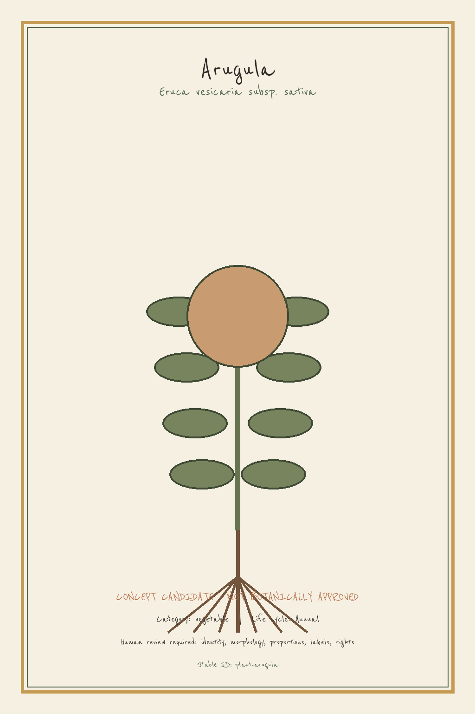

**Source status:** Not botanically or horticulturally approved. Recorded fields are derived
from the retained registry and remain subject to claim-level source review.

### Asparagus

**Stable plant ID:** `plant-asparagus`
**Category:** vegetable
**Recorded botanical name:** Asparagus officinalis
**Recorded family:** Asparagaceae
**Life cycle:** Perennial
**Illustration status:** `CANDIDATE_GENERATED / REVIEW_PENDING / NOT_APPROVED`

**Identification and morphology**

- Growth habit: Growth habit should be resolved to the exact species or cultivar; this entry provides a category-level source scaffold.
- Root or storage organ: Species-specific root, crown, or storage organ; verify the exact form before illustrating.
- Leaf arrangement and shape: Species-specific arrangement and blade shape; verify exact genus and cultivar.
- Flower structure: Species-specific inflorescence or flower structure.
- Fruit or seed structure: Species-specific fruit, seed pod, achene, capsule, berry, or nut.

**Errington timing fields**

- Indoor sow: Source timing not reviewed
- Direct sow: Source timing not reviewed
- Transplant: Source timing not reviewed
- Bloom: Source timing not reviewed
- Harvest: Source timing not reviewed
- Frost: Source timing not reviewed

**Cultivation**

- Soil: Well-drained, fertile soil with organic matter; adjust for the crop's root depth.
- Water: Keep moisture even during establishment and harvest formation; avoid prolonged waterlogging.
- Spacing: Use the calendar, seed packet, or mature crop size; do not rely on a registry-wide spacing value.
- Light: Full sun is usual; leafy cool-season crops tolerate more partial shade.
- Maintenance: Thin, weed, mulch, and monitor; support or stake as the crop requires.
- Pests/diseases: Monitor locally for aphids, slugs, caterpillars, fungal leaf spots, and soil-borne disease; identify before treatment.

**Candidate plate:**
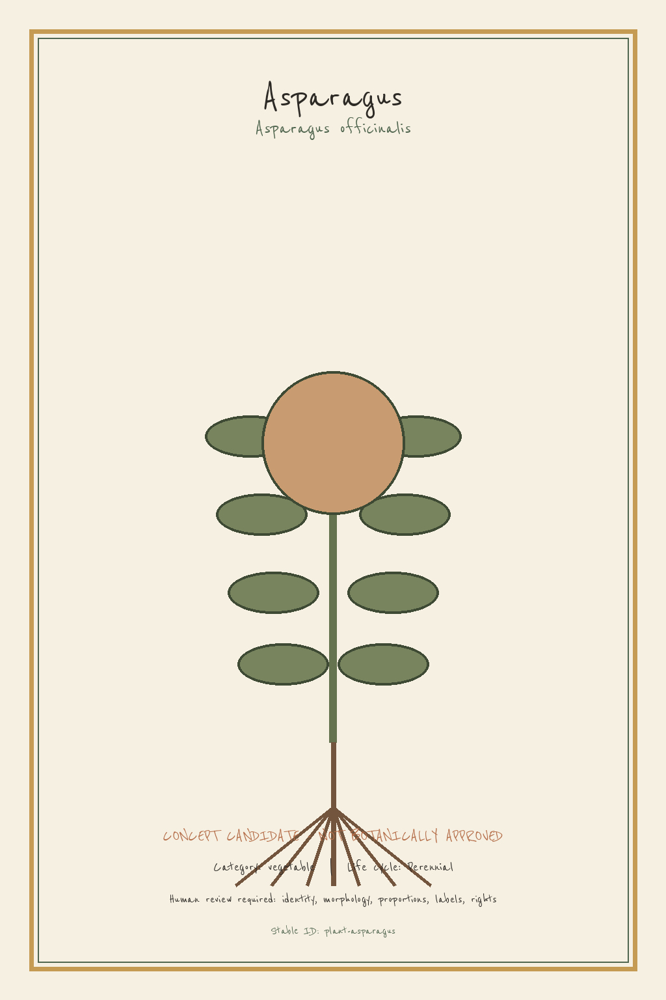

**Source status:** Not botanically or horticulturally approved. Recorded fields are derived
from the retained registry and remain subject to claim-level source review.

### Beans

**Stable plant ID:** `plant-beans`
**Category:** vegetable
**Recorded botanical name:** Phaseolus vulgaris
**Recorded family:** Fabaceae
**Life cycle:** Annual
**Illustration status:** `CANDIDATE_GENERATED / REVIEW_PENDING / NOT_APPROVED`

**Identification and morphology**

- Growth habit: Growth habit should be resolved to the exact species or cultivar; this entry provides a category-level source scaffold.
- Root or storage organ: Species-specific root, crown, or storage organ; verify the exact form before illustrating.
- Leaf arrangement and shape: Species-specific arrangement and blade shape; verify exact genus and cultivar.
- Flower structure: Species-specific inflorescence or flower structure.
- Fruit or seed structure: Species-specific fruit, seed pod, achene, capsule, berry, or nut.

**Errington timing fields**

- Indoor sow: Source timing not reviewed
- Direct sow: Source timing not reviewed
- Transplant: Source timing not reviewed
- Bloom: Source timing not reviewed
- Harvest: Source timing not reviewed
- Frost: Source timing not reviewed

**Cultivation**

- Soil: Well-drained, fertile soil with organic matter; adjust for the crop's root depth.
- Water: Keep moisture even during establishment and harvest formation; avoid prolonged waterlogging.
- Spacing: Use the calendar, seed packet, or mature crop size; do not rely on a registry-wide spacing value.
- Light: Full sun is usual; leafy cool-season crops tolerate more partial shade.
- Maintenance: Thin, weed, mulch, and monitor; support or stake as the crop requires.
- Pests/diseases: Monitor locally for aphids, slugs, caterpillars, fungal leaf spots, and soil-borne disease; identify before treatment.

**Candidate plate:**
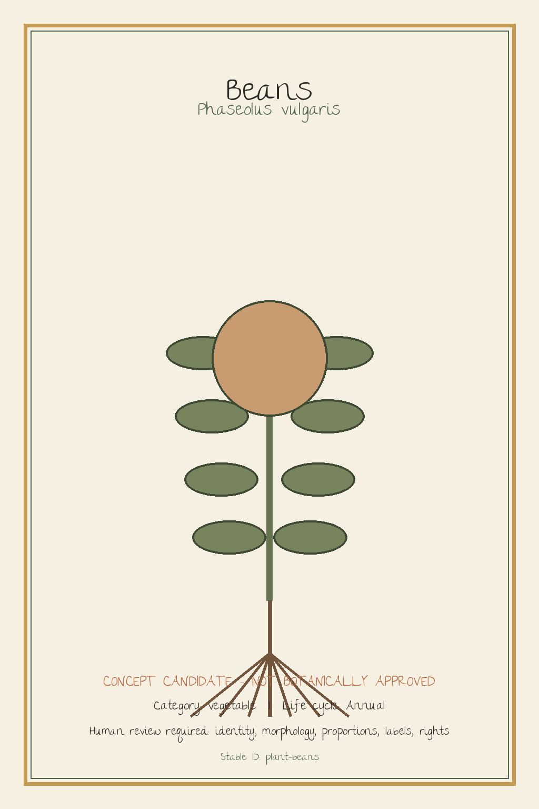

**Source status:** Not botanically or horticulturally approved. Recorded fields are derived
from the retained registry and remain subject to claim-level source review.

### Beets

**Stable plant ID:** `plant-beets`
**Category:** vegetable
**Recorded botanical name:** Beta vulgaris
**Recorded family:** Amaranthaceae
**Life cycle:** Annual
**Illustration status:** `CANDIDATE_GENERATED / REVIEW_PENDING / NOT_APPROVED`

**Identification and morphology**

- Growth habit: Growth habit should be resolved to the exact species or cultivar; this entry provides a category-level source scaffold.
- Root or storage organ: Species-specific root, crown, or storage organ; verify the exact form before illustrating.
- Leaf arrangement and shape: Species-specific arrangement and blade shape; verify exact genus and cultivar.
- Flower structure: Species-specific inflorescence or flower structure.
- Fruit or seed structure: Species-specific fruit, seed pod, achene, capsule, berry, or nut.

**Errington timing fields**

- Indoor sow: Source timing not reviewed
- Direct sow: Source timing not reviewed
- Transplant: Source timing not reviewed
- Bloom: Source timing not reviewed
- Harvest: Source timing not reviewed
- Frost: Source timing not reviewed

**Cultivation**

- Soil: Well-drained, fertile soil with organic matter; adjust for the crop's root depth.
- Water: Keep moisture even during establishment and harvest formation; avoid prolonged waterlogging.
- Spacing: Use the calendar, seed packet, or mature crop size; do not rely on a registry-wide spacing value.
- Light: Full sun is usual; leafy cool-season crops tolerate more partial shade.
- Maintenance: Thin, weed, mulch, and monitor; support or stake as the crop requires.
- Pests/diseases: Monitor locally for aphids, slugs, caterpillars, fungal leaf spots, and soil-borne disease; identify before treatment.

**Candidate plate:**

**Source status:** Not botanically or horticulturally approved. Recorded fields are derived
from the retained registry and remain subject to claim-level source review.

### Bell Pepper

**Stable plant ID:** `plant-bell-pepper`
**Category:** vegetable
**Recorded botanical name:** Capsicum annuum
**Recorded family:** Solanaceae
**Life cycle:** Annual
**Illustration status:** `CANDIDATE_GENERATED / REVIEW_PENDING / NOT_APPROVED`

**Identification and morphology**

- Growth habit: Growth habit should be resolved to the exact species or cultivar; this entry provides a category-level source scaffold.
- Root or storage organ: Species-specific root, crown, or storage organ; verify the exact form before illustrating.
- Leaf arrangement and shape: Species-specific arrangement and blade shape; verify exact genus and cultivar.
- Flower structure: Species-specific inflorescence or flower structure.
- Fruit or seed structure: Species-specific fruit, seed pod, achene, capsule, berry, or nut.

**Errington timing fields**

- Indoor sow: Source timing not reviewed
- Direct sow: Source timing not reviewed
- Transplant: Source timing not reviewed
- Bloom: Source timing not reviewed
- Harvest: Source timing not reviewed
- Frost: Source timing not reviewed

**Cultivation**

- Soil: Well-drained, fertile soil with organic matter; adjust for the crop's root depth.
- Water: Keep moisture even during establishment and harvest formation; avoid prolonged waterlogging.
- Spacing: Use the calendar, seed packet, or mature crop size; do not rely on a registry-wide spacing value.
- Light: Full sun is usual; leafy cool-season crops tolerate more partial shade.
- Maintenance: Thin, weed, mulch, and monitor; support or stake as the crop requires.
- Pests/diseases: Monitor locally for aphids, slugs, caterpillars, fungal leaf spots, and soil-borne disease; identify before treatment.

**Candidate plate:**
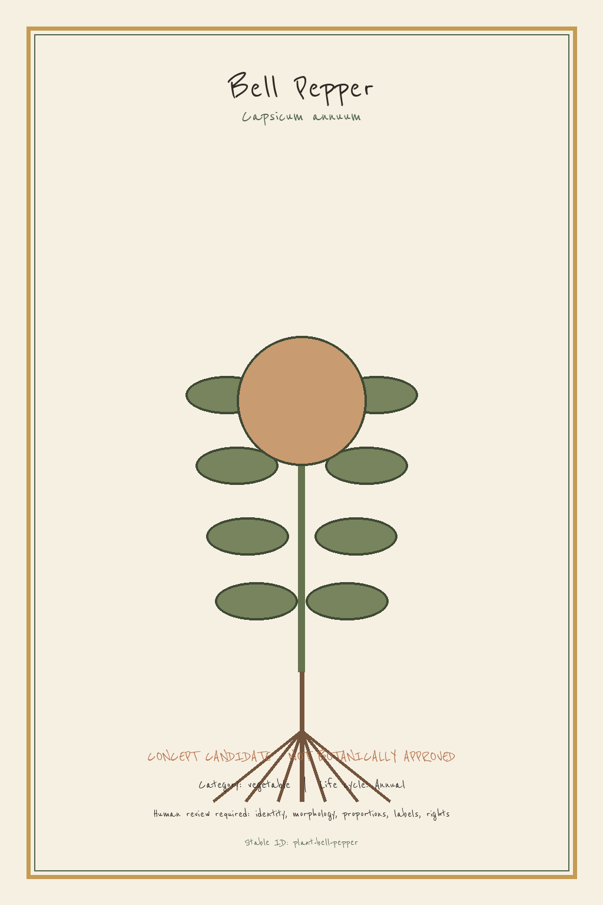

**Source status:** Not botanically or horticulturally approved. Recorded fields are derived
from the retained registry and remain subject to claim-level source review.

### Broccoli

**Stable plant ID:** `plant-broccoli`
**Category:** vegetable
**Recorded botanical name:** Brassica oleracea var. italica
**Recorded family:** Brassicaceae
**Life cycle:** Annual
**Illustration status:** `CANDIDATE_GENERATED / REVIEW_PENDING / NOT_APPROVED`

**Identification and morphology**

- Growth habit: Growth habit should be resolved to the exact species or cultivar; this entry provides a category-level source scaffold.
- Root or storage organ: Species-specific root, crown, or storage organ; verify the exact form before illustrating.
- Leaf arrangement and shape: Species-specific arrangement and blade shape; verify exact genus and cultivar.
- Flower structure: Species-specific inflorescence or flower structure.
- Fruit or seed structure: Species-specific fruit, seed pod, achene, capsule, berry, or nut.

**Errington timing fields**

- Indoor sow: Source timing not reviewed
- Direct sow: Source timing not reviewed
- Transplant: Source timing not reviewed
- Bloom: Source timing not reviewed
- Harvest: Source timing not reviewed
- Frost: Source timing not reviewed

**Cultivation**

- Soil: Well-drained, fertile soil with organic matter; adjust for the crop's root depth.
- Water: Keep moisture even during establishment and harvest formation; avoid prolonged waterlogging.
- Spacing: Use the calendar, seed packet, or mature crop size; do not rely on a registry-wide spacing value.
- Light: Full sun is usual; leafy cool-season crops tolerate more partial shade.
- Maintenance: Thin, weed, mulch, and monitor; support or stake as the crop requires.
- Pests/diseases: Monitor locally for aphids, slugs, caterpillars, fungal leaf spots, and soil-borne disease; identify before treatment.

**Candidate plate:**
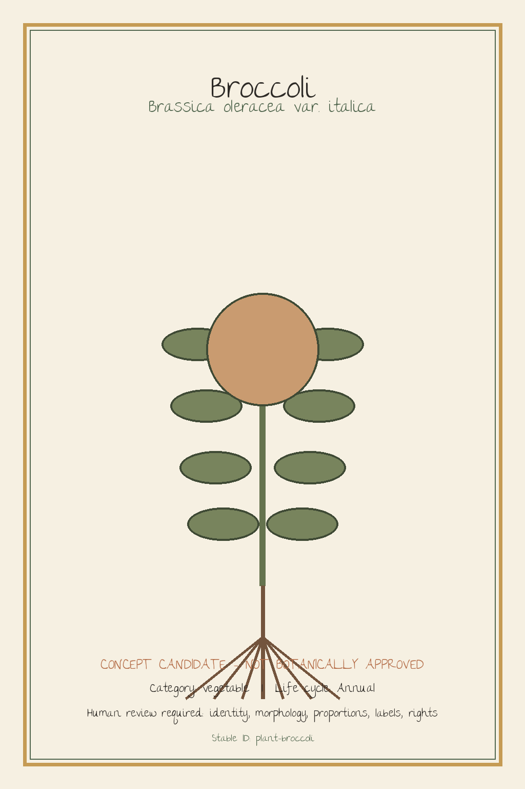

**Source status:** Not botanically or horticulturally approved. Recorded fields are derived
from the retained registry and remain subject to claim-level source review.

### Brussels Sprouts

**Stable plant ID:** `plant-brussels-sprouts`
**Category:** vegetable
**Recorded botanical name:** Brassica oleracea var. gemmifera
**Recorded family:** Brassicaceae
**Life cycle:** Annual
**Illustration status:** `CANDIDATE_GENERATED / REVIEW_PENDING / NOT_APPROVED`

**Identification and morphology**

- Growth habit: Growth habit should be resolved to the exact species or cultivar; this entry provides a category-level source scaffold.
- Root or storage organ: Species-specific root, crown, or storage organ; verify the exact form before illustrating.
- Leaf arrangement and shape: Species-specific arrangement and blade shape; verify exact genus and cultivar.
- Flower structure: Species-specific inflorescence or flower structure.
- Fruit or seed structure: Species-specific fruit, seed pod, achene, capsule, berry, or nut.

**Errington timing fields**

- Indoor sow: Source timing not reviewed
- Direct sow: Source timing not reviewed
- Transplant: Source timing not reviewed
- Bloom: Source timing not reviewed
- Harvest: Source timing not reviewed
- Frost: Source timing not reviewed

**Cultivation**

- Soil: Well-drained, fertile soil with organic matter; adjust for the crop's root depth.
- Water: Keep moisture even during establishment and harvest formation; avoid prolonged waterlogging.
- Spacing: Use the calendar, seed packet, or mature crop size; do not rely on a registry-wide spacing value.
- Light: Full sun is usual; leafy cool-season crops tolerate more partial shade.
- Maintenance: Thin, weed, mulch, and monitor; support or stake as the crop requires.
- Pests/diseases: Monitor locally for aphids, slugs, caterpillars, fungal leaf spots, and soil-borne disease; identify before treatment.

**Candidate plate:**
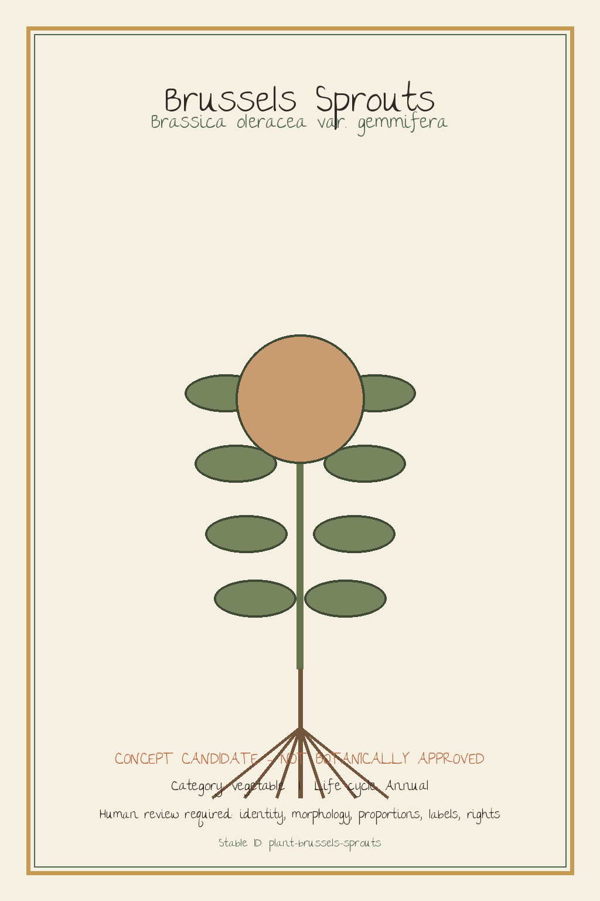

**Source status:** Not botanically or horticulturally approved. Recorded fields are derived
from the retained registry and remain subject to claim-level source review.

### Cabbage

**Stable plant ID:** `plant-cabbage`
**Category:** vegetable
**Recorded botanical name:** Brassica oleracea var. capitata
**Recorded family:** Brassicaceae
**Life cycle:** Annual
**Illustration status:** `CANDIDATE_GENERATED / REVIEW_PENDING / NOT_APPROVED`

**Identification and morphology**

- Growth habit: Growth habit should be resolved to the exact species or cultivar; this entry provides a category-level source scaffold.
- Root or storage organ: Species-specific root, crown, or storage organ; verify the exact form before illustrating.
- Leaf arrangement and shape: Species-specific arrangement and blade shape; verify exact genus and cultivar.
- Flower structure: Species-specific inflorescence or flower structure.
- Fruit or seed structure: Species-specific fruit, seed pod, achene, capsule, berry, or nut.

**Errington timing fields**

- Indoor sow: Source timing not reviewed
- Direct sow: Source timing not reviewed
- Transplant: Source timing not reviewed
- Bloom: Source timing not reviewed
- Harvest: Source timing not reviewed
- Frost: Source timing not reviewed

**Cultivation**

- Soil: Well-drained, fertile soil with organic matter; adjust for the crop's root depth.
- Water: Keep moisture even during establishment and harvest formation; avoid prolonged waterlogging.
- Spacing: Use the calendar, seed packet, or mature crop size; do not rely on a registry-wide spacing value.
- Light: Full sun is usual; leafy cool-season crops tolerate more partial shade.
- Maintenance: Thin, weed, mulch, and monitor; support or stake as the crop requires.
- Pests/diseases: Monitor locally for aphids, slugs, caterpillars, fungal leaf spots, and soil-borne disease; identify before treatment.

**Candidate plate:**
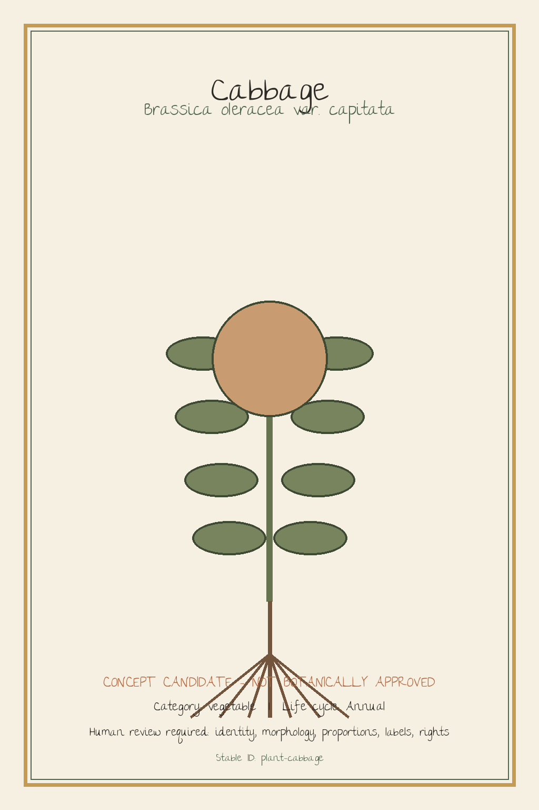

**Source status:** Not botanically or horticulturally approved. Recorded fields are derived
from the retained registry and remain subject to claim-level source review.

### Cantaloupe

**Stable plant ID:** `plant-cantaloupe`
**Category:** vegetable
**Recorded botanical name:** Cucumis melo
**Recorded family:** Cucurbitaceae
**Life cycle:** Annual
**Illustration status:** `CANDIDATE_GENERATED / REVIEW_PENDING / NOT_APPROVED`

**Identification and morphology**

- Growth habit: Growth habit should be resolved to the exact species or cultivar; this entry provides a category-level source scaffold.
- Root or storage organ: Species-specific root, crown, or storage organ; verify the exact form before illustrating.
- Leaf arrangement and shape: Species-specific arrangement and blade shape; verify exact genus and cultivar.
- Flower structure: Species-specific inflorescence or flower structure.
- Fruit or seed structure: Species-specific fruit, seed pod, achene, capsule, berry, or nut.

**Errington timing fields**

- Indoor sow: Source timing not reviewed
- Direct sow: Source timing not reviewed
- Transplant: Source timing not reviewed
- Bloom: Source timing not reviewed
- Harvest: Source timing not reviewed
- Frost: Source timing not reviewed

**Cultivation**

- Soil: Well-drained, fertile soil with organic matter; adjust for the crop's root depth.
- Water: Keep moisture even during establishment and harvest formation; avoid prolonged waterlogging.
- Spacing: Use the calendar, seed packet, or mature crop size; do not rely on a registry-wide spacing value.
- Light: Full sun is usual; leafy cool-season crops tolerate more partial shade.
- Maintenance: Thin, weed, mulch, and monitor; support or stake as the crop requires.
- Pests/diseases: Monitor locally for aphids, slugs, caterpillars, fungal leaf spots, and soil-borne disease; identify before treatment.

**Candidate plate:**
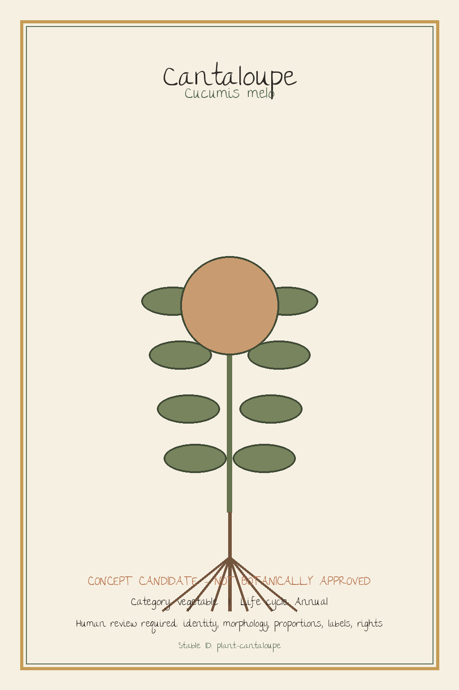

**Source status:** Not botanically or horticulturally approved. Recorded fields are derived
from the retained registry and remain subject to claim-level source review.

### Carrots

**Stable plant ID:** `plant-carrots`
**Category:** vegetable
**Recorded botanical name:** Daucus carota subsp. sativus
**Recorded family:** Apiaceae
**Life cycle:** Annual
**Illustration status:** `CANDIDATE_GENERATED / REVIEW_PENDING / NOT_APPROVED`

**Identification and morphology**

- Growth habit: Growth habit should be resolved to the exact species or cultivar; this entry provides a category-level source scaffold.
- Root or storage organ: Species-specific root, crown, or storage organ; verify the exact form before illustrating.
- Leaf arrangement and shape: Species-specific arrangement and blade shape; verify exact genus and cultivar.
- Flower structure: Species-specific inflorescence or flower structure.
- Fruit or seed structure: Species-specific fruit, seed pod, achene, capsule, berry, or nut.

**Errington timing fields**

- Indoor sow: Source timing not reviewed
- Direct sow: Source timing not reviewed
- Transplant: Source timing not reviewed
- Bloom: Source timing not reviewed
- Harvest: Source timing not reviewed
- Frost: Source timing not reviewed

**Cultivation**

- Soil: Well-drained, fertile soil with organic matter; adjust for the crop's root depth.
- Water: Keep moisture even during establishment and harvest formation; avoid prolonged waterlogging.
- Spacing: Use the calendar, seed packet, or mature crop size; do not rely on a registry-wide spacing value.
- Light: Full sun is usual; leafy cool-season crops tolerate more partial shade.
- Maintenance: Thin, weed, mulch, and monitor; support or stake as the crop requires.
- Pests/diseases: Monitor locally for aphids, slugs, caterpillars, fungal leaf spots, and soil-borne disease; identify before treatment.

**Candidate plate:**
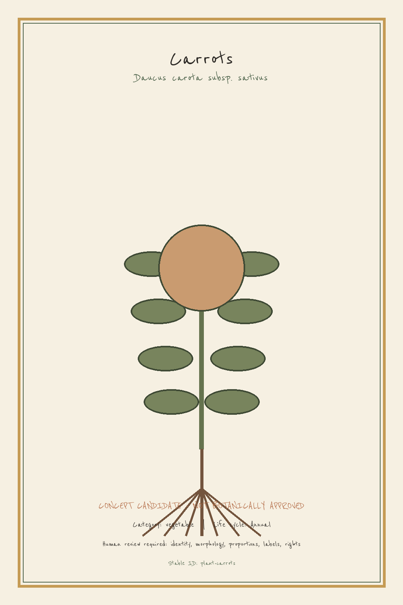

**Source status:** Not botanically or horticulturally approved. Recorded fields are derived
from the retained registry and remain subject to claim-level source review.

### Cauliflower

**Stable plant ID:** `plant-cauliflower`
**Category:** vegetable
**Recorded botanical name:** Brassica oleracea var. botrytis
**Recorded family:** Brassicaceae
**Life cycle:** Annual
**Illustration status:** `CANDIDATE_GENERATED / REVIEW_PENDING / NOT_APPROVED`

**Identification and morphology**

- Growth habit: Growth habit should be resolved to the exact species or cultivar; this entry provides a category-level source scaffold.
- Root or storage organ: Species-specific root, crown, or storage organ; verify the exact form before illustrating.
- Leaf arrangement and shape: Species-specific arrangement and blade shape; verify exact genus and cultivar.
- Flower structure: Species-specific inflorescence or flower structure.
- Fruit or seed structure: Species-specific fruit, seed pod, achene, capsule, berry, or nut.

**Errington timing fields**

- Indoor sow: Source timing not reviewed
- Direct sow: Source timing not reviewed
- Transplant: Source timing not reviewed
- Bloom: Source timing not reviewed
- Harvest: Source timing not reviewed
- Frost: Source timing not reviewed

**Cultivation**

- Soil: Well-drained, fertile soil with organic matter; adjust for the crop's root depth.
- Water: Keep moisture even during establishment and harvest formation; avoid prolonged waterlogging.
- Spacing: Use the calendar, seed packet, or mature crop size; do not rely on a registry-wide spacing value.
- Light: Full sun is usual; leafy cool-season crops tolerate more partial shade.
- Maintenance: Thin, weed, mulch, and monitor; support or stake as the crop requires.
- Pests/diseases: Monitor locally for aphids, slugs, caterpillars, fungal leaf spots, and soil-borne disease; identify before treatment.

**Candidate plate:**
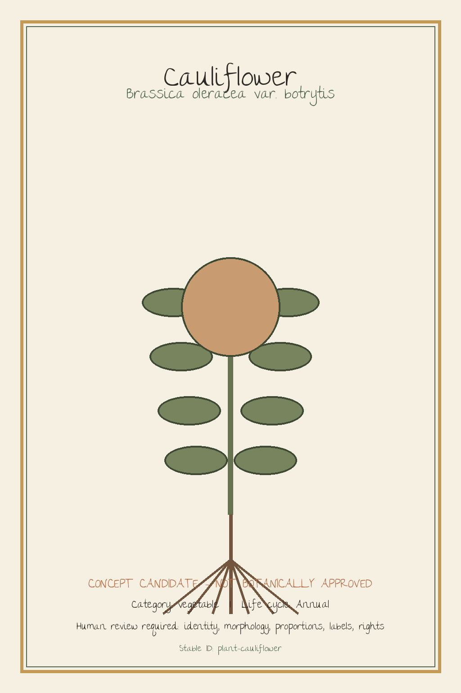

**Source status:** Not botanically or horticulturally approved. Recorded fields are derived
from the retained registry and remain subject to claim-level source review.

### Celery

**Stable plant ID:** `plant-celery`
**Category:** vegetable
**Recorded botanical name:** Apium graveolens var. dulce
**Recorded family:** Apiaceae
**Life cycle:** Annual
**Illustration status:** `CANDIDATE_GENERATED / REVIEW_PENDING / NOT_APPROVED`

**Identification and morphology**

- Growth habit: Growth habit should be resolved to the exact species or cultivar; this entry provides a category-level source scaffold.
- Root or storage organ: Species-specific root, crown, or storage organ; verify the exact form before illustrating.
- Leaf arrangement and shape: Species-specific arrangement and blade shape; verify exact genus and cultivar.
- Flower structure: Species-specific inflorescence or flower structure.
- Fruit or seed structure: Species-specific fruit, seed pod, achene, capsule, berry, or nut.

**Errington timing fields**

- Indoor sow: Source timing not reviewed
- Direct sow: Source timing not reviewed
- Transplant: Source timing not reviewed
- Bloom: Source timing not reviewed
- Harvest: Source timing not reviewed
- Frost: Source timing not reviewed

**Cultivation**

- Soil: Well-drained, fertile soil with organic matter; adjust for the crop's root depth.
- Water: Keep moisture even during establishment and harvest formation; avoid prolonged waterlogging.
- Spacing: Use the calendar, seed packet, or mature crop size; do not rely on a registry-wide spacing value.
- Light: Full sun is usual; leafy cool-season crops tolerate more partial shade.
- Maintenance: Thin, weed, mulch, and monitor; support or stake as the crop requires.
- Pests/diseases: Monitor locally for aphids, slugs, caterpillars, fungal leaf spots, and soil-borne disease; identify before treatment.

**Candidate plate:**
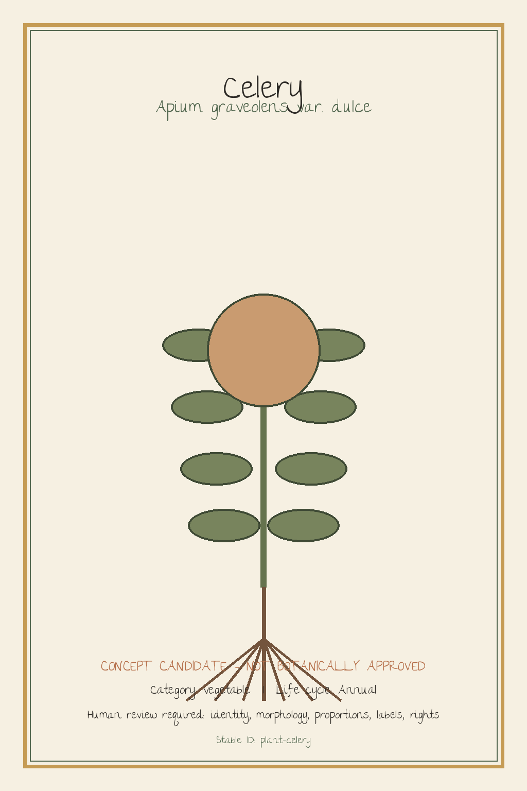

**Source status:** Not botanically or horticulturally approved. Recorded fields are derived
from the retained registry and remain subject to claim-level source review.

### Corn

**Stable plant ID:** `plant-corn`
**Category:** vegetable
**Recorded botanical name:** Zea mays
**Recorded family:** Poaceae
**Life cycle:** Annual
**Illustration status:** `CANDIDATE_GENERATED / REVIEW_PENDING / NOT_APPROVED`

**Identification and morphology**

- Growth habit: Growth habit should be resolved to the exact species or cultivar; this entry provides a category-level source scaffold.
- Root or storage organ: Species-specific root, crown, or storage organ; verify the exact form before illustrating.
- Leaf arrangement and shape: Species-specific arrangement and blade shape; verify exact genus and cultivar.
- Flower structure: Species-specific inflorescence or flower structure.
- Fruit or seed structure: Species-specific fruit, seed pod, achene, capsule, berry, or nut.

**Errington timing fields**

- Indoor sow: Source timing not reviewed
- Direct sow: Source timing not reviewed
- Transplant: Source timing not reviewed
- Bloom: Source timing not reviewed
- Harvest: Source timing not reviewed
- Frost: Source timing not reviewed

**Cultivation**

- Soil: Well-drained, fertile soil with organic matter; adjust for the crop's root depth.
- Water: Keep moisture even during establishment and harvest formation; avoid prolonged waterlogging.
- Spacing: Use the calendar, seed packet, or mature crop size; do not rely on a registry-wide spacing value.
- Light: Full sun is usual; leafy cool-season crops tolerate more partial shade.
- Maintenance: Thin, weed, mulch, and monitor; support or stake as the crop requires.
- Pests/diseases: Monitor locally for aphids, slugs, caterpillars, fungal leaf spots, and soil-borne disease; identify before treatment.

**Candidate plate:**
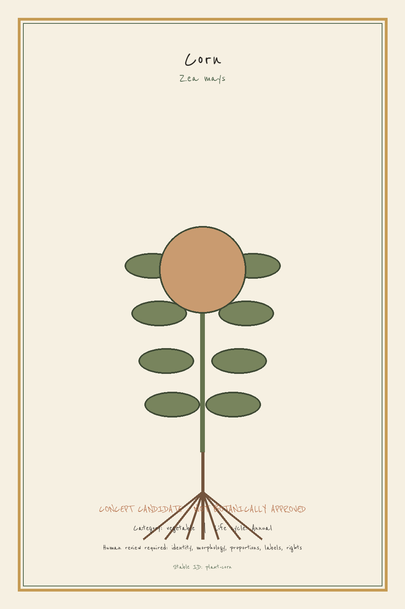

**Source status:** Not botanically or horticulturally approved. Recorded fields are derived
from the retained registry and remain subject to claim-level source review.

### Cucumber

**Stable plant ID:** `plant-cucumber`
**Category:** vegetable
**Recorded botanical name:** Cucumis sativus
**Recorded family:** Cucurbitaceae
**Life cycle:** Annual
**Illustration status:** `CANDIDATE_GENERATED / REVIEW_PENDING / NOT_APPROVED`

**Identification and morphology**

- Growth habit: Growth habit should be resolved to the exact species or cultivar; this entry provides a category-level source scaffold.
- Root or storage organ: Species-specific root, crown, or storage organ; verify the exact form before illustrating.
- Leaf arrangement and shape: Species-specific arrangement and blade shape; verify exact genus and cultivar.
- Flower structure: Species-specific inflorescence or flower structure.
- Fruit or seed structure: Species-specific fruit, seed pod, achene, capsule, berry, or nut.

**Errington timing fields**

- Indoor sow: Source timing not reviewed
- Direct sow: Source timing not reviewed
- Transplant: Source timing not reviewed
- Bloom: Source timing not reviewed
- Harvest: Source timing not reviewed
- Frost: Source timing not reviewed

**Cultivation**

- Soil: Well-drained, fertile soil with organic matter; adjust for the crop's root depth.
- Water: Keep moisture even during establishment and harvest formation; avoid prolonged waterlogging.
- Spacing: Use the calendar, seed packet, or mature crop size; do not rely on a registry-wide spacing value.
- Light: Full sun is usual; leafy cool-season crops tolerate more partial shade.
- Maintenance: Thin, weed, mulch, and monitor; support or stake as the crop requires.
- Pests/diseases: Monitor locally for aphids, slugs, caterpillars, fungal leaf spots, and soil-borne disease; identify before treatment.

**Candidate plate:**
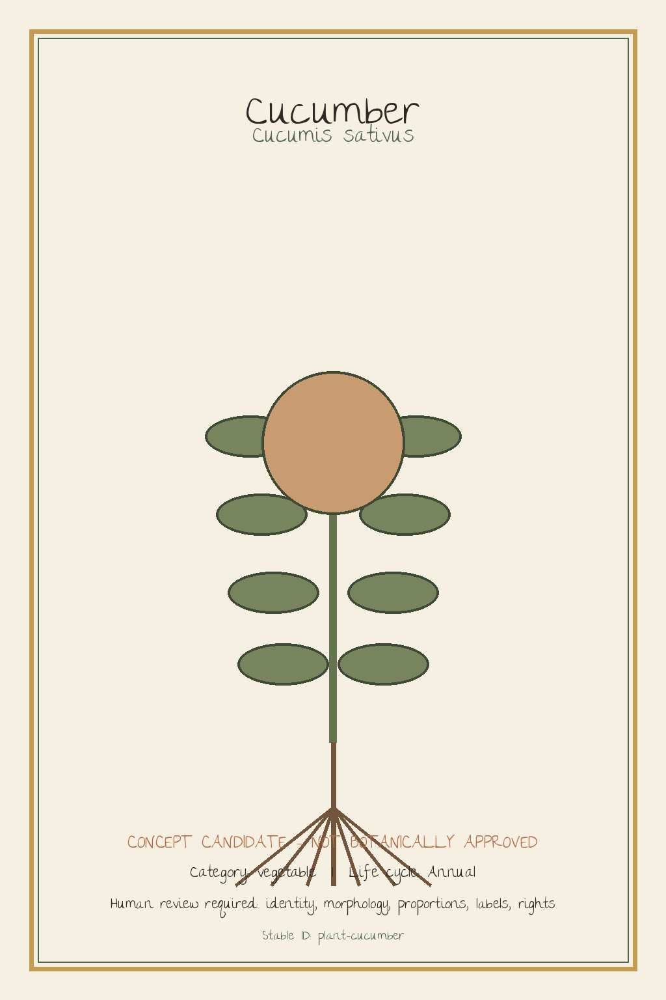

**Source status:** Not botanically or horticulturally approved. Recorded fields are derived
from the retained registry and remain subject to claim-level source review.

### Garlic

**Stable plant ID:** `plant-garlic`
**Category:** vegetable
**Recorded botanical name:** Allium sativum
**Recorded family:** Amaryllidaceae
**Life cycle:** Annual
**Illustration status:** `CANDIDATE_GENERATED / REVIEW_PENDING / NOT_APPROVED`

**Identification and morphology**

- Growth habit: Growth habit should be resolved to the exact species or cultivar; this entry provides a category-level source scaffold.
- Root or storage organ: Species-specific root, crown, or storage organ; verify the exact form before illustrating.
- Leaf arrangement and shape: Species-specific arrangement and blade shape; verify exact genus and cultivar.
- Flower structure: Species-specific inflorescence or flower structure.
- Fruit or seed structure: Species-specific fruit, seed pod, achene, capsule, berry, or nut.

**Errington timing fields**

- Indoor sow: Source timing not reviewed
- Direct sow: Source timing not reviewed
- Transplant: Source timing not reviewed
- Bloom: Source timing not reviewed
- Harvest: Source timing not reviewed
- Frost: Source timing not reviewed

**Cultivation**

- Soil: Well-drained, fertile soil with organic matter; adjust for the crop's root depth.
- Water: Keep moisture even during establishment and harvest formation; avoid prolonged waterlogging.
- Spacing: Use the calendar, seed packet, or mature crop size; do not rely on a registry-wide spacing value.
- Light: Full sun is usual; leafy cool-season crops tolerate more partial shade.
- Maintenance: Thin, weed, mulch, and monitor; support or stake as the crop requires.
- Pests/diseases: Monitor locally for aphids, slugs, caterpillars, fungal leaf spots, and soil-borne disease; identify before treatment.

**Candidate plate:**
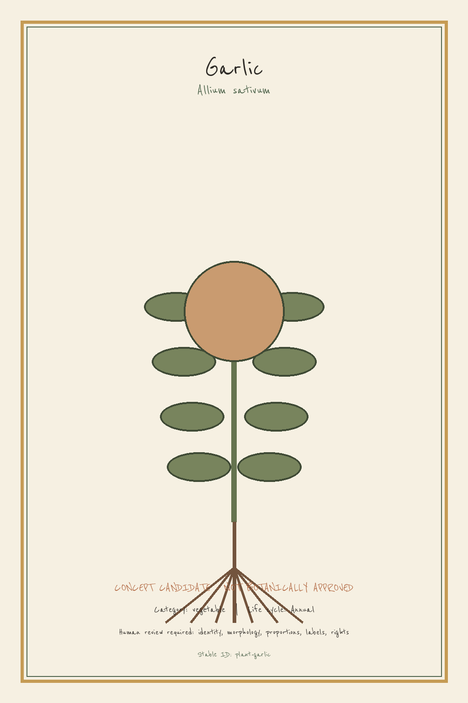

**Source status:** Not botanically or horticulturally approved. Recorded fields are derived
from the retained registry and remain subject to claim-level source review.

### Kohlrabi

**Stable plant ID:** `plant-kohlrabi`
**Category:** vegetable
**Recorded botanical name:** Brassica oleracea var. gongylodes
**Recorded family:** Brassicaceae
**Life cycle:** Annual
**Illustration status:** `CANDIDATE_GENERATED / REVIEW_PENDING / NOT_APPROVED`

**Identification and morphology**

- Growth habit: Growth habit should be resolved to the exact species or cultivar; this entry provides a category-level source scaffold.
- Root or storage organ: Species-specific root, crown, or storage organ; verify the exact form before illustrating.
- Leaf arrangement and shape: Species-specific arrangement and blade shape; verify exact genus and cultivar.
- Flower structure: Species-specific inflorescence or flower structure.
- Fruit or seed structure: Species-specific fruit, seed pod, achene, capsule, berry, or nut.

**Errington timing fields**

- Indoor sow: Source timing not reviewed
- Direct sow: Source timing not reviewed
- Transplant: Source timing not reviewed
- Bloom: Source timing not reviewed
- Harvest: Source timing not reviewed
- Frost: Source timing not reviewed

**Cultivation**

- Soil: Well-drained, fertile soil with organic matter; adjust for the crop's root depth.
- Water: Keep moisture even during establishment and harvest formation; avoid prolonged waterlogging.
- Spacing: Use the calendar, seed packet, or mature crop size; do not rely on a registry-wide spacing value.
- Light: Full sun is usual; leafy cool-season crops tolerate more partial shade.
- Maintenance: Thin, weed, mulch, and monitor; support or stake as the crop requires.
- Pests/diseases: Monitor locally for aphids, slugs, caterpillars, fungal leaf spots, and soil-borne disease; identify before treatment.

**Candidate plate:**
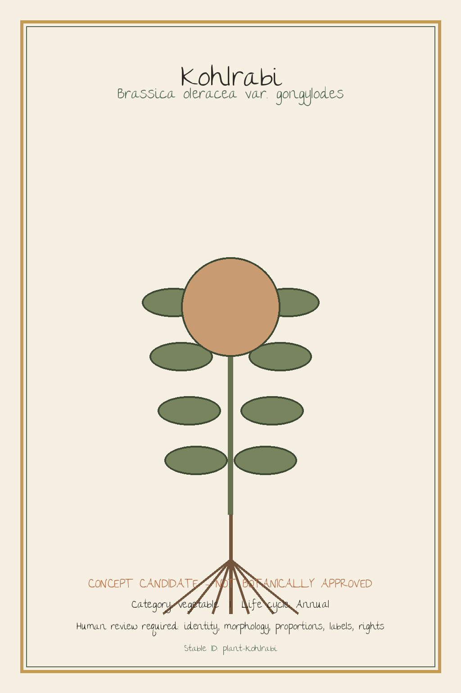

**Source status:** Not botanically or horticulturally approved. Recorded fields are derived
from the retained registry and remain subject to claim-level source review.

### Leeks

**Stable plant ID:** `plant-leeks`
**Category:** vegetable
**Recorded botanical name:** Allium ampeloprasum
**Recorded family:** Amaryllidaceae
**Life cycle:** Annual
**Illustration status:** `CANDIDATE_GENERATED / REVIEW_PENDING / NOT_APPROVED`

**Identification and morphology**

- Growth habit: Growth habit should be resolved to the exact species or cultivar; this entry provides a category-level source scaffold.
- Root or storage organ: Species-specific root, crown, or storage organ; verify the exact form before illustrating.
- Leaf arrangement and shape: Species-specific arrangement and blade shape; verify exact genus and cultivar.
- Flower structure: Species-specific inflorescence or flower structure.
- Fruit or seed structure: Species-specific fruit, seed pod, achene, capsule, berry, or nut.

**Errington timing fields**

- Indoor sow: Source timing not reviewed
- Direct sow: Source timing not reviewed
- Transplant: Source timing not reviewed
- Bloom: Source timing not reviewed
- Harvest: Source timing not reviewed
- Frost: Source timing not reviewed

**Cultivation**

- Soil: Well-drained, fertile soil with organic matter; adjust for the crop's root depth.
- Water: Keep moisture even during establishment and harvest formation; avoid prolonged waterlogging.
- Spacing: Use the calendar, seed packet, or mature crop size; do not rely on a registry-wide spacing value.
- Light: Full sun is usual; leafy cool-season crops tolerate more partial shade.
- Maintenance: Thin, weed, mulch, and monitor; support or stake as the crop requires.
- Pests/diseases: Monitor locally for aphids, slugs, caterpillars, fungal leaf spots, and soil-borne disease; identify before treatment.

**Candidate plate:**
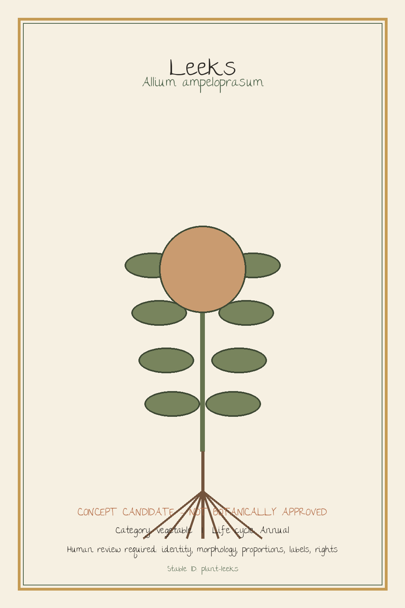

**Source status:** Not botanically or horticulturally approved. Recorded fields are derived
from the retained registry and remain subject to claim-level source review.

### Lettuce

**Stable plant ID:** `plant-lettuce`
**Category:** vegetable
**Recorded botanical name:** Lactuca sativa
**Recorded family:** Asteraceae
**Life cycle:** Annual
**Illustration status:** `CANDIDATE_GENERATED / REVIEW_PENDING / NOT_APPROVED`

**Identification and morphology**

- Growth habit: Growth habit should be resolved to the exact species or cultivar; this entry provides a category-level source scaffold.
- Root or storage organ: Species-specific root, crown, or storage organ; verify the exact form before illustrating.
- Leaf arrangement and shape: Species-specific arrangement and blade shape; verify exact genus and cultivar.
- Flower structure: Species-specific inflorescence or flower structure.
- Fruit or seed structure: Species-specific fruit, seed pod, achene, capsule, berry, or nut.

**Errington timing fields**

- Indoor sow: Source timing not reviewed
- Direct sow: Source timing not reviewed
- Transplant: Source timing not reviewed
- Bloom: Source timing not reviewed
- Harvest: Source timing not reviewed
- Frost: Source timing not reviewed

**Cultivation**

- Soil: Well-drained, fertile soil with organic matter; adjust for the crop's root depth.
- Water: Keep moisture even during establishment and harvest formation; avoid prolonged waterlogging.
- Spacing: Use the calendar, seed packet, or mature crop size; do not rely on a registry-wide spacing value.
- Light: Full sun is usual; leafy cool-season crops tolerate more partial shade.
- Maintenance: Thin, weed, mulch, and monitor; support or stake as the crop requires.
- Pests/diseases: Monitor locally for aphids, slugs, caterpillars, fungal leaf spots, and soil-borne disease; identify before treatment.

**Candidate plate:**
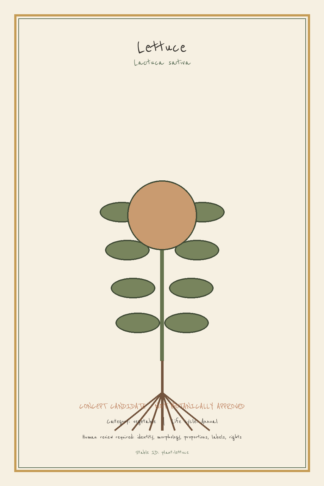

**Source status:** Not botanically or horticulturally approved. Recorded fields are derived
from the retained registry and remain subject to claim-level source review.

### Eggplant

**Stable plant ID:** `plant-eggplant`
**Category:** vegetable
**Recorded botanical name:** Solanum melongena
**Recorded family:** Solanaceae
**Life cycle:** Annual
**Illustration status:** `CANDIDATE_GENERATED / REVIEW_PENDING / NOT_APPROVED`

**Identification and morphology**

- Growth habit: Growth habit should be resolved to the exact species or cultivar; this entry provides a category-level source scaffold.
- Root or storage organ: Species-specific root, crown, or storage organ; verify the exact form before illustrating.
- Leaf arrangement and shape: Species-specific arrangement and blade shape; verify exact genus and cultivar.
- Flower structure: Species-specific inflorescence or flower structure.
- Fruit or seed structure: Species-specific fruit, seed pod, achene, capsule, berry, or nut.

**Errington timing fields**

- Indoor sow: Source timing not reviewed
- Direct sow: Source timing not reviewed
- Transplant: Source timing not reviewed
- Bloom: Source timing not reviewed
- Harvest: Source timing not reviewed
- Frost: Source timing not reviewed

**Cultivation**

- Soil: Well-drained, fertile soil with organic matter; adjust for the crop's root depth.
- Water: Keep moisture even during establishment and harvest formation; avoid prolonged waterlogging.
- Spacing: Use the calendar, seed packet, or mature crop size; do not rely on a registry-wide spacing value.
- Light: Full sun is usual; leafy cool-season crops tolerate more partial shade.
- Maintenance: Thin, weed, mulch, and monitor; support or stake as the crop requires.
- Pests/diseases: Monitor locally for aphids, slugs, caterpillars, fungal leaf spots, and soil-borne disease; identify before treatment.

**Candidate plate:**
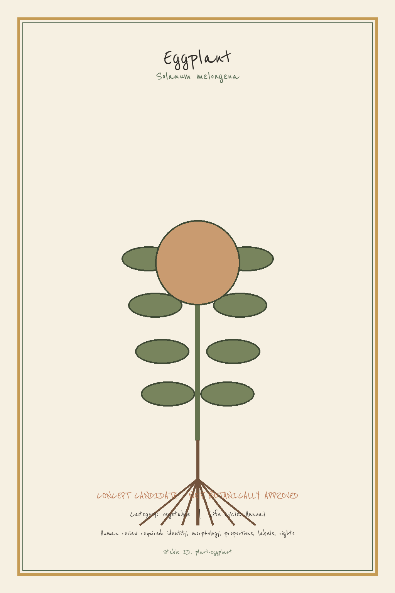

**Source status:** Not botanically or horticulturally approved. Recorded fields are derived
from the retained registry and remain subject to claim-level source review.

### Melons

**Stable plant ID:** `plant-melons`
**Category:** vegetable
**Recorded botanical name:** Cucumis melo
**Recorded family:** Cucurbitaceae
**Life cycle:** Annual
**Illustration status:** `CANDIDATE_GENERATED / REVIEW_PENDING / NOT_APPROVED`

**Identification and morphology**

- Growth habit: Growth habit should be resolved to the exact species or cultivar; this entry provides a category-level source scaffold.
- Root or storage organ: Species-specific root, crown, or storage organ; verify the exact form before illustrating.
- Leaf arrangement and shape: Species-specific arrangement and blade shape; verify exact genus and cultivar.
- Flower structure: Species-specific inflorescence or flower structure.
- Fruit or seed structure: Species-specific fruit, seed pod, achene, capsule, berry, or nut.

**Errington timing fields**

- Indoor sow: Source timing not reviewed
- Direct sow: Source timing not reviewed
- Transplant: Source timing not reviewed
- Bloom: Source timing not reviewed
- Harvest: Source timing not reviewed
- Frost: Source timing not reviewed

**Cultivation**

- Soil: Well-drained, fertile soil with organic matter; adjust for the crop's root depth.
- Water: Keep moisture even during establishment and harvest formation; avoid prolonged waterlogging.
- Spacing: Use the calendar, seed packet, or mature crop size; do not rely on a registry-wide spacing value.
- Light: Full sun is usual; leafy cool-season crops tolerate more partial shade.
- Maintenance: Thin, weed, mulch, and monitor; support or stake as the crop requires.
- Pests/diseases: Monitor locally for aphids, slugs, caterpillars, fungal leaf spots, and soil-borne disease; identify before treatment.

**Candidate plate:**
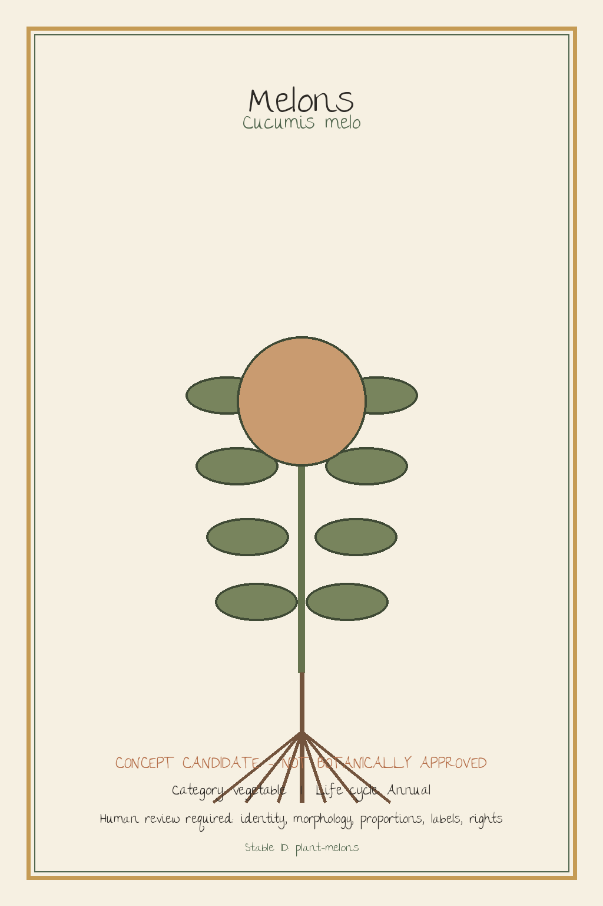

**Source status:** Not botanically or horticulturally approved. Recorded fields are derived
from the retained registry and remain subject to claim-level source review.

### Okra

**Stable plant ID:** `plant-okra`
**Category:** vegetable
**Recorded botanical name:** Abelmoschus esculentus
**Recorded family:** Malvaceae
**Life cycle:** Annual
**Illustration status:** `CANDIDATE_GENERATED / REVIEW_PENDING / NOT_APPROVED`

**Identification and morphology**

- Growth habit: Growth habit should be resolved to the exact species or cultivar; this entry provides a category-level source scaffold.
- Root or storage organ: Species-specific root, crown, or storage organ; verify the exact form before illustrating.
- Leaf arrangement and shape: Species-specific arrangement and blade shape; verify exact genus and cultivar.
- Flower structure: Species-specific inflorescence or flower structure.
- Fruit or seed structure: Species-specific fruit, seed pod, achene, capsule, berry, or nut.

**Errington timing fields**

- Indoor sow: Source timing not reviewed
- Direct sow: Source timing not reviewed
- Transplant: Source timing not reviewed
- Bloom: Source timing not reviewed
- Harvest: Source timing not reviewed
- Frost: Source timing not reviewed

**Cultivation**

- Soil: Well-drained, fertile soil with organic matter; adjust for the crop's root depth.
- Water: Keep moisture even during establishment and harvest formation; avoid prolonged waterlogging.
- Spacing: Use the calendar, seed packet, or mature crop size; do not rely on a registry-wide spacing value.
- Light: Full sun is usual; leafy cool-season crops tolerate more partial shade.
- Maintenance: Thin, weed, mulch, and monitor; support or stake as the crop requires.
- Pests/diseases: Monitor locally for aphids, slugs, caterpillars, fungal leaf spots, and soil-borne disease; identify before treatment.

**Candidate plate:**
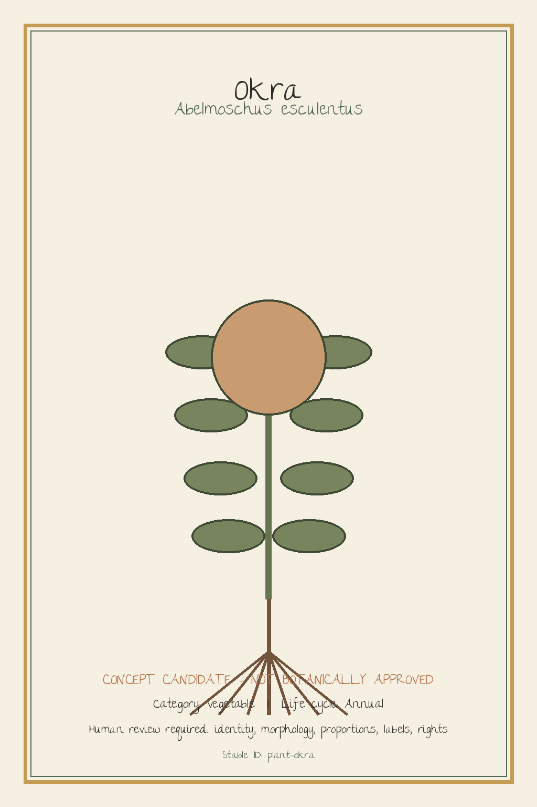

**Source status:** Not botanically or horticulturally approved. Recorded fields are derived
from the retained registry and remain subject to claim-level source review.

### Parsnips

**Stable plant ID:** `plant-parsnips`
**Category:** vegetable
**Recorded botanical name:** Pastinaca sativa
**Recorded family:** Apiaceae
**Life cycle:** Annual
**Illustration status:** `CANDIDATE_GENERATED / REVIEW_PENDING / NOT_APPROVED`

**Identification and morphology**

- Growth habit: Growth habit should be resolved to the exact species or cultivar; this entry provides a category-level source scaffold.
- Root or storage organ: Species-specific root, crown, or storage organ; verify the exact form before illustrating.
- Leaf arrangement and shape: Species-specific arrangement and blade shape; verify exact genus and cultivar.
- Flower structure: Species-specific inflorescence or flower structure.
- Fruit or seed structure: Species-specific fruit, seed pod, achene, capsule, berry, or nut.

**Errington timing fields**

- Indoor sow: Source timing not reviewed
- Direct sow: Source timing not reviewed
- Transplant: Source timing not reviewed
- Bloom: Source timing not reviewed
- Harvest: Source timing not reviewed
- Frost: Source timing not reviewed

**Cultivation**

- Soil: Well-drained, fertile soil with organic matter; adjust for the crop's root depth.
- Water: Keep moisture even during establishment and harvest formation; avoid prolonged waterlogging.
- Spacing: Use the calendar, seed packet, or mature crop size; do not rely on a registry-wide spacing value.
- Light: Full sun is usual; leafy cool-season crops tolerate more partial shade.
- Maintenance: Thin, weed, mulch, and monitor; support or stake as the crop requires.
- Pests/diseases: Monitor locally for aphids, slugs, caterpillars, fungal leaf spots, and soil-borne disease; identify before treatment.

**Candidate plate:**
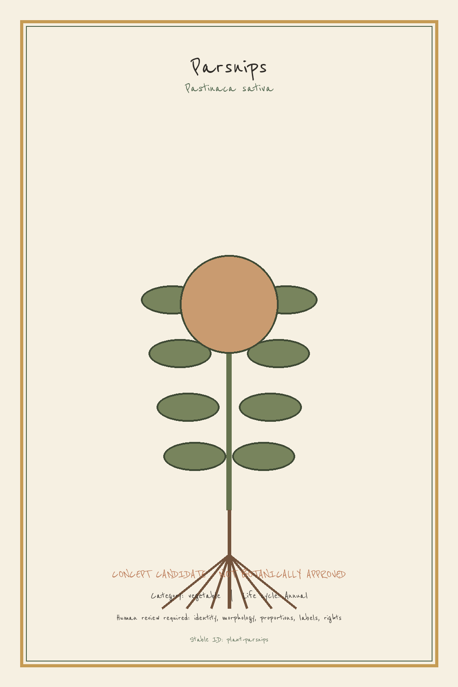

**Source status:** Not botanically or horticulturally approved. Recorded fields are derived
from the retained registry and remain subject to claim-level source review.

### Peas

**Stable plant ID:** `plant-peas`
**Category:** vegetable
**Recorded botanical name:** Pisum sativum
**Recorded family:** Fabaceae
**Life cycle:** Annual
**Illustration status:** `CANDIDATE_GENERATED / REVIEW_PENDING / NOT_APPROVED`

**Identification and morphology**

- Growth habit: Growth habit should be resolved to the exact species or cultivar; this entry provides a category-level source scaffold.
- Root or storage organ: Species-specific root, crown, or storage organ; verify the exact form before illustrating.
- Leaf arrangement and shape: Species-specific arrangement and blade shape; verify exact genus and cultivar.
- Flower structure: Species-specific inflorescence or flower structure.
- Fruit or seed structure: Species-specific fruit, seed pod, achene, capsule, berry, or nut.

**Errington timing fields**

- Indoor sow: Source timing not reviewed
- Direct sow: Source timing not reviewed
- Transplant: Source timing not reviewed
- Bloom: Source timing not reviewed
- Harvest: Source timing not reviewed
- Frost: Source timing not reviewed

**Cultivation**

- Soil: Well-drained, fertile soil with organic matter; adjust for the crop's root depth.
- Water: Keep moisture even during establishment and harvest formation; avoid prolonged waterlogging.
- Spacing: Use the calendar, seed packet, or mature crop size; do not rely on a registry-wide spacing value.
- Light: Full sun is usual; leafy cool-season crops tolerate more partial shade.
- Maintenance: Thin, weed, mulch, and monitor; support or stake as the crop requires.
- Pests/diseases: Monitor locally for aphids, slugs, caterpillars, fungal leaf spots, and soil-borne disease; identify before treatment.

**Candidate plate:**

**Source status:** Not botanically or horticulturally approved. Recorded fields are derived
from the retained registry and remain subject to claim-level source review.

### Potatoes

**Stable plant ID:** `plant-potatoes`
**Category:** vegetable
**Recorded botanical name:** Solanum tuberosum
**Recorded family:** Solanaceae
**Life cycle:** Annual
**Illustration status:** `CANDIDATE_GENERATED / REVIEW_PENDING / NOT_APPROVED`

**Identification and morphology**

- Growth habit: Growth habit should be resolved to the exact species or cultivar; this entry provides a category-level source scaffold.
- Root or storage organ: Species-specific root, crown, or storage organ; verify the exact form before illustrating.
- Leaf arrangement and shape: Species-specific arrangement and blade shape; verify exact genus and cultivar.
- Flower structure: Species-specific inflorescence or flower structure.
- Fruit or seed structure: Species-specific fruit, seed pod, achene, capsule, berry, or nut.

**Errington timing fields**

- Indoor sow: Source timing not reviewed
- Direct sow: Source timing not reviewed
- Transplant: Source timing not reviewed
- Bloom: Source timing not reviewed
- Harvest: Source timing not reviewed
- Frost: Source timing not reviewed

**Cultivation**

- Soil: Well-drained, fertile soil with organic matter; adjust for the crop's root depth.
- Water: Keep moisture even during establishment and harvest formation; avoid prolonged waterlogging.
- Spacing: Use the calendar, seed packet, or mature crop size; do not rely on a registry-wide spacing value.
- Light: Full sun is usual; leafy cool-season crops tolerate more partial shade.
- Maintenance: Thin, weed, mulch, and monitor; support or stake as the crop requires.
- Pests/diseases: Monitor locally for aphids, slugs, caterpillars, fungal leaf spots, and soil-borne disease; identify before treatment.

**Candidate plate:**
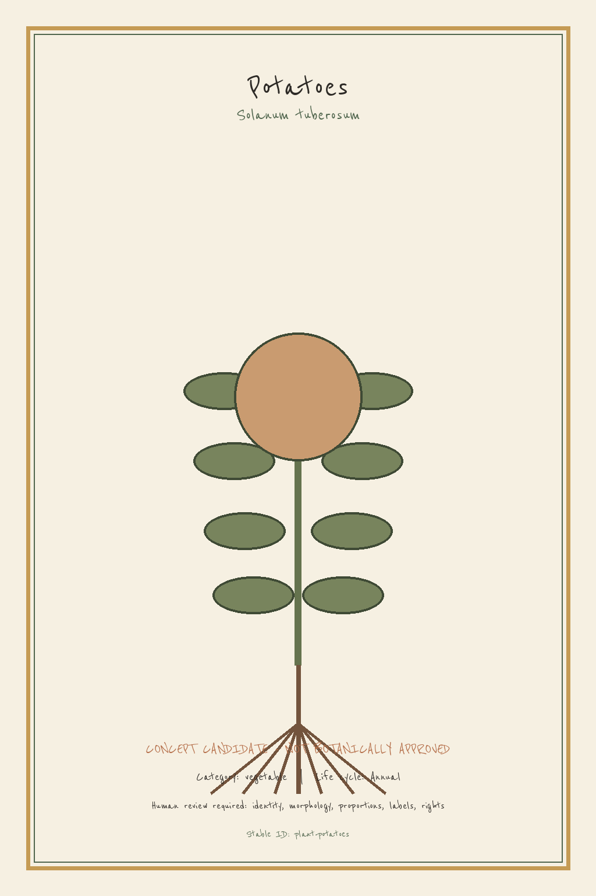

**Source status:** Not botanically or horticulturally approved. Recorded fields are derived
from the retained registry and remain subject to claim-level source review.

### Spinach

**Stable plant ID:** `plant-spinach`
**Category:** vegetable
**Recorded botanical name:** Spinacia oleracea
**Recorded family:** Amaranthaceae
**Life cycle:** Annual
**Illustration status:** `CANDIDATE_GENERATED / REVIEW_PENDING / NOT_APPROVED`

**Identification and morphology**

- Growth habit: Growth habit should be resolved to the exact species or cultivar; this entry provides a category-level source scaffold.
- Root or storage organ: Species-specific root, crown, or storage organ; verify the exact form before illustrating.
- Leaf arrangement and shape: Species-specific arrangement and blade shape; verify exact genus and cultivar.
- Flower structure: Species-specific inflorescence or flower structure.
- Fruit or seed structure: Species-specific fruit, seed pod, achene, capsule, berry, or nut.

**Errington timing fields**

- Indoor sow: Source timing not reviewed
- Direct sow: Source timing not reviewed
- Transplant: Source timing not reviewed
- Bloom: Source timing not reviewed
- Harvest: Source timing not reviewed
- Frost: Source timing not reviewed

**Cultivation**

- Soil: Well-drained, fertile soil with organic matter; adjust for the crop's root depth.
- Water: Keep moisture even during establishment and harvest formation; avoid prolonged waterlogging.
- Spacing: Use the calendar, seed packet, or mature crop size; do not rely on a registry-wide spacing value.
- Light: Full sun is usual; leafy cool-season crops tolerate more partial shade.
- Maintenance: Thin, weed, mulch, and monitor; support or stake as the crop requires.
- Pests/diseases: Monitor locally for aphids, slugs, caterpillars, fungal leaf spots, and soil-borne disease; identify before treatment.

**Candidate plate:**
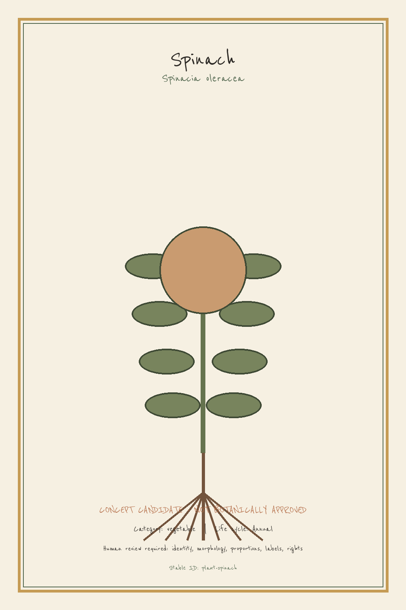

**Source status:** Not botanically or horticulturally approved. Recorded fields are derived
from the retained registry and remain subject to claim-level source review.

### Sweet Potato

**Stable plant ID:** `plant-sweet-potato`
**Category:** vegetable
**Recorded botanical name:** Ipomoea batatas
**Recorded family:** Convolvulaceae
**Life cycle:** Annual
**Illustration status:** `CANDIDATE_GENERATED / REVIEW_PENDING / NOT_APPROVED`

**Identification and morphology**

- Growth habit: Growth habit should be resolved to the exact species or cultivar; this entry provides a category-level source scaffold.
- Root or storage organ: Species-specific root, crown, or storage organ; verify the exact form before illustrating.
- Leaf arrangement and shape: Species-specific arrangement and blade shape; verify exact genus and cultivar.
- Flower structure: Species-specific inflorescence or flower structure.
- Fruit or seed structure: Species-specific fruit, seed pod, achene, capsule, berry, or nut.

**Errington timing fields**

- Indoor sow: Source timing not reviewed
- Direct sow: Source timing not reviewed
- Transplant: Source timing not reviewed
- Bloom: Source timing not reviewed
- Harvest: Source timing not reviewed
- Frost: Source timing not reviewed

**Cultivation**

- Soil: Well-drained, fertile soil with organic matter; adjust for the crop's root depth.
- Water: Keep moisture even during establishment and harvest formation; avoid prolonged waterlogging.
- Spacing: Use the calendar, seed packet, or mature crop size; do not rely on a registry-wide spacing value.
- Light: Full sun is usual; leafy cool-season crops tolerate more partial shade.
- Maintenance: Thin, weed, mulch, and monitor; support or stake as the crop requires.
- Pests/diseases: Monitor locally for aphids, slugs, caterpillars, fungal leaf spots, and soil-borne disease; identify before treatment.

**Candidate plate:**
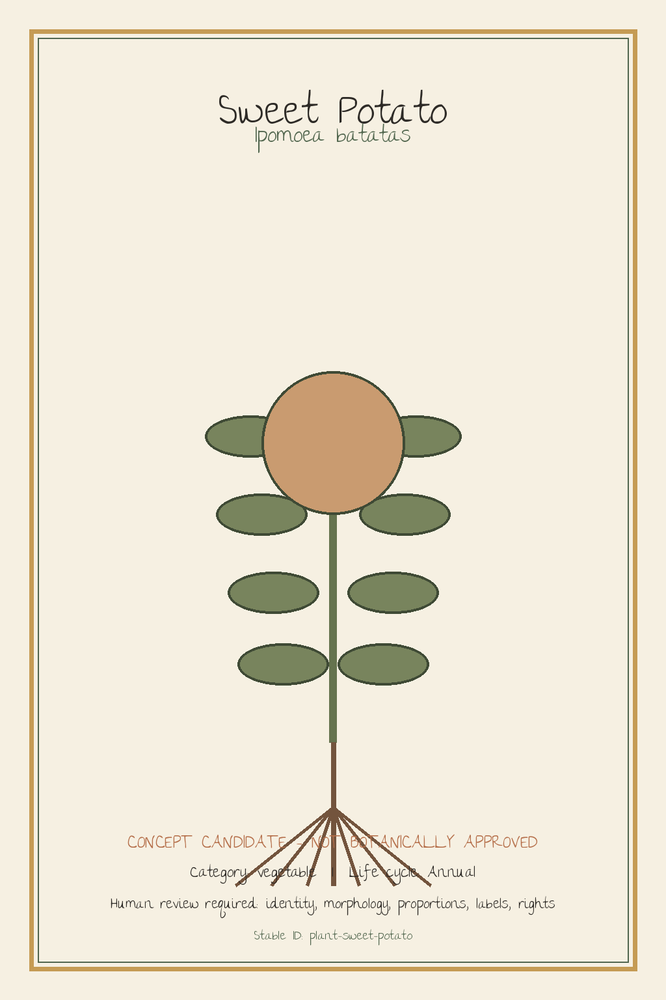

**Source status:** Not botanically or horticulturally approved. Recorded fields are derived
from the retained registry and remain subject to claim-level source review.

### Summer Squash

**Stable plant ID:** `plant-summer-squash`
**Category:** vegetable
**Recorded botanical name:** Cucurbita pepo
**Recorded family:** Cucurbitaceae
**Life cycle:** Annual
**Illustration status:** `CANDIDATE_GENERATED / REVIEW_PENDING / NOT_APPROVED`

**Identification and morphology**

- Growth habit: Growth habit should be resolved to the exact species or cultivar; this entry provides a category-level source scaffold.
- Root or storage organ: Species-specific root, crown, or storage organ; verify the exact form before illustrating.
- Leaf arrangement and shape: Species-specific arrangement and blade shape; verify exact genus and cultivar.
- Flower structure: Species-specific inflorescence or flower structure.
- Fruit or seed structure: Species-specific fruit, seed pod, achene, capsule, berry, or nut.

**Errington timing fields**

- Indoor sow: Source timing not reviewed
- Direct sow: Source timing not reviewed
- Transplant: Source timing not reviewed
- Bloom: Source timing not reviewed
- Harvest: Source timing not reviewed
- Frost: Source timing not reviewed

**Cultivation**

- Soil: Well-drained, fertile soil with organic matter; adjust for the crop's root depth.
- Water: Keep moisture even during establishment and harvest formation; avoid prolonged waterlogging.
- Spacing: Use the calendar, seed packet, or mature crop size; do not rely on a registry-wide spacing value.
- Light: Full sun is usual; leafy cool-season crops tolerate more partial shade.
- Maintenance: Thin, weed, mulch, and monitor; support or stake as the crop requires.
- Pests/diseases: Monitor locally for aphids, slugs, caterpillars, fungal leaf spots, and soil-borne disease; identify before treatment.

**Candidate plate:**
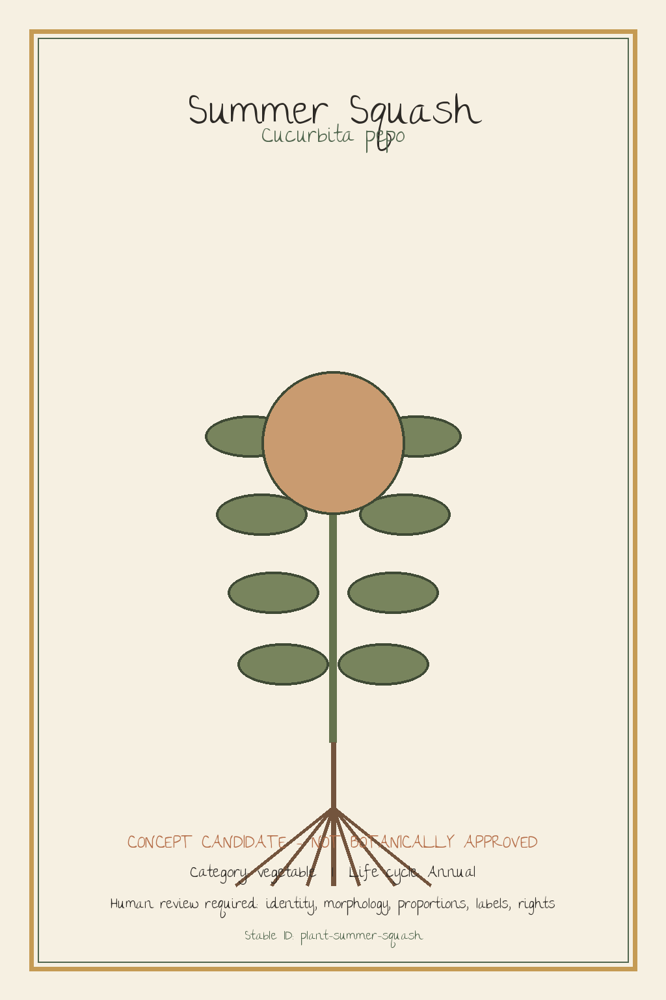

**Source status:** Not botanically or horticulturally approved. Recorded fields are derived
from the retained registry and remain subject to claim-level source review.

### Swiss Chard

**Stable plant ID:** `plant-swiss-chard`
**Category:** vegetable
**Recorded botanical name:** Beta vulgaris subsp. cicla
**Recorded family:** Amaranthaceae
**Life cycle:** Annual
**Illustration status:** `CANDIDATE_GENERATED / REVIEW_PENDING / NOT_APPROVED`

**Identification and morphology**

- Growth habit: Growth habit should be resolved to the exact species or cultivar; this entry provides a category-level source scaffold.
- Root or storage organ: Species-specific root, crown, or storage organ; verify the exact form before illustrating.
- Leaf arrangement and shape: Species-specific arrangement and blade shape; verify exact genus and cultivar.
- Flower structure: Species-specific inflorescence or flower structure.
- Fruit or seed structure: Species-specific fruit, seed pod, achene, capsule, berry, or nut.

**Errington timing fields**

- Indoor sow: Source timing not reviewed
- Direct sow: Source timing not reviewed
- Transplant: Source timing not reviewed
- Bloom: Source timing not reviewed
- Harvest: Source timing not reviewed
- Frost: Source timing not reviewed

**Cultivation**

- Soil: Well-drained, fertile soil with organic matter; adjust for the crop's root depth.
- Water: Keep moisture even during establishment and harvest formation; avoid prolonged waterlogging.
- Spacing: Use the calendar, seed packet, or mature crop size; do not rely on a registry-wide spacing value.
- Light: Full sun is usual; leafy cool-season crops tolerate more partial shade.
- Maintenance: Thin, weed, mulch, and monitor; support or stake as the crop requires.
- Pests/diseases: Monitor locally for aphids, slugs, caterpillars, fungal leaf spots, and soil-borne disease; identify before treatment.

**Candidate plate:**
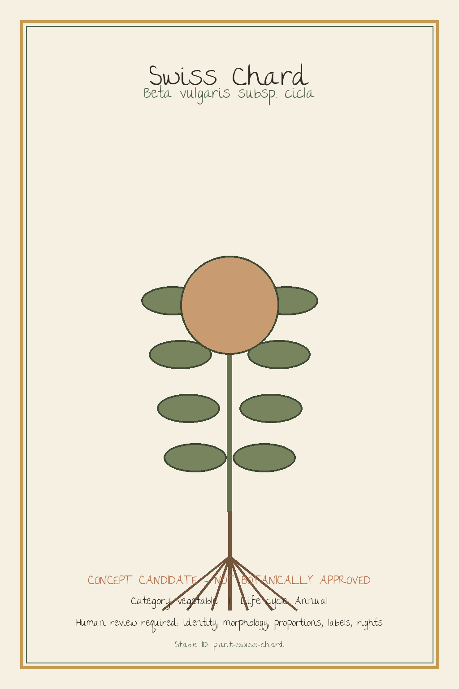

**Source status:** Not botanically or horticulturally approved. Recorded fields are derived
from the retained registry and remain subject to claim-level source review.

### Tomatoes

**Stable plant ID:** `plant-tomatoes`
**Category:** vegetable
**Recorded botanical name:** Solanum lycopersicum
**Recorded family:** Solanaceae
**Life cycle:** Annual
**Illustration status:** `CANDIDATE_GENERATED / REVIEW_PENDING / NOT_APPROVED`

**Identification and morphology**

- Growth habit: Growth habit should be resolved to the exact species or cultivar; this entry provides a category-level source scaffold.
- Root or storage organ: Species-specific root, crown, or storage organ; verify the exact form before illustrating.
- Leaf arrangement and shape: Species-specific arrangement and blade shape; verify exact genus and cultivar.
- Flower structure: Species-specific inflorescence or flower structure.
- Fruit or seed structure: Species-specific fruit, seed pod, achene, capsule, berry, or nut.

**Errington timing fields**

- Indoor sow: Source timing not reviewed
- Direct sow: Source timing not reviewed
- Transplant: Source timing not reviewed
- Bloom: Source timing not reviewed
- Harvest: Source timing not reviewed
- Frost: Source timing not reviewed

**Cultivation**

- Soil: Well-drained, fertile soil with organic matter; adjust for the crop's root depth.
- Water: Keep moisture even during establishment and harvest formation; avoid prolonged waterlogging.
- Spacing: Use the calendar, seed packet, or mature crop size; do not rely on a registry-wide spacing value.
- Light: Full sun is usual; leafy cool-season crops tolerate more partial shade.
- Maintenance: Thin, weed, mulch, and monitor; support or stake as the crop requires.
- Pests/diseases: Monitor locally for aphids, slugs, caterpillars, fungal leaf spots, and soil-borne disease; identify before treatment.

**Candidate plate:**
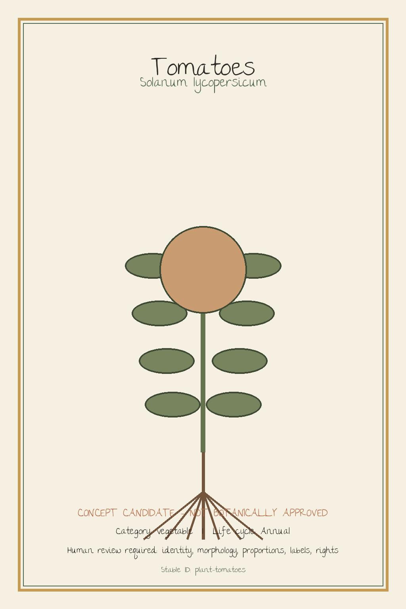

**Source status:** Not botanically or horticulturally approved. Recorded fields are derived
from the retained registry and remain subject to claim-level source review.

### Marigold

**Stable plant ID:** `plant-marigold`
**Category:** flower
**Recorded botanical name:** Tagetes patula
**Recorded family:** Asteraceae
**Life cycle:** Annual
**Illustration status:** `CANDIDATE_GENERATED / REVIEW_PENDING / NOT_APPROVED`

**Identification and morphology**

- Growth habit: Growth habit should be resolved to the exact species or cultivar; this entry provides a category-level source scaffold.
- Root or storage organ: Species-specific root, crown, or storage organ; verify the exact form before illustrating.
- Leaf arrangement and shape: Species-specific arrangement and blade shape; verify exact genus and cultivar.
- Flower structure: Species-specific inflorescence or flower structure.
- Fruit or seed structure: Species-specific fruit, seed pod, achene, capsule, berry, or nut.

**Errington timing fields**

- Indoor sow: Source timing not reviewed
- Direct sow: Source timing not reviewed
- Transplant: Source timing not reviewed
- Bloom: Source timing not reviewed
- Harvest: Source timing not reviewed
- Frost: Source timing not reviewed

**Cultivation**

- Soil: Fertile, well-drained soil with organic matter unless the species has a known exceptional preference.
- Water: Provide even establishment moisture; then follow the species' drought, moisture, or wetness preference.
- Spacing: Base spacing on mature height and spread, not just the common name.
- Light: Sun requirement is species-specific; the common name alone is not a reliable light label.
- Maintenance: Mulch, deadhead or divide as appropriate, and monitor for structural or seasonal maintenance.
- Pests/diseases: Identify the pest or disease locally before control; favor sanitation, cultural prevention, and targeted action.

**Candidate plate:**
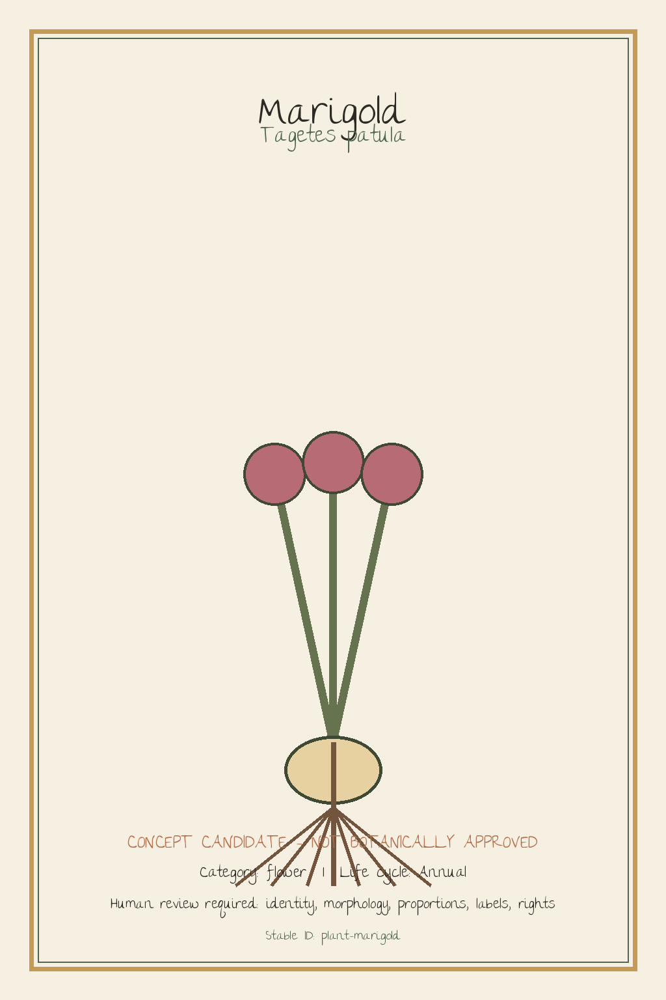

**Source status:** Not botanically or horticulturally approved. Recorded fields are derived
from the retained registry and remain subject to claim-level source review.

### Zinnia

**Stable plant ID:** `plant-zinnia`
**Category:** flower
**Recorded botanical name:** Zinnia elegans
**Recorded family:** Asteraceae
**Life cycle:** Annual
**Illustration status:** `CANDIDATE_GENERATED / REVIEW_PENDING / NOT_APPROVED`

**Identification and morphology**

- Growth habit: Growth habit should be resolved to the exact species or cultivar; this entry provides a category-level source scaffold.
- Root or storage organ: Species-specific root, crown, or storage organ; verify the exact form before illustrating.
- Leaf arrangement and shape: Species-specific arrangement and blade shape; verify exact genus and cultivar.
- Flower structure: Species-specific inflorescence or flower structure.
- Fruit or seed structure: Species-specific fruit, seed pod, achene, capsule, berry, or nut.

**Errington timing fields**

- Indoor sow: Source timing not reviewed
- Direct sow: Source timing not reviewed
- Transplant: Source timing not reviewed
- Bloom: Source timing not reviewed
- Harvest: Source timing not reviewed
- Frost: Source timing not reviewed

**Cultivation**

- Soil: Fertile, well-drained soil with organic matter unless the species has a known exceptional preference.
- Water: Provide even establishment moisture; then follow the species' drought, moisture, or wetness preference.
- Spacing: Base spacing on mature height and spread, not just the common name.
- Light: Sun requirement is species-specific; the common name alone is not a reliable light label.
- Maintenance: Mulch, deadhead or divide as appropriate, and monitor for structural or seasonal maintenance.
- Pests/diseases: Identify the pest or disease locally before control; favor sanitation, cultural prevention, and targeted action.

**Candidate plate:**
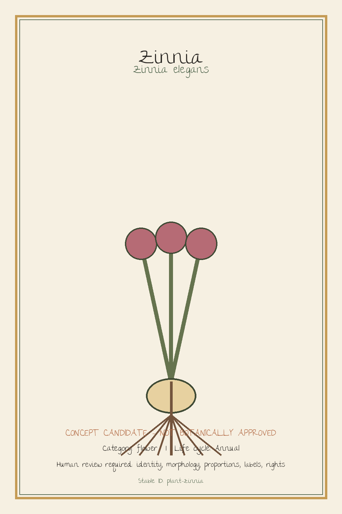

**Source status:** Not botanically or horticulturally approved. Recorded fields are derived
from the retained registry and remain subject to claim-level source review.

### Cosmos

**Stable plant ID:** `plant-cosmos`
**Category:** flower
**Recorded botanical name:** Cosmos bipinnatus
**Recorded family:** Asteraceae
**Life cycle:** Annual
**Illustration status:** `CANDIDATE_GENERATED / REVIEW_PENDING / NOT_APPROVED`

**Identification and morphology**

- Growth habit: Growth habit should be resolved to the exact species or cultivar; this entry provides a category-level source scaffold.
- Root or storage organ: Species-specific root, crown, or storage organ; verify the exact form before illustrating.
- Leaf arrangement and shape: Species-specific arrangement and blade shape; verify exact genus and cultivar.
- Flower structure: Species-specific inflorescence or flower structure.
- Fruit or seed structure: Species-specific fruit, seed pod, achene, capsule, berry, or nut.

**Errington timing fields**

- Indoor sow: Source timing not reviewed
- Direct sow: Source timing not reviewed
- Transplant: Source timing not reviewed
- Bloom: Source timing not reviewed
- Harvest: Source timing not reviewed
- Frost: Source timing not reviewed

**Cultivation**

- Soil: Fertile, well-drained soil with organic matter unless the species has a known exceptional preference.
- Water: Provide even establishment moisture; then follow the species' drought, moisture, or wetness preference.
- Spacing: Base spacing on mature height and spread, not just the common name.
- Light: Sun requirement is species-specific; the common name alone is not a reliable light label.
- Maintenance: Mulch, deadhead or divide as appropriate, and monitor for structural or seasonal maintenance.
- Pests/diseases: Identify the pest or disease locally before control; favor sanitation, cultural prevention, and targeted action.

**Candidate plate:**
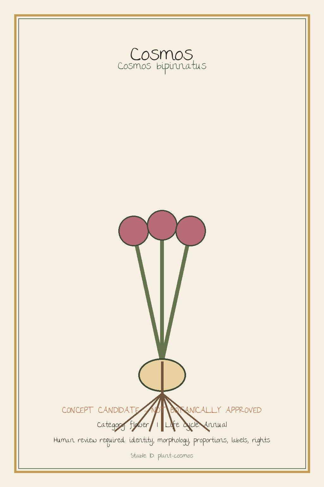

**Source status:** Not botanically or horticulturally approved. Recorded fields are derived
from the retained registry and remain subject to claim-level source review.

### Nasturtium

**Stable plant ID:** `plant-nasturtium`
**Category:** flower
**Recorded botanical name:** Tropaeolum majus
**Recorded family:** Tropaeolaceae
**Life cycle:** Annual
**Illustration status:** `CANDIDATE_GENERATED / REVIEW_PENDING / NOT_APPROVED`

**Identification and morphology**

- Growth habit: Growth habit should be resolved to the exact species or cultivar; this entry provides a category-level source scaffold.
- Root or storage organ: Species-specific root, crown, or storage organ; verify the exact form before illustrating.
- Leaf arrangement and shape: Species-specific arrangement and blade shape; verify exact genus and cultivar.
- Flower structure: Species-specific inflorescence or flower structure.
- Fruit or seed structure: Species-specific fruit, seed pod, achene, capsule, berry, or nut.

**Errington timing fields**

- Indoor sow: Source timing not reviewed
- Direct sow: Source timing not reviewed
- Transplant: Source timing not reviewed
- Bloom: Source timing not reviewed
- Harvest: Source timing not reviewed
- Frost: Source timing not reviewed

**Cultivation**

- Soil: Fertile, well-drained soil with organic matter unless the species has a known exceptional preference.
- Water: Provide even establishment moisture; then follow the species' drought, moisture, or wetness preference.
- Spacing: Base spacing on mature height and spread, not just the common name.
- Light: Sun requirement is species-specific; the common name alone is not a reliable light label.
- Maintenance: Mulch, deadhead or divide as appropriate, and monitor for structural or seasonal maintenance.
- Pests/diseases: Identify the pest or disease locally before control; favor sanitation, cultural prevention, and targeted action.

**Candidate plate:**
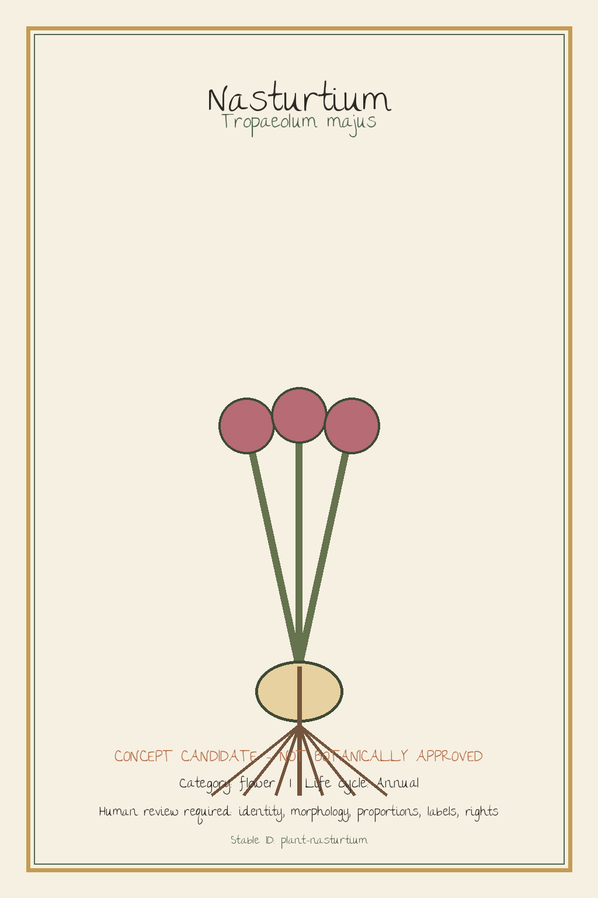

**Source status:** Not botanically or horticulturally approved. Recorded fields are derived
from the retained registry and remain subject to claim-level source review.

### Sunflower

**Stable plant ID:** `plant-sunflower`
**Category:** flower
**Recorded botanical name:** Helianthus annuus
**Recorded family:** Asteraceae
**Life cycle:** Annual
**Illustration status:** `CANDIDATE_GENERATED / REVIEW_PENDING / NOT_APPROVED`

**Identification and morphology**

- Growth habit: Growth habit should be resolved to the exact species or cultivar; this entry provides a category-level source scaffold.
- Root or storage organ: Species-specific root, crown, or storage organ; verify the exact form before illustrating.
- Leaf arrangement and shape: Species-specific arrangement and blade shape; verify exact genus and cultivar.
- Flower structure: Species-specific inflorescence or flower structure.
- Fruit or seed structure: Species-specific fruit, seed pod, achene, capsule, berry, or nut.

**Errington timing fields**

- Indoor sow: Source timing not reviewed
- Direct sow: Source timing not reviewed
- Transplant: Source timing not reviewed
- Bloom: Source timing not reviewed
- Harvest: Source timing not reviewed
- Frost: Source timing not reviewed

**Cultivation**

- Soil: Fertile, well-drained soil with organic matter unless the species has a known exceptional preference.
- Water: Provide even establishment moisture; then follow the species' drought, moisture, or wetness preference.
- Spacing: Base spacing on mature height and spread, not just the common name.
- Light: Sun requirement is species-specific; the common name alone is not a reliable light label.
- Maintenance: Mulch, deadhead or divide as appropriate, and monitor for structural or seasonal maintenance.
- Pests/diseases: Identify the pest or disease locally before control; favor sanitation, cultural prevention, and targeted action.

**Candidate plate:**
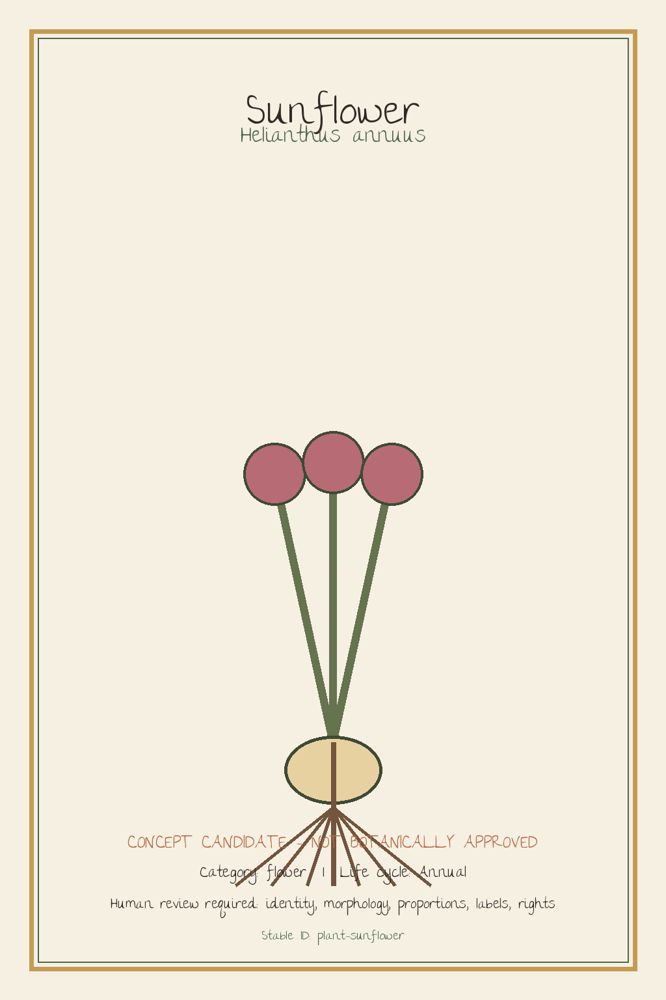

**Source status:** Not botanically or horticulturally approved. Recorded fields are derived
from the retained registry and remain subject to claim-level source review.

### Sweet Pea

**Stable plant ID:** `plant-sweet-pea`
**Category:** flower
**Recorded botanical name:** Lathyrus odoratus
**Recorded family:** Fabaceae
**Life cycle:** Annual
**Illustration status:** `CANDIDATE_GENERATED / REVIEW_PENDING / NOT_APPROVED`

**Identification and morphology**

- Growth habit: Growth habit should be resolved to the exact species or cultivar; this entry provides a category-level source scaffold.
- Root or storage organ: Species-specific root, crown, or storage organ; verify the exact form before illustrating.
- Leaf arrangement and shape: Species-specific arrangement and blade shape; verify exact genus and cultivar.
- Flower structure: Species-specific inflorescence or flower structure.
- Fruit or seed structure: Species-specific fruit, seed pod, achene, capsule, berry, or nut.

**Errington timing fields**

- Indoor sow: Source timing not reviewed
- Direct sow: Source timing not reviewed
- Transplant: Source timing not reviewed
- Bloom: Source timing not reviewed
- Harvest: Source timing not reviewed
- Frost: Source timing not reviewed

**Cultivation**

- Soil: Fertile, well-drained soil with organic matter unless the species has a known exceptional preference.
- Water: Provide even establishment moisture; then follow the species' drought, moisture, or wetness preference.
- Spacing: Base spacing on mature height and spread, not just the common name.
- Light: Sun requirement is species-specific; the common name alone is not a reliable light label.
- Maintenance: Mulch, deadhead or divide as appropriate, and monitor for structural or seasonal maintenance.
- Pests/diseases: Identify the pest or disease locally before control; favor sanitation, cultural prevention, and targeted action.

**Candidate plate:**

**Source status:** Not botanically or horticulturally approved. Recorded fields are derived
from the retained registry and remain subject to claim-level source review.

### Calendula

**Stable plant ID:** `plant-calendula`
**Category:** flower
**Recorded botanical name:** Calendula officinalis
**Recorded family:** Asteraceae
**Life cycle:** Annual
**Illustration status:** `CANDIDATE_GENERATED / REVIEW_PENDING / NOT_APPROVED`

**Identification and morphology**

- Growth habit: Growth habit should be resolved to the exact species or cultivar; this entry provides a category-level source scaffold.
- Root or storage organ: Species-specific root, crown, or storage organ; verify the exact form before illustrating.
- Leaf arrangement and shape: Species-specific arrangement and blade shape; verify exact genus and cultivar.
- Flower structure: Species-specific inflorescence or flower structure.
- Fruit or seed structure: Species-specific fruit, seed pod, achene, capsule, berry, or nut.

**Errington timing fields**

- Indoor sow: Source timing not reviewed
- Direct sow: Source timing not reviewed
- Transplant: Source timing not reviewed
- Bloom: Source timing not reviewed
- Harvest: Source timing not reviewed
- Frost: Source timing not reviewed

**Cultivation**

- Soil: Fertile, well-drained soil with organic matter unless the species has a known exceptional preference.
- Water: Provide even establishment moisture; then follow the species' drought, moisture, or wetness preference.
- Spacing: Base spacing on mature height and spread, not just the common name.
- Light: Sun requirement is species-specific; the common name alone is not a reliable light label.
- Maintenance: Mulch, deadhead or divide as appropriate, and monitor for structural or seasonal maintenance.
- Pests/diseases: Identify the pest or disease locally before control; favor sanitation, cultural prevention, and targeted action.

**Candidate plate:**
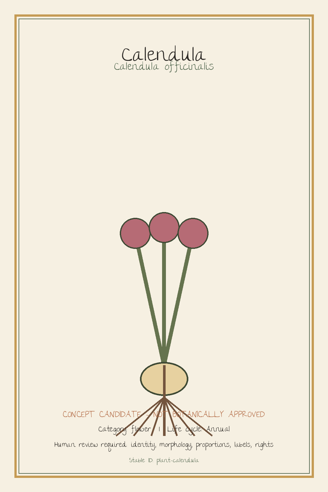

**Source status:** Not botanically or horticulturally approved. Recorded fields are derived
from the retained registry and remain subject to claim-level source review.

### Dahlia

**Stable plant ID:** `plant-dahlia`
**Category:** flower
**Recorded botanical name:** Dahlia pinnata
**Recorded family:** Asteraceae
**Life cycle:** Perennial
**Illustration status:** `CANDIDATE_GENERATED / REVIEW_PENDING / NOT_APPROVED`

**Identification and morphology**

- Growth habit: Growth habit should be resolved to the exact species or cultivar; this entry provides a category-level source scaffold.
- Root or storage organ: Species-specific root, crown, or storage organ; verify the exact form before illustrating.
- Leaf arrangement and shape: Species-specific arrangement and blade shape; verify exact genus and cultivar.
- Flower structure: Species-specific inflorescence or flower structure.
- Fruit or seed structure: Species-specific fruit, seed pod, achene, capsule, berry, or nut.

**Errington timing fields**

- Indoor sow: Source timing not reviewed
- Direct sow: Source timing not reviewed
- Transplant: Source timing not reviewed
- Bloom: Source timing not reviewed
- Harvest: Source timing not reviewed
- Frost: Source timing not reviewed

**Cultivation**

- Soil: Fertile, well-drained soil with organic matter unless the species has a known exceptional preference.
- Water: Provide even establishment moisture; then follow the species' drought, moisture, or wetness preference.
- Spacing: Base spacing on mature height and spread, not just the common name.
- Light: Sun requirement is species-specific; the common name alone is not a reliable light label.
- Maintenance: Mulch, deadhead or divide as appropriate, and monitor for structural or seasonal maintenance.
- Pests/diseases: Identify the pest or disease locally before control; favor sanitation, cultural prevention, and targeted action.

**Candidate plate:**

**Source status:** Not botanically or horticulturally approved. Recorded fields are derived
from the retained registry and remain subject to claim-level source review.

### Peony

**Stable plant ID:** `plant-peony`
**Category:** flower
**Recorded botanical name:** Paeonia lactiflora
**Recorded family:** Paeoniaceae
**Life cycle:** Perennial
**Illustration status:** `CANDIDATE_GENERATED / REVIEW_PENDING / NOT_APPROVED`

**Identification and morphology**

- Growth habit: Growth habit should be resolved to the exact species or cultivar; this entry provides a category-level source scaffold.
- Root or storage organ: Species-specific root, crown, or storage organ; verify the exact form before illustrating.
- Leaf arrangement and shape: Species-specific arrangement and blade shape; verify exact genus and cultivar.
- Flower structure: Species-specific inflorescence or flower structure.
- Fruit or seed structure: Species-specific fruit, seed pod, achene, capsule, berry, or nut.

**Errington timing fields**

- Indoor sow: Source timing not reviewed
- Direct sow: Source timing not reviewed
- Transplant: Source timing not reviewed
- Bloom: Source timing not reviewed
- Harvest: Source timing not reviewed
- Frost: Source timing not reviewed

**Cultivation**

- Soil: Fertile, well-drained soil with organic matter unless the species has a known exceptional preference.
- Water: Provide even establishment moisture; then follow the species' drought, moisture, or wetness preference.
- Spacing: Base spacing on mature height and spread, not just the common name.
- Light: Sun requirement is species-specific; the common name alone is not a reliable light label.
- Maintenance: Mulch, deadhead or divide as appropriate, and monitor for structural or seasonal maintenance.
- Pests/diseases: Identify the pest or disease locally before control; favor sanitation, cultural prevention, and targeted action.

**Candidate plate:**
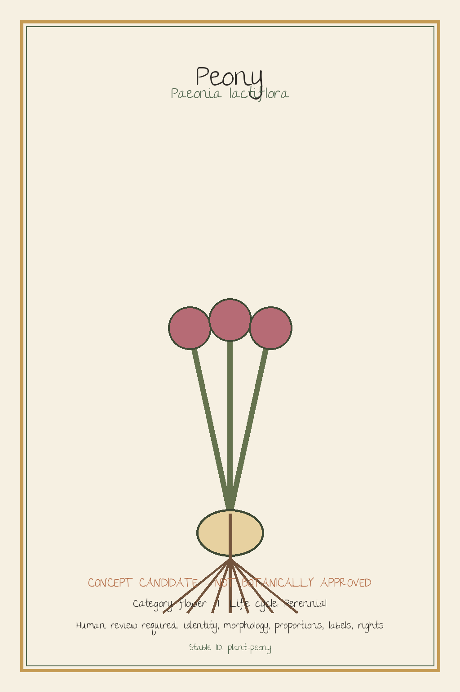

**Source status:** Not botanically or horticulturally approved. Recorded fields are derived
from the retained registry and remain subject to claim-level source review.

### Iris

**Stable plant ID:** `plant-iris`
**Category:** flower
**Recorded botanical name:** Iris × germanica
**Recorded family:** Iridaceae
**Life cycle:** Perennial
**Illustration status:** `CANDIDATE_GENERATED / REVIEW_PENDING / NOT_APPROVED`

**Identification and morphology**

- Growth habit: Growth habit should be resolved to the exact species or cultivar; this entry provides a category-level source scaffold.
- Root or storage organ: Species-specific root, crown, or storage organ; verify the exact form before illustrating.
- Leaf arrangement and shape: Species-specific arrangement and blade shape; verify exact genus and cultivar.
- Flower structure: Species-specific inflorescence or flower structure.
- Fruit or seed structure: Species-specific fruit, seed pod, achene, capsule, berry, or nut.

**Errington timing fields**

- Indoor sow: Source timing not reviewed
- Direct sow: Source timing not reviewed
- Transplant: Source timing not reviewed
- Bloom: Source timing not reviewed
- Harvest: Source timing not reviewed
- Frost: Source timing not reviewed

**Cultivation**

- Soil: Fertile, well-drained soil with organic matter unless the species has a known exceptional preference.
- Water: Provide even establishment moisture; then follow the species' drought, moisture, or wetness preference.
- Spacing: Base spacing on mature height and spread, not just the common name.
- Light: Sun requirement is species-specific; the common name alone is not a reliable light label.
- Maintenance: Mulch, deadhead or divide as appropriate, and monitor for structural or seasonal maintenance.
- Pests/diseases: Identify the pest or disease locally before control; favor sanitation, cultural prevention, and targeted action.

**Candidate plate:**
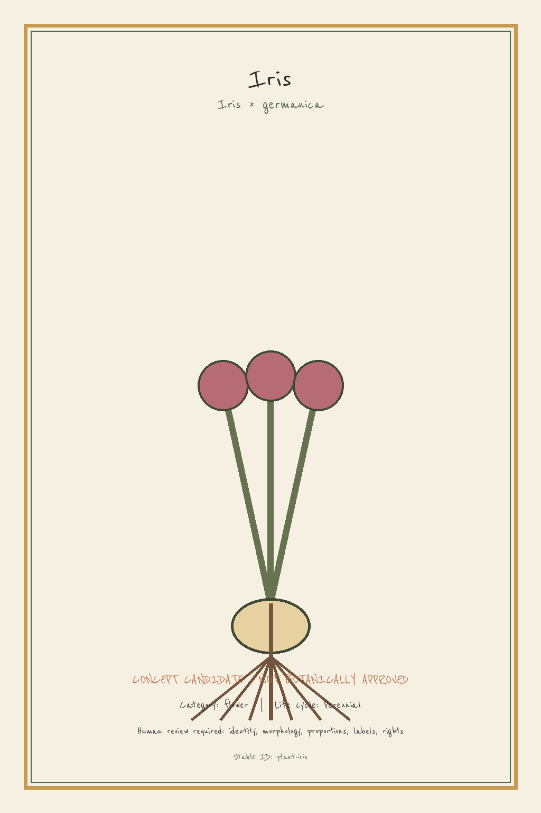

**Source status:** Not botanically or horticulturally approved. Recorded fields are derived
from the retained registry and remain subject to claim-level source review.

### Daylily

**Stable plant ID:** `plant-daylily`
**Category:** flower
**Recorded botanical name:** Hemerocallis × hybrida
**Recorded family:** Asphodelaceae
**Life cycle:** Perennial
**Illustration status:** `CANDIDATE_GENERATED / REVIEW_PENDING / NOT_APPROVED`

**Identification and morphology**

- Growth habit: Growth habit should be resolved to the exact species or cultivar; this entry provides a category-level source scaffold.
- Root or storage organ: Species-specific root, crown, or storage organ; verify the exact form before illustrating.
- Leaf arrangement and shape: Species-specific arrangement and blade shape; verify exact genus and cultivar.
- Flower structure: Species-specific inflorescence or flower structure.
- Fruit or seed structure: Species-specific fruit, seed pod, achene, capsule, berry, or nut.

**Errington timing fields**

- Indoor sow: Source timing not reviewed
- Direct sow: Source timing not reviewed
- Transplant: Source timing not reviewed
- Bloom: Source timing not reviewed
- Harvest: Source timing not reviewed
- Frost: Source timing not reviewed

**Cultivation**

- Soil: Fertile, well-drained soil with organic matter unless the species has a known exceptional preference.
- Water: Provide even establishment moisture; then follow the species' drought, moisture, or wetness preference.
- Spacing: Base spacing on mature height and spread, not just the common name.
- Light: Sun requirement is species-specific; the common name alone is not a reliable light label.
- Maintenance: Mulch, deadhead or divide as appropriate, and monitor for structural or seasonal maintenance.
- Pests/diseases: Identify the pest or disease locally before control; favor sanitation, cultural prevention, and targeted action.

**Candidate plate:**
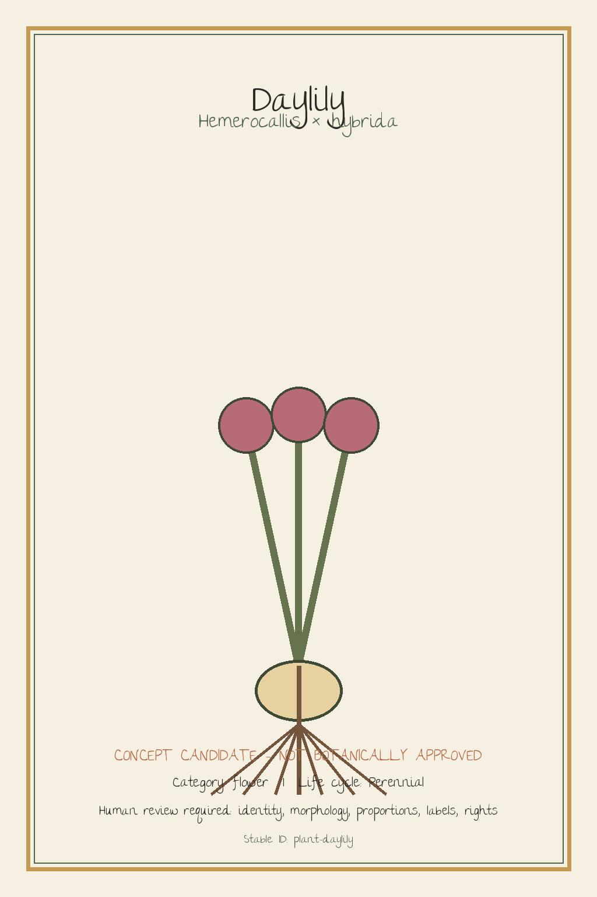

**Source status:** Not botanically or horticulturally approved. Recorded fields are derived
from the retained registry and remain subject to claim-level source review.

### Lavender

**Stable plant ID:** `plant-lavender`
**Category:** flower
**Recorded botanical name:** Lavandula angustifolia
**Recorded family:** Lamiaceae
**Life cycle:** Perennial
**Illustration status:** `CANDIDATE_GENERATED / REVIEW_PENDING / NOT_APPROVED`

**Identification and morphology**

- Growth habit: Growth habit should be resolved to the exact species or cultivar; this entry provides a category-level source scaffold.
- Root or storage organ: Species-specific root, crown, or storage organ; verify the exact form before illustrating.
- Leaf arrangement and shape: Species-specific arrangement and blade shape; verify exact genus and cultivar.
- Flower structure: Species-specific inflorescence or flower structure.
- Fruit or seed structure: Species-specific fruit, seed pod, achene, capsule, berry, or nut.

**Errington timing fields**

- Indoor sow: Source timing not reviewed
- Direct sow: Source timing not reviewed
- Transplant: Source timing not reviewed
- Bloom: Source timing not reviewed
- Harvest: Source timing not reviewed
- Frost: Source timing not reviewed

**Cultivation**

- Soil: Fertile, well-drained soil with organic matter unless the species has a known exceptional preference.
- Water: Provide even establishment moisture; then follow the species' drought, moisture, or wetness preference.
- Spacing: Base spacing on mature height and spread, not just the common name.
- Light: Sun requirement is species-specific; the common name alone is not a reliable light label.
- Maintenance: Mulch, deadhead or divide as appropriate, and monitor for structural or seasonal maintenance.
- Pests/diseases: Identify the pest or disease locally before control; favor sanitation, cultural prevention, and targeted action.

**Candidate plate:**
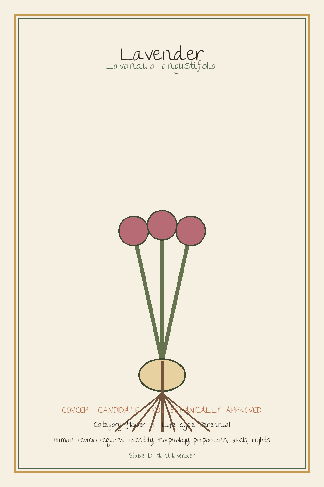

**Source status:** Not botanically or horticulturally approved. Recorded fields are derived
from the retained registry and remain subject to claim-level source review.

### Echinacea

**Stable plant ID:** `plant-echinacea`
**Category:** flower
**Recorded botanical name:** Echinacea purpurea
**Recorded family:** Asteraceae
**Life cycle:** Perennial
**Illustration status:** `CANDIDATE_GENERATED / REVIEW_PENDING / NOT_APPROVED`

**Identification and morphology**

- Growth habit: Growth habit should be resolved to the exact species or cultivar; this entry provides a category-level source scaffold.
- Root or storage organ: Species-specific root, crown, or storage organ; verify the exact form before illustrating.
- Leaf arrangement and shape: Species-specific arrangement and blade shape; verify exact genus and cultivar.
- Flower structure: Species-specific inflorescence or flower structure.
- Fruit or seed structure: Species-specific fruit, seed pod, achene, capsule, berry, or nut.

**Errington timing fields**

- Indoor sow: Source timing not reviewed
- Direct sow: Source timing not reviewed
- Transplant: Source timing not reviewed
- Bloom: Source timing not reviewed
- Harvest: Source timing not reviewed
- Frost: Source timing not reviewed

**Cultivation**

- Soil: Fertile, well-drained soil with organic matter unless the species has a known exceptional preference.
- Water: Provide even establishment moisture; then follow the species' drought, moisture, or wetness preference.
- Spacing: Base spacing on mature height and spread, not just the common name.
- Light: Sun requirement is species-specific; the common name alone is not a reliable light label.
- Maintenance: Mulch, deadhead or divide as appropriate, and monitor for structural or seasonal maintenance.
- Pests/diseases: Identify the pest or disease locally before control; favor sanitation, cultural prevention, and targeted action.

**Candidate plate:**

**Source status:** Not botanically or horticulturally approved. Recorded fields are derived
from the retained registry and remain subject to claim-level source review.

### Rudbeckia

**Stable plant ID:** `plant-rudbeckia`
**Category:** flower
**Recorded botanical name:** Rudbeckia hirta
**Recorded family:** Asteraceae
**Life cycle:** Perennial
**Illustration status:** `CANDIDATE_GENERATED / REVIEW_PENDING / NOT_APPROVED`

**Identification and morphology**

- Growth habit: Growth habit should be resolved to the exact species or cultivar; this entry provides a category-level source scaffold.
- Root or storage organ: Species-specific root, crown, or storage organ; verify the exact form before illustrating.
- Leaf arrangement and shape: Species-specific arrangement and blade shape; verify exact genus and cultivar.
- Flower structure: Species-specific inflorescence or flower structure.
- Fruit or seed structure: Species-specific fruit, seed pod, achene, capsule, berry, or nut.

**Errington timing fields**

- Indoor sow: Source timing not reviewed
- Direct sow: Source timing not reviewed
- Transplant: Source timing not reviewed
- Bloom: Source timing not reviewed
- Harvest: Source timing not reviewed
- Frost: Source timing not reviewed

**Cultivation**

- Soil: Fertile, well-drained soil with organic matter unless the species has a known exceptional preference.
- Water: Provide even establishment moisture; then follow the species' drought, moisture, or wetness preference.
- Spacing: Base spacing on mature height and spread, not just the common name.
- Light: Sun requirement is species-specific; the common name alone is not a reliable light label.
- Maintenance: Mulch, deadhead or divide as appropriate, and monitor for structural or seasonal maintenance.
- Pests/diseases: Identify the pest or disease locally before control; favor sanitation, cultural prevention, and targeted action.

**Candidate plate:**

**Source status:** Not botanically or horticulturally approved. Recorded fields are derived
from the retained registry and remain subject to claim-level source review.

### Tulip

**Stable plant ID:** `plant-tulip`
**Category:** flower
**Recorded botanical name:** Tulipa gesneriana
**Recorded family:** Liliaceae
**Life cycle:** Perennial; grown from a bulb, corm, or storage organ
**Illustration status:** `CANDIDATE_GENERATED / REVIEW_PENDING / NOT_APPROVED`

**Identification and morphology**

- Growth habit: Growth habit should be resolved to the exact species or cultivar; this entry provides a category-level source scaffold.
- Root or storage organ: Basal plate and fibrous roots; bulb or corm storage organ.
- Leaf arrangement and shape: Basal or sheathing leaves; strap, linear, or species-specific blades.
- Flower structure: Species-specific flower or inflorescence; generally showy and arranged to attract pollinators.
- Fruit or seed structure: Seed capsule or berry may follow flowering.

**Errington timing fields**

- Indoor sow: Source timing not reviewed
- Direct sow: Source timing not reviewed
- Transplant: Source timing not reviewed
- Bloom: Source timing not reviewed
- Harvest: Source timing not reviewed
- Frost: Source timing not reviewed

**Cultivation**

- Soil: Fertile, well-drained soil with organic matter unless the species has a known exceptional preference.
- Water: Provide even establishment moisture; then follow the species' drought, moisture, or wetness preference.
- Spacing: Base spacing on mature height and spread, not just the common name.
- Light: Sun requirement is species-specific; the common name alone is not a reliable light label.
- Maintenance: Mulch, deadhead or divide as appropriate, and monitor for structural or seasonal maintenance.
- Pests/diseases: Identify the pest or disease locally before control; favor sanitation, cultural prevention, and targeted action.

**Candidate plate:**
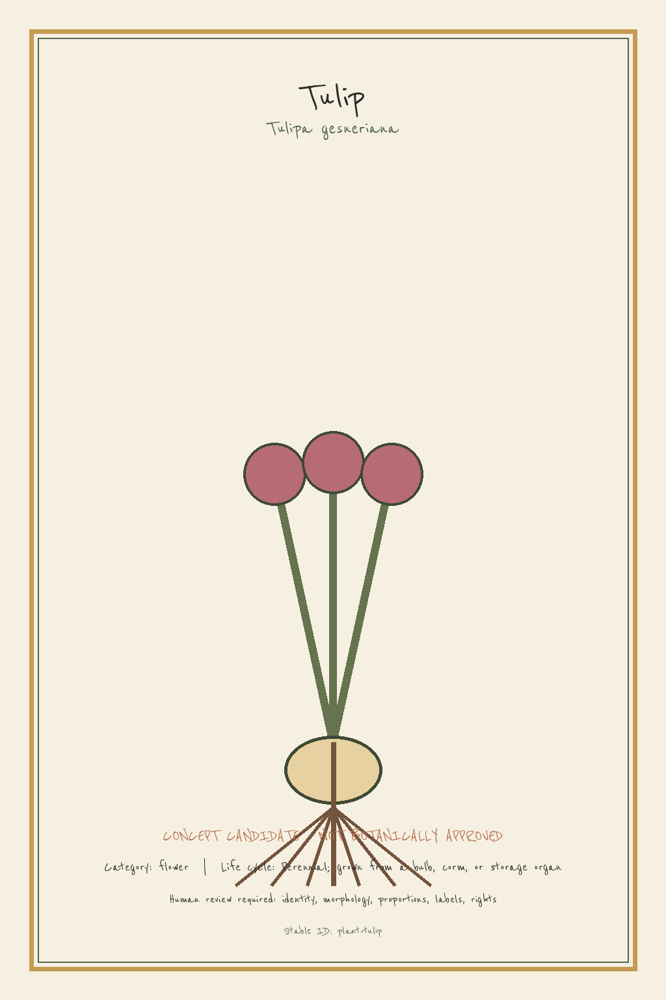

**Source status:** Not botanically or horticulturally approved. Recorded fields are derived
from the retained registry and remain subject to claim-level source review.

### Daffodil

**Stable plant ID:** `plant-daffodil`
**Category:** flower
**Recorded botanical name:** Narcissus pseudonarcissus
**Recorded family:** Amaryllidaceae
**Life cycle:** Perennial; grown from a bulb, corm, or storage organ
**Illustration status:** `CANDIDATE_GENERATED / REVIEW_PENDING / NOT_APPROVED`

**Identification and morphology**

- Growth habit: Growth habit should be resolved to the exact species or cultivar; this entry provides a category-level source scaffold.
- Root or storage organ: Basal plate and fibrous roots; bulb or corm storage organ.
- Leaf arrangement and shape: Basal or sheathing leaves; strap, linear, or species-specific blades.
- Flower structure: Species-specific flower or inflorescence; generally showy and arranged to attract pollinators.
- Fruit or seed structure: Seed capsule or berry may follow flowering.

**Errington timing fields**

- Indoor sow: Source timing not reviewed
- Direct sow: Source timing not reviewed
- Transplant: Source timing not reviewed
- Bloom: Source timing not reviewed
- Harvest: Source timing not reviewed
- Frost: Source timing not reviewed

**Cultivation**

- Soil: Fertile, well-drained soil with organic matter unless the species has a known exceptional preference.
- Water: Provide even establishment moisture; then follow the species' drought, moisture, or wetness preference.
- Spacing: Base spacing on mature height and spread, not just the common name.
- Light: Sun requirement is species-specific; the common name alone is not a reliable light label.
- Maintenance: Mulch, deadhead or divide as appropriate, and monitor for structural or seasonal maintenance.
- Pests/diseases: Identify the pest or disease locally before control; favor sanitation, cultural prevention, and targeted action.

**Candidate plate:**
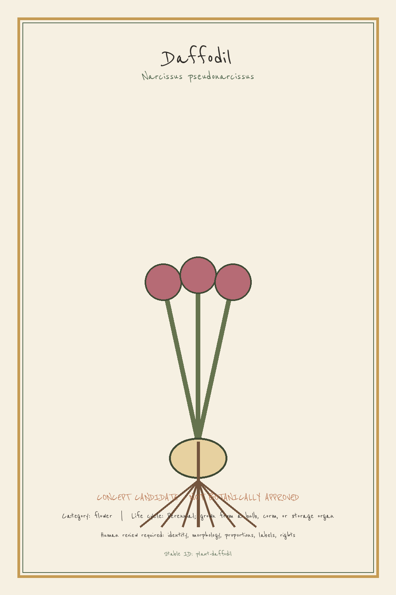

**Source status:** Not botanically or horticulturally approved. Recorded fields are derived
from the retained registry and remain subject to claim-level source review.

### Crocus

**Stable plant ID:** `plant-crocus`
**Category:** flower
**Recorded botanical name:** Crocus vernus
**Recorded family:** Iridaceae
**Life cycle:** Perennial; grown from a bulb, corm, or storage organ
**Illustration status:** `CANDIDATE_GENERATED / REVIEW_PENDING / NOT_APPROVED`

**Identification and morphology**

- Growth habit: Growth habit should be resolved to the exact species or cultivar; this entry provides a category-level source scaffold.
- Root or storage organ: Basal plate and fibrous roots; bulb or corm storage organ.
- Leaf arrangement and shape: Basal or sheathing leaves; strap, linear, or species-specific blades.
- Flower structure: Species-specific flower or inflorescence; generally showy and arranged to attract pollinators.
- Fruit or seed structure: Seed capsule or berry may follow flowering.

**Errington timing fields**

- Indoor sow: Source timing not reviewed
- Direct sow: Source timing not reviewed
- Transplant: Source timing not reviewed
- Bloom: Source timing not reviewed
- Harvest: Source timing not reviewed
- Frost: Source timing not reviewed

**Cultivation**

- Soil: Fertile, well-drained soil with organic matter unless the species has a known exceptional preference.
- Water: Provide even establishment moisture; then follow the species' drought, moisture, or wetness preference.
- Spacing: Base spacing on mature height and spread, not just the common name.
- Light: Sun requirement is species-specific; the common name alone is not a reliable light label.
- Maintenance: Mulch, deadhead or divide as appropriate, and monitor for structural or seasonal maintenance.
- Pests/diseases: Identify the pest or disease locally before control; favor sanitation, cultural prevention, and targeted action.

**Candidate plate:**
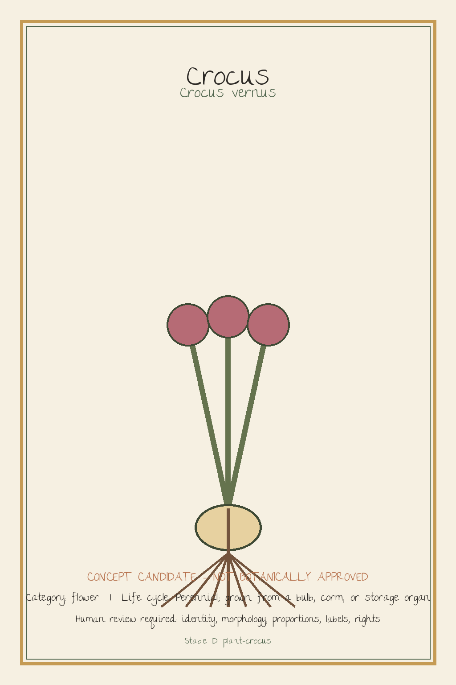

**Source status:** Not botanically or horticulturally approved. Recorded fields are derived
from the retained registry and remain subject to claim-level source review.

### Allium

**Stable plant ID:** `plant-allium`
**Category:** flower
**Recorded botanical name:** Allium hollandicum
**Recorded family:** Amaryllidaceae
**Life cycle:** Perennial; grown from a bulb, corm, or storage organ
**Illustration status:** `CANDIDATE_GENERATED / REVIEW_PENDING / NOT_APPROVED`

**Identification and morphology**

- Growth habit: Growth habit should be resolved to the exact species or cultivar; this entry provides a category-level source scaffold.
- Root or storage organ: Basal plate and fibrous roots; bulb or corm storage organ.
- Leaf arrangement and shape: Basal or sheathing leaves; strap, linear, or species-specific blades.
- Flower structure: Species-specific flower or inflorescence; generally showy and arranged to attract pollinators.
- Fruit or seed structure: Seed capsule or berry may follow flowering.

**Errington timing fields**

- Indoor sow: Source timing not reviewed
- Direct sow: Source timing not reviewed
- Transplant: Source timing not reviewed
- Bloom: Source timing not reviewed
- Harvest: Source timing not reviewed
- Frost: Source timing not reviewed

**Cultivation**

- Soil: Fertile, well-drained soil with organic matter unless the species has a known exceptional preference.
- Water: Provide even establishment moisture; then follow the species' drought, moisture, or wetness preference.
- Spacing: Base spacing on mature height and spread, not just the common name.
- Light: Sun requirement is species-specific; the common name alone is not a reliable light label.
- Maintenance: Mulch, deadhead or divide as appropriate, and monitor for structural or seasonal maintenance.
- Pests/diseases: Identify the pest or disease locally before control; favor sanitation, cultural prevention, and targeted action.

**Candidate plate:**
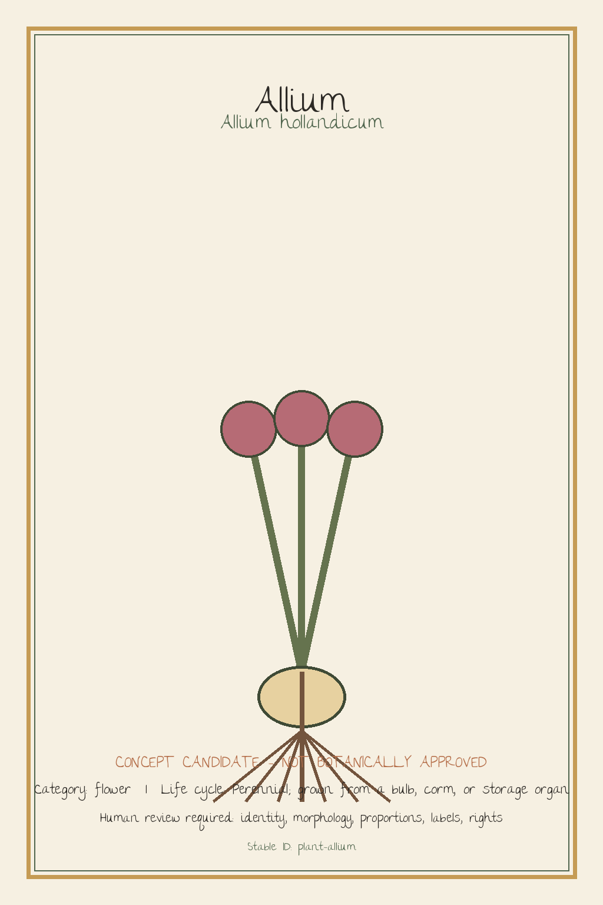

**Source status:** Not botanically or horticulturally approved. Recorded fields are derived
from the retained registry and remain subject to claim-level source review.

### Hyacinth

**Stable plant ID:** `plant-hyacinth`
**Category:** flower
**Recorded botanical name:** Hyacinthus orientalis
**Recorded family:** Asparagaceae
**Life cycle:** Perennial; grown from a bulb, corm, or storage organ
**Illustration status:** `CANDIDATE_GENERATED / REVIEW_PENDING / NOT_APPROVED`

**Identification and morphology**

- Growth habit: Growth habit should be resolved to the exact species or cultivar; this entry provides a category-level source scaffold.
- Root or storage organ: Basal plate and fibrous roots; bulb or corm storage organ.
- Leaf arrangement and shape: Basal or sheathing leaves; strap, linear, or species-specific blades.
- Flower structure: Species-specific flower or inflorescence; generally showy and arranged to attract pollinators.
- Fruit or seed structure: Seed capsule or berry may follow flowering.

**Errington timing fields**

- Indoor sow: Source timing not reviewed
- Direct sow: Source timing not reviewed
- Transplant: Source timing not reviewed
- Bloom: Source timing not reviewed
- Harvest: Source timing not reviewed
- Frost: Source timing not reviewed

**Cultivation**

- Soil: Fertile, well-drained soil with organic matter unless the species has a known exceptional preference.
- Water: Provide even establishment moisture; then follow the species' drought, moisture, or wetness preference.
- Spacing: Base spacing on mature height and spread, not just the common name.
- Light: Sun requirement is species-specific; the common name alone is not a reliable light label.
- Maintenance: Mulch, deadhead or divide as appropriate, and monitor for structural or seasonal maintenance.
- Pests/diseases: Identify the pest or disease locally before control; favor sanitation, cultural prevention, and targeted action.

**Candidate plate:**
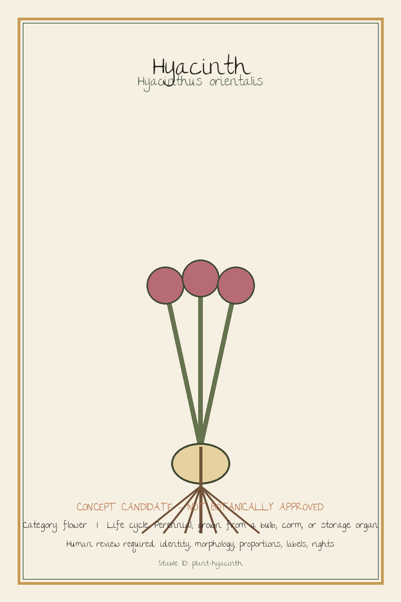

**Source status:** Not botanically or horticulturally approved. Recorded fields are derived
from the retained registry and remain subject to claim-level source review.

### Hostas

**Stable plant ID:** `plant-hostas`
**Category:** ornamental
**Recorded botanical name:** Hosta spp.
**Recorded family:** Asparagaceae
**Life cycle:** Perennial or variable; species-level resolution required
**Illustration status:** `CANDIDATE_GENERATED / REVIEW_PENDING / NOT_APPROVED`

**Identification and morphology**

- Growth habit: Growth habit should be resolved to the exact species or cultivar; this entry provides a category-level source scaffold.
- Root or storage organ: Fibrous, rhizomatous, clumping, or fleshy according to the species.
- Leaf arrangement and shape: Species- or genus-specific leaf arrangement and shape; generic label needs disambiguation.
- Flower structure: Species-specific flower form; local bloom timing comes from the Errington calendar if matched.
- Fruit or seed structure: Seed capsule, achene, berry, or no conspicuous fruit according to species.

**Errington timing fields**

- Indoor sow: Source timing not reviewed
- Direct sow: Source timing not reviewed
- Transplant: Source timing not reviewed
- Bloom: Source timing not reviewed
- Harvest: Source timing not reviewed
- Frost: Source timing not reviewed

**Cultivation**

- Soil: Choose a well-drained soil matched to the plant; the label and species can vary widely.
- Water: Water to establish, then match moisture to the specific ornamental's type.
- Spacing: Allow for mature clump or canopy width; label or cultivar may change the correct spacing.
- Light: Check the specific species; full sun, shade, and moisture labels may vary across genera.
- Maintenance: Remove damaged growth, divide where applicable, mulch carefully, and avoid overwatering.
- Pests/diseases: Monitor for slugs, aphids, mites, scale, and fungal leaf problems; use identification and prevention first.

**Candidate plate:**
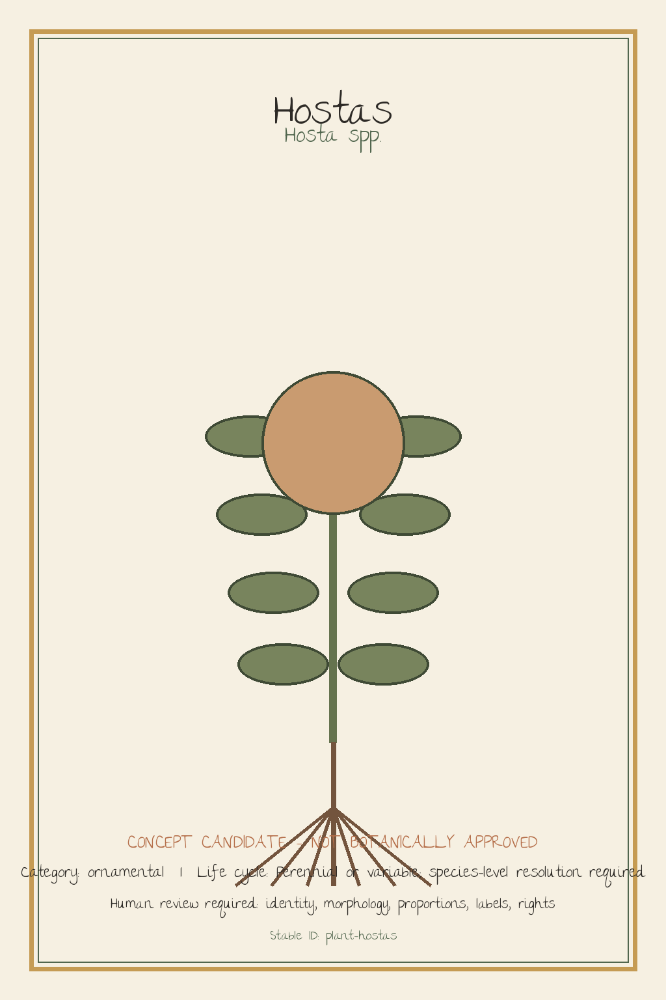

**Source status:** Not botanically or horticulturally approved. Recorded fields are derived
from the retained registry and remain subject to claim-level source review.

### Ferns

**Stable plant ID:** `plant-ferns`
**Category:** ornamental
**Recorded botanical name:** Fern species / multiple genera
**Recorded family:** Multiple families
**Life cycle:** Perennial or variable; species-level resolution required
**Illustration status:** `CANDIDATE_GENERATED / REVIEW_PENDING / NOT_APPROVED`

**Identification and morphology**

- Growth habit: Growth habit should be resolved to the exact species or cultivar; this entry provides a category-level source scaffold.
- Root or storage organ: Fibrous, rhizomatous, clumping, or fleshy according to the species.
- Leaf arrangement and shape: Species- or genus-specific leaf arrangement and shape; generic label needs disambiguation.
- Flower structure: Species-specific flower form; local bloom timing comes from the Errington calendar if matched.
- Fruit or seed structure: Seed capsule, achene, berry, or no conspicuous fruit according to species.

**Errington timing fields**

- Indoor sow: Source timing not reviewed
- Direct sow: Source timing not reviewed
- Transplant: Source timing not reviewed
- Bloom: Source timing not reviewed
- Harvest: Source timing not reviewed
- Frost: Source timing not reviewed

**Cultivation**

- Soil: Choose a well-drained soil matched to the plant; the label and species can vary widely.
- Water: Water to establish, then match moisture to the specific ornamental's type.
- Spacing: Allow for mature clump or canopy width; label or cultivar may change the correct spacing.
- Light: Check the specific species; full sun, shade, and moisture labels may vary across genera.
- Maintenance: Remove damaged growth, divide where applicable, mulch carefully, and avoid overwatering.
- Pests/diseases: Monitor for slugs, aphids, mites, scale, and fungal leaf problems; use identification and prevention first.

**Candidate plate:**
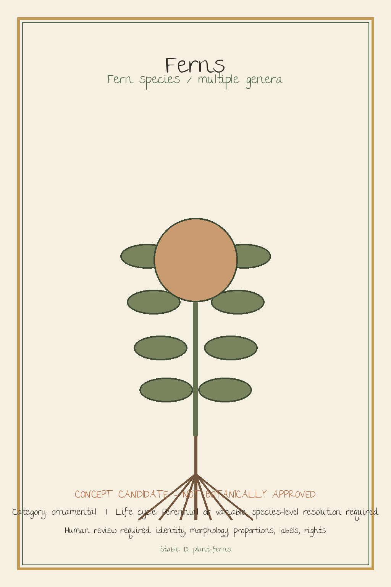

**Source status:** Not botanically or horticulturally approved. Recorded fields are derived
from the retained registry and remain subject to claim-level source review.

### Ornamental Grasses

**Stable plant ID:** `plant-ornamental-grasses`
**Category:** ornamental
**Recorded botanical name:** Ornamental grass species / multiple genera
**Recorded family:** Poaceae
**Life cycle:** Perennial or variable; species-level resolution required
**Illustration status:** `CANDIDATE_GENERATED / REVIEW_PENDING / NOT_APPROVED`

**Identification and morphology**

- Growth habit: Growth habit should be resolved to the exact species or cultivar; this entry provides a category-level source scaffold.
- Root or storage organ: Fibrous, rhizomatous, clumping, or fleshy according to the species.
- Leaf arrangement and shape: Species- or genus-specific leaf arrangement and shape; generic label needs disambiguation.
- Flower structure: Species-specific flower form; local bloom timing comes from the Errington calendar if matched.
- Fruit or seed structure: Seed capsule, achene, berry, or no conspicuous fruit according to species.

**Errington timing fields**

- Indoor sow: Source timing not reviewed
- Direct sow: Source timing not reviewed
- Transplant: Source timing not reviewed
- Bloom: Source timing not reviewed
- Harvest: Source timing not reviewed
- Frost: Source timing not reviewed

**Cultivation**

- Soil: Choose a well-drained soil matched to the plant; the label and species can vary widely.
- Water: Water to establish, then match moisture to the specific ornamental's type.
- Spacing: Allow for mature clump or canopy width; label or cultivar may change the correct spacing.
- Light: Check the specific species; full sun, shade, and moisture labels may vary across genera.
- Maintenance: Remove damaged growth, divide where applicable, mulch carefully, and avoid overwatering.
- Pests/diseases: Monitor for slugs, aphids, mites, scale, and fungal leaf problems; use identification and prevention first.

**Candidate plate:**
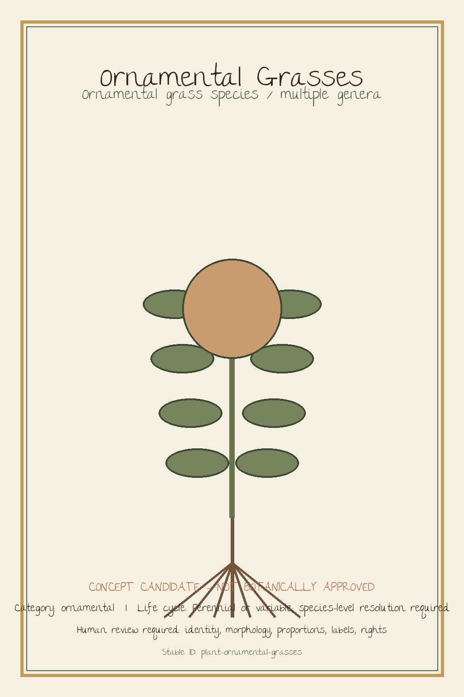

**Source status:** Not botanically or horticulturally approved. Recorded fields are derived
from the retained registry and remain subject to claim-level source review.

### Sedum

**Stable plant ID:** `plant-sedum`
**Category:** ornamental
**Recorded botanical name:** Hylotelephium telephium
**Recorded family:** Crassulaceae
**Life cycle:** Perennial or variable; species-level resolution required
**Illustration status:** `CANDIDATE_GENERATED / REVIEW_PENDING / NOT_APPROVED`

**Identification and morphology**

- Growth habit: Growth habit should be resolved to the exact species or cultivar; this entry provides a category-level source scaffold.
- Root or storage organ: Fibrous, rhizomatous, clumping, or fleshy according to the species.
- Leaf arrangement and shape: Species- or genus-specific leaf arrangement and shape; generic label needs disambiguation.
- Flower structure: Species-specific flower form; local bloom timing comes from the Errington calendar if matched.
- Fruit or seed structure: Seed capsule, achene, berry, or no conspicuous fruit according to species.

**Errington timing fields**

- Indoor sow: Source timing not reviewed
- Direct sow: Source timing not reviewed
- Transplant: Source timing not reviewed
- Bloom: Source timing not reviewed
- Harvest: Source timing not reviewed
- Frost: Source timing not reviewed

**Cultivation**

- Soil: Choose a well-drained soil matched to the plant; the label and species can vary widely.
- Water: Water to establish, then match moisture to the specific ornamental's type.
- Spacing: Allow for mature clump or canopy width; label or cultivar may change the correct spacing.
- Light: Check the specific species; full sun, shade, and moisture labels may vary across genera.
- Maintenance: Remove damaged growth, divide where applicable, mulch carefully, and avoid overwatering.
- Pests/diseases: Monitor for slugs, aphids, mites, scale, and fungal leaf problems; use identification and prevention first.

**Candidate plate:**

**Source status:** Not botanically or horticulturally approved. Recorded fields are derived
from the retained registry and remain subject to claim-level source review.

### Heuchera

**Stable plant ID:** `plant-heuchera`
**Category:** ornamental
**Recorded botanical name:** Heuchera sanguinea
**Recorded family:** Saxifragaceae
**Life cycle:** Perennial or variable; species-level resolution required
**Illustration status:** `CANDIDATE_GENERATED / REVIEW_PENDING / NOT_APPROVED`

**Identification and morphology**

- Growth habit: Growth habit should be resolved to the exact species or cultivar; this entry provides a category-level source scaffold.
- Root or storage organ: Fibrous, rhizomatous, clumping, or fleshy according to the species.
- Leaf arrangement and shape: Species- or genus-specific leaf arrangement and shape; generic label needs disambiguation.
- Flower structure: Species-specific flower form; local bloom timing comes from the Errington calendar if matched.
- Fruit or seed structure: Seed capsule, achene, berry, or no conspicuous fruit according to species.

**Errington timing fields**

- Indoor sow: Source timing not reviewed
- Direct sow: Source timing not reviewed
- Transplant: Source timing not reviewed
- Bloom: Source timing not reviewed
- Harvest: Source timing not reviewed
- Frost: Source timing not reviewed

**Cultivation**

- Soil: Choose a well-drained soil matched to the plant; the label and species can vary widely.
- Water: Water to establish, then match moisture to the specific ornamental's type.
- Spacing: Allow for mature clump or canopy width; label or cultivar may change the correct spacing.
- Light: Check the specific species; full sun, shade, and moisture labels may vary across genera.
- Maintenance: Remove damaged growth, divide where applicable, mulch carefully, and avoid overwatering.
- Pests/diseases: Monitor for slugs, aphids, mites, scale, and fungal leaf problems; use identification and prevention first.

**Candidate plate:**
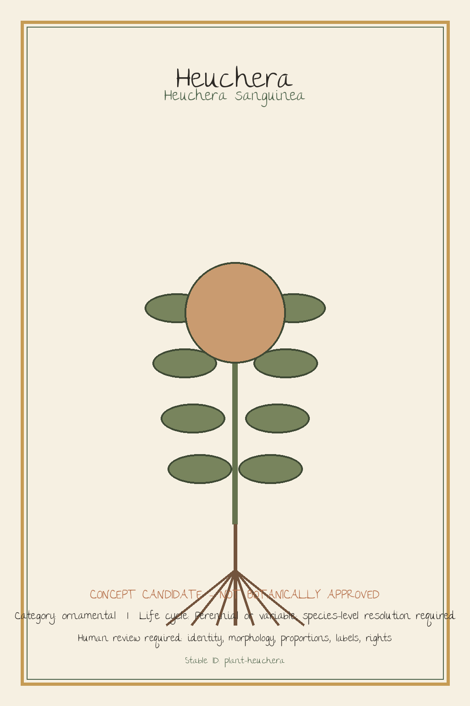

**Source status:** Not botanically or horticulturally approved. Recorded fields are derived
from the retained registry and remain subject to claim-level source review.

### Astilbe

**Stable plant ID:** `plant-astilbe`
**Category:** ornamental
**Recorded botanical name:** Astilbe × arendsii
**Recorded family:** Saxifragaceae
**Life cycle:** Perennial or variable; species-level resolution required
**Illustration status:** `CANDIDATE_GENERATED / REVIEW_PENDING / NOT_APPROVED`

**Identification and morphology**

- Growth habit: Growth habit should be resolved to the exact species or cultivar; this entry provides a category-level source scaffold.
- Root or storage organ: Fibrous, rhizomatous, clumping, or fleshy according to the species.
- Leaf arrangement and shape: Species- or genus-specific leaf arrangement and shape; generic label needs disambiguation.
- Flower structure: Species-specific flower form; local bloom timing comes from the Errington calendar if matched.
- Fruit or seed structure: Seed capsule, achene, berry, or no conspicuous fruit according to species.

**Errington timing fields**

- Indoor sow: Source timing not reviewed
- Direct sow: Source timing not reviewed
- Transplant: Source timing not reviewed
- Bloom: Source timing not reviewed
- Harvest: Source timing not reviewed
- Frost: Source timing not reviewed

**Cultivation**

- Soil: Choose a well-drained soil matched to the plant; the label and species can vary widely.
- Water: Water to establish, then match moisture to the specific ornamental's type.
- Spacing: Allow for mature clump or canopy width; label or cultivar may change the correct spacing.
- Light: Check the specific species; full sun, shade, and moisture labels may vary across genera.
- Maintenance: Remove damaged growth, divide where applicable, mulch carefully, and avoid overwatering.
- Pests/diseases: Monitor for slugs, aphids, mites, scale, and fungal leaf problems; use identification and prevention first.

**Candidate plate:**

**Source status:** Not botanically or horticulturally approved. Recorded fields are derived
from the retained registry and remain subject to claim-level source review.

### Rosemary

**Stable plant ID:** `plant-rosemary`
**Category:** herb
**Recorded botanical name:** Salvia rosmarinus
**Recorded family:** Lamiaceae
**Life cycle:** Perennial
**Illustration status:** `CANDIDATE_GENERATED / REVIEW_PENDING / NOT_APPROVED`

**Identification and morphology**

- Growth habit: Growth habit should be resolved to the exact species or cultivar; this entry provides a category-level source scaffold.
- Root or storage organ: Species-specific root, crown, or storage organ; verify the exact form before illustrating.
- Leaf arrangement and shape: Species-specific arrangement and blade shape; verify exact genus and cultivar.
- Flower structure: Species-specific inflorescence or flower structure.
- Fruit or seed structure: Species-specific fruit, seed pod, achene, capsule, berry, or nut.

**Errington timing fields**

- Indoor sow: Source timing not reviewed
- Direct sow: Source timing not reviewed
- Transplant: Source timing not reviewed
- Bloom: Source timing not reviewed
- Harvest: Source timing not reviewed
- Frost: Source timing not reviewed

**Cultivation**

- Soil: Fertile, well-drained soil with organic matter unless the species has a known exceptional preference.
- Water: Provide even establishment moisture; then follow the species' drought, moisture, or wetness preference.
- Spacing: Base spacing on mature height and spread, not just the common name.
- Light: Sun requirement is species-specific; the common name alone is not a reliable light label.
- Maintenance: Mulch, deadhead or divide as appropriate, and monitor for structural or seasonal maintenance.
- Pests/diseases: Identify the pest or disease locally before control; favor sanitation, cultural prevention, and targeted action.

**Candidate plate:**
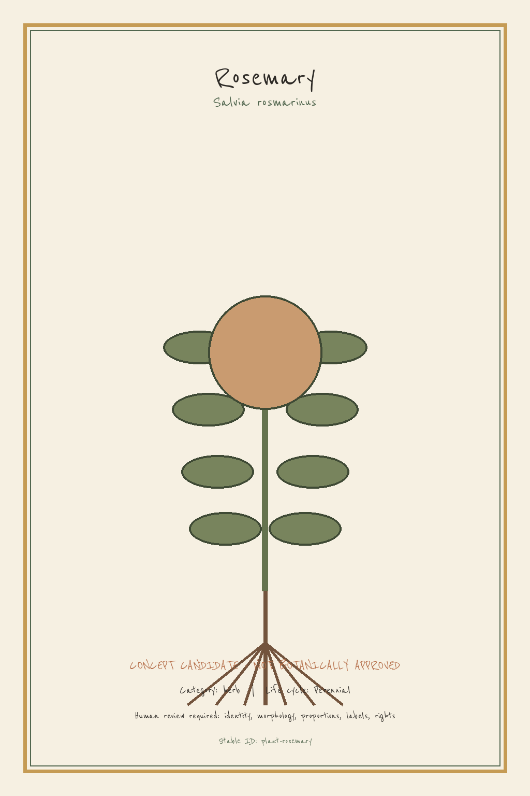

**Source status:** Not botanically or horticulturally approved. Recorded fields are derived
from the retained registry and remain subject to claim-level source review.

### Thyme

**Stable plant ID:** `plant-thyme`
**Category:** herb
**Recorded botanical name:** Thymus vulgaris
**Recorded family:** Lamiaceae
**Life cycle:** Perennial
**Illustration status:** `CANDIDATE_GENERATED / REVIEW_PENDING / NOT_APPROVED`

**Identification and morphology**

- Growth habit: Growth habit should be resolved to the exact species or cultivar; this entry provides a category-level source scaffold.
- Root or storage organ: Species-specific root, crown, or storage organ; verify the exact form before illustrating.
- Leaf arrangement and shape: Species-specific arrangement and blade shape; verify exact genus and cultivar.
- Flower structure: Species-specific inflorescence or flower structure.
- Fruit or seed structure: Species-specific fruit, seed pod, achene, capsule, berry, or nut.

**Errington timing fields**

- Indoor sow: Source timing not reviewed
- Direct sow: Source timing not reviewed
- Transplant: Source timing not reviewed
- Bloom: Source timing not reviewed
- Harvest: Source timing not reviewed
- Frost: Source timing not reviewed

**Cultivation**

- Soil: Fertile, well-drained soil with organic matter unless the species has a known exceptional preference.
- Water: Provide even establishment moisture; then follow the species' drought, moisture, or wetness preference.
- Spacing: Base spacing on mature height and spread, not just the common name.
- Light: Sun requirement is species-specific; the common name alone is not a reliable light label.
- Maintenance: Mulch, deadhead or divide as appropriate, and monitor for structural or seasonal maintenance.
- Pests/diseases: Identify the pest or disease locally before control; favor sanitation, cultural prevention, and targeted action.

**Candidate plate:**
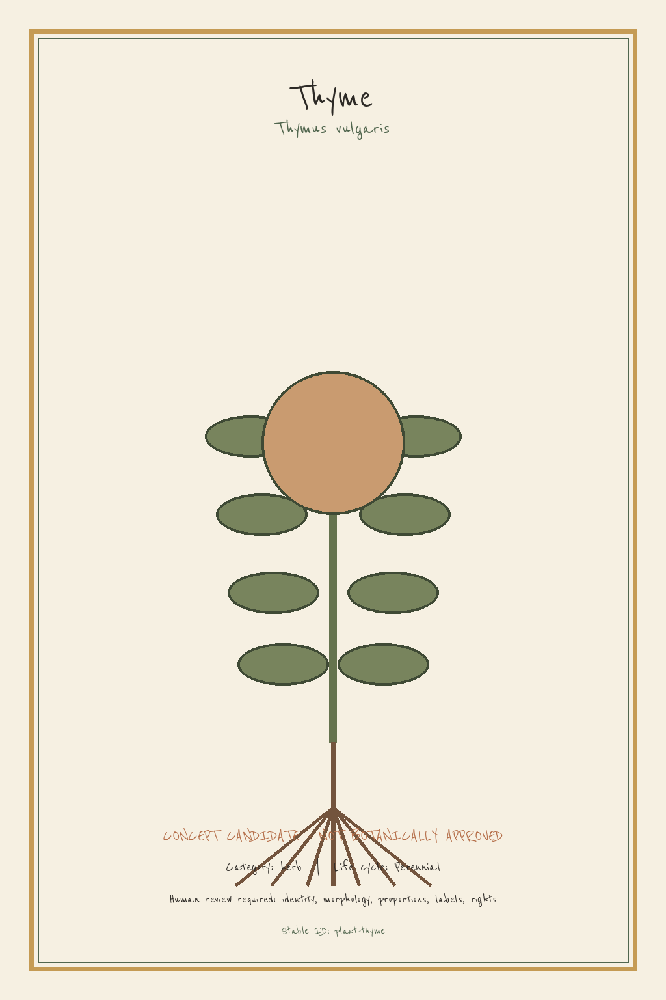

**Source status:** Not botanically or horticulturally approved. Recorded fields are derived
from the retained registry and remain subject to claim-level source review.

### Oregano

**Stable plant ID:** `plant-oregano`
**Category:** herb
**Recorded botanical name:** Origanum vulgare
**Recorded family:** Lamiaceae
**Life cycle:** Perennial
**Illustration status:** `CANDIDATE_GENERATED / REVIEW_PENDING / NOT_APPROVED`

**Identification and morphology**

- Growth habit: Growth habit should be resolved to the exact species or cultivar; this entry provides a category-level source scaffold.
- Root or storage organ: Species-specific root, crown, or storage organ; verify the exact form before illustrating.
- Leaf arrangement and shape: Species-specific arrangement and blade shape; verify exact genus and cultivar.
- Flower structure: Species-specific inflorescence or flower structure.
- Fruit or seed structure: Species-specific fruit, seed pod, achene, capsule, berry, or nut.

**Errington timing fields**

- Indoor sow: Source timing not reviewed
- Direct sow: Source timing not reviewed
- Transplant: Source timing not reviewed
- Bloom: Source timing not reviewed
- Harvest: Source timing not reviewed
- Frost: Source timing not reviewed

**Cultivation**

- Soil: Fertile, well-drained soil with organic matter unless the species has a known exceptional preference.
- Water: Provide even establishment moisture; then follow the species' drought, moisture, or wetness preference.
- Spacing: Base spacing on mature height and spread, not just the common name.
- Light: Sun requirement is species-specific; the common name alone is not a reliable light label.
- Maintenance: Mulch, deadhead or divide as appropriate, and monitor for structural or seasonal maintenance.
- Pests/diseases: Identify the pest or disease locally before control; favor sanitation, cultural prevention, and targeted action.

**Candidate plate:**
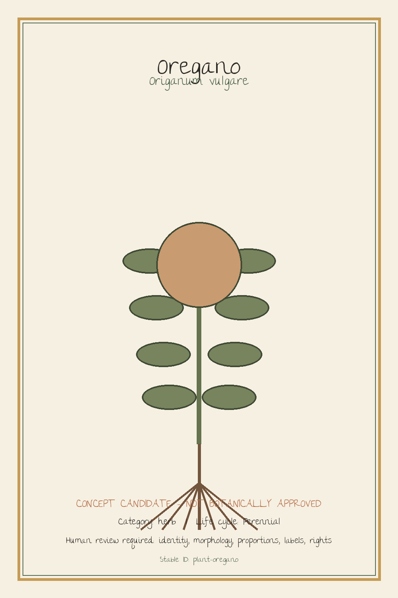

**Source status:** Not botanically or horticulturally approved. Recorded fields are derived
from the retained registry and remain subject to claim-level source review.

### Parsley

**Stable plant ID:** `plant-parsley`
**Category:** herb
**Recorded botanical name:** Petroselinum crispum
**Recorded family:** Apiaceae
**Life cycle:** Biennial, often grown as an annual
**Illustration status:** `CANDIDATE_GENERATED / REVIEW_PENDING / NOT_APPROVED`

**Identification and morphology**

- Growth habit: Growth habit should be resolved to the exact species or cultivar; this entry provides a category-level source scaffold.
- Root or storage organ: Species-specific root, crown, or storage organ; verify the exact form before illustrating.
- Leaf arrangement and shape: Species-specific arrangement and blade shape; verify exact genus and cultivar.
- Flower structure: Species-specific inflorescence or flower structure.
- Fruit or seed structure: Species-specific fruit, seed pod, achene, capsule, berry, or nut.

**Errington timing fields**

- Indoor sow: Source timing not reviewed
- Direct sow: Source timing not reviewed
- Transplant: Source timing not reviewed
- Bloom: Source timing not reviewed
- Harvest: Source timing not reviewed
- Frost: Source timing not reviewed

**Cultivation**

- Soil: Fertile, well-drained soil with organic matter unless the species has a known exceptional preference.
- Water: Provide even establishment moisture; then follow the species' drought, moisture, or wetness preference.
- Spacing: Base spacing on mature height and spread, not just the common name.
- Light: Sun requirement is species-specific; the common name alone is not a reliable light label.
- Maintenance: Mulch, deadhead or divide as appropriate, and monitor for structural or seasonal maintenance.
- Pests/diseases: Identify the pest or disease locally before control; favor sanitation, cultural prevention, and targeted action.

**Candidate plate:**
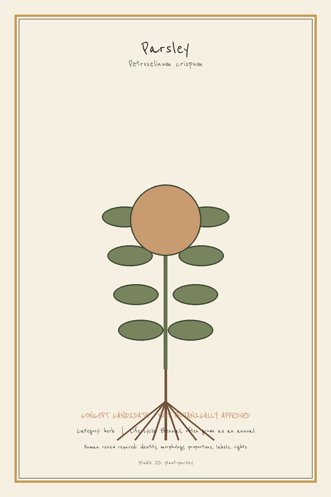

**Source status:** Not botanically or horticulturally approved. Recorded fields are derived
from the retained registry and remain subject to claim-level source review.

### Chives

**Stable plant ID:** `plant-chives`
**Category:** herb
**Recorded botanical name:** Allium schoenoprasum
**Recorded family:** Amaryllidaceae
**Life cycle:** Perennial
**Illustration status:** `CANDIDATE_GENERATED / REVIEW_PENDING / NOT_APPROVED`

**Identification and morphology**

- Growth habit: Growth habit should be resolved to the exact species or cultivar; this entry provides a category-level source scaffold.
- Root or storage organ: Species-specific root, crown, or storage organ; verify the exact form before illustrating.
- Leaf arrangement and shape: Species-specific arrangement and blade shape; verify exact genus and cultivar.
- Flower structure: Species-specific inflorescence or flower structure.
- Fruit or seed structure: Species-specific fruit, seed pod, achene, capsule, berry, or nut.

**Errington timing fields**

- Indoor sow: Source timing not reviewed
- Direct sow: Source timing not reviewed
- Transplant: Source timing not reviewed
- Bloom: Source timing not reviewed
- Harvest: Source timing not reviewed
- Frost: Source timing not reviewed

**Cultivation**

- Soil: Fertile, well-drained soil with organic matter unless the species has a known exceptional preference.
- Water: Provide even establishment moisture; then follow the species' drought, moisture, or wetness preference.
- Spacing: Base spacing on mature height and spread, not just the common name.
- Light: Sun requirement is species-specific; the common name alone is not a reliable light label.
- Maintenance: Mulch, deadhead or divide as appropriate, and monitor for structural or seasonal maintenance.
- Pests/diseases: Identify the pest or disease locally before control; favor sanitation, cultural prevention, and targeted action.

**Candidate plate:**

**Source status:** Not botanically or horticulturally approved. Recorded fields are derived
from the retained registry and remain subject to claim-level source review.

### Basil

**Stable plant ID:** `plant-basil`
**Category:** herb
**Recorded botanical name:** Ocimum basilicum
**Recorded family:** Lamiaceae
**Life cycle:** Annual
**Illustration status:** `CANDIDATE_GENERATED / REVIEW_PENDING / NOT_APPROVED`

**Identification and morphology**

- Growth habit: Growth habit should be resolved to the exact species or cultivar; this entry provides a category-level source scaffold.
- Root or storage organ: Species-specific root, crown, or storage organ; verify the exact form before illustrating.
- Leaf arrangement and shape: Species-specific arrangement and blade shape; verify exact genus and cultivar.
- Flower structure: Species-specific inflorescence or flower structure.
- Fruit or seed structure: Species-specific fruit, seed pod, achene, capsule, berry, or nut.

**Errington timing fields**

- Indoor sow: Source timing not reviewed
- Direct sow: Source timing not reviewed
- Transplant: Source timing not reviewed
- Bloom: Source timing not reviewed
- Harvest: Source timing not reviewed
- Frost: Source timing not reviewed

**Cultivation**

- Soil: Fertile, well-drained soil with organic matter unless the species has a known exceptional preference.
- Water: Provide even establishment moisture; then follow the species' drought, moisture, or wetness preference.
- Spacing: Base spacing on mature height and spread, not just the common name.
- Light: Sun requirement is species-specific; the common name alone is not a reliable light label.
- Maintenance: Mulch, deadhead or divide as appropriate, and monitor for structural or seasonal maintenance.
- Pests/diseases: Identify the pest or disease locally before control; favor sanitation, cultural prevention, and targeted action.

**Candidate plate:**

**Source status:** Not botanically or horticulturally approved. Recorded fields are derived
from the retained registry and remain subject to claim-level source review.

### Dill

**Stable plant ID:** `plant-dill`
**Category:** herb
**Recorded botanical name:** Anethum graveolens
**Recorded family:** Apiaceae
**Life cycle:** Annual
**Illustration status:** `CANDIDATE_GENERATED / REVIEW_PENDING / NOT_APPROVED`

**Identification and morphology**

- Growth habit: Growth habit should be resolved to the exact species or cultivar; this entry provides a category-level source scaffold.
- Root or storage organ: Species-specific root, crown, or storage organ; verify the exact form before illustrating.
- Leaf arrangement and shape: Species-specific arrangement and blade shape; verify exact genus and cultivar.
- Flower structure: Species-specific inflorescence or flower structure.
- Fruit or seed structure: Species-specific fruit, seed pod, achene, capsule, berry, or nut.

**Errington timing fields**

- Indoor sow: Source timing not reviewed
- Direct sow: Source timing not reviewed
- Transplant: Source timing not reviewed
- Bloom: Source timing not reviewed
- Harvest: Source timing not reviewed
- Frost: Source timing not reviewed

**Cultivation**

- Soil: Fertile, well-drained soil with organic matter unless the species has a known exceptional preference.
- Water: Provide even establishment moisture; then follow the species' drought, moisture, or wetness preference.
- Spacing: Base spacing on mature height and spread, not just the common name.
- Light: Sun requirement is species-specific; the common name alone is not a reliable light label.
- Maintenance: Mulch, deadhead or divide as appropriate, and monitor for structural or seasonal maintenance.
- Pests/diseases: Identify the pest or disease locally before control; favor sanitation, cultural prevention, and targeted action.

**Candidate plate:**

**Source status:** Not botanically or horticulturally approved. Recorded fields are derived
from the retained registry and remain subject to claim-level source review.

### Cilantro

**Stable plant ID:** `plant-cilantro`
**Category:** herb
**Recorded botanical name:** Coriandrum sativum
**Recorded family:** Apiaceae
**Life cycle:** Annual
**Illustration status:** `CANDIDATE_GENERATED / REVIEW_PENDING / NOT_APPROVED`

**Identification and morphology**

- Growth habit: Growth habit should be resolved to the exact species or cultivar; this entry provides a category-level source scaffold.
- Root or storage organ: Species-specific root, crown, or storage organ; verify the exact form before illustrating.
- Leaf arrangement and shape: Species-specific arrangement and blade shape; verify exact genus and cultivar.
- Flower structure: Species-specific inflorescence or flower structure.
- Fruit or seed structure: Species-specific fruit, seed pod, achene, capsule, berry, or nut.

**Errington timing fields**

- Indoor sow: Source timing not reviewed
- Direct sow: Source timing not reviewed
- Transplant: Source timing not reviewed
- Bloom: Source timing not reviewed
- Harvest: Source timing not reviewed
- Frost: Source timing not reviewed

**Cultivation**

- Soil: Fertile, well-drained soil with organic matter unless the species has a known exceptional preference.
- Water: Provide even establishment moisture; then follow the species' drought, moisture, or wetness preference.
- Spacing: Base spacing on mature height and spread, not just the common name.
- Light: Sun requirement is species-specific; the common name alone is not a reliable light label.
- Maintenance: Mulch, deadhead or divide as appropriate, and monitor for structural or seasonal maintenance.
- Pests/diseases: Identify the pest or disease locally before control; favor sanitation, cultural prevention, and targeted action.

**Candidate plate:**

**Source status:** Not botanically or horticulturally approved. Recorded fields are derived
from the retained registry and remain subject to claim-level source review.

### Chervil

**Stable plant ID:** `plant-chervil`
**Category:** herb
**Recorded botanical name:** Anthriscus cerefolium
**Recorded family:** Apiaceae
**Life cycle:** Annual
**Illustration status:** `CANDIDATE_GENERATED / REVIEW_PENDING / NOT_APPROVED`

**Identification and morphology**

- Growth habit: Growth habit should be resolved to the exact species or cultivar; this entry provides a category-level source scaffold.
- Root or storage organ: Species-specific root, crown, or storage organ; verify the exact form before illustrating.
- Leaf arrangement and shape: Species-specific arrangement and blade shape; verify exact genus and cultivar.
- Flower structure: Species-specific inflorescence or flower structure.
- Fruit or seed structure: Species-specific fruit, seed pod, achene, capsule, berry, or nut.

**Errington timing fields**

- Indoor sow: Source timing not reviewed
- Direct sow: Source timing not reviewed
- Transplant: Source timing not reviewed
- Bloom: Source timing not reviewed
- Harvest: Source timing not reviewed
- Frost: Source timing not reviewed

**Cultivation**

- Soil: Fertile, well-drained soil with organic matter unless the species has a known exceptional preference.
- Water: Provide even establishment moisture; then follow the species' drought, moisture, or wetness preference.
- Spacing: Base spacing on mature height and spread, not just the common name.
- Light: Sun requirement is species-specific; the common name alone is not a reliable light label.
- Maintenance: Mulch, deadhead or divide as appropriate, and monitor for structural or seasonal maintenance.
- Pests/diseases: Identify the pest or disease locally before control; favor sanitation, cultural prevention, and targeted action.

**Candidate plate:**

**Source status:** Not botanically or horticulturally approved. Recorded fields are derived
from the retained registry and remain subject to claim-level source review.

### Fennel

**Stable plant ID:** `plant-fennel`
**Category:** herb
**Recorded botanical name:** Foeniculum vulgare
**Recorded family:** Apiaceae
**Life cycle:** Perennial
**Illustration status:** `CANDIDATE_GENERATED / REVIEW_PENDING / NOT_APPROVED`

**Identification and morphology**

- Growth habit: Growth habit should be resolved to the exact species or cultivar; this entry provides a category-level source scaffold.
- Root or storage organ: Species-specific root, crown, or storage organ; verify the exact form before illustrating.
- Leaf arrangement and shape: Species-specific arrangement and blade shape; verify exact genus and cultivar.
- Flower structure: Species-specific inflorescence or flower structure.
- Fruit or seed structure: Species-specific fruit, seed pod, achene, capsule, berry, or nut.

**Errington timing fields**

- Indoor sow: Source timing not reviewed
- Direct sow: Source timing not reviewed
- Transplant: Source timing not reviewed
- Bloom: Source timing not reviewed
- Harvest: Source timing not reviewed
- Frost: Source timing not reviewed

**Cultivation**

- Soil: Fertile, well-drained soil with organic matter unless the species has a known exceptional preference.
- Water: Provide even establishment moisture; then follow the species' drought, moisture, or wetness preference.
- Spacing: Base spacing on mature height and spread, not just the common name.
- Light: Sun requirement is species-specific; the common name alone is not a reliable light label.
- Maintenance: Mulch, deadhead or divide as appropriate, and monitor for structural or seasonal maintenance.
- Pests/diseases: Identify the pest or disease locally before control; favor sanitation, cultural prevention, and targeted action.

**Candidate plate:**

**Source status:** Not botanically or horticulturally approved. Recorded fields are derived
from the retained registry and remain subject to claim-level source review.

### Apple

**Stable plant ID:** `plant-apple`
**Category:** fruit
**Recorded botanical name:** Malus domestica
**Recorded family:** Rosaceae
**Life cycle:** Perennial
**Illustration status:** `CANDIDATE_GENERATED / REVIEW_PENDING / NOT_APPROVED`

**Identification and morphology**

- Growth habit: Growth habit should be resolved to the exact species or cultivar; this entry provides a category-level source scaffold.
- Root or storage organ: Woody perennial root system; grafted trees may include rootstock-specific traits.
- Leaf arrangement and shape: Alternate or opposite foliage according to the exact genus; use species-level morphology.
- Flower structure: Flowers arranged in species-specific racemes, clusters, umbels, or catkins.
- Fruit or seed structure: Botanical fruit type is species-specific: pome, drupe, berry, aggregate fruit, or grape.

**Errington timing fields**

- Indoor sow: Source timing not reviewed
- Direct sow: Source timing not reviewed
- Transplant: Source timing not reviewed
- Bloom: Source timing not reviewed
- Harvest: Source timing not reviewed
- Frost: Source timing not reviewed

**Cultivation**

- Soil: Fertile, well-drained soil with organic matter unless the species has a known exceptional preference.
- Water: Provide even establishment moisture; then follow the species' drought, moisture, or wetness preference.
- Spacing: Base spacing on mature height and spread, not just the common name.
- Light: Sun requirement is species-specific; the common name alone is not a reliable light label.
- Maintenance: Mulch, deadhead or divide as appropriate, and monitor for structural or seasonal maintenance.
- Pests/diseases: Identify the pest or disease locally before control; favor sanitation, cultural prevention, and targeted action.

**Candidate plate:**

**Source status:** Not botanically or horticulturally approved. Recorded fields are derived
from the retained registry and remain subject to claim-level source review.

### Pear

**Stable plant ID:** `plant-pear`
**Category:** fruit
**Recorded botanical name:** Pyrus communis
**Recorded family:** Rosaceae
**Life cycle:** Perennial
**Illustration status:** `CANDIDATE_GENERATED / REVIEW_PENDING / NOT_APPROVED`

**Identification and morphology**

- Growth habit: Growth habit should be resolved to the exact species or cultivar; this entry provides a category-level source scaffold.
- Root or storage organ: Woody perennial root system; grafted trees may include rootstock-specific traits.
- Leaf arrangement and shape: Alternate or opposite foliage according to the exact genus; use species-level morphology.
- Flower structure: Flowers arranged in species-specific racemes, clusters, umbels, or catkins.
- Fruit or seed structure: Botanical fruit type is species-specific: pome, drupe, berry, aggregate fruit, or grape.

**Errington timing fields**

- Indoor sow: Source timing not reviewed
- Direct sow: Source timing not reviewed
- Transplant: Source timing not reviewed
- Bloom: Source timing not reviewed
- Harvest: Source timing not reviewed
- Frost: Source timing not reviewed

**Cultivation**

- Soil: Fertile, well-drained soil with organic matter unless the species has a known exceptional preference.
- Water: Provide even establishment moisture; then follow the species' drought, moisture, or wetness preference.
- Spacing: Base spacing on mature height and spread, not just the common name.
- Light: Sun requirement is species-specific; the common name alone is not a reliable light label.
- Maintenance: Mulch, deadhead or divide as appropriate, and monitor for structural or seasonal maintenance.
- Pests/diseases: Identify the pest or disease locally before control; favor sanitation, cultural prevention, and targeted action.

**Candidate plate:**

**Source status:** Not botanically or horticulturally approved. Recorded fields are derived
from the retained registry and remain subject to claim-level source review.

### Plum

**Stable plant ID:** `plant-plum`
**Category:** fruit
**Recorded botanical name:** Prunus domestica
**Recorded family:** Rosaceae
**Life cycle:** Perennial
**Illustration status:** `CANDIDATE_GENERATED / REVIEW_PENDING / NOT_APPROVED`

**Identification and morphology**

- Growth habit: Growth habit should be resolved to the exact species or cultivar; this entry provides a category-level source scaffold.
- Root or storage organ: Woody perennial root system; grafted trees may include rootstock-specific traits.
- Leaf arrangement and shape: Alternate or opposite foliage according to the exact genus; use species-level morphology.
- Flower structure: Flowers arranged in species-specific racemes, clusters, umbels, or catkins.
- Fruit or seed structure: Botanical fruit type is species-specific: pome, drupe, berry, aggregate fruit, or grape.

**Errington timing fields**

- Indoor sow: Source timing not reviewed
- Direct sow: Source timing not reviewed
- Transplant: Source timing not reviewed
- Bloom: Source timing not reviewed
- Harvest: Source timing not reviewed
- Frost: Source timing not reviewed

**Cultivation**

- Soil: Fertile, well-drained soil with organic matter unless the species has a known exceptional preference.
- Water: Provide even establishment moisture; then follow the species' drought, moisture, or wetness preference.
- Spacing: Base spacing on mature height and spread, not just the common name.
- Light: Sun requirement is species-specific; the common name alone is not a reliable light label.
- Maintenance: Mulch, deadhead or divide as appropriate, and monitor for structural or seasonal maintenance.
- Pests/diseases: Identify the pest or disease locally before control; favor sanitation, cultural prevention, and targeted action.

**Candidate plate:**

**Source status:** Not botanically or horticulturally approved. Recorded fields are derived
from the retained registry and remain subject to claim-level source review.

### Cherry

**Stable plant ID:** `plant-cherry`
**Category:** fruit
**Recorded botanical name:** Prunus avium
**Recorded family:** Rosaceae
**Life cycle:** Perennial
**Illustration status:** `CANDIDATE_GENERATED / REVIEW_PENDING / NOT_APPROVED`

**Identification and morphology**

- Growth habit: Growth habit should be resolved to the exact species or cultivar; this entry provides a category-level source scaffold.
- Root or storage organ: Woody perennial root system; grafted trees may include rootstock-specific traits.
- Leaf arrangement and shape: Alternate or opposite foliage according to the exact genus; use species-level morphology.
- Flower structure: Flowers arranged in species-specific racemes, clusters, umbels, or catkins.
- Fruit or seed structure: Botanical fruit type is species-specific: pome, drupe, berry, aggregate fruit, or grape.

**Errington timing fields**

- Indoor sow: Source timing not reviewed
- Direct sow: Source timing not reviewed
- Transplant: Source timing not reviewed
- Bloom: Source timing not reviewed
- Harvest: Source timing not reviewed
- Frost: Source timing not reviewed

**Cultivation**

- Soil: Fertile, well-drained soil with organic matter unless the species has a known exceptional preference.
- Water: Provide even establishment moisture; then follow the species' drought, moisture, or wetness preference.
- Spacing: Base spacing on mature height and spread, not just the common name.
- Light: Sun requirement is species-specific; the common name alone is not a reliable light label.
- Maintenance: Mulch, deadhead or divide as appropriate, and monitor for structural or seasonal maintenance.
- Pests/diseases: Identify the pest or disease locally before control; favor sanitation, cultural prevention, and targeted action.

**Candidate plate:**

**Source status:** Not botanically or horticulturally approved. Recorded fields are derived
from the retained registry and remain subject to claim-level source review.

### Grapes

**Stable plant ID:** `plant-grapes`
**Category:** fruit
**Recorded botanical name:** Vitis vinifera
**Recorded family:** Vitaceae
**Life cycle:** Perennial
**Illustration status:** `CANDIDATE_GENERATED / REVIEW_PENDING / NOT_APPROVED`

**Identification and morphology**

- Growth habit: Growth habit should be resolved to the exact species or cultivar; this entry provides a category-level source scaffold.
- Root or storage organ: Woody perennial root system; grafted trees may include rootstock-specific traits.
- Leaf arrangement and shape: Alternate or opposite foliage according to the exact genus; use species-level morphology.
- Flower structure: Flowers arranged in species-specific racemes, clusters, umbels, or catkins.
- Fruit or seed structure: Botanical fruit type is species-specific: pome, drupe, berry, aggregate fruit, or grape.

**Errington timing fields**

- Indoor sow: Source timing not reviewed
- Direct sow: Source timing not reviewed
- Transplant: Source timing not reviewed
- Bloom: Source timing not reviewed
- Harvest: Source timing not reviewed
- Frost: Source timing not reviewed

**Cultivation**

- Soil: Fertile, well-drained soil with organic matter unless the species has a known exceptional preference.
- Water: Provide even establishment moisture; then follow the species' drought, moisture, or wetness preference.
- Spacing: Base spacing on mature height and spread, not just the common name.
- Light: Sun requirement is species-specific; the common name alone is not a reliable light label.
- Maintenance: Mulch, deadhead or divide as appropriate, and monitor for structural or seasonal maintenance.
- Pests/diseases: Identify the pest or disease locally before control; favor sanitation, cultural prevention, and targeted action.

**Candidate plate:**

**Source status:** Not botanically or horticulturally approved. Recorded fields are derived
from the retained registry and remain subject to claim-level source review.

### Strawberries

**Stable plant ID:** `plant-strawberries`
**Category:** fruit
**Recorded botanical name:** Fragaria × ananassa
**Recorded family:** Rosaceae
**Life cycle:** Perennial
**Illustration status:** `CANDIDATE_GENERATED / REVIEW_PENDING / NOT_APPROVED`

**Identification and morphology**

- Growth habit: Growth habit should be resolved to the exact species or cultivar; this entry provides a category-level source scaffold.
- Root or storage organ: Woody perennial root system; grafted trees may include rootstock-specific traits.
- Leaf arrangement and shape: Alternate or opposite foliage according to the exact genus; use species-level morphology.
- Flower structure: Flowers arranged in species-specific racemes, clusters, umbels, or catkins.
- Fruit or seed structure: Botanical fruit type is species-specific: pome, drupe, berry, aggregate fruit, or grape.

**Errington timing fields**

- Indoor sow: Source timing not reviewed
- Direct sow: Source timing not reviewed
- Transplant: Source timing not reviewed
- Bloom: Source timing not reviewed
- Harvest: Source timing not reviewed
- Frost: Source timing not reviewed

**Cultivation**

- Soil: Fertile, well-drained soil with organic matter unless the species has a known exceptional preference.
- Water: Provide even establishment moisture; then follow the species' drought, moisture, or wetness preference.
- Spacing: Base spacing on mature height and spread, not just the common name.
- Light: Sun requirement is species-specific; the common name alone is not a reliable light label.
- Maintenance: Mulch, deadhead or divide as appropriate, and monitor for structural or seasonal maintenance.
- Pests/diseases: Identify the pest or disease locally before control; favor sanitation, cultural prevention, and targeted action.

**Candidate plate:**

**Source status:** Not botanically or horticulturally approved. Recorded fields are derived
from the retained registry and remain subject to claim-level source review.

### Raspberries

**Stable plant ID:** `plant-raspberries`
**Category:** fruit
**Recorded botanical name:** Rubus idaeus
**Recorded family:** Rosaceae
**Life cycle:** Perennial
**Illustration status:** `CANDIDATE_GENERATED / REVIEW_PENDING / NOT_APPROVED`

**Identification and morphology**

- Growth habit: Growth habit should be resolved to the exact species or cultivar; this entry provides a category-level source scaffold.
- Root or storage organ: Woody perennial root system; grafted trees may include rootstock-specific traits.
- Leaf arrangement and shape: Alternate or opposite foliage according to the exact genus; use species-level morphology.
- Flower structure: Flowers arranged in species-specific racemes, clusters, umbels, or catkins.
- Fruit or seed structure: Botanical fruit type is species-specific: pome, drupe, berry, aggregate fruit, or grape.

**Errington timing fields**

- Indoor sow: Source timing not reviewed
- Direct sow: Source timing not reviewed
- Transplant: Source timing not reviewed
- Bloom: Source timing not reviewed
- Harvest: Source timing not reviewed
- Frost: Source timing not reviewed

**Cultivation**

- Soil: Fertile, well-drained soil with organic matter unless the species has a known exceptional preference.
- Water: Provide even establishment moisture; then follow the species' drought, moisture, or wetness preference.
- Spacing: Base spacing on mature height and spread, not just the common name.
- Light: Sun requirement is species-specific; the common name alone is not a reliable light label.
- Maintenance: Mulch, deadhead or divide as appropriate, and monitor for structural or seasonal maintenance.
- Pests/diseases: Identify the pest or disease locally before control; favor sanitation, cultural prevention, and targeted action.

**Candidate plate:**

**Source status:** Not botanically or horticulturally approved. Recorded fields are derived
from the retained registry and remain subject to claim-level source review.

### Blueberries

**Stable plant ID:** `plant-blueberries`
**Category:** fruit
**Recorded botanical name:** Vaccinium corymbosum
**Recorded family:** Ericaceae
**Life cycle:** Perennial
**Illustration status:** `CANDIDATE_GENERATED / REVIEW_PENDING / NOT_APPROVED`

**Identification and morphology**

- Growth habit: Growth habit should be resolved to the exact species or cultivar; this entry provides a category-level source scaffold.
- Root or storage organ: Woody perennial root system; grafted trees may include rootstock-specific traits.
- Leaf arrangement and shape: Alternate or opposite foliage according to the exact genus; use species-level morphology.
- Flower structure: Flowers arranged in species-specific racemes, clusters, umbels, or catkins.
- Fruit or seed structure: Botanical fruit type is species-specific: pome, drupe, berry, aggregate fruit, or grape.

**Errington timing fields**

- Indoor sow: Source timing not reviewed
- Direct sow: Source timing not reviewed
- Transplant: Source timing not reviewed
- Bloom: Source timing not reviewed
- Harvest: Source timing not reviewed
- Frost: Source timing not reviewed

**Cultivation**

- Soil: Fertile, well-drained soil with organic matter unless the species has a known exceptional preference.
- Water: Provide even establishment moisture; then follow the species' drought, moisture, or wetness preference.
- Spacing: Base spacing on mature height and spread, not just the common name.
- Light: Sun requirement is species-specific; the common name alone is not a reliable light label.
- Maintenance: Mulch, deadhead or divide as appropriate, and monitor for structural or seasonal maintenance.
- Pests/diseases: Identify the pest or disease locally before control; favor sanitation, cultural prevention, and targeted action.

**Candidate plate:**

**Source status:** Not botanically or horticulturally approved. Recorded fields are derived
from the retained registry and remain subject to claim-level source review.

### Currants

**Stable plant ID:** `plant-currants`
**Category:** fruit
**Recorded botanical name:** Ribes rubrum
**Recorded family:** Grossulariaceae
**Life cycle:** Perennial
**Illustration status:** `CANDIDATE_GENERATED / REVIEW_PENDING / NOT_APPROVED`

**Identification and morphology**

- Growth habit: Growth habit should be resolved to the exact species or cultivar; this entry provides a category-level source scaffold.
- Root or storage organ: Woody perennial root system; grafted trees may include rootstock-specific traits.
- Leaf arrangement and shape: Alternate or opposite foliage according to the exact genus; use species-level morphology.
- Flower structure: Flowers arranged in species-specific racemes, clusters, umbels, or catkins.
- Fruit or seed structure: Botanical fruit type is species-specific: pome, drupe, berry, aggregate fruit, or grape.

**Errington timing fields**

- Indoor sow: Source timing not reviewed
- Direct sow: Source timing not reviewed
- Transplant: Source timing not reviewed
- Bloom: Source timing not reviewed
- Harvest: Source timing not reviewed
- Frost: Source timing not reviewed

**Cultivation**

- Soil: Fertile, well-drained soil with organic matter unless the species has a known exceptional preference.
- Water: Provide even establishment moisture; then follow the species' drought, moisture, or wetness preference.
- Spacing: Base spacing on mature height and spread, not just the common name.
- Light: Sun requirement is species-specific; the common name alone is not a reliable light label.
- Maintenance: Mulch, deadhead or divide as appropriate, and monitor for structural or seasonal maintenance.
- Pests/diseases: Identify the pest or disease locally before control; favor sanitation, cultural prevention, and targeted action.

**Candidate plate:**

**Source status:** Not botanically or horticulturally approved. Recorded fields are derived
from the retained registry and remain subject to claim-level source review.

### Gooseberries

**Stable plant ID:** `plant-gooseberries`
**Category:** fruit
**Recorded botanical name:** Ribes uva-crispa
**Recorded family:** Grossulariaceae
**Life cycle:** Perennial
**Illustration status:** `CANDIDATE_GENERATED / REVIEW_PENDING / NOT_APPROVED`

**Identification and morphology**

- Growth habit: Growth habit should be resolved to the exact species or cultivar; this entry provides a category-level source scaffold.
- Root or storage organ: Woody perennial root system; grafted trees may include rootstock-specific traits.
- Leaf arrangement and shape: Alternate or opposite foliage according to the exact genus; use species-level morphology.
- Flower structure: Flowers arranged in species-specific racemes, clusters, umbels, or catkins.
- Fruit or seed structure: Botanical fruit type is species-specific: pome, drupe, berry, aggregate fruit, or grape.

**Errington timing fields**

- Indoor sow: Source timing not reviewed
- Direct sow: Source timing not reviewed
- Transplant: Source timing not reviewed
- Bloom: Source timing not reviewed
- Harvest: Source timing not reviewed
- Frost: Source timing not reviewed

**Cultivation**

- Soil: Fertile, well-drained soil with organic matter unless the species has a known exceptional preference.
- Water: Provide even establishment moisture; then follow the species' drought, moisture, or wetness preference.
- Spacing: Base spacing on mature height and spread, not just the common name.
- Light: Sun requirement is species-specific; the common name alone is not a reliable light label.
- Maintenance: Mulch, deadhead or divide as appropriate, and monitor for structural or seasonal maintenance.
- Pests/diseases: Identify the pest or disease locally before control; favor sanitation, cultural prevention, and targeted action.

**Candidate plate:**

**Source status:** Not botanically or horticulturally approved. Recorded fields are derived
from the retained registry and remain subject to claim-level source review.

### Rhubarb

**Stable plant ID:** `plant-rhubarb`
**Category:** perennial-edible
**Recorded botanical name:** Rheum × hybridum
**Recorded family:** Polygonaceae
**Life cycle:** Perennial
**Illustration status:** `CANDIDATE_GENERATED / REVIEW_PENDING / NOT_APPROVED`

**Identification and morphology**

- Growth habit: Growth habit should be resolved to the exact species or cultivar; this entry provides a category-level source scaffold.
- Root or storage organ: Species-specific root, crown, or storage organ; verify the exact form before illustrating.
- Leaf arrangement and shape: Species-specific arrangement and blade shape; verify exact genus and cultivar.
- Flower structure: Species-specific inflorescence or flower structure.
- Fruit or seed structure: Species-specific fruit, seed pod, achene, capsule, berry, or nut.

**Errington timing fields**

- Indoor sow: Source timing not reviewed
- Direct sow: Source timing not reviewed
- Transplant: Source timing not reviewed
- Bloom: Source timing not reviewed
- Harvest: Source timing not reviewed
- Frost: Source timing not reviewed

**Cultivation**

- Soil: Fertile, well-drained soil with organic matter unless the species has a known exceptional preference.
- Water: Provide even establishment moisture; then follow the species' drought, moisture, or wetness preference.
- Spacing: Base spacing on mature height and spread, not just the common name.
- Light: Sun requirement is species-specific; the common name alone is not a reliable light label.
- Maintenance: Mulch, deadhead or divide as appropriate, and monitor for structural or seasonal maintenance.
- Pests/diseases: Identify the pest or disease locally before control; favor sanitation, cultural prevention, and targeted action.

**Candidate plate:**

**Source status:** Not botanically or horticulturally approved. Recorded fields are derived
from the retained registry and remain subject to claim-level source review.

### Globe Artichoke

**Stable plant ID:** `plant-globe-artichoke`
**Category:** perennial-edible
**Recorded botanical name:** Cynara cardunculus var. scolymus
**Recorded family:** Asteraceae
**Life cycle:** Perennial
**Illustration status:** `CANDIDATE_GENERATED / REVIEW_PENDING / NOT_APPROVED`

**Identification and morphology**

- Growth habit: Growth habit should be resolved to the exact species or cultivar; this entry provides a category-level source scaffold.
- Root or storage organ: Species-specific root, crown, or storage organ; verify the exact form before illustrating.
- Leaf arrangement and shape: Species-specific arrangement and blade shape; verify exact genus and cultivar.
- Flower structure: Species-specific inflorescence or flower structure.
- Fruit or seed structure: Species-specific fruit, seed pod, achene, capsule, berry, or nut.

**Errington timing fields**

- Indoor sow: Source timing not reviewed
- Direct sow: Source timing not reviewed
- Transplant: Source timing not reviewed
- Bloom: Source timing not reviewed
- Harvest: Source timing not reviewed
- Frost: Source timing not reviewed

**Cultivation**

- Soil: Fertile, well-drained soil with organic matter unless the species has a known exceptional preference.
- Water: Provide even establishment moisture; then follow the species' drought, moisture, or wetness preference.
- Spacing: Base spacing on mature height and spread, not just the common name.
- Light: Sun requirement is species-specific; the common name alone is not a reliable light label.
- Maintenance: Mulch, deadhead or divide as appropriate, and monitor for structural or seasonal maintenance.
- Pests/diseases: Identify the pest or disease locally before control; favor sanitation, cultural prevention, and targeted action.

**Candidate plate:**

**Source status:** Not botanically or horticulturally approved. Recorded fields are derived
from the retained registry and remain subject to claim-level source review.

### Snapdragons

**Stable plant ID:** `plant-snapdragons`
**Category:** flower
**Recorded botanical name:** Antirrhinum majus
**Recorded family:** Plantaginaceae
**Life cycle:** Annual
**Illustration status:** `CANDIDATE_GENERATED / REVIEW_PENDING / NOT_APPROVED`

**Identification and morphology**

- Growth habit: Growth habit should be resolved to the exact species or cultivar; this entry provides a category-level source scaffold.
- Root or storage organ: Species-specific root, crown, or storage organ; verify the exact form before illustrating.
- Leaf arrangement and shape: Species-specific arrangement and blade shape; verify exact genus and cultivar.
- Flower structure: Species-specific inflorescence or flower structure.
- Fruit or seed structure: Species-specific fruit, seed pod, achene, capsule, berry, or nut.

**Errington timing fields**

- Indoor sow: Source timing not reviewed
- Direct sow: Source timing not reviewed
- Transplant: Source timing not reviewed
- Bloom: Source timing not reviewed
- Harvest: Source timing not reviewed
- Frost: Source timing not reviewed

**Cultivation**

- Soil: Fertile, well-drained soil with organic matter unless the species has a known exceptional preference.
- Water: Provide even establishment moisture; then follow the species' drought, moisture, or wetness preference.
- Spacing: Base spacing on mature height and spread, not just the common name.
- Light: Sun requirement is species-specific; the common name alone is not a reliable light label.
- Maintenance: Mulch, deadhead or divide as appropriate, and monitor for structural or seasonal maintenance.
- Pests/diseases: Identify the pest or disease locally before control; favor sanitation, cultural prevention, and targeted action.

**Candidate plate:**

**Source status:** Not botanically or horticulturally approved. Recorded fields are derived
from the retained registry and remain subject to claim-level source review.

### Petunias

**Stable plant ID:** `plant-petunias`
**Category:** flower
**Recorded botanical name:** Petunia × atkinsiana
**Recorded family:** Solanaceae
**Life cycle:** Annual
**Illustration status:** `CANDIDATE_GENERATED / REVIEW_PENDING / NOT_APPROVED`

**Identification and morphology**

- Growth habit: Growth habit should be resolved to the exact species or cultivar; this entry provides a category-level source scaffold.
- Root or storage organ: Species-specific root, crown, or storage organ; verify the exact form before illustrating.
- Leaf arrangement and shape: Species-specific arrangement and blade shape; verify exact genus and cultivar.
- Flower structure: Species-specific inflorescence or flower structure.
- Fruit or seed structure: Species-specific fruit, seed pod, achene, capsule, berry, or nut.

**Errington timing fields**

- Indoor sow: Source timing not reviewed
- Direct sow: Source timing not reviewed
- Transplant: Source timing not reviewed
- Bloom: Source timing not reviewed
- Harvest: Source timing not reviewed
- Frost: Source timing not reviewed

**Cultivation**

- Soil: Fertile, well-drained soil with organic matter unless the species has a known exceptional preference.
- Water: Provide even establishment moisture; then follow the species' drought, moisture, or wetness preference.
- Spacing: Base spacing on mature height and spread, not just the common name.
- Light: Sun requirement is species-specific; the common name alone is not a reliable light label.
- Maintenance: Mulch, deadhead or divide as appropriate, and monitor for structural or seasonal maintenance.
- Pests/diseases: Identify the pest or disease locally before control; favor sanitation, cultural prevention, and targeted action.

**Candidate plate:**

**Source status:** Not botanically or horticulturally approved. Recorded fields are derived
from the retained registry and remain subject to claim-level source review.

### Lobelia

**Stable plant ID:** `plant-lobelia`
**Category:** flower
**Recorded botanical name:** Lobelia erinus
**Recorded family:** Campanulaceae
**Life cycle:** Annual
**Illustration status:** `CANDIDATE_GENERATED / REVIEW_PENDING / NOT_APPROVED`

**Identification and morphology**

- Growth habit: Growth habit should be resolved to the exact species or cultivar; this entry provides a category-level source scaffold.
- Root or storage organ: Species-specific root, crown, or storage organ; verify the exact form before illustrating.
- Leaf arrangement and shape: Species-specific arrangement and blade shape; verify exact genus and cultivar.
- Flower structure: Species-specific inflorescence or flower structure.
- Fruit or seed structure: Species-specific fruit, seed pod, achene, capsule, berry, or nut.

**Errington timing fields**

- Indoor sow: Source timing not reviewed
- Direct sow: Source timing not reviewed
- Transplant: Source timing not reviewed
- Bloom: Source timing not reviewed
- Harvest: Source timing not reviewed
- Frost: Source timing not reviewed

**Cultivation**

- Soil: Fertile, well-drained soil with organic matter unless the species has a known exceptional preference.
- Water: Provide even establishment moisture; then follow the species' drought, moisture, or wetness preference.
- Spacing: Base spacing on mature height and spread, not just the common name.
- Light: Sun requirement is species-specific; the common name alone is not a reliable light label.
- Maintenance: Mulch, deadhead or divide as appropriate, and monitor for structural or seasonal maintenance.
- Pests/diseases: Identify the pest or disease locally before control; favor sanitation, cultural prevention, and targeted action.

**Candidate plate:**

**Source status:** Not botanically or horticulturally approved. Recorded fields are derived
from the retained registry and remain subject to claim-level source review.

### Pansy

**Stable plant ID:** `plant-pansy`
**Category:** flower
**Recorded botanical name:** Viola × wittrockiana
**Recorded family:** Violaceae
**Life cycle:** Annual
**Illustration status:** `CANDIDATE_GENERATED / REVIEW_PENDING / NOT_APPROVED`

**Identification and morphology**

- Growth habit: Growth habit should be resolved to the exact species or cultivar; this entry provides a category-level source scaffold.
- Root or storage organ: Species-specific root, crown, or storage organ; verify the exact form before illustrating.
- Leaf arrangement and shape: Species-specific arrangement and blade shape; verify exact genus and cultivar.
- Flower structure: Species-specific inflorescence or flower structure.
- Fruit or seed structure: Species-specific fruit, seed pod, achene, capsule, berry, or nut.

**Errington timing fields**

- Indoor sow: Source timing not reviewed
- Direct sow: Source timing not reviewed
- Transplant: Source timing not reviewed
- Bloom: Source timing not reviewed
- Harvest: Source timing not reviewed
- Frost: Source timing not reviewed

**Cultivation**

- Soil: Fertile, well-drained soil with organic matter unless the species has a known exceptional preference.
- Water: Provide even establishment moisture; then follow the species' drought, moisture, or wetness preference.
- Spacing: Base spacing on mature height and spread, not just the common name.
- Light: Sun requirement is species-specific; the common name alone is not a reliable light label.
- Maintenance: Mulch, deadhead or divide as appropriate, and monitor for structural or seasonal maintenance.
- Pests/diseases: Identify the pest or disease locally before control; favor sanitation, cultural prevention, and targeted action.

**Candidate plate:**

**Source status:** Not botanically or horticulturally approved. Recorded fields are derived
from the retained registry and remain subject to claim-level source review.

### Stocks

**Stable plant ID:** `plant-stocks`
**Category:** flower
**Recorded botanical name:** Matthiola incana
**Recorded family:** Brassicaceae
**Life cycle:** Annual
**Illustration status:** `CANDIDATE_GENERATED / REVIEW_PENDING / NOT_APPROVED`

**Identification and morphology**

- Growth habit: Growth habit should be resolved to the exact species or cultivar; this entry provides a category-level source scaffold.
- Root or storage organ: Species-specific root, crown, or storage organ; verify the exact form before illustrating.
- Leaf arrangement and shape: Species-specific arrangement and blade shape; verify exact genus and cultivar.
- Flower structure: Species-specific inflorescence or flower structure.
- Fruit or seed structure: Species-specific fruit, seed pod, achene, capsule, berry, or nut.

**Errington timing fields**

- Indoor sow: Source timing not reviewed
- Direct sow: Source timing not reviewed
- Transplant: Source timing not reviewed
- Bloom: Source timing not reviewed
- Harvest: Source timing not reviewed
- Frost: Source timing not reviewed

**Cultivation**

- Soil: Fertile, well-drained soil with organic matter unless the species has a known exceptional preference.
- Water: Provide even establishment moisture; then follow the species' drought, moisture, or wetness preference.
- Spacing: Base spacing on mature height and spread, not just the common name.
- Light: Sun requirement is species-specific; the common name alone is not a reliable light label.
- Maintenance: Mulch, deadhead or divide as appropriate, and monitor for structural or seasonal maintenance.
- Pests/diseases: Identify the pest or disease locally before control; favor sanitation, cultural prevention, and targeted action.

**Candidate plate:**

**Source status:** Not botanically or horticulturally approved. Recorded fields are derived
from the retained registry and remain subject to claim-level source review.

### Statice

**Stable plant ID:** `plant-statice`
**Category:** flower
**Recorded botanical name:** Limonium sinuatum
**Recorded family:** Plumbaginaceae
**Life cycle:** Annual
**Illustration status:** `CANDIDATE_GENERATED / REVIEW_PENDING / NOT_APPROVED`

**Identification and morphology**

- Growth habit: Growth habit should be resolved to the exact species or cultivar; this entry provides a category-level source scaffold.
- Root or storage organ: Species-specific root, crown, or storage organ; verify the exact form before illustrating.
- Leaf arrangement and shape: Species-specific arrangement and blade shape; verify exact genus and cultivar.
- Flower structure: Species-specific inflorescence or flower structure.
- Fruit or seed structure: Species-specific fruit, seed pod, achene, capsule, berry, or nut.

**Errington timing fields**

- Indoor sow: Source timing not reviewed
- Direct sow: Source timing not reviewed
- Transplant: Source timing not reviewed
- Bloom: Source timing not reviewed
- Harvest: Source timing not reviewed
- Frost: Source timing not reviewed

**Cultivation**

- Soil: Fertile, well-drained soil with organic matter unless the species has a known exceptional preference.
- Water: Provide even establishment moisture; then follow the species' drought, moisture, or wetness preference.
- Spacing: Base spacing on mature height and spread, not just the common name.
- Light: Sun requirement is species-specific; the common name alone is not a reliable light label.
- Maintenance: Mulch, deadhead or divide as appropriate, and monitor for structural or seasonal maintenance.
- Pests/diseases: Identify the pest or disease locally before control; favor sanitation, cultural prevention, and targeted action.

**Candidate plate:**

**Source status:** Not botanically or horticulturally approved. Recorded fields are derived
from the retained registry and remain subject to claim-level source review.

### Antirrhinum

**Stable plant ID:** `plant-antirrhinum`
**Category:** flower
**Recorded botanical name:** Antirrhinum majus
**Recorded family:** Plantaginaceae
**Life cycle:** Annual
**Illustration status:** `CANDIDATE_GENERATED / REVIEW_PENDING / NOT_APPROVED`

**Identification and morphology**

- Growth habit: Growth habit should be resolved to the exact species or cultivar; this entry provides a category-level source scaffold.
- Root or storage organ: Species-specific root, crown, or storage organ; verify the exact form before illustrating.
- Leaf arrangement and shape: Species-specific arrangement and blade shape; verify exact genus and cultivar.
- Flower structure: Species-specific inflorescence or flower structure.
- Fruit or seed structure: Species-specific fruit, seed pod, achene, capsule, berry, or nut.

**Errington timing fields**

- Indoor sow: Source timing not reviewed
- Direct sow: Source timing not reviewed
- Transplant: Source timing not reviewed
- Bloom: Source timing not reviewed
- Harvest: Source timing not reviewed
- Frost: Source timing not reviewed

**Cultivation**

- Soil: Fertile, well-drained soil with organic matter unless the species has a known exceptional preference.
- Water: Provide even establishment moisture; then follow the species' drought, moisture, or wetness preference.
- Spacing: Base spacing on mature height and spread, not just the common name.
- Light: Sun requirement is species-specific; the common name alone is not a reliable light label.
- Maintenance: Mulch, deadhead or divide as appropriate, and monitor for structural or seasonal maintenance.
- Pests/diseases: Identify the pest or disease locally before control; favor sanitation, cultural prevention, and targeted action.

**Candidate plate:**

**Source status:** Not botanically or horticulturally approved. Recorded fields are derived
from the retained registry and remain subject to claim-level source review.

### Impatiens

**Stable plant ID:** `plant-impatiens`
**Category:** flower
**Recorded botanical name:** Impatiens walleriana
**Recorded family:** Balsaminaceae
**Life cycle:** Annual
**Illustration status:** `CANDIDATE_GENERATED / REVIEW_PENDING / NOT_APPROVED`

**Identification and morphology**

- Growth habit: Growth habit should be resolved to the exact species or cultivar; this entry provides a category-level source scaffold.
- Root or storage organ: Species-specific root, crown, or storage organ; verify the exact form before illustrating.
- Leaf arrangement and shape: Species-specific arrangement and blade shape; verify exact genus and cultivar.
- Flower structure: Species-specific inflorescence or flower structure.
- Fruit or seed structure: Species-specific fruit, seed pod, achene, capsule, berry, or nut.

**Errington timing fields**

- Indoor sow: Source timing not reviewed
- Direct sow: Source timing not reviewed
- Transplant: Source timing not reviewed
- Bloom: Source timing not reviewed
- Harvest: Source timing not reviewed
- Frost: Source timing not reviewed

**Cultivation**

- Soil: Fertile, well-drained soil with organic matter unless the species has a known exceptional preference.
- Water: Provide even establishment moisture; then follow the species' drought, moisture, or wetness preference.
- Spacing: Base spacing on mature height and spread, not just the common name.
- Light: Sun requirement is species-specific; the common name alone is not a reliable light label.
- Maintenance: Mulch, deadhead or divide as appropriate, and monitor for structural or seasonal maintenance.
- Pests/diseases: Identify the pest or disease locally before control; favor sanitation, cultural prevention, and targeted action.

**Candidate plate:**

**Source status:** Not botanically or horticulturally approved. Recorded fields are derived
from the retained registry and remain subject to claim-level source review.

### Nicotiana

**Stable plant ID:** `plant-nicotiana`
**Category:** flower
**Recorded botanical name:** Nicotiana alata
**Recorded family:** Solanaceae
**Life cycle:** Annual
**Illustration status:** `CANDIDATE_GENERATED / REVIEW_PENDING / NOT_APPROVED`

**Identification and morphology**

- Growth habit: Growth habit should be resolved to the exact species or cultivar; this entry provides a category-level source scaffold.
- Root or storage organ: Species-specific root, crown, or storage organ; verify the exact form before illustrating.
- Leaf arrangement and shape: Species-specific arrangement and blade shape; verify exact genus and cultivar.
- Flower structure: Species-specific inflorescence or flower structure.
- Fruit or seed structure: Species-specific fruit, seed pod, achene, capsule, berry, or nut.

**Errington timing fields**

- Indoor sow: Source timing not reviewed
- Direct sow: Source timing not reviewed
- Transplant: Source timing not reviewed
- Bloom: Source timing not reviewed
- Harvest: Source timing not reviewed
- Frost: Source timing not reviewed

**Cultivation**

- Soil: Fertile, well-drained soil with organic matter unless the species has a known exceptional preference.
- Water: Provide even establishment moisture; then follow the species' drought, moisture, or wetness preference.
- Spacing: Base spacing on mature height and spread, not just the common name.
- Light: Sun requirement is species-specific; the common name alone is not a reliable light label.
- Maintenance: Mulch, deadhead or divide as appropriate, and monitor for structural or seasonal maintenance.
- Pests/diseases: Identify the pest or disease locally before control; favor sanitation, cultural prevention, and targeted action.

**Candidate plate:**

**Source status:** Not botanically or horticulturally approved. Recorded fields are derived
from the retained registry and remain subject to claim-level source review.

### Cleome

**Stable plant ID:** `plant-cleome`
**Category:** flower
**Recorded botanical name:** Cleome hassleriana
**Recorded family:** Cleomaceae
**Life cycle:** Annual
**Illustration status:** `CANDIDATE_GENERATED / REVIEW_PENDING / NOT_APPROVED`

**Identification and morphology**

- Growth habit: Growth habit should be resolved to the exact species or cultivar; this entry provides a category-level source scaffold.
- Root or storage organ: Species-specific root, crown, or storage organ; verify the exact form before illustrating.
- Leaf arrangement and shape: Species-specific arrangement and blade shape; verify exact genus and cultivar.
- Flower structure: Species-specific inflorescence or flower structure.
- Fruit or seed structure: Species-specific fruit, seed pod, achene, capsule, berry, or nut.

**Errington timing fields**

- Indoor sow: Source timing not reviewed
- Direct sow: Source timing not reviewed
- Transplant: Source timing not reviewed
- Bloom: Source timing not reviewed
- Harvest: Source timing not reviewed
- Frost: Source timing not reviewed

**Cultivation**

- Soil: Fertile, well-drained soil with organic matter unless the species has a known exceptional preference.
- Water: Provide even establishment moisture; then follow the species' drought, moisture, or wetness preference.
- Spacing: Base spacing on mature height and spread, not just the common name.
- Light: Sun requirement is species-specific; the common name alone is not a reliable light label.
- Maintenance: Mulch, deadhead or divide as appropriate, and monitor for structural or seasonal maintenance.
- Pests/diseases: Identify the pest or disease locally before control; favor sanitation, cultural prevention, and targeted action.

**Candidate plate:**

**Source status:** Not botanically or horticulturally approved. Recorded fields are derived
from the retained registry and remain subject to claim-level source review.

### Larkspur

**Stable plant ID:** `plant-larkspur`
**Category:** flower
**Recorded botanical name:** Consolida ajacis
**Recorded family:** Ranunculaceae
**Life cycle:** Annual
**Illustration status:** `CANDIDATE_GENERATED / REVIEW_PENDING / NOT_APPROVED`

**Identification and morphology**

- Growth habit: Growth habit should be resolved to the exact species or cultivar; this entry provides a category-level source scaffold.
- Root or storage organ: Species-specific root, crown, or storage organ; verify the exact form before illustrating.
- Leaf arrangement and shape: Species-specific arrangement and blade shape; verify exact genus and cultivar.
- Flower structure: Species-specific inflorescence or flower structure.
- Fruit or seed structure: Species-specific fruit, seed pod, achene, capsule, berry, or nut.

**Errington timing fields**

- Indoor sow: Source timing not reviewed
- Direct sow: Source timing not reviewed
- Transplant: Source timing not reviewed
- Bloom: Source timing not reviewed
- Harvest: Source timing not reviewed
- Frost: Source timing not reviewed

**Cultivation**

- Soil: Fertile, well-drained soil with organic matter unless the species has a known exceptional preference.
- Water: Provide even establishment moisture; then follow the species' drought, moisture, or wetness preference.
- Spacing: Base spacing on mature height and spread, not just the common name.
- Light: Sun requirement is species-specific; the common name alone is not a reliable light label.
- Maintenance: Mulch, deadhead or divide as appropriate, and monitor for structural or seasonal maintenance.
- Pests/diseases: Identify the pest or disease locally before control; favor sanitation, cultural prevention, and targeted action.

**Candidate plate:**

**Source status:** Not botanically or horticulturally approved. Recorded fields are derived
from the retained registry and remain subject to claim-level source review.

### Poppy

**Stable plant ID:** `plant-poppy`
**Category:** flower
**Recorded botanical name:** Papaver rhoeas
**Recorded family:** Papaveraceae
**Life cycle:** Annual
**Illustration status:** `CANDIDATE_GENERATED / REVIEW_PENDING / NOT_APPROVED`

**Identification and morphology**

- Growth habit: Growth habit should be resolved to the exact species or cultivar; this entry provides a category-level source scaffold.
- Root or storage organ: Species-specific root, crown, or storage organ; verify the exact form before illustrating.
- Leaf arrangement and shape: Species-specific arrangement and blade shape; verify exact genus and cultivar.
- Flower structure: Species-specific inflorescence or flower structure.
- Fruit or seed structure: Species-specific fruit, seed pod, achene, capsule, berry, or nut.

**Errington timing fields**

- Indoor sow: Source timing not reviewed
- Direct sow: Source timing not reviewed
- Transplant: Source timing not reviewed
- Bloom: Source timing not reviewed
- Harvest: Source timing not reviewed
- Frost: Source timing not reviewed

**Cultivation**

- Soil: Fertile, well-drained soil with organic matter unless the species has a known exceptional preference.
- Water: Provide even establishment moisture; then follow the species' drought, moisture, or wetness preference.
- Spacing: Base spacing on mature height and spread, not just the common name.
- Light: Sun requirement is species-specific; the common name alone is not a reliable light label.
- Maintenance: Mulch, deadhead or divide as appropriate, and monitor for structural or seasonal maintenance.
- Pests/diseases: Identify the pest or disease locally before control; favor sanitation, cultural prevention, and targeted action.

**Candidate plate:**

**Source status:** Not botanically or horticulturally approved. Recorded fields are derived
from the retained registry and remain subject to claim-level source review.

### Nigella

**Stable plant ID:** `plant-nigella`
**Category:** flower
**Recorded botanical name:** Nigella damascena
**Recorded family:** Ranunculaceae
**Life cycle:** Annual
**Illustration status:** `CANDIDATE_GENERATED / REVIEW_PENDING / NOT_APPROVED`

**Identification and morphology**

- Growth habit: Growth habit should be resolved to the exact species or cultivar; this entry provides a category-level source scaffold.
- Root or storage organ: Species-specific root, crown, or storage organ; verify the exact form before illustrating.
- Leaf arrangement and shape: Species-specific arrangement and blade shape; verify exact genus and cultivar.
- Flower structure: Species-specific inflorescence or flower structure.
- Fruit or seed structure: Species-specific fruit, seed pod, achene, capsule, berry, or nut.

**Errington timing fields**

- Indoor sow: Source timing not reviewed
- Direct sow: Source timing not reviewed
- Transplant: Source timing not reviewed
- Bloom: Source timing not reviewed
- Harvest: Source timing not reviewed
- Frost: Source timing not reviewed

**Cultivation**

- Soil: Fertile, well-drained soil with organic matter unless the species has a known exceptional preference.
- Water: Provide even establishment moisture; then follow the species' drought, moisture, or wetness preference.
- Spacing: Base spacing on mature height and spread, not just the common name.
- Light: Sun requirement is species-specific; the common name alone is not a reliable light label.
- Maintenance: Mulch, deadhead or divide as appropriate, and monitor for structural or seasonal maintenance.
- Pests/diseases: Identify the pest or disease locally before control; favor sanitation, cultural prevention, and targeted action.

**Candidate plate:**

**Source status:** Not botanically or horticulturally approved. Recorded fields are derived
from the retained registry and remain subject to claim-level source review.

### Borage

**Stable plant ID:** `plant-borage`
**Category:** flower
**Recorded botanical name:** Borago officinalis
**Recorded family:** Boraginaceae
**Life cycle:** Annual
**Illustration status:** `CANDIDATE_GENERATED / REVIEW_PENDING / NOT_APPROVED`

**Identification and morphology**

- Growth habit: Growth habit should be resolved to the exact species or cultivar; this entry provides a category-level source scaffold.
- Root or storage organ: Species-specific root, crown, or storage organ; verify the exact form before illustrating.
- Leaf arrangement and shape: Species-specific arrangement and blade shape; verify exact genus and cultivar.
- Flower structure: Species-specific inflorescence or flower structure.
- Fruit or seed structure: Species-specific fruit, seed pod, achene, capsule, berry, or nut.

**Errington timing fields**

- Indoor sow: Source timing not reviewed
- Direct sow: Source timing not reviewed
- Transplant: Source timing not reviewed
- Bloom: Source timing not reviewed
- Harvest: Source timing not reviewed
- Frost: Source timing not reviewed

**Cultivation**

- Soil: Fertile, well-drained soil with organic matter unless the species has a known exceptional preference.
- Water: Provide even establishment moisture; then follow the species' drought, moisture, or wetness preference.
- Spacing: Base spacing on mature height and spread, not just the common name.
- Light: Sun requirement is species-specific; the common name alone is not a reliable light label.
- Maintenance: Mulch, deadhead or divide as appropriate, and monitor for structural or seasonal maintenance.
- Pests/diseases: Identify the pest or disease locally before control; favor sanitation, cultural prevention, and targeted action.

**Candidate plate:**

**Source status:** Not botanically or horticulturally approved. Recorded fields are derived
from the retained registry and remain subject to claim-level source review.

### Cornflower

**Stable plant ID:** `plant-cornflower`
**Category:** flower
**Recorded botanical name:** Centaurea cyanus
**Recorded family:** Asteraceae
**Life cycle:** Annual
**Illustration status:** `CANDIDATE_GENERATED / REVIEW_PENDING / NOT_APPROVED`

**Identification and morphology**

- Growth habit: Growth habit should be resolved to the exact species or cultivar; this entry provides a category-level source scaffold.
- Root or storage organ: Species-specific root, crown, or storage organ; verify the exact form before illustrating.
- Leaf arrangement and shape: Species-specific arrangement and blade shape; verify exact genus and cultivar.
- Flower structure: Species-specific inflorescence or flower structure.
- Fruit or seed structure: Species-specific fruit, seed pod, achene, capsule, berry, or nut.

**Errington timing fields**

- Indoor sow: Source timing not reviewed
- Direct sow: Source timing not reviewed
- Transplant: Source timing not reviewed
- Bloom: Source timing not reviewed
- Harvest: Source timing not reviewed
- Frost: Source timing not reviewed

**Cultivation**

- Soil: Fertile, well-drained soil with organic matter unless the species has a known exceptional preference.
- Water: Provide even establishment moisture; then follow the species' drought, moisture, or wetness preference.
- Spacing: Base spacing on mature height and spread, not just the common name.
- Light: Sun requirement is species-specific; the common name alone is not a reliable light label.
- Maintenance: Mulch, deadhead or divide as appropriate, and monitor for structural or seasonal maintenance.
- Pests/diseases: Identify the pest or disease locally before control; favor sanitation, cultural prevention, and targeted action.

**Candidate plate:**

**Source status:** Not botanically or horticulturally approved. Recorded fields are derived
from the retained registry and remain subject to claim-level source review.

### Ammi majus

**Stable plant ID:** `plant-ammi-majus`
**Category:** flower
**Recorded botanical name:** Ammi majus
**Recorded family:** Apiaceae
**Life cycle:** Annual
**Illustration status:** `CANDIDATE_GENERATED / REVIEW_PENDING / NOT_APPROVED`

**Identification and morphology**

- Growth habit: Growth habit should be resolved to the exact species or cultivar; this entry provides a category-level source scaffold.
- Root or storage organ: Species-specific root, crown, or storage organ; verify the exact form before illustrating.
- Leaf arrangement and shape: Species-specific arrangement and blade shape; verify exact genus and cultivar.
- Flower structure: Species-specific inflorescence or flower structure.
- Fruit or seed structure: Species-specific fruit, seed pod, achene, capsule, berry, or nut.

**Errington timing fields**

- Indoor sow: Source timing not reviewed
- Direct sow: Source timing not reviewed
- Transplant: Source timing not reviewed
- Bloom: Source timing not reviewed
- Harvest: Source timing not reviewed
- Frost: Source timing not reviewed

**Cultivation**

- Soil: Fertile, well-drained soil with organic matter unless the species has a known exceptional preference.
- Water: Provide even establishment moisture; then follow the species' drought, moisture, or wetness preference.
- Spacing: Base spacing on mature height and spread, not just the common name.
- Light: Sun requirement is species-specific; the common name alone is not a reliable light label.
- Maintenance: Mulch, deadhead or divide as appropriate, and monitor for structural or seasonal maintenance.
- Pests/diseases: Identify the pest or disease locally before control; favor sanitation, cultural prevention, and targeted action.

**Candidate plate:**

**Source status:** Not botanically or horticulturally approved. Recorded fields are derived
from the retained registry and remain subject to claim-level source review.

### Orlaya

**Stable plant ID:** `plant-orlaya`
**Category:** flower
**Recorded botanical name:** Orlaya grandiflora
**Recorded family:** Apiaceae
**Life cycle:** Annual
**Illustration status:** `CANDIDATE_GENERATED / REVIEW_PENDING / NOT_APPROVED`

**Identification and morphology**

- Growth habit: Growth habit should be resolved to the exact species or cultivar; this entry provides a category-level source scaffold.
- Root or storage organ: Species-specific root, crown, or storage organ; verify the exact form before illustrating.
- Leaf arrangement and shape: Species-specific arrangement and blade shape; verify exact genus and cultivar.
- Flower structure: Species-specific inflorescence or flower structure.
- Fruit or seed structure: Species-specific fruit, seed pod, achene, capsule, berry, or nut.

**Errington timing fields**

- Indoor sow: Source timing not reviewed
- Direct sow: Source timing not reviewed
- Transplant: Source timing not reviewed
- Bloom: Source timing not reviewed
- Harvest: Source timing not reviewed
- Frost: Source timing not reviewed

**Cultivation**

- Soil: Fertile, well-drained soil with organic matter unless the species has a known exceptional preference.
- Water: Provide even establishment moisture; then follow the species' drought, moisture, or wetness preference.
- Spacing: Base spacing on mature height and spread, not just the common name.
- Light: Sun requirement is species-specific; the common name alone is not a reliable light label.
- Maintenance: Mulch, deadhead or divide as appropriate, and monitor for structural or seasonal maintenance.
- Pests/diseases: Identify the pest or disease locally before control; favor sanitation, cultural prevention, and targeted action.

**Candidate plate:**

**Source status:** Not botanically or horticulturally approved. Recorded fields are derived
from the retained registry and remain subject to claim-level source review.

### Celosia

**Stable plant ID:** `plant-celosia`
**Category:** flower
**Recorded botanical name:** Celosia argentea
**Recorded family:** Amaranthaceae
**Life cycle:** Annual
**Illustration status:** `CANDIDATE_GENERATED / REVIEW_PENDING / NOT_APPROVED`

**Identification and morphology**

- Growth habit: Growth habit should be resolved to the exact species or cultivar; this entry provides a category-level source scaffold.
- Root or storage organ: Species-specific root, crown, or storage organ; verify the exact form before illustrating.
- Leaf arrangement and shape: Species-specific arrangement and blade shape; verify exact genus and cultivar.
- Flower structure: Species-specific inflorescence or flower structure.
- Fruit or seed structure: Species-specific fruit, seed pod, achene, capsule, berry, or nut.

**Errington timing fields**

- Indoor sow: Source timing not reviewed
- Direct sow: Source timing not reviewed
- Transplant: Source timing not reviewed
- Bloom: Source timing not reviewed
- Harvest: Source timing not reviewed
- Frost: Source timing not reviewed

**Cultivation**

- Soil: Fertile, well-drained soil with organic matter unless the species has a known exceptional preference.
- Water: Provide even establishment moisture; then follow the species' drought, moisture, or wetness preference.
- Spacing: Base spacing on mature height and spread, not just the common name.
- Light: Sun requirement is species-specific; the common name alone is not a reliable light label.
- Maintenance: Mulch, deadhead or divide as appropriate, and monitor for structural or seasonal maintenance.
- Pests/diseases: Identify the pest or disease locally before control; favor sanitation, cultural prevention, and targeted action.

**Candidate plate:**

**Source status:** Not botanically or horticulturally approved. Recorded fields are derived
from the retained registry and remain subject to claim-level source review.

### Strawflower

**Stable plant ID:** `plant-strawflower`
**Category:** flower
**Recorded botanical name:** Xerochrysum bracteatum
**Recorded family:** Asteraceae
**Life cycle:** Annual
**Illustration status:** `CANDIDATE_GENERATED / REVIEW_PENDING / NOT_APPROVED`

**Identification and morphology**

- Growth habit: Growth habit should be resolved to the exact species or cultivar; this entry provides a category-level source scaffold.
- Root or storage organ: Species-specific root, crown, or storage organ; verify the exact form before illustrating.
- Leaf arrangement and shape: Species-specific arrangement and blade shape; verify exact genus and cultivar.
- Flower structure: Species-specific inflorescence or flower structure.
- Fruit or seed structure: Species-specific fruit, seed pod, achene, capsule, berry, or nut.

**Errington timing fields**

- Indoor sow: Source timing not reviewed
- Direct sow: Source timing not reviewed
- Transplant: Source timing not reviewed
- Bloom: Source timing not reviewed
- Harvest: Source timing not reviewed
- Frost: Source timing not reviewed

**Cultivation**

- Soil: Fertile, well-drained soil with organic matter unless the species has a known exceptional preference.
- Water: Provide even establishment moisture; then follow the species' drought, moisture, or wetness preference.
- Spacing: Base spacing on mature height and spread, not just the common name.
- Light: Sun requirement is species-specific; the common name alone is not a reliable light label.
- Maintenance: Mulch, deadhead or divide as appropriate, and monitor for structural or seasonal maintenance.
- Pests/diseases: Identify the pest or disease locally before control; favor sanitation, cultural prevention, and targeted action.

**Candidate plate:**

**Source status:** Not botanically or horticulturally approved. Recorded fields are derived
from the retained registry and remain subject to claim-level source review.

### Scabiosa

**Stable plant ID:** `plant-scabiosa`
**Category:** flower
**Recorded botanical name:** Scabiosa atropurpurea
**Recorded family:** Caprifoliaceae
**Life cycle:** Annual
**Illustration status:** `CANDIDATE_GENERATED / REVIEW_PENDING / NOT_APPROVED`

**Identification and morphology**

- Growth habit: Growth habit should be resolved to the exact species or cultivar; this entry provides a category-level source scaffold.
- Root or storage organ: Species-specific root, crown, or storage organ; verify the exact form before illustrating.
- Leaf arrangement and shape: Species-specific arrangement and blade shape; verify exact genus and cultivar.
- Flower structure: Species-specific inflorescence or flower structure.
- Fruit or seed structure: Species-specific fruit, seed pod, achene, capsule, berry, or nut.

**Errington timing fields**

- Indoor sow: Source timing not reviewed
- Direct sow: Source timing not reviewed
- Transplant: Source timing not reviewed
- Bloom: Source timing not reviewed
- Harvest: Source timing not reviewed
- Frost: Source timing not reviewed

**Cultivation**

- Soil: Fertile, well-drained soil with organic matter unless the species has a known exceptional preference.
- Water: Provide even establishment moisture; then follow the species' drought, moisture, or wetness preference.
- Spacing: Base spacing on mature height and spread, not just the common name.
- Light: Sun requirement is species-specific; the common name alone is not a reliable light label.
- Maintenance: Mulch, deadhead or divide as appropriate, and monitor for structural or seasonal maintenance.
- Pests/diseases: Identify the pest or disease locally before control; favor sanitation, cultural prevention, and targeted action.

**Candidate plate:**

**Source status:** Not botanically or horticulturally approved. Recorded fields are derived
from the retained registry and remain subject to claim-level source review.

### Hellebores

**Stable plant ID:** `plant-hellebores`
**Category:** flower
**Recorded botanical name:** Helleborus orientalis
**Recorded family:** Ranunculaceae
**Life cycle:** Perennial
**Illustration status:** `CANDIDATE_GENERATED / REVIEW_PENDING / NOT_APPROVED`

**Identification and morphology**

- Growth habit: Growth habit should be resolved to the exact species or cultivar; this entry provides a category-level source scaffold.
- Root or storage organ: Species-specific root, crown, or storage organ; verify the exact form before illustrating.
- Leaf arrangement and shape: Species-specific arrangement and blade shape; verify exact genus and cultivar.
- Flower structure: Species-specific inflorescence or flower structure.
- Fruit or seed structure: Species-specific fruit, seed pod, achene, capsule, berry, or nut.

**Errington timing fields**

- Indoor sow: Source timing not reviewed
- Direct sow: Source timing not reviewed
- Transplant: Source timing not reviewed
- Bloom: Source timing not reviewed
- Harvest: Source timing not reviewed
- Frost: Source timing not reviewed

**Cultivation**

- Soil: Fertile, well-drained soil with organic matter unless the species has a known exceptional preference.
- Water: Provide even establishment moisture; then follow the species' drought, moisture, or wetness preference.
- Spacing: Base spacing on mature height and spread, not just the common name.
- Light: Sun requirement is species-specific; the common name alone is not a reliable light label.
- Maintenance: Mulch, deadhead or divide as appropriate, and monitor for structural or seasonal maintenance.
- Pests/diseases: Identify the pest or disease locally before control; favor sanitation, cultural prevention, and targeted action.

**Candidate plate:**

**Source status:** Not botanically or horticulturally approved. Recorded fields are derived
from the retained registry and remain subject to claim-level source review.

### Snowdrops

**Stable plant ID:** `plant-snowdrops`
**Category:** flower
**Recorded botanical name:** Galanthus nivalis
**Recorded family:** Amaryllidaceae
**Life cycle:** Perennial
**Illustration status:** `CANDIDATE_GENERATED / REVIEW_PENDING / NOT_APPROVED`

**Identification and morphology**

- Growth habit: Growth habit should be resolved to the exact species or cultivar; this entry provides a category-level source scaffold.
- Root or storage organ: Species-specific root, crown, or storage organ; verify the exact form before illustrating.
- Leaf arrangement and shape: Species-specific arrangement and blade shape; verify exact genus and cultivar.
- Flower structure: Species-specific inflorescence or flower structure.
- Fruit or seed structure: Species-specific fruit, seed pod, achene, capsule, berry, or nut.

**Errington timing fields**

- Indoor sow: Source timing not reviewed
- Direct sow: Source timing not reviewed
- Transplant: Source timing not reviewed
- Bloom: Source timing not reviewed
- Harvest: Source timing not reviewed
- Frost: Source timing not reviewed

**Cultivation**

- Soil: Fertile, well-drained soil with organic matter unless the species has a known exceptional preference.
- Water: Provide even establishment moisture; then follow the species' drought, moisture, or wetness preference.
- Spacing: Base spacing on mature height and spread, not just the common name.
- Light: Sun requirement is species-specific; the common name alone is not a reliable light label.
- Maintenance: Mulch, deadhead or divide as appropriate, and monitor for structural or seasonal maintenance.
- Pests/diseases: Identify the pest or disease locally before control; favor sanitation, cultural prevention, and targeted action.

**Candidate plate:**

**Source status:** Not botanically or horticulturally approved. Recorded fields are derived
from the retained registry and remain subject to claim-level source review.

### Delphinium

**Stable plant ID:** `plant-delphinium`
**Category:** flower
**Recorded botanical name:** Delphinium elatum
**Recorded family:** Ranunculaceae
**Life cycle:** Perennial
**Illustration status:** `CANDIDATE_GENERATED / REVIEW_PENDING / NOT_APPROVED`

**Identification and morphology**

- Growth habit: Growth habit should be resolved to the exact species or cultivar; this entry provides a category-level source scaffold.
- Root or storage organ: Species-specific root, crown, or storage organ; verify the exact form before illustrating.
- Leaf arrangement and shape: Species-specific arrangement and blade shape; verify exact genus and cultivar.
- Flower structure: Species-specific inflorescence or flower structure.
- Fruit or seed structure: Species-specific fruit, seed pod, achene, capsule, berry, or nut.

**Errington timing fields**

- Indoor sow: Source timing not reviewed
- Direct sow: Source timing not reviewed
- Transplant: Source timing not reviewed
- Bloom: Source timing not reviewed
- Harvest: Source timing not reviewed
- Frost: Source timing not reviewed

**Cultivation**

- Soil: Fertile, well-drained soil with organic matter unless the species has a known exceptional preference.
- Water: Provide even establishment moisture; then follow the species' drought, moisture, or wetness preference.
- Spacing: Base spacing on mature height and spread, not just the common name.
- Light: Sun requirement is species-specific; the common name alone is not a reliable light label.
- Maintenance: Mulch, deadhead or divide as appropriate, and monitor for structural or seasonal maintenance.
- Pests/diseases: Identify the pest or disease locally before control; favor sanitation, cultural prevention, and targeted action.

**Candidate plate:**

**Source status:** Not botanically or horticulturally approved. Recorded fields are derived
from the retained registry and remain subject to claim-level source review.

### Salvia nemorosa

**Stable plant ID:** `plant-salvia-nemorosa`
**Category:** flower
**Recorded botanical name:** Salvia nemorosa
**Recorded family:** Lamiaceae
**Life cycle:** Perennial
**Illustration status:** `CANDIDATE_GENERATED / REVIEW_PENDING / NOT_APPROVED`

**Identification and morphology**

- Growth habit: Growth habit should be resolved to the exact species or cultivar; this entry provides a category-level source scaffold.
- Root or storage organ: Species-specific root, crown, or storage organ; verify the exact form before illustrating.
- Leaf arrangement and shape: Species-specific arrangement and blade shape; verify exact genus and cultivar.
- Flower structure: Species-specific inflorescence or flower structure.
- Fruit or seed structure: Species-specific fruit, seed pod, achene, capsule, berry, or nut.

**Errington timing fields**

- Indoor sow: Source timing not reviewed
- Direct sow: Source timing not reviewed
- Transplant: Source timing not reviewed
- Bloom: Source timing not reviewed
- Harvest: Source timing not reviewed
- Frost: Source timing not reviewed

**Cultivation**

- Soil: Fertile, well-drained soil with organic matter unless the species has a known exceptional preference.
- Water: Provide even establishment moisture; then follow the species' drought, moisture, or wetness preference.
- Spacing: Base spacing on mature height and spread, not just the common name.
- Light: Sun requirement is species-specific; the common name alone is not a reliable light label.
- Maintenance: Mulch, deadhead or divide as appropriate, and monitor for structural or seasonal maintenance.
- Pests/diseases: Identify the pest or disease locally before control; favor sanitation, cultural prevention, and targeted action.

**Candidate plate:**

**Source status:** Not botanically or horticulturally approved. Recorded fields are derived
from the retained registry and remain subject to claim-level source review.

### Gaillardia

**Stable plant ID:** `plant-gaillardia`
**Category:** flower
**Recorded botanical name:** Gaillardia aristata
**Recorded family:** Asteraceae
**Life cycle:** Perennial
**Illustration status:** `CANDIDATE_GENERATED / REVIEW_PENDING / NOT_APPROVED`

**Identification and morphology**

- Growth habit: Growth habit should be resolved to the exact species or cultivar; this entry provides a category-level source scaffold.
- Root or storage organ: Species-specific root, crown, or storage organ; verify the exact form before illustrating.
- Leaf arrangement and shape: Species-specific arrangement and blade shape; verify exact genus and cultivar.
- Flower structure: Species-specific inflorescence or flower structure.
- Fruit or seed structure: Species-specific fruit, seed pod, achene, capsule, berry, or nut.

**Errington timing fields**

- Indoor sow: Source timing not reviewed
- Direct sow: Source timing not reviewed
- Transplant: Source timing not reviewed
- Bloom: Source timing not reviewed
- Harvest: Source timing not reviewed
- Frost: Source timing not reviewed

**Cultivation**

- Soil: Fertile, well-drained soil with organic matter unless the species has a known exceptional preference.
- Water: Provide even establishment moisture; then follow the species' drought, moisture, or wetness preference.
- Spacing: Base spacing on mature height and spread, not just the common name.
- Light: Sun requirement is species-specific; the common name alone is not a reliable light label.
- Maintenance: Mulch, deadhead or divide as appropriate, and monitor for structural or seasonal maintenance.
- Pests/diseases: Identify the pest or disease locally before control; favor sanitation, cultural prevention, and targeted action.

**Candidate plate:**

**Source status:** Not botanically or horticulturally approved. Recorded fields are derived
from the retained registry and remain subject to claim-level source review.

### Asters

**Stable plant ID:** `plant-asters`
**Category:** flower
**Recorded botanical name:** Symphyotrichum novi-belgii
**Recorded family:** Asteraceae
**Life cycle:** Perennial
**Illustration status:** `CANDIDATE_GENERATED / REVIEW_PENDING / NOT_APPROVED`

**Identification and morphology**

- Growth habit: Growth habit should be resolved to the exact species or cultivar; this entry provides a category-level source scaffold.
- Root or storage organ: Species-specific root, crown, or storage organ; verify the exact form before illustrating.
- Leaf arrangement and shape: Species-specific arrangement and blade shape; verify exact genus and cultivar.
- Flower structure: Species-specific inflorescence or flower structure.
- Fruit or seed structure: Species-specific fruit, seed pod, achene, capsule, berry, or nut.

**Errington timing fields**

- Indoor sow: Source timing not reviewed
- Direct sow: Source timing not reviewed
- Transplant: Source timing not reviewed
- Bloom: Source timing not reviewed
- Harvest: Source timing not reviewed
- Frost: Source timing not reviewed

**Cultivation**

- Soil: Fertile, well-drained soil with organic matter unless the species has a known exceptional preference.
- Water: Provide even establishment moisture; then follow the species' drought, moisture, or wetness preference.
- Spacing: Base spacing on mature height and spread, not just the common name.
- Light: Sun requirement is species-specific; the common name alone is not a reliable light label.
- Maintenance: Mulch, deadhead or divide as appropriate, and monitor for structural or seasonal maintenance.
- Pests/diseases: Identify the pest or disease locally before control; favor sanitation, cultural prevention, and targeted action.

**Candidate plate:**

**Source status:** Not botanically or horticulturally approved. Recorded fields are derived
from the retained registry and remain subject to claim-level source review.

### Primula

**Stable plant ID:** `plant-primula`
**Category:** flower
**Recorded botanical name:** Primula vulgaris
**Recorded family:** Primulaceae
**Life cycle:** Perennial
**Illustration status:** `CANDIDATE_GENERATED / REVIEW_PENDING / NOT_APPROVED`

**Identification and morphology**

- Growth habit: Growth habit should be resolved to the exact species or cultivar; this entry provides a category-level source scaffold.
- Root or storage organ: Species-specific root, crown, or storage organ; verify the exact form before illustrating.
- Leaf arrangement and shape: Species-specific arrangement and blade shape; verify exact genus and cultivar.
- Flower structure: Species-specific inflorescence or flower structure.
- Fruit or seed structure: Species-specific fruit, seed pod, achene, capsule, berry, or nut.

**Errington timing fields**

- Indoor sow: Source timing not reviewed
- Direct sow: Source timing not reviewed
- Transplant: Source timing not reviewed
- Bloom: Source timing not reviewed
- Harvest: Source timing not reviewed
- Frost: Source timing not reviewed

**Cultivation**

- Soil: Fertile, well-drained soil with organic matter unless the species has a known exceptional preference.
- Water: Provide even establishment moisture; then follow the species' drought, moisture, or wetness preference.
- Spacing: Base spacing on mature height and spread, not just the common name.
- Light: Sun requirement is species-specific; the common name alone is not a reliable light label.
- Maintenance: Mulch, deadhead or divide as appropriate, and monitor for structural or seasonal maintenance.
- Pests/diseases: Identify the pest or disease locally before control; favor sanitation, cultural prevention, and targeted action.

**Candidate plate:**

**Source status:** Not botanically or horticulturally approved. Recorded fields are derived
from the retained registry and remain subject to claim-level source review.

### Wallflower

**Stable plant ID:** `plant-wallflower`
**Category:** flower
**Recorded botanical name:** Erysimum cheiri
**Recorded family:** Brassicaceae
**Life cycle:** Perennial
**Illustration status:** `CANDIDATE_GENERATED / REVIEW_PENDING / NOT_APPROVED`

**Identification and morphology**

- Growth habit: Growth habit should be resolved to the exact species or cultivar; this entry provides a category-level source scaffold.
- Root or storage organ: Species-specific root, crown, or storage organ; verify the exact form before illustrating.
- Leaf arrangement and shape: Species-specific arrangement and blade shape; verify exact genus and cultivar.
- Flower structure: Species-specific inflorescence or flower structure.
- Fruit or seed structure: Species-specific fruit, seed pod, achene, capsule, berry, or nut.

**Errington timing fields**

- Indoor sow: Source timing not reviewed
- Direct sow: Source timing not reviewed
- Transplant: Source timing not reviewed
- Bloom: Source timing not reviewed
- Harvest: Source timing not reviewed
- Frost: Source timing not reviewed

**Cultivation**

- Soil: Fertile, well-drained soil with organic matter unless the species has a known exceptional preference.
- Water: Provide even establishment moisture; then follow the species' drought, moisture, or wetness preference.
- Spacing: Base spacing on mature height and spread, not just the common name.
- Light: Sun requirement is species-specific; the common name alone is not a reliable light label.
- Maintenance: Mulch, deadhead or divide as appropriate, and monitor for structural or seasonal maintenance.
- Pests/diseases: Identify the pest or disease locally before control; favor sanitation, cultural prevention, and targeted action.

**Candidate plate:**

**Source status:** Not botanically or horticulturally approved. Recorded fields are derived
from the retained registry and remain subject to claim-level source review.

### Aubretia

**Stable plant ID:** `plant-aubretia`
**Category:** flower
**Recorded botanical name:** Aubrieta deltoidea
**Recorded family:** Brassicaceae
**Life cycle:** Perennial
**Illustration status:** `CANDIDATE_GENERATED / REVIEW_PENDING / NOT_APPROVED`

**Identification and morphology**

- Growth habit: Growth habit should be resolved to the exact species or cultivar; this entry provides a category-level source scaffold.
- Root or storage organ: Species-specific root, crown, or storage organ; verify the exact form before illustrating.
- Leaf arrangement and shape: Species-specific arrangement and blade shape; verify exact genus and cultivar.
- Flower structure: Species-specific inflorescence or flower structure.
- Fruit or seed structure: Species-specific fruit, seed pod, achene, capsule, berry, or nut.

**Errington timing fields**

- Indoor sow: Source timing not reviewed
- Direct sow: Source timing not reviewed
- Transplant: Source timing not reviewed
- Bloom: Source timing not reviewed
- Harvest: Source timing not reviewed
- Frost: Source timing not reviewed

**Cultivation**

- Soil: Fertile, well-drained soil with organic matter unless the species has a known exceptional preference.
- Water: Provide even establishment moisture; then follow the species' drought, moisture, or wetness preference.
- Spacing: Base spacing on mature height and spread, not just the common name.
- Light: Sun requirement is species-specific; the common name alone is not a reliable light label.
- Maintenance: Mulch, deadhead or divide as appropriate, and monitor for structural or seasonal maintenance.
- Pests/diseases: Identify the pest or disease locally before control; favor sanitation, cultural prevention, and targeted action.

**Candidate plate:**

**Source status:** Not botanically or horticulturally approved. Recorded fields are derived
from the retained registry and remain subject to claim-level source review.

### Iberis

**Stable plant ID:** `plant-iberis`
**Category:** flower
**Recorded botanical name:** Iberis sempervirens
**Recorded family:** Brassicaceae
**Life cycle:** Perennial
**Illustration status:** `CANDIDATE_GENERATED / REVIEW_PENDING / NOT_APPROVED`

**Identification and morphology**

- Growth habit: Growth habit should be resolved to the exact species or cultivar; this entry provides a category-level source scaffold.
- Root or storage organ: Species-specific root, crown, or storage organ; verify the exact form before illustrating.
- Leaf arrangement and shape: Species-specific arrangement and blade shape; verify exact genus and cultivar.
- Flower structure: Species-specific inflorescence or flower structure.
- Fruit or seed structure: Species-specific fruit, seed pod, achene, capsule, berry, or nut.

**Errington timing fields**

- Indoor sow: Source timing not reviewed
- Direct sow: Source timing not reviewed
- Transplant: Source timing not reviewed
- Bloom: Source timing not reviewed
- Harvest: Source timing not reviewed
- Frost: Source timing not reviewed

**Cultivation**

- Soil: Fertile, well-drained soil with organic matter unless the species has a known exceptional preference.
- Water: Provide even establishment moisture; then follow the species' drought, moisture, or wetness preference.
- Spacing: Base spacing on mature height and spread, not just the common name.
- Light: Sun requirement is species-specific; the common name alone is not a reliable light label.
- Maintenance: Mulch, deadhead or divide as appropriate, and monitor for structural or seasonal maintenance.
- Pests/diseases: Identify the pest or disease locally before control; favor sanitation, cultural prevention, and targeted action.

**Candidate plate:**

**Source status:** Not botanically or horticulturally approved. Recorded fields are derived
from the retained registry and remain subject to claim-level source review.

### Hyacinths

**Stable plant ID:** `plant-hyacinths`
**Category:** flower
**Recorded botanical name:** Hyacinthus orientalis
**Recorded family:** Asparagaceae
**Life cycle:** Perennial; grown from a bulb, corm, or storage organ
**Illustration status:** `CANDIDATE_GENERATED / REVIEW_PENDING / NOT_APPROVED`

**Identification and morphology**

- Growth habit: Growth habit should be resolved to the exact species or cultivar; this entry provides a category-level source scaffold.
- Root or storage organ: Basal plate and fibrous roots; bulb or corm storage organ.
- Leaf arrangement and shape: Basal or sheathing leaves; strap, linear, or species-specific blades.
- Flower structure: Species-specific flower or inflorescence; generally showy and arranged to attract pollinators.
- Fruit or seed structure: Seed capsule or berry may follow flowering.

**Errington timing fields**

- Indoor sow: Source timing not reviewed
- Direct sow: Source timing not reviewed
- Transplant: Source timing not reviewed
- Bloom: Source timing not reviewed
- Harvest: Source timing not reviewed
- Frost: Source timing not reviewed

**Cultivation**

- Soil: Fertile, well-drained soil with organic matter unless the species has a known exceptional preference.
- Water: Provide even establishment moisture; then follow the species' drought, moisture, or wetness preference.
- Spacing: Base spacing on mature height and spread, not just the common name.
- Light: Sun requirement is species-specific; the common name alone is not a reliable light label.
- Maintenance: Mulch, deadhead or divide as appropriate, and monitor for structural or seasonal maintenance.
- Pests/diseases: Identify the pest or disease locally before control; favor sanitation, cultural prevention, and targeted action.

**Candidate plate:**

**Source status:** Not botanically or horticulturally approved. Recorded fields are derived
from the retained registry and remain subject to claim-level source review.

### Muscari

**Stable plant ID:** `plant-muscari`
**Category:** flower
**Recorded botanical name:** Muscari armeniacum
**Recorded family:** Asparagaceae
**Life cycle:** Perennial; grown from a bulb, corm, or storage organ
**Illustration status:** `CANDIDATE_GENERATED / REVIEW_PENDING / NOT_APPROVED`

**Identification and morphology**

- Growth habit: Growth habit should be resolved to the exact species or cultivar; this entry provides a category-level source scaffold.
- Root or storage organ: Basal plate and fibrous roots; bulb or corm storage organ.
- Leaf arrangement and shape: Basal or sheathing leaves; strap, linear, or species-specific blades.
- Flower structure: Species-specific flower or inflorescence; generally showy and arranged to attract pollinators.
- Fruit or seed structure: Seed capsule or berry may follow flowering.

**Errington timing fields**

- Indoor sow: Source timing not reviewed
- Direct sow: Source timing not reviewed
- Transplant: Source timing not reviewed
- Bloom: Source timing not reviewed
- Harvest: Source timing not reviewed
- Frost: Source timing not reviewed

**Cultivation**

- Soil: Fertile, well-drained soil with organic matter unless the species has a known exceptional preference.
- Water: Provide even establishment moisture; then follow the species' drought, moisture, or wetness preference.
- Spacing: Base spacing on mature height and spread, not just the common name.
- Light: Sun requirement is species-specific; the common name alone is not a reliable light label.
- Maintenance: Mulch, deadhead or divide as appropriate, and monitor for structural or seasonal maintenance.
- Pests/diseases: Identify the pest or disease locally before control; favor sanitation, cultural prevention, and targeted action.

**Candidate plate:**

**Source status:** Not botanically or horticulturally approved. Recorded fields are derived
from the retained registry and remain subject to claim-level source review.

### Gladiolus

**Stable plant ID:** `plant-gladiolus`
**Category:** flower
**Recorded botanical name:** Gladiolus × hortulanus
**Recorded family:** Iridaceae
**Life cycle:** Perennial; grown from a bulb, corm, or storage organ
**Illustration status:** `CANDIDATE_GENERATED / REVIEW_PENDING / NOT_APPROVED`

**Identification and morphology**

- Growth habit: Growth habit should be resolved to the exact species or cultivar; this entry provides a category-level source scaffold.
- Root or storage organ: Basal plate and fibrous roots; bulb or corm storage organ.
- Leaf arrangement and shape: Basal or sheathing leaves; strap, linear, or species-specific blades.
- Flower structure: Species-specific flower or inflorescence; generally showy and arranged to attract pollinators.
- Fruit or seed structure: Seed capsule or berry may follow flowering.

**Errington timing fields**

- Indoor sow: Source timing not reviewed
- Direct sow: Source timing not reviewed
- Transplant: Source timing not reviewed
- Bloom: Source timing not reviewed
- Harvest: Source timing not reviewed
- Frost: Source timing not reviewed

**Cultivation**

- Soil: Fertile, well-drained soil with organic matter unless the species has a known exceptional preference.
- Water: Provide even establishment moisture; then follow the species' drought, moisture, or wetness preference.
- Spacing: Base spacing on mature height and spread, not just the common name.
- Light: Sun requirement is species-specific; the common name alone is not a reliable light label.
- Maintenance: Mulch, deadhead or divide as appropriate, and monitor for structural or seasonal maintenance.
- Pests/diseases: Identify the pest or disease locally before control; favor sanitation, cultural prevention, and targeted action.

**Candidate plate:**

**Source status:** Not botanically or horticulturally approved. Recorded fields are derived
from the retained registry and remain subject to claim-level source review.

### Anemone

**Stable plant ID:** `plant-anemone`
**Category:** flower
**Recorded botanical name:** Anemone coronaria
**Recorded family:** Ranunculaceae
**Life cycle:** Perennial; grown from a bulb, corm, or storage organ
**Illustration status:** `CANDIDATE_GENERATED / REVIEW_PENDING / NOT_APPROVED`

**Identification and morphology**

- Growth habit: Growth habit should be resolved to the exact species or cultivar; this entry provides a category-level source scaffold.
- Root or storage organ: Basal plate and fibrous roots; bulb or corm storage organ.
- Leaf arrangement and shape: Basal or sheathing leaves; strap, linear, or species-specific blades.
- Flower structure: Species-specific flower or inflorescence; generally showy and arranged to attract pollinators.
- Fruit or seed structure: Seed capsule or berry may follow flowering.

**Errington timing fields**

- Indoor sow: Source timing not reviewed
- Direct sow: Source timing not reviewed
- Transplant: Source timing not reviewed
- Bloom: Source timing not reviewed
- Harvest: Source timing not reviewed
- Frost: Source timing not reviewed

**Cultivation**

- Soil: Fertile, well-drained soil with organic matter unless the species has a known exceptional preference.
- Water: Provide even establishment moisture; then follow the species' drought, moisture, or wetness preference.
- Spacing: Base spacing on mature height and spread, not just the common name.
- Light: Sun requirement is species-specific; the common name alone is not a reliable light label.
- Maintenance: Mulch, deadhead or divide as appropriate, and monitor for structural or seasonal maintenance.
- Pests/diseases: Identify the pest or disease locally before control; favor sanitation, cultural prevention, and targeted action.

**Candidate plate:**

**Source status:** Not botanically or horticulturally approved. Recorded fields are derived
from the retained registry and remain subject to claim-level source review.

### Camassia

**Stable plant ID:** `plant-camassia`
**Category:** flower
**Recorded botanical name:** Camassia quamash
**Recorded family:** Asparagaceae
**Life cycle:** Perennial; grown from a bulb, corm, or storage organ
**Illustration status:** `CANDIDATE_GENERATED / REVIEW_PENDING / NOT_APPROVED`

**Identification and morphology**

- Growth habit: Growth habit should be resolved to the exact species or cultivar; this entry provides a category-level source scaffold.
- Root or storage organ: Basal plate and fibrous roots; bulb or corm storage organ.
- Leaf arrangement and shape: Basal or sheathing leaves; strap, linear, or species-specific blades.
- Flower structure: Species-specific flower or inflorescence; generally showy and arranged to attract pollinators.
- Fruit or seed structure: Seed capsule or berry may follow flowering.

**Errington timing fields**

- Indoor sow: Source timing not reviewed
- Direct sow: Source timing not reviewed
- Transplant: Source timing not reviewed
- Bloom: Source timing not reviewed
- Harvest: Source timing not reviewed
- Frost: Source timing not reviewed

**Cultivation**

- Soil: Fertile, well-drained soil with organic matter unless the species has a known exceptional preference.
- Water: Provide even establishment moisture; then follow the species' drought, moisture, or wetness preference.
- Spacing: Base spacing on mature height and spread, not just the common name.
- Light: Sun requirement is species-specific; the common name alone is not a reliable light label.
- Maintenance: Mulch, deadhead or divide as appropriate, and monitor for structural or seasonal maintenance.
- Pests/diseases: Identify the pest or disease locally before control; favor sanitation, cultural prevention, and targeted action.

**Candidate plate:**

**Source status:** Not botanically or horticulturally approved. Recorded fields are derived
from the retained registry and remain subject to claim-level source review.

### Witch Hazel

**Stable plant ID:** `plant-witch-hazel`
**Category:** shrub-tree
**Recorded botanical name:** Hamamelis virginiana
**Recorded family:** Hamamelidaceae
**Life cycle:** Perennial
**Illustration status:** `CANDIDATE_GENERATED / REVIEW_PENDING / NOT_APPROVED`

**Identification and morphology**

- Growth habit: Growth habit should be resolved to the exact species or cultivar; this entry provides a category-level source scaffold.
- Root or storage organ: Species-specific root, crown, or storage organ; verify the exact form before illustrating.
- Leaf arrangement and shape: Species-specific arrangement and blade shape; verify exact genus and cultivar.
- Flower structure: Species-specific inflorescence or flower structure.
- Fruit or seed structure: Species-specific fruit, seed pod, achene, capsule, berry, or nut.

**Errington timing fields**

- Indoor sow: Source timing not reviewed
- Direct sow: Source timing not reviewed
- Transplant: Source timing not reviewed
- Bloom: Source timing not reviewed
- Harvest: Source timing not reviewed
- Frost: Source timing not reviewed

**Cultivation**

- Soil: Fertile, well-drained soil with organic matter unless the species has a known exceptional preference.
- Water: Provide even establishment moisture; then follow the species' drought, moisture, or wetness preference.
- Spacing: Base spacing on mature height and spread, not just the common name.
- Light: Sun requirement is species-specific; the common name alone is not a reliable light label.
- Maintenance: Mulch, deadhead or divide as appropriate, and monitor for structural or seasonal maintenance.
- Pests/diseases: Identify the pest or disease locally before control; favor sanitation, cultural prevention, and targeted action.

**Candidate plate:**

**Source status:** Not botanically or horticulturally approved. Recorded fields are derived
from the retained registry and remain subject to claim-level source review.

### Buddleja

**Stable plant ID:** `plant-buddleja`
**Category:** shrub-tree
**Recorded botanical name:** Buddleja davidii
**Recorded family:** Scrophulariaceae
**Life cycle:** Perennial
**Illustration status:** `CANDIDATE_GENERATED / REVIEW_PENDING / NOT_APPROVED`

**Identification and morphology**

- Growth habit: Growth habit should be resolved to the exact species or cultivar; this entry provides a category-level source scaffold.
- Root or storage organ: Species-specific root, crown, or storage organ; verify the exact form before illustrating.
- Leaf arrangement and shape: Species-specific arrangement and blade shape; verify exact genus and cultivar.
- Flower structure: Species-specific inflorescence or flower structure.
- Fruit or seed structure: Species-specific fruit, seed pod, achene, capsule, berry, or nut.

**Errington timing fields**

- Indoor sow: Source timing not reviewed
- Direct sow: Source timing not reviewed
- Transplant: Source timing not reviewed
- Bloom: Source timing not reviewed
- Harvest: Source timing not reviewed
- Frost: Source timing not reviewed

**Cultivation**

- Soil: Fertile, well-drained soil with organic matter unless the species has a known exceptional preference.
- Water: Provide even establishment moisture; then follow the species' drought, moisture, or wetness preference.
- Spacing: Base spacing on mature height and spread, not just the common name.
- Light: Sun requirement is species-specific; the common name alone is not a reliable light label.
- Maintenance: Mulch, deadhead or divide as appropriate, and monitor for structural or seasonal maintenance.
- Pests/diseases: Identify the pest or disease locally before control; favor sanitation, cultural prevention, and targeted action.

**Candidate plate:**

**Source status:** Not botanically or horticulturally approved. Recorded fields are derived
from the retained registry and remain subject to claim-level source review.

### Deutzia

**Stable plant ID:** `plant-deutzia`
**Category:** shrub-tree
**Recorded botanical name:** Deutzia gracilis
**Recorded family:** Hydrangeaceae
**Life cycle:** Perennial
**Illustration status:** `CANDIDATE_GENERATED / REVIEW_PENDING / NOT_APPROVED`

**Identification and morphology**

- Growth habit: Growth habit should be resolved to the exact species or cultivar; this entry provides a category-level source scaffold.
- Root or storage organ: Species-specific root, crown, or storage organ; verify the exact form before illustrating.
- Leaf arrangement and shape: Species-specific arrangement and blade shape; verify exact genus and cultivar.
- Flower structure: Species-specific inflorescence or flower structure.
- Fruit or seed structure: Species-specific fruit, seed pod, achene, capsule, berry, or nut.

**Errington timing fields**

- Indoor sow: Source timing not reviewed
- Direct sow: Source timing not reviewed
- Transplant: Source timing not reviewed
- Bloom: Source timing not reviewed
- Harvest: Source timing not reviewed
- Frost: Source timing not reviewed

**Cultivation**

- Soil: Fertile, well-drained soil with organic matter unless the species has a known exceptional preference.
- Water: Provide even establishment moisture; then follow the species' drought, moisture, or wetness preference.
- Spacing: Base spacing on mature height and spread, not just the common name.
- Light: Sun requirement is species-specific; the common name alone is not a reliable light label.
- Maintenance: Mulch, deadhead or divide as appropriate, and monitor for structural or seasonal maintenance.
- Pests/diseases: Identify the pest or disease locally before control; favor sanitation, cultural prevention, and targeted action.

**Candidate plate:**

**Source status:** Not botanically or horticulturally approved. Recorded fields are derived
from the retained registry and remain subject to claim-level source review.

### Hydrangea paniculata

**Stable plant ID:** `plant-hydrangea-paniculata`
**Category:** shrub-tree
**Recorded botanical name:** Hydrangea paniculata
**Recorded family:** Hydrangeaceae
**Life cycle:** Perennial
**Illustration status:** `CANDIDATE_GENERATED / REVIEW_PENDING / NOT_APPROVED`

**Identification and morphology**

- Growth habit: Growth habit should be resolved to the exact species or cultivar; this entry provides a category-level source scaffold.
- Root or storage organ: Species-specific root, crown, or storage organ; verify the exact form before illustrating.
- Leaf arrangement and shape: Species-specific arrangement and blade shape; verify exact genus and cultivar.
- Flower structure: Species-specific inflorescence or flower structure.
- Fruit or seed structure: Species-specific fruit, seed pod, achene, capsule, berry, or nut.

**Errington timing fields**

- Indoor sow: Source timing not reviewed
- Direct sow: Source timing not reviewed
- Transplant: Source timing not reviewed
- Bloom: Source timing not reviewed
- Harvest: Source timing not reviewed
- Frost: Source timing not reviewed

**Cultivation**

- Soil: Fertile, well-drained soil with organic matter unless the species has a known exceptional preference.
- Water: Provide even establishment moisture; then follow the species' drought, moisture, or wetness preference.
- Spacing: Base spacing on mature height and spread, not just the common name.
- Light: Sun requirement is species-specific; the common name alone is not a reliable light label.
- Maintenance: Mulch, deadhead or divide as appropriate, and monitor for structural or seasonal maintenance.
- Pests/diseases: Identify the pest or disease locally before control; favor sanitation, cultural prevention, and targeted action.

**Candidate plate:**

**Source status:** Not botanically or horticulturally approved. Recorded fields are derived
from the retained registry and remain subject to claim-level source review.

### Roses

**Stable plant ID:** `plant-roses`
**Category:** shrub-tree
**Recorded botanical name:** Rosa spp.
**Recorded family:** Rosaceae
**Life cycle:** Perennial
**Illustration status:** `CANDIDATE_GENERATED / REVIEW_PENDING / NOT_APPROVED`

**Identification and morphology**

- Growth habit: Growth habit should be resolved to the exact species or cultivar; this entry provides a category-level source scaffold.
- Root or storage organ: Species-specific root, crown, or storage organ; verify the exact form before illustrating.
- Leaf arrangement and shape: Species-specific arrangement and blade shape; verify exact genus and cultivar.
- Flower structure: Species-specific inflorescence or flower structure.
- Fruit or seed structure: Species-specific fruit, seed pod, achene, capsule, berry, or nut.

**Errington timing fields**

- Indoor sow: Source timing not reviewed
- Direct sow: Source timing not reviewed
- Transplant: Source timing not reviewed
- Bloom: Source timing not reviewed
- Harvest: Source timing not reviewed
- Frost: Source timing not reviewed

**Cultivation**

- Soil: Fertile, well-drained soil with organic matter unless the species has a known exceptional preference.
- Water: Provide even establishment moisture; then follow the species' drought, moisture, or wetness preference.
- Spacing: Base spacing on mature height and spread, not just the common name.
- Light: Sun requirement is species-specific; the common name alone is not a reliable light label.
- Maintenance: Mulch, deadhead or divide as appropriate, and monitor for structural or seasonal maintenance.
- Pests/diseases: Identify the pest or disease locally before control; favor sanitation, cultural prevention, and targeted action.

**Candidate plate:**

**Source status:** Not botanically or horticulturally approved. Recorded fields are derived
from the retained registry and remain subject to claim-level source review.

### Forsythia

**Stable plant ID:** `plant-forsythia`
**Category:** shrub-tree
**Recorded botanical name:** Forsythia × intermedia
**Recorded family:** Oleaceae
**Life cycle:** Perennial
**Illustration status:** `CANDIDATE_GENERATED / REVIEW_PENDING / NOT_APPROVED`

**Identification and morphology**

- Growth habit: Growth habit should be resolved to the exact species or cultivar; this entry provides a category-level source scaffold.
- Root or storage organ: Species-specific root, crown, or storage organ; verify the exact form before illustrating.
- Leaf arrangement and shape: Species-specific arrangement and blade shape; verify exact genus and cultivar.
- Flower structure: Species-specific inflorescence or flower structure.
- Fruit or seed structure: Species-specific fruit, seed pod, achene, capsule, berry, or nut.

**Errington timing fields**

- Indoor sow: Source timing not reviewed
- Direct sow: Source timing not reviewed
- Transplant: Source timing not reviewed
- Bloom: Source timing not reviewed
- Harvest: Source timing not reviewed
- Frost: Source timing not reviewed

**Cultivation**

- Soil: Fertile, well-drained soil with organic matter unless the species has a known exceptional preference.
- Water: Provide even establishment moisture; then follow the species' drought, moisture, or wetness preference.
- Spacing: Base spacing on mature height and spread, not just the common name.
- Light: Sun requirement is species-specific; the common name alone is not a reliable light label.
- Maintenance: Mulch, deadhead or divide as appropriate, and monitor for structural or seasonal maintenance.
- Pests/diseases: Identify the pest or disease locally before control; favor sanitation, cultural prevention, and targeted action.

**Candidate plate:**

**Source status:** Not botanically or horticulturally approved. Recorded fields are derived
from the retained registry and remain subject to claim-level source review.

### Philadelphus

**Stable plant ID:** `plant-philadelphus`
**Category:** shrub-tree
**Recorded botanical name:** Philadelphus coronarius
**Recorded family:** Hydrangeaceae
**Life cycle:** Perennial
**Illustration status:** `CANDIDATE_GENERATED / REVIEW_PENDING / NOT_APPROVED`

**Identification and morphology**

- Growth habit: Growth habit should be resolved to the exact species or cultivar; this entry provides a category-level source scaffold.
- Root or storage organ: Species-specific root, crown, or storage organ; verify the exact form before illustrating.
- Leaf arrangement and shape: Species-specific arrangement and blade shape; verify exact genus and cultivar.
- Flower structure: Species-specific inflorescence or flower structure.
- Fruit or seed structure: Species-specific fruit, seed pod, achene, capsule, berry, or nut.

**Errington timing fields**

- Indoor sow: Source timing not reviewed
- Direct sow: Source timing not reviewed
- Transplant: Source timing not reviewed
- Bloom: Source timing not reviewed
- Harvest: Source timing not reviewed
- Frost: Source timing not reviewed

**Cultivation**

- Soil: Fertile, well-drained soil with organic matter unless the species has a known exceptional preference.
- Water: Provide even establishment moisture; then follow the species' drought, moisture, or wetness preference.
- Spacing: Base spacing on mature height and spread, not just the common name.
- Light: Sun requirement is species-specific; the common name alone is not a reliable light label.
- Maintenance: Mulch, deadhead or divide as appropriate, and monitor for structural or seasonal maintenance.
- Pests/diseases: Identify the pest or disease locally before control; favor sanitation, cultural prevention, and targeted action.

**Candidate plate:**

**Source status:** Not botanically or horticulturally approved. Recorded fields are derived
from the retained registry and remain subject to claim-level source review.

### Pieris

**Stable plant ID:** `plant-pieris`
**Category:** shrub-tree
**Recorded botanical name:** Pieris japonica
**Recorded family:** Ericaceae
**Life cycle:** Perennial
**Illustration status:** `CANDIDATE_GENERATED / REVIEW_PENDING / NOT_APPROVED`

**Identification and morphology**

- Growth habit: Growth habit should be resolved to the exact species or cultivar; this entry provides a category-level source scaffold.
- Root or storage organ: Species-specific root, crown, or storage organ; verify the exact form before illustrating.
- Leaf arrangement and shape: Species-specific arrangement and blade shape; verify exact genus and cultivar.
- Flower structure: Species-specific inflorescence or flower structure.
- Fruit or seed structure: Species-specific fruit, seed pod, achene, capsule, berry, or nut.

**Errington timing fields**

- Indoor sow: Source timing not reviewed
- Direct sow: Source timing not reviewed
- Transplant: Source timing not reviewed
- Bloom: Source timing not reviewed
- Harvest: Source timing not reviewed
- Frost: Source timing not reviewed

**Cultivation**

- Soil: Fertile, well-drained soil with organic matter unless the species has a known exceptional preference.
- Water: Provide even establishment moisture; then follow the species' drought, moisture, or wetness preference.
- Spacing: Base spacing on mature height and spread, not just the common name.
- Light: Sun requirement is species-specific; the common name alone is not a reliable light label.
- Maintenance: Mulch, deadhead or divide as appropriate, and monitor for structural or seasonal maintenance.
- Pests/diseases: Identify the pest or disease locally before control; favor sanitation, cultural prevention, and targeted action.

**Candidate plate:**

**Source status:** Not botanically or horticulturally approved. Recorded fields are derived
from the retained registry and remain subject to claim-level source review.

### Magnolia

**Stable plant ID:** `plant-magnolia`
**Category:** shrub-tree
**Recorded botanical name:** Magnolia stellata
**Recorded family:** Magnoliaceae
**Life cycle:** Perennial
**Illustration status:** `CANDIDATE_GENERATED / REVIEW_PENDING / NOT_APPROVED`

**Identification and morphology**

- Growth habit: Growth habit should be resolved to the exact species or cultivar; this entry provides a category-level source scaffold.
- Root or storage organ: Species-specific root, crown, or storage organ; verify the exact form before illustrating.
- Leaf arrangement and shape: Species-specific arrangement and blade shape; verify exact genus and cultivar.
- Flower structure: Species-specific inflorescence or flower structure.
- Fruit or seed structure: Species-specific fruit, seed pod, achene, capsule, berry, or nut.

**Errington timing fields**

- Indoor sow: Source timing not reviewed
- Direct sow: Source timing not reviewed
- Transplant: Source timing not reviewed
- Bloom: Source timing not reviewed
- Harvest: Source timing not reviewed
- Frost: Source timing not reviewed

**Cultivation**

- Soil: Fertile, well-drained soil with organic matter unless the species has a known exceptional preference.
- Water: Provide even establishment moisture; then follow the species' drought, moisture, or wetness preference.
- Spacing: Base spacing on mature height and spread, not just the common name.
- Light: Sun requirement is species-specific; the common name alone is not a reliable light label.
- Maintenance: Mulch, deadhead or divide as appropriate, and monitor for structural or seasonal maintenance.
- Pests/diseases: Identify the pest or disease locally before control; favor sanitation, cultural prevention, and targeted action.

**Candidate plate:**

**Source status:** Not botanically or horticulturally approved. Recorded fields are derived
from the retained registry and remain subject to claim-level source review.

### Camellia

**Stable plant ID:** `plant-camellia`
**Category:** shrub-tree
**Recorded botanical name:** Camellia japonica
**Recorded family:** Theaceae
**Life cycle:** Perennial
**Illustration status:** `CANDIDATE_GENERATED / REVIEW_PENDING / NOT_APPROVED`

**Identification and morphology**

- Growth habit: Growth habit should be resolved to the exact species or cultivar; this entry provides a category-level source scaffold.
- Root or storage organ: Species-specific root, crown, or storage organ; verify the exact form before illustrating.
- Leaf arrangement and shape: Species-specific arrangement and blade shape; verify exact genus and cultivar.
- Flower structure: Species-specific inflorescence or flower structure.
- Fruit or seed structure: Species-specific fruit, seed pod, achene, capsule, berry, or nut.

**Errington timing fields**

- Indoor sow: Source timing not reviewed
- Direct sow: Source timing not reviewed
- Transplant: Source timing not reviewed
- Bloom: Source timing not reviewed
- Harvest: Source timing not reviewed
- Frost: Source timing not reviewed

**Cultivation**

- Soil: Fertile, well-drained soil with organic matter unless the species has a known exceptional preference.
- Water: Provide even establishment moisture; then follow the species' drought, moisture, or wetness preference.
- Spacing: Base spacing on mature height and spread, not just the common name.
- Light: Sun requirement is species-specific; the common name alone is not a reliable light label.
- Maintenance: Mulch, deadhead or divide as appropriate, and monitor for structural or seasonal maintenance.
- Pests/diseases: Identify the pest or disease locally before control; favor sanitation, cultural prevention, and targeted action.

**Candidate plate:**

**Source status:** Not botanically or horticulturally approved. Recorded fields are derived
from the retained registry and remain subject to claim-level source review.

### Rhododendron

**Stable plant ID:** `plant-rhododendron`
**Category:** shrub-tree
**Recorded botanical name:** Rhododendron spp.
**Recorded family:** Ericaceae
**Life cycle:** Perennial
**Illustration status:** `CANDIDATE_GENERATED / REVIEW_PENDING / NOT_APPROVED`

**Identification and morphology**

- Growth habit: Growth habit should be resolved to the exact species or cultivar; this entry provides a category-level source scaffold.
- Root or storage organ: Species-specific root, crown, or storage organ; verify the exact form before illustrating.
- Leaf arrangement and shape: Species-specific arrangement and blade shape; verify exact genus and cultivar.
- Flower structure: Species-specific inflorescence or flower structure.
- Fruit or seed structure: Species-specific fruit, seed pod, achene, capsule, berry, or nut.

**Errington timing fields**

- Indoor sow: Source timing not reviewed
- Direct sow: Source timing not reviewed
- Transplant: Source timing not reviewed
- Bloom: Source timing not reviewed
- Harvest: Source timing not reviewed
- Frost: Source timing not reviewed

**Cultivation**

- Soil: Fertile, well-drained soil with organic matter unless the species has a known exceptional preference.
- Water: Provide even establishment moisture; then follow the species' drought, moisture, or wetness preference.
- Spacing: Base spacing on mature height and spread, not just the common name.
- Light: Sun requirement is species-specific; the common name alone is not a reliable light label.
- Maintenance: Mulch, deadhead or divide as appropriate, and monitor for structural or seasonal maintenance.
- Pests/diseases: Identify the pest or disease locally before control; favor sanitation, cultural prevention, and targeted action.

**Candidate plate:**

**Source status:** Not botanically or horticulturally approved. Recorded fields are derived
from the retained registry and remain subject to claim-level source review.

### Spiraea

**Stable plant ID:** `plant-spiraea`
**Category:** shrub-tree
**Recorded botanical name:** Spiraea japonica
**Recorded family:** Rosaceae
**Life cycle:** Perennial
**Illustration status:** `CANDIDATE_GENERATED / REVIEW_PENDING / NOT_APPROVED`

**Identification and morphology**

- Growth habit: Growth habit should be resolved to the exact species or cultivar; this entry provides a category-level source scaffold.
- Root or storage organ: Species-specific root, crown, or storage organ; verify the exact form before illustrating.
- Leaf arrangement and shape: Species-specific arrangement and blade shape; verify exact genus and cultivar.
- Flower structure: Species-specific inflorescence or flower structure.
- Fruit or seed structure: Species-specific fruit, seed pod, achene, capsule, berry, or nut.

**Errington timing fields**

- Indoor sow: Source timing not reviewed
- Direct sow: Source timing not reviewed
- Transplant: Source timing not reviewed
- Bloom: Source timing not reviewed
- Harvest: Source timing not reviewed
- Frost: Source timing not reviewed

**Cultivation**

- Soil: Fertile, well-drained soil with organic matter unless the species has a known exceptional preference.
- Water: Provide even establishment moisture; then follow the species' drought, moisture, or wetness preference.
- Spacing: Base spacing on mature height and spread, not just the common name.
- Light: Sun requirement is species-specific; the common name alone is not a reliable light label.
- Maintenance: Mulch, deadhead or divide as appropriate, and monitor for structural or seasonal maintenance.
- Pests/diseases: Identify the pest or disease locally before control; favor sanitation, cultural prevention, and targeted action.

**Candidate plate:**

**Source status:** Not botanically or horticulturally approved. Recorded fields are derived
from the retained registry and remain subject to claim-level source review.

### Azalea

**Stable plant ID:** `plant-azalea`
**Category:** shrub-tree
**Recorded botanical name:** Rhododendron spp.
**Recorded family:** Ericaceae
**Life cycle:** Perennial
**Illustration status:** `CANDIDATE_GENERATED / REVIEW_PENDING / NOT_APPROVED`

**Identification and morphology**

- Growth habit: Growth habit should be resolved to the exact species or cultivar; this entry provides a category-level source scaffold.
- Root or storage organ: Species-specific root, crown, or storage organ; verify the exact form before illustrating.
- Leaf arrangement and shape: Species-specific arrangement and blade shape; verify exact genus and cultivar.
- Flower structure: Species-specific inflorescence or flower structure.
- Fruit or seed structure: Species-specific fruit, seed pod, achene, capsule, berry, or nut.

**Errington timing fields**

- Indoor sow: Source timing not reviewed
- Direct sow: Source timing not reviewed
- Transplant: Source timing not reviewed
- Bloom: Source timing not reviewed
- Harvest: Source timing not reviewed
- Frost: Source timing not reviewed

**Cultivation**

- Soil: Fertile, well-drained soil with organic matter unless the species has a known exceptional preference.
- Water: Provide even establishment moisture; then follow the species' drought, moisture, or wetness preference.
- Spacing: Base spacing on mature height and spread, not just the common name.
- Light: Sun requirement is species-specific; the common name alone is not a reliable light label.
- Maintenance: Mulch, deadhead or divide as appropriate, and monitor for structural or seasonal maintenance.
- Pests/diseases: Identify the pest or disease locally before control; favor sanitation, cultural prevention, and targeted action.

**Candidate plate:**

**Source status:** Not botanically or horticulturally approved. Recorded fields are derived
from the retained registry and remain subject to claim-level source review.

### Kerria

**Stable plant ID:** `plant-kerria`
**Category:** shrub-tree
**Recorded botanical name:** Kerria japonica
**Recorded family:** Rosaceae
**Life cycle:** Perennial
**Illustration status:** `CANDIDATE_GENERATED / REVIEW_PENDING / NOT_APPROVED`

**Identification and morphology**

- Growth habit: Growth habit should be resolved to the exact species or cultivar; this entry provides a category-level source scaffold.
- Root or storage organ: Species-specific root, crown, or storage organ; verify the exact form before illustrating.
- Leaf arrangement and shape: Species-specific arrangement and blade shape; verify exact genus and cultivar.
- Flower structure: Species-specific inflorescence or flower structure.
- Fruit or seed structure: Species-specific fruit, seed pod, achene, capsule, berry, or nut.

**Errington timing fields**

- Indoor sow: Source timing not reviewed
- Direct sow: Source timing not reviewed
- Transplant: Source timing not reviewed
- Bloom: Source timing not reviewed
- Harvest: Source timing not reviewed
- Frost: Source timing not reviewed

**Cultivation**

- Soil: Fertile, well-drained soil with organic matter unless the species has a known exceptional preference.
- Water: Provide even establishment moisture; then follow the species' drought, moisture, or wetness preference.
- Spacing: Base spacing on mature height and spread, not just the common name.
- Light: Sun requirement is species-specific; the common name alone is not a reliable light label.
- Maintenance: Mulch, deadhead or divide as appropriate, and monitor for structural or seasonal maintenance.
- Pests/diseases: Identify the pest or disease locally before control; favor sanitation, cultural prevention, and targeted action.

**Candidate plate:**

**Source status:** Not botanically or horticulturally approved. Recorded fields are derived
from the retained registry and remain subject to claim-level source review.

### Garry Oak

**Stable plant ID:** `plant-garry-oak`
**Category:** shrub-tree
**Recorded botanical name:** Quercus garryana
**Recorded family:** Fagaceae
**Life cycle:** Perennial
**Illustration status:** `CANDIDATE_GENERATED / REVIEW_PENDING / NOT_APPROVED`

**Identification and morphology**

- Growth habit: Growth habit should be resolved to the exact species or cultivar; this entry provides a category-level source scaffold.
- Root or storage organ: Species-specific root, crown, or storage organ; verify the exact form before illustrating.
- Leaf arrangement and shape: Species-specific arrangement and blade shape; verify exact genus and cultivar.
- Flower structure: Species-specific inflorescence or flower structure.
- Fruit or seed structure: Species-specific fruit, seed pod, achene, capsule, berry, or nut.

**Errington timing fields**

- Indoor sow: Source timing not reviewed
- Direct sow: Source timing not reviewed
- Transplant: Source timing not reviewed
- Bloom: Source timing not reviewed
- Harvest: Source timing not reviewed
- Frost: Source timing not reviewed

**Cultivation**

- Soil: Fertile, well-drained soil with organic matter unless the species has a known exceptional preference.
- Water: Provide even establishment moisture; then follow the species' drought, moisture, or wetness preference.
- Spacing: Base spacing on mature height and spread, not just the common name.
- Light: Sun requirement is species-specific; the common name alone is not a reliable light label.
- Maintenance: Mulch, deadhead or divide as appropriate, and monitor for structural or seasonal maintenance.
- Pests/diseases: Identify the pest or disease locally before control; favor sanitation, cultural prevention, and targeted action.

**Candidate plate:**

**Source status:** Not botanically or horticulturally approved. Recorded fields are derived
from the retained registry and remain subject to claim-level source review.

### Wisteria

**Stable plant ID:** `plant-wisteria`
**Category:** vine
**Recorded botanical name:** Wisteria sinensis
**Recorded family:** Fabaceae
**Life cycle:** Perennial
**Illustration status:** `CANDIDATE_GENERATED / REVIEW_PENDING / NOT_APPROVED`

**Identification and morphology**

- Growth habit: Growth habit should be resolved to the exact species or cultivar; this entry provides a category-level source scaffold.
- Root or storage organ: Perennial or annual anchored root system; species-specific climbing or trailing habit.
- Leaf arrangement and shape: Alternate or opposite leaves according to genus; vine support is an identifying feature.
- Flower structure: Species-specific inflorescence or solitary bloom.
- Fruit or seed structure: Pod, capsule, berry, or dry seed structure according to species.

**Errington timing fields**

- Indoor sow: Source timing not reviewed
- Direct sow: Source timing not reviewed
- Transplant: Source timing not reviewed
- Bloom: Source timing not reviewed
- Harvest: Source timing not reviewed
- Frost: Source timing not reviewed

**Cultivation**

- Soil: Fertile, well-drained soil with organic matter unless the species has a known exceptional preference.
- Water: Provide even establishment moisture; then follow the species' drought, moisture, or wetness preference.
- Spacing: Base spacing on mature height and spread, not just the common name.
- Light: Sun requirement is species-specific; the common name alone is not a reliable light label.
- Maintenance: Mulch, deadhead or divide as appropriate, and monitor for structural or seasonal maintenance.
- Pests/diseases: Identify the pest or disease locally before control; favor sanitation, cultural prevention, and targeted action.

**Candidate plate:**

**Source status:** Not botanically or horticulturally approved. Recorded fields are derived
from the retained registry and remain subject to claim-level source review.

### Clematis Group 3

**Stable plant ID:** `plant-clematis-group-3`
**Category:** vine
**Recorded botanical name:** Clematis spp. (pruning Group 3)
**Recorded family:** Ranunculaceae
**Life cycle:** Perennial
**Illustration status:** `CANDIDATE_GENERATED / REVIEW_PENDING / NOT_APPROVED`

**Identification and morphology**

- Growth habit: Growth habit should be resolved to the exact species or cultivar; this entry provides a category-level source scaffold.
- Root or storage organ: Perennial or annual anchored root system; species-specific climbing or trailing habit.
- Leaf arrangement and shape: Alternate or opposite leaves according to genus; vine support is an identifying feature.
- Flower structure: Species-specific inflorescence or solitary bloom.
- Fruit or seed structure: Pod, capsule, berry, or dry seed structure according to species.

**Errington timing fields**

- Indoor sow: Source timing not reviewed
- Direct sow: Source timing not reviewed
- Transplant: Source timing not reviewed
- Bloom: Source timing not reviewed
- Harvest: Source timing not reviewed
- Frost: Source timing not reviewed

**Cultivation**

- Soil: Fertile, well-drained soil with organic matter unless the species has a known exceptional preference.
- Water: Provide even establishment moisture; then follow the species' drought, moisture, or wetness preference.
- Spacing: Base spacing on mature height and spread, not just the common name.
- Light: Sun requirement is species-specific; the common name alone is not a reliable light label.
- Maintenance: Mulch, deadhead or divide as appropriate, and monitor for structural or seasonal maintenance.
- Pests/diseases: Identify the pest or disease locally before control; favor sanitation, cultural prevention, and targeted action.

**Candidate plate:**

**Source status:** Not botanically or horticulturally approved. Recorded fields are derived
from the retained registry and remain subject to claim-level source review.

### Clematis montana

**Stable plant ID:** `plant-clematis-montana`
**Category:** vine
**Recorded botanical name:** Clematis montana
**Recorded family:** Ranunculaceae
**Life cycle:** Perennial
**Illustration status:** `CANDIDATE_GENERATED / REVIEW_PENDING / NOT_APPROVED`

**Identification and morphology**

- Growth habit: Growth habit should be resolved to the exact species or cultivar; this entry provides a category-level source scaffold.
- Root or storage organ: Perennial or annual anchored root system; species-specific climbing or trailing habit.
- Leaf arrangement and shape: Alternate or opposite leaves according to genus; vine support is an identifying feature.
- Flower structure: Species-specific inflorescence or solitary bloom.
- Fruit or seed structure: Pod, capsule, berry, or dry seed structure according to species.

**Errington timing fields**

- Indoor sow: Source timing not reviewed
- Direct sow: Source timing not reviewed
- Transplant: Source timing not reviewed
- Bloom: Source timing not reviewed
- Harvest: Source timing not reviewed
- Frost: Source timing not reviewed

**Cultivation**

- Soil: Fertile, well-drained soil with organic matter unless the species has a known exceptional preference.
- Water: Provide even establishment moisture; then follow the species' drought, moisture, or wetness preference.
- Spacing: Base spacing on mature height and spread, not just the common name.
- Light: Sun requirement is species-specific; the common name alone is not a reliable light label.
- Maintenance: Mulch, deadhead or divide as appropriate, and monitor for structural or seasonal maintenance.
- Pests/diseases: Identify the pest or disease locally before control; favor sanitation, cultural prevention, and targeted action.

**Candidate plate:**

**Source status:** Not botanically or horticulturally approved. Recorded fields are derived
from the retained registry and remain subject to claim-level source review.

### Honeysuckle

**Stable plant ID:** `plant-honeysuckle`
**Category:** vine
**Recorded botanical name:** Lonicera spp.
**Recorded family:** Caprifoliaceae
**Life cycle:** Perennial
**Illustration status:** `CANDIDATE_GENERATED / REVIEW_PENDING / NOT_APPROVED`

**Identification and morphology**

- Growth habit: Growth habit should be resolved to the exact species or cultivar; this entry provides a category-level source scaffold.
- Root or storage organ: Perennial or annual anchored root system; species-specific climbing or trailing habit.
- Leaf arrangement and shape: Alternate or opposite leaves according to genus; vine support is an identifying feature.
- Flower structure: Species-specific inflorescence or solitary bloom.
- Fruit or seed structure: Pod, capsule, berry, or dry seed structure according to species.

**Errington timing fields**

- Indoor sow: Source timing not reviewed
- Direct sow: Source timing not reviewed
- Transplant: Source timing not reviewed
- Bloom: Source timing not reviewed
- Harvest: Source timing not reviewed
- Frost: Source timing not reviewed

**Cultivation**

- Soil: Fertile, well-drained soil with organic matter unless the species has a known exceptional preference.
- Water: Provide even establishment moisture; then follow the species' drought, moisture, or wetness preference.
- Spacing: Base spacing on mature height and spread, not just the common name.
- Light: Sun requirement is species-specific; the common name alone is not a reliable light label.
- Maintenance: Mulch, deadhead or divide as appropriate, and monitor for structural or seasonal maintenance.
- Pests/diseases: Identify the pest or disease locally before control; favor sanitation, cultural prevention, and targeted action.

**Candidate plate:**

**Source status:** Not botanically or horticulturally approved. Recorded fields are derived
from the retained registry and remain subject to claim-level source review.

### Morning Glory

**Stable plant ID:** `plant-morning-glory`
**Category:** vine
**Recorded botanical name:** Ipomoea purpurea
**Recorded family:** Convolvulaceae
**Life cycle:** Perennial
**Illustration status:** `CANDIDATE_GENERATED / REVIEW_PENDING / NOT_APPROVED`

**Identification and morphology**

- Growth habit: Growth habit should be resolved to the exact species or cultivar; this entry provides a category-level source scaffold.
- Root or storage organ: Perennial or annual anchored root system; species-specific climbing or trailing habit.
- Leaf arrangement and shape: Alternate or opposite leaves according to genus; vine support is an identifying feature.
- Flower structure: Species-specific inflorescence or solitary bloom.
- Fruit or seed structure: Pod, capsule, berry, or dry seed structure according to species.

**Errington timing fields**

- Indoor sow: Source timing not reviewed
- Direct sow: Source timing not reviewed
- Transplant: Source timing not reviewed
- Bloom: Source timing not reviewed
- Harvest: Source timing not reviewed
- Frost: Source timing not reviewed

**Cultivation**

- Soil: Fertile, well-drained soil with organic matter unless the species has a known exceptional preference.
- Water: Provide even establishment moisture; then follow the species' drought, moisture, or wetness preference.
- Spacing: Base spacing on mature height and spread, not just the common name.
- Light: Sun requirement is species-specific; the common name alone is not a reliable light label.
- Maintenance: Mulch, deadhead or divide as appropriate, and monitor for structural or seasonal maintenance.
- Pests/diseases: Identify the pest or disease locally before control; favor sanitation, cultural prevention, and targeted action.

**Candidate plate:**

**Source status:** Not botanically or horticulturally approved. Recorded fields are derived
from the retained registry and remain subject to claim-level source review.

### Osoberry

**Stable plant ID:** `plant-osoberry`
**Category:** native
**Recorded botanical name:** Oemleria cerasiformis
**Recorded family:** Rosaceae
**Life cycle:** Perennial
**Illustration status:** `CANDIDATE_GENERATED / REVIEW_PENDING / NOT_APPROVED`

**Identification and morphology**

- Growth habit: Growth habit should be resolved to the exact species or cultivar; this entry provides a category-level source scaffold.
- Root or storage organ: Species-specific perennial root or rhizome system; do not infer a single organ from the common name.
- Leaf arrangement and shape: Leaves follow the characteristic genus or species; arrangement and shape require species-level verification.
- Flower structure: Species-specific bloom structure; bloom timing in Errington remains calendar-dependent.
- Fruit or seed structure: Fruit or seed structure follows the species; verify before illustration or propagation.

**Errington timing fields**

- Indoor sow: Source timing not reviewed
- Direct sow: Source timing not reviewed
- Transplant: Source timing not reviewed
- Bloom: Source timing not reviewed
- Harvest: Source timing not reviewed
- Frost: Source timing not reviewed

**Cultivation**

- Soil: Use a native-plant soil profile matching the species' natural moisture and exposure.
- Water: Provide supplemental water only during establishment unless the species is naturally moisture-demanding.
- Spacing: Use mature native-plant size and avoid crowding at establishment.
- Light: Match sun or shade to the species and local site.
- Maintenance: Protect soil and leaf litter where appropriate; avoid heavy fertilizer; prune only for structure or safety.
- Pests/diseases: Favor prevention and local beneficial organisms; treat only confirmed damage.

**Candidate plate:**

**Source status:** Not botanically or horticulturally approved. Recorded fields are derived
from the retained registry and remain subject to claim-level source review.

### Red-flowering Currant

**Stable plant ID:** `plant-red-flowering-currant`
**Category:** native
**Recorded botanical name:** Ribes sanguineum
**Recorded family:** Grossulariaceae
**Life cycle:** Perennial
**Illustration status:** `CANDIDATE_GENERATED / REVIEW_PENDING / NOT_APPROVED`

**Identification and morphology**

- Growth habit: Growth habit should be resolved to the exact species or cultivar; this entry provides a category-level source scaffold.
- Root or storage organ: Species-specific perennial root or rhizome system; do not infer a single organ from the common name.
- Leaf arrangement and shape: Leaves follow the characteristic genus or species; arrangement and shape require species-level verification.
- Flower structure: Species-specific bloom structure; bloom timing in Errington remains calendar-dependent.
- Fruit or seed structure: Fruit or seed structure follows the species; verify before illustration or propagation.

**Errington timing fields**

- Indoor sow: Source timing not reviewed
- Direct sow: Source timing not reviewed
- Transplant: Source timing not reviewed
- Bloom: Source timing not reviewed
- Harvest: Source timing not reviewed
- Frost: Source timing not reviewed

**Cultivation**

- Soil: Use a native-plant soil profile matching the species' natural moisture and exposure.
- Water: Provide supplemental water only during establishment unless the species is naturally moisture-demanding.
- Spacing: Use mature native-plant size and avoid crowding at establishment.
- Light: Match sun or shade to the species and local site.
- Maintenance: Protect soil and leaf litter where appropriate; avoid heavy fertilizer; prune only for structure or safety.
- Pests/diseases: Favor prevention and local beneficial organisms; treat only confirmed damage.

**Candidate plate:**

**Source status:** Not botanically or horticulturally approved. Recorded fields are derived
from the retained registry and remain subject to claim-level source review.

### Trillium

**Stable plant ID:** `plant-trillium`
**Category:** native
**Recorded botanical name:** Trillium ovatum
**Recorded family:** Melanthiaceae
**Life cycle:** Perennial
**Illustration status:** `CANDIDATE_GENERATED / REVIEW_PENDING / NOT_APPROVED`

**Identification and morphology**

- Growth habit: Growth habit should be resolved to the exact species or cultivar; this entry provides a category-level source scaffold.
- Root or storage organ: Species-specific perennial root or rhizome system; do not infer a single organ from the common name.
- Leaf arrangement and shape: Leaves follow the characteristic genus or species; arrangement and shape require species-level verification.
- Flower structure: Species-specific bloom structure; bloom timing in Errington remains calendar-dependent.
- Fruit or seed structure: Fruit or seed structure follows the species; verify before illustration or propagation.

**Errington timing fields**

- Indoor sow: Source timing not reviewed
- Direct sow: Source timing not reviewed
- Transplant: Source timing not reviewed
- Bloom: Source timing not reviewed
- Harvest: Source timing not reviewed
- Frost: Source timing not reviewed

**Cultivation**

- Soil: Use a native-plant soil profile matching the species' natural moisture and exposure.
- Water: Provide supplemental water only during establishment unless the species is naturally moisture-demanding.
- Spacing: Use mature native-plant size and avoid crowding at establishment.
- Light: Match sun or shade to the species and local site.
- Maintenance: Protect soil and leaf litter where appropriate; avoid heavy fertilizer; prune only for structure or safety.
- Pests/diseases: Favor prevention and local beneficial organisms; treat only confirmed damage.

**Candidate plate:**

**Source status:** Not botanically or horticulturally approved. Recorded fields are derived
from the retained registry and remain subject to claim-level source review.

### Bleeding Heart

**Stable plant ID:** `plant-bleeding-heart`
**Category:** native
**Recorded botanical name:** Dicentra formosa
**Recorded family:** Papaveraceae
**Life cycle:** Perennial
**Illustration status:** `CANDIDATE_GENERATED / REVIEW_PENDING / NOT_APPROVED`

**Identification and morphology**

- Growth habit: Growth habit should be resolved to the exact species or cultivar; this entry provides a category-level source scaffold.
- Root or storage organ: Species-specific perennial root or rhizome system; do not infer a single organ from the common name.
- Leaf arrangement and shape: Leaves follow the characteristic genus or species; arrangement and shape require species-level verification.
- Flower structure: Species-specific bloom structure; bloom timing in Errington remains calendar-dependent.
- Fruit or seed structure: Fruit or seed structure follows the species; verify before illustration or propagation.

**Errington timing fields**

- Indoor sow: Source timing not reviewed
- Direct sow: Source timing not reviewed
- Transplant: Source timing not reviewed
- Bloom: Source timing not reviewed
- Harvest: Source timing not reviewed
- Frost: Source timing not reviewed

**Cultivation**

- Soil: Use a native-plant soil profile matching the species' natural moisture and exposure.
- Water: Provide supplemental water only during establishment unless the species is naturally moisture-demanding.
- Spacing: Use mature native-plant size and avoid crowding at establishment.
- Light: Match sun or shade to the species and local site.
- Maintenance: Protect soil and leaf litter where appropriate; avoid heavy fertilizer; prune only for structure or safety.
- Pests/diseases: Favor prevention and local beneficial organisms; treat only confirmed damage.

**Candidate plate:**

**Source status:** Not botanically or horticulturally approved. Recorded fields are derived
from the retained registry and remain subject to claim-level source review.

### Camas

**Stable plant ID:** `plant-camas`
**Category:** native
**Recorded botanical name:** Camassia quamash
**Recorded family:** Asparagaceae
**Life cycle:** Perennial
**Illustration status:** `CANDIDATE_GENERATED / REVIEW_PENDING / NOT_APPROVED`

**Identification and morphology**

- Growth habit: Growth habit should be resolved to the exact species or cultivar; this entry provides a category-level source scaffold.
- Root or storage organ: Species-specific perennial root or rhizome system; do not infer a single organ from the common name.
- Leaf arrangement and shape: Leaves follow the characteristic genus or species; arrangement and shape require species-level verification.
- Flower structure: Species-specific bloom structure; bloom timing in Errington remains calendar-dependent.
- Fruit or seed structure: Fruit or seed structure follows the species; verify before illustration or propagation.

**Errington timing fields**

- Indoor sow: Source timing not reviewed
- Direct sow: Source timing not reviewed
- Transplant: Source timing not reviewed
- Bloom: Source timing not reviewed
- Harvest: Source timing not reviewed
- Frost: Source timing not reviewed

**Cultivation**

- Soil: Use a native-plant soil profile matching the species' natural moisture and exposure.
- Water: Provide supplemental water only during establishment unless the species is naturally moisture-demanding.
- Spacing: Use mature native-plant size and avoid crowding at establishment.
- Light: Match sun or shade to the species and local site.
- Maintenance: Protect soil and leaf litter where appropriate; avoid heavy fertilizer; prune only for structure or safety.
- Pests/diseases: Favor prevention and local beneficial organisms; treat only confirmed damage.

**Candidate plate:**

**Source status:** Not botanically or horticulturally approved. Recorded fields are derived
from the retained registry and remain subject to claim-level source review.

### Sword Fern

**Stable plant ID:** `plant-sword-fern`
**Category:** native
**Recorded botanical name:** Polystichum munitum
**Recorded family:** Dryopteridaceae
**Life cycle:** Perennial
**Illustration status:** `CANDIDATE_GENERATED / REVIEW_PENDING / NOT_APPROVED`

**Identification and morphology**

- Growth habit: Growth habit should be resolved to the exact species or cultivar; this entry provides a category-level source scaffold.
- Root or storage organ: Species-specific perennial root or rhizome system; do not infer a single organ from the common name.
- Leaf arrangement and shape: Leaves follow the characteristic genus or species; arrangement and shape require species-level verification.
- Flower structure: Species-specific bloom structure; bloom timing in Errington remains calendar-dependent.
- Fruit or seed structure: Fruit or seed structure follows the species; verify before illustration or propagation.

**Errington timing fields**

- Indoor sow: Source timing not reviewed
- Direct sow: Source timing not reviewed
- Transplant: Source timing not reviewed
- Bloom: Source timing not reviewed
- Harvest: Source timing not reviewed
- Frost: Source timing not reviewed

**Cultivation**

- Soil: Use a native-plant soil profile matching the species' natural moisture and exposure.
- Water: Provide supplemental water only during establishment unless the species is naturally moisture-demanding.
- Spacing: Use mature native-plant size and avoid crowding at establishment.
- Light: Match sun or shade to the species and local site.
- Maintenance: Protect soil and leaf litter where appropriate; avoid heavy fertilizer; prune only for structure or safety.
- Pests/diseases: Favor prevention and local beneficial organisms; treat only confirmed damage.

**Candidate plate:**

**Source status:** Not botanically or horticulturally approved. Recorded fields are derived
from the retained registry and remain subject to claim-level source review.

# Educational Figure Library

These figures are concept productions. Captions and accessibility text are
present, but botanical and horticultural source references remain to be attached
before final human approval.

## Figure 001. Flowering Plant Anatomy. Whole plant, leaves, stem, flowers, fruit and roots.

**Figure ID:** `FIG-001`
**Description:** Whole plant, leaves, stem, flowers, fruit and roots.
**Accessibility text:** Flowering Plant Anatomy: Whole plant, leaves, stem, flowers, fruit and roots.
**Publication location:** Errington Gardening Encyclopedia
**Status:** CONCEPT_PENDING_REVIEW

## Figure 002. Taproot and Fibrous Root Comparison. Conceptual comparison; exact species varies.

**Figure ID:** `FIG-002`
**Description:** Conceptual comparison; exact species varies.
**Accessibility text:** Taproot and Fibrous Root Comparison: Conceptual comparison; exact species varies.
**Publication location:** Errington Gardening Encyclopedia
**Status:** CONCEPT_PENDING_REVIEW

## Figure 003. Leaf Arrangement. Alternate, opposite and whorled attachment patterns.

**Figure ID:** `FIG-003`
**Description:** Alternate, opposite and whorled attachment patterns.
**Accessibility text:** Leaf Arrangement: Alternate, opposite and whorled attachment patterns.
**Publication location:** Errington Gardening Encyclopedia
**Status:** CONCEPT_PENDING_REVIEW

## Figure 004. Flower Anatomy. Sepals, petals, stamens and pistil.

**Figure ID:** `FIG-004`
**Description:** Sepals, petals, stamens and pistil.
**Accessibility text:** Flower Anatomy: Sepals, petals, stamens and pistil.
**Publication location:** Errington Gardening Encyclopedia
**Status:** CONCEPT_PENDING_REVIEW

## Figure 005. Pollination. Flower, pollen transfer, pollinator and resulting fruit.

**Figure ID:** `FIG-005`
**Description:** Flower, pollen transfer, pollinator and resulting fruit.
**Accessibility text:** Pollination: Flower, pollen transfer, pollinator and resulting fruit.
**Publication location:** Errington Gardening Encyclopedia
**Status:** CONCEPT_PENDING_REVIEW

## Figure 006. Seed and Fruit Development. Flower, fertilization, fruit and seed sequence.

**Figure ID:** `FIG-006`
**Description:** Flower, fertilization, fruit and seed sequence.
**Accessibility text:** Seed and Fruit Development: Flower, fertilization, fruit and seed sequence.
**Publication location:** Errington Gardening Encyclopedia
**Status:** CONCEPT_PENDING_REVIEW

## Figure 007. Bulbs, Corms, Tubers and Rhizomes. Four storage organs distinguished.

**Figure ID:** `FIG-007`
**Description:** Four storage organs distinguished.
**Accessibility text:** Bulbs, Corms, Tubers and Rhizomes: Four storage organs distinguished.
**Publication location:** Errington Gardening Encyclopedia
**Status:** CONCEPT_PENDING_REVIEW

## Figure 008. Monocot and Dicot Comparison. General contrasts with botanical qualifications.

**Figure ID:** `FIG-008`
**Description:** General contrasts with botanical qualifications.
**Accessibility text:** Monocot and Dicot Comparison: General contrasts with botanical qualifications.
**Publication location:** Errington Gardening Encyclopedia
**Status:** CONCEPT_PENDING_REVIEW

## Figure 009. Fern Reproduction. Frond, sori, spores and gametophyte sequence.

**Figure ID:** `FIG-009`
**Description:** Frond, sori, spores and gametophyte sequence.
**Accessibility text:** Fern Reproduction: Frond, sori, spores and gametophyte sequence.
**Publication location:** Errington Gardening Encyclopedia
**Status:** CONCEPT_PENDING_REVIEW

## Figure 010. Soil Horizons. O, A, B, C and bedrock context.

**Figure ID:** `FIG-010`
**Description:** O, A, B, C and bedrock context.
**Accessibility text:** Soil Horizons: O, A, B, C and bedrock context.
**Publication location:** Errington Gardening Encyclopedia
**Status:** CONCEPT_PENDING_REVIEW

## Figure 011. Soil Texture Triangle. Sand, silt and clay texture classes.

**Figure ID:** `FIG-011`
**Description:** Sand, silt and clay texture classes.
**Accessibility text:** Soil Texture Triangle: Sand, silt and clay texture classes.
**Publication location:** Errington Gardening Encyclopedia
**Status:** CONCEPT_PENDING_REVIEW

## Figure 012. Drainage and Compaction. Percolation, pore space and a compacted layer.

**Figure ID:** `FIG-012`
**Description:** Percolation, pore space and a compacted layer.
**Accessibility text:** Drainage and Compaction: Percolation, pore space and a compacted layer.
**Publication location:** Errington Gardening Encyclopedia
**Status:** CONCEPT_PENDING_REVIEW

## Figure 013. Compost Development. Green, brown, air and moisture inputs.

**Figure ID:** `FIG-013`
**Description:** Green, brown, air and moisture inputs.
**Accessibility text:** Compost Development: Green, brown, air and moisture inputs.
**Publication location:** Errington Gardening Encyclopedia
**Status:** CONCEPT_PENDING_REVIEW

## Figure 014. Mulch Management. Organic mulch, gap at stems, and moisture retention.

**Figure ID:** `FIG-014`
**Description:** Organic mulch, gap at stems, and moisture retention.
**Accessibility text:** Mulch Management: Organic mulch, gap at stems, and moisture retention.
**Publication location:** Errington Gardening Encyclopedia
**Status:** CONCEPT_PENDING_REVIEW

## Figure 015. Raised-Bed Construction. Retaining sides, soil depth and drainage.

**Figure ID:** `FIG-015`
**Description:** Retaining sides, soil depth and drainage.
**Accessibility text:** Raised-Bed Construction: Retaining sides, soil depth and drainage.
**Publication location:** Errington Gardening Encyclopedia
**Status:** CONCEPT_PENDING_REVIEW

## Figure 016. Root-Zone Moisture. Dry, ideal and waterlogged zones.

**Figure ID:** `FIG-016`
**Description:** Dry, ideal and waterlogged zones.
**Accessibility text:** Root-Zone Moisture: Dry, ideal and waterlogged zones.
**Publication location:** Errington Gardening Encyclopedia
**Status:** CONCEPT_PENDING_REVIEW

## Figure 017. Germination Sequence. Imbibition, radicle, shoot and cotyledons.

**Figure ID:** `FIG-017`
**Description:** Imbibition, radicle, shoot and cotyledons.
**Accessibility text:** Germination Sequence: Imbibition, radicle, shoot and cotyledons.
**Publication location:** Errington Gardening Encyclopedia
**Status:** CONCEPT_PENDING_REVIEW

## Figure 018. Indoor Seed Starting. Tray, sterile medium, light and labels.

**Figure ID:** `FIG-018`
**Description:** Tray, sterile medium, light and labels.
**Accessibility text:** Indoor Seed Starting: Tray, sterile medium, light and labels.
**Publication location:** Errington Gardening Encyclopedia
**Status:** CONCEPT_PENDING_REVIEW

## Figure 019. Hardening-Off Sequence. Seven-day staged outdoor exposure.

**Figure ID:** `FIG-019`
**Description:** Seven-day staged outdoor exposure.
**Accessibility text:** Hardening-Off Sequence: Seven-day staged outdoor exposure.
**Publication location:** Errington Gardening Encyclopedia
**Status:** CONCEPT_PENDING_REVIEW

## Figure 020. Transplanting Seedlings. Hole depth, set, backfill and water.

**Figure ID:** `FIG-020`
**Description:** Hole depth, set, backfill and water.
**Accessibility text:** Transplanting Seedlings: Hole depth, set, backfill and water.
**Publication location:** Errington Gardening Encyclopedia
**Status:** CONCEPT_PENDING_REVIEW

## Figure 021. Stem Cuttings. Cut below a node, remove lower leaves, medium.

**Figure ID:** `FIG-021`
**Description:** Cut below a node, remove lower leaves, medium.
**Accessibility text:** Stem Cuttings: Cut below a node, remove lower leaves, medium.
**Publication location:** Errington Gardening Encyclopedia
**Status:** CONCEPT_PENDING_REVIEW

## Figure 022. Perennial Division. Lift, separate, replant and water.

**Figure ID:** `FIG-022`
**Description:** Lift, separate, replant and water.
**Accessibility text:** Perennial Division: Lift, separate, replant and water.
**Publication location:** Errington Gardening Encyclopedia
**Status:** CONCEPT_PENDING_REVIEW

## Figure 023. Raised-Bed Layout. Four-by-four sample layout and access paths.

**Figure ID:** `FIG-023`
**Description:** Four-by-four sample layout and access paths.
**Accessibility text:** Raised-Bed Layout: Four-by-four sample layout and access paths.
**Publication location:** Errington Gardening Encyclopedia
**Status:** CONCEPT_PENDING_REVIEW

## Figure 024. Spacing Calculation. Length divided by spacing yields plant positions.

**Figure ID:** `FIG-024`
**Description:** Length divided by spacing yields plant positions.
**Accessibility text:** Spacing Calculation: Length divided by spacing yields plant positions.
**Publication location:** Errington Gardening Encyclopedia
**Status:** CONCEPT_PENDING_REVIEW

## Figure 025. Succession Planting. Three staggered sowing blocks.

**Figure ID:** `FIG-025`
**Description:** Three staggered sowing blocks.
**Accessibility text:** Succession Planting: Three staggered sowing blocks.
**Publication location:** Errington Gardening Encyclopedia
**Status:** CONCEPT_PENDING_REVIEW

## Figure 026. Crop-Rotation Families. Four-season rotation cycle.

**Figure ID:** `FIG-026`
**Description:** Four-season rotation cycle.
**Accessibility text:** Crop-Rotation Families: Four-season rotation cycle.
**Publication location:** Errington Gardening Encyclopedia
**Status:** CONCEPT_PENDING_REVIEW

## Figure 027. Companion Planting Qualifications. Benefits vary; avoid unsupported certainty.

**Figure ID:** `FIG-027`
**Description:** Benefits vary; avoid unsupported certainty.
**Accessibility text:** Companion Planting Qualifications: Benefits vary; avoid unsupported certainty.
**Publication location:** Errington Gardening Encyclopedia
**Status:** CONCEPT_PENDING_REVIEW

## Figure 028. Container Layout. Drainage, root volume and watering.

**Figure ID:** `FIG-028`
**Description:** Drainage, root volume and watering.
**Accessibility text:** Container Layout: Drainage, root volume and watering.
**Publication location:** Errington Gardening Encyclopedia
**Status:** CONCEPT_PENDING_REVIEW

## Figure 029. Vertical Growing. Trellis, tie points and airflow.

**Figure ID:** `FIG-029`
**Description:** Trellis, tie points and airflow.
**Accessibility text:** Vertical Growing: Trellis, tie points and airflow.
**Publication location:** Errington Gardening Encyclopedia
**Status:** CONCEPT_PENDING_REVIEW

## Figure 030. Beneficial Insects. Lady beetle, lacewing, hoverfly and bee.

**Figure ID:** `FIG-030`
**Description:** Lady beetle, lacewing, hoverfly and bee.
**Accessibility text:** Beneficial Insects: Lady beetle, lacewing, hoverfly and bee.
**Publication location:** Errington Gardening Encyclopedia
**Status:** CONCEPT_PENDING_REVIEW

## Figure 031. Integrated Pest Management. Prevent, monitor, identify, act, evaluate.

**Figure ID:** `FIG-031`
**Description:** Prevent, monitor, identify, act, evaluate.
**Accessibility text:** Integrated Pest Management: Prevent, monitor, identify, act, evaluate.
**Publication location:** Errington Gardening Encyclopedia
**Status:** CONCEPT_PENDING_REVIEW

## Figure 032. Plant-Problem Decision Tree. Symptoms to water, pests, disease or nutrients.

**Figure ID:** `FIG-032`
**Description:** Symptoms to water, pests, disease or nutrients.
**Accessibility text:** Plant-Problem Decision Tree: Symptoms to water, pests, disease or nutrients.
**Publication location:** Errington Gardening Encyclopedia
**Status:** CONCEPT_PENDING_REVIEW

## Figure 033. Annual Growing Cycle. Prepare, sow, grow, harvest and preserve.

**Figure ID:** `FIG-033`
**Description:** Prepare, sow, grow, harvest and preserve.
**Accessibility text:** Annual Growing Cycle: Prepare, sow, grow, harvest and preserve.
**Publication location:** Errington Gardening Encyclopedia
**Status:** CONCEPT_PENDING_REVIEW

## Figure 034. Frost Protection. Cover, anchor and remove in morning.

**Figure ID:** `FIG-034`
**Description:** Cover, anchor and remove in morning.
**Accessibility text:** Frost Protection: Cover, anchor and remove in morning.
**Publication location:** Errington Gardening Encyclopedia
**Status:** CONCEPT_PENDING_REVIEW

## Figure 035. Harvest Maturity Checks. Colour, size, firmness and time of day.

**Figure ID:** `FIG-035`
**Description:** Colour, size, firmness and time of day.
**Accessibility text:** Harvest Maturity Checks: Colour, size, firmness and time of day.
**Publication location:** Errington Gardening Encyclopedia
**Status:** CONCEPT_PENDING_REVIEW

## Figure 036. Native-Pollinator Habitat. Nectar, host plants, water and shelter.

**Figure ID:** `FIG-036`
**Description:** Nectar, host plants, water and shelter.
**Accessibility text:** Native-Pollinator Habitat: Nectar, host plants, water and shelter.
**Publication location:** Errington Gardening Encyclopedia
**Status:** CONCEPT_PENDING_REVIEW

# Practical worked examples

Each example gives an objective, materials, preparation, procedure, expected result, common mistakes and troubleshooting.

## Example 01: Planning a raised vegetable bed

**Objective:** Use one 4 ft x 8 ft bed; 32 sq ft.
**Materials:** Tape, stakes, compost, soil test.
**Preparation:** Map orientation and access; mark corners; add 8-12 in of soil mix; leave 24 in paths.
**Procedure:** A flat, accessible bed with full sun and 32 sq ft planting area.
**Expected result:** Deep paths, untreated edging, and compacted soil.
**Common mistakes:** Measure sun and drainage before planting; correct compaction.
**Troubleshooting:** Not specified

## Example 02: Preparing soil

**Objective:** Assess and improve a loam bed.
**Materials:** Soil test, fork, compost.
**Preparation:** Avoid wet digging; remove weeds; incorporate mature compost only as indicated; rake level.
**Procedure:** Stable, friable soil and even drainage.
**Expected result:** Working saturated soil or adding excess amendments.
**Common mistakes:** Retest and correct drainage before replanting.
**Troubleshooting:** Not specified

## Example 03: Starting seeds indoors

**Objective:** Start a cool-season tray.
**Materials:** Seed tray, sterile mix, labels, light.
**Preparation:** Sanitize tray; fill; sow at packet depth; label; mist; provide 14-16 hr light.
**Procedure:** Even germination and compact seedlings.
**Expected result:** Overwatering, deep sowing and heat mats misused for cool crops.
**Common mistakes:** Vent, thin and reduce moisture.
**Troubleshooting:** Not specified

## Example 04: Calculating planting spacing

**Objective:** Fit 32 lettuce transplants in 32 sq ft.
**Materials:** Tape, seed packet spacing.
**Preparation:** Use 12 in on-center spacing; 4 columns x 8 rows on a 4 x 8 bed.
**Procedure:** Eight staggered short rows.
**Expected result:** Mixing mature spread and row spacing.
**Common mistakes:** Check the exact cultivar and recalculate.
**Troubleshooting:** Not specified

## Example 05: Transplanting seedlings

**Objective:** Move hardened starts safely.
**Materials:** Plant tags, trowel, water.
**Preparation:** Water before; plant to correct depth; firm gently; water at soil line.
**Procedure:** No wilt after establishment.
**Expected result:** Planting too deep or leaving air pockets.
**Common mistakes:** Rewater and add mulch away from stems.
**Troubleshooting:** Not specified

## Example 06: Hardening off plants

**Objective:** Adapt indoor plants to outdoor conditions.
**Materials:** Tray, sheltered location.
**Preparation:** Day 1-2 shade and wind protection; increase light and exposure; bring in if frost threatens.
**Procedure:** Plants tolerate direct outdoor conditions.
**Expected result:** Sunburn, wind damage or skipped frost protection.
**Common mistakes:** Restart gradual exposure.
**Troubleshooting:** Not specified

## Example 07: Planning succession crops

**Objective:** Sow radish or lettuce every 14 days.
**Materials:** Seed, labels, calendar.
**Preparation:** Divide a bed into blocks; sow block one; repeat after 14 days.
**Procedure:** Continuous small harvests.
**Expected result:** Oversowing one large harvest window.
**Common mistakes:** Thin and stagger sowings.
**Troubleshooting:** Not specified

## Example 08: Crop rotation

**Objective:** Rotate four crop families.
**Materials:** Bed map and labels.
**Preparation:** Group nightshades, brassicas, legumes and roots; move each group one bed annually.
**Procedure:** Rotation notes and reduced repeated-family pressure.
**Expected result:** Assuming rotation replaces pest diagnosis.
**Common mistakes:** Keep records and diagnose symptoms.
**Troubleshooting:** Not specified

## Example 09: Supporting climbing plants

**Objective:** Support peas or pole beans.
**Materials:** Netting, stakes, ties.
**Preparation:** Install support before planting; direct seedlings beside support; loose-tie growth.
**Procedure:** Stable vines and harvest access.
**Expected result:** Tying tightly or staking after roots are disturbed.
**Common mistakes:** Replace damaged ties with soft, slack loops.
**Troubleshooting:** Not specified

## Example 10: Pruning shrubs and perennials

**Objective:** Remove dead or crossing growth safely.
**Materials:** Clean shears, gloves.
**Preparation:** Identify live wood and branch union; remove dead wood; avoid spring-blooming shrub cuts after bud set.
**Procedure:** Healthy structure and accurate timing.
**Expected result:** Heavy pruning at the wrong season.
**Common mistakes:** Stop and confirm species timing.
**Troubleshooting:** Not specified

## Example 11: Dividing perennials

**Objective:** Divide a crowded clump.
**Materials:** Fork, knife, labels.
**Preparation:** Lift dormant or post-bloom clump; divide at natural joins; replant promptly.
**Procedure:** Two or more viable divisions.
**Expected result:** Planting pieces too deep or dividing in frost/heat.
**Common mistakes:** Replant and water; reserve uncertain species for review.
**Troubleshooting:** Not specified

## Example 12: Growing berries

**Objective:** Establish a small berry row.
**Materials:** Berry starts, mulch, supports.
**Preparation:** Improve drainage; set at nursery depth; mulch; net if appropriate.
**Procedure:** Healthy growth and harvestable fruit.
**Expected result:** Mulch against crowns or overfeeding.
**Common mistakes:** Remove mulch from crowns and verify nutrient needs.
**Troubleshooting:** Not specified

## Example 13: Managing irrigation

**Objective:** Water a 4 x 8 bed efficiently.
**Materials:** Irrigation tubing, controller, catch cups.
**Preparation:** Zone bed; measure application; water the root zone in the morning as needed.
**Procedure:** Even moisture without runoff.
**Expected result:** Daily shallow watering or saturated soil.
**Common mistakes:** Check soil below surface and adjust.
**Troubleshooting:** Not specified

## Example 14: Diagnosing plant problems

**Objective:** Separate similar symptoms.
**Materials:** Notebook, hand lens.
**Preparation:** Observe distribution, soil moisture, roots and damage pattern; use an IPM decision tree.
**Procedure:** Narrowed diagnosis and a conservative next step.
**Expected result:** Treating every yellow leaf as deficiency.
**Common mistakes:** Review pest/disease evidence and consult qualified local support.
**Troubleshooting:** Not specified

## Example 15: Protecting from frost

**Objective:** Protect a tender transplant row.
**Materials:** Cover, stakes, weight.
**Preparation:** Anchor cover before frost; keep fabric from stems; remove in morning if warming.
**Procedure:** Reduced radiative frost exposure.
**Expected result:** Sealing plants in wet plastic or leaving covers in sun.
**Common mistakes:** Use breathable cover and remove promptly.
**Troubleshooting:** Not specified

## Example 16: Harvesting and preserving produce

**Objective:** Harvest and preserve small beans.
**Materials:** Basket, clean knife, freezer boxes.
**Preparation:** Harvest when tender; chill promptly; blanch or freeze according to verified guidance.
**Procedure:** Fresh, labelled preserved produce.
**Expected result:** Freezing raw unverified produce or unsafe water-bath assumptions.
**Common mistakes:** Use tested preservation directions.
**Troubleshooting:** Not specified

## Example 17: Establishing pollinator habitat

**Objective:** Create a season-long pollinator strip.
**Materials:** Native plants, mulch, water.
**Preparation:** Plan spring to fall bloom, avoid pesticides, preserve bare-soil and shelter zones.
**Procedure:** Diverse, pesticide-minimized habitat.
**Expected result:** Claiming that every exotic ornamental is native support.
**Common mistakes:** Use verified regional native lists.
**Troubleshooting:** Not specified

## Example 18: Establishing a compost bin

**Objective:** Produce a stable compost pile.
**Materials:** Lidded bin, browns, greens, fork.
**Preparation:** Layer browns and greens, maintain damp sponge moisture and aerate.
**Procedure:** Dark, earthy compost with little odour.
**Expected result:** Adding meat/disease material or soggy greens.
**Common mistakes:** Balance carbon, moisture and aeration.
**Troubleshooting:** Not specified

# Source and Verification Policy

# Source and evidence policy

## Evidence hierarchy

Keep the following layers separate and preserve upstream files:

1. Supplied source artifacts, including PDFs and chart images.
2. Faithful source transcriptions with source ID and page or image location.
3. Normalized records that retain the original wording.
4. Independently researched botanical claims with claim-level citations.
5. Locally reviewed horticultural recommendations.
6. Edited reader-facing manuscript.
7. Illustrated assets with creator, license, review, and approval records.
8. Reproducibly generated publications and quality reports.

Never write editorial interpretations back into an original source file or replace source
wording with a normalized value. Generated records must retain their source ID, source path,
page or section where available, and a clear evidence type.

## Current source register

| Source ID | Repository path | Evidence and limits |
|---|---|---|
| `ERRINGTON-CALENDAR-PDF` | `Errington BC Zone 8a Planting Calendar.pdf` | Locally supplied 89-page calendar PDF. PDF metadata has no named author and a creation date of 2026-06-28. The source history and independence of this artifact are not established. |
| `ERRINGTON-CHART-IMAGES` | `Planting Calander-Crops.png`; `Planting Calander-Ornamentals.png` | Chart images visibly labeled Zone 8b. Their text and marks can be transcribed, but visual chart positions and color bands have not been independently reviewed plant by plant. |
| `CALENDAR-TRANSCRIPTION` | `ERRINGTON_CALENDAR_FULL_TEXT.md`; `errington_calendar_entries.csv` | Text transcription attributed to the supplied calendar PDF. It is not independent corroboration of that PDF. |
| `PROJECT-HANDOFF` | `ERRINGTON_ENCYCLOPEDIA_HANDOFF.md` | Project-scope and common-name inventory. Not a botanical authority. |
| `GENERAL-GARDENING-REFERENCE` | `Vegetable_Gardening_Encyclopedia_With_Sp.pdf` | Supplied general reference. Not Errington timing authority; copyright and reuse limits apply. |
| `USDA-HARDINESS-MAP` | <https://planthardiness.ars.usda.gov/> | Official U.S. hardiness-zone map; reference for the USDA system, not a local frost-date source. Accessed 2026-11-22. |
| `NRCan-HARDINESS-SITE` | <https://planthardiness.gc.ca/index.php?lang=en&m=17> | Natural Resources Canada explanation of Canadian and USDA hardiness-zone systems; the Canadian system uses multiple climate variables. Accessed 2026-11-22. |

Other sources mentioned in old project notes (including the Eastern Vancouver Island
pollinator guide and web references) are not checked into this repository. Do not treat
their statements as independently reverified here. Add a source artifact or a durable URL,
author/organization, publication date, access date, page/section, and the supported claim
before relying on them in a published profile.

The [research and verification library](RESEARCH_LIBRARY.md) lists candidate external
resources, their audit limitations, and a claim-level verification matrix. Inclusion is not
evidence that a source was accessed or that it supports a particular claim.

## Climate and calendar policy

The supplied calendar PDF says Zone 8a; both chart images say Zone 8b. Keep both statements
with their source locations until an authoritative source resolves the discrepancy. USDA
hardiness zones describe average annual extreme minimum temperatures and are not Canadian
Plant Hardiness Zones, frost-date statistics, or a prediction for a particular garden.

The calendar's April 15 and October 15 dates are approximate expected frost anchors as
reported by the source. They are not guaranteed last/first frost dates. Do not present
them as observed local climate normals without a named, geographically relevant data source.
Recommendations must account for site exposure, elevation, cold-air drainage, wind, coastal
influence, drainage, and season-extension methods where evidence supports those details.

## Status vocabulary

Verification dimensions are independent. In particular, taxonomy verification never
validates cultivar identity, a profile, local timing, or an illustration. Use
`pending-verification` until the claim is supported by an identified source and an actual
review. Use `requires-resolution` when the name cannot be resolved at the current record
level. `bulk-taxonomy-populated` is historical pipeline metadata only and is not a
verification state.

Source matches, OCR output, generated prose, generated illustration prompts, and a
successful build are not independent verification. Record generated material as generated
and reviewed/approved material separately.
